<!-- source: DeepWiki mcp.deepwiki.com · repo Mellanox/libvma · page 2.2 Socket Implementation · fetched 2026-11-11 -->

# Socket Implementation

Relevant source files

The following files were used as context for generating this wiki page:

- [src/vma/sock/sockinfo.cpp](src/vma/sock/sockinfo.cpp)
- [src/vma/sock/sockinfo.h](src/vma/sock/sockinfo.h)
- [src/vma/sock/sockinfo_tcp.cpp](src/vma/sock/sockinfo_tcp.cpp)
- [src/vma/sock/sockinfo_tcp.h](src/vma/sock/sockinfo_tcp.h)
- [src/vma/sock/sockinfo_udp.cpp](src/vma/sock/sockinfo_udp.cpp)
- [src/vma/sock/sockinfo_udp.h](src/vma/sock/sockinfo_udp.h)

This page explains how VMA implements standard socket operations for TCP and UDP protocols through its socket classes, providing transparent acceleration while maintaining POSIX compatibility. For information about how socket operations are intercepted, see [Socket Redirection](#2.1).

## Socket Class Hierarchy Overview

VMA implements sockets through a class hierarchy that extends standard socket functionality with hardware acceleration capabilities:

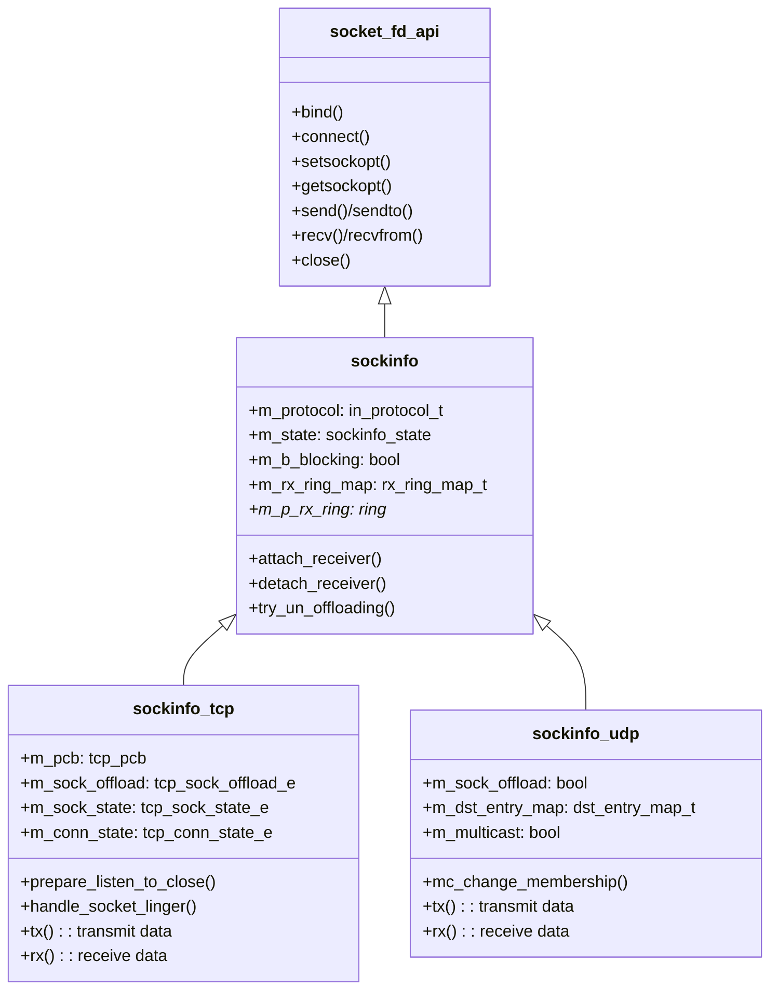

The base `socket_fd_api` class provides the interface for socket operations. The `sockinfo` class implements common functionality shared between TCP and UDP sockets, while the protocol-specific classes `sockinfo_tcp` and `sockinfo_udp` implement protocol-specific behavior.

Sources: [src/vma/sock/socket_fd_api.h](), [src/vma/sock/sockinfo.h:131-520](), [src/vma/sock/sockinfo_tcp.h:90-488](), [src/vma/sock/sockinfo_udp.h:63-262]()

## Common Socket Infrastructure

The `sockinfo` base class provides the infrastructure shared by both TCP and UDP sockets:

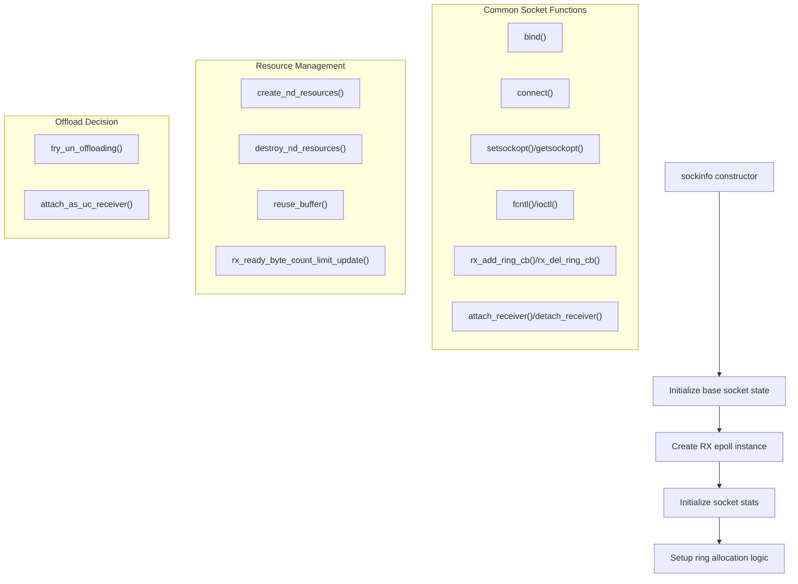

Key components of the common socket infrastructure:

1. **Socket State Management**: 
   - Socket can be in one of three states: `SOCKINFO_OPENED`, `SOCKINFO_CLOSING`, or `SOCKINFO_CLOSED`
   - Tracks blocking mode, bound address, connected address

2. **Buffer Management**:
   - Manages RX buffer pools for efficient reuse
   - Implements buffer reclamation policies

3. **Ring Management**:
   - Maps incoming flows to rings for offloaded processing
   - Manages ring allocation based on configurable logic

4. **Offload Decision Logic**:
   - Determines when sockets can be offloaded or need OS processing
   - Handles transitions between offloaded and non-offloaded states

Sources: [src/vma/sock/sockinfo.cpp:37-520](), [src/vma/sock/sockinfo.h:131-520]()

## TCP Socket Implementation

The `sockinfo_tcp` class implements TCP-specific socket behavior using the lightweight IP (LWIP) TCP stack:

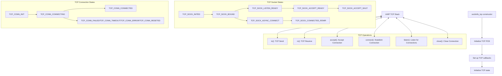

Key aspects of the TCP socket implementation:

1. **TCP State Machine**:
   - Manages socket state transitions (INITED → BOUND → LISTEN/CONNECT → etc.)
   - Separate connection state tracking (INIT → CONNECTING → CONNECTED/FAILED)

2. **LWIP Integration**:
   - Uses LWIP TCP control block (`tcp_pcb`) for TCP protocol handling
   - Registers callbacks for TCP events (data received, connection established, etc.)

3. **Connection Management**:
   - Server: handles SYN received, connections pending acceptance
   - Client: manages connection establishment and error handling

4. **Data Transfer**:
   - Send: Buffers data when needed, handles flow control
   - Receive: Processes incoming segments, manages receive window

Sources: [src/vma/sock/sockinfo_tcp.cpp:193-396](), [src/vma/sock/sockinfo_tcp.cpp:709-956](), [src/vma/sock/sockinfo_tcp.h:90-488]()

## UDP Socket Implementation

The `sockinfo_udp` class implements UDP-specific socket behavior, which is simpler than TCP as UDP is connectionless:

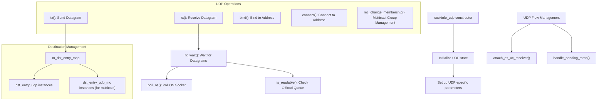

Key aspects of the UDP socket implementation:

1. **Datagram Handling**:
   - No connection state (though `connect()` can set a default destination)
   - Each datagram is an independent packet

2. **Destination Management**:
   - Maps destinations to dst_entry objects for reuse
   - Handles different types for unicast vs multicast

3. **Multicast Support**:
   - Implements multicast group membership
   - Handles source-specific multicast options

4. **Polling Strategy**:
   - Balances polling offloaded path vs. OS socket
   - Uses configurable ratio for efficiency

Sources: [src/vma/sock/sockinfo_udp.cpp:304-403](), [src/vma/sock/sockinfo_udp.cpp:710-956](), [src/vma/sock/sockinfo_udp.h:63-262]()

## Socket Operations Flow

### Binding Process

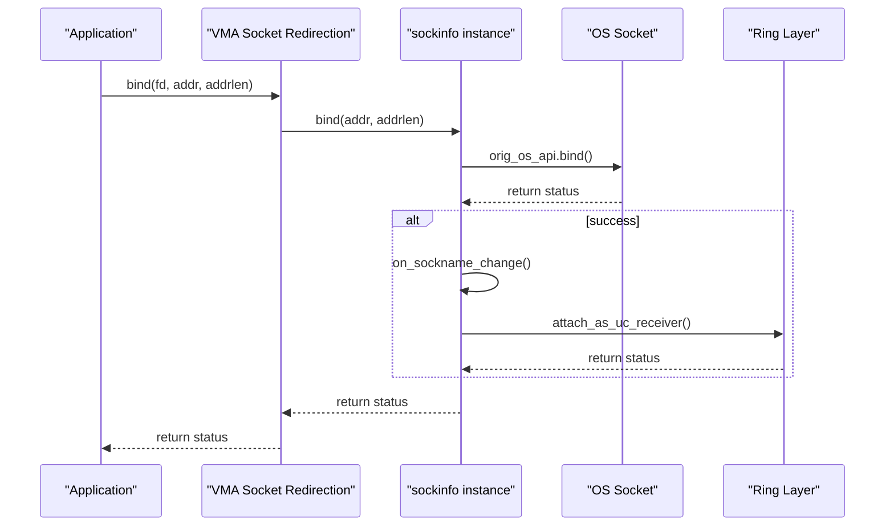

### Connection Establishment (TCP)

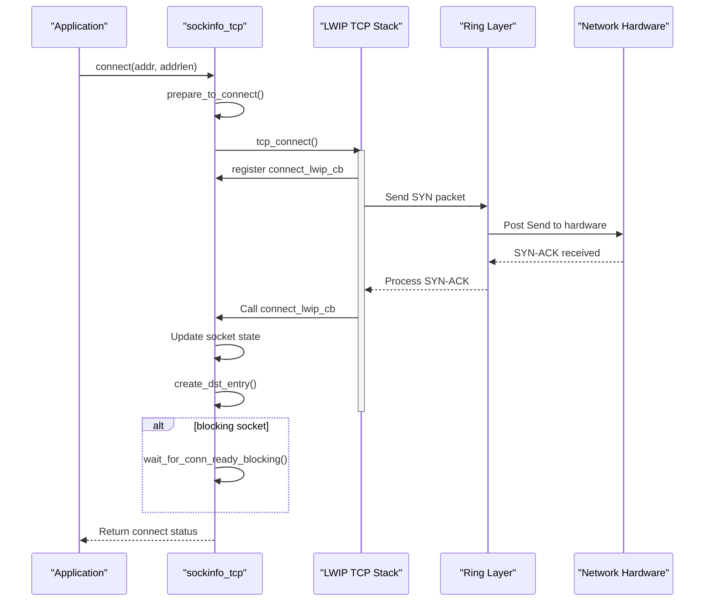

### Data Transmission (TCP)

```mermaid
sequenceDiagram
    participant App as "Application"
    participant STCP as "sockinfo_tcp"
    participant LWIP as "LWIP TCP Stack"
    participant DE as "dst_entry_tcp"
    participant Ring as "Ring Layer"
    
    App->>STCP: send(data, len)
    
    alt socket not ready to send
        STCP-->>App: Error (ENOTCONN/EPIPE)
    else socket is ready
        STCP->>STCP: lock_tcp_con()
        
        loop while data remains
            STCP->>LWIP: tcp_sndbuf() check available space
            
            alt buffer full
                STCP->>STCP: tx_wait() (may block)
            end
            
            STCP->>LWIP: tcp_write()
            LWIP->>LWIP: Process data for TCP
        end
        
        STCP->>LWIP: tcp_output()
        LWIP->>STCP: ip_output()
        STCP->>DE: prepare_to_send()
        DE->>Ring: send_ring_buffer()
        
        STCP->>STCP: unlock_tcp_con()
    end
    
    STCP-->>App: Return bytes sent
```

### Data Reception

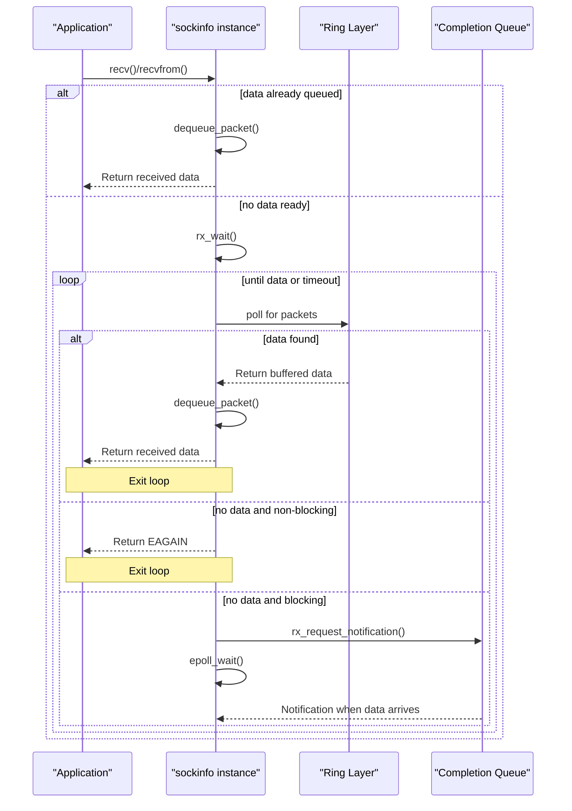

Sources: [src/vma/sock/sockinfo_tcp.cpp:709-956](), [src/vma/sock/sockinfo_udp.cpp:85-284](), [src/vma/sock/sockinfo.cpp:346-446]()

## Offloading Decision Process

The socket implementation must determine when to handle operations through the offloaded path and when to fall back to the OS. This decision depends on various factors:

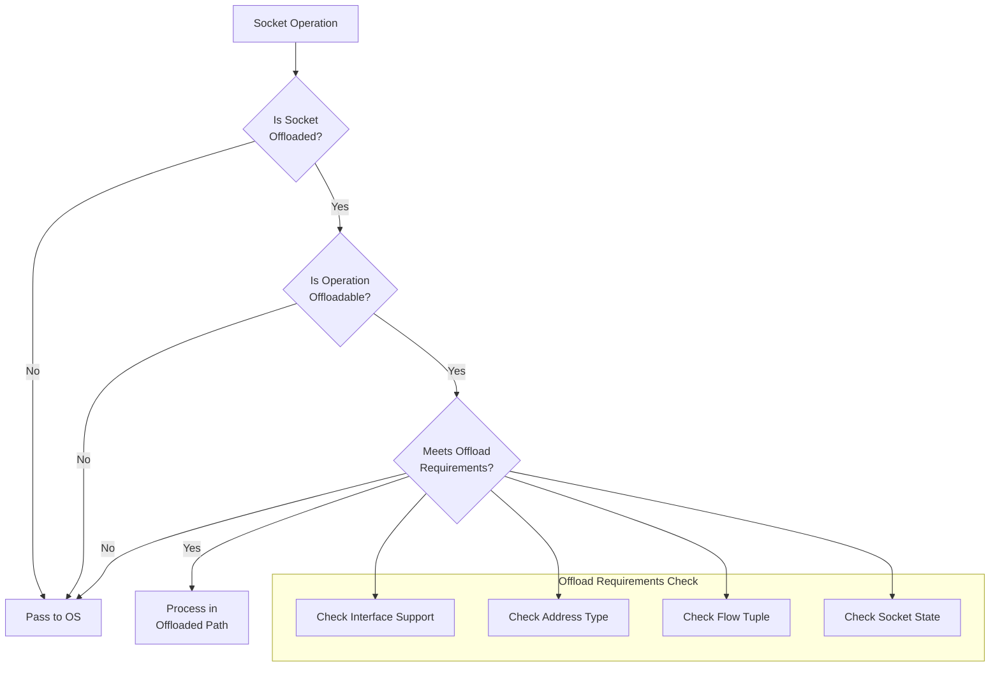

Key aspects of the offloading decision process:

1. **Initial Socket Setup**:
   - Socket starts in offloadable state (`m_sock_offload = true` for UDP, `TCP_SOCK_LWIP` for TCP)
   - Can be changed to passthrough mode (`setPassthrough()`)

2. **Operation-Specific Checks**:
   - Some operations may not be supported in offloaded mode
   - Socket options may affect offload capability

3. **Dynamic Fallback**:
   - Socket can transition to passthrough mode if conditions change
   - Implemented through `try_un_offloading()` mechanism

4. **Hardware Ring Allocation**:
   - Sockets attach to appropriate rings based on flow tuples
   - Ring allocation logic determines which ring to use for offloading

Sources: [src/vma/sock/sockinfo.cpp:532-539](), [src/vma/sock/sockinfo_tcp.h:100-104](), [src/vma/sock/sockinfo_udp.h:69-70]()

## TCP Socket State Machine

TCP sockets in VMA maintain two types of state:

1. **Socket State** (`m_sock_state`): Represents the socket API state
2. **Connection State** (`m_conn_state`): Represents the TCP connection establishment state

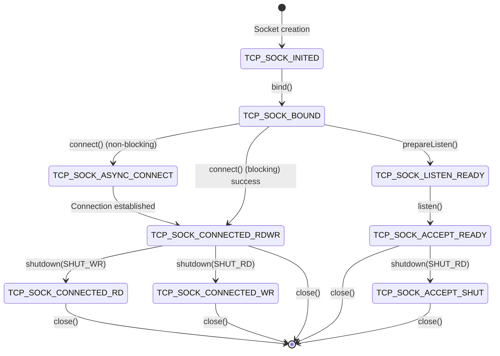

Connection State Machine:

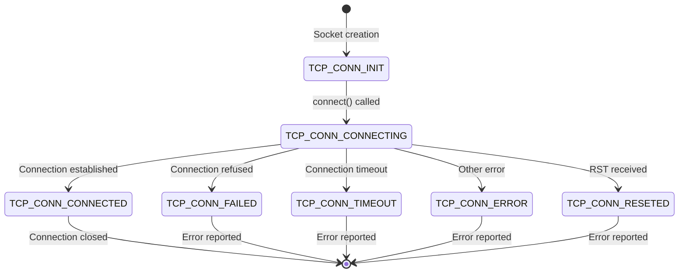

Sources: [src/vma/sock/sockinfo_tcp.h:31-60](), [src/vma/sock/sockinfo_tcp.cpp:193-290]()

## Performance Optimization Techniques

The VMA socket implementation employs several techniques to optimize performance:

1. **Buffer Management**:
   - Pre-allocated buffer pools to reduce memory allocation overhead
   - Buffer reuse policies to minimize memory operations
   - Threshold-based buffer reclamation to reduce reclamation frequency

2. **Polling Strategies**:
   - Configurable polling ratio between offloaded path and OS
   - Adaptive polling to balance CPU utilization and latency
   - Support for both blocking and non-blocking socket modes

3. **Zero-Copy Operations**:
   - Zero-copy receive path for applications that support it
   - Optimized buffer handling to minimize data copies

4. **Batching**:
   - Batch processing of multiple packets for improved efficiency
   - Configurable buffer batching modes

5. **Connection Caching**:
   - Caching of destination entries for reuse with subsequent operations
   - Flow tuple mapping for efficient packet routing

6. **Lock Optimization**:
   - Fine-grained locking for reduced contention
   - Separate locks for send and receive paths
   - Lock-free operations where possible

Sources: [src/vma/sock/sockinfo.cpp:445-481](), [src/vma/sock/sockinfo_tcp.cpp:152-191](), [src/vma/sock/sockinfo_udp.cpp:72-89]()

## Socket Implementation Tables

### Supported Socket Options

| Socket Level | Option Name | TCP Support | UDP Support | Notes |
|--------------|-------------|-------------|------------|-------|
| SOL_SOCKET | SO_REUSEADDR | ✓ | ✓ | Allows reuse of local addresses |
| SOL_SOCKET | SO_REUSEPORT | ✓ | ✓ | Allows multiple sockets to bind to same port |
| SOL_SOCKET | SO_RCVBUF | ✓ | ✓ | Sets receive buffer size |
| SOL_SOCKET | SO_SNDBUF | ✓ | ✓ | Sets send buffer size |
| SOL_SOCKET | SO_LINGER | ✓ | ✓ | Controls socket closure behavior |
| SOL_SOCKET | SO_BINDTODEVICE | ✓ | ✓ | Binds socket to specific device |
| SOL_SOCKET | SO_TIMESTAMP | ✓ | ✓ | Enables timestamp generation |
| SOL_SOCKET | SO_TIMESTAMPNS | ✓ | ✓ | Enables nanosecond timestamp generation |
| SOL_SOCKET | SO_MAX_PACING_RATE | ✓ | ✓ | Controls packet pacing |
| IPPROTO_IP | IP_TTL | ✓ | ✓ | Sets IP Time-To-Live value |
| IPPROTO_IP | IP_MULTICAST_TTL | ✗ | ✓ | Sets multicast TTL value |
| IPPROTO_IP | IP_MULTICAST_IF | ✗ | ✓ | Sets outgoing multicast interface |
| IPPROTO_IP | IP_MULTICAST_LOOP | ✗ | ✓ | Controls multicast loopback |
| IPPROTO_IP | IP_ADD_MEMBERSHIP | ✗ | ✓ | Joins multicast group |
| IPPROTO_IP | IP_DROP_MEMBERSHIP | ✗ | ✓ | Leaves multicast group |
| IPPROTO_TCP | TCP_NODELAY | ✓ | ✗ | Disables Nagle's algorithm |
| IPPROTO_TCP | TCP_KEEPALIVE | ✓ | ✗ | Controls TCP keepalive |
| IPPROTO_TCP | TCP_KEEPIDLE | ✓ | ✗ | Controls TCP keepalive idle time |

Sources: [src/vma/sock/sockinfo_tcp.cpp:60-97](), [src/vma/sock/sockinfo_udp.cpp:640-788](), [src/vma/sock/sockinfo.cpp:309-497]()

### Method Comparison Between TCP and UDP Implementation

| Operation | sockinfo_tcp | sockinfo_udp | Notes |
|-----------|--------------|--------------|-------|
| State Tracking | Complex (socket + connection state) | Simple | TCP maintains extensive state |
| Buffer Management | Managed by LWIP | Direct buffer handling | TCP relies on LWIP for buffering |
| Connection Management | Explicit connection setup | Connectionless | TCP requires handshake |
| Error Handling | Various error conditions | Simpler error handling | TCP has more failure modes |
| Flow Control | Window-based | None | TCP implements flow control |
| Reliability | Retransmissions | None | TCP ensures reliable delivery |
| Multicast | Not supported | Fully supported | UDP implements multicast handling |
| Protocol Integration | LWIP | Direct implementation | TCP uses external TCP stack (LWIP) |

Sources: [src/vma/sock/sockinfo_tcp.h:90-488](), [src/vma/sock/sockinfo_udp.h:63-262]()

---

