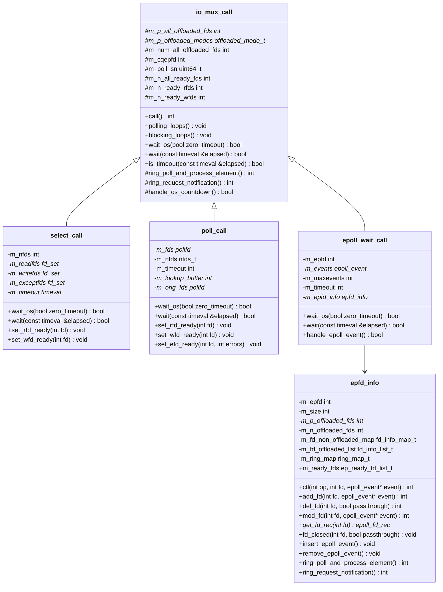
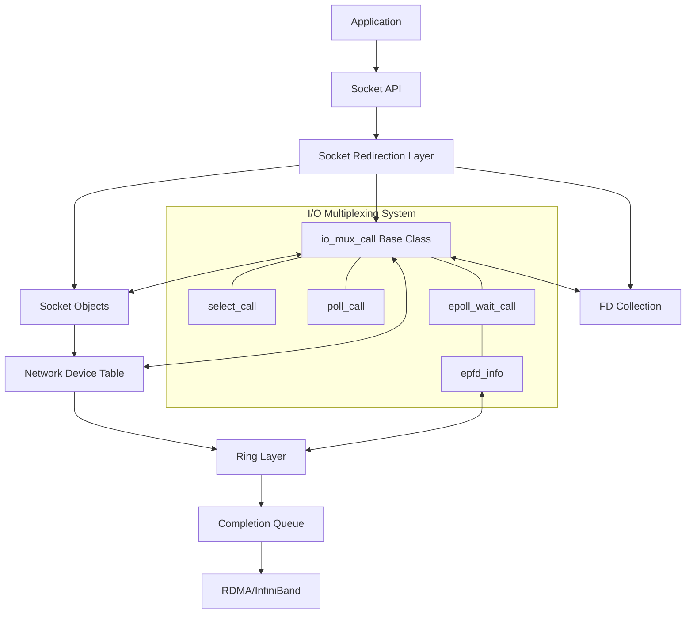
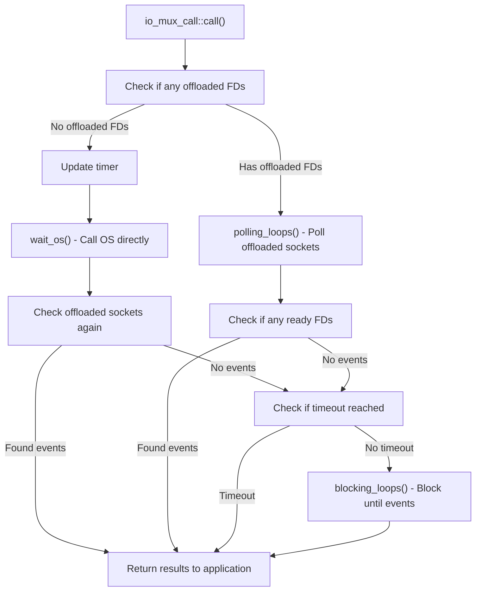
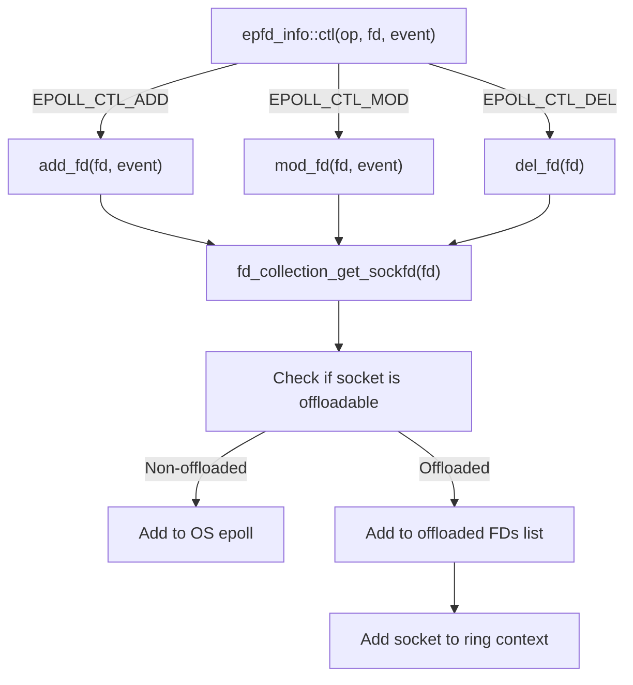
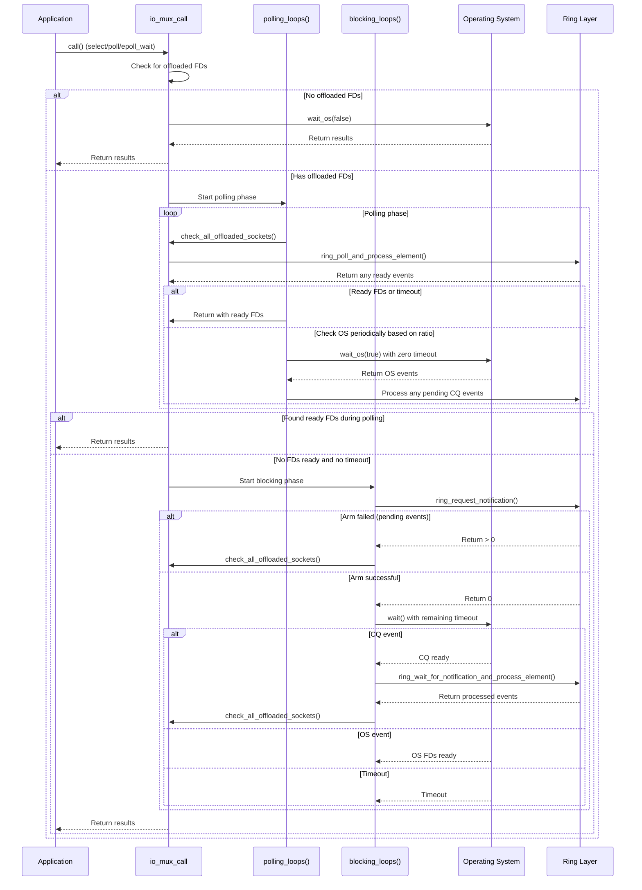

<!-- source: DeepWiki mcp.deepwiki.com · repo Mellanox/libvma · page 2.3 I/O Multiplexing · fetched 2026-11-11 -->

# I/O Multiplexing

<details>
<summary>Relevant source files</summary>

The following files were used as context for generating this wiki page:

- [README](README)
- [src/vma/iomux/epfd_info.cpp](src/vma/iomux/epfd_info.cpp)
- [src/vma/iomux/epfd_info.h](src/vma/iomux/epfd_info.h)
- [src/vma/iomux/epoll_wait_call.cpp](src/vma/iomux/epoll_wait_call.cpp)
- [src/vma/iomux/epoll_wait_call.h](src/vma/iomux/epoll_wait_call.h)
- [src/vma/iomux/io_mux_call.cpp](src/vma/iomux/io_mux_call.cpp)
- [src/vma/iomux/io_mux_call.h](src/vma/iomux/io_mux_call.h)
- [src/vma/iomux/poll_call.cpp](src/vma/iomux/poll_call.cpp)
- [src/vma/iomux/poll_call.h](src/vma/iomux/poll_call.h)
- [src/vma/iomux/select_call.cpp](src/vma/iomux/select_call.cpp)
- [src/vma/lwip/cc_cubic.h](src/vma/lwip/cc_cubic.h)
- [src/vma/util/hash_map.inl](src/vma/util/hash_map.inl)

</details>


## Introduction

I/O Multiplexing in VMA refers to the optimized implementation of standard POSIX I/O multiplexing functions (`select()`, `poll()`, and `epoll_wait()`) that allow applications to monitor multiple file descriptors for I/O events. VMA enhances these operations by leveraging hardware offloading capabilities and optimizing the notification path, resulting in reduced latency and improved throughput for networking applications.

This page covers the internal architecture of VMA's I/O multiplexing implementation, its integration with other VMA components, and the flow of operations when handling multiplexing calls. For information about the Socket Redirection layer, see [Socket Redirection](#2.1), and for Socket Implementation details, see [Socket Implementation](#2.2).

Sources: [src/vma/iomux/io_mux_call.h:36-42](), [README:189-146]()

## Architecture Overview

VMA's I/O multiplexing implementation is built around a base class (`io_mux_call`) that provides common functionality for all multiplexing types, with specialized derived classes for each specific system call type. The system is designed to work with both offloaded and non-offloaded sockets, providing seamless compatibility with applications using standard socket APIs.



Sources: [src/vma/iomux/io_mux_call.h:40-272](), [src/vma/iomux/epoll_wait_call.h:22-102](), [src/vma/iomux/epfd_info.h:21-129](), [src/vma/iomux/poll_call.h:18-73]()

## Integration with VMA System

I/O Multiplexing is a critical component that bridges the Socket Layer with the hardware acceleration capabilities of VMA. The following diagram shows how I/O Multiplexing fits into the overall VMA architecture:



Sources: [src/vma/iomux/io_mux_call.cpp:514-529](), [src/vma/iomux/epfd_info.cpp:280-348]()

## Core I/O Multiplexing Base

The `io_mux_call` class serves as the foundation for all I/O multiplexing implementations in VMA. It implements a three-phase approach to handle multiplexing operations efficiently:

1. **Direct OS Path**: If there are no offloaded sockets, VMA simply forwards the call to the OS.
2. **Polling Phase**: If there are offloaded sockets, VMA first polls them for a configurable period to check for ready events without blocking.
3. **Blocking Phase**: If no events are detected after polling, VMA blocks waiting for events from either offloaded sockets or the OS.

The main entry point is the `call()` method, which orchestrates this three-phase approach:



Sources: [src/vma/iomux/io_mux_call.cpp:438-485](), [src/vma/iomux/io_mux_call.cpp:250-371](), [src/vma/iomux/io_mux_call.cpp:373-436]()

## Multiplexing Implementation Types

VMA provides specialized implementations for each of the standard I/O multiplexing system calls:

### select_call

The `select_call` class implements the VMA version of the `select()` system call. It translates between the fd_set structures used by select() and VMA's internal representation.

Key features:
- Handles the fd_set structures for read, write, and exception events
- Maintains copies of original fd_sets to restore before OS calls
- Implements select-specific timeout handling using timevals

Sources: [src/vma/iomux/select_call.cpp:28-115](), [src/vma/iomux/select_call.cpp:201-261]()

### poll_call

The `poll_call` class implements the VMA version of the `poll()` system call. It works with pollfd structures and manages the complexities of poll event flags.

Key features:
- Manages arrays of pollfd structures
- Maintains a lookup buffer to efficiently map between different representations
- Implements poll-specific timeout handling using milliseconds

Sources: [src/vma/iomux/poll_call.cpp:21-90](), [src/vma/iomux/poll_call.cpp:131-175]()

### epoll_wait_call

The `epoll_wait_call` class implements the VMA version of the `epoll_wait()` system call. It works with `epfd_info` to manage epoll file descriptors and handle event notifications.

Key features:
- Interacts with `epfd_info` to manage epoll state
- Handles epoll_event structures for returning events
- Supports edge-triggered and level-triggered event semantics
- Efficiently processes completion queue events

Sources: [src/vma/iomux/epoll_wait_call.cpp:21-37](), [src/vma/iomux/epoll_wait_call.cpp:138-235]()

## Epoll File Descriptor Management

The `epfd_info` class is central to epoll support in VMA. It manages epoll file descriptors and their associated events, maintaining the state necessary for efficient event handling.

Key responsibilities:
- Maintaining lists of offloaded and non-offloaded file descriptors
- Handling epoll control operations (add, modify, delete)
- Managing ready file descriptors and events
- Coordinating with the ring layer for hardware-accelerated event notification

```mermaid
sequenceDiagram
    participant App as Application
    participant EpollWait as epoll_wait_call
    participant EpfdInfo as epfd_info
    participant Socket as socket_fd_api
    participant Ring as ring_layer
    
    App->>EpollWait: epoll_wait(epfd, events, maxevents, timeout)
    EpollWait->>EpfdInfo: get_offloaded_fds_arr_and_size()
    EpfdInfo-->>EpollWait: offloaded FDs array and count
    
    EpollWait->>EpfdInfo: ring_poll_and_process_element()
    EpfdInfo->>Ring: poll_and_process_element_rx()
    Ring-->>EpfdInfo: Return processed events
    
    EpollWait->>EpfdInfo: get_current_events()
    EpfdInfo->>Socket: is_readable()/is_writeable()
    Socket-->>EpfdInfo: Readiness status
    
    alt Ready events found
        EpfdInfo-->>EpollWait: Ready events
        EpollWait-->>App: Return events
    else No events and timeout not reached
        EpollWait->>EpfdInfo: ring_request_notification()
        EpfdInfo->>Ring: request_notification()
        Ring-->>EpfdInfo: Notification status
        
        EpollWait->>+EpollWait: _wait(timeout)
        EpollWait->>+EpfdInfo: going_to_sleep()
        EpollWait->>+OS: epoll_wait/epoll_pwait
        OS-->>-EpollWait: OS events
        EpollWait->>-EpfdInfo: return_from_sleep()
        
        alt CQ ready
            EpollWait->>EpfdInfo: ring_wait_for_notification_and_process_element()
            EpfdInfo->>Ring: wait_for_notification_and_process_element()
            Ring-->>EpfdInfo: Processed events
        end
        
        EpollWait->>EpfdInfo: get_current_events()
        EpfdInfo-->>EpollWait: Ready events
        EpollWait-->>-App: Return events
    end
```

Sources: [src/vma/iomux/epfd_info.cpp:30-110](), [src/vma/iomux/epfd_info.cpp:112-144](), [src/vma/iomux/epfd_info.cpp:545-565]()

### Epoll Control Operations

The `epfd_info` class implements the core functionality for managing epoll file descriptors through three main operations:

1. **add_fd**: Adds a new file descriptor to the epoll instance, distinguishing between offloaded and non-offloaded sockets.
2. **mod_fd**: Modifies the event settings for an existing file descriptor.
3. **del_fd**: Removes a file descriptor from the epoll instance.

These operations are coordinated through the `ctl()` method, which maps directly to the `epoll_ctl()` system call:



Sources: [src/vma/iomux/epfd_info.cpp:166-278](), [src/vma/iomux/epfd_info.cpp:356-427](), [src/vma/iomux/epfd_info.cpp:430-505]()

## Operational Flow Details

The operational flow of an I/O multiplexing call in VMA depends on the presence of offloaded sockets and the system configuration. The following sequence diagram illustrates the detailed flow for a typical call:



Sources: [src/vma/iomux/io_mux_call.cpp:438-485](), [src/vma/iomux/io_mux_call.cpp:250-371](), [src/vma/iomux/io_mux_call.cpp:373-436]()

## Performance Considerations

VMA's I/O multiplexing implementation includes several features designed to maximize performance:

### 1. Polling Strategy

VMA implements an intelligent polling strategy that balances CPU usage with responsiveness. The polling duration and behavior can be configured through several parameters:

- `VMA_SELECT_POLL`: Controls the polling duration (in microseconds) for select() calls
- `VMA_RX_POLL`: Controls the polling behavior for receive operations
- `VMA_SELECT_POLL_OS_RATIO`: Controls how frequently VMA checks for OS events during polling

### 2. Completion Queue Integration

VMA integrates tightly with the RDMA/InfiniBand completion queue mechanism for efficient event notification:

- Registers completion queue file descriptors with the OS
- Uses completion queue polling to detect hardware events efficiently
- Provides completion queue moderation options for balancing latency and CPU usage

### 3. OS Interaction Control

VMA provides fine-grained control over interactions with the OS:

- `VMA_SELECT_POLL_OS_FORCE`: Forces OS polling regardless of offloaded socket status
- `VMA_SELECT_SKIP_OS`: Controls when VMA skips checking OS sockets entirely
- Balance between offloaded processing and OS fallback

### 4. Statistics Collection

VMA collects detailed statistics about I/O multiplexing operations, enabling performance analysis and optimization:

- Counts of poll hits and misses
- CPU usage during polling
- Ready file descriptor counts
- Timeout statistics

Sources: [README:142-145](), [README:274-281](), [src/vma/iomux/io_mux_call.cpp:734-757]()

## Summary

VMA's I/O multiplexing implementation enhances the standard POSIX functions (`select()`, `poll()`, `epoll_wait()`) by integrating them with hardware offloading capabilities. The three-phase approach (direct OS, polling, blocking) balances performance with functionality, providing applications with improved networking performance while maintaining API compatibility.

Key benefits include:
- Reduced latency through intelligent polling and hardware integration
- Improved throughput by efficiently handling multiple sockets
- Seamless compatibility with existing applications
- Configurable behavior to match workload characteristics
- Integration with VMA's overall performance optimization strategy

Through this implementation, VMA delivers substantial performance benefits for message-based and streaming applications without requiring changes to the application code.

Sources: [src/vma/iomux/io_mux_call.h:36-53](), [README:6-16]()

---

