<!-- source: DeepWiki mcp.deepwiki.com · repo Mellanox/libvma · page 3 Network Layer · fetched 2026-11-11 -->

# Network Layer

<details>
<summary>Relevant source files</summary>

The following files were used as context for generating this wiki page:

- [src/vma/dev/net_device_table_mgr.cpp](src/vma/dev/net_device_table_mgr.cpp)
- [src/vma/dev/net_device_table_mgr.h](src/vma/dev/net_device_table_mgr.h)
- [src/vma/dev/net_device_val.cpp](src/vma/dev/net_device_val.cpp)
- [src/vma/dev/net_device_val.h](src/vma/dev/net_device_val.h)
- [src/vma/infra/sender.h](src/vma/infra/sender.h)
- [src/vma/proto/dst_entry.cpp](src/vma/proto/dst_entry.cpp)
- [src/vma/proto/dst_entry.h](src/vma/proto/dst_entry.h)
- [src/vma/proto/dst_entry_tcp.cpp](src/vma/proto/dst_entry_tcp.cpp)
- [src/vma/proto/dst_entry_tcp.h](src/vma/proto/dst_entry_tcp.h)
- [src/vma/proto/dst_entry_udp.cpp](src/vma/proto/dst_entry_udp.cpp)
- [src/vma/proto/dst_entry_udp.h](src/vma/proto/dst_entry_udp.h)
- [src/vma/proto/igmp_handler.cpp](src/vma/proto/igmp_handler.cpp)
- [src/vma/proto/neighbour.cpp](src/vma/proto/neighbour.cpp)
- [src/vma/proto/neighbour.h](src/vma/proto/neighbour.h)
- [src/vma/proto/netlink_socket_mgr.h](src/vma/proto/netlink_socket_mgr.h)
- [src/vma/proto/route_table_mgr.cpp](src/vma/proto/route_table_mgr.cpp)
- [src/vma/proto/route_table_mgr.h](src/vma/proto/route_table_mgr.h)
- [src/vma/proto/rule_table_mgr.cpp](src/vma/proto/rule_table_mgr.cpp)
- [src/vma/proto/rule_table_mgr.h](src/vma/proto/rule_table_mgr.h)
- [src/vma/proto/rule_val.cpp](src/vma/proto/rule_val.cpp)
- [src/vma/proto/rule_val.h](src/vma/proto/rule_val.h)
- [src/vma/util/utils.cpp](src/vma/util/utils.cpp)
- [src/vma/util/utils.h](src/vma/util/utils.h)

</details>


The Network Layer in VMA (Versatile Message Accelerator) is responsible for managing network devices, handling routing decisions, resolving network addresses, and facilitating high-performance packet transmission. It sits between the [Socket Layer](#2) and the [Hardware Abstraction Layer](#4), providing critical networking functionality while enabling RDMA/InfiniBand acceleration.

## Component Overview

The Network Layer consists of four main subsystems:

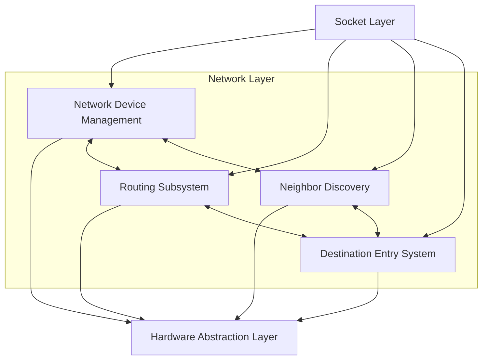

Sources:
- [src/vma/dev/net_device_table_mgr.h:28-104]()
- [src/vma/proto/route_table_mgr.h:32-60]()
- [src/vma/proto/neighbour.h:32-101]()
- [src/vma/proto/dst_entry.h:44-162]()

## Network Device Management

The Network Device Management subsystem discovers, initializes, and manages network interfaces that VMA can use for acceleration. It maintains a database of available devices and their capabilities.

### Core Components

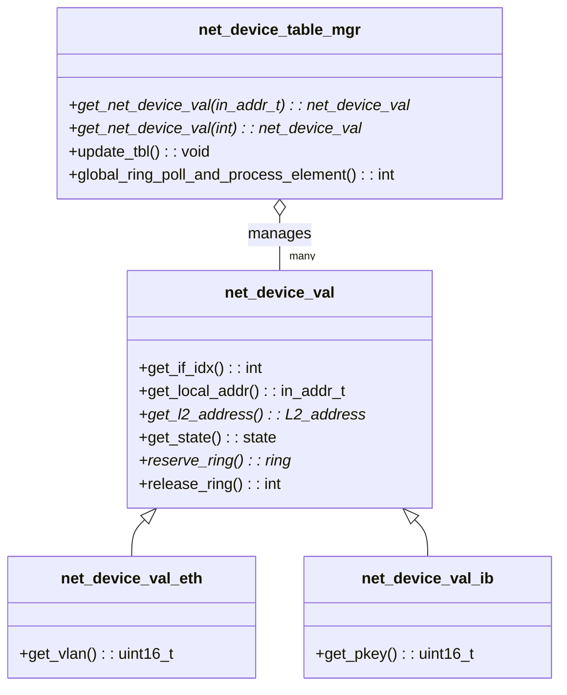

Sources:
- [src/vma/dev/net_device_val.h:156-294]()
- [src/vma/dev/net_device_table_mgr.h:28-104]()

### Device Discovery Process

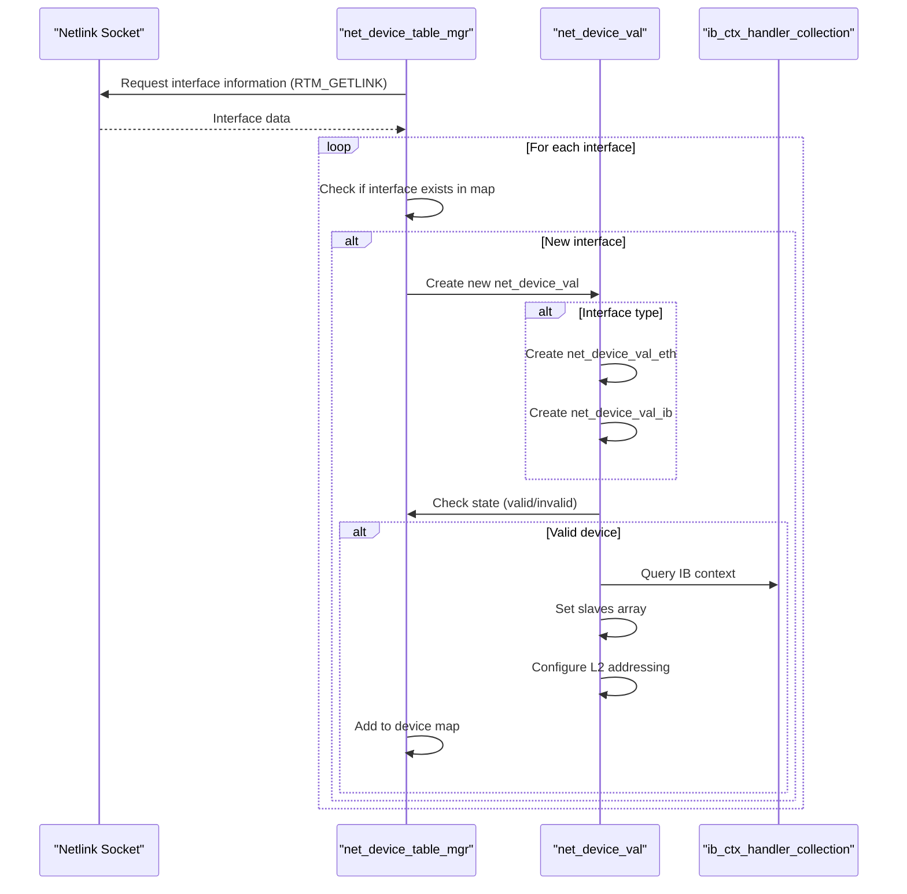

Sources:
- [src/vma/dev/net_device_table_mgr.cpp:148-261]()
- [src/vma/dev/net_device_val.cpp:155-286]()

The network device management system uses netlink sockets to discover network interfaces, creating `net_device_val` objects for each valid device. Each object represents an interface that can be used for offloaded operations, maintaining information about:

- IP addresses assigned to the interface
- L2 (MAC/link) addresses 
- Interface state and capabilities
- Bond configurations (for bonded interfaces)
- Associated InfiniBand contexts

Each network device also manages "rings" - abstractions of hardware queues used for packet transmission and reception.

```
Interface States:
- DOWN: Interface exists but is down
- UP: Interface is up but not running
- RUNNING: Interface is fully operational
- INVALID: Interface cannot be used for offloading
```

Sources:
- [src/vma/dev/net_device_val.h:159-164]()
- [src/vma/dev/net_device_val.cpp:539-642]()

## Routing Subsystem

The Routing Subsystem determines the appropriate next-hop and outgoing interface for packet transmission based on destination address and other parameters.

### Core Components

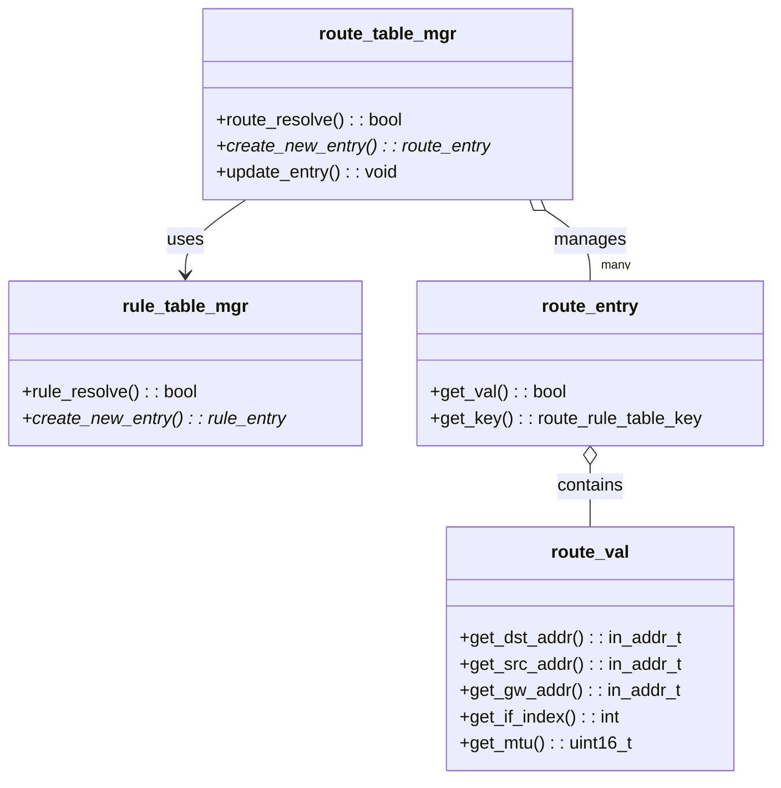

Sources:
- [src/vma/proto/route_table_mgr.h:32-60]()
- [src/vma/proto/rule_table_mgr.h:21-28]()

### Route Resolution Process

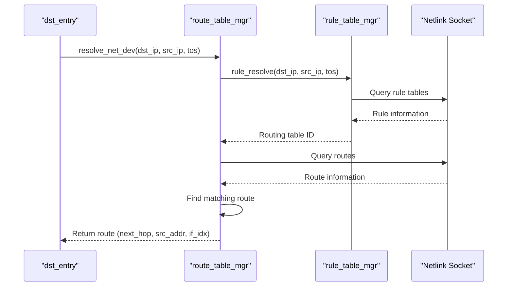

Sources:
- [src/vma/proto/dst_entry.cpp:199-248]()
- [src/vma/proto/route_table_mgr.cpp:223-266]()

The routing subsystem maintains a cache of the kernel's routing tables and rules, updated through netlink events. When determining how to route a packet, the system:

1. First consults the rule table (via `rule_table_mgr`) to determine which routing table to use
2. Then consults the appropriate routing table (via `route_table_mgr`) to find the best route
3. Returns routing information including:
   - Next-hop address (gateway, if applicable)
   - Source address to use
   - Outgoing interface index
   - Path MTU

The routing subsystem uses the Observer pattern to notify interested components about route changes.

Sources:
- [src/vma/proto/route_table_mgr.cpp:96-176]()
- [src/vma/proto/rule_table_mgr.cpp:45-57]()

## Neighbor Discovery

The Neighbor Discovery system resolves network layer addresses (IPv4) to link layer addresses (MAC/InfiniBand GID) and manages the neighbor cache.

### Core Components

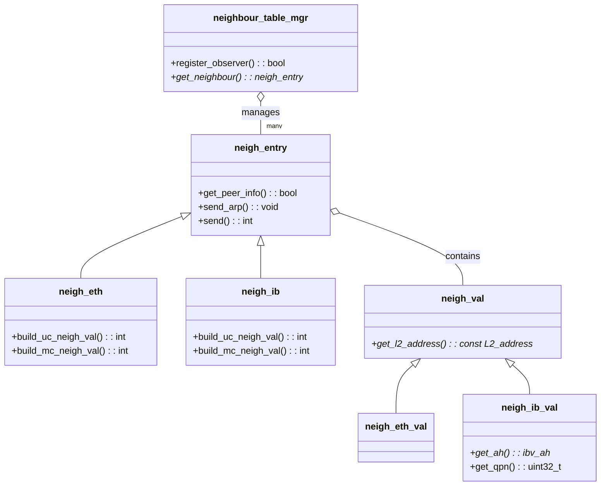

Sources:
- [src/vma/proto/neighbour.h:32-101]()
- [src/vma/proto/neighbour.cpp:54-235]()

### Neighbor Resolution Process

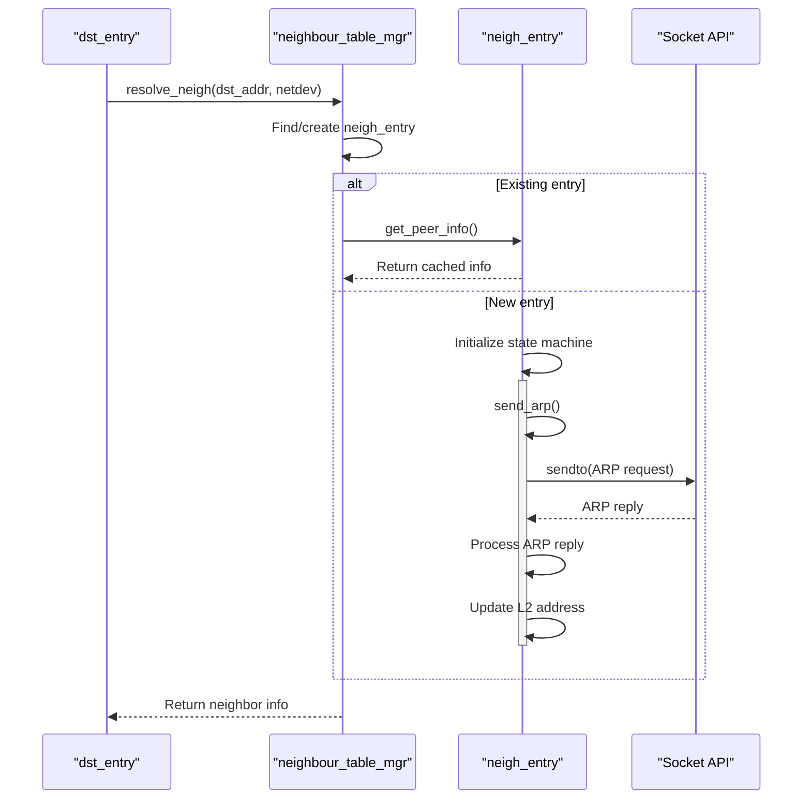

Sources:
- [src/vma/proto/dst_entry.cpp:252-276]()
- [src/vma/proto/neighbour.cpp:320-365]()

The neighbor discovery system resolves IP addresses to link-layer addresses (MAC addresses for Ethernet, GIDs for InfiniBand). Key functions include:

1. Sending ARP requests for address resolution
2. Processing ARP replies to update the neighbor cache
3. Managing a state machine for each neighbor entry
4. Providing L2 addressing information to the destination entry system

For Ethernet neighbors, the system resolves MAC addresses. For InfiniBand neighbors, it resolves additional information such as Queue Pair Numbers (QPN) and Address Handles (AH) needed for RDMA operations.

Neighbor entries have a state machine that tracks:
- Initial resolution state
- Active resolution state (ARP in progress)
- Ready state (address resolved)
- Error states

Sources:
- [src/vma/proto/neighbour.cpp:54-129]()
- [src/vma/proto/neighbour.cpp:320-365]()

## Destination Entry System

The Destination Entry system manages connections to remote endpoints and handles packet transmission, tying together the routing and neighbor discovery components.

### Core Components

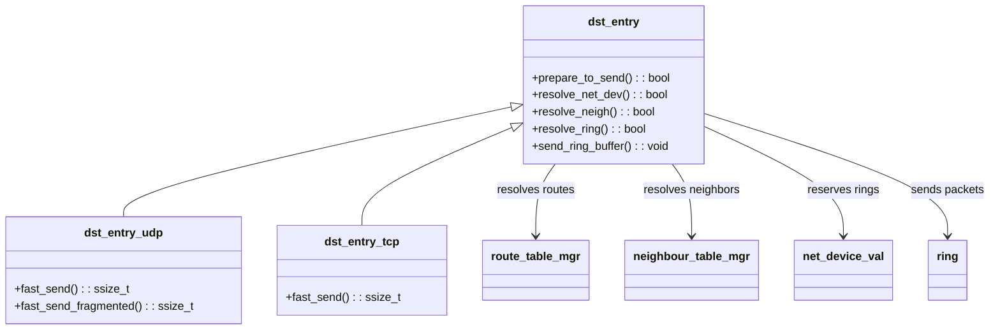

Sources:
- [src/vma/proto/dst_entry.h:44-162]()
- [src/vma/proto/dst_entry_tcp.h:13-16]()
- [src/vma/proto/dst_entry_udp.h:13-16]()

### Packet Transmission Process

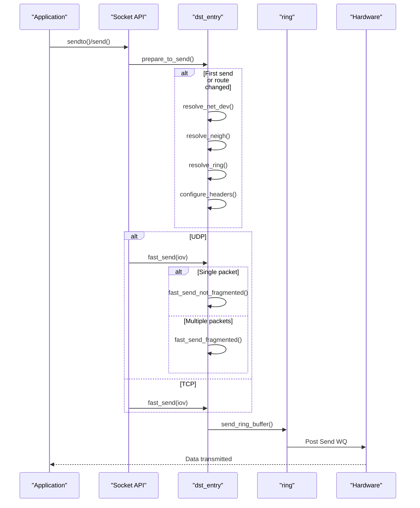

Sources:
- [src/vma/proto/dst_entry.cpp:85-175]()
- [src/vma/proto/dst_entry_udp.cpp:54-153]()
- [src/vma/proto/dst_entry_tcp.cpp:45-184]()

The destination entry system is responsible for:

1. Creating and managing destination entries for each remote endpoint
2. Resolving the route to the destination
3. Resolving the neighbor (L2 address) for the next hop
4. Allocating and managing rings for packet transmission
5. Preparing packet headers (L2, IP, UDP/TCP)
6. Handling packet fragmentation for large UDP datagrams
7. Managing TCP segmentation and acknowledgment

Each protocol (UDP/TCP) has specialized destination entry classes that handle protocol-specific requirements:

- `dst_entry_udp`: Handles UDP packet transmission, including fragmentation
- `dst_entry_tcp`: Handles TCP packet transmission, including segmentation

Sources:
- [src/vma/proto/dst_entry.cpp:199-248]()
- [src/vma/proto/dst_entry.cpp:252-276]()
- [src/vma/proto/dst_entry_udp.cpp:155-302]()

## Network Data Flow

This section illustrates how the network layer components work together to process packets.

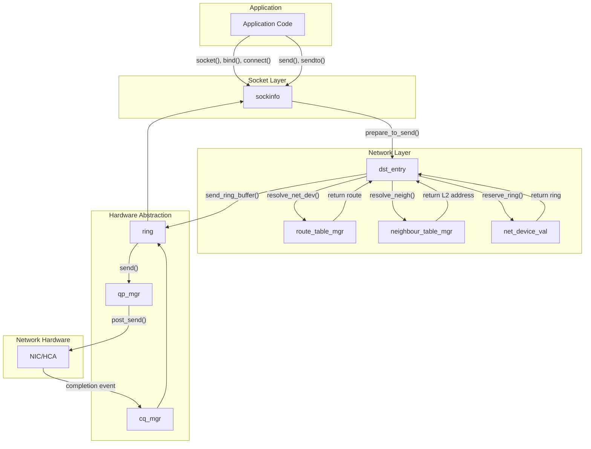

Sources:
- [src/vma/proto/dst_entry.cpp:53-107]()
- [src/vma/proto/dst_entry_udp.cpp:54-153]()
- [src/vma/dev/net_device_val.cpp:946-992]()

### Outbound Packet Path

For outbound packets, the flow is:

1. Application calls send/sendto/write on a socket
2. Socket layer creates a destination entry if one doesn't exist
3. Destination entry resolves:
   - Route to destination via route_table_mgr
   - Next-hop link address via neighbour_table_mgr
   - Network device and ring via net_device_val
4. Destination entry prepares packet headers
5. Destination entry sends packet via ring
6. Ring posts send request to hardware
7. Hardware transmits packet

### UDP vs TCP Handling

| Feature | UDP Handling | TCP Handling |
|---------|-------------|-------------|
| Fragmentation | Handled by dst_entry_udp | N/A (TCP segments) |
| Checksum | Hardware or software | Hardware or software |
| Header preparation | Per-packet | Connection-based |
| Retransmission | None | Handled by TCP stack |
| Memory management | Buffer pools | Zero-copy when possible |

Sources:
- [src/vma/proto/dst_entry_udp.cpp:155-302]()
- [src/vma/proto/dst_entry_tcp.cpp:44-184]()

## Network Layer Integration

The Network Layer integrates with other VMA components to provide a complete networking solution:

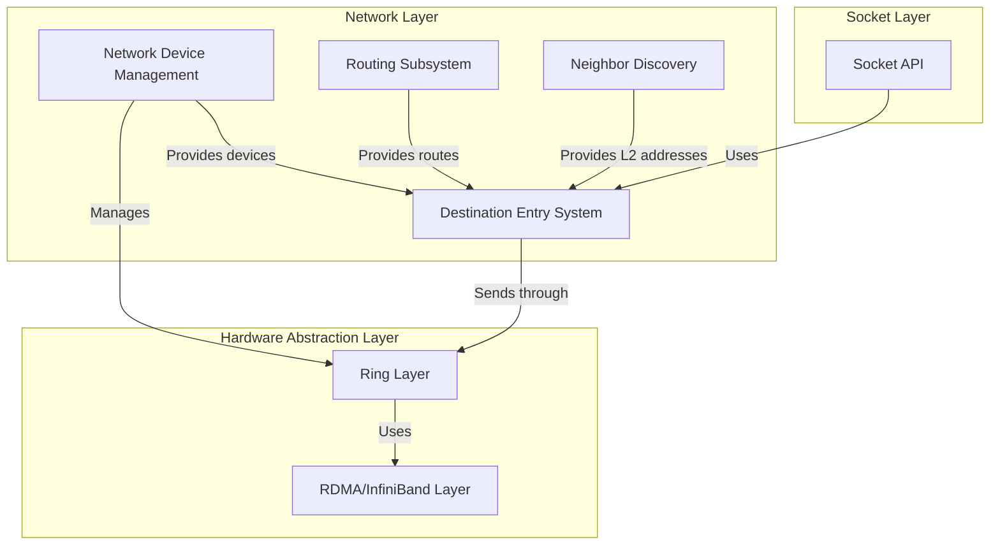

Sources:
- [src/vma/dev/net_device_table_mgr.cpp:274-290]()
- [src/vma/proto/dst_entry.cpp:252-276]()

The Network Layer's components work together to provide:

1. Transparent acceleration of network traffic
2. Efficient memory management through buffer pooling
3. Hardware offload capabilities for checksum and segmentation
4. Integration with RDMA/InfiniBand features
5. Support for various network configurations (bonding, VLANs, etc.)

By abstracting these networking details, the VMA library allows applications to benefit from high-performance networking without code changes.

---

