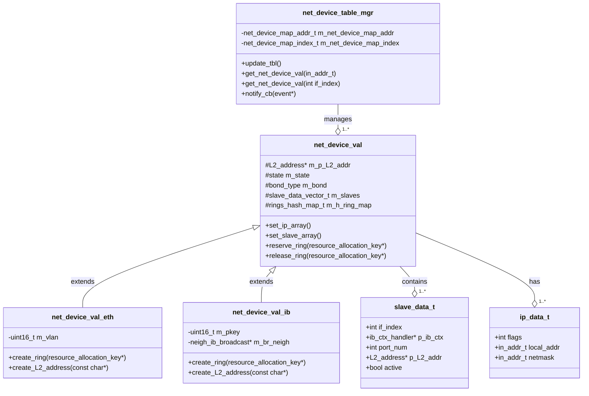
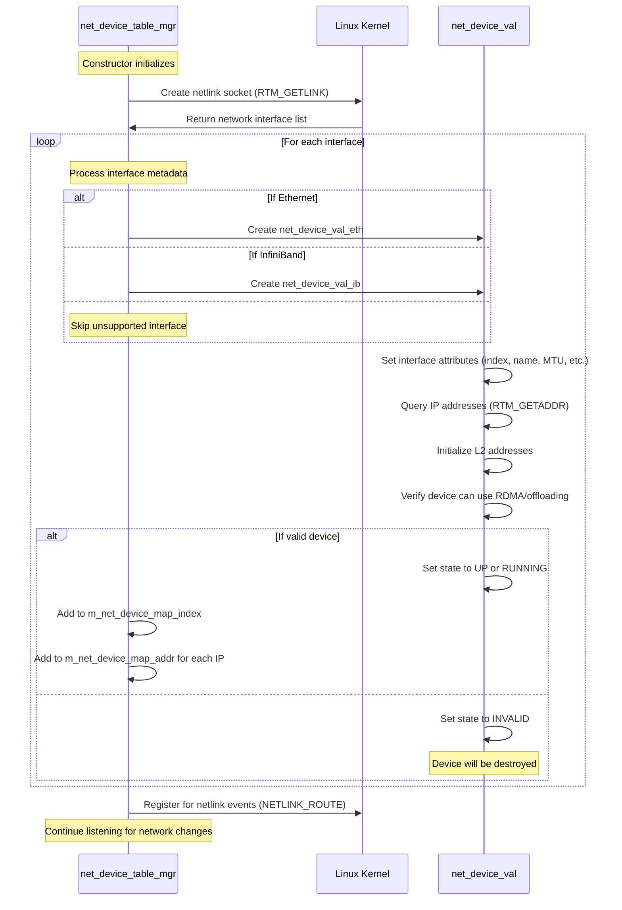
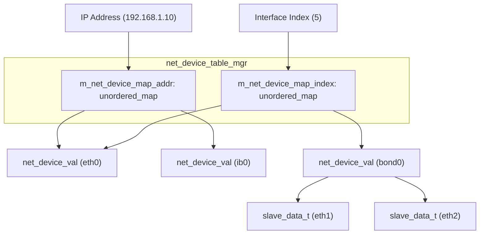
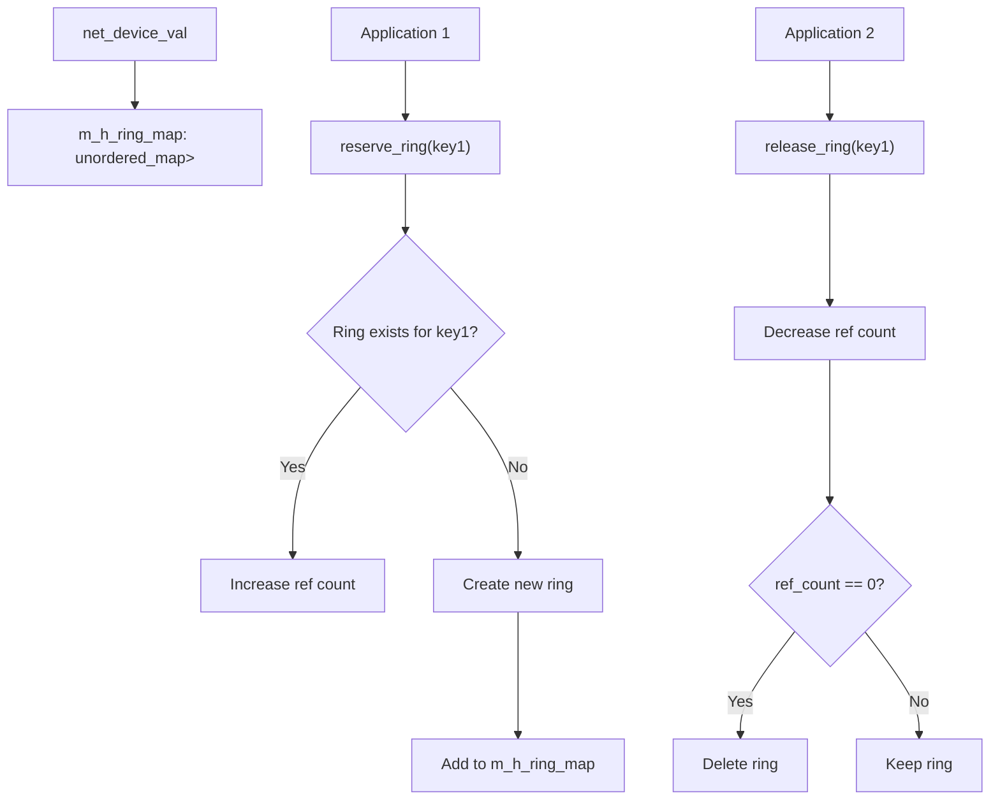
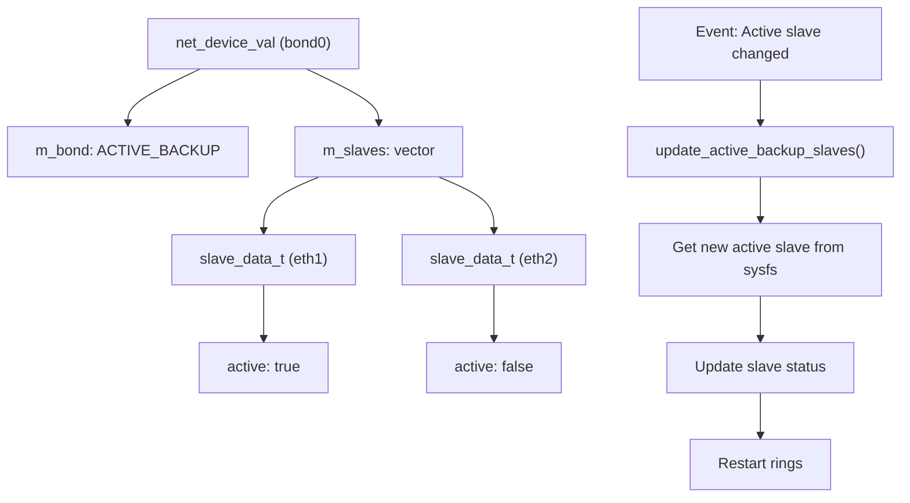
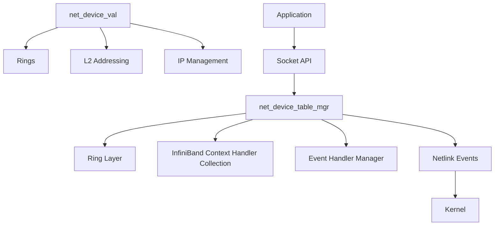

<!-- source: DeepWiki mcp.deepwiki.com · repo Mellanox/libvma · page 3.1 Network Device Management · fetched 2026-11-11 -->

# Network Device Management

Relevant source files

The following files were used as context for generating this wiki page:

- [src/vma/dev/net_device_table_mgr.cpp](src/vma/dev/net_device_table_mgr.cpp)
- [src/vma/dev/net_device_table_mgr.h](src/vma/dev/net_device_table_mgr.h)
- [src/vma/dev/net_device_val.cpp](src/vma/dev/net_device_val.cpp)
- [src/vma/dev/net_device_val.h](src/vma/dev/net_device_val.h)
- [src/vma/util/utils.cpp](src/vma/util/utils.cpp)
- [src/vma/util/utils.h](src/vma/util/utils.h)

## Purpose and Scope

This page documents the Network Device Management subsystem within VMA (Versatile Message Accelerator), which is responsible for discovering, tracking, and managing network interfaces in the system. The subsystem provides abstractions for different types of network devices (Ethernet, InfiniBand) and supports advanced configurations like bonding and VLAN. It serves as a foundation for VMA's ability to offload network traffic to RDMA-capable hardware while maintaining a standard socket API.

For information about individual rings and queues that operate on network devices, see [Ring Management](#4.3). For routing decisions and neighbor discovery, see [Routing](#3.3) and [Neighbor Discovery](#3.2) respectively.

## Network Device Management Architecture

The Network Device Management subsystem consists of two primary components:

1. **Network Device Representation** - Classes that model network interfaces and their capabilities
2. **Network Device Table Manager** - A singleton that discovers and maintains a registry of all network devices

Sources:
- [src/vma/dev/net_device_val.h:156-349]()
- [src/vma/dev/net_device_table_mgr.h:28-104]()

## Network Device Discovery Process

The Network Device Management system discovers network interfaces using netlink socket communication with the Linux kernel. The discovery process occurs when VMA initializes and also dynamically responds to netlink events for device changes.

Sources:
- [src/vma/dev/net_device_table_mgr.cpp:148-261]()
- [src/vma/dev/net_device_val.cpp:155-296]()

## Network Device Representation

VMA represents network devices through a class hierarchy that abstracts different types of network interfaces:

### Base Network Device (net_device_val)

The `net_device_val` class is the base representation of all network interfaces in VMA:

- It stores device attributes like interface index, name, type, MTU, flags, etc.
- It tracks IP addresses assigned to the interface
- It manages "slaves" for bonded interfaces
- It maintains rings (communication channels) for the device
- It handles the device state (UP, DOWN, RUNNING, INVALID)

### Device Types

VMA supports two main types of network devices:

1. **Ethernet Devices** (`net_device_val_eth`)
   - Regular Ethernet interfaces (eth0, eth1, etc.)
   - VLAN interfaces (eth0.100, etc.)
   - Bond interfaces in Ethernet mode

2. **InfiniBand Devices** (`net_device_val_ib`)
   - IPoIB interfaces (ib0, ib1, etc.)
   - Bond interfaces in InfiniBand mode

### Device States

A network device can be in one of four states:

| State | Description |
|-------|-------------|
| INVALID | Device cannot be used for VMA offloading |
| DOWN | Device is present but down |
| UP | Device is up but not running |
| RUNNING | Device is up and running |

Sources:
- [src/vma/dev/net_device_val.h:159-164]()
- [src/vma/dev/net_device_val.cpp:155-296]()

## Network Device Table Manager

The `net_device_table_mgr` class is a singleton (accessible via `g_p_net_device_table_mgr`) that maintains a registry of all discovered network devices and provides lookup services:

### Key Responsibilities

1. **Device Discovery**: Uses netlink to discover network interfaces at startup
2. **Device Lookup**: Provides methods to find devices by IP address or interface index
3. **Event Handling**: Processes netlink events for network device changes
4. **Global Ring Operations**: Coordinates operations across all rings in all devices

### Main Data Structures

- `m_net_device_map_addr`: Maps IP addresses to network devices
- `m_net_device_map_index`: Maps interface indices to network devices

Sources:
- [src/vma/dev/net_device_table_mgr.h:24-25]()
- [src/vma/dev/net_device_table_mgr.cpp:46-117]()
- [src/vma/dev/net_device_table_mgr.cpp:274-344]()

## Ring Management in Network Devices

Each network device manages a set of "rings" (communication channels) for data transmission and reception. Rings are created on demand and can be shared or dedicated based on configuration:

### Ring Allocation and Management

- The `reserve_ring()` method creates or reuses a ring based on a resource allocation key
- Rings are reference-counted to manage their lifecycle
- The `release_ring()` method decreases the reference count and potentially destroys the ring

### Ring Allocation Strategies

VMA supports multiple strategies for ring allocation through the `resource_allocation_key` class:

| Strategy | Description |
|----------|-------------|
| RING_LOGIC_PER_INTERFACE | One ring per interface (shared) |
| RING_LOGIC_PER_IP | One ring per IP address |
| RING_LOGIC_PER_SOCKET | One ring per socket |
| RING_LOGIC_PER_USER_ID | Ring allocation based on user-defined ID |
| RING_LOGIC_PER_THREAD | One ring per thread |
| RING_LOGIC_PER_CORE | One ring per CPU core |
| RING_LOGIC_PER_CORE_ATTACH | Ring attaches to thread's core |

Sources:
- [src/vma/dev/net_device_val.cpp:947-1040]()
- [src/vma/dev/net_device_val.cpp:1046-1115]()

## Bonding Support

VMA supports multiple types of bonded interfaces:

### Bond Types

| Type | Description |
|------|-------------|
| NO_BOND | Regular non-bonded interface |
| ACTIVE_BACKUP | Active-backup configuration (only one active slave) |
| LAG_8023ad | IEEE 802.3ad Link Aggregation |
| NETVSC | Microsoft Hyper-V Network Virtualization |

### Slave Management

- For bonded devices, VMA keeps track of all slave interfaces (physical interfaces)
- Each slave is represented by a `slave_data_t` structure storing:
  - Interface index
  - InfiniBand context (if applicable)
  - Port number
  - L2 address
  - Active status

### Active Slave Tracking

- For active-backup bonds, VMA monitors the active slave through sysfs
- When the active slave changes, VMA updates its internal state and reconfigures rings

Sources:
- [src/vma/dev/net_device_val.h:165-170]()
- [src/vma/dev/net_device_val.cpp:539-583]()
- [src/vma/dev/net_device_val.cpp:736-775]()

## Event Handling and Dynamic Updates

The Network Device Management system dynamically responds to network changes through netlink events:

### Event Handling Process

1. The `net_device_table_mgr` registers for netlink events at startup
2. When netlink events occur (e.g., link up/down, new interface, etc.), the `notify_cb` method is called
3. The appropriate handler processes the event:
   - `new_link_event()` for RTM_NEWLINK events (link changes)
   - `del_link_event()` for RTM_DELLINK events (link removal)

### Bond-Specific Updates

For bonded interfaces, VMA provides specific update methods:

- `update_active_backup_slaves()`: Updates the active slave for active-backup bonds
- `update_active_slaves()`: Updates the active slaves for LAG bonds
- `update_netvsc_slaves()`: Updates the slave status for Hyper-V netvsc devices

Sources:
- [src/vma/dev/net_device_table_mgr.cpp:613-640]()
- [src/vma/dev/net_device_table_mgr.cpp:555-611]()
- [src/vma/dev/net_device_val.cpp:736-940]()

## Interface with Other Subsystems

The Network Device Management system interacts with several other VMA subsystems:

### Rings and Completion Queues

- Creates and manages rings for network devices
- Coordinates global operations across all rings
- Handles completion queue polling and notification

### InfiniBand Context Management

- Associates network devices with InfiniBand contexts
- Handles InfiniBand-specific operations and events

### Event Handling

- Registers for and processes system events related to network devices
- Coordinates with the Event Handler Manager

Sources:
- [src/vma/dev/net_device_table_mgr.cpp:387-406]()
- [src/vma/dev/net_device_val.cpp:1184-1214]()

## Conclusion

The Network Device Management subsystem provides a crucial foundation for VMA's network acceleration capabilities. By abstracting network devices and managing their lifecycle, it enables VMA to efficiently offload socket operations to RDMA-capable hardware while supporting a variety of network configurations, including bonding and VLANs.

The system dynamically adapts to network changes through netlink events, ensuring that VMA's internal representation remains consistent with the actual system state. This enables applications to benefit from hardware acceleration without having to handle the complexities of different network device types and configurations.

---

