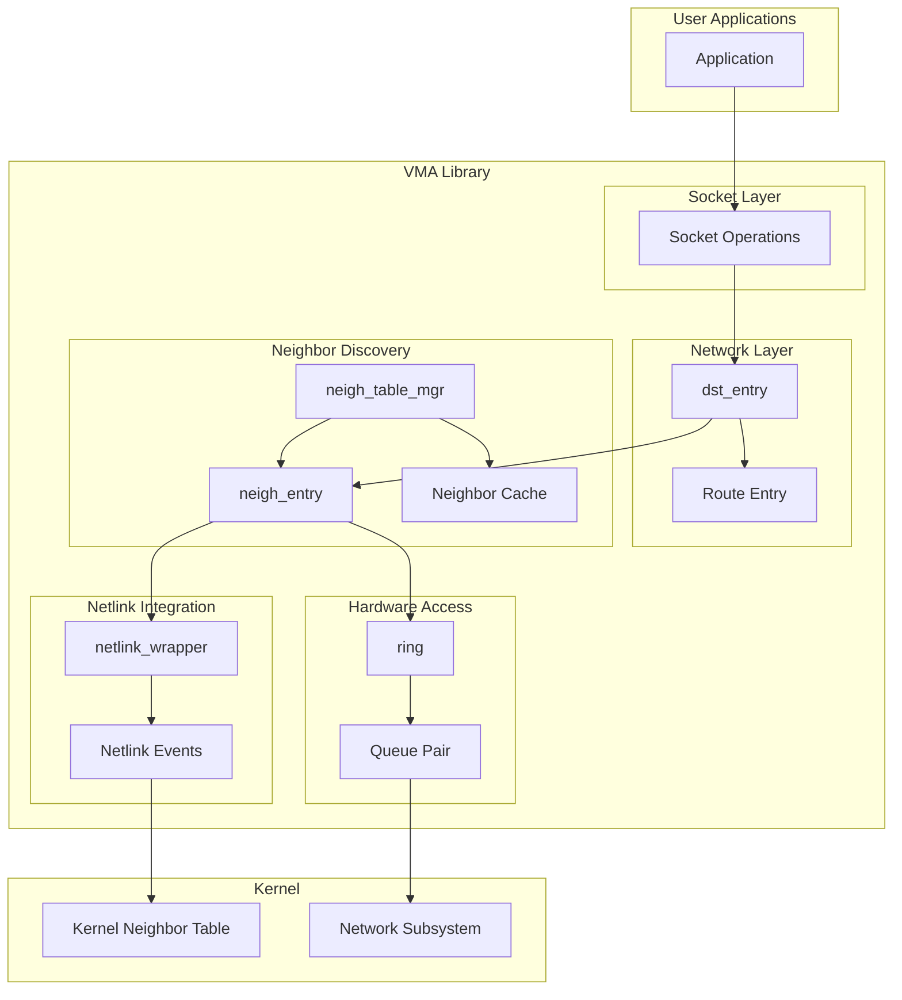
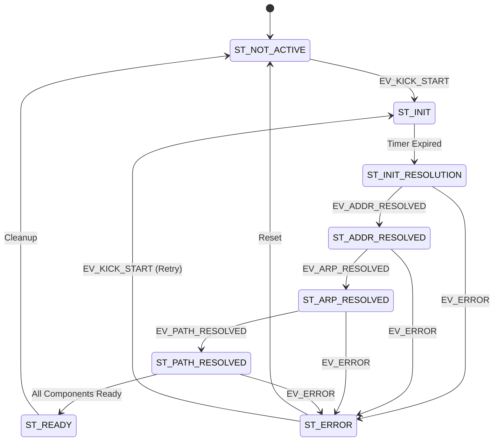
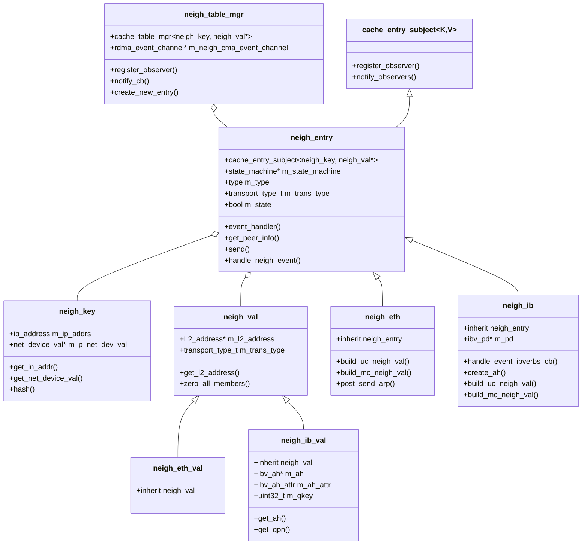
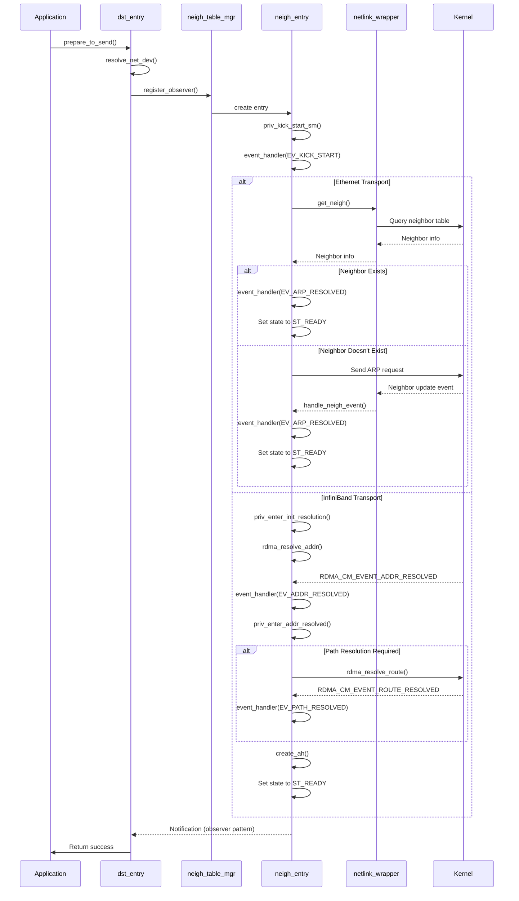
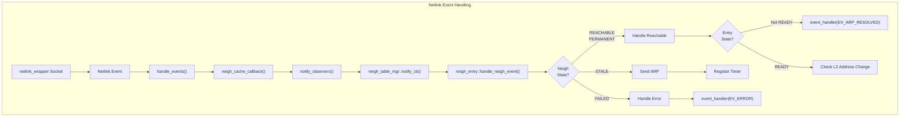

<!-- source: DeepWiki mcp.deepwiki.com · repo Mellanox/libvma · page 3.2 Neighbor Discovery · fetched 2026-11-11 -->

# Neighbor Discovery

<details>
<summary>Relevant source files</summary>

The following files were used as context for generating this wiki page:

- [src/vma/infra/sender.cpp](src/vma/infra/sender.cpp)
- [src/vma/infra/sender.h](src/vma/infra/sender.h)
- [src/vma/netlink/netlink_wrapper.cpp](src/vma/netlink/netlink_wrapper.cpp)
- [src/vma/netlink/netlink_wrapper.h](src/vma/netlink/netlink_wrapper.h)
- [src/vma/netlink/test_main.cpp](src/vma/netlink/test_main.cpp)
- [src/vma/proto/dst_entry.cpp](src/vma/proto/dst_entry.cpp)
- [src/vma/proto/dst_entry.h](src/vma/proto/dst_entry.h)
- [src/vma/proto/dst_entry_tcp.cpp](src/vma/proto/dst_entry_tcp.cpp)
- [src/vma/proto/dst_entry_tcp.h](src/vma/proto/dst_entry_tcp.h)
- [src/vma/proto/dst_entry_udp.cpp](src/vma/proto/dst_entry_udp.cpp)
- [src/vma/proto/dst_entry_udp.h](src/vma/proto/dst_entry_udp.h)
- [src/vma/proto/igmp_handler.cpp](src/vma/proto/igmp_handler.cpp)
- [src/vma/proto/neighbour.cpp](src/vma/proto/neighbour.cpp)
- [src/vma/proto/neighbour.h](src/vma/proto/neighbour.h)
- [src/vma/proto/neighbour_table_mgr.cpp](src/vma/proto/neighbour_table_mgr.cpp)
- [src/vma/proto/neighbour_table_mgr.h](src/vma/proto/neighbour_table_mgr.h)
- [src/vma/util/wakeup_pipe.cpp](src/vma/util/wakeup_pipe.cpp)
- [src/vma/util/wakeup_pipe.h](src/vma/util/wakeup_pipe.h)

</details>


## Purpose and Scope

This document describes the Neighbor Discovery subsystem in VMA, which is responsible for resolving Layer 3 (IP) addresses to Layer 2 (MAC/hardware) addresses. This is a critical component that enables successful packet delivery in the offloaded data path. For routing information, see [Routing](#3.3).

The Neighbor Discovery subsystem integrates with the kernel's neighbor table through netlink, providing efficient address resolution for both unicast and multicast traffic across Ethernet and InfiniBand transports.

## Overview

The Neighbor Discovery subsystem tracks and resolves mappings between IP addresses and their corresponding Layer 2 addresses. It maintains a cache of resolved neighbors, handles ARP/neighbor resolution, and monitors changes in the kernel's neighbor table.



Sources: [src/vma/proto/neighbour.h](), [src/vma/proto/neighbour_table_mgr.h](), [src/vma/proto/dst_entry.h](), [src/vma/netlink/netlink_wrapper.h]()

### Key Components

1. **Neighbor Table Manager (`neigh_table_mgr`)**: Central manager for the neighbor cache
2. **Neighbor Entry (`neigh_entry`)**: Handles the resolution and tracking of a specific neighbor
3. **Neighbor Key (`neigh_key`)**: Uniquely identifies a neighbor by IP address and network device
4. **Neighbor Value (`neigh_val`)**: Stores the Layer 2 address and related information
5. **Netlink Wrapper (`netlink_wrapper`)**: Interfaces with the kernel's neighbor subsystem

## Neighbor Entry State Machine

The neighbor discovery process is managed by a state machine within each `neigh_entry` instance.



Sources: [src/vma/proto/neighbour.cpp:774-801](), [src/vma/proto/neighbour.h:176-187]()

### State Descriptions

| State | Description |
|-------|-------------|
| `ST_NOT_ACTIVE` | Initial state, entry is not actively resolving |
| `ST_INIT` | Initialization state, prepares for resolution |
| `ST_INIT_RESOLUTION` | Actively resolving the neighbor |
| `ST_ADDR_RESOLVED` | Address resolved (mainly for RDMA/IB transports) |
| `ST_ARP_RESOLVED` | ARP/Neighbor resolution complete |
| `ST_PATH_RESOLVED` | Path resolution complete (mainly for IB) |
| `ST_READY` | Neighbor is fully resolved and ready to use |
| `ST_ERROR` | Error state, resolution failed |

### Event Handling

Events drive the state machine transitions:

| Event | Description |
|-------|-------------|
| `EV_KICK_START` | Start the resolution process |
| `EV_START_RESOLUTION` | Begin active resolution |
| `EV_ARP_RESOLVED` | ARP/neighbor information resolved |
| `EV_ADDR_RESOLVED` | Address resolved (IB-specific) |
| `EV_PATH_RESOLVED` | Path resolved (IB-specific) |
| `EV_ERROR` | Error occurred |
| `EV_TIMEOUT_EXPIRED` | Timer expired |

Sources: [src/vma/proto/neighbour.cpp:749-773](), [src/vma/proto/neighbour.h:189-198]()

## Class Architecture

The Neighbor Discovery subsystem is built on several key classes:



Sources: [src/vma/proto/neighbour.h:32-395]()

### Key Class Descriptions

#### Neighbor Key and Value

- **`neigh_key`**: Identifies a neighbor by IP address and network device
  - `m_ip_addrs`: The IP address of the neighbor
  - `m_p_net_dev_val`: Pointer to the associated network device

- **`neigh_val`**: Stores the Layer 2 address and related information
  - `m_l2_address`: The Layer 2 address (MAC/hardware address)
  - `m_trans_type`: Transport type (Ethernet, InfiniBand)

- **`neigh_eth_val`**: Ethernet-specific neighbor value
- **`neigh_ib_val`**: InfiniBand-specific neighbor value
  - `m_ah`: InfiniBand address handle
  - `m_qkey`: InfiniBand queue key
  - `m_ah_attr`: InfiniBand address handle attributes

#### Neighbor Entry

- **`neigh_entry`**: Base class for neighbor entries
  - Implements state machine for neighbor resolution
  - Handles ARP/neighbor resolution
  - Manages the cached Layer 2 address

- **`neigh_eth`**: Ethernet-specific neighbor entry
  - Handles Ethernet ARP resolution
  - Manages Ethernet MAC addresses

- **`neigh_ib`**: InfiniBand-specific neighbor entry
  - Handles IB address resolution
  - Manages queue pairs and address handles

#### Neighbor Table Manager

- **`neigh_table_mgr`**: Manages the neighbor cache
  - Maintains a table of all neighbor entries
  - Handles registration of observers
  - Processes netlink events for neighbors

Sources: [src/vma/proto/neighbour.cpp](), [src/vma/proto/neighbour_table_mgr.cpp]()

## Neighbor Resolution Process

The neighbor resolution process is executed through several steps:



Sources: [src/vma/proto/neighbour.cpp:150-353](), [src/vma/proto/dst_entry.cpp:252-276]()

### Resolution Flow Details

1. **Initialization**:
   - A `dst_entry` needs to resolve an IP address to a MAC/hardware address
   - It registers as an observer with the `neigh_table_mgr`
   - A new `neigh_entry` is created if one doesn't exist for the given IP

2. **State Machine Execution**:
   - The state machine starts with `EV_KICK_START` event
   - Transitions through various states based on resolution progress

3. **Transport-specific Resolution**:
   - **Ethernet**:
     - Queries the kernel's neighbor table via netlink
     - Sends ARP requests if needed using `send_arp()`
     - Updates state when ARP response is received

   - **InfiniBand**:
     - Uses RDMA Connection Manager for address resolution
     - Creates address handles (AH) for communication
     - Resolves paths for remote communication

4. **Completion**:
   - When resolution is complete, the entry reaches the `ST_READY` state
   - Observers are notified of the successful resolution
   - The cached Layer 2 address can now be used for packet transmission

Sources: [src/vma/proto/neighbour.cpp:973-1146]()

## Integration with Destination Entries

Destination entries (`dst_entry`) use neighbor entries for the final step of packet delivery.

```mermaid
flowchart TD
    subgraph "Packet Transmission Flow"
        start["dst_entry::prepare_to_send()"] --> resolveNetDev["resolve_net_dev()"]
        resolveNetDev --> resolveNeigh["resolve_neigh()"]
        resolveNeigh --> neigh{"Is neigh\nresolved?"}
        
        neigh -->|"Yes"| configureHeaders["configure_headers()"]
        neigh -->|"No"| registerObserver["Register as observer"]
        registerObserver --> bufferPacket["Buffer packet in neigh_entry"]
        
        configureHeaders --> configureL2["conf_hdrs_and_snd_wqe()"]
        configureL2 --> send["send_ring_buffer()"]
        
        bufferPacket --> waitEvent["Wait for neighbor resolution"]
        waitEvent --> neigh
    end
    
    subgraph "When Neighbor Resolves"
        neighReady["neigh_entry reaches ST_READY"] --> notifyObs["notify_observers()"]
        notifyObs --> emptyQueue["empty_unsent_queue()"]
        emptyQueue --> sendBuffered["post_send_packet()"]
    end
```



Sources: [src/vma/proto/dst_entry.cpp:480-541](), [src/vma/proto/neighbour.cpp:290-306]()

### Destination Entry and Neighbor Communication

The `dst_entry` class:

1. **Maintains a reference to a neighbor entry**:
   ```cpp
   neigh_entry* m_p_neigh_entry;
   neigh_val* m_p_neigh_val;
   ```

2. **Resolves neighbor information**:
   ```cpp
   bool dst_entry::resolve_neigh() {
       // Get neighbor entry for destination IP
       cache_entry_subject<neigh_key, neigh_val*>* p_ces = NULL;
       g_p_neigh_table_mgr->register_observer(neigh_key(dst_addr, m_p_net_dev_val), this, &p_ces);
       m_p_neigh_entry = dynamic_cast<neigh_entry*>(p_ces);
       
       // Get Layer 2 information
       if (m_p_neigh_entry) {
           if (m_p_neigh_entry->get_peer_info(m_p_neigh_val)) {
               // Neighbor is resolved
               return true;
           }
       }
       return false;
   }
   ```

3. **Configures packet headers with neighbor information**:
   ```cpp
   bool dst_entry::conf_l2_hdr_and_snd_wqe_eth() {
       // Get L2 addresses from neighbor value
       const L2_address *src = m_p_net_dev_val->get_l2_address();
       const L2_address *dst = m_p_neigh_val->get_l2_address();
       
       // Configure Ethernet headers
       m_header.configure_eth_headers(*src, *dst);
       // ...
   }
   ```

Sources: [src/vma/proto/dst_entry.cpp:252-276]()

## Netlink Integration

The Neighbor Discovery subsystem integrates with the kernel's neighbor table through netlink.



Sources: [src/vma/proto/neighbour.cpp:629-744](), [src/vma/netlink/netlink_wrapper.cpp:73-92]()

### Netlink Event Processing

1. **Netlink Socket Setup**:
   - `netlink_wrapper` creates a netlink socket to the kernel
   - Subscribes to NETLINK_ROUTE family events for neighbor updates

2. **Event Processing**:
   - When a neighbor event occurs in the kernel, it's sent to the netlink socket
   - `netlink_wrapper::handle_events()` processes the event
   - Events are converted to `neigh_nl_event` objects

3. **Neighbor Event Handling**:
   - `neigh_table_mgr::notify_cb()` receives the event
   - Finds relevant neighbor entries and forwards the event
   - `neigh_entry::handle_neigh_event()` processes the event

4. **Neighbor State Updates**:
   - Based on the neighbor state (REACHABLE, STALE, FAILED, etc.)
   - Updates the internal state machine accordingly
   - May trigger ARP requests or error handling

Sources: [src/vma/netlink/netlink_wrapper.cpp:102-140](), [src/vma/proto/neighbour_table_mgr.cpp:102-143]()

## ARP and Neighbor Resolution

For IP networks, Address Resolution Protocol (ARP) is used to resolve IP addresses to MAC addresses.

### ARP Handling

1. **Sending ARP Requests**:
   ```cpp
   void neigh_entry::send_arp() {
       // Decide if broadcast or unicast ARP
       bool is_broadcast = (m_arp_counter >= m_n_sysvar_neigh_uc_arp_quata) || 
                            m_is_first_send_arp || !m_val;
       if (post_send_arp(is_broadcast)) {
           m_is_first_send_arp = false;
           m_arp_counter++;
       }
   }
   ```

2. **Ethernet ARP Implementation**:
   ```cpp
   bool neigh_eth::post_send_arp(bool is_broadcast) {
       // Create and send ARP packet
       // For broadcast or unicast ARP
   }
   ```

3. **ARP Response Handling**:
   - Kernel processes ARP responses
   - Updates its neighbor table
   - Sends netlink event to VMA
   - VMA updates the neighbor entry state

Sources: [src/vma/proto/neighbour.cpp:354-366]()

## Performance Considerations

The Neighbor Discovery subsystem includes several optimizations:

1. **Caching**:
   - Resolved neighbors are cached to avoid repeated resolution
   - Improves performance for repeated communications

2. **Proactive Resolution**:
   - Resolution starts as soon as an observer registers interest
   - Reduces latency for the first packet transmission

3. **Asynchronous Processing**:
   - Doesn't block packet processing while waiting for resolution
   - Buffers packets until neighbor is resolved

4. **Netlink Event Monitoring**:
   - Keeps cache consistent with kernel neighbor table
   - Updates when neighbors become stale or unreachable

5. **Transport-specific Optimizations**:
   - Different approaches for Ethernet and InfiniBand
   - Uses appropriate hardware acceleration features

Sources: [src/vma/proto/neighbour.cpp:621-626](), [src/vma/proto/dst_entry.cpp:199-207]()

## Summary

The Neighbor Discovery subsystem is a core component of VMA that:

1. Resolves Layer 3 (IP) addresses to Layer 2 (MAC/hardware) addresses
2. Maintains a cache of resolved neighbors
3. Handles ARP/neighbor resolution
4. Monitors changes in the kernel's neighbor table
5. Supports both Ethernet and InfiniBand transports
6. Integrates with destination entries for packet transmission

This subsystem is critical for establishing communication paths to network peers and ensuring optimal packet delivery in the offloaded data path.

---

