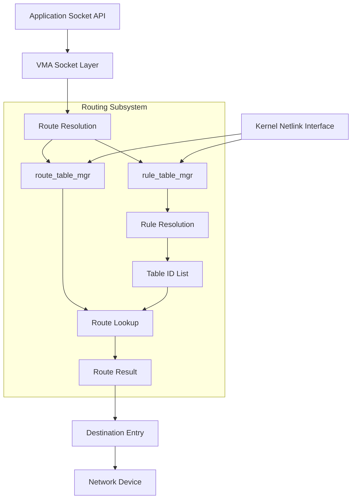
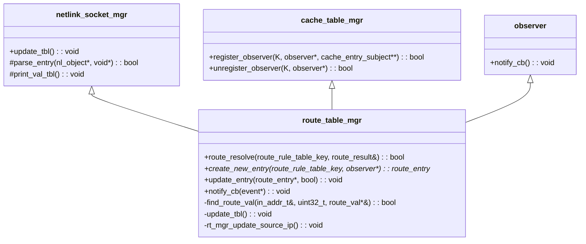
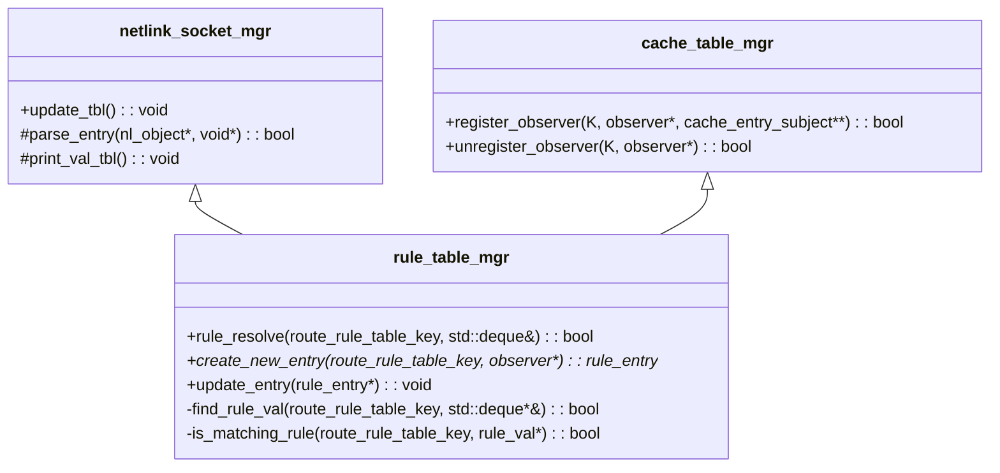
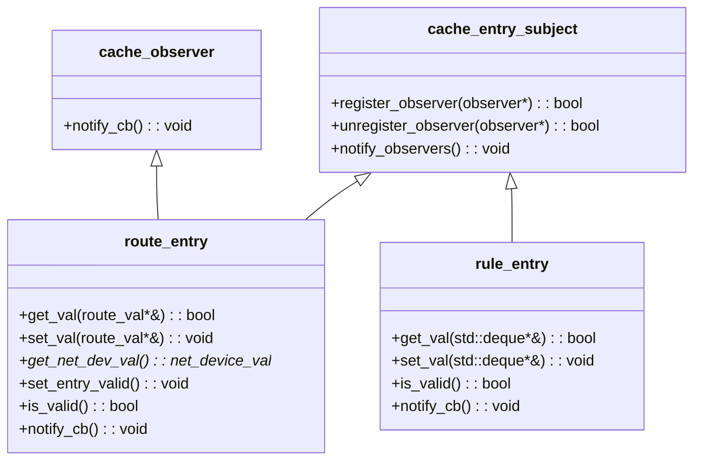
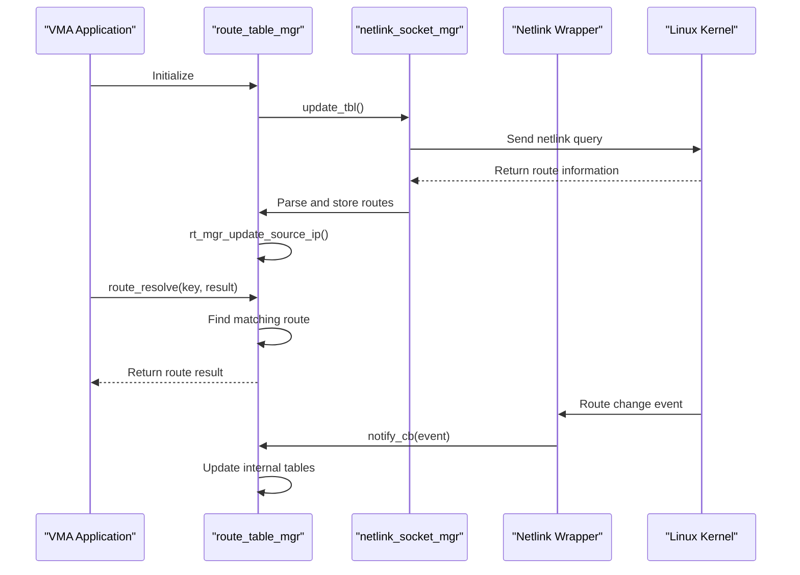
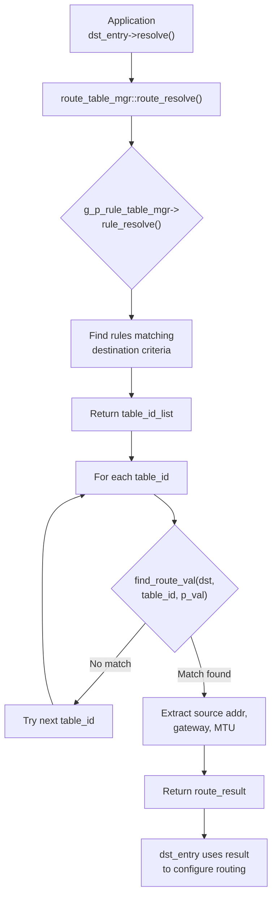
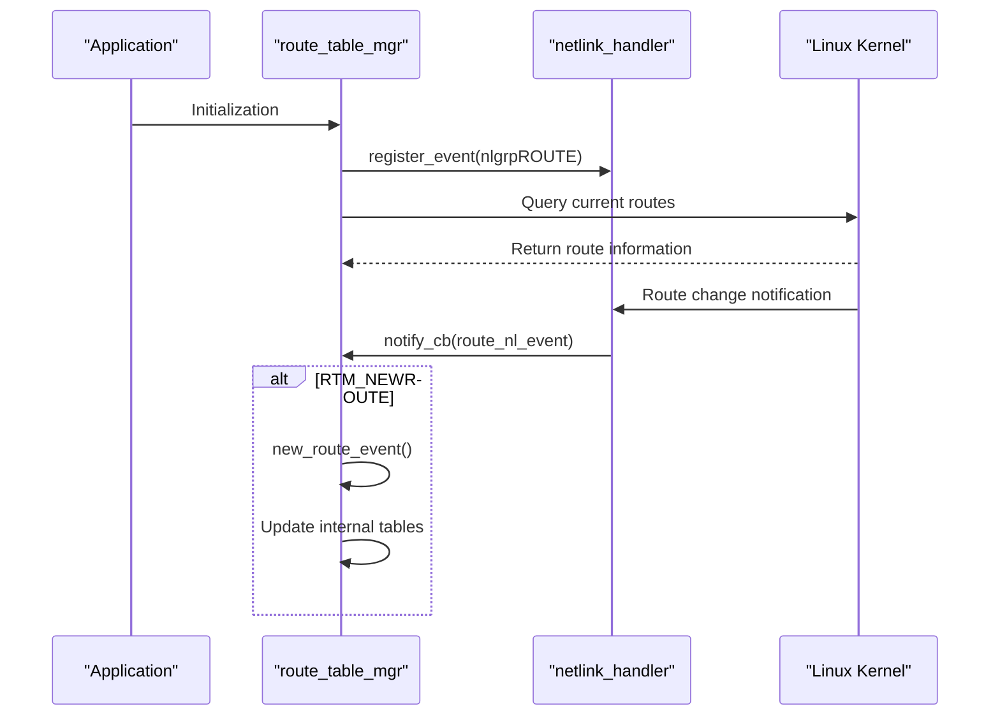

<!-- source: DeepWiki mcp.deepwiki.com · repo Mellanox/libvma · page 3.3 Routing · fetched 2026-11-11 -->

# Routing

Relevant source files

The following files were used as context for generating this wiki page:

- [src/vma/event/netlink_event.cpp](src/vma/event/netlink_event.cpp)
- [src/vma/event/netlink_event.h](src/vma/event/netlink_event.h)
- [src/vma/netlink/route_info.h](src/vma/netlink/route_info.h)
- [src/vma/proto/netlink_socket_mgr.h](src/vma/proto/netlink_socket_mgr.h)
- [src/vma/proto/route_entry.cpp](src/vma/proto/route_entry.cpp)
- [src/vma/proto/route_entry.h](src/vma/proto/route_entry.h)
- [src/vma/proto/route_table_mgr.cpp](src/vma/proto/route_table_mgr.cpp)
- [src/vma/proto/route_table_mgr.h](src/vma/proto/route_table_mgr.h)
- [src/vma/proto/rule_table_mgr.cpp](src/vma/proto/rule_table_mgr.cpp)
- [src/vma/proto/rule_table_mgr.h](src/vma/proto/rule_table_mgr.h)
- [src/vma/proto/rule_val.cpp](src/vma/proto/rule_val.cpp)
- [src/vma/proto/rule_val.h](src/vma/proto/rule_val.h)

## Purpose and Scope

This document explains how VMA manages routing tables and makes routing decisions. The routing subsystem enables VMA to determine the optimal path for network traffic based on destination addresses, source addresses, and traffic parameters. It interfaces with the Linux kernel's routing facilities while providing caching and optimization for high-performance networking. For information about neighbor discovery, see [Neighbor Discovery](#3.2), and for network device management, see [Network Device Management](#3.1).

## Routing System Overview

VMA's routing system is responsible for resolving destination addresses to the appropriate source addresses, gateway addresses, and outbound interfaces. It maintains a cache of routes from the operating system and implements rule-based lookups to determine the best route for each connection.

Sources: [src/vma/proto/route_table_mgr.h:35-41](), [src/vma/proto/rule_table_mgr.h:21-28]()

## Key Components

### Route Table Manager

The Route Table Manager (`route_table_mgr`) is the central component of the routing subsystem. It maintains a table of routes retrieved from the kernel and provides API methods for route resolution.

Sources: [src/vma/proto/route_table_mgr.h:32-63](), [src/vma/proto/route_table_mgr.cpp:43-98]()

#### Route Resolution Process

The `route_resolve` method is the main entry point for route lookups. It takes a destination key (containing destination IP, source IP, and TOS) and returns route information including source address, gateway, and MTU.

The resolution process follows these steps:
1. Get a list of routing table IDs from the Rule Table Manager
2. For each table ID, search for the most specific matching route
3. Return the first matching route's details (source address, gateway, MTU)

Sources: [src/vma/proto/route_table_mgr.cpp:338-367]()

### Rule Table Manager

The Rule Table Manager (`rule_table_mgr`) maintains the routing rules that determine which routing table to use for a given destination. It implements the policy-based routing mechanism used by Linux.

Sources: [src/vma/proto/rule_table_mgr.h:21-42](), [src/vma/proto/rule_table_mgr.cpp:45-57]()

### Route and Rule Values

The `route_val` and `rule_val` classes store information about routes and rules, respectively. They encapsulate the attributes of kernel routes and rules in a format suitable for VMA's needs.

#### Route Value Attributes

- Destination address and mask
- Source address
- Gateway address
- Output interface index and name
- Protocol, scope, type, and table ID
- MTU

Sources: [src/vma/proto/route_table_mgr.cpp:257-304]()

#### Rule Value Attributes

- Destination and source addresses
- Type of Service (TOS)
- Input and output interface names
- Priority
- Table ID

Sources: [src/vma/proto/rule_val.h:27-42](), [src/vma/proto/rule_table_mgr.cpp:99-137]()

### Route and Rule Entry Cache

VMA uses a caching mechanism to store route and rule information for efficient lookups. The `route_entry` and `rule_entry` classes represent cached entries that are managed by the observer pattern.

Sources: [src/vma/proto/route_entry.h:20-53](), [src/vma/proto/route_entry.cpp:23-119]()

## Netlink Interface

VMA communicates with the Linux kernel's routing subsystem using netlink sockets. The `netlink_socket_mgr` template class provides a generic interface for retrieving routing information from the kernel.

Sources: [src/vma/proto/netlink_socket_mgr.h:63-96](), [src/vma/proto/route_table_mgr.cpp:464-493]()

### Netlink Events

VMA registers for and processes netlink events to keep its routing information up-to-date. The `notify_cb` method in `route_table_mgr` handles these events:

- `RTM_NEWROUTE`: A new route was added to the kernel's routing table
- `RTM_DELROUTE`: A route was removed (currently not implemented)

Sources: [src/vma/event/netlink_event.h:95-110](), [src/vma/proto/route_table_mgr.cpp:464-493]()

## Route Resolution Flow

The following diagram shows the detailed flow of a route resolution request:

Sources: [src/vma/proto/route_table_mgr.cpp:338-367](), [src/vma/proto/rule_table_mgr.cpp:240-255]()

### Route Lookup Logic

The route lookup process uses the longest prefix match algorithm, which is standard in IP routing:

1. For each route in the specified table, check if the destination address matches the route's network address (destination & mask)
2. Among all matching routes, select the one with the longest prefix (most specific match)
3. Return the details of the selected route

Sources: [src/vma/proto/route_table_mgr.cpp:306-336]()

## Source Address Resolution

An important aspect of routing in VMA is determining the correct source address for a given destination. This is handled by the `rt_mgr_update_source_ip` method, which follows these steps:

1. For routes without a source address or gateway:
   - Try to get a source IP from the network device associated with the route's interface
   - Use the longest matching prefix if multiple addresses are available
   - If no match is found, use the primary address of the interface

2. For routes with a gateway but no source address:
   - Recursively look up the route to the gateway
   - Use the source address from that route
   - If circular references are found, resolve them

Sources: [src/vma/proto/route_table_mgr.cpp:107-209]()

## Routing Table Updates

The routing subsystem needs to stay in sync with the kernel's routing tables. This is accomplished through:

1. Initial population of tables during initialization
2. Listening for netlink events for route changes
3. Handling network device state changes

Sources: [src/vma/proto/route_table_mgr.cpp:70-74](), [src/vma/proto/route_table_mgr.cpp:464-493]()

## Route Entry Management

When a `route_entry` is created or updated, it may register with a network device to receive notifications about device changes:

1. The `route_entry` is created with a specific destination key
2. The `update_entry` method is called to populate it with the corresponding route value
3. If registration to a network device is requested, it finds the device matching the route's source address
4. The entry is registered as an observer of the network device
5. When the network device changes, the `notify_cb` method is called, and the entry notifies its observers

Sources: [src/vma/proto/route_entry.cpp:64-119](), [src/vma/proto/route_table_mgr.cpp:369-430]()

## Summary

The routing subsystem in VMA is responsible for resolving network paths for traffic. It leverages the Linux kernel's routing facilities while providing an efficient caching mechanism for high-performance applications. The key classes `route_table_mgr` and `rule_table_mgr` work together to implement policy-based routing and longest prefix matching for route selection.

---

