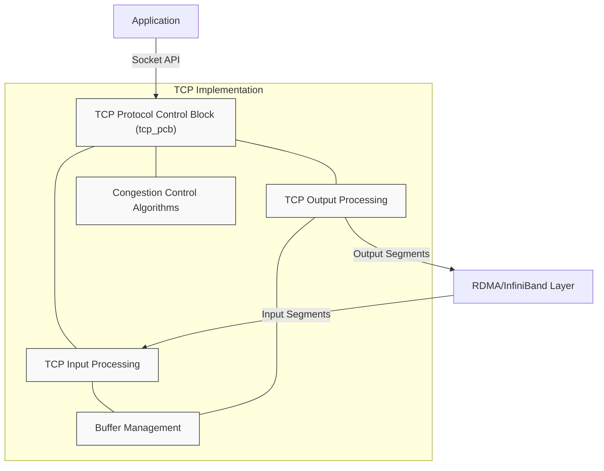
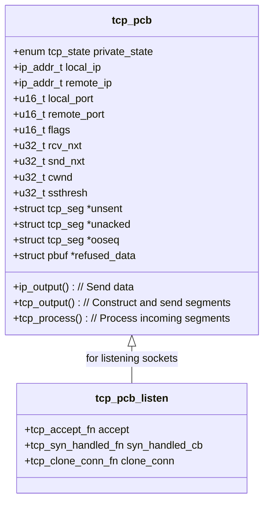
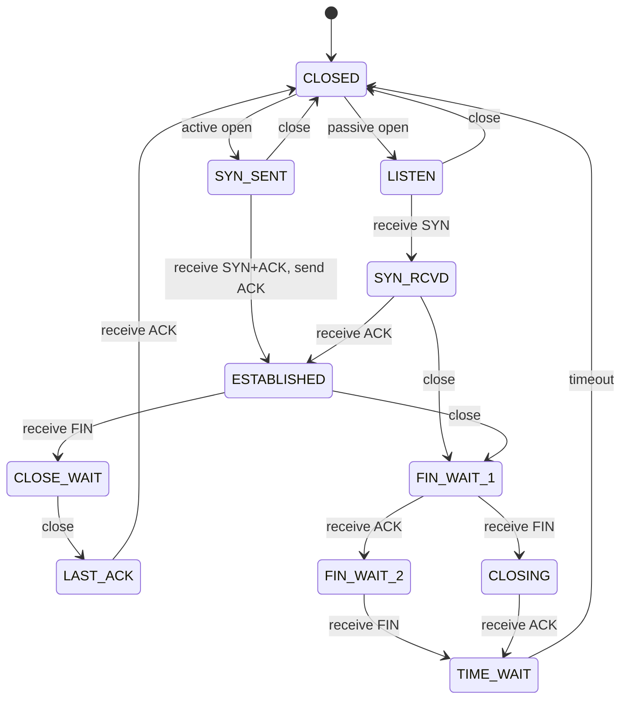
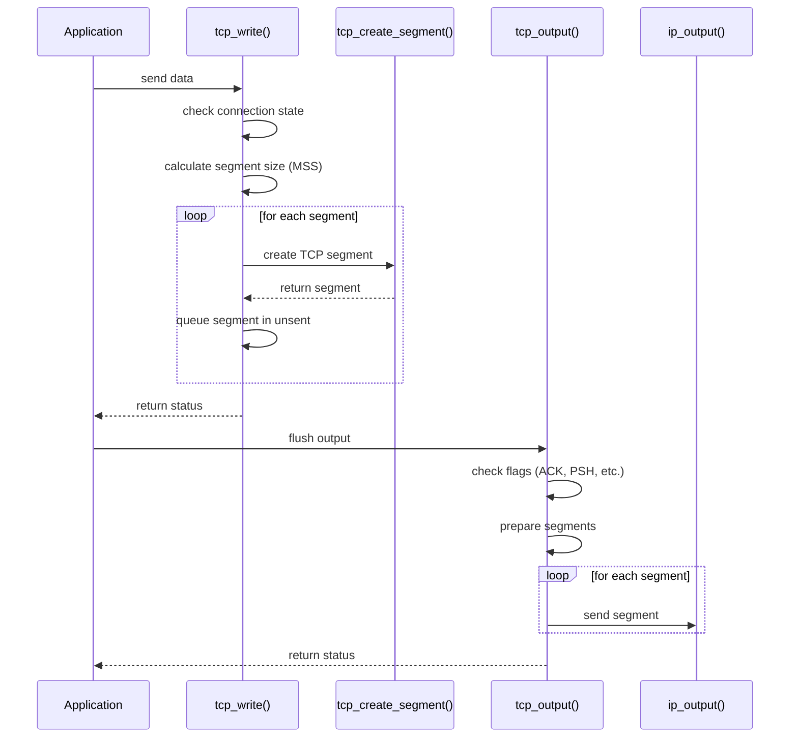
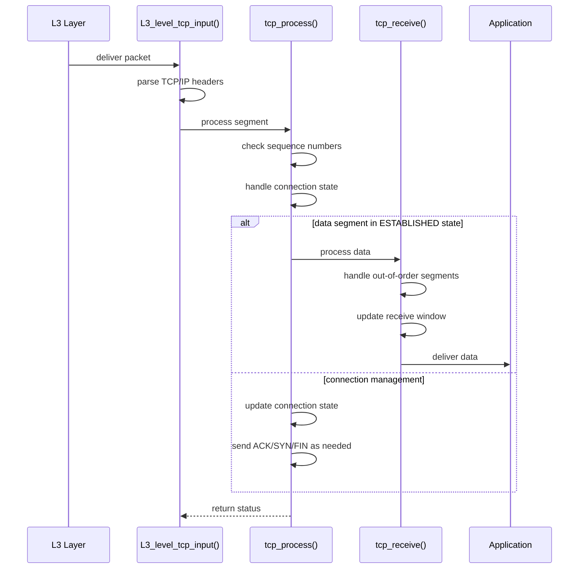
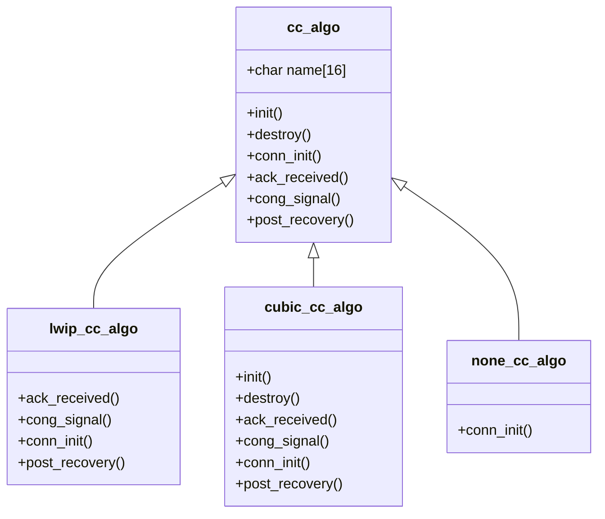
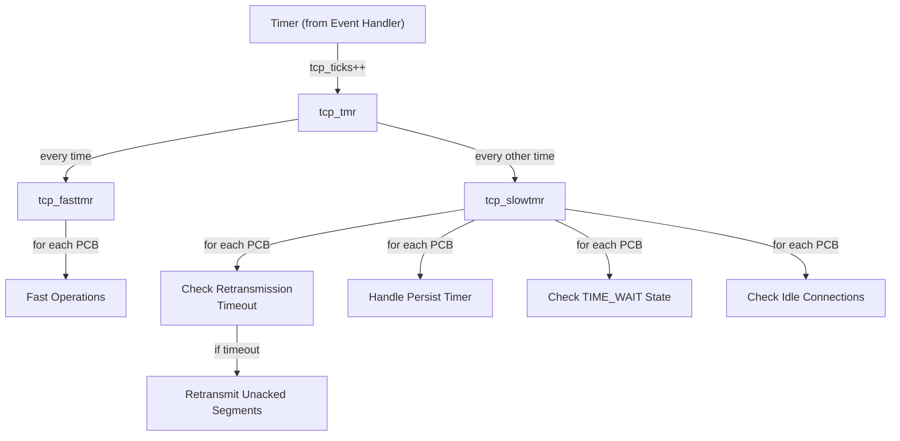
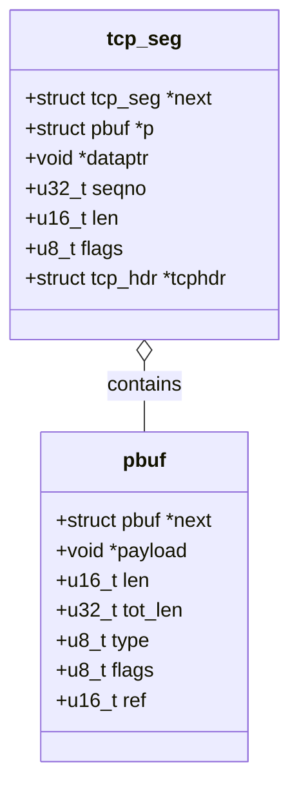
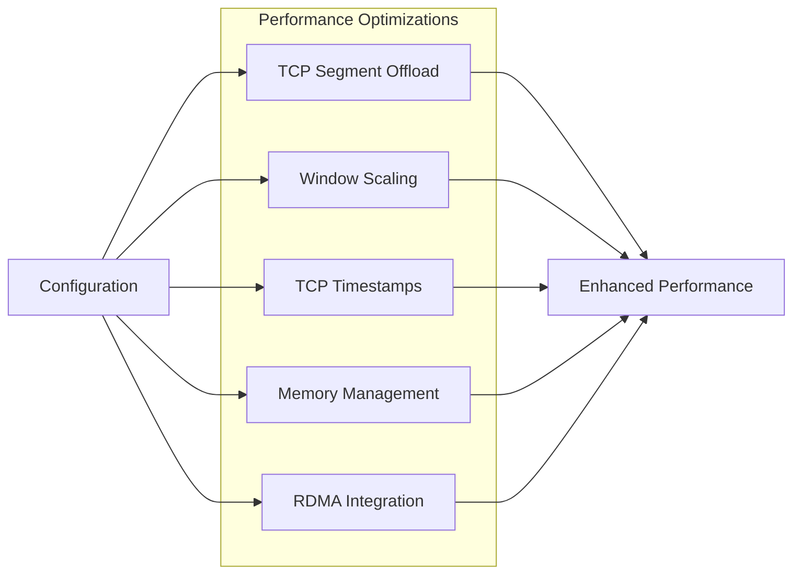
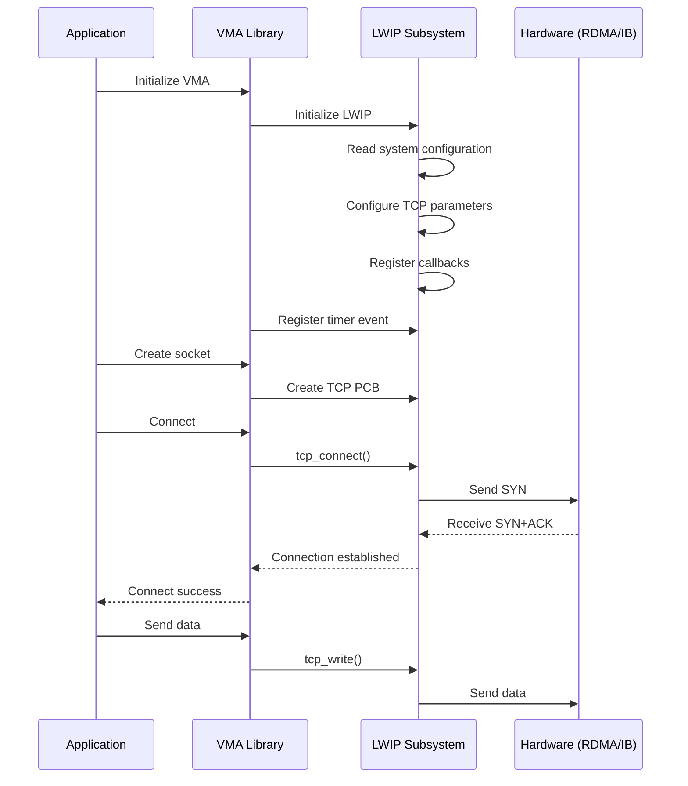

<!-- source: DeepWiki mcp.deepwiki.com · repo Mellanox/libvma · page 3.4 TCP Implementation · fetched 2026-11-11 -->

# TCP Implementation

Relevant source files

The following files were used as context for generating this wiki page:

- [src/vma/lwip/cc.c](src/vma/lwip/cc.c)
- [src/vma/lwip/cc.h](src/vma/lwip/cc.h)
- [src/vma/lwip/cc_cubic.c](src/vma/lwip/cc_cubic.c)
- [src/vma/lwip/cc_lwip.c](src/vma/lwip/cc_lwip.c)
- [src/vma/lwip/cc_none.c](src/vma/lwip/cc_none.c)
- [src/vma/lwip/ip.h](src/vma/lwip/ip.h)
- [src/vma/lwip/opt.h](src/vma/lwip/opt.h)
- [src/vma/lwip/pbuf.c](src/vma/lwip/pbuf.c)
- [src/vma/lwip/pbuf.h](src/vma/lwip/pbuf.h)
- [src/vma/lwip/tcp.c](src/vma/lwip/tcp.c)
- [src/vma/lwip/tcp.h](src/vma/lwip/tcp.h)
- [src/vma/lwip/tcp_impl.h](src/vma/lwip/tcp_impl.h)
- [src/vma/lwip/tcp_in.c](src/vma/lwip/tcp_in.c)
- [src/vma/lwip/tcp_out.c](src/vma/lwip/tcp_out.c)
- [src/vma/proto/vma_lwip.cpp](src/vma/proto/vma_lwip.cpp)
- [src/vma/proto/vma_lwip.h](src/vma/proto/vma_lwip.h)
- [src/vma/util/sysctl_reader.h](src/vma/util/sysctl_reader.h)

This document describes the TCP implementation in VMA (Versatile Message Accelerator), which is based on the LightWeight IP (LWIP) network stack. The implementation provides a complete user-space TCP protocol stack that bypasses the kernel for improved performance when used with RDMA/InfiniBand hardware.

## Overview

VMA's TCP implementation is primarily based on LWIP, a small independent implementation of the TCP/IP protocol suite originally developed for embedded systems. In VMA, it's adapted and optimized to work with high-performance networking hardware through the RDMA/InfiniBand layer.

Key characteristics of the TCP implementation include:

- Full user-space implementation
- Integration with RDMA verbs for hardware acceleration
- Support for multiple congestion control algorithms
- Seamless socket API compatibility
- Configurable parameters for performance tuning

Sources: [src/vma/lwip/tcp.h:281-441](), [src/vma/lwip/tcp_in.c:44-68](), [src/vma/lwip/tcp_out.c:41-106]()

## TCP Protocol Control Block (PCB)

The core of the TCP implementation is the Protocol Control Block (PCB), defined in the `tcp_pcb` structure. This structure maintains all the state for a TCP connection and includes:

- Connection identifiers (local and remote IP/port)
- TCP state (ESTABLISHED, LISTEN, etc.)
- Sequence and acknowledgment numbers
- Window sizes and scaling factors
- Congestion control variables
- Send and receive buffers
- Various timers and flags

Sources: [src/vma/lwip/tcp.h:281-441](), [src/vma/lwip/tcp_impl.h:97-120]()

## TCP Connection States

The TCP implementation follows the standard TCP state machine as defined in RFC 793. States are enumerated in the `tcp_state` enum:

State transitions are handled in the `tcp_process` function, which processes incoming TCP segments and updates the connection state accordingly.

Sources: [src/vma/lwip/tcp.h:197-223](), [src/vma/lwip/tcp_in.c:489-706]()

## Data Flow

The TCP implementation handles both incoming and outgoing data flows.

### Outgoing Data Flow

When an application sends data, it goes through the following path:

1. Application calls `send()` or related functions
2. Data is passed to `tcp_write()`
3. `tcp_write()` segments the data and queues it for transmission
4. `tcp_output()` processes the queue and constructs TCP segments
5. Segments are passed to the IP layer via the registered `ip_output` function

Sources: [src/vma/lwip/tcp_out.c:415-774](), [src/vma/lwip/tcp_out.c:131-167]()

### Incoming Data Flow

When data is received from the network, it follows this path:

1. L3 layer delivers packet to `L3_level_tcp_input()`
2. TCP header is parsed and validated
3. `tcp_process()` handles the segment based on connection state
4. For established connections, data is passed to the application

Sources: [src/vma/lwip/tcp_in.c:94-137](), [src/vma/lwip/tcp_in.c:489-706]()

## Congestion Control

The TCP implementation supports multiple congestion control algorithms, which can be selected based on configuration. The main algorithms are:

1. **LWIP (Default)**: Classic TCP congestion control with slow start and congestion avoidance
2. **CUBIC**: An enhanced algorithm optimized for high bandwidth-delay product networks
3. **NONE**: Disables congestion control (useful for testing)

The congestion control modules implement a common interface defined in `cc.h`:

The congestion control algorithm affects how the congestion window (`cwnd`) and slow start threshold (`ssthresh`) are updated, which in turn determines how fast data can be sent over the connection.

Sources: [src/vma/lwip/cc.h:57-106](), [src/vma/lwip/cc_lwip.c:66-106](), [src/vma/lwip/cc_cubic.c:95-171](), [src/vma/lwip/cc_none.c:14-23]()

## TCP Timers and Retransmission

The TCP implementation uses several timers to handle retransmissions, keepalives, and other time-dependent operations:

1. **Fast timer**: Used for quick operations, typically runs every 250ms (configurable)
2. **Slow timer**: Used for less frequent operations, runs at twice the interval of the fast timer

These timers drive various functions:

- `tcp_fasttmr()`: Handles immediate operations
- `tcp_slowtmr()`: Handles retransmission timeouts, connection state timeouts, etc.

When a retransmission timeout occurs, the congestion window is reduced, and the oldest unacknowledged segment is retransmitted.

Sources: [src/vma/lwip/tcp.c:124-135](), [src/vma/lwip/tcp.c:642-755]()

## TCP Segment Management

TCP data is managed through segmentation and packet buffers:

1. **TCP segments (`struct tcp_seg`)**: Represent TCP segments in the queue
2. **Packet buffers (`struct pbuf`)**: Contain the actual packet data

These structures are used to manage unsent data, unacknowledged data, and out-of-sequence received data.

For outgoing traffic, segments are created, queued, and then sent. For incoming traffic, they are processed, possibly reordered, and then delivered to the application.

Sources: [src/vma/lwip/pbuf.h:72-103](), [src/vma/lwip/tcp_out.c:209-271]()

## Performance Optimizations

The TCP implementation includes several optimizations for high performance:

1. **TCP Segment Offload (TSO)**: Allows large segments to be sent, reducing CPU overhead
2. **Window Scaling**: Supports larger receive windows for high bandwidth-delay product paths
3. **Timestamps**: Enables more accurate RTT measurement
4. **Memory Management**: Custom buffer allocation for better performance
5. **RDMA Integration**: Uses RDMA for efficient data transfer

These optimizations are configured through various parameters and can be tuned for specific workloads.

Sources: [src/vma/lwip/opt.h:165-197](), [src/vma/proto/vma_lwip.cpp:76-87](), [src/vma/util/sysctl_reader.h:110-122]()

## TCP Options and Configuration

The TCP implementation can be configured through various options in `opt.h` and runtime settings:

1. **MSS (Maximum Segment Size)**: Configurable, default is 1460 bytes
2. **Window Size**: Configurable, including window scaling
3. **Congestion Control Algorithm**: Selectable between LWIP, CUBIC, or NONE
4. **TCP Timestamps**: Can be enabled or disabled
5. **Delayed ACK**: Configurable, can improve performance

Additionally, the TCP implementation can read system settings from `/proc/sys` through the `sysctl_reader` class, allowing it to match OS parameters.

Sources: [src/vma/lwip/opt.h:153-197](), [src/vma/proto/vma_lwip.cpp:76-87](), [src/vma/util/sysctl_reader.h:144-149]()

## Integration with VMA

The TCP implementation is integrated into VMA through the `vma_lwip` class, which:

1. Initializes the LWIP subsystem
2. Registers callbacks for memory allocation, I/O operations, etc.
3. Configures TCP parameters based on system settings
4. Sets up timers for TCP operation

The integration ensures that TCP operations can utilize hardware offloads and RDMA capabilities when available, while maintaining compatibility with the standard socket API.

Sources: [src/vma/proto/vma_lwip.cpp:63-106](), [src/vma/proto/vma_lwip.h:54-70]()

## Summary

VMA's TCP implementation provides a full-featured user-space TCP stack based on LWIP. It supports all standard TCP functionality, includes multiple congestion control algorithms, and integrates with RDMA/InfiniBand hardware for high performance. The implementation is highly configurable and can be tuned for specific workloads and environments.

The TCP implementation maintains compatibility with the standard socket API while bypassing the kernel, allowing applications to benefit from improved performance without code changes.

---

