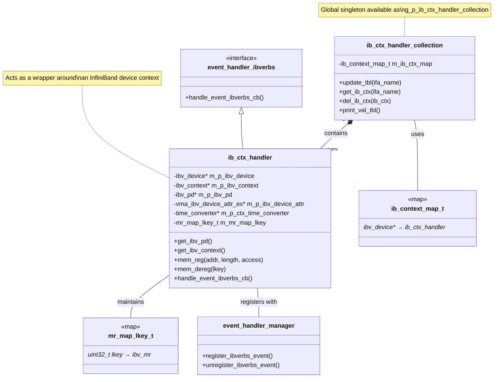
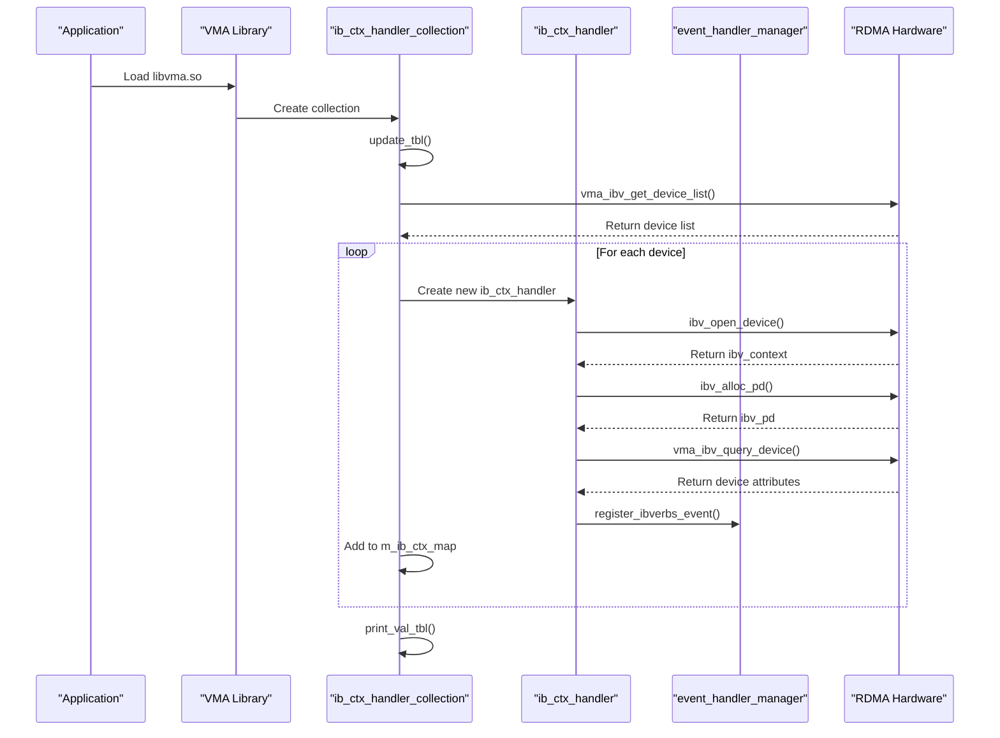
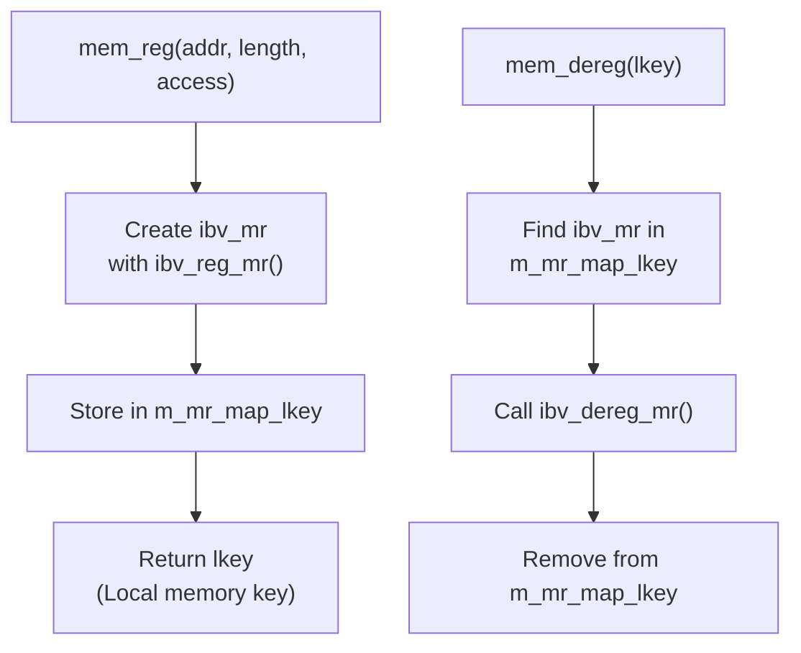
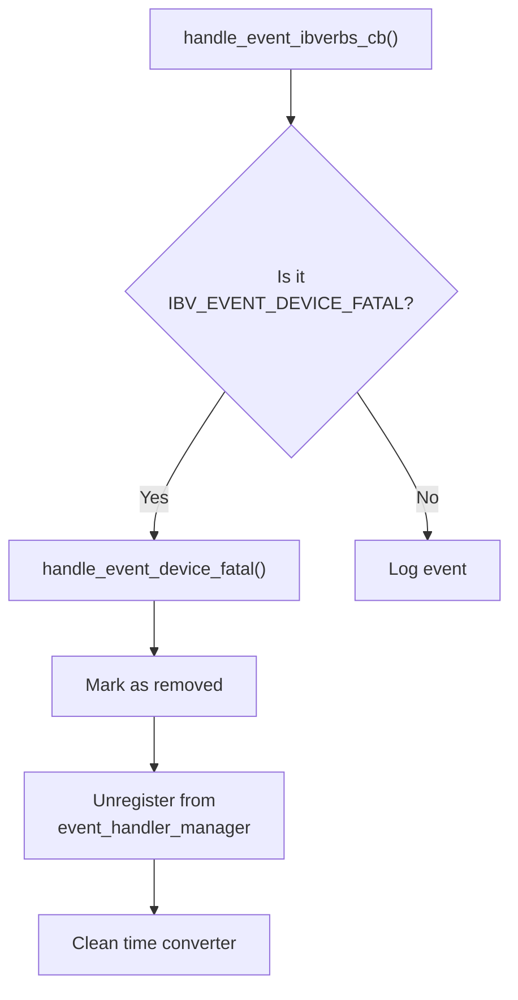
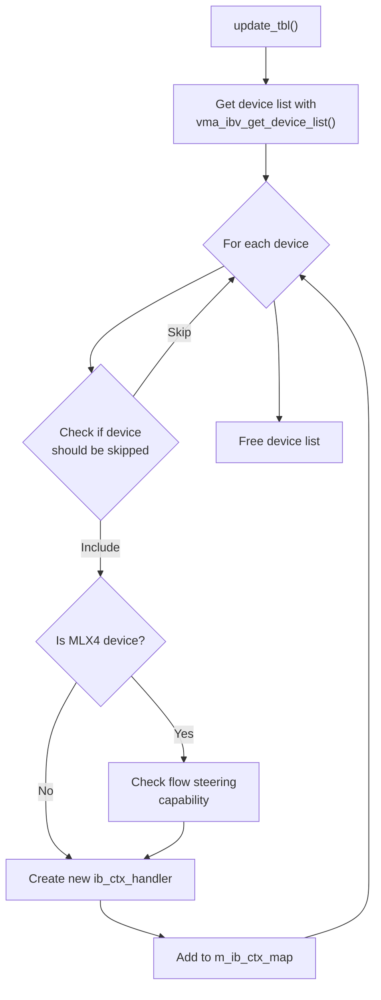
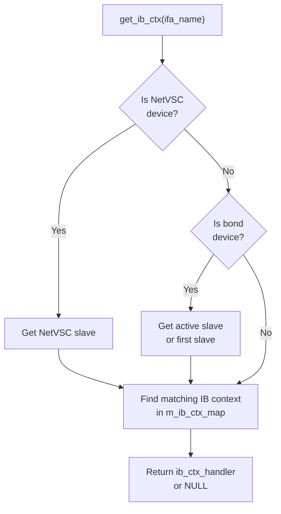
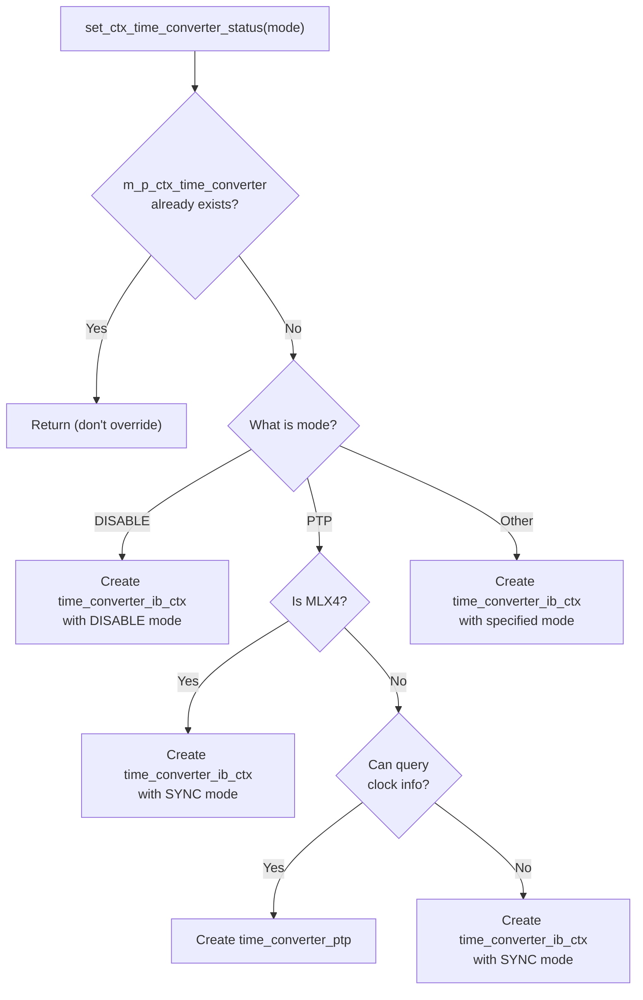
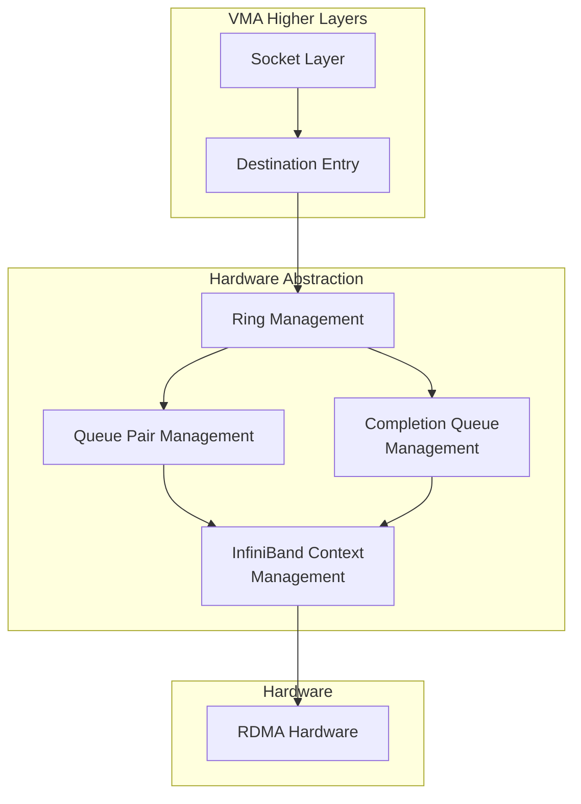

<!-- source: DeepWiki mcp.deepwiki.com · repo Mellanox/libvma · page 4.1 InfiniBand Context Management · fetched 2026-11-11 -->

# InfiniBand Context Management

<details>
<summary>Relevant source files</summary>

The following files were used as context for generating this wiki page:

- [src/vma/Makefile.am](src/vma/Makefile.am)
- [src/vma/dev/ib_ctx_handler.cpp](src/vma/dev/ib_ctx_handler.cpp)
- [src/vma/dev/ib_ctx_handler.h](src/vma/dev/ib_ctx_handler.h)
- [src/vma/dev/ib_ctx_handler_collection.cpp](src/vma/dev/ib_ctx_handler_collection.cpp)
- [src/vma/dev/ib_ctx_handler_collection.h](src/vma/dev/ib_ctx_handler_collection.h)

</details>


## Purpose and Scope

This document details the InfiniBand Context Management subsystem within VMA, which provides the foundation for interacting with RDMA-capable hardware. It creates, manages, and provides access to InfiniBand contexts and related resources required by VMA's high-performance networking operations.

The InfiniBand Context Management subsystem acts as a bridge between VMA's higher-level constructs (like rings and sockets) and the low-level RDMA hardware interfaces. For information about the RDMA verbs abstraction that uses these contexts, see [RDMA Verbs Abstraction](#4.2).

Sources: [src/vma/dev/ib_ctx_handler.h:32-93](), [src/vma/dev/ib_ctx_handler_collection.h:16-37]()

## System Overview

InfiniBand Context Management consists of two primary components:

1. **ib_ctx_handler** - Manages a single InfiniBand device context
2. **ib_ctx_handler_collection** - Maintains and provides access to all available InfiniBand contexts

These components are responsible for discovering and initializing RDMA devices, creating protection domains, registering memory regions, handling device events, and providing critical RDMA resources to other VMA subsystems.

### Architecture Diagram



Sources: [src/vma/dev/ib_ctx_handler.h:32-93](), [src/vma/dev/ib_ctx_handler_collection.h:16-37]()

## InfiniBand Context Initialization

The InfiniBand Context Management subsystem is initialized during VMA startup. This process involves discovering available RDMA-capable devices and creating context handlers for each device.

### Initialization Flow



Sources: [src/vma/dev/ib_ctx_handler.cpp:31-112](), [src/vma/dev/ib_ctx_handler_collection.cpp:66-77](), [src/vma/dev/ib_ctx_handler_collection.cpp:93-151]()

## ib_ctx_handler Class

The `ib_ctx_handler` class manages a single InfiniBand device context and provides the necessary abstractions to interact with this device. It encapsulates the following key resources:

- **ibv_device**: The physical InfiniBand HCA (Host Channel Adapter)
- **ibv_context**: The context created for this device
- **ibv_pd**: The Protection Domain for memory registration
- **Device attributes**: Capabilities and limits of the device

### Key Features

1. **Memory Registration**: Provides methods to register and deregister memory regions for RDMA operations
2. **Event Handling**: Receives and processes asynchronous InfiniBand events
3. **Device Capability Inspection**: Methods to query device capabilities (packet pacing, flow tag, etc.)
4. **Time Conversion**: Manages time conversion between hardware and system time

### Memory Registration

One of the core functions of `ib_ctx_handler` is to manage memory registration for RDMA operations. This involves:



Sources: [src/vma/dev/ib_ctx_handler.cpp:254-309]()

### Event Handling

The `ib_ctx_handler` class implements the `event_handler_ibverbs` interface to receive and handle asynchronous events from the InfiniBand device:



Sources: [src/vma/dev/ib_ctx_handler.cpp:343-375]()

## ib_ctx_handler_collection Class

The `ib_ctx_handler_collection` class is a container for all available InfiniBand contexts in the system. It provides methods to discover, access, and manage these contexts.

### Device Discovery and Management

The collection scans the system for InfiniBand devices and creates an `ib_ctx_handler` for each discovered device.



Sources: [src/vma/dev/ib_ctx_handler_collection.cpp:93-151]()

### Interface to Context Resolution

The collection provides methods to find the appropriate InfiniBand context for a given network interface:



Sources: [src/vma/dev/ib_ctx_handler_collection.cpp:162-201]()

## Memory Management

Memory registration is a critical function for RDMA operations. The `ib_ctx_handler` provides methods to register and deregister memory with the InfiniBand device.

### Memory Registration and Tracking

| Operation | Description | Method |
|-----------|-------------|--------|
| Register Memory | Register a memory region with the InfiniBand device | `mem_reg(void *addr, size_t length, uint64_t access)` |
| Deregister Memory | Release a previously registered memory region | `mem_dereg(uint32_t lkey)` |
| Lookup Memory Region | Find a registered memory region by its lkey | `get_mem_reg(uint32_t lkey)` |

Each registered memory region is tracked in the `m_mr_map_lkey` map, which maps from the local key (lkey) to the corresponding `ibv_mr` structure.

Sources: [src/vma/dev/ib_ctx_handler.cpp:254-309](), [src/vma/dev/ib_ctx_handler.h:20]()

## Time Conversion

InfiniBand devices have their own hardware clocks that may need to be synchronized with system time. The `ib_ctx_handler` manages this synchronization through the `time_converter` component.

### Time Conversion Modes

1. **TS_CONVERSION_MODE_DISABLE**: No time conversion
2. **TS_CONVERSION_MODE_PTP**: PTP time conversion (for supported devices)
3. **TS_CONVERSION_MODE_SYNC**: Synchronization mode for other devices



Sources: [src/vma/dev/ib_ctx_handler.cpp:190-247]()

## Integration with the VMA System

The InfiniBand Context Management subsystem is a foundational component of VMA's hardware acceleration capabilities. It provides the necessary resources for other components to interact with RDMA hardware.

### Component Interactions



The InfiniBand Context Management provides:

1. **Protection Domains** for memory registration
2. **Device Contexts** for creating Queue Pairs and Completion Queues
3. **Device Capabilities** information for optimizing operations
4. **Event Handling** for responding to device-level events

Sources: System diagrams provided, [src/vma/dev/ib_ctx_handler.h:32-93]()

## Global Access and Singleton Pattern

The InfiniBand Context Management is accessed through a global singleton instance:

```c
extern ib_ctx_handler_collection* g_p_ib_ctx_handler_collection;
```

This singleton is created during VMA initialization and provides centralized access to all InfiniBand contexts in the system.

Sources: [src/vma/dev/ib_ctx_handler_collection.h:37](), [src/vma/dev/ib_ctx_handler_collection.cpp:28]()

---

