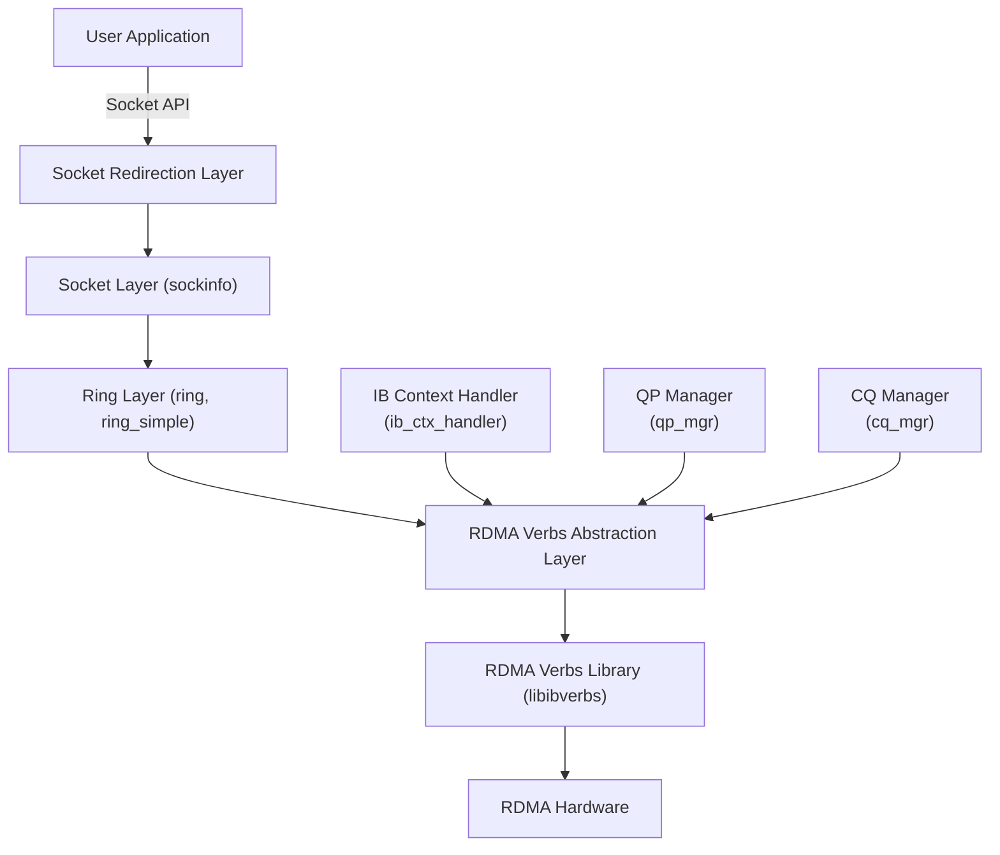
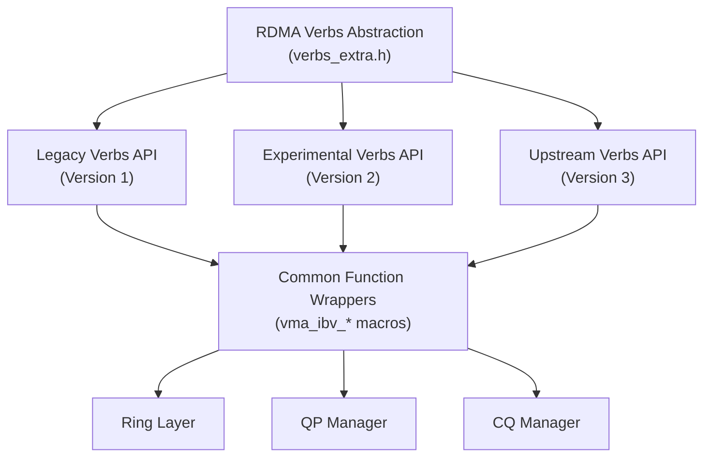
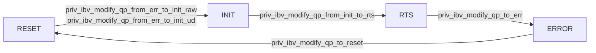
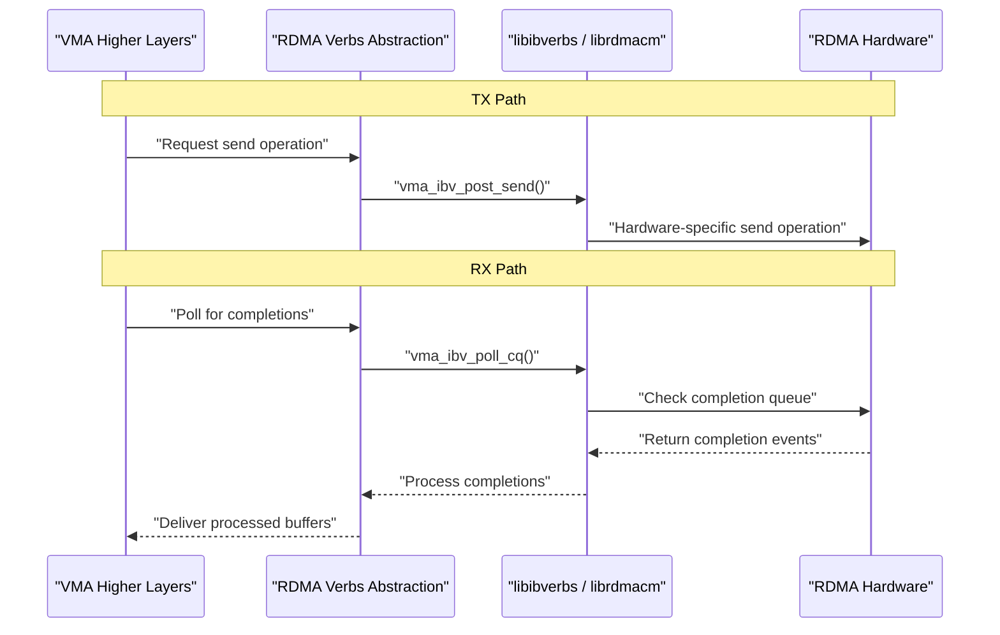

<!-- source: DeepWiki mcp.deepwiki.com · repo Mellanox/libvma · page 4.2 RDMA Verbs Abstraction · fetched 2026-11-11 -->

# RDMA Verbs Abstraction

<details>
<summary>Relevant source files</summary>

The following files were used as context for generating this wiki page:

- [config/m4/verbs.m4](config/m4/verbs.m4)
- [src/vma/dev/cq_mgr.inl](src/vma/dev/cq_mgr.inl)
- [src/vma/ib/base/verbs_extra.cpp](src/vma/ib/base/verbs_extra.cpp)
- [src/vma/ib/base/verbs_extra.h](src/vma/ib/base/verbs_extra.h)

</details>


The RDMA Verbs Abstraction layer in VMA provides a unified interface to interact with RDMA-capable hardware through the InfiniBand Verbs API. This abstraction handles the differences between various versions of the Verbs API and presents a consistent interface to the rest of VMA, enabling the library to work with different RDMA hardware and driver versions without requiring changes to higher-level components.

For information about the overall Hardware Abstraction Layer, see [Hardware Abstraction Layer](#4).
For specific information about InfiniBand Context Management, see [InfiniBand Context Management](#4.1).

## Architecture and Position in VMA

The RDMA Verbs Abstraction layer sits between VMA's higher-level components and the underlying RDMA/InfiniBand hardware access mechanisms. It serves as a critical translation layer that maps VMA's internal requirements to the appropriate RDMA API calls.



Sources: [src/vma/ib/base/verbs_extra.h:8-24]()

## VERBS Version Compatibility

VMA supports three different versions of the RDMA Verbs API through a conditional compilation framework:



The version detection happens during build time through configure scripts:

| Version | Definition | Description |
|---------|------------|-------------|
| Version 1 | `DEFINED_VERBS_VERSION=1` | Legacy Verbs API |
| Version 2 | `DEFINED_VERBS_VERSION=2` | Experimental Verbs API with extensions |
| Version 3 | `DEFINED_VERBS_VERSION=3` | Upstream Verbs API |

Sources: [src/vma/ib/base/verbs_extra.h:89-93](), [config/m4/verbs.m4:65-93]()

## Core Components

### Error Normalization

RDMA Verbs API sometimes returns errors as negative return codes and sometimes by setting errno. The abstraction layer normalizes this behavior:

```c
inline int _errnocheck(int rc) {
    if (rc < -1) {
        errno = -rc;
    }
    return rc;
}
```

Macros for standardized error handling:

```c
#define IF_VERBS_FAILURE(__func__)     { if (_errnocheck(__func__))
#define ENDIF_VERBS_FAILURE            }
```

Sources: [src/vma/ib/base/verbs_extra.h:31-47]()

### Function and Type Abstraction

The abstraction layer provides unified function and type definitions that map to the appropriate implementation based on the detected Verbs version:

| VMA Abstraction | Maps To (Based on Version) |
|-----------------|----------------------------|
| `vma_ibv_create_qp` | `ibv_create_qp`, `ibv_create_qp_ex`, or `ibv_exp_create_qp` |
| `vma_ibv_poll_cq` | `ibv_poll_cq` or `ibv_exp_poll_cq` |
| `vma_ibv_post_send` | `ibv_post_send` or `ibv_exp_post_send` |
| `vma_ibv_qp_init_attr` | `ibv_qp_init_attr`, `ibv_qp_init_attr_ex`, or `ibv_exp_qp_init_attr` |
| `vma_ibv_device_attr` | `ibv_device_attr`, `ibv_device_attr_ex`, or `ibv_exp_device_attr` |

Sources: [src/vma/ib/base/verbs_extra.h:94-196](), [src/vma/ib/base/verbs_extra.h:287-488]()

## QP Management Functions

The abstraction layer provides functions for managing QP state transitions:



Sources: [src/vma/ib/base/verbs_extra.h:62-71](), [src/vma/ib/base/verbs_extra.cpp:96-211]()

## Flow Steering Support

The abstraction layer provides unified flow specification functions for setting up flow steering rules:

```c
static inline void ibv_flow_spec_eth_set(vma_ibv_flow_spec_eth* eth, uint8_t* dst_mac, uint16_t vlan_tag)
static inline void ibv_flow_spec_ipv4_set(vma_ibv_flow_spec_ipv4* ipv4, uint32_t dst_ip, uint32_t src_ip)
static inline void ibv_flow_spec_tcp_udp_set(vma_ibv_flow_spec_tcp_udp* tcp_udp, bool is_tcp, uint16_t dst_port, uint16_t src_port)
```

These functions create flow specifications that can be used with the `vma_ibv_create_flow` function to set up hardware flow steering.

Sources: [src/vma/ib/base/verbs_extra.h:533-563]()

## Feature Detection

The RDMA Verbs Abstraction layer includes capability detection functions to determine at runtime if specific features are supported:

```c
int priv_ibv_query_flow_tag_supported(struct ibv_qp *qp, uint8_t port_num)
int priv_ibv_create_flow_supported(struct ibv_qp *qp, uint8_t port_num)
int priv_ibv_query_burst_supported(struct ibv_qp *qp, uint8_t port_num)
```

Sources: [src/vma/ib/base/verbs_extra.h:85-87](), [src/vma/ib/base/verbs_extra.cpp:227-324]()

## Advanced Features

### Hardware Checksum Offload

The abstraction layer supports TCP/IP checksum offloading to hardware:

```c
#ifdef DEFINED_IBV_DEVICE_RAW_IP_CSUM
#define vma_is_rx_hw_csum_supported(attr) ((attr)->device_cap_flags & (IBV_DEVICE_RAW_IP_CSUM | IBV_DEVICE_UD_IP_CSUM))
#define vma_wc_rx_hw_csum_ok(wc) (vma_wc_flags(wc) & IBV_WC_IP_CSUM_OK)
#else
#define vma_is_rx_hw_csum_supported(attr) 0
#define vma_wc_rx_hw_csum_ok(wc) (1)
#endif
```

Sources: [src/vma/ib/base/verbs_extra.h:134-140](), [src/vma/ib/base/verbs_extra.h:308-355]()

### Packet Pacing

Controls the rate at which packets are sent:

```c
int priv_ibv_modify_qp_ratelimit(struct ibv_qp *qp, struct vma_rate_limit_t &rate_limit, uint32_t rl_changes);
```

Sources: [src/vma/ib/base/verbs_extra.h:71](), [src/vma/ib/base/verbs_extra.cpp:337-379]()

### Flow Tagging

Enables flow identification and tracking through hardware tagging:

```c
#ifdef DEFINED_IBV_FLOW_TAG
#define VMA_IBV_FLOW_SPEC_ACTION_TAG IBV_FLOW_SPEC_ACTION_TAG
typedef struct ibv_flow_spec_action_tag vma_ibv_flow_spec_action_tag;
#define vma_get_flow_tag(cqe) ntohl((uint32_t)(cqe->sop_drop_qpn))
#else
typedef struct ibv_flow_spec_action_tag_dummy {} vma_ibv_flow_spec_action_tag;
#define vma_get_flow_tag(cqe) 0
#endif
```

Sources: [src/vma/ib/base/verbs_extra.h:223-231](), [src/vma/ib/base/verbs_extra.h:447-454]()

## Data Flow Through the Abstraction Layer



Sources: [src/vma/ib/base/verbs_extra.h:126-132](), [src/vma/ib/base/verbs_extra.h:197-198](), [src/vma/dev/cq_mgr.inl:29-44]()

## Configuration and Build-Time Detection

The RDMA Verbs capabilities are detected at build time through the `configure` script using M4 macros defined in `verbs.m4`:

```
AC_DEFUN([CHECK_VERBS_ATTRIBUTE], [
    AC_LINK_IFELSE([AC_LANG_PROGRAM([
        [#include <$2>]],
        [[int attr = (int)$1; attr = attr;]])],
        [vma_cv_attribute_$1=yes],
        [vma_cv_attribute_$1=no])
])
```

This framework allows VMA to conditionally compile support for different RDMA features based on what's available in the build environment.

Sources: [config/m4/verbs.m4:9-29](), [config/m4/verbs.m4:41-194]()

## Summary

The RDMA Verbs Abstraction layer provides a critical translation layer between VMA's higher-level components and the underlying RDMA hardware. By normalizing the API differences between various versions of the RDMA Verbs interface and providing feature detection mechanisms, it allows VMA to leverage advanced RDMA capabilities while maintaining compatibility across different hardware and driver versions.

This abstraction enables VMA to benefit from RDMA optimizations such as:
- Zero-copy data transfer
- Kernel bypass for network operations
- Hardware offloading of packet processing tasks
- Advanced flow steering mechanisms

Sources: [src/vma/ib/base/verbs_extra.h](), [src/vma/ib/base/verbs_extra.cpp]()

---

