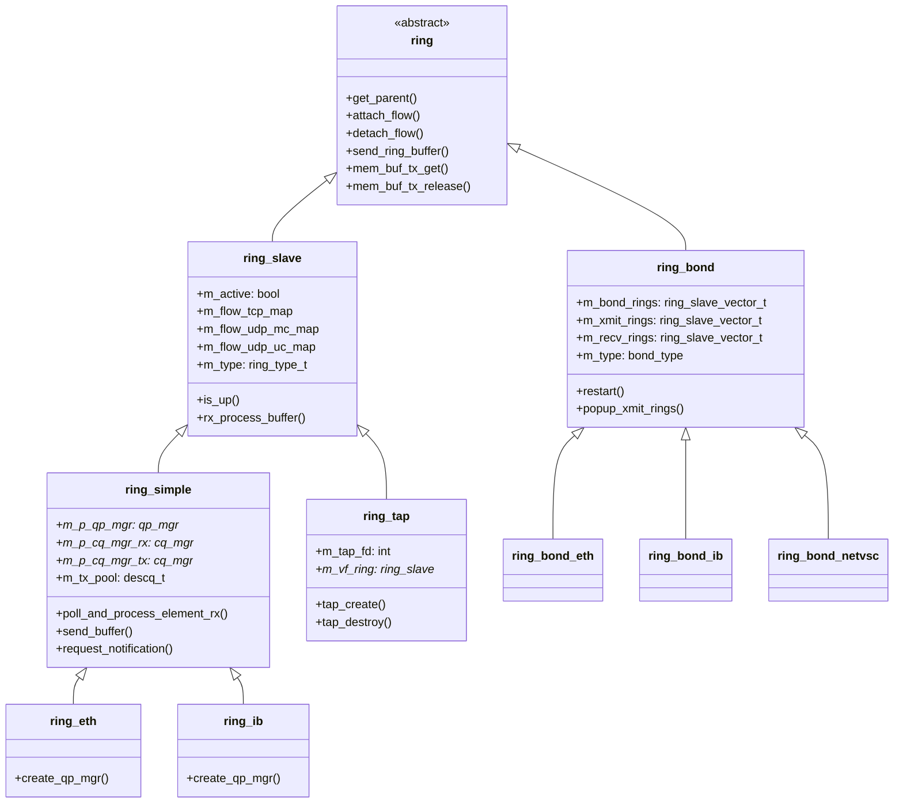
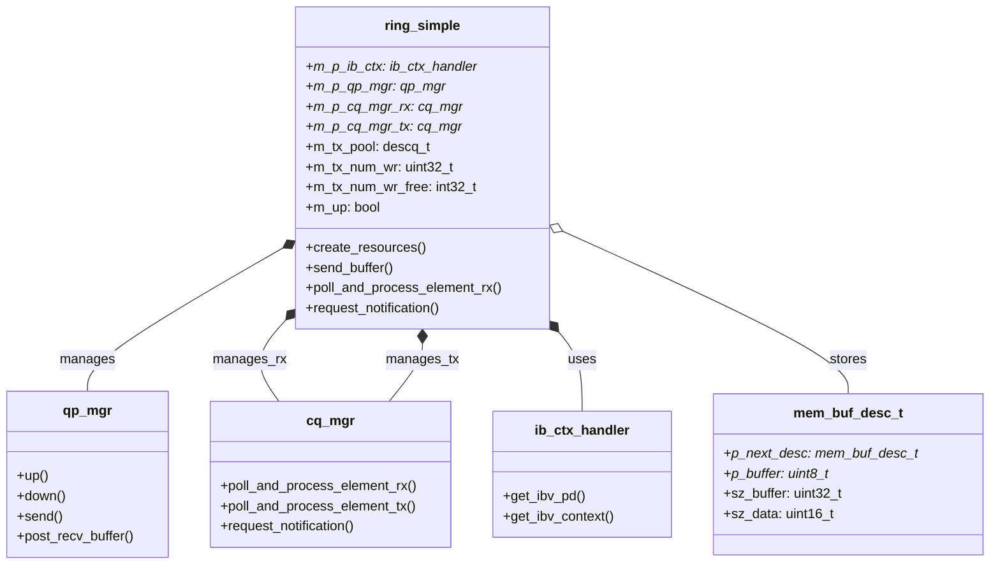
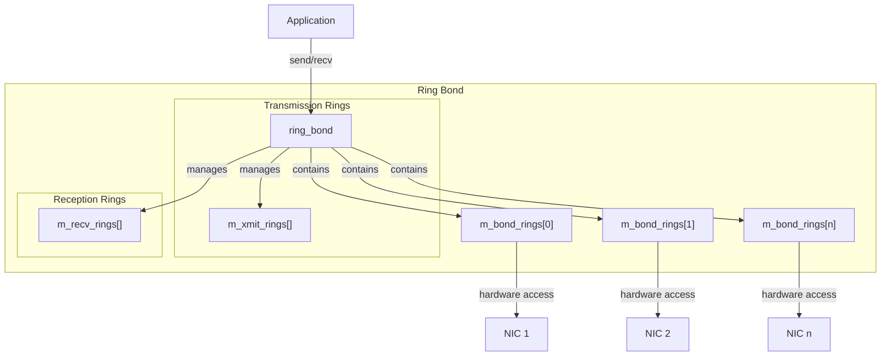
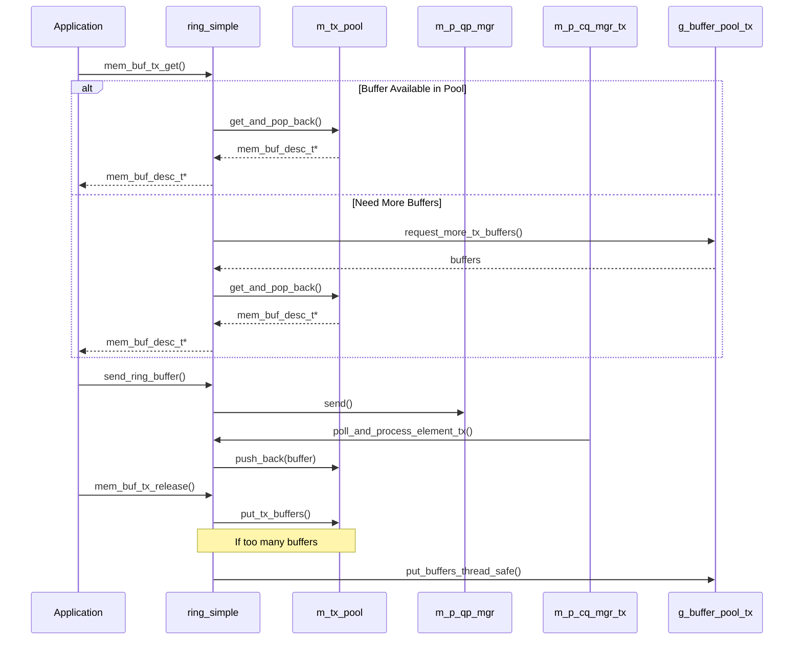
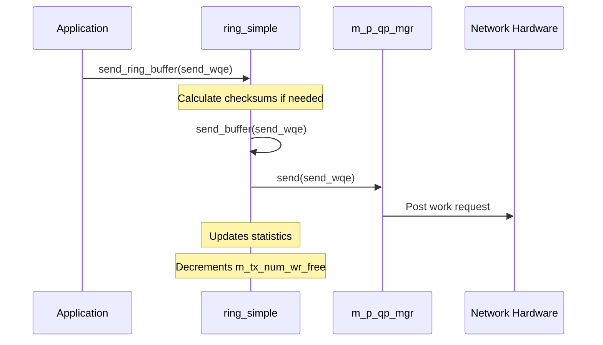
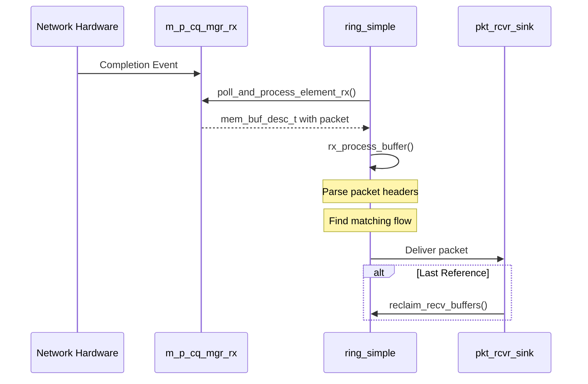
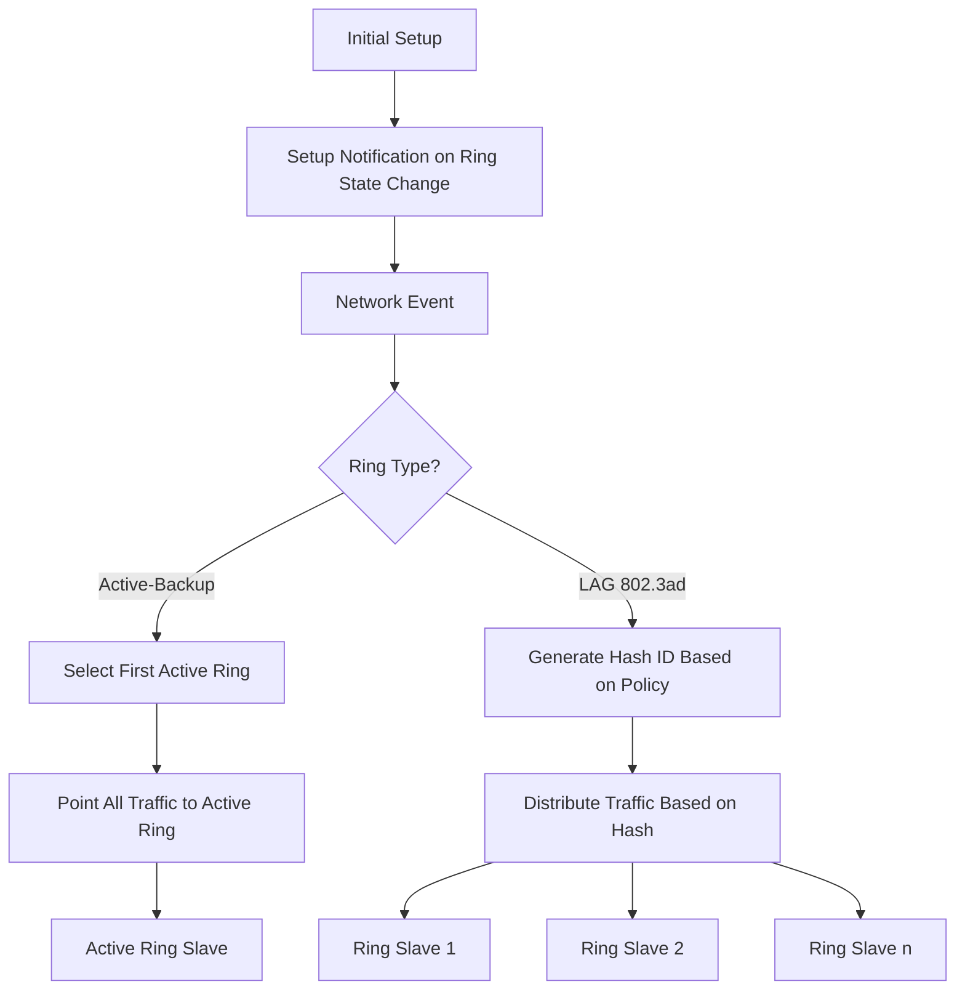

<!-- source: DeepWiki mcp.deepwiki.com · repo Mellanox/libvma · page 4.3 Ring Management · fetched 2026-11-11 -->

# Ring Management

Relevant source files

The following files were used as context for generating this wiki page:

- [src/vma/dev/ring.cpp](src/vma/dev/ring.cpp)
- [src/vma/dev/ring.h](src/vma/dev/ring.h)
- [src/vma/dev/ring_allocation_logic.cpp](src/vma/dev/ring_allocation_logic.cpp)
- [src/vma/dev/ring_allocation_logic.h](src/vma/dev/ring_allocation_logic.h)
- [src/vma/dev/ring_bond.cpp](src/vma/dev/ring_bond.cpp)
- [src/vma/dev/ring_bond.h](src/vma/dev/ring_bond.h)
- [src/vma/dev/ring_simple.cpp](src/vma/dev/ring_simple.cpp)
- [src/vma/dev/ring_simple.h](src/vma/dev/ring_simple.h)
- [src/vma/dev/ring_slave.cpp](src/vma/dev/ring_slave.cpp)
- [src/vma/dev/ring_slave.h](src/vma/dev/ring_slave.h)
- [src/vma/dev/ring_tap.cpp](src/vma/dev/ring_tap.cpp)
- [src/vma/dev/ring_tap.h](src/vma/dev/ring_tap.h)

This page documents the Ring Management system in VMA, which provides abstraction and management of network packet processing resources. Ring Management is responsible for handling packet transmission and reception through direct hardware interfaces, buffer allocation, and flow management.

For information about hardware abstraction in general, see [Hardware Abstraction Layer](#4). For specific information about Completion Queue Management, see [Completion Queue Management](#4.4).

## Overview

The Ring Management subsystem in VMA creates an abstraction layer over network hardware resources, particularly Queue Pairs (QPs) and Completion Queues (CQs) used in RDMA/InfiniBand networking. It manages the allocation, distribution, and lifecycle of these hardware resources, handling packet transmission and reception while providing efficient buffer management.

*Ring Class Hierarchy*

Sources: [src/vma/dev/ring.h:47-117](), [src/vma/dev/ring_slave.h:95-155](), [src/vma/dev/ring_simple.h:33-196](), [src/vma/dev/ring_bond.h:22-190]()

## Ring Architecture

The Ring Management system is composed of several key abstractions:

### Ring Types and Purposes

1. **Base Ring (`ring`)**
   * Abstract base class defining the interface for all ring implementations
   * Provides virtual methods for flow management and buffer operations
   * Acts as a placeholder for common ring functionality

2. **Ring Slave (`ring_slave`)**
   * Implements common ring functionality but remains an abstract base class
   * Manages flow tables for TCP and UDP traffic
   * Processes received buffers

3. **Simple Ring (`ring_simple`)**
   * Concrete implementation tied to physical network hardware
   * Directly interacts with InfiniBand/RDMA hardware through QPs and CQs
   * Manages separate buffer pools and completion queues for TX and RX

4. **Bond Ring (`ring_bond`)**
   * Aggregates multiple slave rings into a single logical interface
   * Supports active-backup configuration for fault tolerance
   * Supports LAG (Link Aggregation Group, 802.3ad) for load balancing
   * Handles distribution of traffic across slave rings

5. **TAP Ring (`ring_tap`)**
   * Software implementation using TAP devices
   * Primarily used for testing or virtualization scenarios

Sources: [src/vma/dev/ring.h:47-117](), [src/vma/dev/ring_slave.h:95-155](), [src/vma/dev/ring_simple.h:33-196](), [src/vma/dev/ring_bond.h:22-190](), [src/vma/dev/ring_tap.h:13-84]()

## Simple Ring Design

The `ring_simple` class is the primary implementation for hardware-based rings, managing direct interactions with network devices. It encapsulates Queue Pair and Completion Queue management, buffer handling, and packet sending/receiving logic.

*Simple Ring Components*

Sources: [src/vma/dev/ring_simple.h:33-196](), [src/vma/dev/ring_simple.cpp:80-196]()

### Key Components

1. **Queue Pair Manager (`m_p_qp_mgr`)**
   * Encapsulates operations on the underlying Queue Pair
   * Manages the state of the QP (up/down)
   * Handles posting send and receive work requests
   * Created via virtual function `create_qp_mgr()` for device-specific implementations

2. **Completion Queue Managers**
   * `m_p_cq_mgr_rx`: Manages receive-side completions
   * `m_p_cq_mgr_tx`: Manages transmit-side completions
   * Poll for completion events and process completed work requests
   * Request notifications for new completion events

3. **Buffer Pools**
   * `m_tx_pool`: Pool of transmit buffers
   * Manages allocation and recycling of memory buffers
   * Tracks reference counts for shared buffers

4. **Resource Management**
   * `m_tx_num_wr` and `m_tx_num_wr_free`: Track available work requests
   * `m_up`: Indicates whether the ring is operational
   * `m_p_ib_ctx`: Interface to InfiniBand context

Sources: [src/vma/dev/ring_simple.cpp:80-311](), [src/vma/dev/ring_simple.h:103-195]()

## Bond Ring Architecture

The `ring_bond` aggregates multiple `ring_slave` instances, providing capabilities like redundancy and load balancing.

*Bond Ring Architecture*

Sources: [src/vma/dev/ring_bond.h:22-190](), [src/vma/dev/ring_bond.cpp:21-176]()

### Bond Ring Types

1. **Active-Backup Mode**
   * One active slave ring handles all traffic
   * Backup rings take over if the active ring fails
   * Provides fault tolerance/high availability

2. **LAG Mode (802.3ad)**
   * Traffic distributed across multiple active slave rings
   * Distribution based on configurable hash policy:
     * Layer 2 (MAC addresses)
     * Layer 2+3 (MAC + IP addresses)
     * Layer 3+4 (IP addresses + ports)
   * Provides both increased bandwidth and fault tolerance

3. **NETVSC Mode**
   * Specialized for network virtualization scenarios
   * Combines VF (Virtual Function) ring with TAP ring

Sources: [src/vma/dev/ring_bond.cpp:668-811](), [src/vma/dev/ring_bond.h:75-95]()

## Key Operations

### Buffer Management

The ring is responsible for managing memory buffers used for packet transmission and reception. Each buffer is represented by a `mem_buf_desc_t` structure.

*Buffer Management Flow*

Sources: [src/vma/dev/ring_simple.cpp:476-589](), [src/vma/dev/ring_simple.cpp:776-825]()

### Flow Management

Rings manage the attachment and detachment of network flows to direct packets to the appropriate consumers.

1. **Flow Attachment**
   * Creates RFS (Receive Flow Steering) objects for flows
   * Associates flows with packet receivers (sinks)
   * Configures hardware filters when supported

2. **Flow Detachment**
   * Removes associations between flows and sinks
   * Cleans up RFS objects when no longer needed
   * Removes hardware filters

Sources: [src/vma/dev/ring_slave.cpp:140-449]()

### Packet Processing

The ring is the central component in packet processing, handling both transmission and reception:

#### Transmission Path:

*Transmission Path*

Sources: [src/vma/dev/ring_simple.cpp:608-658]()

#### Reception Path:

*Reception Path*

Sources: [src/vma/dev/ring_simple.cpp:335-340](), [src/vma/dev/ring_slave.cpp:479-568]()

## Ring Lifecycle Management

Rings undergo several stages in their lifecycle:

1. **Creation**
   * Ring objects are created based on network device configuration
   * `create_resources()` initializes hardware resources
   * Queue pairs and completion queues are set up
   * Buffer pools are established

2. **Activation/Deactivation**
   * `start_active_qp_mgr()`: Brings the ring's QP up
   * `stop_active_qp_mgr()`: Takes the ring's QP down
   * `is_up()`: Checks if the ring is operational

3. **Flow Attachment/Detachment**
   * `attach_flow()`: Associates flow tuples with the ring
   * `detach_flow()`: Removes flow associations

4. **Restart**
   * `restart()`: Reinitializes the ring after network changes
   * Particularly important for bond rings to adjust active slave rings

5. **Destruction**
   * Release hardware resources (QPs, CQs)
   * Free all buffer pools
   * Detach all flows

Sources: [src/vma/dev/ring_simple.cpp:209-311](), [src/vma/dev/ring_simple.cpp:962-987](), [src/vma/dev/ring_bond.cpp:122-309]()

## Ring Bond Operations

The bond ring has specific operations for managing its slave rings:

### Slave Ring Management

1. **Slave Creation and Destruction**
   * `slave_create()`: Adds a new slave ring to the bond
   * `slave_destroy()`: Removes a slave ring from the bond

2. **Ring Selection**
   * `popup_xmit_rings()`: Determines which slaves to use for transmission
   * `popup_recv_rings()`: Determines which slaves to use for reception

3. **Active Ring Selection**
   * Based on network device's slave status
   * Takes LAG configuration into account
   * Considers ring health and availability

### Ring Failover and Load Balancing

*Bond Ring Failover and Load Balancing*

Sources: [src/vma/dev/ring_bond.cpp:668-732](), [src/vma/dev/ring_bond.cpp:769-811]()

## Ring Optimization Features

### CQ Moderation

Rings implement Completion Queue moderation to optimize interrupt and processing behavior:

1. **Moderation Configuration**
   * `modify_cq_moderation()`: Sets period and count for moderation
   * Configured via system variables or dynamically

2. **Adaptive Moderation**
   * `adapt_cq_moderation()`: Dynamically adjusts moderation settings
   * Balances latency vs. throughput based on traffic patterns

Sources: [src/vma/dev/ring_simple.cpp:890-960]()

### Buffer Pool Management

Efficient buffer management is critical for performance:

1. **Buffer Allocation**
   * Pre-allocates buffers during initialization
   * Dynamically requests additional buffers as needed

2. **Buffer Recycling**
   * Returns unused buffers to pools
   * Maintains reference counts for shared buffers
   * Efficiently reclaims memory

3. **Global Pool Integration**
   * Exchanges buffers with global pools when local counts are imbalanced
   * Prevents buffer starvation and overpopulation

Sources: [src/vma/dev/ring_simple.cpp:776-825]()

## Integration with VMA

The Ring Management system integrates with other VMA components:

1. **Socket Layer Integration**
   * Sockets use rings for data transmission and reception
   * Flow tuples from sockets are attached to rings

2. **Hardware Abstraction**
   * Abstracts underlying hardware details (IB, Ethernet)
   * Provides common interface for different hardware types

3. **Flow Management**
   * Maps network flows to appropriate packet processors
   * Uses hardware-assisted steering when available

4. **Buffer Management**
   * Coordinates with global buffer pools
   * Ensures efficient buffer utilization

The Ring Management subsystem is a critical part of VMA's high-performance networking stack, providing the interface between user applications and hardware acceleration capabilities.

Sources: [src/vma/dev/ring.h:47-117](), [src/vma/dev/ring_simple.h:33-196](), [src/vma/dev/ring_bond.h:22-190]()

---

