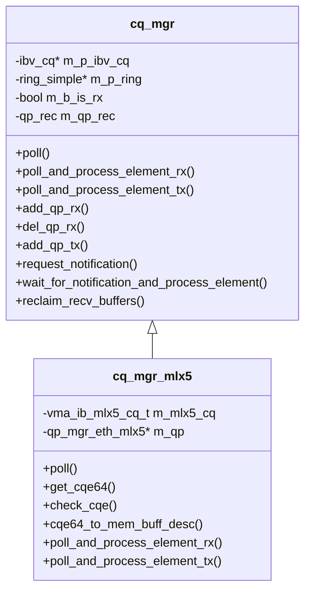
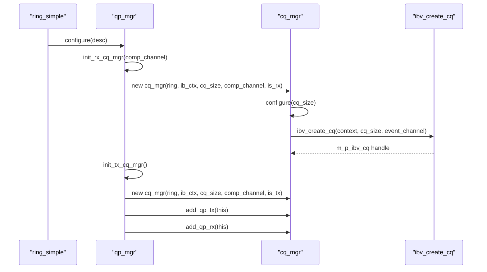
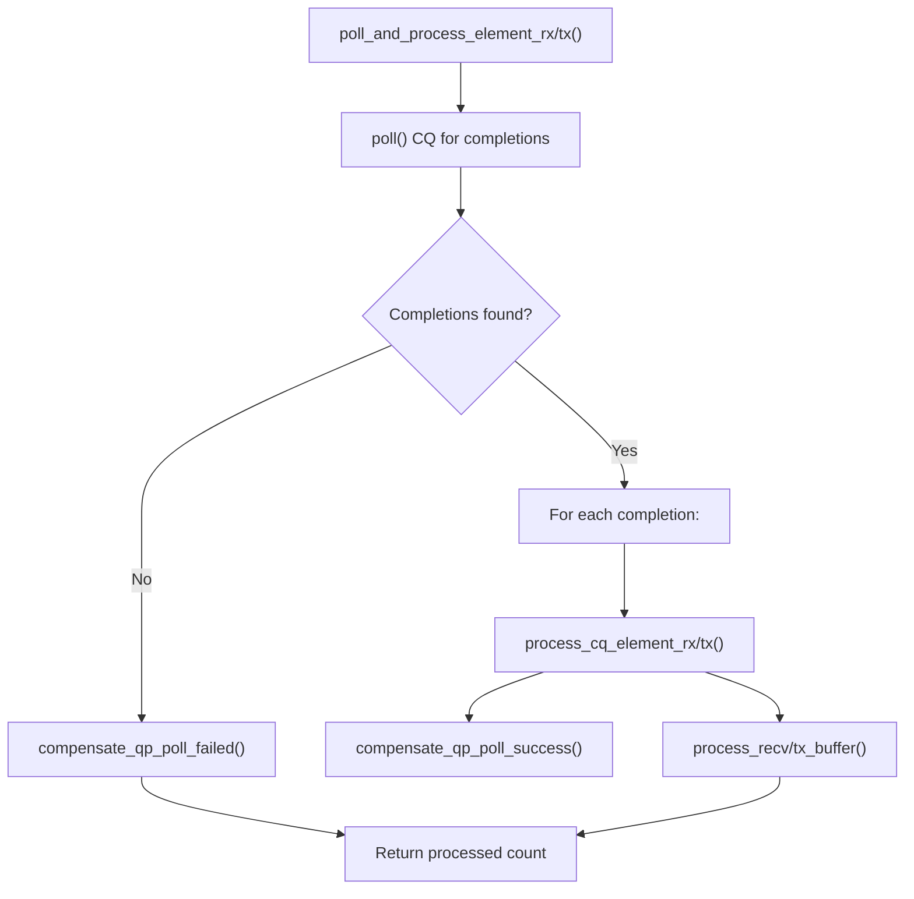
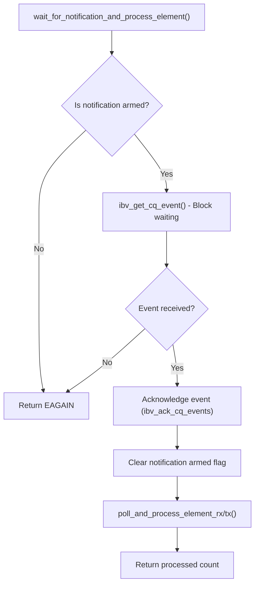
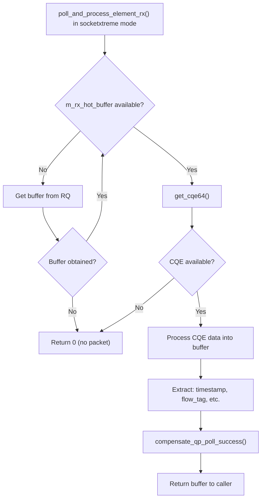
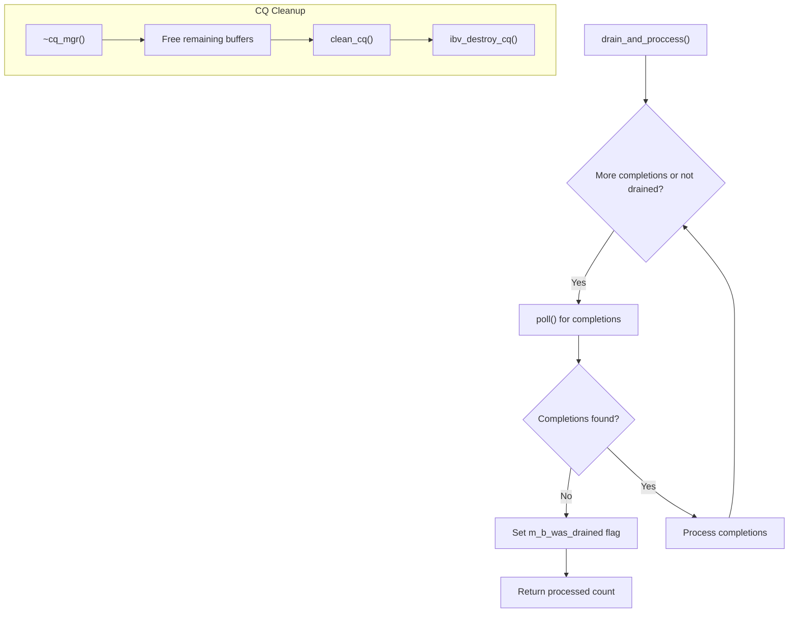

<!-- source: DeepWiki mcp.deepwiki.com · repo Mellanox/libvma · page 4.4 Completion Queue Management · fetched 2026-11-11 -->

# Completion Queue Management

Relevant source files

The following files were used as context for generating this wiki page:

- [src/vma/dev/cq_mgr.cpp](src/vma/dev/cq_mgr.cpp)
- [src/vma/dev/cq_mgr.h](src/vma/dev/cq_mgr.h)
- [src/vma/dev/cq_mgr_mlx5.cpp](src/vma/dev/cq_mgr_mlx5.cpp)
- [src/vma/dev/cq_mgr_mlx5.h](src/vma/dev/cq_mgr_mlx5.h)
- [src/vma/dev/cq_mgr_mlx5.inl](src/vma/dev/cq_mgr_mlx5.inl)
- [src/vma/dev/qp_mgr.cpp](src/vma/dev/qp_mgr.cpp)
- [src/vma/dev/qp_mgr.h](src/vma/dev/qp_mgr.h)
- [src/vma/dev/qp_mgr_eth_mlx5.cpp](src/vma/dev/qp_mgr_eth_mlx5.cpp)
- [src/vma/dev/qp_mgr_eth_mlx5.h](src/vma/dev/qp_mgr_eth_mlx5.h)

This page documents the Completion Queue (CQ) management system in VMA, which handles RDMA completion events for both receive (Rx) and transmit (Tx) operations. It explains how VMA processes completion queue entries (CQEs), manages buffer resources, and integrates with the Queue Pair (QP) system to provide efficient network operations.

For information about Queue Pair management, see [Hardware Abstraction Layer](#4) and [Ring Management](#4.3).

## Architecture Overview

The Completion Queue management in VMA is implemented through a class hierarchy with a base `cq_mgr` class providing common functionality, and specialized implementations like `cq_mgr_mlx5` for specific hardware.

The architecture is designed to:
1. Process completion events efficiently from RDMA hardware
2. Manage memory buffers associated with completed operations
3. Provide notification mechanisms to upper layers
4. Support both polling and event-based completion handling

Sources: [src/vma/dev/cq_mgr.h:56-233](), [src/vma/dev/cq_mgr_mlx5.h:23-66]()

## Creation and Configuration

Completion queues are created during the initialization of network endpoints. Each queue pair (QP) is associated with both a transmit and receive completion queue.

### Creation Process

The key configuration parameters include:
- CQ size (number of completion entries)
- Association with a completion event channel (for notifications)
- Designation as Rx or Tx CQ
- Hardware-specific attributes

Sources: [src/vma/dev/cq_mgr.cpp:51-133](), [src/vma/dev/qp_mgr.cpp:111-147]()

## Completion Processing Methods

VMA supports two primary methods for processing completions:

### 1. Polling Mechanism

In polling mode, the CQ manager actively checks for completions through the `poll()` method, which retrieves completion entries from the hardware. When completions are found, they are processed and appropriate action is taken.

For MLX5 hardware, `cq_mgr_mlx5` implements an optimized polling method that directly accesses hardware completion queue structures.

Sources: [src/vma/dev/cq_mgr.cpp:307-378](), [src/vma/dev/cq_mgr.cpp:613-656](), [src/vma/dev/cq_mgr_mlx5.cpp:85-154]()

### 2. Event-Based Notification

In notification mode, the application waits for the hardware to signal when completions are available. This is more efficient for latency-sensitive applications or low-traffic scenarios.

The notification mechanism is armed with `request_notification()` and handled by `wait_for_notification_and_process_element()`.

Sources: [src/vma/dev/cq_mgr.cpp:840-946]()

## Buffer Management

The CQ manager is responsible for handling memory buffers associated with completions:

```mermaid
flowchart TD
    subgraph "Receive Path"
        RxCompletion["RX Completion"] --> ProcessRx["process_cq_element_rx()"]
        ProcessRx --> CheckStatus{"Valid completion?"}
        CheckStatus -->|"Error"| ErrorRx["mem_buf_desc_completion_with_error_rx()"]
        CheckStatus -->|"Success"| Validate["Validate packet: HW checksum, etc."]
        Validate --> Deliver["process_recv_buffer()"]
        ErrorRx --> Return["Return to buffer pool"]
    end
    
    subgraph "Transmit Path"
        TxCompletion["TX Completion"] --> ProcessTx["process_cq_element_tx()"]
        ProcessTx --> CheckTxStatus{"Valid completion?"}
        CheckTxStatus -->|"Error"| ErrorTx["mem_buf_desc_completion_with_error_tx()"]
        CheckTxStatus -->|"Success"| ProcessList["process_tx_buffer_list()"]
        ProcessList --> ReturnTx["mem_buf_desc_return_to_owner_tx()"]
    end
    
    subgraph "QP Compensation"
        CompSuccess["compensate_qp_poll_success()"] --> CheckPool{"Buffer pool sufficient?"}
        CheckPool -->|"Yes"| PostRecv["Post receive buffers from pool"]
        CheckPool -->|"No"| RequestMore["request_more_buffers()"]
        RequestMore --> PostRecv
        
        CompFail["compensate_qp_poll_failed()"] --> CheckDebt{"QP buffer debt?"}
        CheckDebt -->|"Yes"| PostDebt["Post receive buffers to cover debt"]
    end
```

Key buffer management functions:

1. **Processing completions**:
   - `process_cq_element_rx()`: Processes receive completions
   - `process_cq_element_tx()`: Processes transmit completions

2. **Buffer reclamation**:
   - `reclaim_recv_buffers()`: Returns buffers to their owners/pools
   - `reclaim_recv_buffer_helper()`: Helper function for buffer reclamation

3. **Queue pair compensation**:
   - `compensate_qp_poll_success()`: Maintains receive queue depth after successful poll
   - `compensate_qp_poll_failed()`: Maintains receive queue depth after poll with no completions

Sources: [src/vma/dev/cq_mgr.cpp:405-508](), [src/vma/dev/cq_mgr.cpp:510-543](), [src/vma/dev/cq_mgr.cpp:544-611]()

## Integration with Queue Pairs

CQ managers work closely with Queue Pairs (QPs) to manage the send and receive operations:

```mermaid
flowchart TD
    subgraph "QP Creation"
        CreateQP["qp_mgr::configure()"] --> InitRxCQ["init_rx_cq_mgr()"]
        CreateQP --> InitTxCQ["init_tx_cq_mgr()"]
        InitRxCQ --> CQManagerRx["new cq_mgr(is_rx=true)"]
        InitTxCQ --> CQManagerTx["new cq_mgr(is_rx=false)"]
    end
    
    subgraph "QP Association"
        QP["qp_mgr"] --> RingUp["qp_mgr::up()"]
        RingUp --> ModifyQP["modify_qp_to_ready_state()"]
        ModifyQP --> AddQPRx["cq_mgr::add_qp_rx(qp)"]
        RingUp --> AddQPTx["cq_mgr::add_qp_tx(qp)"]
    end
    
    subgraph "QP Teardown"
        QPDown["qp_mgr::down()"] --> ErrorState["modify_qp_to_error_state()"]
        ErrorState --> TriggerComp["trigger_completion_for_all_sent_packets()"]
        TriggerComp --> ReleaseRx["release_rx_buffers()"]
        ReleaseRx --> ReleaseTx["release_tx_buffers()"]
        ReleaseTx --> DelQP["cq_mgr::del_qp_rx(qp)"]
    end
```

Key integration points:

1. **QP Creation and Association**:
   - Each QP is created with references to its Rx and Tx CQs
   - CQs keep track of associated QPs in the `m_qp_rec` structure

2. **Buffer Management**:
   - CQs ensure QP receive queues remain populated
   - QPs notify CQs when operations complete

3. **Lifecycle Management**:
   - QP state transitions are coordinated with CQ operations
   - During QP teardown, CQs help reclaim outstanding buffers

Sources: [src/vma/dev/cq_mgr.cpp:218-278](), [src/vma/dev/qp_mgr.cpp:326-409]()

## Performance Optimizations

The CQ management system implements several optimizations to maximize performance:

```mermaid
flowchart TD
    subgraph "Batched Processing"
        Batch["Batched completion processing"] --> PollMultiple["poll multiple entries at once"]
        PollMultiple --> BatchLimit["Limit: m_n_sysvar_cq_poll_batch_max"]
    end
    
    subgraph "Completion Signaling"
        SignalStrategy["Controlled TX completion signaling"] --> UnsignaledCount["Track unsignaled operations"]
        UnsignaledCount --> SignalPeriodic["Signal every N operations"]
        SignalPeriodic --> Limit["m_n_sysvar_tx_num_wr_to_signal"]
    end
    
    subgraph "Memory Optimizations"
        Prefetch["Memory prefetching"] --> PrefetchData["prefetch_range() for packet data"]
        PrefetchData --> NextDesc["prefetch next descriptors"]
        BufferPool["Efficient buffer pooling"] --> CompLevel["m_n_sysvar_qp_compensation_level"]
    end
    
    subgraph "Hardware-Specific Optimizations"
        MLX5["MLX5 optimizations"] --> DirectCQ["Direct CQ access"]
        MLX5 --> HWChecksum["Hardware checksum detection"]
        MLX5 --> HWTimestamp["Hardware timestamp extraction"]
    end
```

Key optimizations include:

1. **Batched processing**:
   - Processing multiple completions in a single operation
   - Configurable via `m_n_sysvar_cq_poll_batch_max`

2. **Completion signaling strategy**:
   - Reducing overhead by only signaling completions periodically
   - Controlled via `m_n_sysvar_tx_num_wr_to_signal`

3. **Memory optimizations**:
   - Prefetching of memory to reduce cache misses
   - Efficient buffer pool management
   - Optimized buffer descriptor handling

4. **Hardware-specific optimizations**:
   - `cq_mgr_mlx5` provides direct hardware access for MLX5 devices
   - Hardware checksum offload detection
   - Hardware timestamp extraction
   - Flow tag support

Sources: [src/vma/dev/cq_mgr.cpp:307-378](), [src/vma/dev/qp_mgr.cpp:590-652](), [src/vma/dev/cq_mgr_mlx5.cpp:85-154]()

## Advanced Features

The CQ management system supports several advanced features:

### SocketXtreme Mode

SocketXtreme mode provides a specialized interface for high-performance applications:
- Zero-copy packet delivery
- Direct buffer management
- Optimized polling interfaces

Sources: [src/vma/dev/cq_mgr_mlx5.cpp:537-601]()

### Hardware Offloads

The CQ system supports various hardware offloads:

1. **Hardware Checksum Verification**:
   - Detection of checksum calculation in hardware
   - Flagging packets that need software checksum verification

2. **Hardware Timestamps**:
   - Extraction of packet timestamps from completion entries
   - Storage in buffer descriptors for application access

3. **Flow Tags**:
   - Extraction of flow identification tags
   - Support for flow steering and classification

Sources: [src/vma/dev/cq_mgr.cpp:483-508](), [src/vma/dev/cq_mgr_mlx5.cpp:156-214]()

## Draining and Cleanup

The CQ management system provides mechanisms for draining the completion queue during shutdown or error handling:

Key cleanup operations:

1. **Draining the CQ**:
   - `drain_and_proccess()`: Polls and processes all available completions
   - Used during shutdown or when QPs are taken down

2. **Resource cleanup**:
   - Buffer reclamation through `reclaim_recv_buffers()`
   - Destruction of the underlying `ibv_cq` object

3. **Statistics reporting**:
   - Tracking and reporting completion statistics
   - Used for monitoring and troubleshooting

Sources: [src/vma/dev/cq_mgr.cpp:142-197](), [src/vma/dev/cq_mgr.cpp:752-835]()

## Summary

The Completion Queue management system in VMA provides an efficient framework for handling RDMA completion events. It balances performance and resource utilization through:

1. Flexible completion processing methods (polling and event-based)
2. Sophisticated buffer management
3. Tight integration with Queue Pairs
4. Performance optimizations for modern hardware
5. Support for advanced networking features

This system is critical for achieving high throughput and low latency in RDMA-based networking applications.

Sources: [src/vma/dev/cq_mgr.h:56-233](), [src/vma/dev/cq_mgr.cpp:51-946](), [src/vma/dev/cq_mgr_mlx5.h:23-66](), [src/vma/dev/cq_mgr_mlx5.cpp:27-601]()

---

