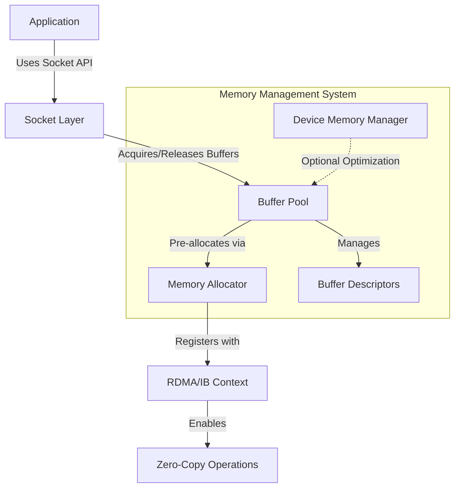
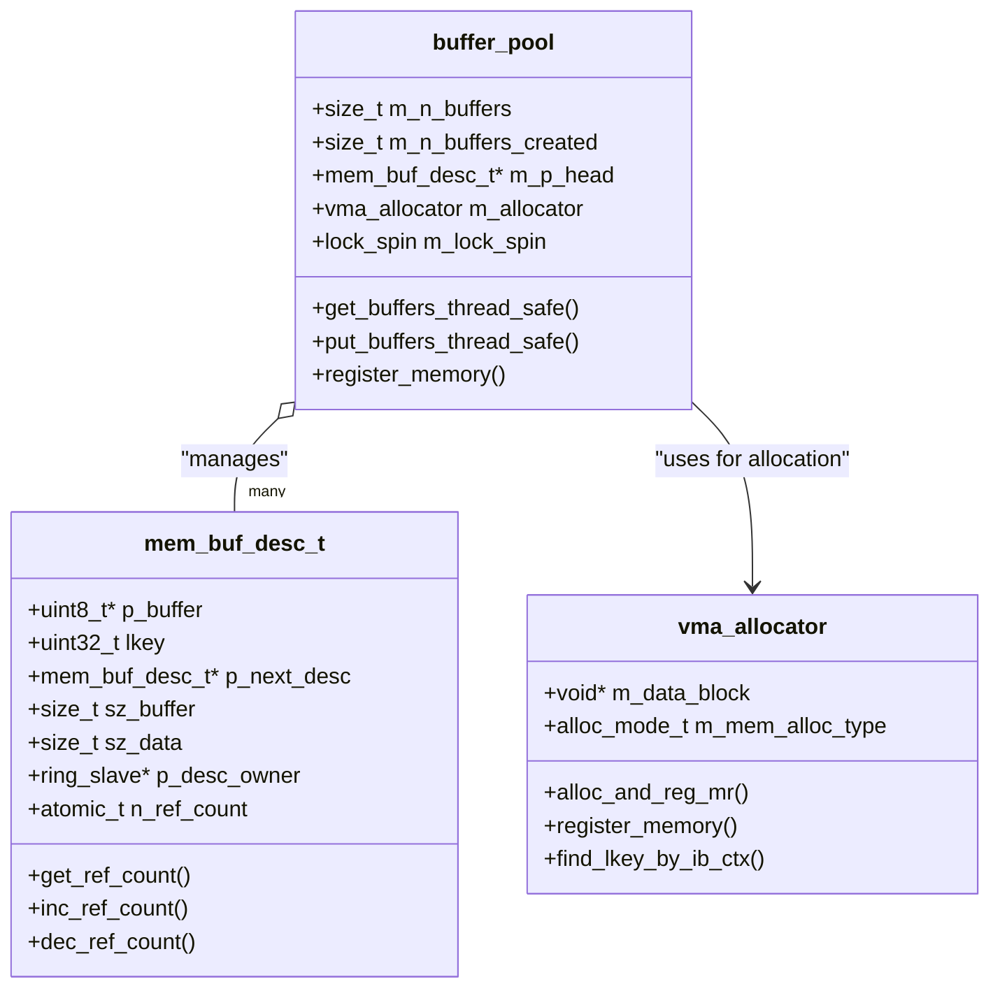
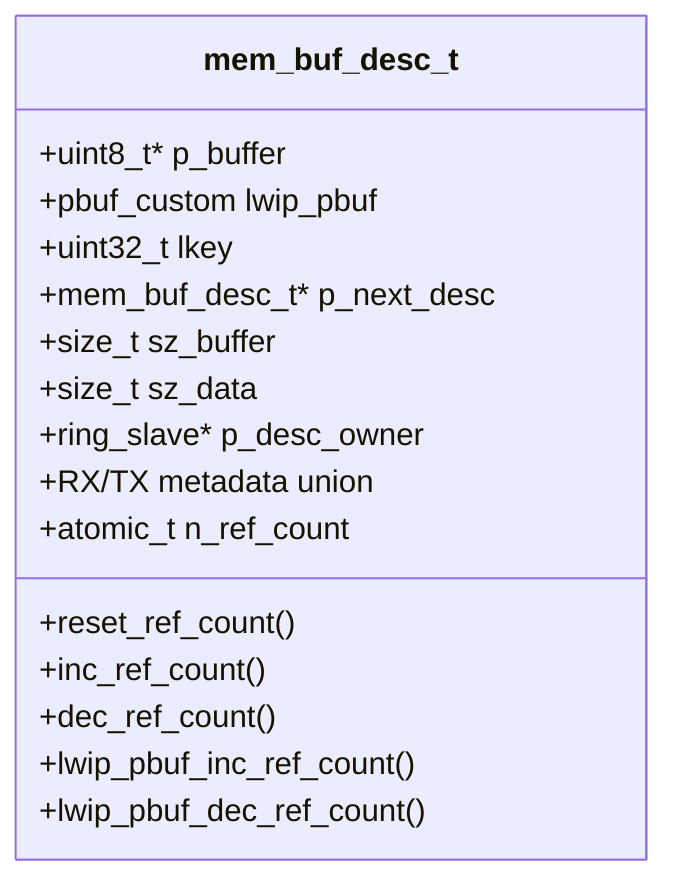
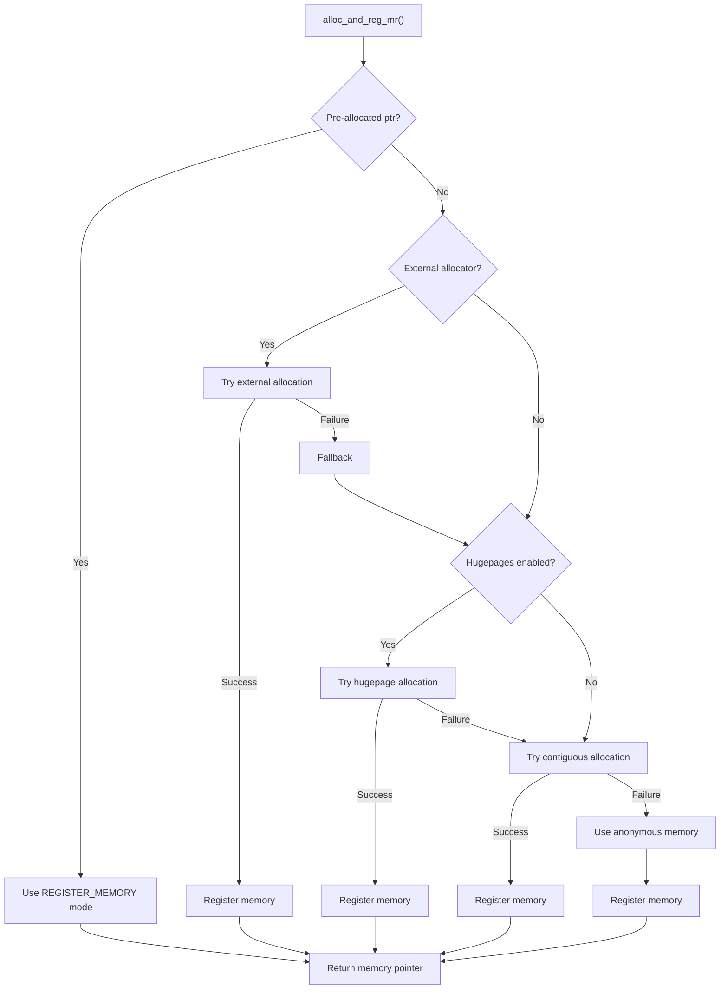
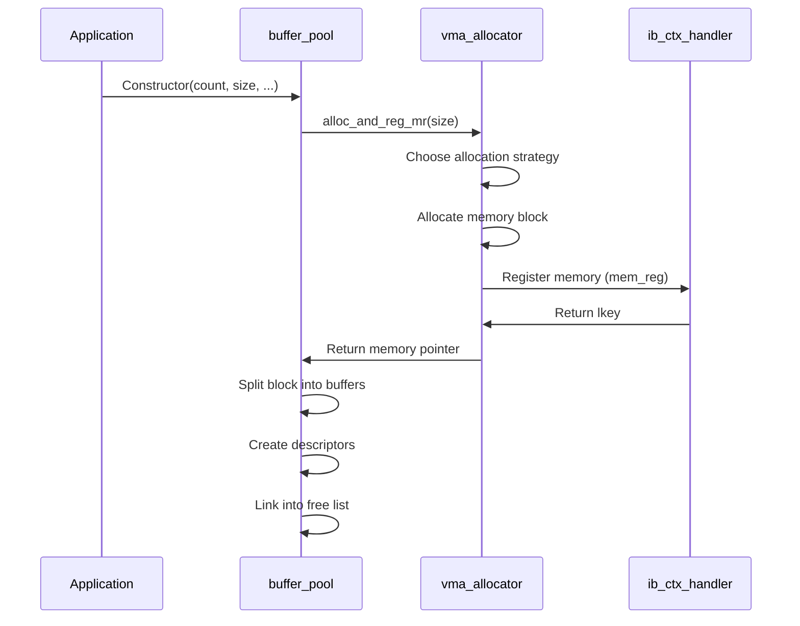
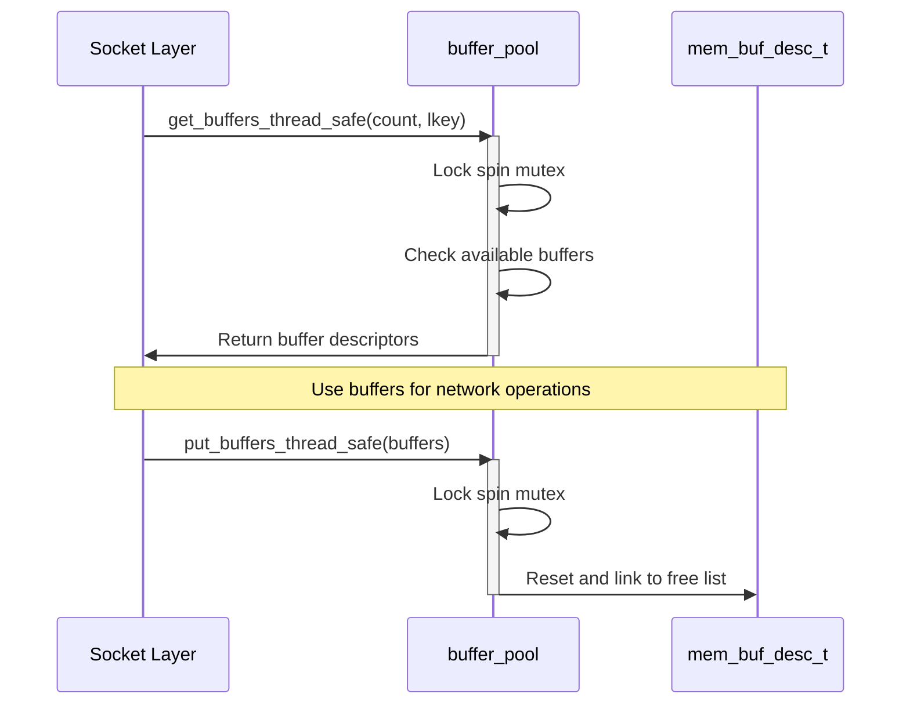
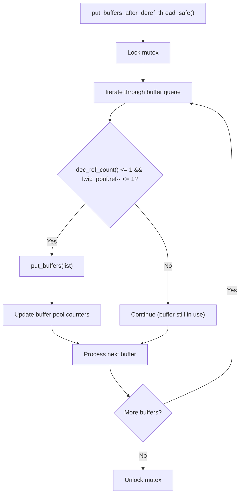
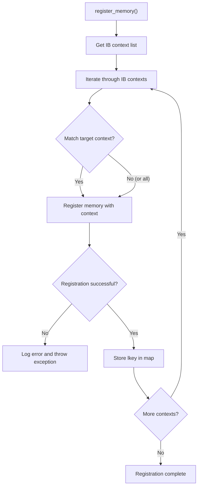
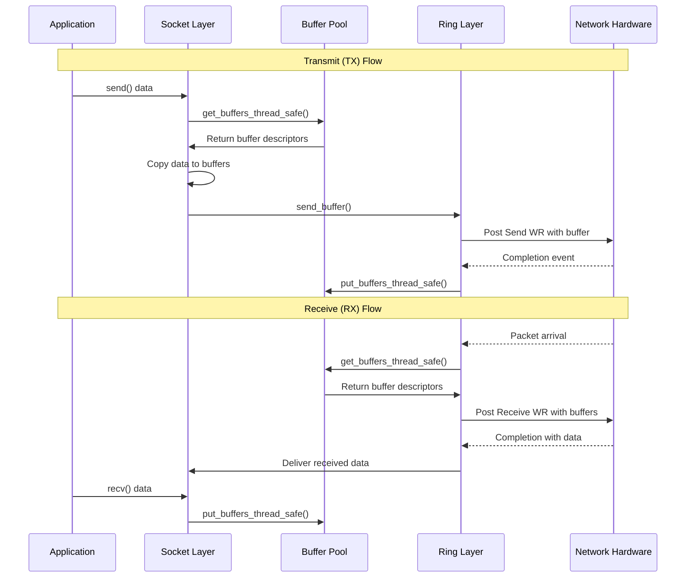

<!-- source: DeepWiki mcp.deepwiki.com · repo Mellanox/libvma · page 4.5 Memory Management · fetched 2026-11-11 -->

# Memory Management

Relevant source files

The following files were used as context for generating this wiki page:

- [src/vma/dev/allocator.cpp](src/vma/dev/allocator.cpp)
- [src/vma/dev/allocator.h](src/vma/dev/allocator.h)
- [src/vma/dev/buffer_pool.cpp](src/vma/dev/buffer_pool.cpp)
- [src/vma/dev/buffer_pool.h](src/vma/dev/buffer_pool.h)
- [src/vma/dev/dm_mgr.cpp](src/vma/dev/dm_mgr.cpp)
- [src/vma/dev/dm_mgr.h](src/vma/dev/dm_mgr.h)
- [src/vma/proto/mem_buf_desc.h](src/vma/proto/mem_buf_desc.h)

## Purpose and Scope

This document describes the memory management system within the VMA (Versatile Message Accelerator) library. The memory management system is responsible for efficiently allocating, managing, and tracking network buffers for high-performance, zero-copy data transfer operations. It includes buffer pooling, memory allocation strategies, buffer descriptor management, and memory registration with RDMA-capable hardware.

## Overview of Memory Management in VMA

The VMA memory management system is designed to minimize allocations during packet processing by pre-allocating and reusing memory buffers. It also provides efficient integration with RDMA hardware through memory registration to enable zero-copy operations.

Sources: [src/vma/dev/buffer_pool.h:25-96](), [src/vma/dev/allocator.h:17-38](), [src/vma/proto/mem_buf_desc.h:34-116]()

## Memory Components

### Buffer Pools

VMA maintains two global buffer pools:
- `g_buffer_pool_rx`: For receive operations
- `g_buffer_pool_tx`: For transmit operations

These pools pre-allocate memory during initialization and manage the lifecycle of memory buffers throughout the application's execution.

Sources: [src/vma/dev/buffer_pool.h:21-99](), [src/vma/dev/buffer_pool.cpp:21-22]()

### Memory Buffer Descriptor

The `mem_buf_desc_t` class serves as the central data structure for tracking and managing memory buffers. Each descriptor contains:

- A pointer to the actual memory buffer
- Metadata for packet processing (separate for RX and TX paths)
- Reference counting mechanism
- Integration with the LWIP network stack
- RDMA registration information (lkey)
- Owner information and buffer state

Sources: [src/vma/proto/mem_buf_desc.h:34-116]()

## Memory Allocation Strategies

VMA's allocator (`vma_allocator`) supports multiple memory allocation strategies, selected based on configuration and hardware capabilities:

| Allocation Type | Description | Benefits |
|----------------|------------|----------|
| ALLOC_TYPE_EXTERNAL | Uses custom allocation functions | Integration with external memory management |
| ALLOC_TYPE_HUGEPAGES | Uses huge pages (sysv or mmap) | Reduced TLB misses, better performance |
| ALLOC_TYPE_CONTIG | Allocates contiguous memory pages | Better hardware interaction |
| ALLOC_TYPE_ANON | Standard aligned memory allocation | Fallback method |
| ALLOC_TYPE_REGISTER_MEMORY | Uses pre-allocated memory | For externally managed memory |

Sources: [src/vma/dev/allocator.cpp:89-148](), [src/vma/dev/allocator.h:17-38]()

### Huge Pages Allocation

For performance-critical applications, VMA attempts to use huge pages to reduce TLB (Translation Lookaside Buffer) misses. It tries two methods:

1. Memory-mapped huge pages using `mmap` with `MAP_HUGETLB` flag
2. System V shared memory with `SHM_HUGETLB` flag

If huge pages allocation fails, VMA falls back to other allocation methods and logs a warning.

Sources: [src/vma/dev/allocator.cpp:160-263]()

## Buffer Pool Operation

### Initialization

During initialization, the buffer pool:

1. Allocates a large memory block using the chosen allocation strategy
2. Divides the memory into individual buffers
3. Creates a descriptor for each buffer
4. Links descriptors in a free list for efficient management
5. Registers memory with the RDMA/InfiniBand subsystem

Sources: [src/vma/dev/buffer_pool.cpp:51-98]()

### Buffer Allocation and Recycling

VMA uses a thread-safe mechanism to allocate and recycle buffers:

- `get_buffers_thread_safe()`: Acquires buffers from the pool for network operations
- `put_buffers_thread_safe()`: Returns buffers to the pool after use

The buffer pool maintains a linked list of free buffers, with each buffer having its own descriptor. When buffers are needed, they're removed from the free list and linked to the requesting component. When buffers are released, they're returned to the pool's free list.

Sources: [src/vma/dev/buffer_pool.cpp:131-165](), [src/vma/dev/buffer_pool.cpp:284-339]()

## Reference Counting

Memory buffers in VMA employ reference counting to track usage and ensure proper recycling. This is particularly important because multiple components may reference the same buffer.

Two separate reference counting mechanisms are used:
1. VMA internal reference counting (`n_ref_count`)
2. LWIP reference counting (`lwip_pbuf.pbuf.ref`)

A buffer is only returned to the pool when both reference counts reach zero, indicating that it's no longer in use by any component.

Sources: [src/vma/dev/buffer_pool.cpp:330-339](), [src/vma/proto/mem_buf_desc.h:107-115]()

## RDMA Memory Registration

To enable zero-copy RDMA operations, memory must be registered with each InfiniBand device. The `vma_allocator` class handles this process:

1. Memory is allocated using the selected strategy
2. The memory is registered with each relevant InfiniBand context
3. Registration produces local keys (lkeys) that are stored in a map
4. These keys are used later for RDMA operations

Sources: [src/vma/dev/allocator.cpp:293-361]()

## Device Memory Optimization

For supported hardware (primarily Mellanox ConnectX-5 and newer), VMA can utilize on-device memory through the `dm_mgr` class to reduce PCIe transfers and improve performance:

1. During ring initialization, device memory is allocated if supported
2. When sending data, VMA attempts to copy it to device memory
3. A cyclic buffer management system tracks memory usage
4. For alignment requirements, data is padded to 8-byte boundaries

Device memory is particularly useful for small packets, as it can significantly reduce PCIe overhead.

Sources: [src/vma/dev/dm_mgr.cpp:41-241](), [src/vma/dev/dm_mgr.h:21-39]()

## Memory Flow in VMA Operations

The following diagram illustrates how memory buffers flow through VMA during send and receive operations:

Sources: [src/vma/dev/buffer_pool.cpp:131-165](), [src/vma/dev/buffer_pool.cpp:284-339]()

## Related Pages

- For more information about the Ring Layer, see [Ring Management](#4.3)
- For details on how VMA interfaces with InfiniBand hardware, see [InfiniBand Context Management](#4.1)
- For information about the higher-level socket operations, see [Socket Implementation](#2.2)

---

