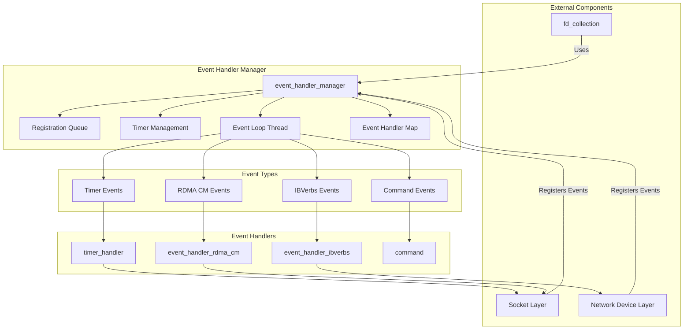
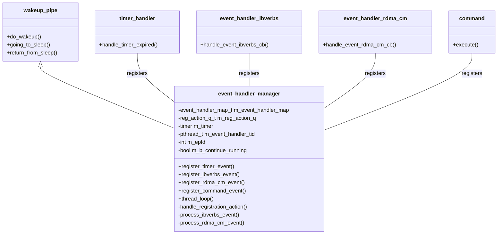
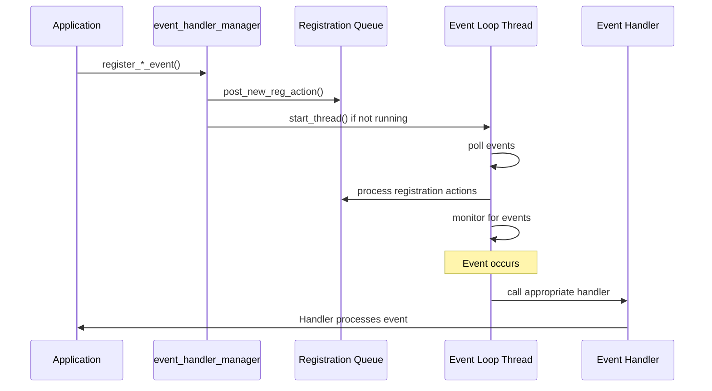
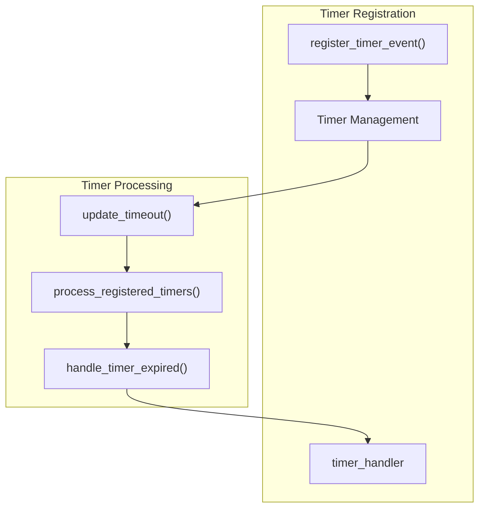
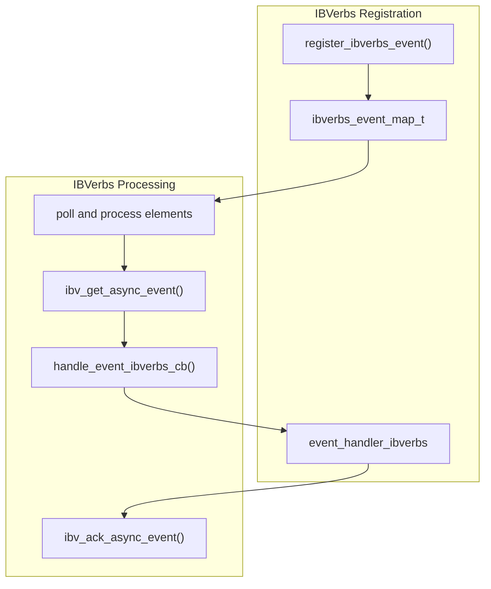
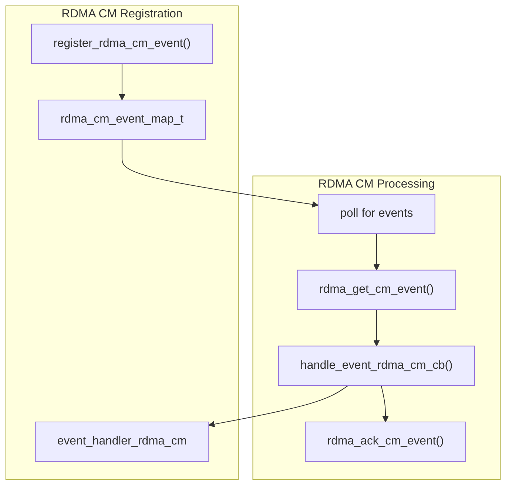
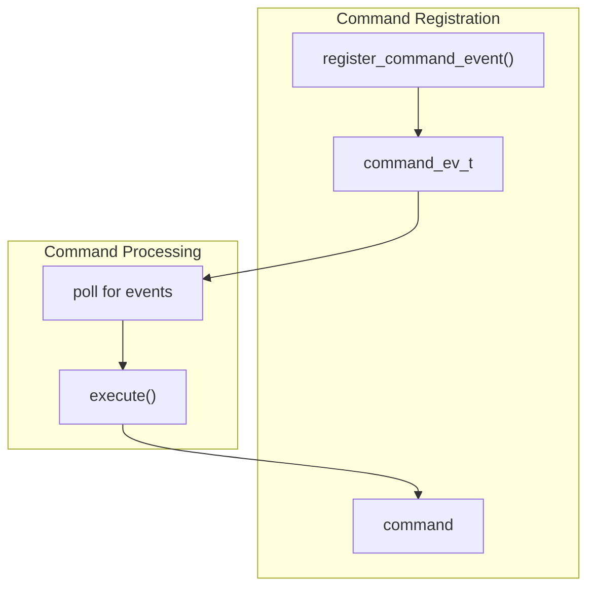
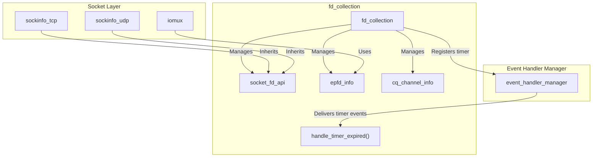

<!-- source: DeepWiki mcp.deepwiki.com · repo Mellanox/libvma · page 5 Event Handling · fetched 2026-11-11 -->

# Event Handling

<details>
<summary>Relevant source files</summary>

The following files were used as context for generating this wiki page:

- [src/vma/event/event_handler_manager.cpp](src/vma/event/event_handler_manager.cpp)
- [src/vma/event/event_handler_manager.h](src/vma/event/event_handler_manager.h)
- [src/vma/sock/fd_collection.cpp](src/vma/sock/fd_collection.cpp)
- [src/vma/sock/fd_collection.h](src/vma/sock/fd_collection.h)
- [src/vma/util/chunk_list.h](src/vma/util/chunk_list.h)
- [src/vma/util/vma_list.h](src/vma/util/vma_list.h)
- [src/vma/util/wakeup.cpp](src/vma/util/wakeup.cpp)
- [src/vma/util/wakeup.h](src/vma/util/wakeup.h)

</details>


The Event Handling system in VMA provides a centralized mechanism for managing and processing various types of asynchronous events within the library. This includes timer events, InfiniBand (IB) events, RDMA Connection Manager events, and command events. The system enables efficient event notification and dispatching while maintaining a unified interface for different event types.

## System Overview



Sources: [src/vma/event/event_handler_manager.h:152-156](), [src/vma/event/event_handler_manager.h:28-39](), [src/vma/event/event_handler_manager.cpp:102-109]()

## Core Components

The event handling system consists of the following core components:

### Event Handler Manager

The `event_handler_manager` class is the central component that coordinates event registration, monitoring, and dispatching. It maintains data structures for different types of events and runs a dedicated thread to process them.



Sources: [src/vma/event/event_handler_manager.h:157-226](), [src/vma/event/event_handler_manager.cpp:204-226]()

### Event Registration

The event handler manager provides methods to register different types of event handlers:

1. **Timer Events**: Register a handler to be called after a specified timeout
2. **IBVerbs Events**: Register a handler for InfiniBand asynchronous events
3. **RDMA CM Events**: Register a handler for RDMA Connection Manager events
4. **Command Events**: Register a command to be executed

Each registration adds the handler to appropriate data structures and sets up necessary monitoring mechanisms.

### Event Data Structures

The event handler manager uses several data structures to manage different types of events:

| Data Structure | Purpose | Type |
|----------------|---------|------|
| `m_event_handler_map` | Maps file descriptors to event handlers | `event_handler_map_t` |
| `m_reg_action_q` | Queue for pending registration/unregistration requests | `reg_action_q_t` |
| `m_timer` | Manages timer events | `timer` |
| `m_epfd` | epoll file descriptor for event monitoring | `int` |

Sources: [src/vma/event/event_handler_manager.h:185-193](), [src/vma/event/event_handler_manager.cpp:47-50]()

## Event Processing Flow



Sources: [src/vma/event/event_handler_manager.cpp:407-423](), [src/vma/event/event_handler_manager.cpp:835-995]()

### Registration Process

When a component wants to register for events, it follows this process:

1. The component calls one of the registration methods in `event_handler_manager`
2. The manager creates a registration action and adds it to the queue
3. If the event thread is not running, it starts it
4. The event thread processes the registration action and sets up necessary monitoring
5. Events are then delivered to the registered handler as they occur

### Event Loop

The core of the event handling system is the `thread_loop()` method in `event_handler_manager`, which:

1. Updates timer timeouts and processes expired timers
2. Waits for events using epoll
3. Processes pending registration actions
4. Processes events for file descriptors that are ready
5. Dispatches events to appropriate handlers

Sources: [src/vma/event/event_handler_manager.cpp:835-995]()

## Event Types

The event handling system supports several types of events, each with its own registration mechanism and processing flow:

### Timer Events

Timer events allow components to register callbacks that are executed after a specified timeout. The system supports both one-time and periodic timers.



Sources: [src/vma/event/event_handler_manager.cpp:54-91](), [src/vma/event/event_handler_manager.cpp:425-457]()

#### Registration

To register for timer events, a component must:

1. Implement the `timer_handler` interface with a `handle_timer_expired()` method
2. Call `register_timer_event()` with the timeout in milliseconds, handler pointer, and optional user data
3. Optionally specify whether the timer is one-time or periodic

The timer system uses a delta-timer mechanism that efficiently manages multiple timers with minimal overhead.

### IBVerbs Events

IBVerbs events are asynchronous events from InfiniBand devices that are delivered through a channel.



Sources: [src/vma/event/event_handler_manager.cpp:145-166](), [src/vma/event/event_handler_manager.cpp:484-573](), [src/vma/event/event_handler_manager.cpp:742-773]()

#### Registration

To register for IBVerbs events, a component must:

1. Implement the `event_handler_ibverbs` interface with a `handle_event_ibverbs_cb()` method
2. Call `register_ibverbs_event()` with the file descriptor, handler pointer, channel, and optional user data

The IBVerbs events are delivered through an asynchronous event channel, which the event handler manager monitors.

### RDMA CM Events

RDMA Connection Manager events are related to RDMA connections, such as connection establishment, termination, and error notifications.



Sources: [src/vma/event/event_handler_manager.cpp:168-188](), [src/vma/event/event_handler_manager.cpp:561-629](), [src/vma/event/event_handler_manager.cpp:775-823]()

#### Registration

To register for RDMA CM events, a component must:

1. Implement the `event_handler_rdma_cm` interface with a `handle_event_rdma_cm_cb()` method
2. Call `register_rdma_cm_event()` with the file descriptor, ID, CMA channel, and handler pointer

The RDMA CM events are delivered through a channel that the event handler manager monitors.

### Command Events

Command events provide a mechanism to execute commands in the context of the event thread.



Sources: [src/vma/event/event_handler_manager.cpp:190-202](), [src/vma/event/event_handler_manager.cpp:629-656]()

#### Registration

To register for command events, a component must:

1. Implement the `command` interface with an `execute()` method
2. Call `register_command_event()` with the file descriptor and command pointer

The command is executed when the file descriptor becomes ready.

## Integration with System Components

The event handling system integrates with various components of the VMA system:

### Socket Layer

The socket layer uses the event handling system to:
- Register for timer events to handle socket timeouts and retransmissions
- Register for RDMA CM events to handle connection establishment and termination
- Process asynchronous I/O events

### fd_collection

The `fd_collection` class uses the event handling system to manage file descriptor events:
- Register for timer events to handle socket cleanup
- Process events for epoll file descriptors
- Handle CQ (Completion Queue) channel events



Sources: [src/vma/sock/fd_collection.cpp:602-645](), [src/vma/sock/fd_collection.h:45-53]()

### Network Device Layer

The network device layer uses the event handling system to:
- Register for IBVerbs events to handle device state changes
- Process Completion Queue events for send and receive operations
- Handle channel events for device notifications

## Using the Event Handling System

Components that need to handle events must follow these general steps:

1. Implement the appropriate handler interface for the event type
2. Register the handler with the event handler manager
3. Process events in the handler method
4. Unregister the handler when no longer needed

### Example: Registering Timer Events

A component that needs to handle timer events would:

1. Implement the `timer_handler` interface:
```cpp
class my_component : public timer_handler {
public:
    void handle_timer_expired(void* user_data) {
        // Process timer event
    }
};
```

2. Register for timer events:
```cpp
my_component* comp = new my_component();
void* timer_handle = g_p_event_handler_manager->register_timer_event(
    1000,           // Timeout in milliseconds
    comp,           // Handler
    PERIODIC_TIMER, // Timer type
    NULL            // User data
);
```

3. Unregister when done:
```cpp
g_p_event_handler_manager->unregister_timer_event(comp, timer_handle);
```

Sources: [src/vma/event/event_handler_manager.cpp:54-91](), [src/vma/event/event_handler_manager.cpp:111-133]()

## Conclusion

The Event Handling system in VMA provides a unified mechanism to manage various types of asynchronous events. It enables efficient event monitoring and dispatching while maintaining separation of concerns between event generation and handling. The system is used extensively throughout VMA to handle timers, device notifications, connection events, and command execution, forming a core part of VMA's asynchronous processing architecture.

---

