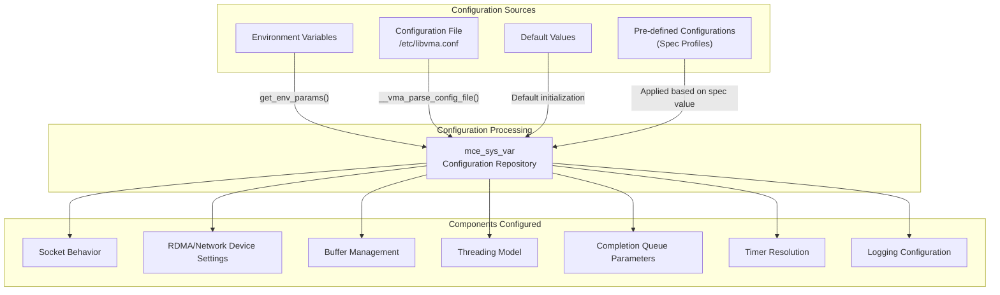
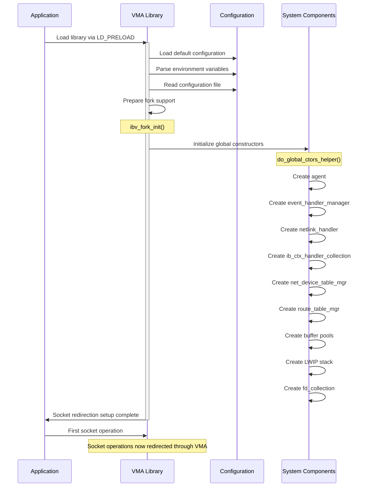
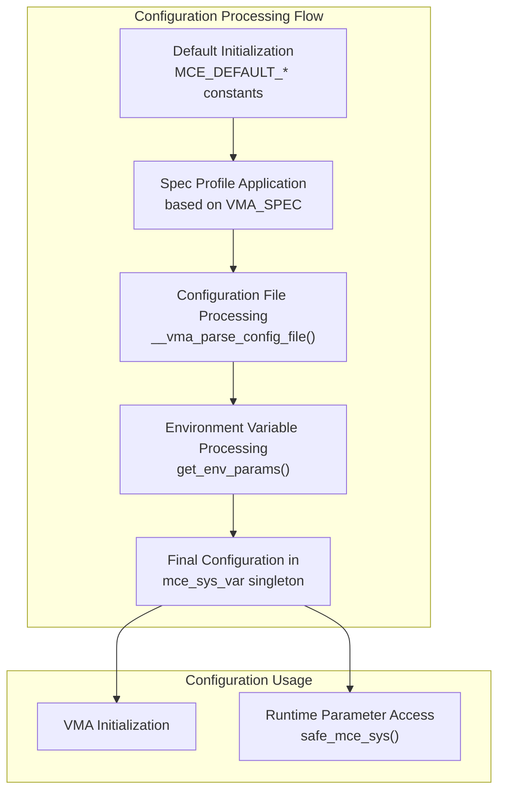
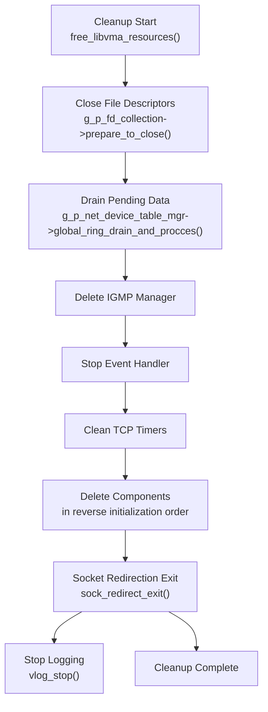

<!-- source: DeepWiki mcp.deepwiki.com · repo Mellanox/libvma · page 6 Configuration and Initialization · fetched 2026-11-11 -->

# Configuration and Initialization

<details>
<summary>Relevant source files</summary>

The following files were used as context for generating this wiki page:

- [src/vma/config_parser.c](src/vma/config_parser.c)
- [src/vma/config_parser.h](src/vma/config_parser.h)
- [src/vma/config_scanner.c](src/vma/config_scanner.c)
- [src/vma/main.cpp](src/vma/main.cpp)
- [src/vma/util/sys_vars.cpp](src/vma/util/sys_vars.cpp)
- [src/vma/util/sys_vars.h](src/vma/util/sys_vars.h)

</details>


This page explains how the VMA (Versatile Message Accelerator) library is configured and initialized. It covers the configuration parameters, their sources, default values, and the initialization sequence that prepares VMA for accelerating network traffic on application startup.

For details about runtime behavior after initialization, see [Socket Layer](#2) and [Hardware Abstraction Layer](#4).

## Configuration System Overview

VMA's configuration system allows fine-tuning various aspects of the library's behavior through multiple configuration sources. This flexibility enables users to optimize VMA for specific applications without modifying code.



Sources: [src/vma/util/sys_vars.h:246-544](), [src/vma/util/sys_vars.cpp:435-603]()

## Configuration Parameters

VMA offers hundreds of configurable parameters to fine-tune performance. The most important configuration parameters include:

| Category | Parameter | Environment Variable | Default | Description |
|----------|-----------|---------------------|---------|-------------|
| **Ring Management** | Ring Allocation Logic TX | VMA_RING_ALLOCATION_LOGIC_TX | RING_LOGIC_PER_INTERFACE | Determines how TX rings are allocated |
| **Ring Management** | Ring Allocation Logic RX | VMA_RING_ALLOCATION_LOGIC_RX | RING_LOGIC_PER_INTERFACE | Determines how RX rings are allocated |
| **Memory Management** | TX Buffers | VMA_TX_BUFS | 200000 | Number of TX buffers |
| **Memory Management** | RX Buffers | VMA_RX_BUFS | 200000 | Number of RX buffers |
| **Memory Management** | Memory Allocation Type | VMA_MEM_ALLOC_TYPE | HUGEPAGES | Type of memory allocation |
| **Performance** | CQ Moderation | VMA_CQ_MODERATION_ENABLE | true | Enable/disable CQ moderation |
| **TCP Settings** | TCP No Delay | VMA_TCP_NODELAY | false | Enable/disable Nagle's algorithm |
| **Feature Switches** | IPoIB Support | VMA_IPOIB | true | Enable/disable IPoIB support |
| **Feature Switches** | SocketXtreme | VMA_SOCKETXTREME | false | Enable/disable SocketXtreme mode |
| **Debugging** | Log Level | VMA_TRACELEVEL | VLOG_INFO | Log verbosity level |

Sources: [src/vma/util/sys_vars.h:428-546](), [src/vma/util/sys_vars.cpp:490-603]()

## Predefined Configuration Profiles

VMA provides several predefined configuration profiles optimized for specific use cases, which can be activated using the `VMA_SPEC` environment variable:

| Profile | Value | Optimized For |
|---------|-------|---------------|
| Ultra Latency | 10 | Socket performance with minimal latency |
| Latency | 15 | Balance of latency and throughput |
| 29West LBM | 29 | 29West LBM messaging software |
| Memcached | 623 | Memcached applications |
| Memcached IRQ | 624 | Memcached with interrupt-driven mode |
| Low Latency | 7750 | General low latency applications |
| Multi Ring Latency | "multi_ring_latency" | Applications requiring multiple rings per thread |

Sources: [src/vma/util/sys_vars.cpp:624-749]()

## Initialization Sequence

VMA initialization begins when an application loads the library and continues through several phases:



Sources: [src/vma/main.cpp:587-607](), [src/vma/main.cpp:634-759]()

## Detailed Initialization Process

The initialization process follows these key steps:

1. **Library Loading**: VMA is loaded via `LD_PRELOAD` when the application starts.

2. **Configuration Loading**:
   - Default values are set for all configuration parameters
   - Environment variables are processed via `get_env_params()`
   - Configuration file is read via `__vma_parse_config_file()`
   - Predefined configuration profiles are applied if specified

3. **Fork Support Preparation**:
   - `prepare_fork()` calls `ibv_fork_init()` to ensure proper handling of resources when `fork()` is called

4. **Global Constructor Initialization**:
   - `do_global_ctors_helper()` initializes all global objects needed by VMA
   - Components are created in a specific order to handle dependencies

5. **Core Components Creation**:
   - Agent - communication channel with daemon
   - Event Handler Manager - manages event handling and timers
   - Netlink Handler - handles network notifications from kernel
   - IB Context Handler Collection - manages InfiniBand contexts
   - Network Device Table Manager - manages network interfaces
   - Route and Rule Table Managers - manage routing
   - Buffer Pools - manages memory for send and receive operations
   - LWIP Stack - provides TCP/IP stack functionality
   - Socket Management - handles socket operations

6. **Socket Redirection Setup**:
   - Socket API functions are redirected to VMA implementations
   - VMA becomes ready to handle socket operations

Sources: [src/vma/main.cpp:585-607](), [src/vma/main.cpp:633-759]()

## Component Construction Sequence

The creation of VMA components follows a specific sequence to ensure proper dependency handling:

```mermaid
flowchart TD
    subgraph "Initialization Sequence"
        direction TB
        START["Initialization Start"]
        AGENT["g_p_agent\n(Agent)"]
        EVENT["g_p_event_handler_manager\n(Event Handler Manager)"]
        NETLINK["g_p_netlink_handler\n(Netlink Wrapper)"]
        IB["g_p_ib_ctx_handler_collection\n(IB Context Collection)"]
        NEIGH["g_p_neigh_table_mgr\n(Neighbor Table)"]
        NETDEV["g_p_net_device_table_mgr\n(Net Device Table)"]
        RULE["g_p_rule_table_mgr\n(Rule Table)"]
        ROUTE["g_p_route_table_mgr\n(Route Table)"]
        IGMP["g_p_igmp_mgr\n(IGMP Manager)"]
        BUFFER_RX["g_buffer_pool_rx\n(RX Buffer Pool)"]
        BUFFER_TX["g_buffer_pool_tx\n(TX Buffer Pool)"]
        TCP_SEG["g_tcp_seg_pool\n(TCP Segment Pool)"]
        TCP_TIMER["g_tcp_timers_collection\n(TCP Timers)"]
        VLOGGER["g_p_vlogger_timer_handler\n(Logger Timer)"]
        IP_FRAG["g_p_ip_frag_manager\n(IP Fragment Manager)"]
        FD_COLL["g_p_fd_collection\n(FD Collection)"]
        LWIP["g_p_lwip\n(LWIP Stack)"]
        RING["g_p_ring_profile\n(Ring Profiles)"]
        
        START --> AGENT
        AGENT --> EVENT
        EVENT --> NETLINK
        NETLINK --> IB
        IB --> NEIGH
        NEIGH --> NETDEV
        NETDEV --> RULE
        RULE --> ROUTE
        ROUTE --> IGMP
        IGMP --> BUFFER_RX
        BUFFER_RX --> BUFFER_TX
        BUFFER_TX --> TCP_SEG
        TCP_SEG --> TCP_TIMER
        TCP_TIMER --> VLOGGER
        VLOGGER --> IP_FRAG
        IP_FRAG --> FD_COLL
        FD_COLL --> LWIP
        LWIP --> RING
    end
```



Sources: [src/vma/main.cpp:650-758]()

## Configuration Processing

Configuration parameters are processed from various sources in the following order (later sources override earlier ones):

1. **Default Values**: Hardcoded defaults defined in `sys_vars.h`
2. **Predefined Profiles**: Applied based on the VMA_SPEC environment variable
3. **Configuration File**: Settings from `/etc/libvma.conf` or custom location
4. **Environment Variables**: Individual parameter overrides

The configuration file uses a custom syntax and is parsed using a Bison parser. The file supports socket rules, application identification, and logging configuration.



Sources: [src/vma/util/sys_vars.cpp:435-603](), [src/vma/config_parser.c:107-343]()

## Resource Cleanup

When the application terminates or when VMA needs to shut down, resources are released in the reverse order of initialization:



Sources: [src/vma/main.cpp:87-193]()

## Environment Variable Naming Convention

VMA environment variables follow a consistent naming convention:

* All environment variables start with `VMA_`
* For example: `VMA_TRACELEVEL`, `VMA_TX_BUFS`, `VMA_SOCKETXTREME`

The mapping between environment variables and internal configuration is handled in `get_env_params()` in `sys_vars.cpp`.

Sources: [src/vma/util/sys_vars.h:428-546](), [src/vma/util/sys_vars.cpp:435-603]()

## Special Configuration Cases

### SocketXtreme Mode

SocketXtreme mode is a special operating mode that has specific parameter limitations and is optimized for extreme performance:

```
if (enable_socketxtreme) {
    /* Set following parameters as default for SocketXtreme mode */
    rx_num_wr = 1024;
    gro_streams_max = 0;
    progress_engine_interval_msec = MCE_CQ_DRAIN_INTERVAL_DISABLED;
}
```

When SocketXtreme is enabled, certain parameters are automatically adjusted to ensure optimal performance.

Sources: [src/vma/util/sys_vars.cpp:610-618]()

### Fork Support

VMA provides support for applications that use `fork()` through the `ibv_fork_init()` function, which ensures proper handling of RDMA resources during process forking:

```
if (safe_mce_sys().handle_fork && !g_init_ibv_fork_done) {
    IF_VERBS_FAILURE(ibv_fork_init()) {
        vlog_printf(VLOG_DEBUG,"ibv_fork_init failed (errno=%d %m)\n", errno);
        vlog_printf(VLOG_ERROR, "************************************************************************\n");
        vlog_printf(VLOG_ERROR, "ibv_fork_init() failed! The effect of the application calling 'fork()' is undefined!\n");
        vlog_printf(VLOG_ERROR, "Read the fork section in the VMA's User Manual for more information\n");
        vlog_printf(VLOG_ERROR, "************************************************************************\n");
    }
    else {
        g_init_ibv_fork_done = true;
        vlog_printf(VLOG_DEBUG,"ibv_fork_init() succeeded, fork() may be used safely!!\n");
    }
}
```

This initialization is controlled by the `VMA_FORK` environment variable.

Sources: [src/vma/main.cpp:559-574]()

## Configuration Validation and Diagnostics

During initialization, VMA performs various validation checks to ensure the system is properly configured:

1. **CPU Speed Check**: Verifies CPU cores are running at consistent speed
2. **Locked Memory Check**: Ensures sufficient locked memory limits are set
3. **Parameter Bounds Validation**: Checks configured values are within allowed ranges
4. **Hypervisor Detection**: Detects if running in a virtualized environment

These checks help identify potential performance issues early and provide diagnostic information through the VMA log.

Sources: [src/vma/main.cpp:214-248](), [src/vma/util/sys_vars.cpp:367-433]()

## Conclusion

The VMA initialization and configuration system provides a flexible framework for optimizing network acceleration according to specific application needs. Through a combination of default values, configuration files, and environment variables, users can fine-tune virtually every aspect of VMA's behavior without modifying code.

The initialization sequence ensures that all components are created in the proper order with correct dependencies, enabling the seamless redirection of socket operations through VMA's accelerated path.

---

