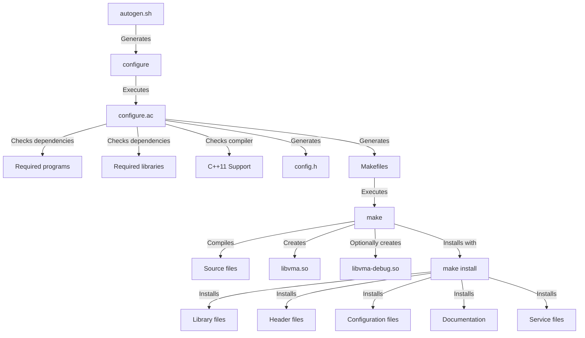
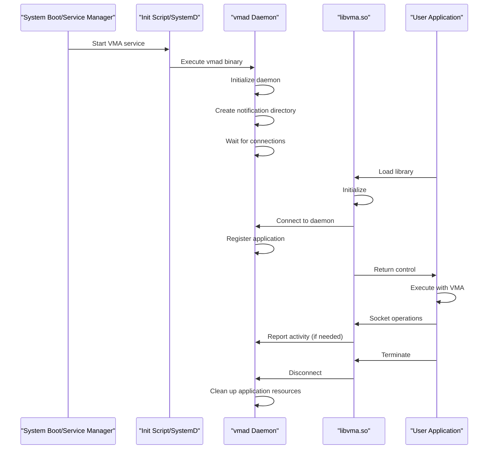

<!-- source: DeepWiki mcp.deepwiki.com · repo Mellanox/libvma · page 7 Building and Packaging · fetched 2026-11-11 -->

# Building and Packaging

<details>
<summary>Relevant source files</summary>

The following files were used as context for generating this wiki page:

- [CHANGES](CHANGES)
- [Makefile.am](Makefile.am)
- [README.md](README.md)
- [config/m4/compiler.m4](config/m4/compiler.m4)
- [configure.ac](configure.ac)
- [contrib/jenkins_tests/tool.sh](contrib/jenkins_tests/tool.sh)
- [contrib/scripts/libvma.spec.in](contrib/scripts/libvma.spec.in)
- [contrib/scripts/vma.init.in](contrib/scripts/vma.init.in)
- [contrib/scripts/vma.service.in](contrib/scripts/vma.service.in)
- [debian/changelog.in](debian/changelog.in)
- [debian/control](debian/control)
- [debian/copyright](debian/copyright)
- [debian/libvma-dev.install](debian/libvma-dev.install)
- [debian/libvma.install](debian/libvma.install)
- [debian/postinst](debian/postinst)
- [debian/postrm](debian/postrm)
- [debian/prerm](debian/prerm)
- [debian/rules](debian/rules)

</details>


This document provides comprehensive instructions for building the VMA (Versatile Message Accelerator) library from source code and packaging it for distribution. It covers the build system, dependencies, configuration options, and packaging processes for both RPM and Debian formats.

For information about the general architecture of VMA, see [Architecture Overview](#1.1). For details on testing the built packages, see [Testing and CI/CD](#9).

## Prerequisites

Before building VMA, ensure your system has the following dependencies installed:

- **Build Tools**: 
  - GCC/G++ compiler with C++11 support
  - autoconf (2.59 or later)
  - automake
  - libtool
  - pkg-config
  - make

- **Libraries**:
  - RDMA libraries (libibverbs, librdmacm)
  - libnl-3 and libnl-route-3 (for netlink support)
  - pthread
  - dl
  - rt

- **Package Building (optional)**:
  - RPM: rpmbuild
  - Debian: debhelper

Sources: [configure.ac:98-139](), [contrib/scripts/libvma.spec.in:22-42](), [debian/control:5-12](), [config/m4/compiler.m4:212]()

## Build System Overview

VMA uses a standard GNU Autotools build system consisting of autoconf, automake, and libtool. This diagram shows the build process flow:



Sources: [configure.ac:1-401](), [Makefile.am:1-49]()

## Building from Source

### Configuring the Build

The `configure` script provides various options to customize the build:

```bash
./configure [options]
```

Key configuration options include:

| Option | Description | Default |
|--------|-------------|---------|
| `--prefix=PREFIX` | Installation prefix | `/usr/local` |
| `--with-ofed=PATH` | Path to OFED installation | Auto-detected |
| `--enable-debug` | Enable debug mode | `no` |
| `--enable-opt-log=LEVEL` | Set log optimization level (none, medium, high) | `medium` |
| `--enable-symbol-visibility` | Enable symbols visibility | `no` |
| `--enable-thread-lock` | Enable thread locking | `yes` |
| `--enable-tso` | Enable TSO (TCP Segmentation Offload) | `no` |
| `--with-valgrind` | Enable Valgrind annotations | `no` |

Sources: [configure.ac:148-276]()

### Building the Library

After configuring, you can build the library with:

```bash
make
```

For building with multiple cores:

```bash
make -j$(nproc)
```

To build the tests:

```bash
make tests
```

Sources: [Makefile.am:17-43]()

### Installing

Install the library with:

```bash
sudo make install
```

This installs:
- Library files to `$(prefix)/lib`
- Header files to `$(prefix)/include/mellanox`
- Configuration file to `/etc/libvma.conf`
- VMA daemon to `$(prefix)/sbin`
- Documentation to `$(prefix)/share/doc/libvma`
- Man pages to `$(prefix)/share/man`
- SystemD service file (if applicable)

Sources: [Makefile.am:22-32]()

## Package Structure and Components

The following diagram shows the structure of the VMA package components:

```mermaid
classDiagram
    class "VMA Package" {
        - Libraries
        - Headers
        - Configuration
        - Daemon
        - Documentation
    }
    
    class "Libraries" {
        - libvma.so
        - libvma-debug.so (optional)
    }
    
    class "Headers" {
        - vma_extra.h
    }
    
    class "Configuration" {
        - libvma.conf
    }
    
    class "Daemon" {
        - vmad executable
        - vma.service
    }
    
    class "Documentation" {
        - README
        - CHANGES
        - Man pages
    }
    
    class "Tools" {
        - vma_stats
    }
    
    "VMA Package" *-- "Libraries"
    "VMA Package" *-- "Headers"
    "VMA Package" *-- "Configuration"
    "VMA Package" *-- "Daemon"
    "VMA Package" *-- "Documentation"
    "VMA Package" *-- "Tools"
```

Sources: [contrib/scripts/libvma.spec.in:162-187](), [debian/libvma.install:1-11](), [debian/libvma-dev.install:1-3]()

## RPM Packaging

### Building RPM Packages

VMA can be packaged as RPM using the provided spec file. To build an RPM package:

1. Ensure `rpmbuild` is installed
2. Run the configure script with required options
3. Build the source tarball or use existing source distribution
4. Build the RPM package using:

```bash
rpmbuild -tb libvma-x.y.z.tar.gz
```

Or to build from a spec file directly:

```bash
rpmbuild -ba contrib/scripts/libvma.spec
```

### RPM Package Components

The RPM packaging creates three packages:

1. **libvma**: Main library package containing:
   - libvma.so
   - Configuration file
   - VMA daemon (vmad)
   - Documentation and man pages
   - SystemD service file (if applicable)

2. **libvma-devel**: Development package containing:
   - Header files
   - libvma-debug.so (if built with debug option)

3. **libvma-utils**: Utilities package containing:
   - vma_stats tool

Sources: [contrib/scripts/libvma.spec.in:1-193]()

## Debian Packaging

### Building Debian Packages

To build Debian packages:

1. Ensure Debian build tools are installed
2. Configure the build environment
3. Build the package using:

```bash
dpkg-buildpackage -us -uc
```

Or:

```bash
debuild -us -uc
```

### Debian Package Components

The Debian packaging creates four packages:

1. **libvma**: Main library package
2. **libvma-dev**: Development package
3. **libvma-dbg**: Debug symbols package
4. **libvma-utils**: Utilities package

Sources: [debian/control:1-82](), [debian/rules:1-29](), [debian/libvma.install:1-11](), [debian/libvma-dev.install:1-3]()

## Version Management

VMA uses a versioning scheme with major, minor, and revision numbers defined in `configure.ac`:

```
define([prj_ver_major], 9)
define([prj_ver_minor], 8)
define([prj_ver_revision], 71)
define([prj_ver_release], esyscmd([echo ${PRJ_RELEASE:=0}]))
```

This results in version 9.8.71 for the current release.

Sources: [configure.ac:13-18]()

## The VMA Daemon

The VMA daemon (vmad) is a service that handles monitoring of processes using the VMA library. It's installed as part of the main package.

### Daemon Initialization Flow



Sources: [contrib/scripts/vma.service.in:1-13](), [contrib/scripts/vma.init.in:1-152](), [contrib/jenkins_tests/tool.sh:24-61]()

### Managing the Daemon

The VMA daemon can be managed using systemd or the provided init script:

- **SystemD** (modern Linux distributions):
  ```
  systemctl start vma
  systemctl stop vma
  systemctl status vma
  ```

- **Init Script** (older distributions):
  ```
  /etc/init.d/vma start
  /etc/init.d/vma stop
  /etc/init.d/vma status
  ```

Sources: [contrib/scripts/vma.service.in:1-13](), [contrib/scripts/vma.init.in:129-148]()

## Troubleshooting the Build Process

Common issues that may arise during the build process:

1. **Missing Dependencies**: If configure fails with errors about missing libraries or headers, install the required development packages.

2. **Compiler Version**: VMA requires a compiler with C++11 support. Ensure your compiler is up to date.

3. **OFED Path**: If VMA can't find the OFED installation, specify it explicitly with `--with-ofed=PATH`.

4. **Build Failures**: Check the build log for specific errors. Build with `V=1` for verbose output:
   ```
   make V=1
   ```

5. **Installation Permissions**: Ensure you have sufficient permissions when running `make install`. Use `sudo` if necessary.

Sources: [configure.ac:98-139](), [config/m4/compiler.m4:211-213]()

## Conclusion

This document has covered the process of building and packaging VMA from source code. By following these instructions, you should be able to build the library, create packages for distribution, and manage the VMA daemon service.

For more information on using VMA, refer to the documentation and man pages installed with the package.

---

