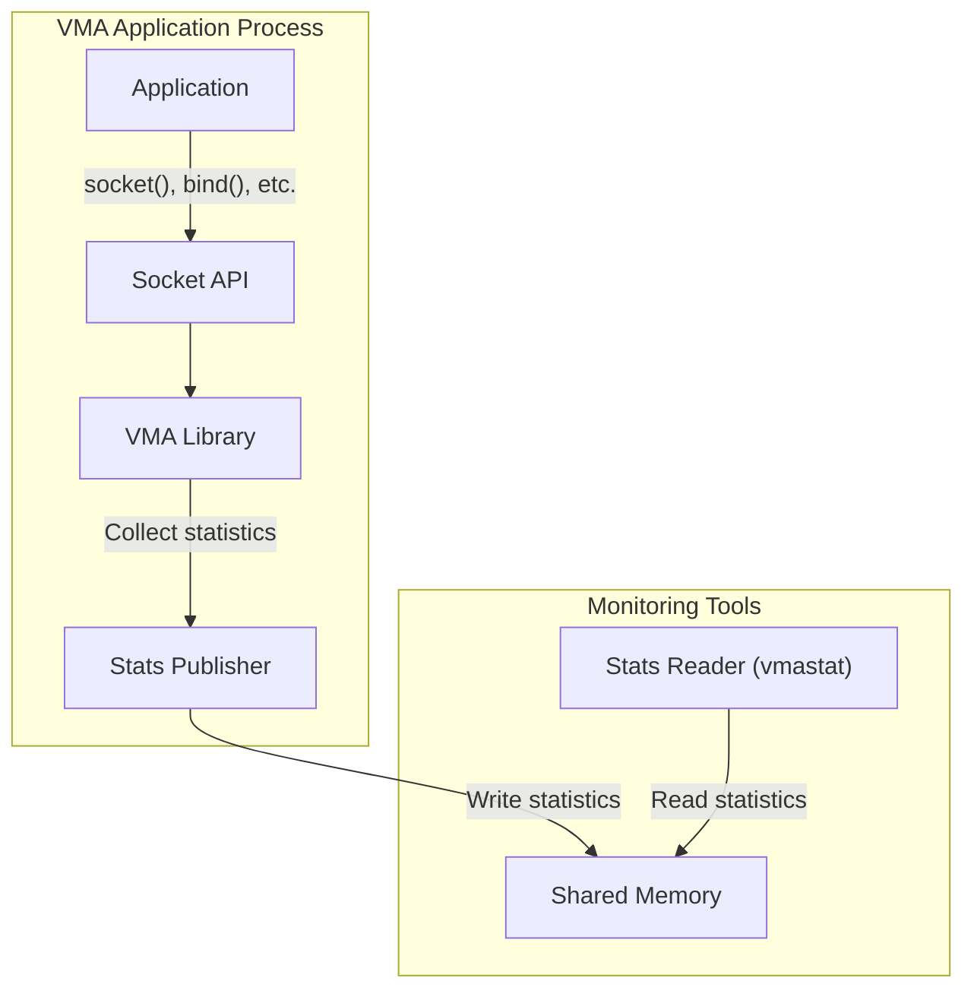
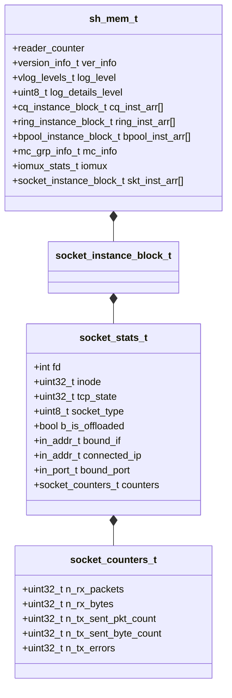
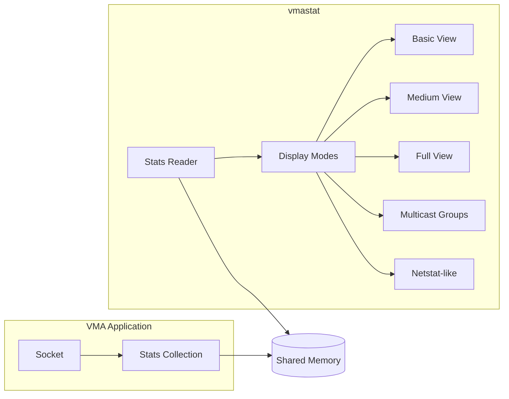
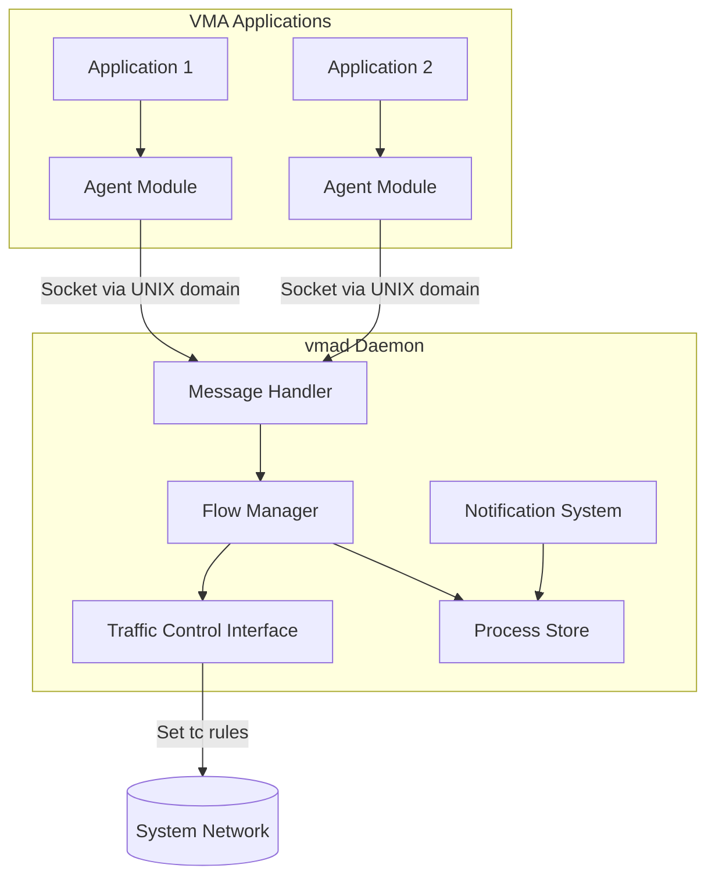
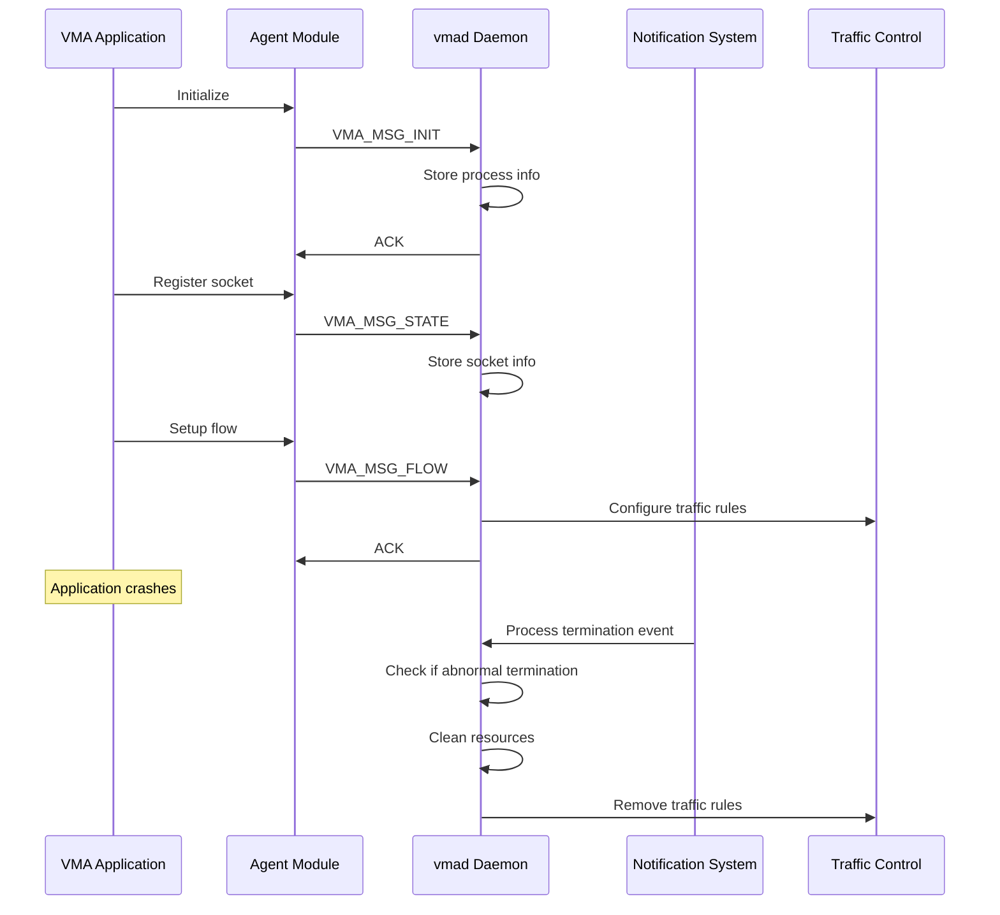
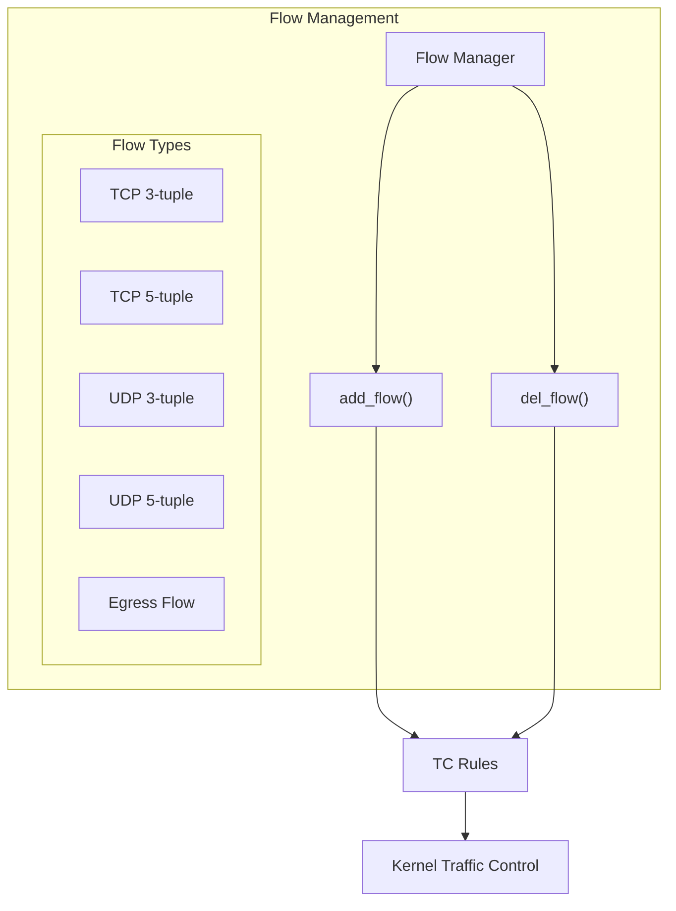
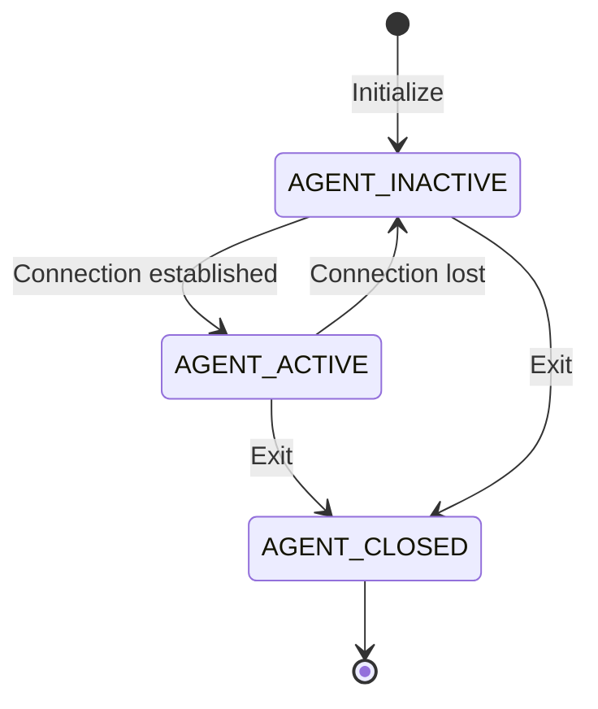
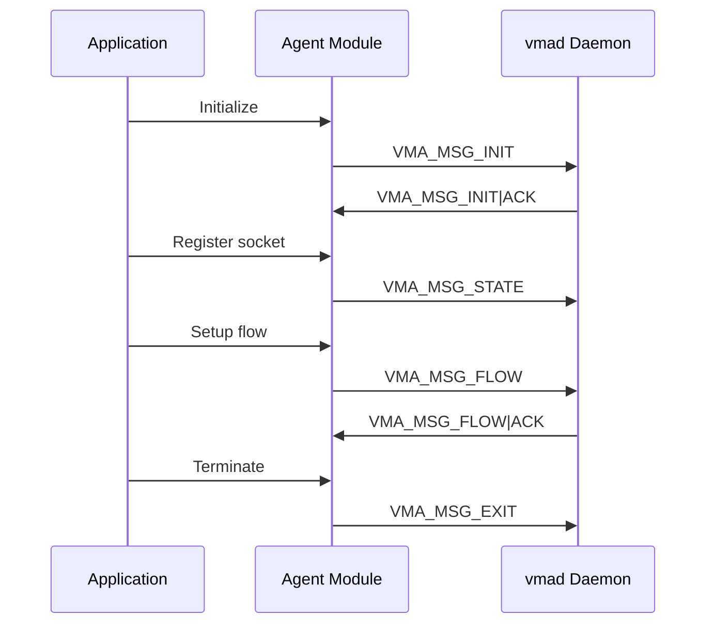

<!-- source: DeepWiki mcp.deepwiki.com · repo Mellanox/libvma · page 8 Tools and Utilities · fetched 2026-11-11 -->

# Tools and Utilities

Relevant source files

The following files were used as context for generating this wiki page:

- [src/stats/stats_printer.cpp](src/stats/stats_printer.cpp)
- [src/stats/stats_publisher.cpp](src/stats/stats_publisher.cpp)
- [src/stats/stats_reader.cpp](src/stats/stats_reader.cpp)
- [src/vma/util/agent.cpp](src/vma/util/agent.cpp)
- [src/vma/util/agent.h](src/vma/util/agent.h)
- [src/vma/util/agent_def.h](src/vma/util/agent_def.h)
- [src/vma/util/list.h](src/vma/util/list.h)
- [src/vma/util/vma_stats.h](src/vma/util/vma_stats.h)
- [tools/daemon/daemon.c](tools/daemon/daemon.c)
- [tools/daemon/daemon.h](tools/daemon/daemon.h)
- [tools/daemon/flow.c](tools/daemon/flow.c)
- [tools/daemon/loop.c](tools/daemon/loop.c)
- [tools/daemon/message.c](tools/daemon/message.c)
- [tools/daemon/notify.c](tools/daemon/notify.c)

This document provides an overview of the auxiliary tools and utilities that are part of the VMA (Versatile Message Accelerator) library. These tools are designed to assist with monitoring, debugging, and managing the behavior of VMA-enabled applications.

## VMA Statistics Collection System

VMA includes a comprehensive statistics collection system that enables monitoring of socket performance, traffic patterns, and internal state information. The statistics system operates through a shared memory architecture that allows statistics gathering with minimal impact on application performance.

### Architecture Overview

Sources: [src/stats/stats_publisher.cpp:30-226](), [src/stats/stats_reader.cpp:10-125]()

### Shared Memory Statistics

The statistics system uses a shared memory architecture to expose performance metrics to external tools without requiring direct access to VMA-enabled applications. Statistics are published to shared memory at regular intervals, allowing monitoring tools to read them asynchronously.

Key components of the statistics shared memory:

- Socket statistics (packet counts, bytes, errors)
- CQ (Completion Queue) statistics
- Ring statistics (hardware interface metrics)
- Buffer pool statistics
- I/O multiplexing statistics (poll, select, epoll)
- Multicast group information

Sources: [src/vma/util/vma_stats.h:38-333](), [src/stats/stats_publisher.cpp:279-333]()

### vmastat Command-line Utility

The `vmastat` utility is a command-line tool that reads and displays VMA statistics for monitoring and debugging purposes. It can be used to monitor VMA-enabled applications in real-time.

#### Key Features:

- View socket statistics (TCP/UDP)
- Monitor performance metrics
- Show ring (hardware) statistics
- Display socket states and connections
- View memory utilization

#### Command-line Options:

| Option | Description |
|--------|-------------|
| `-p pid` | Show statistics for specific process ID |
| `-k directory` | Set shared memory directory path |
| `-n application` | Show statistics for specific application |
| `-f` | Find and show statistics for running VMA instances |
| `-i interval` | Print reports at specified interval (seconds) |
| `-v view` | Set view type (1-5): basic, extra, full, mc groups, netstat-like |
| `-d details` | Set details mode: totals or deltas |
| `-z` | Zero counters |
| `-l log_level` | Set VMA log level |
| `-S fd` | Dump statistics for specific file descriptor |

Sources: [src/stats/stats_reader.cpp:120-146](), [src/stats/stats_reader.cpp:467-500]()

### Statistics Viewing Modes

The vmastat utility provides multiple view modes to present statistics in different formats:

1. **Basic View**: Shows essential socket statistics including packet/byte counts and errors
2. **Medium View**: Includes additional details about ready queues
3. **Full View**: Comprehensive statistics including all metrics
4. **Multicast Groups**: Shows multicast group memberships
5. **Netstat-like**: Format similar to the standard netstat tool

Sources: [src/stats/stats_reader.cpp:430-465](), [src/stats/stats_printer.cpp:26-225]()

## vmad Daemon

The vmad daemon is a service process that manages aspects of VMA applications across the system. It handles flow setup, state tracking, and process monitoring.

### Architecture Overview

Sources: [tools/daemon/daemon.c:36-105](), [tools/daemon/daemon.h:109-133](), [tools/daemon/loop.c:33-120]()

### Process Monitoring and State Tracking

The vmad daemon monitors VMA applications and manages their state. When applications terminate unexpectedly, vmad can clean up network resources and optionally send RST packets to peers to terminate connections cleanly.

Sources: [tools/daemon/notify.c:238-339](), [tools/daemon/message.c:177-242]()

### Flow Management

The vmad daemon manages network flows by configuring Traffic Control (tc) rules in the kernel. This enables packet steering between network and tap devices, facilitating hardware offload paths.

Key flow types:

- TCP 3-tuple flows (destination IP/port, protocol)
- TCP 5-tuple flows (source/destination IP/port, protocol)
- UDP 3-tuple flows
- UDP 5-tuple flows
- Egress flows

Sources: [tools/daemon/flow.c:66-339](), [src/vma/util/agent_def.h:75-102]()

## Agent Communication Module

The agent module facilitates communication between VMA applications and the vmad daemon. It establishes and maintains a connection using UNIX domain sockets.

### Agent States and Communication Flow

Sources: [src/vma/util/agent.cpp:62-177](), [src/vma/util/agent.h:34-38]()

### Message Protocol

The agent module uses a defined protocol for communication with the vmad daemon:

| Message Type | Description |
|--------------|-------------|
| VMA_MSG_INIT | Initialize connection with daemon |
| VMA_MSG_STATE | Update socket state information |
| VMA_MSG_EXIT | Notify daemon of process termination |
| VMA_MSG_FLOW | Configure network flows |

Messages can include an ACK flag (VMA_MSG_ACK) to indicate successful processing.

Sources: [src/vma/util/agent.cpp:438-606](), [src/vma/util/agent_def.h:31-35]()

## Integration with System Tools

VMA statistics can be viewed using standard system monitoring tools through the netstat-like view, which presents socket information in a format similar to standard network utilities.

### netstat-like Output Format

The netstat-like view presents socket information in columns similar to the standard netstat tool, including:

- Protocol
- Offload status
- Receive/Send queue sizes
- Local/Remote addresses
- Socket state
- Inode
- Process ID/Name

Sources: [src/stats/stats_printer.cpp:176-225]()

## Monitoring Performance Impacts

The VMA statistics system is designed to minimize overhead on running applications. Statistics are collected asynchronously and only published to shared memory when actively being monitored, reducing the impact on application performance.

Key design considerations:

- Reader counter tracks active readers to avoid unnecessary updates
- Periodic updates with configurable interval
- Zero-copy shared memory architecture

Sources: [src/stats/stats_publisher.cpp:56-76](), [src/vma/util/vma_stats.h:29-31]()

---

