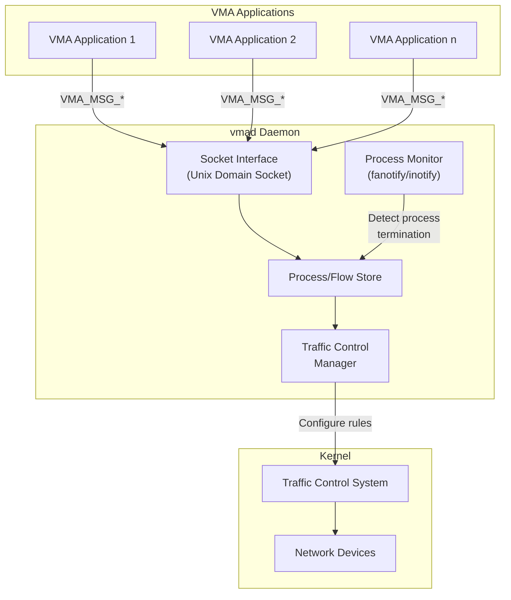
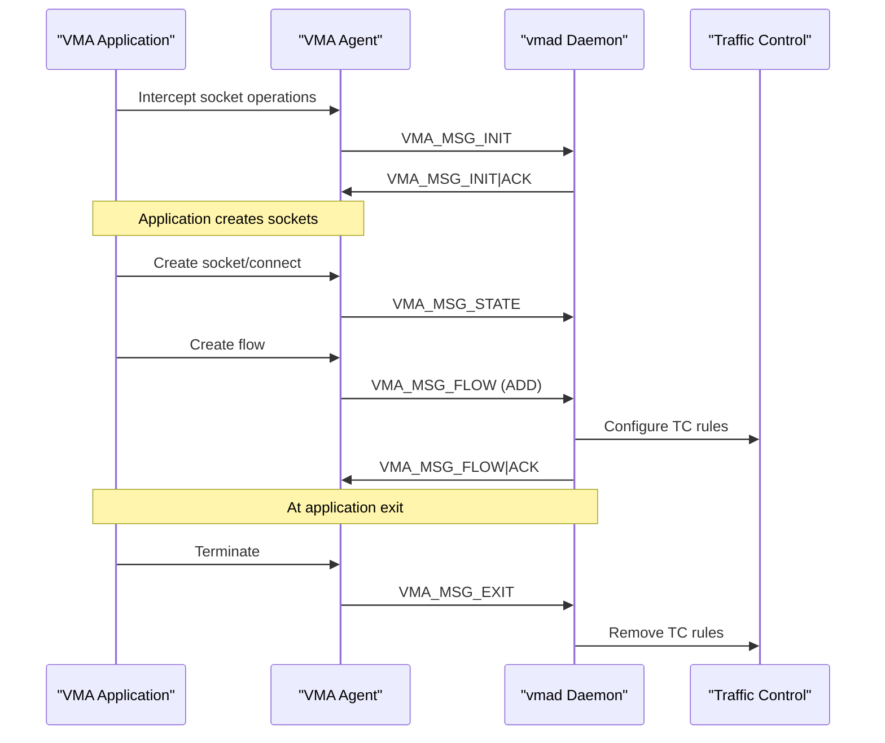
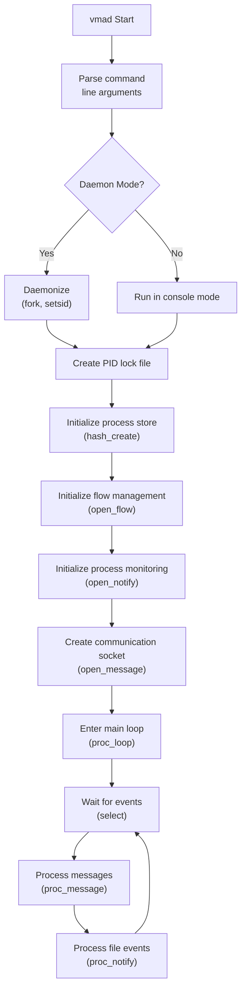
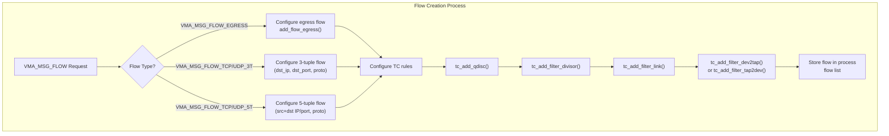
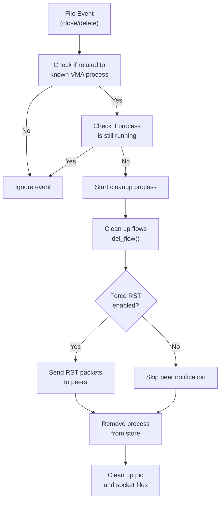
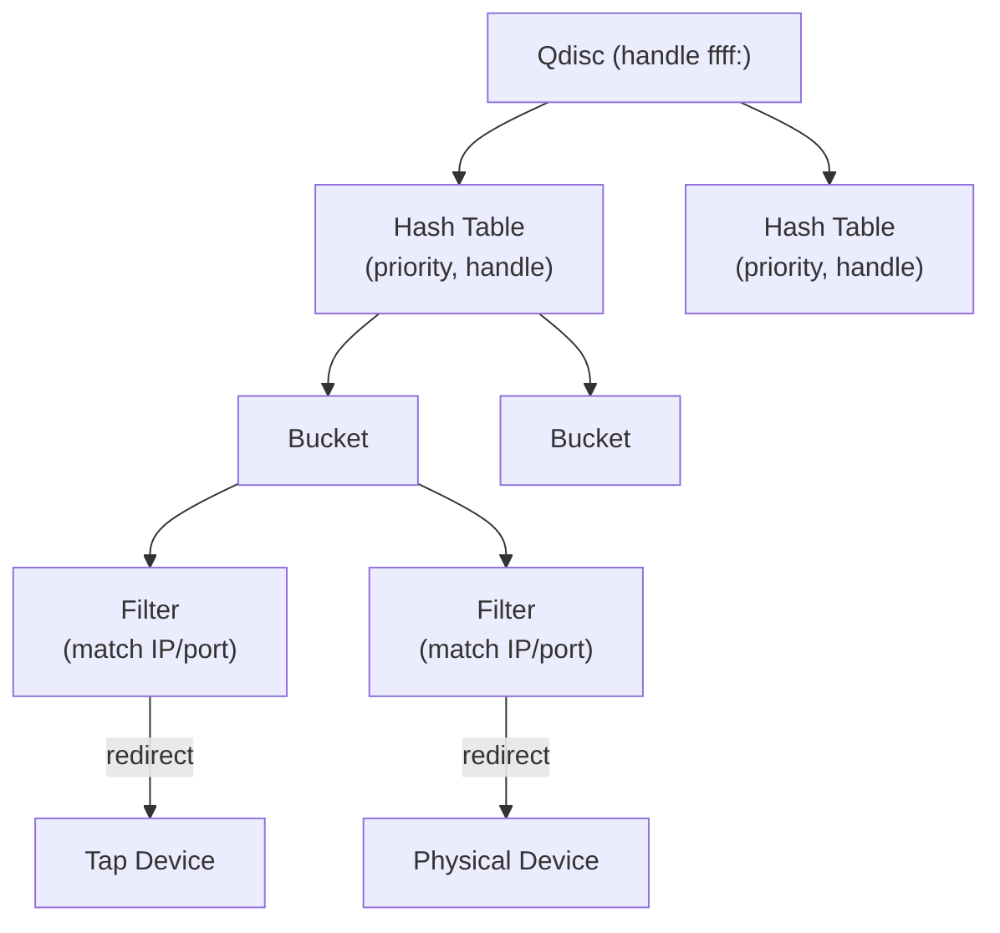
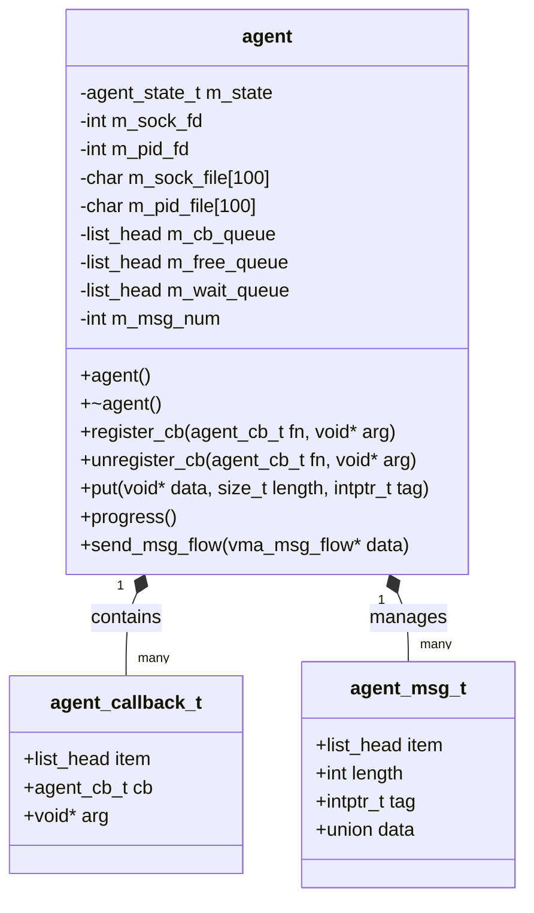

<!-- source: DeepWiki mcp.deepwiki.com · repo Mellanox/libvma · page 8.1 vmad Daemon · fetched 2026-11-11 -->

# vmad Daemon

Relevant source files

The following files were used as context for generating this wiki page:

- [src/vma/util/agent.cpp](src/vma/util/agent.cpp)
- [src/vma/util/agent.h](src/vma/util/agent.h)
- [src/vma/util/agent_def.h](src/vma/util/agent_def.h)
- [src/vma/util/list.h](src/vma/util/list.h)
- [tools/daemon/Makefile.am](tools/daemon/Makefile.am)
- [tools/daemon/daemon.c](tools/daemon/daemon.c)
- [tools/daemon/daemon.h](tools/daemon/daemon.h)
- [tools/daemon/flow.c](tools/daemon/flow.c)
- [tools/daemon/loop.c](tools/daemon/loop.c)
- [tools/daemon/message.c](tools/daemon/message.c)
- [tools/daemon/nl.c](tools/daemon/nl.c)
- [tools/daemon/nl.h](tools/daemon/nl.h)
- [tools/daemon/notify.c](tools/daemon/notify.c)
- [tools/daemon/store.c](tools/daemon/store.c)
- [tools/daemon/tc.c](tools/daemon/tc.c)
- [tools/daemon/tc.h](tools/daemon/tc.h)

The vmad daemon is a critical component in the Versatile Message Accelerator (VMA) system that manages network flow routing between VMA-enabled applications and the network hardware. It serves as the communication bridge between the user space VMA library and the kernel's traffic control (TC) subsystem, enabling efficient network flow management.

This daemon runs in the background, monitoring VMA applications, handling their requests for network routing, and performing cleanup when processes terminate. The vmad daemon is particularly important for managing TCP and UDP flows with proper connection handling and network interface management.

## Architecture Overview

The vmad daemon operates as a standalone system service that communicates with VMA library instances embedded in applications. It implements several key functionalities:

1. Process monitoring and management
2. Traffic control rule configuration
3. Flow table management 
4. Unexpected process termination handling

Sources: [tools/daemon/daemon.h:39-133](), [tools/daemon/message.c:1-496](), [tools/daemon/flow.c:1-720](), [tools/daemon/notify.c:74-187]()

## Communication Protocol

The VMA library embedded in applications communicates with the vmad daemon using a well-defined message protocol over Unix domain sockets. The protocol supports several message types:

| Message Type | Code | Purpose |
|--------------|------|---------|
| VMA_MSG_INIT | 0x01 | Initialize connection between process and daemon |
| VMA_MSG_STATE | 0x02 | Update socket state information |
| VMA_MSG_EXIT | 0x03 | Notify the daemon about process termination |
| VMA_MSG_FLOW | 0x04 | Request flow creation/deletion |

Each message starts with a common header structure (`vma_hdr`) that provides protocol version information, message type, and process ID.

Sources: [src/vma/util/agent_def.h:1-107](), [src/vma/util/agent.cpp:62-150](), [tools/daemon/message.c:177-242](), [tools/daemon/message.c:351-496]()

## Daemon Initialization

The vmad daemon can be started in either daemon mode (detached from the terminal) or console mode (attached to the terminal for debugging). 

During initialization, the daemon:

1. Sets up signal handlers
2. Creates a PID file to ensure only one instance runs
3. Initializes the process and flow storage
4. Opens notification mechanisms to monitor process termination
5. Creates a Unix domain socket to receive messages from VMA processes

Sources: [tools/daemon/daemon.c:36-105](), [tools/daemon/loop.c:33-120]()

## Process and Flow Management

The vmad daemon maintains information about active VMA processes and their network flows. This information is stored in hash tables and linked lists for efficient access.

### Process Store

The process store is a hash table that maps process IDs to process information structures (`struct store_pid`). Each process structure contains:

- Process ID
- Library version used by the process
- Start time of the process
- Hash table of socket information
- List of flow information

### Flow Management

The flow management functionality is responsible for creating and managing traffic control rules that redirect network traffic between network interfaces and tap devices based on:

1. Network flows defined by source and destination IP addresses and ports
2. Protocol (TCP or UDP)
3. Direction (ingress or egress)

When a VMA process requests a new flow, the daemon:

1. Determines the appropriate traffic control rules to create
2. Creates hash tables and filters in the TC subsystem
3. Adds redirection rules to redirect traffic between interfaces and tap devices

Sources: [tools/daemon/flow.c:103-339](), [tools/daemon/message.c:351-496](), [tools/daemon/tc.c:94-142](), [tools/daemon/tc.c:194-581]()

## Process Monitoring and Termination Handling

One of the key features of the vmad daemon is its ability to detect when VMA processes terminate unexpectedly. This is crucial for cleaning up resources and potentially notifying peers about the termination.

The daemon uses either `fanotify` or `inotify` (depending on the kernel capabilities) to monitor the directory containing VMA process-specific files.

When a process terminates unexpectedly:

1. The daemon detects the termination through file system events
2. It cleans up all flows belonging to the process
3. If configured (via the `--force-rst` option), it can send RST packets to peer endpoints to properly close TCP connections
4. It removes the process from the internal store

Sources: [tools/daemon/notify.c:107-173](), [tools/daemon/notify.c:243-339](), [tools/daemon/notify.c:569-689]()

## Traffic Control Integration

The vmad daemon integrates with the Linux Traffic Control (TC) subsystem to manage network traffic flows. It can use either the netlink API or the tc command-line tool to configure TC rules.

### TC Rule Structure

The daemon organizes TC rules in a hierarchical structure:

1. **Qdisc**: The base queuing discipline for an interface
2. **Hash Tables**: Organize filters based on flow characteristics
3. **Buckets**: Subdivisions within hash tables
4. **Filters**: Individual rules that match and redirect traffic

### Traffic Flow Types

The daemon supports several flow types:

1. **Egress flows**: Redirect traffic from tap device to physical device
2. **3-tuple flows**: Match based on destination IP, port, and protocol
3. **5-tuple flows**: Match based on source/destination IP, port, and protocol

For each flow, the daemon creates appropriate TC filters to redirect traffic between the physical network interface and the tap device created by VMA.

Sources: [tools/daemon/flow.c:40-62](), [tools/daemon/tc.h:20-26](), [tools/daemon/tc.c:94-581]()

## Configuration Options

The vmad daemon supports several command-line options for configuration:

| Option | Description | Default |
|--------|-------------|---------|
| `--console` | Run in foreground mode | Off (daemon mode) |
| `--notify-dir` | Directory for VMA process files | `/tmp/vma` |
| `--pid` | Maximum number of processes | 499 |
| `--fid` | Maximum number of sockets per process | 65599 |
| `--force-rst` | Force RST packet sending on process termination | Off |
| `--retry-interval` | SYN packet retry interval in ms | 1000 |
| `--verbose` | Logging verbosity level (0-5) | 4 |

These options can be used to tune the daemon's behavior based on the deployment environment and requirements.

Sources: [tools/daemon/daemon.c:257-369](), [tools/daemon/daemon.h:108-121]()

## Integration with VMA Library

The VMA library in applications communicates with the vmad daemon through an agent component. This agent establishes a connection with the daemon, registers callback functions, and manages the message exchange.

The agent component in the VMA library:

1. Creates a connection with the daemon during initialization
2. Registers callback functions to be notified of state changes
3. Sends messages to the daemon to request flow creation/deletion
4. Periodically checks the connection with the daemon

Sources: [src/vma/util/agent.h:17-131](), [src/vma/util/agent.cpp:62-682]()

## Summary

The vmad daemon is a crucial component in the VMA system that manages network flows between applications and the kernel. It works with the Linux Traffic Control subsystem to redirect network traffic efficiently, monitors VMA processes for proper cleanup on termination, and provides a reliable communication channel for VMA-enabled applications to request flow management.

The daemon's robust design allows it to handle process termination gracefully, clean up resources properly, and optionally notify peers about connection termination, ensuring the reliability of network connections in a VMA-enabled environment.

---

