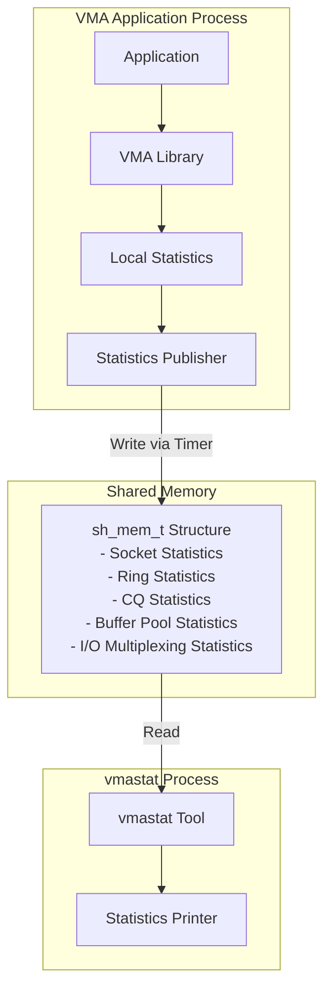
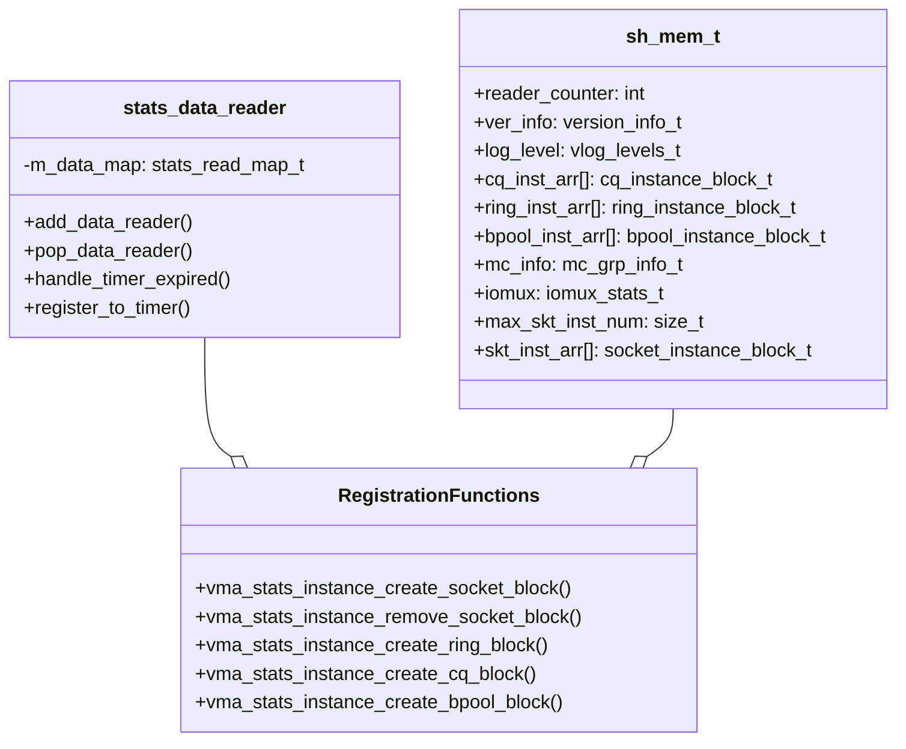
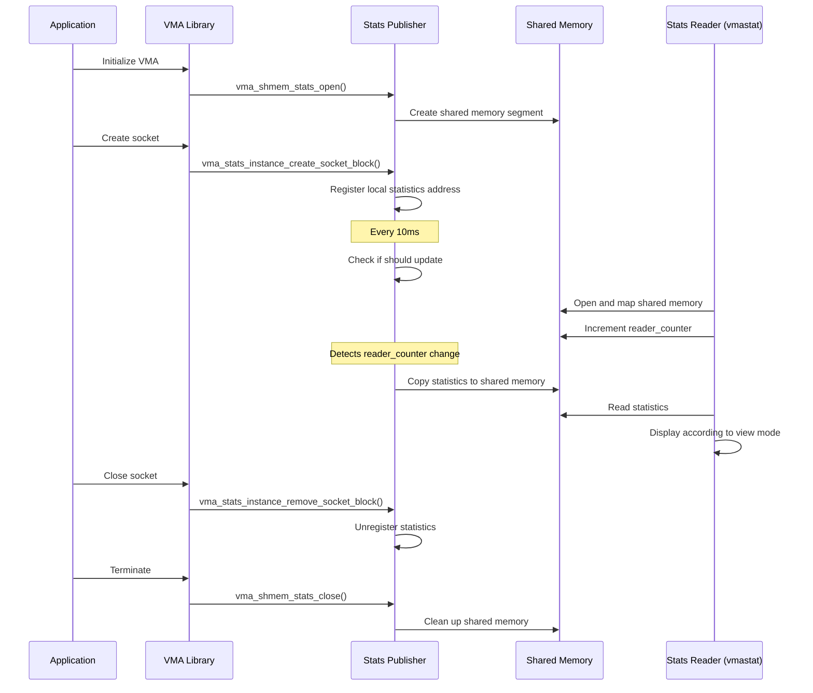

<!-- source: DeepWiki mcp.deepwiki.com · repo Mellanox/libvma · page 8.2 Statistics Collection · fetched 2026-11-11 -->

# Statistics Collection

Relevant source files

The following files were used as context for generating this wiki page:

- [src/Makefile.am](src/Makefile.am)
- [src/stats/stats_data_reader.h](src/stats/stats_data_reader.h)
- [src/stats/stats_printer.cpp](src/stats/stats_printer.cpp)
- [src/stats/stats_publisher.cpp](src/stats/stats_publisher.cpp)
- [src/stats/stats_reader.cpp](src/stats/stats_reader.cpp)
- [src/vma/util/vma_stats.h](src/vma/util/vma_stats.h)

## Purpose and Overview

The Statistics Collection system in VMA provides comprehensive performance monitoring and diagnostic capabilities for applications using the VMA library. The system collects detailed metrics about network operations, hardware resource usage, and I/O multiplexing activities with minimal performance impact on applications. It uses a shared memory mechanism to expose these statistics to external monitoring tools.

This page details how statistics are collected, stored, and accessed within VMA. For information about the vmastat utility that displays these statistics, see [Tools and Utilities](#8).

Sources: [src/vma/util/vma_stats.h:27-33](), [src/stats/stats_publisher.cpp:17-29]()

## Architecture

VMA's statistics collection operates through a publisher-reader model using shared memory as the communication medium. The VMA library acts as the publisher, collecting statistics and periodically writing them to shared memory. External tools like `vmastat` act as readers, accessing this shared memory to display the statistics.

Sources: [src/vma/util/vma_stats.h:279-333](), [src/stats/stats_publisher.cpp:47-126]()

### Publisher Component

The publisher component within VMA initializes the shared memory segment during startup and periodically copies statistics from internal structures to this shared memory. It operates through these key components:

1. **Shared Memory Structure** (`sh_mem_t`) - Contains all statistics data
2. **Stats Data Reader** - Timer-driven mechanism that copies statistics to shared memory
3. **Registration Functions** - Allow components to register their statistics blocks

The publisher writes data to shared memory only when:
- A reader has accessed the shared memory (detected by a change in `reader_counter`)
- It's within a defined duration after reader access
- A specific interval has passed since the last update

Sources: [src/stats/stats_publisher.cpp:129-282](), [src/stats/stats_data_reader.h:8-37]()

### Reader Component

The reader component is typically the `vmastat` utility, which:
1. Opens the shared memory file
2. Maps it into its memory space
3. Increments the `reader_counter` to notify VMA that statistics are being read
4. Reads and displays statistics according to specified parameters
5. Can show different views (basic, medium, full, netstat-like)
6. Can display totals or deltas (changes per second)

Sources: [src/stats/stats_reader.cpp:119-146]()

## Statistics Types

VMA collects various types of statistics across different components of the system:

### Socket Statistics

Tracks information for each socket managed by VMA:

| Category | Metrics |
|----------|---------|
| General | Socket type, blocking mode, file descriptor, TCP state |
| Network | Bound IP/port, connected IP/port, multicast groups |
| Receive | Packets/bytes received, errors, eagain count, poll hits/misses |
| Transmit | Packets/bytes sent, errors, eagain count, retransmissions |
| Performance | Ring migrations, thread IDs for last RX/TX |
| Buffers | Ready packet/byte counts, packet drops, zero-copy buffers |

Sources: [src/vma/util/vma_stats.h:141-185](), [src/stats/stats_printer.cpp:51-173]()

### Ring Statistics

Monitors the ring buffers used for packet processing:

| Metric | Description |
|--------|-------------|
| Ring Type | ETH, ETH_DIRECT, TAP, or IB |
| Throughput | RX/TX packets and bytes count |
| Retransmits | Number of packet retransmissions |
| Interrupts | Interrupt requests and received counts |
| Moderation | CQ moderation count and period |
| Memory | TX device memory allocation and usage |

Sources: [src/vma/util/vma_stats.h:224-251](), [src/stats/stats_reader.cpp:249-298]()

### Completion Queue (CQ) Statistics

Tracks the performance of completion queues:

| Metric | Description |
|--------|-------------|
| Packet Drops | Number of packets dropped |
| Queue Length | Software queue length |
| Max Drain | Maximum packets drained at once |
| Buffer Pool Size | Size of the associated buffer pool |

Sources: [src/vma/util/vma_stats.h:197-203](), [src/stats/stats_reader.cpp:300-321]()

### Buffer Pool Statistics

Monitors memory buffer pools:

| Metric | Description |
|--------|-------------|
| Type | RX or TX buffer pool |
| Size | Number of buffers in the pool |
| No Buffer Errors | Count of no buffer available errors |

Sources: [src/vma/util/vma_stats.h:258-264](), [src/stats/stats_reader.cpp:323-347]()

### I/O Multiplexing Statistics

Tracks performance of socket polling mechanisms:

| Metric | Description |
|--------|-------------|
| Poll/Select/Epoll | Statistics for each I/O multiplexing method |
| Ready FDs | Number of ready file descriptors (OS vs. offloaded) |
| Poll Hit/Miss | Success/failure counts for polling operations |
| Timeouts | Number of polling timeouts |
| Errors | Number of polling errors |
| CPU Usage | Percentage of CPU time spent polling |

Sources: [src/vma/util/vma_stats.h:37-98](), [src/stats/stats_reader.cpp:561-664]()

## Data Flow and Lifecycle

Sources: [src/stats/stats_publisher.cpp:136-283](), [src/stats/stats_publisher.cpp:284-356]()

## Statistics Access and Visualization

VMA statistics can be accessed using the `vmastat` utility, which offers multiple view modes and detail levels:

### View Modes

| Mode | Description |
|------|-------------|
| Basic | Shows essential socket statistics |
| Medium | Adds queue and buffer information |
| Full | Shows all available statistics |
| MC Groups | Shows multicast group memberships |
| Netstat-like | Format similar to netstat output |

Sources: [src/stats/stats_reader.cpp:122-145](), [src/vma/util/vma_stats.h:54-60]()

### Detail Modes

| Mode | Description |
|------|-------------|
| Totals | Shows accumulated statistics |
| Deltas | Shows changes over time (per second) |

Sources: [src/stats/stats_reader.cpp:149-169](), [src/vma/util/vma_stats.h:49-52]()

## Implementation Details

### Shared Memory Management

The shared memory segment is created in a configurable directory (default: `/tmp/`) with a filename format of `vmastat.<pid>`. The size of the segment is determined by the maximum number of socket instances to track (configured via `VMA_STATS_FD_NUM`).

The publisher opens and maps this file during VMA initialization, and the reader maps the same file when statistics are requested.

Sources: [src/stats/stats_publisher.cpp:156-167](), [src/stats/stats_publisher.cpp:191-201]()

### Performance Considerations

1. **Minimal Runtime Impact**: Statistics are copied to shared memory only when actively being read
2. **Timer-based Updates**: Updates occur at configurable intervals rather than on every operation
3. **Lock Protection**: Critical sections use fine-grained locks to minimize contention
4. **Efficient Memory Use**: Components only register statistics blocks when needed

Sources: [src/stats/stats_publisher.cpp:56-76](), [src/stats/stats_publisher.cpp:19-24]()

### Resource Limits

The statistics system has built-in limits to prevent excessive resource usage:

| Resource | Default Limit | Configuration |
|----------|---------------|--------------|
| Socket Instances | System dependent | VMA_STATS_FD_NUM |
| Ring Instances | 16 | NUM_OF_SUPPORTED_RINGS |
| CQ Instances | 16 | NUM_OF_SUPPORTED_CQS |
| Buffer Pool Instances | 2 | NUM_OF_SUPPORTED_BPOOLS |
| Epoll FDs | 32 | NUM_OF_SUPPORTED_EPFDS |
| Multicast Groups | 1024 | MC_TABLE_SIZE |

Sources: [src/vma/util/vma_stats.h:21-27](), [src/stats/stats_publisher.cpp:307-311](), [src/stats/stats_publisher.cpp:414-419]()

## Integration with VMA Components

Statistics collection is integrated throughout the VMA codebase. Key components register their statistics blocks during initialization and update their local statistics during normal operation. This distributed approach ensures statistics are collected at the source with minimal overhead.

The system also provides a mechanism to control VMA logging level through the shared memory, allowing external tools to adjust logging without restarting the application.

Sources: [src/stats/stats_publisher.cpp:229-238](), [src/stats/stats_publisher.cpp:87-93]()

---

