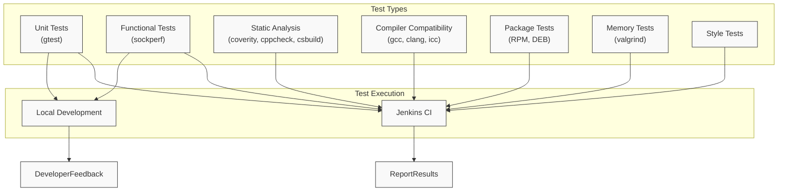
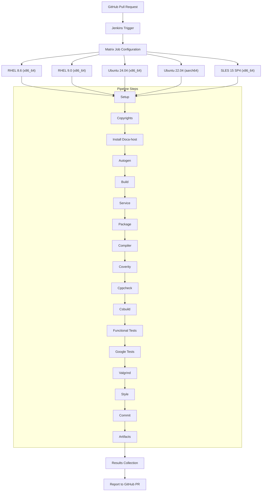

<!-- source: DeepWiki mcp.deepwiki.com · repo Mellanox/libvma · page 9 Testing and CI/CD · fetched 2026-11-11 -->

# Testing and CI/CD

<details>
<summary>Relevant source files</summary>

The following files were used as context for generating this wiki page:

- [.ci/Jenkinsfile](.ci/Jenkinsfile)
- [.ci/README.md](.ci/README.md)
- [.ci/matrix_job.yaml](.ci/matrix_job.yaml)
- [.ci/proj_jjb.yaml](.ci/proj_jjb.yaml)
- [.ci/redmine_jjb.yaml](.ci/redmine_jjb.yaml)
- [.ci/redmine_matrix_job.yaml](.ci/redmine_matrix_job.yaml)
- [.ci/scripts/doca_install.sh](.ci/scripts/doca_install.sh)
- [contrib/jenkins_tests/build.sh](contrib/jenkins_tests/build.sh)
- [contrib/jenkins_tests/compiler.sh](contrib/jenkins_tests/compiler.sh)
- [contrib/jenkins_tests/cov.sh](contrib/jenkins_tests/cov.sh)
- [contrib/jenkins_tests/cppcheck.sh](contrib/jenkins_tests/cppcheck.sh)
- [contrib/jenkins_tests/csbuild.sh](contrib/jenkins_tests/csbuild.sh)
- [contrib/jenkins_tests/globals.sh](contrib/jenkins_tests/globals.sh)
- [contrib/jenkins_tests/rpm.sh](contrib/jenkins_tests/rpm.sh)
- [contrib/jenkins_tests/style.sh](contrib/jenkins_tests/style.sh)
- [contrib/jenkins_tests/test.sh](contrib/jenkins_tests/test.sh)
- [contrib/jenkins_tests/vg.sh](contrib/jenkins_tests/vg.sh)
- [contrib/jenkins_tests/vutil.sh](contrib/jenkins_tests/vutil.sh)
- [contrib/test_jenkins.sh](contrib/test_jenkins.sh)
- [tests/gtest/Makefile.am](tests/gtest/Makefile.am)
- [tests/gtest/tcp/tcp_base.cc](tests/gtest/tcp/tcp_base.cc)
- [tests/gtest/tcp/tcp_bind.cc](tests/gtest/tcp/tcp_bind.cc)
- [tests/gtest/tcp/tcp_send_zc.cc](tests/gtest/tcp/tcp_send_zc.cc)
- [tests/gtest/tcp/tcp_sendfile.cc](tests/gtest/tcp/tcp_sendfile.cc)
- [tests/gtest/tcp/tcp_tls.cc](tests/gtest/tcp/tcp_tls.cc)
- [tests/gtest/vma/vma_recvfrom_zcopy.cc](tests/gtest/vma/vma_recvfrom_zcopy.cc)

</details>


This document provides an overview of the testing framework and continuous integration/deployment setup for the VMA (Versatile Message Accelerator) library. It explains the testing methodology, available test types, CI/CD pipeline configuration, and how to run tests locally.

## Testing Framework Overview

The VMA project employs a comprehensive testing strategy that includes unit tests, functional tests, static code analysis, and performance benchmarking. These tests ensure the stability, correctness, and performance of the network acceleration library across different platforms and configurations.



Sources: [.ci/matrix_job.yaml](), [contrib/test_jenkins.sh](), [contrib/jenkins_tests/globals.sh]()

## CI/CD Pipeline

The VMA project uses a Jenkins-based CI/CD pipeline that runs a comprehensive set of tests on multiple platforms and configurations. The pipeline is configured using a matrix job that tests various combinations of:

- Operating systems (RHEL, Ubuntu, SLES)
- Architectures (x86_64, aarch64, ppc64le)
- Configurations (default, extra features)



Sources: [.ci/matrix_job.yaml](), [.ci/proj_jjb.yaml](), [contrib/test_jenkins.sh]()

### Pipeline Steps

The CI/CD pipeline includes the following test steps:

1. **Build**: Verifies that the code compiles with default and debug configurations
2. **Service**: Tests the VMA daemon functionality 
3. **Package**: Creates and validates RPM and DEB packages
4. **Compiler**: Tests compilation with different compilers (GCC, Clang, ICC)
5. **Coverity**: Performs static code analysis using Coverity
6. **Cppcheck**: Fast static analysis using cppcheck
7. **Csbuild**: Additional static analysis
8. **Test**: Functional tests using sockperf
9. **Gtest**: Unit tests with Google Test framework
10. **Valgrind**: Memory leak and access validation
11. **Style**: Coding style checks
12. **Commit**: Commit message validation

Each step is configured in the matrix job and can be enabled or disabled based on the build parameters.

Sources: [.ci/matrix_job.yaml:67-302](), [contrib/test_jenkins.sh:66-280]()

## Unit Testing (Google Test)

The VMA project uses Google Test framework for unit testing. The test suite is organized by component type and functionality.

```mermaid
flowchart TD
    Gtest["tests/gtest"]
    
    Gtest --> Common["Common Tests"]
    Gtest --> Socket["Socket Tests"]
    Gtest --> Mix["Mix Tests"]
    Gtest --> TCP["TCP Tests"]
    Gtest --> UDP["UDP Tests"]
    Gtest --> VMA["VMA Tests"]
    Gtest --> VMAD["VMAD Tests"]
    
    TCP --> TCP1["tcp_base.cc - Base TCP functionality"]
    TCP --> TCP2["tcp_socket.cc - Socket creation"]
    TCP --> TCP3["tcp_bind.cc - Socket binding"]
    TCP --> TCP4["tcp_connect.cc - Connection establishment"]
    TCP --> TCP5["tcp_send.cc - Data sending"]
    TCP --> TCP6["tcp_sendto.cc - Data sending with destination"]
    TCP --> TCP7["tcp_sendfile.cc - File transfer"]
    TCP --> TCP8["tcp_send_zc.cc - Zero-copy sending"]
    TCP --> TCP9["tcp_tls.cc - TLS functionality"]
    
    UDP --> UDP1["udp_base.cc - Base UDP functionality"]
    UDP --> UDP2["udp_bind.cc - Socket binding"]
    UDP --> UDP3["udp_connect.cc - Default destination setting"]
    UDP --> UDP4["udp_send.cc - Data sending"]
    UDP --> UDP5["udp_sendto.cc - Data sending with destination"]
    
    VMA --> VMA1["vma_base.cc - Base VMA functionality"]
    VMA --> VMA2["vma_ring.cc - Ring buffer tests"]
    VMA --> VMA3["vma_poll.cc - Polling mechanism"]
    VMA --> VMA4["vma_sockopt.cc - Socket options"]
    VMA --> VMA5["vma_recvfrom_zcopy.cc - Zero-copy receive"]
    VMA --> VMA6["vma_ioctl.cc - IOCTL interfaces"]
```



Sources: [tests/gtest/Makefile.am:82-127](), [tests/gtest/tcp/tcp_base.cc](), [tests/gtest/tcp/tcp_bind.cc](), [tests/gtest/tcp/tcp_sendfile.cc](), [tests/gtest/tcp/tcp_send_zc.cc](), [tests/gtest/tcp/tcp_tls.cc](), [tests/gtest/vma/vma_recvfrom_zcopy.cc]()

The Google Test framework is built and run as part of the CI pipeline. Each test checks specific functionality of the VMA library:

- **TCP Tests**: Test TCP socket operations, including socket creation, binding, connecting, sending data, and file transfer
- **UDP Tests**: Test UDP socket operations
- **VMA Tests**: Test VMA-specific functionality, such as ring buffers, zero-copy operations, and socket options
- **VMAD Tests**: Test the VMA daemon functionality

Sources: [tests/gtest/Makefile.am](), [contrib/jenkins_tests/globals.sh]()

## Functional Testing (sockperf)

Functional tests use the sockperf benchmarking tool to verify the correct operation of the VMA library in real-world scenarios.

```mermaid
flowchart TD
    Test["contrib/jenkins_tests/test.sh"]
    
    Test --> Setup["Setup Test Environment"]
    Setup --> TP["TCP Ping-Pong Tests (tcp-pp)"]
    Setup --> TT["TCP Throughput Tests (tcp-tp)"]
    Setup --> TU["TCP Under-Load Tests (tcp-ul)"]
    
    TP --> PP1["Basic ping-pong (no arguments)"]
    TP --> PP2["Ping-pong with --dontwarmup"]
    TP --> PP3["Ping-pong with burst size 10"]
    TP --> PP4["Ping-pong with burst size 100"]
    TP --> PP5["Ping-pong with burst size 1000"]
    TP --> PP6["Ping-pong with 10s runtime"]
    TP --> PP7["Ping-pong with 30s runtime"]
    TP --> PP8["Ping-pong with 32B messages"]
    TP --> PP9["Ping-pong with 4KB messages"]
    
    TT --> TP1["Basic throughput (no arguments)"]
    TT --> TP2["Throughput with --dontwarmup"]
    TT --> TP3["Throughput with burst size 10"]
    TT --> TP4["Throughput with burst size 100"]
    TT --> TP5["Throughput with burst size 1000"]
    TT --> TP6["Throughput with 10s runtime"]
    TT --> TP7["Throughput with 30s runtime"]
    TT --> TP8["Throughput with 32B messages"]
    TT --> TP9["Throughput with 4KB messages"]
    
    TU --> UL1["Basic under-load (no arguments)"]
    TU --> UL2["Under-load with --dontwarmup"]
    TU --> UL3["Under-load with burst size 10"]
    TU --> UL4["Under-load with burst size 100"]
    TU --> UL5["Under-load with burst size 1000"]
    TU --> UL6["Under-load with 10s runtime"]
    TU --> UL7["Under-load with 30s runtime"]
    TU --> UL8["Under-load with 32B messages"]
    TU --> UL9["Under-load with 4KB messages"]
```



Sources: [contrib/jenkins_tests/test.sh](), [contrib/jenkins_tests/vutil.sh]()

The functional tests verify various aspects of the network stack:

- **TCP Ping-Pong**: Measures latency for request-response patterns
- **TCP Throughput**: Measures maximum data transfer rate
- **TCP Under-Load**: Measures latency while maintaining a constant load

Each test case runs with different parameters to test various scenarios and conditions.

Sources: [contrib/jenkins_tests/test.sh:46-164](), [contrib/jenkins_tests/vutil.sh:15-223]()

## Static Code Analysis

The VMA project uses multiple static code analysis tools to identify potential issues:

### Coverity

Coverity performs comprehensive static analysis to find defects such as:
- Memory leaks
- NULL pointer dereferences
- Resource leaks
- API misuse
- Security vulnerabilities

The Coverity analysis is configured in `contrib/jenkins_tests/cov.sh` and runs as part of the CI pipeline.

Sources: [contrib/jenkins_tests/cov.sh]()

### Cppcheck

Cppcheck provides fast static analysis focusing on:
- Memory leaks
- Buffer overflows
- Out-of-bounds access
- Uninitialized variables

The Cppcheck analysis is configured in `contrib/jenkins_tests/cppcheck.sh`.

Sources: [contrib/jenkins_tests/cppcheck.sh]()

### Csbuild

Csbuild offers additional static analysis capabilities and complements the other tools. It's configured in `contrib/jenkins_tests/csbuild.sh`.

Sources: [contrib/jenkins_tests/csbuild.sh]()

## Memory Testing (Valgrind)

Valgrind tests check for memory-related issues such as:
- Memory leaks
- Use of uninitialized memory
- Double free errors
- Memory access violations

The Valgrind tests use sockperf to exercise the VMA library and detect any memory-related issues.

Sources: [contrib/jenkins_tests/vg.sh]()

## Package Testing

Package tests ensure that the VMA library can be properly packaged as RPM and DEB packages. These tests verify:
- Proper file organization
- Correct dependencies
- Installation and uninstallation
- Compliance with packaging standards

Sources: [contrib/jenkins_tests/rpm.sh]()

## Running Tests Locally

To run tests locally during development, follow these steps:

1. Set up the environment variables:
```bash
export WORKSPACE=/path/to/libvma
export BUILD_NUMBER=1
export TARGET=default  # or 'extra' for additional features
```

2. Run the test script with specific test types enabled:
```bash
cd $WORKSPACE
export jenkins_test_build=yes     # Enable build tests
export jenkins_test_gtest=yes     # Enable Google tests
export jenkins_test_run=yes       # Enable functional tests
./contrib/test_jenkins.sh
```

3. Check the test results in the `jenkins` directory:
```bash
ls -la jenkins/default/
```

Sources: [contrib/test_jenkins.sh:10-85](), [contrib/jenkins_tests/globals.sh:1-40]()

## CI Automation and Pull Request Integration

The VMA project uses GitHub pull request integration with Jenkins to automatically test changes. The CI system can be triggered by:

1. Creating a new pull request
2. Updating an existing pull request
3. Adding a comment with `bot:retest` to re-run tests

The CI results are reported back to the GitHub pull request, showing the test status and linking to detailed logs.

Sources: [.ci/proj_jjb.yaml:109-122](), [.ci/README.md:1-26]()

## Docker Containers for Testing

The CI system uses Docker containers to provide consistent test environments. The available containers include:

| OS | Architecture | Purpose |
|----|--------------|---------|
| RHEL 8.6 | x86_64 | Base testing environment |
| RHEL 9.0 | x86_64 | Base testing environment |
| RHEL 9.4 | aarch64 | Base testing environment |
| Ubuntu 24.04 | x86_64, aarch64 | Base testing environment |
| Ubuntu 22.04 | x86_64, aarch64 | Base testing environment |
| SLES 15 SP4 | x86_64 | Base testing environment |
| Toolbox | x86_64 | Special tools environment |
| Blackduck | x86_64 | License compliance checking |
| Header-check | x86_64 | Copyright header validation |

These containers provide isolated environments for testing different platform configurations.

Sources: [.ci/matrix_job.yaml:34-48](), [.ci/README.md:42-65]()

## Conclusion

The VMA testing and CI/CD system provides comprehensive validation of the library's functionality, performance, and code quality. The combination of unit tests, functional tests, static analysis, and performance testing ensures that the library meets its requirements and maintains high quality across releases.

---

