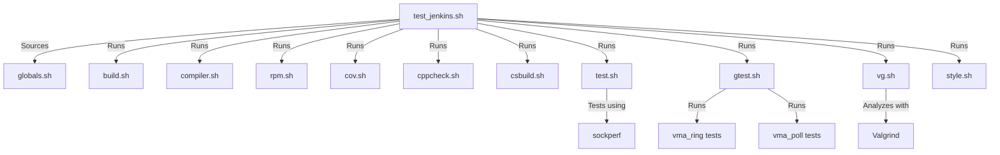
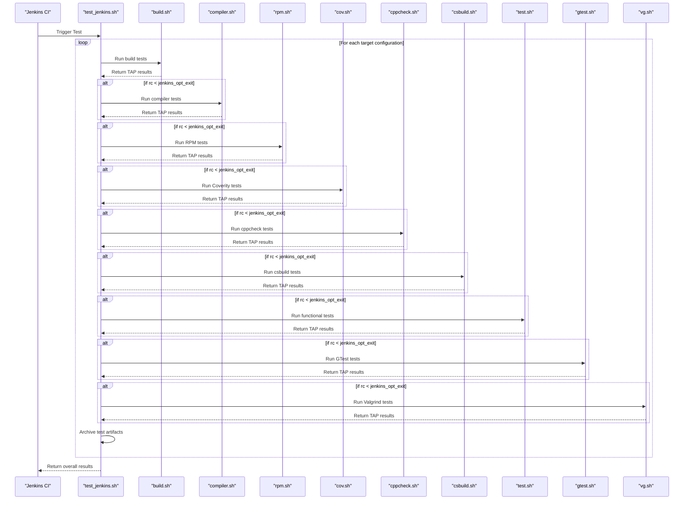
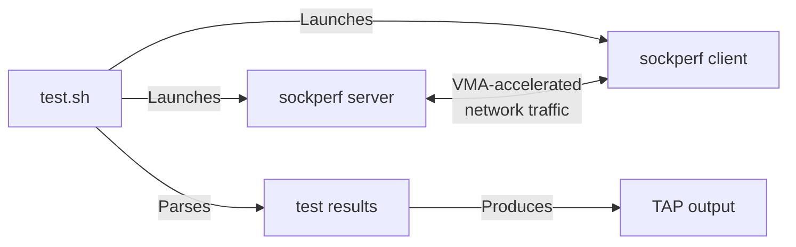
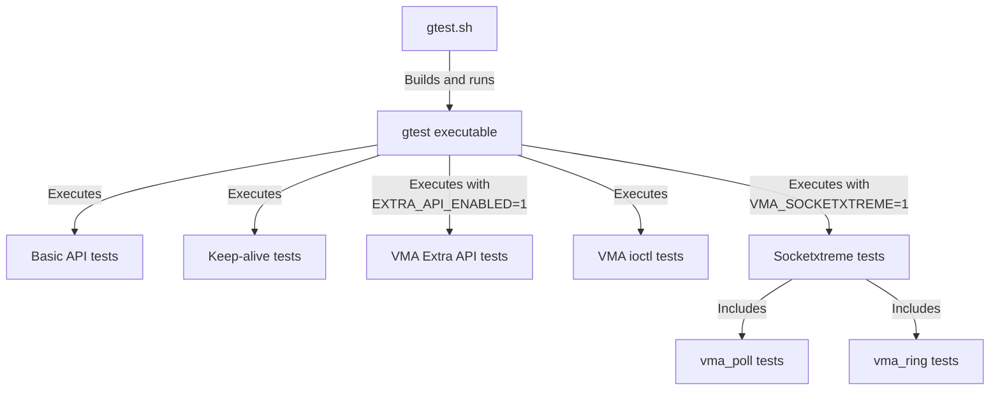
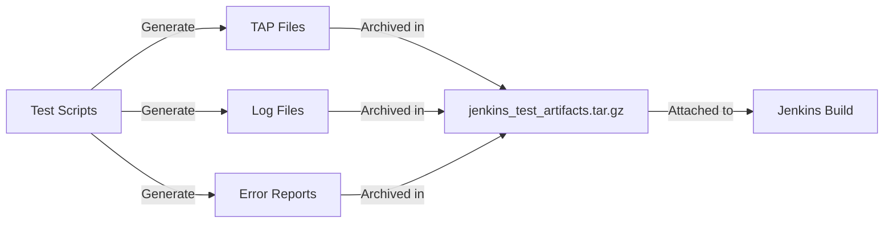
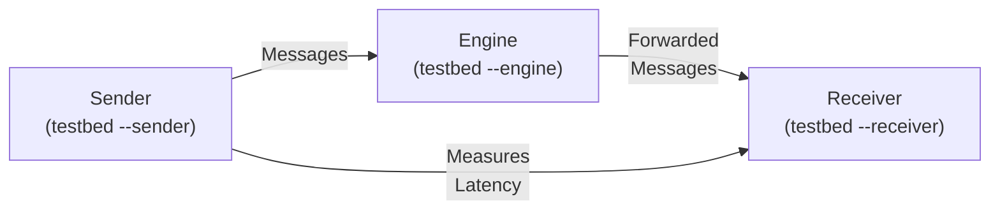

<!-- source: DeepWiki mcp.deepwiki.com · repo Mellanox/libvma · page 9.1 Jenkins Testing · fetched 2026-11-11 -->

# Jenkins Testing

<details>
<summary>Relevant source files</summary>

The following files were used as context for generating this wiki page:

- [contrib/jenkins_tests/build.sh](contrib/jenkins_tests/build.sh)
- [contrib/jenkins_tests/compiler.sh](contrib/jenkins_tests/compiler.sh)
- [contrib/jenkins_tests/cov.sh](contrib/jenkins_tests/cov.sh)
- [contrib/jenkins_tests/cppcheck.sh](contrib/jenkins_tests/cppcheck.sh)
- [contrib/jenkins_tests/csbuild.sh](contrib/jenkins_tests/csbuild.sh)
- [contrib/jenkins_tests/globals.sh](contrib/jenkins_tests/globals.sh)
- [contrib/jenkins_tests/gtest.sh](contrib/jenkins_tests/gtest.sh)
- [contrib/jenkins_tests/rpm.sh](contrib/jenkins_tests/rpm.sh)
- [contrib/jenkins_tests/style.sh](contrib/jenkins_tests/style.sh)
- [contrib/jenkins_tests/test.sh](contrib/jenkins_tests/test.sh)
- [contrib/jenkins_tests/vg.sh](contrib/jenkins_tests/vg.sh)
- [contrib/jenkins_tests/vutil.sh](contrib/jenkins_tests/vutil.sh)
- [contrib/test_jenkins.sh](contrib/test_jenkins.sh)
- [tests/gtest/vma/vma_base.cc](tests/gtest/vma/vma_base.cc)
- [tests/gtest/vma/vma_base.h](tests/gtest/vma/vma_base.h)
- [tests/gtest/vma/vma_poll.cc](tests/gtest/vma/vma_poll.cc)
- [tests/gtest/vma/vma_ring.cc](tests/gtest/vma/vma_ring.cc)
- [tests/gtest/vma/vma_sockopt.cc](tests/gtest/vma/vma_sockopt.cc)
- [tests/testbed/README](tests/testbed/README)
- [tests/testbed/testbed.c](tests/testbed/testbed.c)

</details>


This page documents the Jenkins-based Continuous Integration (CI) testing system for the libvma (Versatile Message Accelerator) project. It covers the structure, components, and execution flow of the automated testing framework used to verify code quality, functionality, and performance of the VMA library.

For information about the overall CI pipeline, see [CI Pipeline](#9.2).

## Jenkins Testing Architecture

The Jenkins testing framework for libvma consists of a main orchestration script and a collection of specialized test scripts, each focusing on a specific aspect of testing. The framework is designed to be modular, allowing tests to be run independently or as part of a complete test suite.



Sources: [contrib/test_jenkins.sh:1-286](), [contrib/jenkins_tests/globals.sh:1-285]()

### Test Execution Flow

The test execution flow is orchestrated by the main script, which runs each test component sequentially and collects their results. Each test script produces a TAP (Test Anything Protocol) file with test results.



Sources: [contrib/test_jenkins.sh:139-263](), [contrib/jenkins_tests/globals.sh:61-76]()

## Test Components

### Global Utilities

The `globals.sh` script provides common functions, variables, and utility methods used by all test scripts. It defines workspace paths, error handling functions, and test result reporting mechanisms.

Key components:

- Directory paths for build, test, and result artifacts
- Common utility functions for executing commands and checking results
- Environment detection and setup
- TAP result formatting and archiving functions

Sources: [contrib/jenkins_tests/globals.sh:1-285]()

### Build Tests

The build tests verify that the libvma code can be built successfully with different configurations. The `build.sh` script uses configure options to build both standard and debug configurations.

```
Default build: standard optimization
Debug build: --enable-opt-log=no --enable-debug
```

Sources: [contrib/jenkins_tests/build.sh:1-38]()

### Compiler Tests

The compiler tests verify that the code can be compiled with different compilers and versions. This helps ensure compatibility across various environments.

| Compiler | Versions Tested |
|-|-|
| GCC | 8.3.0, 9.3.0, 10.1.0 |
| Clang | 9.0.1 |
| ICC | 18.0.4, 19.1.1 |

Sources: [contrib/jenkins_tests/compiler.sh:1-37]()

### RPM Packaging Tests

The RPM tests verify that the code can be packaged correctly into RPM/DEB packages. This includes:

- Creating source tarball
- Building source RPM/SRPM
- Building binary RPM/DEB
- Verifying package metadata and emails

Sources: [contrib/jenkins_tests/rpm.sh:1-127]()

### Static Analysis

#### Coverity Analysis

Coverity is a static analysis tool that detects code defects like memory leaks, buffer overflows, and logical issues. The `cov.sh` script:

- Configures and builds the code with Coverity instrumentation
- Analyzes the code for defects
- Optionally uploads results to a Coverity server
- Generates a local HTML report of findings

Sources: [contrib/jenkins_tests/cov.sh:1-89]()

#### Cppcheck Analysis

Cppcheck is an open-source static analysis tool that detects various coding issues. The `cppcheck.sh` script runs the analysis with options targeting C++ language features.

Sources: [contrib/jenkins_tests/cppcheck.sh:1-85]()

#### Csbuild Analysis

Csbuild (CodeSonar Build) performs static analysis during compilation to find complex code defects. The script filters out false positives and common warning patterns.

Sources: [contrib/jenkins_tests/csbuild.sh:1-69]()

#### Style Checking

The style test checks code against the project's coding style guidelines, using the Linux kernel's `checkpatch.pl` tool.

Sources: [contrib/jenkins_tests/style.sh:1-84]()

### Functional Tests

The functional tests verify that the library works correctly by running `sockperf` (a socket performance measurement tool) with various configurations. These tests validate both functionality and performance of the VMA implementation.

Test scenarios include:
- TCP ping-pong tests
- TCP throughput tests
- TCP under-load tests



Sources: [contrib/jenkins_tests/test.sh:1-170](), [contrib/jenkins_tests/vutil.sh:1-421]()

### Google Tests (Unit Tests)

The gtest script runs unit tests for specific VMA components. These tests verify functionality at a more granular level than the functional tests.

Key test suites:
- VMA Ring tests (verify ring buffer operations)
- VMA Poll tests (verify poll/socketxtreme functionality)
- Socket operation tests



Sources: [contrib/jenkins_tests/gtest.sh:1-81](), [tests/gtest/vma/vma_ring.cc:1-347](), [tests/gtest/vma/vma_poll.cc:1-409](), [tests/gtest/vma/vma_base.cc:1-30](), [tests/gtest/vma/vma_base.h:1-35](), [tests/gtest/vma/vma_sockopt.cc:1-92]()

### Memory Analysis (Valgrind)

The Valgrind tests check for memory issues such as leaks, use of uninitialized memory, and invalid memory access. The `vg.sh` script runs sockperf tests under Valgrind's memcheck tool.

Key features:
- Detects memory leaks
- Traces memory origins
- Tracks file descriptors
- Validates read/write operations

Sources: [contrib/jenkins_tests/vg.sh:1-152]()

## Test Configuration and Execution

### Environment Setup

The test framework uses environment variables to control which tests run. These can be set before calling the main script:

```bash
export jenkins_test_build=yes     # Run build tests
export jenkins_test_compiler=yes  # Run compiler tests
export jenkins_test_rpm=yes       # Run RPM tests
export jenkins_test_cov=yes       # Run Coverity tests
export jenkins_test_cppcheck=yes  # Run cppcheck tests
export jenkins_test_csbuild=yes   # Run csbuild tests
export jenkins_test_run=yes       # Run functional tests
export jenkins_test_gtest=yes     # Run GTest
export jenkins_test_vg=yes        # Run Valgrind tests
export jenkins_test_style=yes     # Run style tests
```

Sources: [contrib/test_jenkins.sh:69-82]()

### Target Configurations

The tests can be run against multiple target configurations:

```bash
# Default configuration (no TSO)
TARGET=default 

# Extra configuration (with TSO enabled)
TARGET=extra

# Both configurations
TARGET=all
```

Sources: [contrib/test_jenkins.sh:97-106]()

### Running Tests

To run the complete test suite:

```bash
cd $WORKSPACE
./contrib/test_jenkins.sh
```

To run an individual test script:

```bash
cd $WORKSPACE
./contrib/jenkins_tests/<test_script>.sh
```

Sources: [contrib/test_jenkins.sh:1-286]()

## Test Results and Reporting

### TAP Output

All tests generate output in the Test Anything Protocol (TAP) format, which provides a standardized way to report test results. The TAP files are generated in the `$WORKSPACE/$prefix` directory with the extension `.tap`.

Example TAP output format:
```
1..3
ok 1 Test case 1 passed
not ok 2 Test case 2 failed
ok 3 Test case 3 passed
```

Sources: [contrib/jenkins_tests/globals.sh:175-198]()

### Result Archiving

Test artifacts (logs, error reports, etc.) are archived for further analysis:



Sources: [contrib/test_jenkins.sh:266-277](), [contrib/jenkins_tests/globals.sh:70-76]()

## Adding New Tests

To add a new test to the framework:

1. Create a test script in `contrib/jenkins_tests/`
2. Source the `globals.sh` script
3. Use the `do_check_result` function to report test results
4. Use the `do_archive` function for test artifacts
5. Return a non-zero exit code on failure

Template for a new test script:

```bash
#!/bin/bash -eExl

source $(dirname $0)/globals.sh

echo "Checking for my test ..."

cd $WORKSPACE

rm -rf $my_test_dir
mkdir -p $my_test_dir
cd $my_test_dir

# Run your test here
# ...

my_test_tap=${WORKSPACE}/${prefix}/my_test.tap

echo "1..1" > $my_test_tap
if [ $rc -gt 0 ]; then
    echo "not ok 1 My test failed" >> $my_test_tap
    do_err "my_test" "${my_test_dir}/my_test.err"
else
    echo "ok 1 My test passed" >> $my_test_tap
fi

do_archive "${my_test_dir}/my_test.err" "${my_test_dir}/my_test.log"

echo "[${0##*/}]..................exit code = $rc"
exit $rc
```

Sources: [contrib/jenkins_tests/globals.sh:51-61](), [contrib/jenkins_tests/globals.sh:175-198]()

## Testbed Application

The test framework also includes a standalone test application called `testbed`, which can be used for performance and functional testing outside of the Jenkins environment. This application includes sender, engine, and receiver components that can be deployed across multiple nodes to test VMA functionality and performance.



Key features:
- Configurable message size and rate
- Multiple sender/receiver configurations
- Timestamp support for latency measurement
- Optional zero-copy functionality using VMA extra API

Sources: [tests/testbed/testbed.c:1-284](), [tests/testbed/README:1-37]()

---

