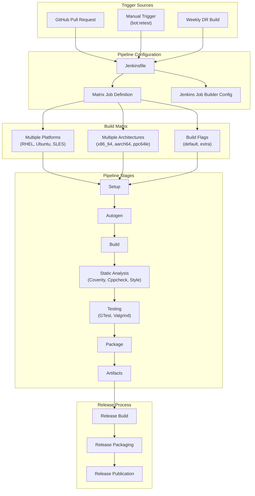
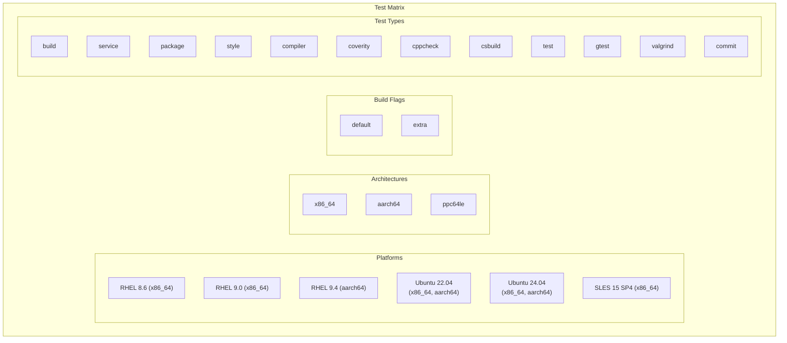
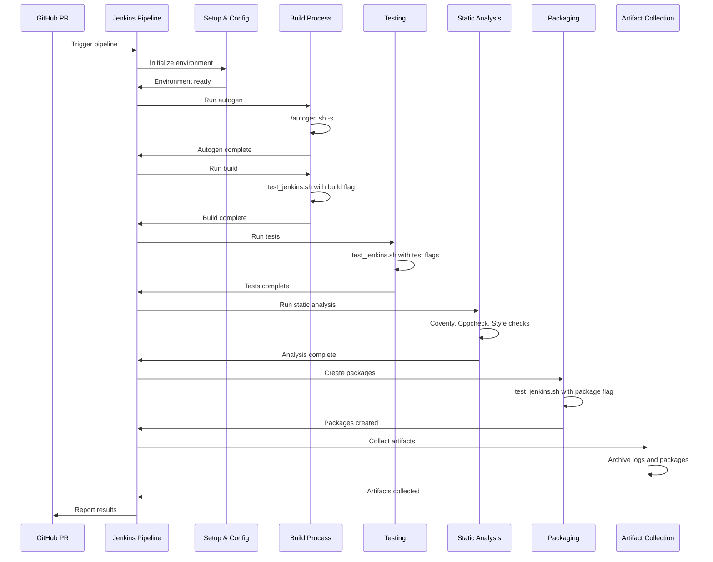
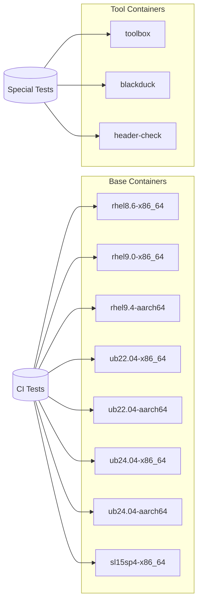
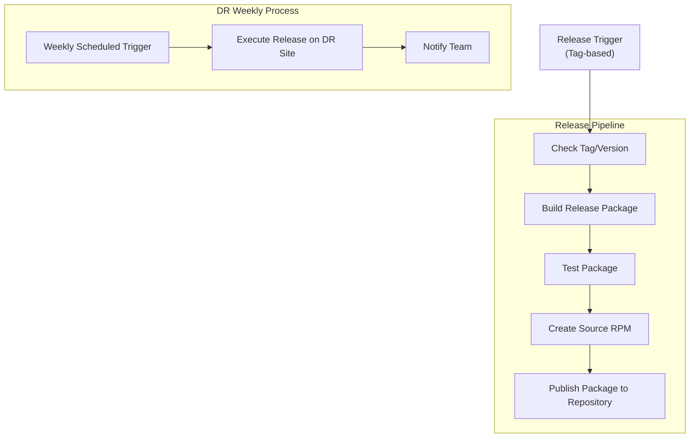

<!-- source: DeepWiki mcp.deepwiki.com · repo Mellanox/libvma · page 9.2 CI Pipeline · fetched 2026-11-11 -->

# CI Pipeline

<details>
<summary>Relevant source files</summary>

The following files were used as context for generating this wiki page:

- [.ci/Jenkinsfile](.ci/Jenkinsfile)
- [.ci/README.md](.ci/README.md)
- [.ci/do_release.sh](.ci/do_release.sh)
- [.ci/dockerfiles/Dockerfile.rhel8.6.release](.ci/dockerfiles/Dockerfile.rhel8.6.release)
- [.ci/matrix_job.yaml](.ci/matrix_job.yaml)
- [.ci/pipeline/dr_weekly_jjb.yaml](.ci/pipeline/dr_weekly_jjb.yaml)
- [.ci/pipeline/dr_weekly_matrix.yaml](.ci/pipeline/dr_weekly_matrix.yaml)
- [.ci/pipeline/release_jjb.yaml](.ci/pipeline/release_jjb.yaml)
- [.ci/pipeline/release_matrix_job.yaml](.ci/pipeline/release_matrix_job.yaml)
- [.ci/proj_jjb.yaml](.ci/proj_jjb.yaml)
- [.ci/redmine_jjb.yaml](.ci/redmine_jjb.yaml)
- [.ci/redmine_matrix_job.yaml](.ci/redmine_matrix_job.yaml)
- [.ci/scripts/doca_install.sh](.ci/scripts/doca_install.sh)

</details>


## Purpose and Scope

This document details the Continuous Integration (CI) pipeline for the VMA (Versatile Message Accelerator) project. It covers the pipeline architecture, test matrix, various testing stages, and release processes. The CI pipeline ensures code quality, compatibility across multiple platforms and architectures, and provides automated testing and validation prior to code integration.

For information about functional and performance testing details, see [Functional and Performance Testing](#9.3).

## Pipeline Overview

The VMA CI pipeline is based on Jenkins and uses a matrix-based approach to test code across multiple platforms, architectures, and configurations. The pipeline is triggered automatically for pull requests and can be manually retriggered using GitHub comments.



Sources: [.ci/Jenkinsfile](), [.ci/matrix_job.yaml](), [.ci/proj_jjb.yaml]()

## Pipeline Architecture

The VMA CI pipeline is implemented using Jenkins CI/CD with configuration defined in YAML files. It uses the ci-demo framework from Mellanox to provide a standardized pipeline structure.

### Jenkins Job Structure

```mermaid
classDiagram
    class "Jenkins" {
        +Folders
        +Jobs
        +Pipeline Definitions
    }
    
    class "Main Pipeline" {
        +LibVMA Job
        +Pull Request Trigger
        +Matrix Test Execution
    }
    
    class "Release Pipeline" {
        +LibVMA-release Job
        +Tag-based Execution
        +Package Publishing
    }
    
    class "DR Weekly Pipeline" {
        +libvma-dr-weekly-launcher
        +Weekly Execution
        +Disaster Recovery Testing
    }
    
    class "Redmine Integration" {
        +LibVMA-redmine-issue
        +Issue Tracking
        +PR Issue Validation
    }
    
    Jenkins *-- "Main Pipeline"
    Jenkins *-- "Release Pipeline"
    Jenkins *-- "DR Weekly Pipeline"
    Jenkins *-- "Redmine Integration"
```

Sources: [.ci/proj_jjb.yaml](), [.ci/pipeline/release_jjb.yaml](), [.ci/pipeline/dr_weekly_jjb.yaml](), [.ci/redmine_jjb.yaml]()

### Test Matrix

The pipeline uses a matrix approach to test VMA across multiple dimensions:



Sources: [.ci/matrix_job.yaml:53-61](), [.ci/matrix_job.yaml:35-48]()

## Pipeline Stages

The CI pipeline consists of multiple stages that run sequentially to validate code changes:



Sources: [.ci/matrix_job.yaml:66-302]()

### Setup Stage

The setup stage prepares the environment for testing, including installing dependencies and DOCA (Data-plane Offload and Communication Architecture).

### Build Stages

The build process starts with the autogen script and then builds VMA with different configurations:

1. **Autogen**: Runs the `./autogen.sh -s` command to generate build files
2. **Build**: Compiles VMA with different build flags
3. **Service**: Tests tools and service components
4. **Package**: Creates RPM and other distribution packages

Sources: [.ci/matrix_job.yaml:111-152]()

### Testing Stages

Several types of tests are performed:

1. **Standard Tests**: Functional testing of the library
2. **Google Tests**: Unit tests using the Google Test framework
3. **Valgrind**: Memory error detection and memory leak analysis

Sources: [.ci/matrix_job.yaml:230-277]()

### Static Analysis Stages

Multiple static analysis tools are used to ensure code quality:

1. **Style Check**: Ensures code follows formatting guidelines
2. **Compiler Checks**: Tests with different compilers (GCC, ICC, Clang)
3. **Coverity Scan**: Advanced static analysis to detect defects
4. **Cppcheck**: Open source static analysis
5. **Csbuild**: Additional static analysis tool

Sources: [.ci/matrix_job.yaml:153-229]()

### Artifact Collection

Logs, test results, and packages are collected and archived for later reference.

Sources: [.ci/matrix_job.yaml:293-301]()

## Docker Containers

The pipeline uses Docker containers to provide consistent test environments:



Sources: [.ci/matrix_job.yaml:34-48]()

## Release Process

The release process builds and publishes VMA packages for distribution:



Sources: [.ci/pipeline/release_matrix_job.yaml](), [.ci/do_release.sh](), [.ci/pipeline/dr_weekly_matrix.yaml]()

### Release Process Details

The release process involves:

1. Triggering the release job with a specific tag
2. Verifying the tag matches the version in `configure.ac`
3. Building the package
4. Creating source and binary RPMs
5. Publishing the package to the release repository

A disaster recovery (DR) weekly build process also runs to ensure releases can be built at the DR site.

Sources: [.ci/do_release.sh:9-77](), [.ci/pipeline/dr_weekly_matrix.yaml:25-73]()

## Triggering the Pipeline

The VMA CI pipeline can be triggered in several ways:

1. **Automatically on Pull Request**: Pipeline runs automatically when a PR is created or updated
2. **Manual Trigger**: Add a comment with "bot:retest" to re-run the pipeline on a PR
3. **Scheduled Trigger**: DR weekly builds run on a schedule

When a PR is created, the pipeline runs the specified test matrix across all supported platforms and architectures.

Sources: [.ci/proj_jjb.yaml:109-123](), [.ci/README.md:1-7]()

## Customizing Test Execution

The pipeline provides parameters to customize which tests are run:

| Parameter       | Description                                              |
|-----------------|----------------------------------------------------------|
| do_build        | Build with different configurations using gcc             |
| do_compiler     | Test compilation with icc, clang                         |
| do_package      | Test tar, source and binary packages                     |
| do_cppcheck     | Run static analysis using cppcheck                       |
| do_csbuild      | Run static analysis using csbuild                        |
| do_service      | Verify service operation                                 |
| do_style        | Check code style                                         |
| do_coverity     | Run Coverity static analysis                             |
| do_test         | Run runtime verification tests                           |
| do_gtest        | Run Google tests                                         |
| do_valgrind     | Run memory checks with Valgrind                          |
| do_commit       | Verify commit message format                             |
| do_artifact     | Collect test artifacts                                   |
| do_blackduck    | Run license compliance check with BlackDuck              |
| do_copyrights   | Check source copyright headers                           |

Sources: [.ci/proj_jjb.yaml:46-108]()

## Troubleshooting

If the pipeline fails, artifacts are collected to help diagnose issues. Each test stage has an `onfail` handler that collects relevant logs and test results.

To manually debug issues, developers can run the Docker containers locally:

```bash
# Find top level dir of the git project:
WORKSPACE=$(git rev-parse --show-toplevel)

# Run container with appropriate volume mounts
docker run -it -d --rm --privileged -e WORKSPACE=$WORKSPACE -v $WORKSPACE:$WORKSPACE [docker-image] bash
```

Sources: [.ci/README.md:42-64]()

---

