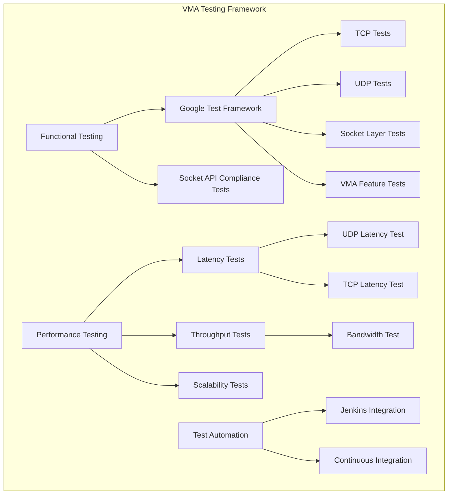
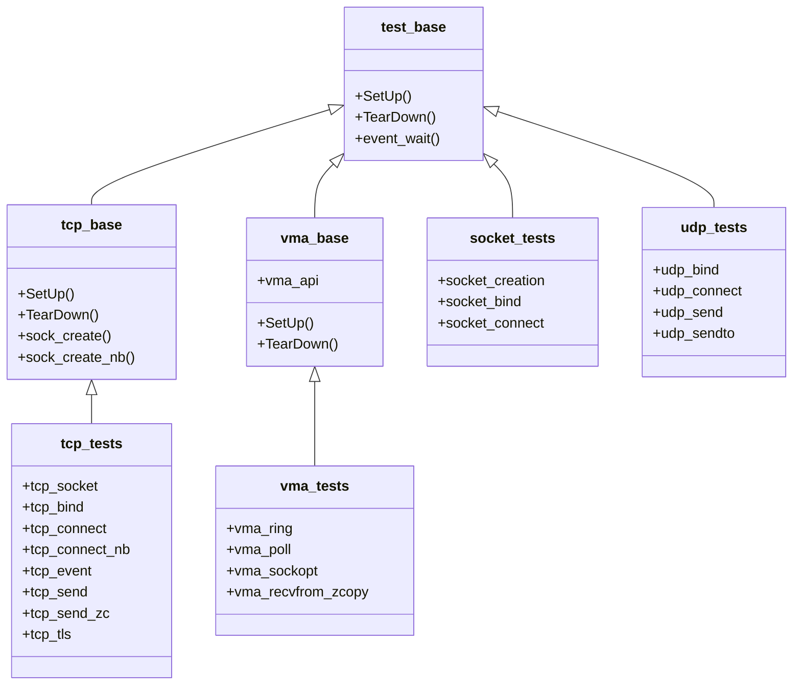
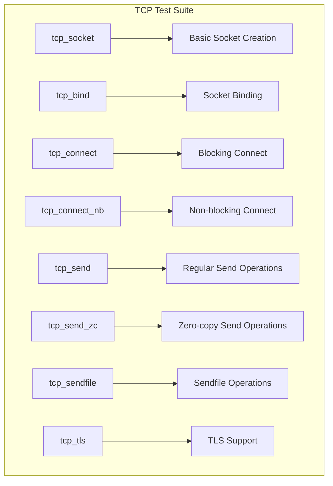
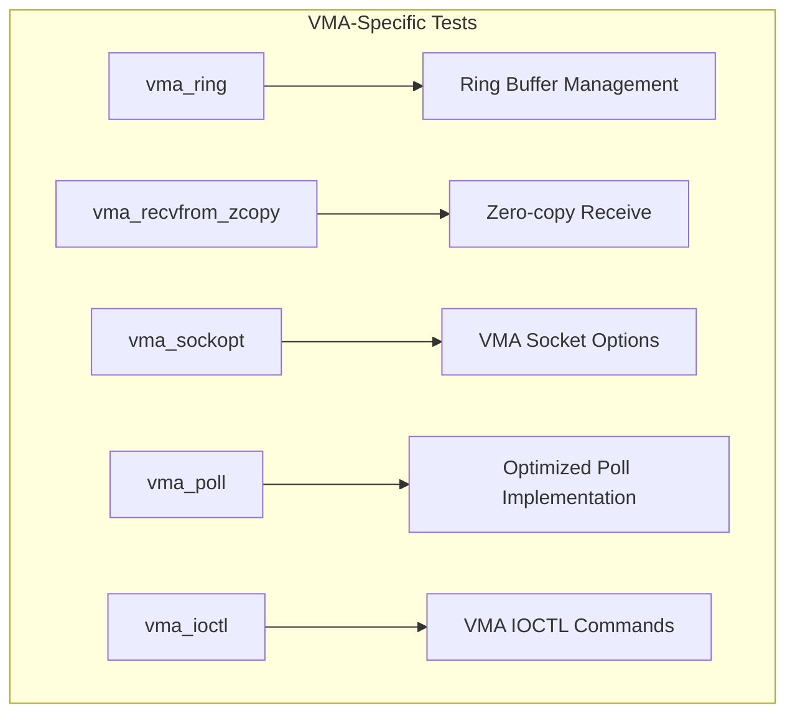
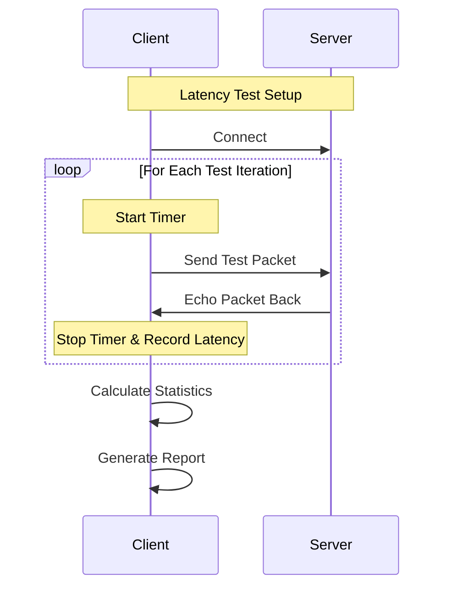
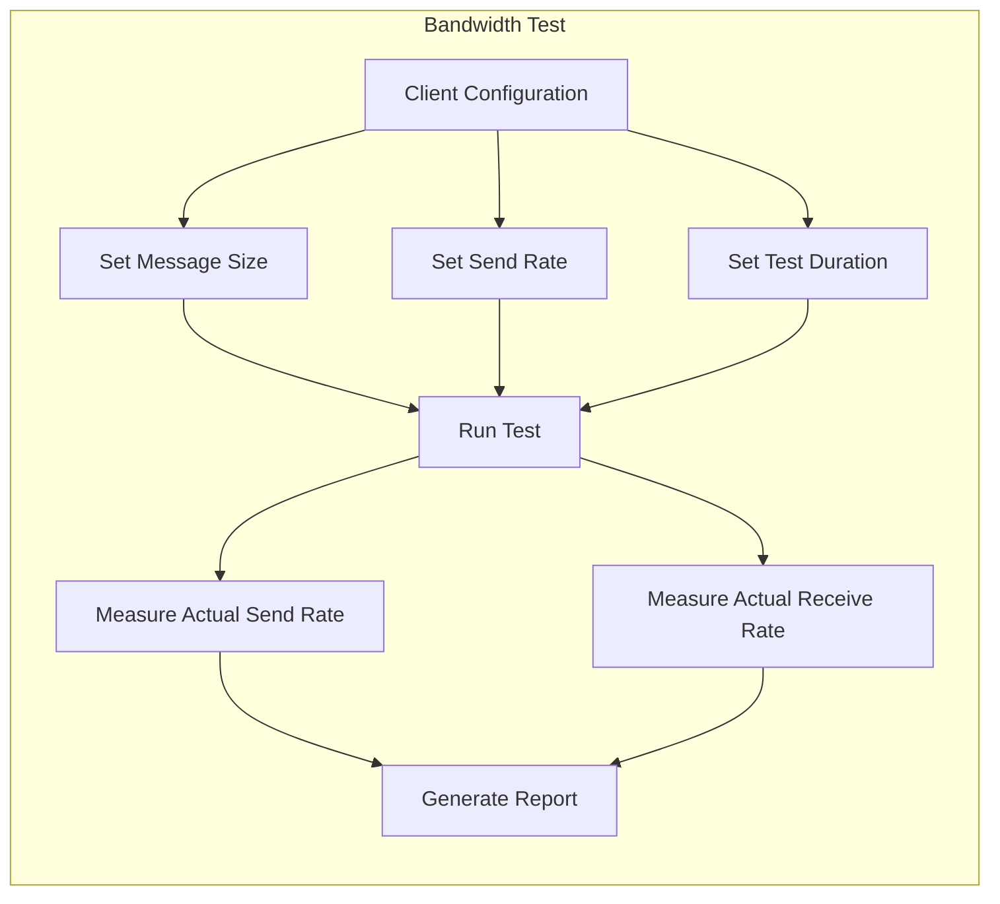

<!-- source: DeepWiki mcp.deepwiki.com · repo Mellanox/libvma · page 9.3 Functional and Performance Testing · fetched 2026-11-11 -->

# Functional and Performance Testing

<details>
<summary>Relevant source files</summary>

The following files were used as context for generating this wiki page:

- [tests/gtest/Makefile.am](tests/gtest/Makefile.am)
- [tests/gtest/tcp/tcp_base.cc](tests/gtest/tcp/tcp_base.cc)
- [tests/gtest/tcp/tcp_bind.cc](tests/gtest/tcp/tcp_bind.cc)
- [tests/gtest/tcp/tcp_send_zc.cc](tests/gtest/tcp/tcp_send_zc.cc)
- [tests/gtest/tcp/tcp_sendfile.cc](tests/gtest/tcp/tcp_sendfile.cc)
- [tests/gtest/tcp/tcp_tls.cc](tests/gtest/tcp/tcp_tls.cc)
- [tests/gtest/vma/vma_recvfrom_zcopy.cc](tests/gtest/vma/vma_recvfrom_zcopy.cc)
- [tests/latency_test/tcp_lat.cpp](tests/latency_test/tcp_lat.cpp)
- [tests/latency_test/udp_lat.c](tests/latency_test/udp_lat.c)
- [tests/throughput_test/bandwidth_test.c](tests/throughput_test/bandwidth_test.c)
- [tests/timetest/Makefile.am](tests/timetest/Makefile.am)
- [tests/timetest/timetest.cpp](tests/timetest/timetest.cpp)

</details>


This page documents the functional and performance testing approach for the VMA (Versatile Message Accelerator) library. It covers the testing frameworks used, testing methodologies, and the specific test tools available for evaluating both the correctness and performance characteristics of VMA. For information about continuous integration infrastructure, see [Jenkins Testing](#9.1) and [CI Pipeline](#9.2).

## Testing Framework Overview

VMA employs a comprehensive testing strategy that includes unit tests, functional tests, and performance benchmarking tools. The primary testing frameworks and tools used include:

1. **Google Test (gtest)** - For unit and functional testing
2. **Custom Benchmarking Tools** - For performance and latency testing
3. **System-level Test Suites** - For end-to-end validation

The testing infrastructure allows for validating VMA's functionality across different protocols (TCP, UDP), networking features, and performance characteristics.



Sources: [tests/gtest/Makefile.am:1-164]()

## Google Test Framework

The Google Test framework is the primary mechanism for unit and functional testing of VMA. The test suite is organized into several modules that test different aspects of the library.

### Test Organization

The tests are organized into several categories:

| Test Category | Purpose | Location |
|---------------|---------|----------|
| Common Tests | Testing common utilities and base functionality | tests/gtest/common/ |
| Socket Tests | Testing socket API compatibility | tests/gtest/sock/ |
| TCP Tests | Testing TCP protocol implementation | tests/gtest/tcp/ |
| UDP Tests | Testing UDP protocol implementation | tests/gtest/udp/ |
| VMA Tests | Testing VMA-specific features | tests/gtest/vma/ |
| VMAD Tests | Testing the VMA daemon | tests/gtest/vmad/ |
| Mix Tests | Testing miscellaneous functionality | tests/gtest/mix/ |

The test suite compilation is managed through a Makefile.am file that defines the necessary sources, include paths, and compilation flags.



Sources: [tests/gtest/Makefile.am:82-127](), [tests/gtest/tcp/tcp_base.cc:1-80](), [tests/gtest/tcp/tcp_send_zc.cc:1-293](), [tests/gtest/tcp/tcp_tls.cc:1-380](), [tests/gtest/vma/vma_recvfrom_zcopy.cc:1-100]()

### Functional Test Categories

#### TCP Testing

The TCP tests verify the correct functionality of TCP sockets with VMA. These tests cover:

1. **Basic Socket Operations**: Creation, binding, listening, and accepting connections
2. **Send/Receive Operations**: Regular send/recv and zero-copy variants
3. **Connection Management**: Connect, non-blocking connect
4. **Advanced Features**: TLS support, sendfile operations

A key feature tested is the zero-copy send functionality, which is critical for VMA's performance benefits.



Sources: [tests/gtest/tcp/tcp_bind.cc:1-125](), [tests/gtest/tcp/tcp_sendfile.cc:1-295](), [tests/gtest/tcp/tcp_send_zc.cc:1-930](), [tests/gtest/tcp/tcp_tls.cc:1-419]()

#### UDP Testing

The UDP tests verify the functionality of UDP sockets with VMA, including:

1. **Datagram Operations**: Sending and receiving datagrams
2. **Multicast Support**: Joining and leaving multicast groups
3. **Zero-copy Operations**: Using VMA's zero-copy API for improved performance

#### VMA-specific Testing

These tests focus on VMA-specific features and optimizations:

1. **Ring Buffer Management**: Testing the VMA ring buffer abstraction
2. **Zero-copy Receive**: Testing VMA's zero-copy receive functionality
3. **Socket Options**: Testing VMA-specific socket options
4. **Poll Mechanism**: Testing VMA's optimized poll implementation



Sources: [tests/gtest/vma/vma_recvfrom_zcopy.cc:1-419]()

## Performance Testing Tools

VMA includes several specialized tools for performance testing, focusing on latency and throughput measurements. These tools are designed to evaluate the performance benefits of using VMA compared to standard socket implementations.

### Latency Testing

Two main tools are provided for latency testing:

1. **UDP Latency Test (udp_lat)**: Measures UDP packet latency
2. **TCP Latency Test (tcp_lat)**: Measures TCP packet latency

These tools measure round-trip time (RTT) for packets of different sizes and under different load conditions. They support various modes including:

- Ping-pong mode (send-receive-reply)
- Streaming mode (one-way traffic)
- Multiple parallel connections



Key features of the latency testing tools:

- Support for various message sizes
- Configurable test duration
- Statistical analysis (min/avg/max latency, histograms)
- Support for multicast testing (UDP)
- Both blocking and non-blocking modes

Sources: [tests/latency_test/udp_lat.c:1-500](), [tests/latency_test/tcp_lat.cpp:1-200]()

### Throughput Testing

The bandwidth test tool (`bandwidth_test.c`) is designed to measure maximum throughput achievable with VMA under various conditions:

- Different message sizes
- Different transmission rates
- With and without VMA optimizations



The tool reports metrics including:

- Messages per second
- Bandwidth (in bytes/sec, MB/sec)
- Packet loss statistics
- Achieved vs. requested send rate

Sources: [tests/throughput_test/bandwidth_test.c:1-566]()

### Time Measurement Testing

VMA also includes a specialized tool (`timetest`) for evaluating different time measurement methods, which is critical for accurate latency measurements:

- `clock_gettime()` with CLOCK_MONOTONIC
- RDTSC (Read Time-Stamp Counter)
- `gettimeofday()`

This tool helps determine the best time measurement method to use for performance testing based on resolution and overhead.

Sources: [tests/timetest/timetest.cpp:1-196](), [tests/timetest/Makefile.am:1-7]()

## Running the Tests

### Functional Tests (Google Test)

The Google Test suite can be built and run as follows:

```
cd tests/gtest
make
./gtest
```

Individual test cases can be run using the Google Test filtering syntax:

```
./gtest --gtest_filter=tcp_send.*
```

### Performance Tests

The performance test tools are built separately and support various command-line options:

#### UDP Latency Test

```
./udp_lat -s                       # Server mode
./udp_lat -c -i <server-ip> -p <port> -m <msg-size> -t <duration>  # Client mode
```

#### TCP Latency Test

```
./tcp_lat -s                       # Server mode
./tcp_lat -c <server-ip> -t <test-number> -l <msg-size>  # Client mode
```

#### Bandwidth Test

```
./bandwidth_test -s                # Server mode
./bandwidth_test -c -i <server-ip> -m <msg-size> -t <duration>  # Client mode
```

## Test Automation

The functional and performance tests are integrated into VMA's continuous integration pipeline. This allows automatic validation of code changes before they are merged.

Key aspects of the test automation:

1. Functional tests are run on every pull request
2. Performance tests are run on scheduled intervals or for specific performance-related changes
3. Regression testing ensures that performance does not degrade with new changes
4. Various hardware configurations are tested to ensure compatibility

For more details on the CI integration, see [CI Pipeline](#9.2).

## Summary

VMA's testing infrastructure combines comprehensive functional testing with specialized performance testing tools. This approach ensures both the correctness of the implementation and its performance benefits across different scenarios.

The functional tests verify that all aspects of the socket API work correctly with VMA, while the performance tools quantify the latency and throughput improvements compared to standard socket implementations.

Sources: [tests/gtest/Makefile.am](), [tests/latency_test/udp_lat.c](), [tests/latency_test/tcp_lat.cpp](), [tests/throughput_test/bandwidth_test.c](), [tests/timetest/timetest.cpp]()

---

