# Page: Overview

# Overview

<details>
<summary>Relevant source files</summary>

The following files were used as context for generating this wiki page:

- [CHANGES](CHANGES)
- [README.md](README.md)
- [configure.ac](configure.ac)
- [contrib/scripts/libvma.spec.in](contrib/scripts/libvma.spec.in)
- [src/vma/main.cpp](src/vma/main.cpp)
- [src/vma/util/sys_vars.cpp](src/vma/util/sys_vars.cpp)
- [src/vma/util/sys_vars.h](src/vma/util/sys_vars.h)

</details>


This page provides an introduction to NVIDIA Messaging Accelerator (VMA), a high-performance network acceleration library that enhances the performance of TCP/UDP applications. VMA allows applications written using standard socket APIs to bypass the kernel network stack and communicate directly with network hardware from user space, resulting in significantly improved latency and throughput.

VMA targets applications that require high message rates and low latency, such as those found in financial trading systems, high-performance computing, and data processing environments. For information about specific configuration options, see [Configuration and Initialization Flow](#6).

Sources: [src/vma/main.cpp:59-77](), [README.md:1-21](), [contrib/scripts/libvma.spec.in:43-54]()

## Architecture Fundamentals

VMA operates by intercepting standard socket calls through a preloaded library mechanism. When an application makes a socket call (such as `socket()`, `bind()`, `connect()`, etc.), VMA redirects these calls to its own implementation that can bypass the kernel and communicate directly with the network hardware through RDMA verbs.

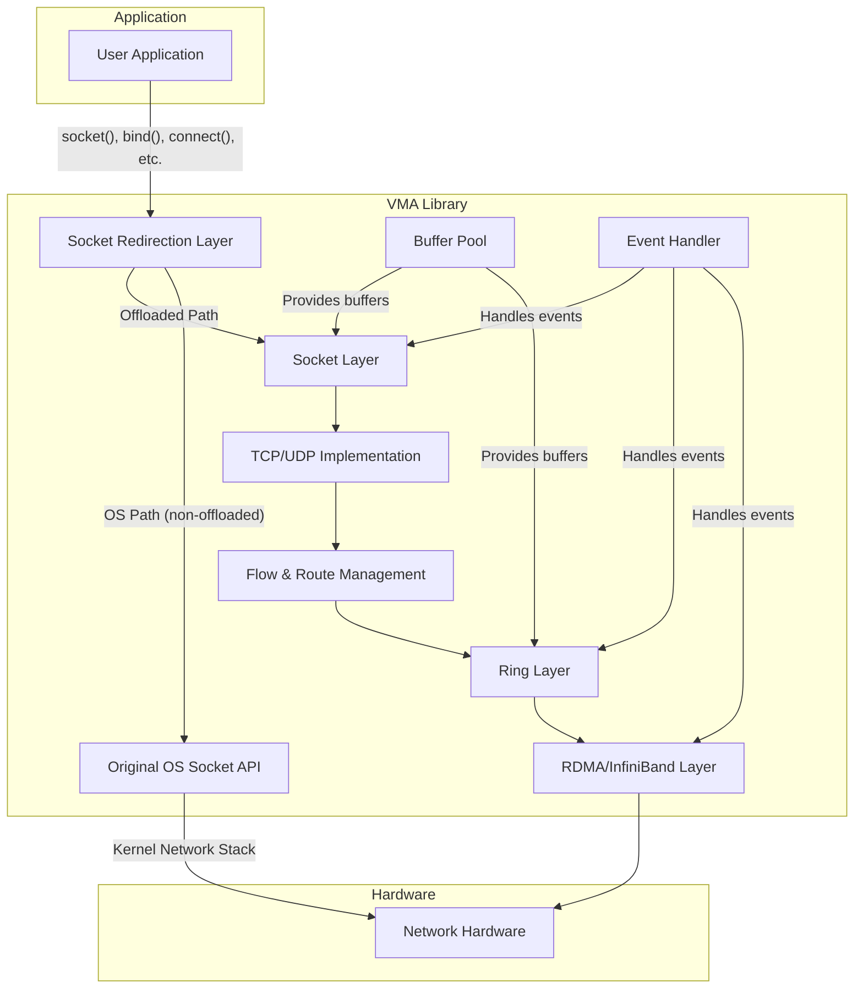

VMA makes a decision during the socket creation process whether to "offload" the socket (handle it through VMA's high-performance path) or to fall back to the operating system's standard socket implementation. This decision is based on various criteria including the socket type, address/port, and available hardware.

Sources: [src/vma/main.cpp:87-193](), [src/vma/sock/sock-redirect.h](), [src/vma/util/sys_vars.h:426-427]()

## Core Components

VMA consists of several interconnected components that work together to provide high-performance networking:

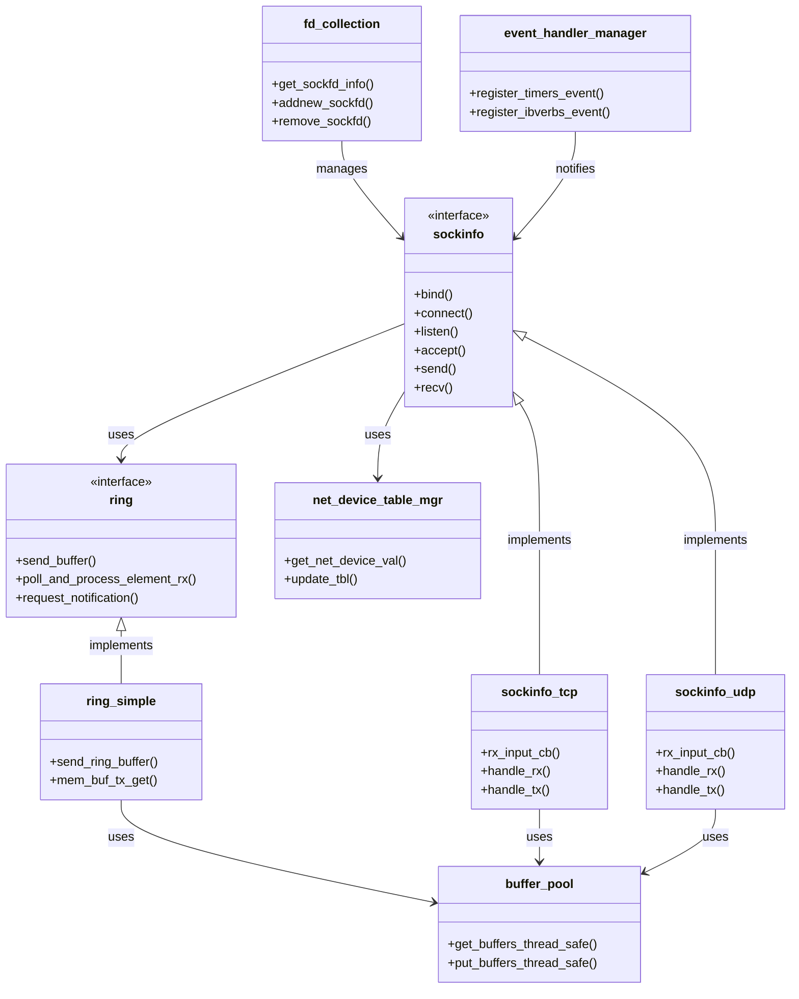

### Socket Layer

The Socket Layer provides the interface between the application's standard socket calls and VMA's internal implementation. It consists of:

1. **Socket Redirection Layer**: Intercepts standard socket API calls
2. **sockinfo Classes**: Implementations for different socket types (TCP, UDP)
3. **I/O Multiplexing**: Handling of select/poll/epoll operations

Sources: [src/vma/sock/sockinfo_tcp.h](), [src/vma/sock/sockinfo_udp.h](), [src/vma/sock/fd_collection.h](), [src/vma/sock/sock-redirect.h]()

### Network Layer

The Network Layer manages the network device information, routing, and addressing:

1. **Net Device Table Manager**: Manages network device information
2. **Route Table Manager**: Handles routing decisions
3. **Neighbor Table Manager**: Manages ARP and neighbor discovery
4. **Flow Management**: Controls packet flows and rules

Sources: [src/vma/dev/net_device_table_mgr.h](), [src/vma/proto/route_table_mgr.h](), [src/vma/proto/neighbour_table_mgr.h]()

### Hardware Abstraction Layer

The Hardware Abstraction Layer provides an interface to the network hardware:

1. **Ring Layer**: Manages communication rings
2. **Queue Pair Management**: Handles InfiniBand queue pairs
3. **Completion Queue Management**: Processes completion events
4. **Buffer Pool**: Manages memory buffers

Sources: [src/vma/dev/ring.h](), [src/vma/dev/qp_mgr.h](), [src/vma/dev/cq_mgr.h](), [src/vma/dev/buffer_pool.h]()

## Packet Processing Flow

VMA's packet processing can be divided into transmit (TX) and receive (RX) paths:

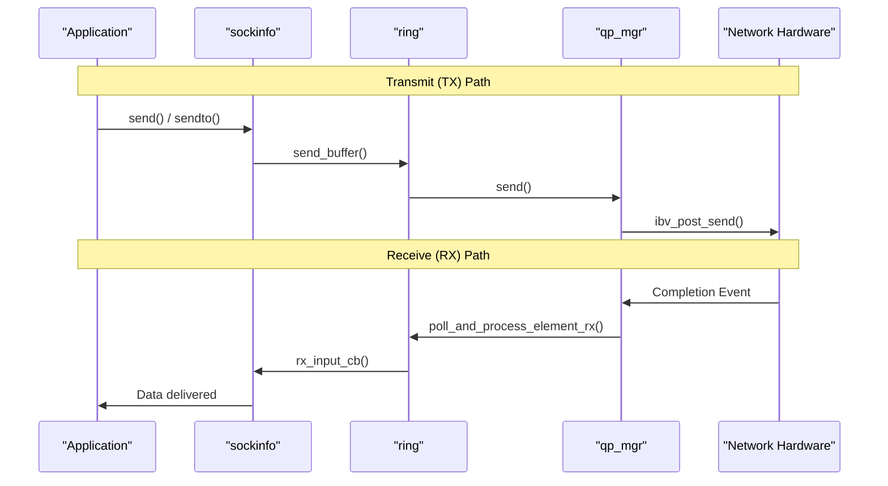

### Transmit Path

1. Application calls `send()` or `sendto()`
2. VMA's implementation prepares the data for transmission
3. Data is sent through the ring layer to the queue pair
4. Queue pair posts a send work request to the network hardware
5. Hardware transmits the data

### Receive Path

1. Network hardware receives a packet and generates a completion event
2. VMA polls the completion queue and processes the received packet
3. Packet is passed to the appropriate socket based on addressing information
4. Socket delivers the data to the application

Sources: [src/vma/sock/sockinfo.h](), [src/vma/dev/ring.h](), [src/vma/dev/qp_mgr.h]()

## Configuration and Tuning

VMA offers numerous configuration parameters to tune its behavior for different use cases. These parameters can be set through environment variables or configuration files.

| Category | Parameter | Description | Default |
|----------|-----------|-------------|---------|
| General | VMA_SPEC | Preconfigured performance profile | NONE |
| Log | VMA_TRACELEVEL | Log verbosity level | INFO |
| | VMA_LOG_FILE | Log file path | (stdout) |
| Socket | VMA_OFFLOADED_SOCKETS | Enable socket offloading | Enabled |
| | VMA_TCP_3T_RULES | Use 3-tuple rules for TCP | Disabled |
| | VMA_UDP_3T_RULES | Use 3-tuple rules for UDP | Enabled |
| Memory | VMA_RX_BUFS | Number of RX buffers | 200000 |
| | VMA_TX_BUFS | Number of TX buffers | 200000 |
| | VMA_MEM_ALLOC_TYPE | Memory allocation type | HUGEPAGES |
| Ring | VMA_RING_ALLOCATION_LOGIC_TX | TX ring allocation logic | PER_INTERFACE |
| | VMA_RING_ALLOCATION_LOGIC_RX | RX ring allocation logic | PER_INTERFACE |
| Performance | VMA_RX_POLL | Number of RX polling iterations | 100000 |
| | VMA_SELECT_POLL | Number of select polling iterations | 100000 |
| | VMA_SOCKETXTREME | Enable SocketXtreme mode | Disabled |

VMA's configuration is extensively customizable to suit different workloads and hardware environments. The library also provides specialized performance profiles for specific use cases such as ultra-low latency trading applications.

Sources: [src/vma/util/sys_vars.h:428-546](), [src/vma/util/sys_vars.cpp:600-680]()

## Initialization Process

When an application using VMA starts, the library goes through the following initialization process:

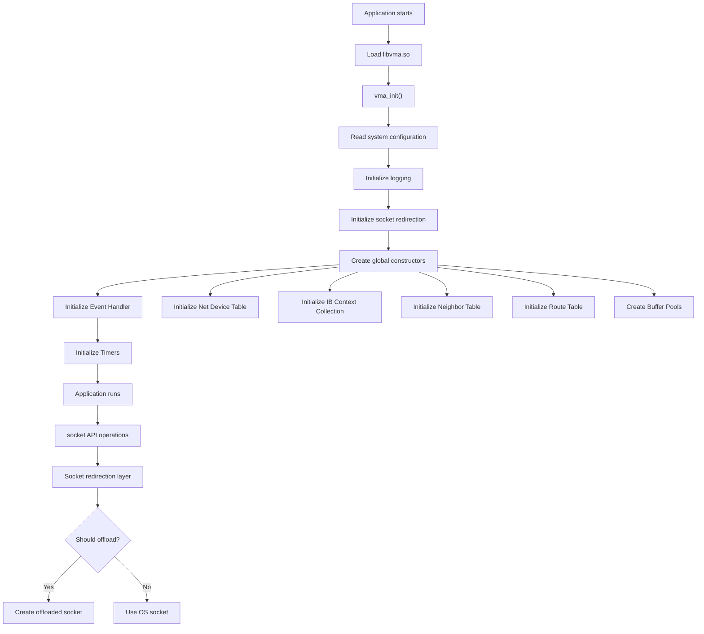

The initialization establishes the necessary infrastructure for VMA's operation, including memory allocation, device detection, and event handling systems. Once initialized, VMA intercepts socket calls from the application and makes the decision whether to handle them internally (offload) or pass them to the operating system.

Sources: [src/vma/main.cpp:622-699](), [src/vma/util/sys_vars.cpp:436-603]()

## Performance Features

VMA implements several key features to achieve high performance:

1. **Kernel Bypass**: Direct access to network hardware from user space
2. **Zero-copy**: Minimizing data copying between buffers
3. **Memory Pre-allocation**: Pre-allocating buffers to avoid allocation overhead
4. **Polling**: Actively checking for incoming data instead of waiting for interrupts
5. **Batch Processing**: Processing multiple packets in a single operation
6. **Hardware Offloading**: Utilizing hardware capabilities for tasks like checksum calculation

These features work together to significantly reduce latency and increase throughput for network operations, especially beneficial for applications requiring high message rates and low latency.

Sources: [src/vma/main.cpp:622-699](), [src/vma/util/sys_vars.cpp:436-603]()

---

# Page: Architecture Overview

# Architecture Overview

<details>
<summary>Relevant source files</summary>

The following files were used as context for generating this wiki page:

- [src/vma/main.cpp](src/vma/main.cpp)
- [src/vma/sock/pipeinfo.cpp](src/vma/sock/pipeinfo.cpp)
- [src/vma/sock/pipeinfo.h](src/vma/sock/pipeinfo.h)
- [src/vma/sock/sock-redirect.cpp](src/vma/sock/sock-redirect.cpp)
- [src/vma/sock/sock-redirect.h](src/vma/sock/sock-redirect.h)
- [src/vma/sock/socket_fd_api.cpp](src/vma/sock/socket_fd_api.cpp)
- [src/vma/sock/socket_fd_api.h](src/vma/sock/socket_fd_api.h)
- [src/vma/sock/sockinfo.cpp](src/vma/sock/sockinfo.cpp)
- [src/vma/sock/sockinfo.h](src/vma/sock/sockinfo.h)
- [src/vma/sock/sockinfo_tcp.cpp](src/vma/sock/sockinfo_tcp.cpp)
- [src/vma/sock/sockinfo_tcp.h](src/vma/sock/sockinfo_tcp.h)
- [src/vma/sock/sockinfo_udp.cpp](src/vma/sock/sockinfo_udp.cpp)
- [src/vma/sock/sockinfo_udp.h](src/vma/sock/sockinfo_udp.h)
- [src/vma/util/sys_vars.cpp](src/vma/util/sys_vars.cpp)
- [src/vma/util/sys_vars.h](src/vma/util/sys_vars.h)
- [src/vma/vma_extra.h](src/vma/vma_extra.h)

</details>


This page provides a comprehensive overview of the VMA (Versatile Message Accelerator) architecture, explaining how its components interact to accelerate network traffic by bypassing the kernel for supported operations while maintaining compatibility with standard socket APIs.

## High-Level Architecture

VMA functions as a high-performance network acceleration library that intercepts standard socket operations and provides a fast data path using RDMA (Remote Direct Memory Access) technology. The library sits between applications and the operating system's network stack, enabling transparent acceleration without requiring application modifications.

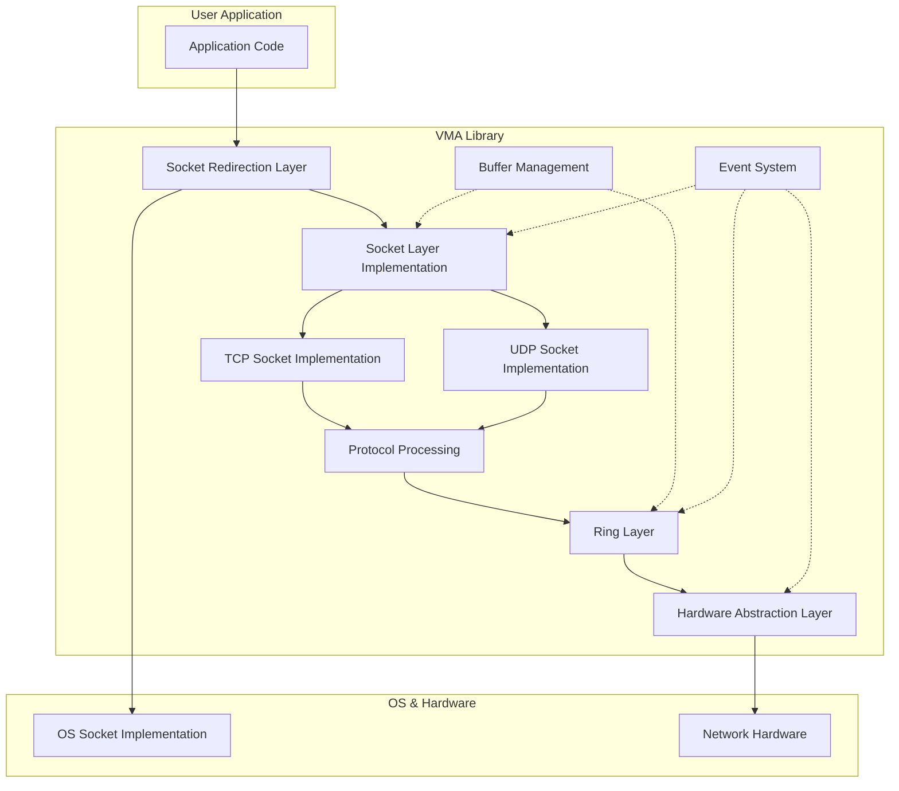

Sources:
- [src/vma/sock/sock-redirect.cpp:1-143]()
- [src/vma/sock/sockinfo_tcp.cpp:1-60]()
- [src/vma/sock/sockinfo_udp.cpp:1-60]()
- [src/vma/main.cpp:1-80]()

## Core Components

### Socket Redirection Layer

The Socket Redirection Layer is the entry point for socket operations. It intercepts standard socket API calls and determines whether to offload them through VMA or pass them to the original OS implementation.

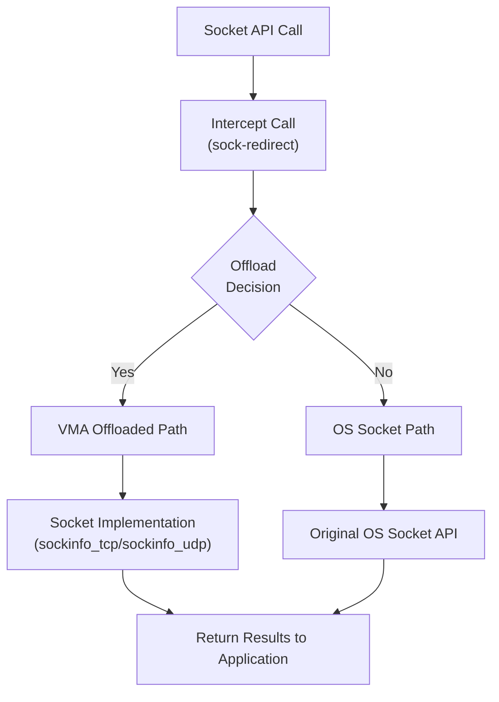

Sources:
- [src/vma/sock/sock-redirect.cpp:793-803]()
- [src/vma/sock/sock-redirect.cpp:117-153]()
- [src/vma/sock/socket_fd_api.cpp:27-111]()

### Socket Implementation

The socket implementation layer provides the core functionality for handling socket operations. It consists of specialized classes for different socket types:

- `socket_fd_api`: Base class for socket file descriptor operations
- `sockinfo`: Common socket functionality implementation
- `sockinfo_tcp`: TCP-specific socket implementation
- `sockinfo_udp`: UDP-specific socket implementation

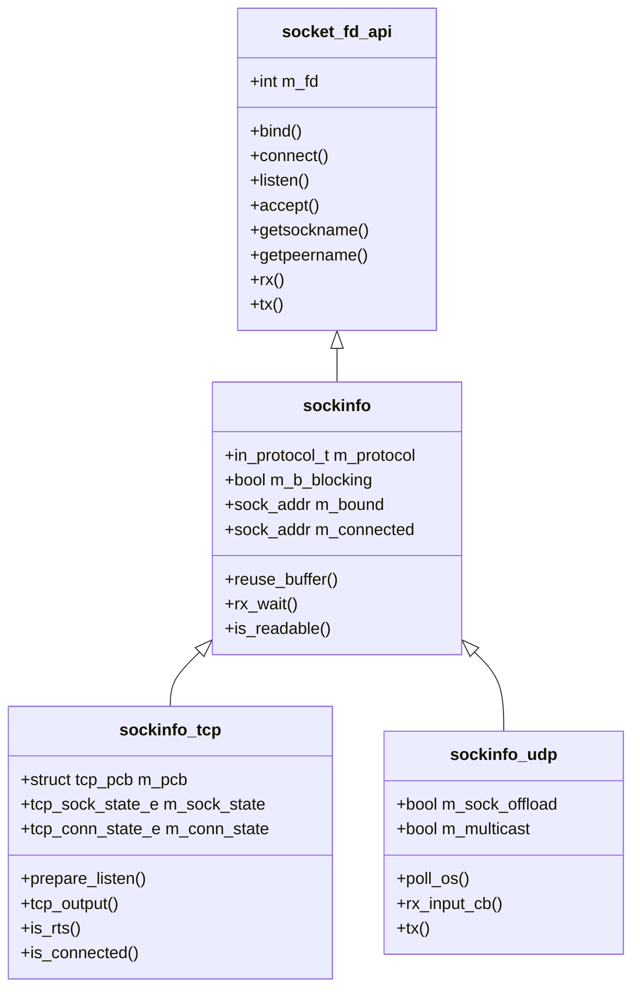

Sources:
- [src/vma/sock/socket_fd_api.h:105-309]()
- [src/vma/sock/sockinfo.h:132-266]()
- [src/vma/sock/sockinfo_tcp.h:90-210]()
- [src/vma/sock/sockinfo_udp.h:63-116]()

### Packet Processing Path

VMA processes packets through a series of interconnected layers, from application socket calls to hardware interaction:

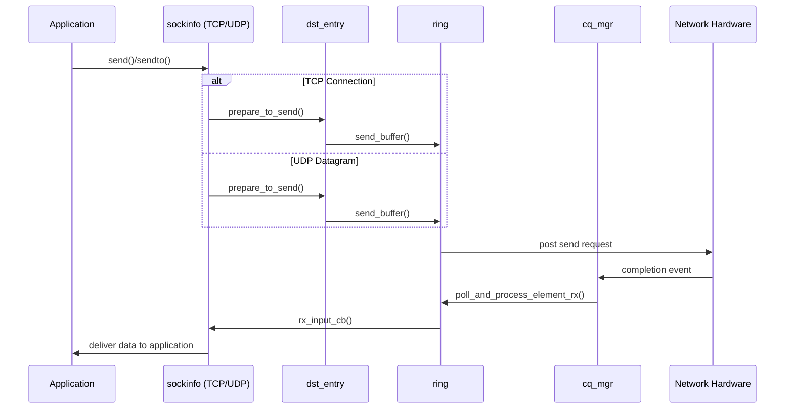

Sources:
- [src/vma/sock/sockinfo_tcp.cpp:709-957]()
- [src/vma/sock/sockinfo_udp.cpp:96-284]()

### Ring Layer

The Ring Layer is a critical component that manages network buffers and interfaces with the hardware. It provides an abstraction over the RDMA/InfiniBand communication mechanisms:

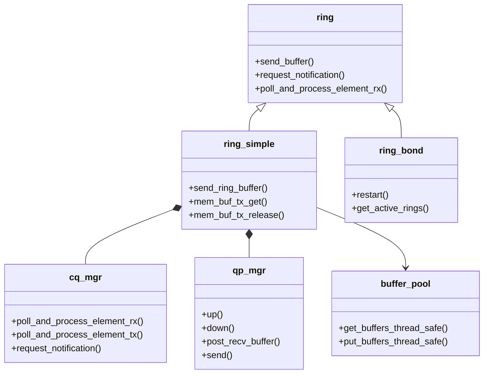

Sources:
- [src/vma/sock/sockinfo_tcp.cpp:1043-1128]()
- [src/vma/sock/sockinfo_udp.cpp:400-550]()

### Memory Management

VMA uses sophisticated buffer management to minimize memory copies and achieve high performance:

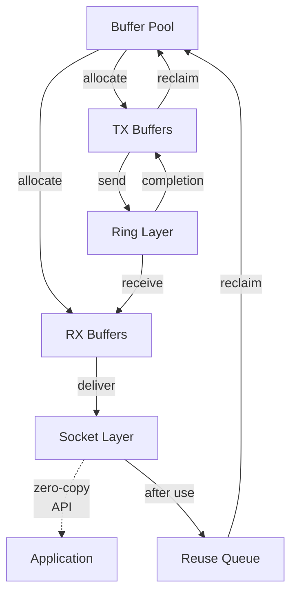

Sources:
- [src/vma/sock/sockinfo.h:213-266]()
- [src/vma/sock/sockinfo.cpp:167-203]()
- [src/vma/sock/sockinfo_tcp.cpp:137-191]()
- [src/vma/sock/sockinfo_udp.cpp:64-90]()

## Data Flow Architecture

The following diagram demonstrates how data flows through VMA during typical send and receive operations:

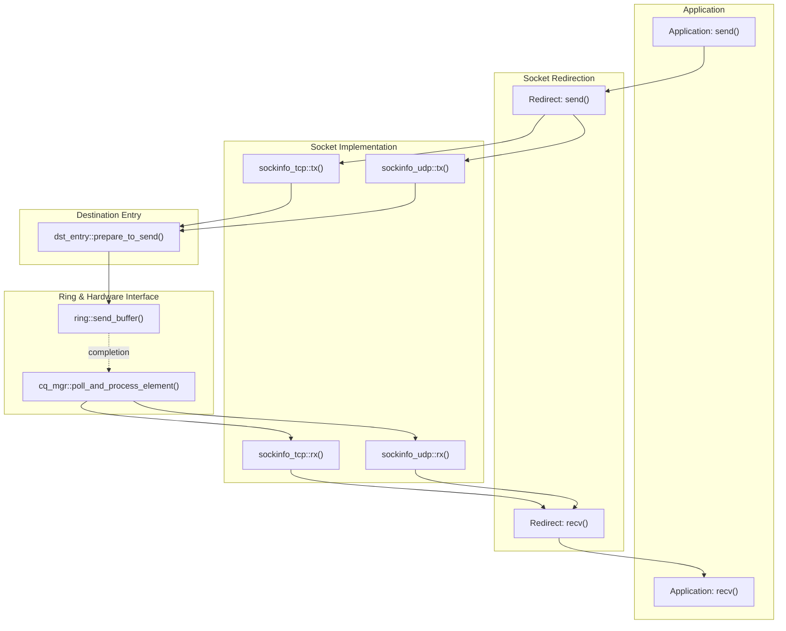

Sources:
- [src/vma/sock/sockinfo_tcp.cpp:709-957]()
- [src/vma/sock/sockinfo_udp.cpp:96-284]()
- [src/vma/sock/sock-redirect.cpp:339-359]()

## Initialization and Configuration

VMA is initialized when the library is loaded, and it uses a comprehensive configuration system to control its behavior:

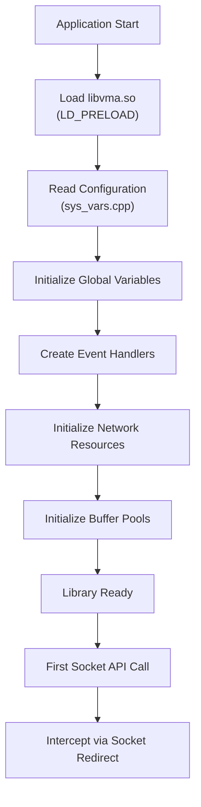

Sources:
- [src/vma/main.cpp:87-193]()
- [src/vma/util/sys_vars.cpp:413-425]()
- [src/vma/sock/sock-redirect.cpp:70-175]()

## Threading Model

VMA's threading model is configurable and supports different modes of operation:

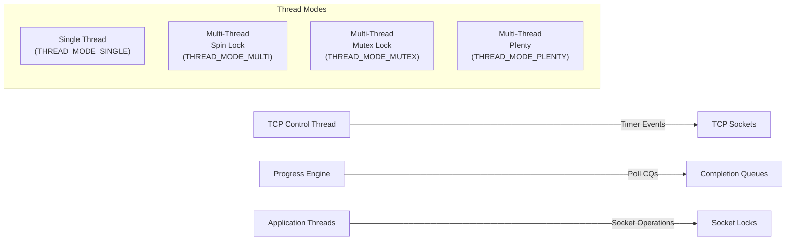

Sources:
- [src/vma/util/sys_vars.h:88-94]()
- [src/vma/util/sys_vars.h:500-508]()
- [src/vma/sock/sockinfo_tcp.cpp:585-595]()

## Offload Decision Logic

The library makes decisions about which sockets to offload based on several factors:

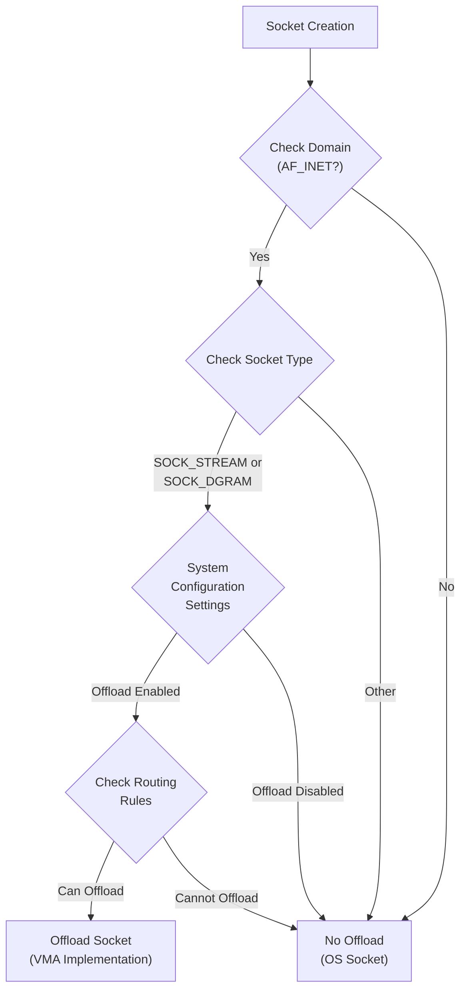

Sources:
- [src/vma/sock/sock-redirect.cpp:793-950]()
- [src/vma/sock/sockinfo_tcp.cpp:222-250]()
- [src/vma/sock/sockinfo_udp.cpp:520-556]()

## Key Performance Optimizations

VMA implements several key optimizations to achieve high performance:

1. **Zero-copy data path**: Minimizes data copies by providing buffer pointers directly to applications
2. **Kernel bypass**: Avoids context switches and system call overhead by handling network operations in user space
3. **RDMA/InfiniBand hardware acceleration**: Uses high-performance networking hardware features
4. **Lock-free design**: Minimizes contention in performance-critical paths
5. **Buffer pooling**: Pre-allocates and reuses memory to reduce allocation overhead
6. **Poll-mode operation**: Avoids blocking/waking thread transitions when needed

Sources:
- [src/vma/sock/sockinfo_tcp.cpp:626-653]()
- [src/vma/sock/sockinfo_udp.cpp:72-89]()
- [src/vma/vma_extra.h:13-38]()

## Integration with Applications

VMA is designed to integrate seamlessly with existing applications without requiring code modifications:

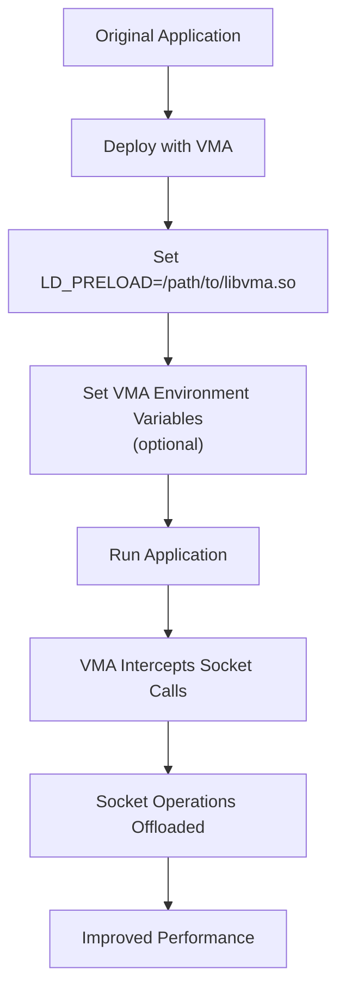

Sources:
- [src/vma/sock/sock-redirect.cpp:40-57]()
- [src/vma/util/sys_vars.h:426-549]()

## Conclusion

VMA's architecture provides a high-performance networking solution by transparently intercepting socket calls and using advanced techniques like RDMA and kernel bypass. The layered design, from socket redirection to hardware access, enables applications to benefit from hardware acceleration while maintaining compatibility with standard socket APIs.

The system's modular design accommodates different protocols (TCP/UDP), networking technologies, and usage patterns, making it a versatile solution for high-performance networking requirements.

---

# Page: Socket Layer

# Socket Layer

<details>
<summary>Relevant source files</summary>

The following files were used as context for generating this wiki page:

- [src/vma/sock/pipeinfo.cpp](src/vma/sock/pipeinfo.cpp)
- [src/vma/sock/pipeinfo.h](src/vma/sock/pipeinfo.h)
- [src/vma/sock/sock-redirect.cpp](src/vma/sock/sock-redirect.cpp)
- [src/vma/sock/sock-redirect.h](src/vma/sock/sock-redirect.h)
- [src/vma/sock/socket_fd_api.cpp](src/vma/sock/socket_fd_api.cpp)
- [src/vma/sock/socket_fd_api.h](src/vma/sock/socket_fd_api.h)
- [src/vma/sock/sockinfo.cpp](src/vma/sock/sockinfo.cpp)
- [src/vma/sock/sockinfo.h](src/vma/sock/sockinfo.h)
- [src/vma/sock/sockinfo_tcp.cpp](src/vma/sock/sockinfo_tcp.cpp)
- [src/vma/sock/sockinfo_tcp.h](src/vma/sock/sockinfo_tcp.h)
- [src/vma/sock/sockinfo_udp.cpp](src/vma/sock/sockinfo_udp.cpp)
- [src/vma/sock/sockinfo_udp.h](src/vma/sock/sockinfo_udp.h)
- [src/vma/vma_extra.h](src/vma/vma_extra.h)

</details>


The Socket Layer in VMA provides the core mechanism for intercepting and processing standard socket operations to enable network acceleration. It serves as a bridge between the application's socket API calls and the RDMA/InfiniBand hardware abstraction layers, allowing transparent acceleration of networking operations while maintaining compatibility with standard socket APIs.

For information about the overall VMA architecture, see [Architecture Overview](#1.1). For details about how socket operations are intercepted, see [Socket Redirection](#2.1).

## Socket Layer Overview

The Socket Layer implements socket operations by either offloading them to hardware or passing them through to the operating system. This decision is made based on several factors including socket type, address family, and network device capabilities.

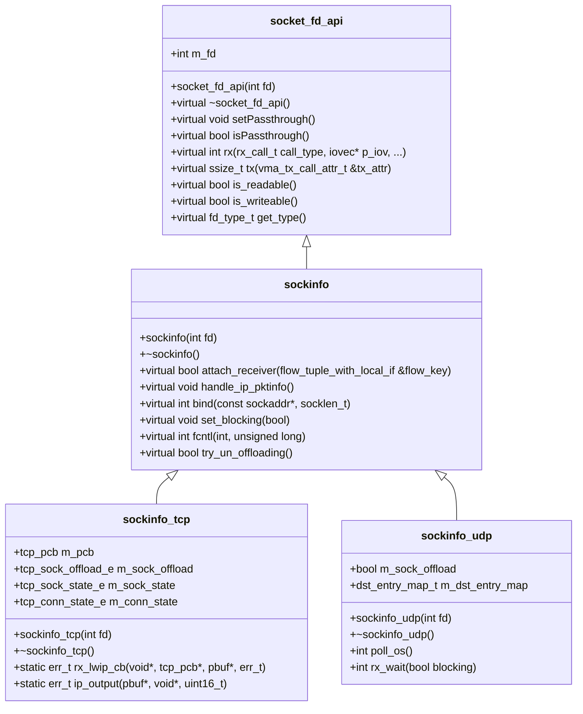

*Socket class hierarchy diagram showing inheritance relationships*

Sources: [src/vma/sock/socket_fd_api.h](), [src/vma/sock/sockinfo.h](), [src/vma/sock/sockinfo_tcp.h](), [src/vma/sock/sockinfo_udp.h]()

## Socket Operations Flow

The following diagram illustrates how socket operations flow through the VMA Socket Layer:

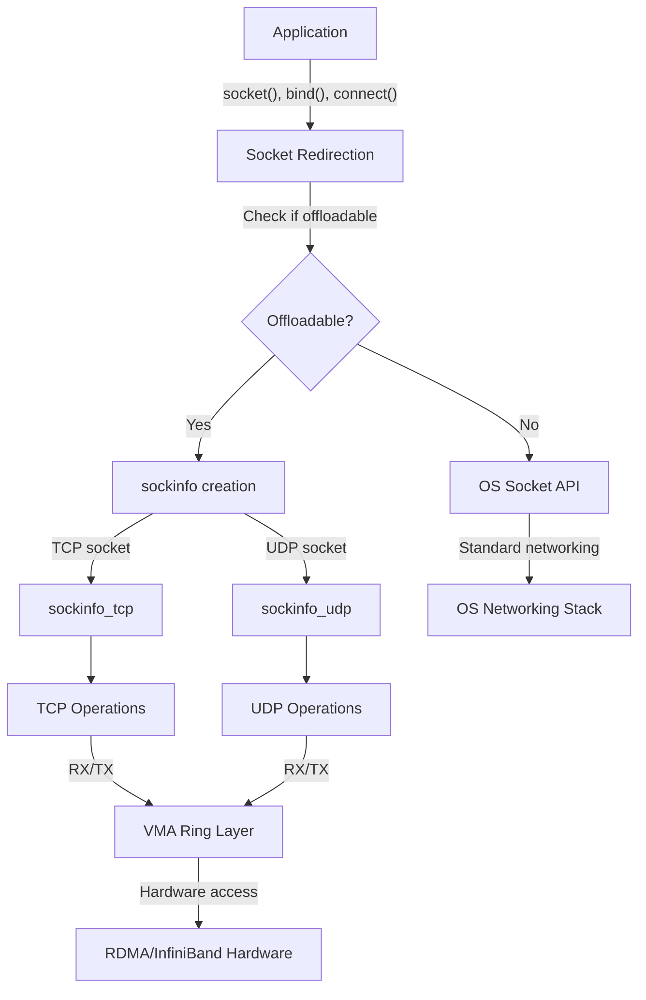

*Socket operations flow diagram*

Sources: [src/vma/sock/sock-redirect.cpp:800-831](), [src/vma/sock/sockinfo_tcp.cpp:193-290](), [src/vma/sock/sockinfo_udp.cpp:304-360]()

## Socket Initialization

When a socket is created through the standard `socket()` call, VMA intercepts this call and determines whether the socket can be offloaded:

1. The Socket Redirection layer intercepts the call
2. For supported socket types (SOCK_DGRAM, SOCK_STREAM), it creates appropriate socket objects
3. TCP sockets are handled by `sockinfo_tcp`, UDP sockets by `sockinfo_udp`
4. The socket objects maintain state and handle subsequent socket operations

Socket offloading eligibility depends on:
- Socket type (TCP or UDP)
- Address family (currently focused on AF_INET)
- Whether the underlying network device supports RDMA/InfiniBand features

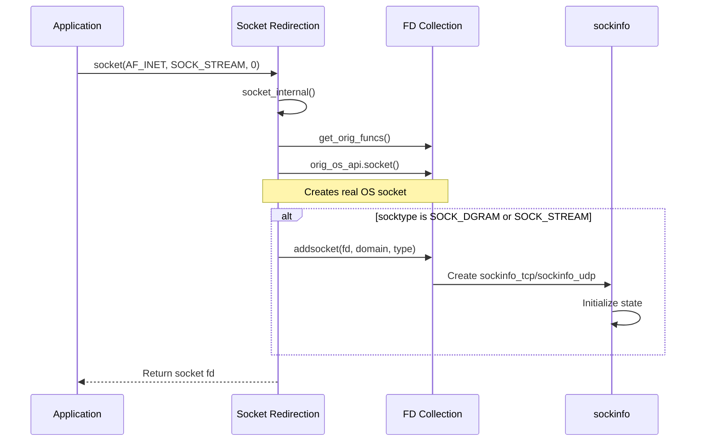

*Socket initialization sequence diagram*

Sources: [src/vma/sock/sock-redirect.cpp:792-831](), [src/vma/sock/sockinfo_tcp.cpp:193-290](), [src/vma/sock/sockinfo_udp.cpp:304-360]()

## Socket Types and Implementation

VMA implements specialized socket classes for different socket types:

### Base Socket Classes

1. **socket_fd_api** - Abstract base class representing socket file descriptor API interface
   - Provides interface for all socket operations
   - Manages socket file descriptor and associated state
   - Implements basic socket functionality

2. **sockinfo** - Base class for socket information
   - Inherits from socket_fd_api
   - Implements common functionality across socket types
   - Manages socket blocking behavior, options, state transitions

### Specialized Socket Implementations

#### TCP Sockets (sockinfo_tcp)

The TCP socket implementation in VMA provides:
- Complete TCP state machine
- Integration with LWIP for wire-compatible TCP implementation
- Support for connection-oriented operations (listen, accept, connect)
- Managed through sockinfo_tcp class

Key components:
- TCP Protocol Control Block (PCB) from LWIP
- Socket state management (INITED, BOUND, CONNECTED, etc.)
- Connection state management (INIT, CONNECTING, CONNECTED, etc.)
- Support for socket options like TCP_NODELAY, SO_RCVBUF, etc.

```
TCP Socket States:
- TCP_SOCK_INITED
- TCP_SOCK_BOUND
- TCP_SOCK_LISTEN_READY
- TCP_SOCK_ACCEPT_READY
- TCP_SOCK_CONNECTED_RD
- TCP_SOCK_CONNECTED_WR
- TCP_SOCK_CONNECTED_RDWR
- TCP_SOCK_ASYNC_CONNECT
- TCP_SOCK_ACCEPT_SHUT
```

#### UDP Sockets (sockinfo_udp)

The UDP socket implementation provides:
- Datagram-based communication
- Support for multicast operations
- Zero-copy receive mechanisms
- Managed through sockinfo_udp class

Key components:
- Destination entry mapping (m_dst_entry_map)
- Buffer management for zero-copy operations
- Support for socket options like IP_MULTICAST_IF, SO_RCVBUF, etc.

Sources: [src/vma/sock/sockinfo_tcp.h:91-453](), [src/vma/sock/sockinfo_udp.h:63-275](), [src/vma/sock/sockinfo.h:131-347]()

## Socket States and Transitions

VMA socket implementations maintain state for proper handling of socket operations:

### Common Socket States

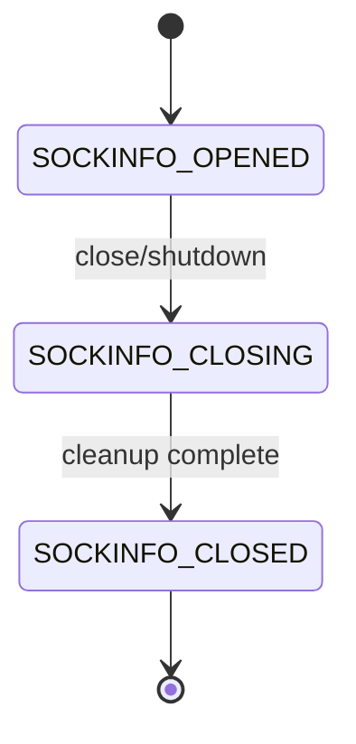

*Common socket state diagram*

### TCP Socket-Specific States

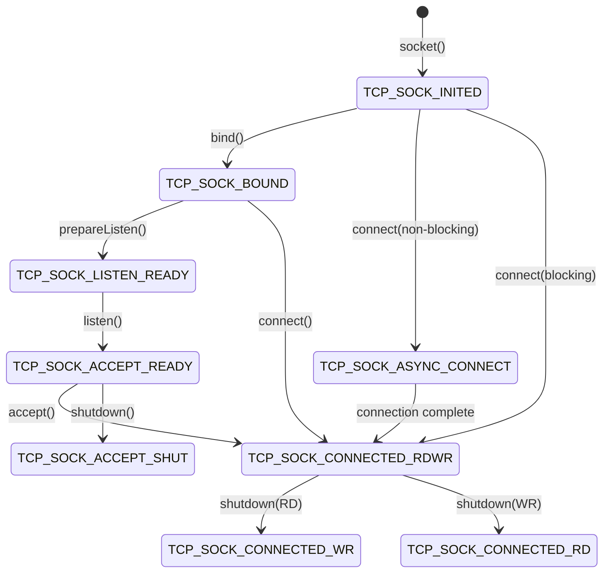

*TCP socket state diagram*

### TCP Connection States

```mermaid
stateDiagram-v2
    [*] --> TCP_CONN_INIT
    TCP_CONN_INIT --> TCP_CONN_CONNECTING: connect()
    TCP_CONN_CONNECTING --> TCP_CONN_CONNECTED: connection established
    TCP_CONN_CONNECTING --> TCP_CONN_FAILED: connection failed
    TCP_CONN_CONNECTING --> TCP_CONN_TIMEOUT: timeout
    TCP_CONN_CONNECTING --> TCP_CONN_ERROR: error
    TCP_CONN_CONNECTING --> TCP_CONN_RESETED: RST received
```

*TCP connection state diagram*

Sources: [src/vma/sock/sockinfo.h:137-141](), [src/vma/sock/sockinfo_tcp.h:31-60]()

## Data Flow in Socket Layer

### Receiving Data (RX Path)

The receive path in the Socket Layer is responsible for:
1. Retrieving data from network hardware (via Ring Layer)
2. Processing it through the appropriate protocol stack
3. Delivering it to the application

```mermaid
sequenceDiagram
    participant App as Application
    participant Sock as sockinfo_tcp/sockinfo_udp
    participant Ring as Ring Layer
    participant HW as Network Hardware
    
    App->>Sock: recv()/recvfrom()/read()
    
    alt Data already in receive queue
        Sock-->>App: Return buffered data
    else No data available
        alt Blocking mode
            Sock->>Ring: rx_wait()
            Ring->>HW: Poll for completions
            HW-->>Ring: Completion event
            Ring->>Sock: Packet available notification
            Sock->>Sock: Process packet
            Sock-->>App: Return data
        else Non-blocking mode
            Sock-->>App: Return EAGAIN
        end
    end
```

*Receive path sequence diagram*

Sources: [src/vma/sock/sockinfo_tcp.cpp:142-136](), [src/vma/sock/sockinfo_udp.cpp:92-284]()

### Sending Data (TX Path)

The transmit path is responsible for:
1. Preparing data for transmission
2. Sending it through the appropriate protocol stack
3. Submitting it to the network hardware

```mermaid
sequenceDiagram
    participant App as Application
    participant Sock as sockinfo_tcp/sockinfo_udp
    participant DST as dst_entry
    participant Ring as Ring Layer
    participant HW as Network Hardware
    
    App->>Sock: send()/sendto()/write()
    
    alt TCP
        Sock->>Sock: tcp_write()
        Sock->>DST: prepare_to_send()
    else UDP
        Sock->>DST: prepare_to_send()
    end
    
    DST->>Ring: send_buffer()
    Ring->>HW: Post Send Work Request
    HW-->>Ring: Completion
    Sock-->>App: Return bytes sent
```

*Transmit path sequence diagram*

Sources: [src/vma/sock/sockinfo_tcp.cpp:709-956](), [src/vma/sock/sockinfo_udp.cpp]()

## Socket Options Handling

The Socket Layer implements standard socket options as well as VMA-specific extensions:

### Standard Socket Options

- **SOL_SOCKET level options** - SO_RCVBUF, SO_SNDBUF, SO_REUSEADDR, etc.
- **IPPROTO_TCP level options** - TCP_NODELAY, TCP_KEEPALIVE, etc.
- **IPPROTO_IP level options** - IP_MULTICAST_IF, IP_TTL, etc.

### VMA-Specific Socket Options

- **SO_VMA_USER_DATA** - Associate custom user data with a socket
- **SO_VMA_RING_ALLOC_LOGIC** - Control ring allocation logic
- **SO_VMA_FLOW_TAG** - Set flow tag for a socket
- **SO_VMA_RING_USER_MEMORY** - Provide user memory for ring buffers

```mermaid
flowchart TD
    A["setsockopt() call"] --> B["sockinfo::setsockopt()"]
    B --> C{"Option level?"}
    
    C -->|"SOL_SOCKET"| D{"Option name?"}
    D -->|"Standard options"| E["Process standard option"]
    D -->|"VMA options"| F["Process VMA option"]
    E --> G["Update socket state"]
    F --> G
    
    C -->|"IPPROTO_TCP"| H["TCP option handling"]
    C -->|"IPPROTO_IP"| I["IP option handling"]
    
    H --> G
    I --> G
    
    G --> J{"Return value?"}
    J -->|"SOCKOPT_INTERNAL_VMA_SUPPORT"| K["Return success"]
    J -->|"SOCKOPT_NO_VMA_SUPPORT"| L["Return error"]
    J -->|"SOCKOPT_PASS_TO_OS"| M["Call OS setsockopt"]
```

*Socket option handling flow diagram*

Sources: [src/vma/sock/sockinfo.cpp:305-481](), [src/vma/sock/sockinfo_tcp.cpp](), [src/vma/sock/sockinfo_udp.cpp:640-768]()

## Offloading Decision Process

A key responsibility of the Socket Layer is deciding whether a socket can be offloaded or should be passed through to the OS:

```mermaid
flowchart TD
    A["New socket"] --> B{"Socket type?"}
    B -->|"SOCK_STREAM, SOCK_DGRAM"| C{"Address family?"}
    B -->|"Other"| D["Passthrough to OS"]
    
    C -->|"AF_INET"| E{"Network interface?"}
    C -->|"Other"| D
    
    E -->|"RDMA/IB capable"| F["Offload socket"]
    E -->|"Not capable"| D
    
    F --> G{"Operation compatible?"}
    G -->|"Yes"| H["Keep offloaded"]
    G -->|"No"| I["Switch to passthrough"]
```

*Offloading decision flow diagram*

Sources: [src/vma/sock/sock-redirect.cpp:793-828](), [src/vma/sock/sockinfo.cpp:532-544]()

## Socket Redirection Mechanism

The Socket Layer relies on the Socket Redirection mechanism to intercept standard socket API calls:

1. VMA replaces standard socket functions (socket, bind, connect, etc.) with its own implementations
2. When these functions are called, VMA intercepts them and routes them through the Socket Layer
3. The Socket Layer either handles the operation or passes it to the original OS implementation

```mermaid
sequenceDiagram
    participant App as Application
    participant Redir as VMA Socket Redirection
    participant SI as sockinfo
    participant OS as Original OS API
    
    App->>Redir: socket()
    Redir->>Redir: socket_internal()
    Redir->>OS: orig_os_api.socket()
    OS-->>Redir: fd
    Redir->>SI: Create sockinfo object
    Redir-->>App: Return fd
    
    App->>Redir: connect(fd, addr, addrlen)
    Redir->>Redir: get_sockfd(fd)
    Redir->>SI: si->connect(addr, addrlen)
    
    alt Offloaded connection
        SI->>SI: Handle connection
        SI-->>Redir: Status
    else Passthrough connection
        SI->>Redir: setPassthrough()
        Redir->>OS: orig_os_api.connect()
        OS-->>Redir: Status
    end
    
    Redir-->>App: Return status
```

*Socket redirection sequence diagram*

Sources: [src/vma/sock/sock-redirect.cpp:792-1002]()

## Integration with Other VMA Components

The Socket Layer integrates with several other components in the VMA system:

### Ring Layer Integration

Socket objects interact with the Ring Layer to send and receive data:
- Each socket is associated with one or more rings
- Rings provide the interface to the hardware queues
- Sockets use rings for data transmission and reception

### Protocol Implementation Integration

- TCP sockets integrate with the LWIP TCP implementation
- UDP sockets have a custom implementation in VMA
- Both implementations interface with the destination entry management system

### Buffer Management

Socket implementations handle buffer management for efficient data transfer:
- Zero-copy mechanisms to avoid unnecessary data copying
- Buffer pool integration for memory management
- Buffer reuse strategies for optimal performance

```mermaid
flowchart TD
    subgraph "Socket Layer"
        A["sockinfo_tcp"]
        B["sockinfo_udp"]
    end
    
    subgraph "Protocol Layer"
        C["LWIP TCP"]
        D["VMA UDP Implementation"]
    end
    
    subgraph "Routing Layer"
        E["dst_entry"]
        F["Flow Manager"]
    end
    
    subgraph "Ring Layer"
        G["ring"]
        H["ring_simple"]
        I["cq_mgr"]
    end
    
    subgraph "Memory Management"
        J["Buffer Pool"]
        K["Memory Registration"]
    end
    
    A --> C
    B --> D
    C --> E
    D --> E
    E --> F
    A --> G
    B --> G
    G --> H
    H --> I
    A --> J
    B --> J
    J --> K
```

*Socket Layer integration with other VMA components*

Sources: [src/vma/sock/sockinfo_tcp.cpp](), [src/vma/sock/sockinfo_udp.cpp](), [src/vma/sock/sockinfo.h]()

## Socket Performance Optimizations

The Socket Layer implements various optimizations to improve performance:

1. **Zero-copy data transfer** - Avoiding unnecessary data copies between user and kernel space
2. **Buffer reuse** - Efficient reuse of memory buffers to reduce memory allocations
3. **Batch processing** - Processing multiple operations together for better efficiency
4. **Event-driven polling** - Efficient notification mechanisms for socket readiness
5. **Direct hardware access** - Bypassing the kernel for data transfer operations

These optimizations enable VMA to achieve lower latency and higher throughput compared to standard socket implementations.

Sources: [src/vma/sock/sockinfo_tcp.cpp](), [src/vma/sock/sockinfo_udp.cpp]()

## Summary

The Socket Layer in VMA serves as the core component that enables transparent acceleration of socket operations by:

1. Intercepting standard socket API calls through redirection mechanisms
2. Implementing socket behavior for both TCP and UDP protocols
3. Making intelligent decisions about offloading vs. passthrough to OS
4. Managing socket state and operations
5. Integrating with other VMA components for efficient data transfer

This architecture allows applications to benefit from hardware acceleration without requiring code modifications, providing significant performance improvements for network-intensive applications.

---

# Page: Socket Redirection

# Socket Redirection

<details>
<summary>Relevant source files</summary>

The following files were used as context for generating this wiki page:

- [src/vma/sock/pipeinfo.cpp](src/vma/sock/pipeinfo.cpp)
- [src/vma/sock/pipeinfo.h](src/vma/sock/pipeinfo.h)
- [src/vma/sock/sock-redirect.cpp](src/vma/sock/sock-redirect.cpp)
- [src/vma/sock/sock-redirect.h](src/vma/sock/sock-redirect.h)
- [src/vma/sock/socket_fd_api.cpp](src/vma/sock/socket_fd_api.cpp)
- [src/vma/sock/socket_fd_api.h](src/vma/sock/socket_fd_api.h)
- [src/vma/vma_extra.h](src/vma/vma_extra.h)

</details>


## Purpose and Scope

This document details how VMA (Versatile Message Accelerator) redirects standard socket system calls to either be handled by its accelerated networking stack or passed through to the OS. Socket redirection is the entry point mechanism that enables VMA to transparently accelerate network operations without requiring application changes. For specific socket implementations, see [Socket Implementation](#2.2).

## Overview

VMA intercepts socket system calls (such as `socket()`, `bind()`, `connect()`, etc.) by using function name redirection techniques (typically via the LD_PRELOAD mechanism). When an application makes a socket call, VMA's implementation receives the call first, determines whether the socket can be offloaded to hardware or should be handled by the OS, and routes the call accordingly.

```mermaid
flowchart TD
    A["Application"] -->|"socket(), bind(), connect(), etc."| B["VMA Socket Redirection Layer"]
    B -->|"Eligible for Offload"| C["VMA Socket Implementation"]
    B -->|"Not Eligible"| D["Original OS Socket API"]
    C -->|"Hardware Offload Path"| E["RDMA/IB Hardware"]
    D -->|"OS Network Stack"| F["OS Network Interface"]
    
    subgraph "VMA Library"
    B
    C
    D
    end
```

*Socket Redirection Architecture*

Sources: [src/vma/sock/sock-redirect.cpp:787-831](), [src/vma/sock/sock-redirect.h:66-148]()

## Interception Mechanism

### Function Pointer Storage

VMA stores pointers to the original OS socket functions in the `orig_os_api` structure, allowing it to call the original implementations when needed. These pointers are obtained during initialization using `dlsym()`.

```mermaid
classDiagram
    class os_api {
        +socket() function*
        +bind() function*
        +connect() function*
        +listen() function*
        +accept() function*
        +setsockopt() function*
        +getsockopt() function*
        +send()/sendto()/sendmsg() function*
        +recv()/recvfrom()/recvmsg() function*
        +ioctl()/fcntl() function*
        +select()/poll()/epoll_*() function*
    }
    
    class orig_os_api {
        "Global instance of os_api"
    }
```

*Original Function Pointers Storage*

Sources: [src/vma/sock/sock-redirect.cpp:59-62](), [src/vma/sock/sock-redirect.h:72-149](), [src/vma/sock/sock-redirect.cpp:117-176]()

### Initialization

The function pointers to original socket operations are populated using the `get_orig_funcs()` function, which uses `dlsym()` to locate the original function symbols.

Sources: [src/vma/sock/sock-redirect.cpp:117-176]()

## Decision Process

When an application makes a socket call, VMA follows this process to determine how to handle it:

```mermaid
sequenceDiagram
    participant App as Application
    participant VMA as VMA Socket Redirection
    participant FDColl as FD Collection
    participant SockObj as VMA Socket Object
    participant OS as Original OS Socket API
    
    App->>VMA: socket(domain, type, protocol)
    Note over VMA: Check if socket should be offloaded
    VMA->>OS: orig_os_api.socket(domain, type, protocol)
    OS->>VMA: Return file descriptor (fd)
    
    alt Socket eligible for offload (SOCK_STREAM or SOCK_DGRAM)
        VMA->>FDColl: Add socket to collection
        FDColl->>SockObj: Create socket_fd_api object
        VMA->>App: Return fd
    else Socket not eligible for offload
        VMA->>App: Return fd (OS managed)
    end
    
    App->>VMA: Operations on fd (bind, connect, etc.)
    VMA->>FDColl: Get socket object for fd
    
    alt Socket is in collection
        FDColl->>SockObj: Forward operation
        
        alt Operation succeeds with offload
            SockObj->>App: Return result
        else Socket switches to passthrough
            SockObj->>VMA: Mark socket as passthrough
            VMA->>FDColl: Remove from collection
            VMA->>OS: Forward operation to OS
            OS->>App: Return result
        end
    else fd not in collection
        VMA->>OS: Forward operation to OS
        OS->>App: Return result
    end
```

*Socket Operation Decision Flow*

Sources: [src/vma/sock/sock-redirect.cpp:792-831](), [src/vma/sock/sock-redirect.cpp:952-990](), [src/vma/sock/sock-redirect.cpp:1000-1046]()

## Key Intercepted Socket Operations

VMA intercepts and redirects the following core socket operations:

### Socket Creation

The `socket()` function is intercepted to create a socket through the OS and then, if eligible for offloading, register it with VMA's file descriptor collection.

```c
int socket(int __domain, int __type, int __protocol)
{
    // Call internal implementation that can be used safely within VMA
    return socket_internal(__domain, __type, __protocol, true);
}
```

Sources: [src/vma/sock/sock-redirect.cpp:792-797](), [src/vma/sock/sock-redirect.cpp:802-831]()

### Bind, Connect, Listen, Accept

These operations are intercepted and routed to either VMA's implementation or the OS based on whether the socket is being managed by VMA:

- **bind()**: Associates the socket with a local address
- **connect()**: Establishes a connection to a remote endpoint
- **listen()**: Marks a socket as passive for accepting connections
- **accept()/accept4()**: Accepts a new connection on a listening socket

Sources: [src/vma/sock/sock-redirect.cpp:952-990](), [src/vma/sock/sock-redirect.cpp:1000-1046](), [src/vma/sock/sock-redirect.cpp:872-917](), [src/vma/sock/sock-redirect.cpp:921-949]()

### Socket Options

VMA intercepts `setsockopt()` and `getsockopt()` to handle VMA-specific socket options and pass standard options to either VMA's implementation or the OS.

Of particular importance is `SO_VMA_GET_API`, which provides access to VMA's extended API.

Sources: [src/vma/sock/sock-redirect.cpp:1051-1082](), [src/vma/sock/sock-redirect.cpp:1087-1151]()

### I/O Operations

VMA intercepts send and receive operations to handle them through its optimized path:

- **send/sendto/sendmsg**: For transmitting data
- **recv/recvfrom/recvmsg**: For receiving data

Sources: [src/vma/sock/sock-redirect.cpp:1225-2051]()

### Close and Shutdown

VMA intercepts `close()` and `shutdown()` to properly clean up resources for sockets it manages.

Sources: [src/vma/sock/sock-redirect.cpp:833-864](), [src/vma/sock/sock-redirect.cpp:872-888]()

## File Descriptor Management

VMA tracks socket file descriptors using the `fd_collection` class, which maintains a mapping between file descriptors and the corresponding socket objects.

```mermaid
classDiagram
    class fd_collection {
        +addsocket(fd, domain, type)
        +get_sockfd(fd)
        +del_sockfd(fd)
        +add_epfd(fd)
        +get_epfd(fd)
        +del_epfd(fd)
        +remove_from_all_epfds(fd)
    }
    
    class socket_fd_api {
        +int m_fd
        +setPassthrough()
        +isPassthrough()
        +bind()
        +connect()
        +listen()
        +accept()
        +setsockopt()
        +getsockopt()
        +rx()
        +tx()
    }
    
    socket_fd_api --o fd_collection : stored in
```

*File Descriptor Management*

Sources: [src/vma/sock/sock-redirect.cpp:300-317](), [src/vma/sock/fd_collection.h]()

## Passthrough Mechanism

If a socket cannot be offloaded or certain operations are not supported by VMA, the socket is marked as passthrough and subsequent operations are forwarded to the OS. This occurs through the following steps:

1. Calling `setPassthrough()` on the socket object
2. Removing the socket from VMA's tracking via `handle_close()`
3. Redirecting all future operations to the OS

```mermaid
flowchart LR
    A["Socket Operation"] --> B{"Is socket\noffloadable?"}
    B -->|"Yes"| C["VMA handling"]
    B -->|"No"| D["Mark as passthrough"]
    D --> E["Remove from VMA tracking"]
    E --> F["Forward to OS"]
    
    subgraph "Passthrough Flow"
    D
    E
    F
    end
```

*Passthrough Decision Flow*

Sources: [src/vma/sock/sock-redirect.cpp:109-115](), [src/vma/sock/sock-redirect.cpp:952-990](), [src/vma/sock/sock-redirect.cpp:1000-1046]()

## Extended API

VMA provides an extended API for advanced functionality beyond standard socket operations. This API is accessible through the `SO_VMA_GET_API` socket option.

```c
struct vma_api_t* vma_get_api()
{
    struct vma_api_t *api_ptr = NULL;
    socklen_t len = sizeof(api_ptr);
    int err = getsockopt(-1, SOL_SOCKET, SO_VMA_GET_API, &api_ptr, &len);
    if (err < 0) {
        return NULL;
    }
    return api_ptr;
}
```

The extended API provides functions for:

- Zero-copy receive and send operations
- Network hardware direct access
- Performance monitoring and statistics
- Memory registration for RDMA operations

Sources: [src/vma/vma_extra.h:357-763](), [src/vma/sock/sock-redirect.cpp:323-783]()

## Implementation Details

### Function Interceptors

VMA's socket redirection relies on defining exported symbols that match the standard socket API function names. When an application links with VMA (using LD_PRELOAD or direct linking), these functions intercept the calls before they reach the standard library.

Each intercepted function follows a similar pattern:

1. Check if VMA should handle the operation
2. If yes, route to VMA's implementation
3. If no, pass through to the original OS implementation

Sources: [src/vma/sock/sock-redirect.cpp:787-3600]()

### Memory Considerations

For performance reasons, VMA manages specialized memory pools for network operations. This includes buffer pools for zero-copy operations and memory registered with RDMA hardware for direct access.

Sources: [src/vma/sock/sock-redirect.cpp:760-783]()

## Summary

The Socket Redirection component is the entry point to VMA's accelerated networking capabilities. By intercepting standard socket system calls, it transparently routes eligible operations to VMA's optimized implementation while maintaining compatibility with applications by falling back to the OS for unsupported operations. This mechanism allows applications to benefit from hardware acceleration without requiring code changes.

---

# Page: Socket Implementation

# Socket Implementation

<details>
<summary>Relevant source files</summary>

The following files were used as context for generating this wiki page:

- [src/vma/sock/sockinfo.cpp](src/vma/sock/sockinfo.cpp)
- [src/vma/sock/sockinfo.h](src/vma/sock/sockinfo.h)
- [src/vma/sock/sockinfo_tcp.cpp](src/vma/sock/sockinfo_tcp.cpp)
- [src/vma/sock/sockinfo_tcp.h](src/vma/sock/sockinfo_tcp.h)
- [src/vma/sock/sockinfo_udp.cpp](src/vma/sock/sockinfo_udp.cpp)
- [src/vma/sock/sockinfo_udp.h](src/vma/sock/sockinfo_udp.h)

</details>


This page explains how VMA implements standard socket operations for TCP and UDP protocols through its socket classes, providing transparent acceleration while maintaining POSIX compatibility. For information about how socket operations are intercepted, see [Socket Redirection](#2.1).

## Socket Class Hierarchy Overview

VMA implements sockets through a class hierarchy that extends standard socket functionality with hardware acceleration capabilities:

```mermaid
classDiagram
    class socket_fd_api {
        +bind()
        +connect()
        +setsockopt()
        +getsockopt()
        +send()/sendto()
        +recv()/recvfrom()
        +close()
    }
    class sockinfo {
        +m_protocol: in_protocol_t
        +m_state: sockinfo_state
        +m_b_blocking: bool
        +m_rx_ring_map: rx_ring_map_t
        +m_p_rx_ring: ring*
        +attach_receiver()
        +detach_receiver()
        +try_un_offloading()
    }
    class sockinfo_tcp {
        +m_pcb: tcp_pcb
        +m_sock_offload: tcp_sock_offload_e
        +m_sock_state: tcp_sock_state_e
        +m_conn_state: tcp_conn_state_e
        +prepare_listen_to_close()
        +handle_socket_linger()
        +tx(): transmit data
        +rx(): receive data
    }
    class sockinfo_udp {
        +m_sock_offload: bool
        +m_dst_entry_map: dst_entry_map_t
        +m_multicast: bool
        +mc_change_membership()
        +tx(): transmit data
        +rx(): receive data
    }
    
    socket_fd_api <|-- sockinfo
    sockinfo <|-- sockinfo_tcp
    sockinfo <|-- sockinfo_udp
```

The base `socket_fd_api` class provides the interface for socket operations. The `sockinfo` class implements common functionality shared between TCP and UDP sockets, while the protocol-specific classes `sockinfo_tcp` and `sockinfo_udp` implement protocol-specific behavior.

Sources: [src/vma/sock/socket_fd_api.h](), [src/vma/sock/sockinfo.h:131-520](), [src/vma/sock/sockinfo_tcp.h:90-488](), [src/vma/sock/sockinfo_udp.h:63-262]()

## Common Socket Infrastructure

The `sockinfo` base class provides the infrastructure shared by both TCP and UDP sockets:

```mermaid
flowchart TD
    A["sockinfo constructor"] --> B["Initialize base socket state"]
    B --> C["Create RX epoll instance"]
    C --> D["Initialize socket stats"]
    D --> E["Setup ring allocation logic"]
    
    subgraph "Common Socket Functions"
        F["bind()"]
        G["connect()"]
        H["setsockopt()/getsockopt()"]
        I["fcntl()/ioctl()"]
        J["rx_add_ring_cb()/rx_del_ring_cb()"]
        K["attach_receiver()/detach_receiver()"]
    end
    
    subgraph "Resource Management"
        L["create_nd_resources()"]
        M["destroy_nd_resources()"]
        N["reuse_buffer()"]
        O["rx_ready_byte_count_limit_update()"]
    end
    
    subgraph "Offload Decision"
        P["try_un_offloading()"]
        Q["attach_as_uc_receiver()"]
    end
```

Key components of the common socket infrastructure:

1. **Socket State Management**: 
   - Socket can be in one of three states: `SOCKINFO_OPENED`, `SOCKINFO_CLOSING`, or `SOCKINFO_CLOSED`
   - Tracks blocking mode, bound address, connected address

2. **Buffer Management**:
   - Manages RX buffer pools for efficient reuse
   - Implements buffer reclamation policies

3. **Ring Management**:
   - Maps incoming flows to rings for offloaded processing
   - Manages ring allocation based on configurable logic

4. **Offload Decision Logic**:
   - Determines when sockets can be offloaded or need OS processing
   - Handles transitions between offloaded and non-offloaded states

Sources: [src/vma/sock/sockinfo.cpp:37-520](), [src/vma/sock/sockinfo.h:131-520]()

## TCP Socket Implementation

The `sockinfo_tcp` class implements TCP-specific socket behavior using the lightweight IP (LWIP) TCP stack:

```mermaid
flowchart TD
    A["sockinfo_tcp constructor"] --> B["Initialize TCP PCB"]
    B --> C["Set up TCP callbacks"]
    C --> D["Initialize TCP state"]
    
    subgraph "TCP Socket States"
        E["TCP_SOCK_INITED"] --> F["TCP_SOCK_BOUND"]
        F --> G["TCP_SOCK_LISTEN_READY"]
        G --> H["TCP_SOCK_ACCEPT_READY"]
        F --> I["TCP_SOCK_ASYNC_CONNECT"]
        I --> J["TCP_SOCK_CONNECTED_RDWR"]
        H --> K["TCP_SOCK_ACCEPT_SHUT"]
    end
    
    subgraph "TCP Connection States"
        L["TCP_CONN_INIT"] --> M["TCP_CONN_CONNECTING"]
        M --> N["TCP_CONN_CONNECTED"]
        M --> O["TCP_CONN_FAILED/TCP_CONN_TIMEOUT/TCP_CONN_ERROR/TCP_CONN_RESETED"]
    end
    
    subgraph "TCP Operations"
        P["tx(): TCP Send"]
        Q["rx(): TCP Receive"]
        R["accept(): Accept Connection"]
        S["connect(): Establish Connection"]
        T["listen(): Listen for Connections"]
        U["close(): Close Connection"]
    end
    
    V["LWIP TCP Stack"] <--> P
    V <--> Q
    V <--> R
    V <--> S
    V <--> T
    V <--> U
```

Key aspects of the TCP socket implementation:

1. **TCP State Machine**:
   - Manages socket state transitions (INITED → BOUND → LISTEN/CONNECT → etc.)
   - Separate connection state tracking (INIT → CONNECTING → CONNECTED/FAILED)

2. **LWIP Integration**:
   - Uses LWIP TCP control block (`tcp_pcb`) for TCP protocol handling
   - Registers callbacks for TCP events (data received, connection established, etc.)

3. **Connection Management**:
   - Server: handles SYN received, connections pending acceptance
   - Client: manages connection establishment and error handling

4. **Data Transfer**:
   - Send: Buffers data when needed, handles flow control
   - Receive: Processes incoming segments, manages receive window

Sources: [src/vma/sock/sockinfo_tcp.cpp:193-396](), [src/vma/sock/sockinfo_tcp.cpp:709-956](), [src/vma/sock/sockinfo_tcp.h:90-488]()

## UDP Socket Implementation

The `sockinfo_udp` class implements UDP-specific socket behavior, which is simpler than TCP as UDP is connectionless:

```mermaid
flowchart TD
    A["sockinfo_udp constructor"] --> B["Initialize UDP state"]
    B --> C["Set up UDP-specific parameters"]
    
    subgraph "UDP Operations"
        D["tx(): Send Datagram"]
        E["rx(): Receive Datagram"]
        F["bind(): Bind to Address"]
        G["connect(): Connect to Address"]
        H["mc_change_membership(): Multicast Group Management"]
    end
    
    subgraph "Destination Management"
        I["m_dst_entry_map"] --> J["dst_entry_udp instances"]
        I --> K["dst_entry_udp_mc instances (for multicast)"]
    end
    
    L["UDP Flow Management"] --> M["attach_as_uc_receiver()"]
    L --> N["handle_pending_mreq()"]
    
    D --> I
    E --> O["rx_wait(): Wait for Datagrams"]
    O --> P["poll_os(): Poll OS Socket"]
    O --> Q["is_readable(): Check Offload Queue"]
```

Key aspects of the UDP socket implementation:

1. **Datagram Handling**:
   - No connection state (though `connect()` can set a default destination)
   - Each datagram is an independent packet

2. **Destination Management**:
   - Maps destinations to dst_entry objects for reuse
   - Handles different types for unicast vs multicast

3. **Multicast Support**:
   - Implements multicast group membership
   - Handles source-specific multicast options

4. **Polling Strategy**:
   - Balances polling offloaded path vs. OS socket
   - Uses configurable ratio for efficiency

Sources: [src/vma/sock/sockinfo_udp.cpp:304-403](), [src/vma/sock/sockinfo_udp.cpp:710-956](), [src/vma/sock/sockinfo_udp.h:63-262]()

## Socket Operations Flow

### Binding Process

```mermaid
sequenceDiagram
    participant App as "Application"
    participant VMA as "VMA Socket Redirection"
    participant SI as "sockinfo instance"
    participant OS as "OS Socket"
    participant Ring as "Ring Layer"
    
    App->>VMA: bind(fd, addr, addrlen)
    VMA->>SI: bind(addr, addrlen)
    SI->>OS: orig_os_api.bind()
    OS-->>SI: return status
    alt success
        SI->>SI: on_sockname_change()
        SI->>Ring: attach_as_uc_receiver()
        Ring-->>SI: return status
    end
    SI-->>VMA: return status
    VMA-->>App: return status
```

### Connection Establishment (TCP)

```mermaid
sequenceDiagram
    participant App as "Application"
    participant STCP as "sockinfo_tcp"
    participant LWIP as "LWIP TCP Stack"
    participant Ring as "Ring Layer"
    participant HW as "Network Hardware"
    
    App->>STCP: connect(addr, addrlen)
    STCP->>STCP: prepare_to_connect()
    STCP->>LWIP: tcp_connect()
    
    activate LWIP
    LWIP->>STCP: register connect_lwip_cb
    LWIP->>Ring: Send SYN packet
    Ring->>HW: Post Send to hardware
    HW-->>Ring: SYN-ACK received
    Ring-->>LWIP: Process SYN-ACK
    LWIP->>STCP: Call connect_lwip_cb
    STCP->>STCP: Update socket state
    STCP->>STCP: create_dst_entry()
    deactivate LWIP
    
    alt blocking socket
        STCP->>STCP: wait_for_conn_ready_blocking()
    end
    
    STCP-->>App: Return connect status
```

### Data Transmission (TCP)

```mermaid
sequenceDiagram
    participant App as "Application"
    participant STCP as "sockinfo_tcp"
    participant LWIP as "LWIP TCP Stack"
    participant DE as "dst_entry_tcp"
    participant Ring as "Ring Layer"
    
    App->>STCP: send(data, len)
    
    alt socket not ready to send
        STCP-->>App: Error (ENOTCONN/EPIPE)
    else socket is ready
        STCP->>STCP: lock_tcp_con()
        
        loop while data remains
            STCP->>LWIP: tcp_sndbuf() check available space
            
            alt buffer full
                STCP->>STCP: tx_wait() (may block)
            end
            
            STCP->>LWIP: tcp_write()
            LWIP->>LWIP: Process data for TCP
        end
        
        STCP->>LWIP: tcp_output()
        LWIP->>STCP: ip_output()
        STCP->>DE: prepare_to_send()
        DE->>Ring: send_ring_buffer()
        
        STCP->>STCP: unlock_tcp_con()
    end
    
    STCP-->>App: Return bytes sent
```

### Data Reception

```mermaid
sequenceDiagram
    participant App as "Application"
    participant SI as "sockinfo instance"
    participant Ring as "Ring Layer"
    participant CQ as "Completion Queue"
    
    App->>SI: recv()/recvfrom()
    
    alt data already queued
        SI->>SI: dequeue_packet()
        SI-->>App: Return received data
    else no data ready
        SI->>SI: rx_wait()
        
        loop until data or timeout
            SI->>Ring: poll for packets
            
            alt data found
                Ring-->>SI: Return buffered data
                SI->>SI: dequeue_packet()
                SI-->>App: Return received data
                note over SI,App: Exit loop
            else no data and non-blocking
                SI-->>App: Return EAGAIN
                note over SI,App: Exit loop
            else no data and blocking
                SI->>CQ: rx_request_notification()
                SI->>SI: epoll_wait()
                CQ-->>SI: Notification when data arrives
            end
        end
    end
```

Sources: [src/vma/sock/sockinfo_tcp.cpp:709-956](), [src/vma/sock/sockinfo_udp.cpp:85-284](), [src/vma/sock/sockinfo.cpp:346-446]()

## Offloading Decision Process

The socket implementation must determine when to handle operations through the offloaded path and when to fall back to the OS. This decision depends on various factors:

```mermaid
flowchart TD
    A["Socket Operation"] --> B{"Is Socket\nOffloaded?"}
    
    B -->|"No"| C["Pass to OS"]
    B -->|"Yes"| D{"Is Operation\nOffloadable?"}
    
    D -->|"No"| C
    D -->|"Yes"| E{"Meets Offload\nRequirements?"}
    
    E -->|"No"| C
    E -->|"Yes"| F["Process in\nOffloaded Path"]
    
    subgraph "Offload Requirements Check"
        G["Check Interface Support"]
        H["Check Address Type"]
        I["Check Flow Tuple"]
        J["Check Socket State"]
    end
    
    E --> G
    E --> H
    E --> I
    E --> J
```

Key aspects of the offloading decision process:

1. **Initial Socket Setup**:
   - Socket starts in offloadable state (`m_sock_offload = true` for UDP, `TCP_SOCK_LWIP` for TCP)
   - Can be changed to passthrough mode (`setPassthrough()`)

2. **Operation-Specific Checks**:
   - Some operations may not be supported in offloaded mode
   - Socket options may affect offload capability

3. **Dynamic Fallback**:
   - Socket can transition to passthrough mode if conditions change
   - Implemented through `try_un_offloading()` mechanism

4. **Hardware Ring Allocation**:
   - Sockets attach to appropriate rings based on flow tuples
   - Ring allocation logic determines which ring to use for offloading

Sources: [src/vma/sock/sockinfo.cpp:532-539](), [src/vma/sock/sockinfo_tcp.h:100-104](), [src/vma/sock/sockinfo_udp.h:69-70]()

## TCP Socket State Machine

TCP sockets in VMA maintain two types of state:

1. **Socket State** (`m_sock_state`): Represents the socket API state
2. **Connection State** (`m_conn_state`): Represents the TCP connection establishment state

```mermaid
stateDiagram-v2
    [*] --> TCP_SOCK_INITED: Socket creation
    
    TCP_SOCK_INITED --> TCP_SOCK_BOUND: bind()
    
    TCP_SOCK_BOUND --> TCP_SOCK_LISTEN_READY: prepareListen()
    TCP_SOCK_LISTEN_READY --> TCP_SOCK_ACCEPT_READY: listen()
    
    TCP_SOCK_BOUND --> TCP_SOCK_ASYNC_CONNECT: connect() (non-blocking)
    TCP_SOCK_ASYNC_CONNECT --> TCP_SOCK_CONNECTED_RDWR: Connection established
    
    TCP_SOCK_BOUND --> TCP_SOCK_CONNECTED_RDWR: connect() (blocking) success
    
    TCP_SOCK_ACCEPT_READY --> TCP_SOCK_ACCEPT_SHUT: shutdown(SHUT_RD)
    
    TCP_SOCK_CONNECTED_RDWR --> TCP_SOCK_CONNECTED_WR: shutdown(SHUT_RD)
    TCP_SOCK_CONNECTED_RDWR --> TCP_SOCK_CONNECTED_RD: shutdown(SHUT_WR)
    
    TCP_SOCK_CONNECTED_RD --> [*]: close()
    TCP_SOCK_CONNECTED_WR --> [*]: close()
    TCP_SOCK_CONNECTED_RDWR --> [*]: close()
    TCP_SOCK_ACCEPT_READY --> [*]: close()
    TCP_SOCK_ACCEPT_SHUT --> [*]: close()
```

Connection State Machine:

```mermaid
stateDiagram-v2
    [*] --> TCP_CONN_INIT: Socket creation
    TCP_CONN_INIT --> TCP_CONN_CONNECTING: connect() called
    
    TCP_CONN_CONNECTING --> TCP_CONN_CONNECTED: Connection established
    TCP_CONN_CONNECTING --> TCP_CONN_FAILED: Connection refused
    TCP_CONN_CONNECTING --> TCP_CONN_TIMEOUT: Connection timeout
    TCP_CONN_CONNECTING --> TCP_CONN_ERROR: Other error
    TCP_CONN_CONNECTING --> TCP_CONN_RESETED: RST received
    
    TCP_CONN_CONNECTED --> [*]: Connection closed
    TCP_CONN_FAILED --> [*]: Error reported
    TCP_CONN_TIMEOUT --> [*]: Error reported
    TCP_CONN_ERROR --> [*]: Error reported
    TCP_CONN_RESETED --> [*]: Error reported
```

Sources: [src/vma/sock/sockinfo_tcp.h:31-60](), [src/vma/sock/sockinfo_tcp.cpp:193-290]()

## Performance Optimization Techniques

The VMA socket implementation employs several techniques to optimize performance:

1. **Buffer Management**:
   - Pre-allocated buffer pools to reduce memory allocation overhead
   - Buffer reuse policies to minimize memory operations
   - Threshold-based buffer reclamation to reduce reclamation frequency

2. **Polling Strategies**:
   - Configurable polling ratio between offloaded path and OS
   - Adaptive polling to balance CPU utilization and latency
   - Support for both blocking and non-blocking socket modes

3. **Zero-Copy Operations**:
   - Zero-copy receive path for applications that support it
   - Optimized buffer handling to minimize data copies

4. **Batching**:
   - Batch processing of multiple packets for improved efficiency
   - Configurable buffer batching modes

5. **Connection Caching**:
   - Caching of destination entries for reuse with subsequent operations
   - Flow tuple mapping for efficient packet routing

6. **Lock Optimization**:
   - Fine-grained locking for reduced contention
   - Separate locks for send and receive paths
   - Lock-free operations where possible

Sources: [src/vma/sock/sockinfo.cpp:445-481](), [src/vma/sock/sockinfo_tcp.cpp:152-191](), [src/vma/sock/sockinfo_udp.cpp:72-89]()

## Socket Implementation Tables

### Supported Socket Options

| Socket Level | Option Name | TCP Support | UDP Support | Notes |
|--------------|-------------|-------------|------------|-------|
| SOL_SOCKET | SO_REUSEADDR | ✓ | ✓ | Allows reuse of local addresses |
| SOL_SOCKET | SO_REUSEPORT | ✓ | ✓ | Allows multiple sockets to bind to same port |
| SOL_SOCKET | SO_RCVBUF | ✓ | ✓ | Sets receive buffer size |
| SOL_SOCKET | SO_SNDBUF | ✓ | ✓ | Sets send buffer size |
| SOL_SOCKET | SO_LINGER | ✓ | ✓ | Controls socket closure behavior |
| SOL_SOCKET | SO_BINDTODEVICE | ✓ | ✓ | Binds socket to specific device |
| SOL_SOCKET | SO_TIMESTAMP | ✓ | ✓ | Enables timestamp generation |
| SOL_SOCKET | SO_TIMESTAMPNS | ✓ | ✓ | Enables nanosecond timestamp generation |
| SOL_SOCKET | SO_MAX_PACING_RATE | ✓ | ✓ | Controls packet pacing |
| IPPROTO_IP | IP_TTL | ✓ | ✓ | Sets IP Time-To-Live value |
| IPPROTO_IP | IP_MULTICAST_TTL | ✗ | ✓ | Sets multicast TTL value |
| IPPROTO_IP | IP_MULTICAST_IF | ✗ | ✓ | Sets outgoing multicast interface |
| IPPROTO_IP | IP_MULTICAST_LOOP | ✗ | ✓ | Controls multicast loopback |
| IPPROTO_IP | IP_ADD_MEMBERSHIP | ✗ | ✓ | Joins multicast group |
| IPPROTO_IP | IP_DROP_MEMBERSHIP | ✗ | ✓ | Leaves multicast group |
| IPPROTO_TCP | TCP_NODELAY | ✓ | ✗ | Disables Nagle's algorithm |
| IPPROTO_TCP | TCP_KEEPALIVE | ✓ | ✗ | Controls TCP keepalive |
| IPPROTO_TCP | TCP_KEEPIDLE | ✓ | ✗ | Controls TCP keepalive idle time |

Sources: [src/vma/sock/sockinfo_tcp.cpp:60-97](), [src/vma/sock/sockinfo_udp.cpp:640-788](), [src/vma/sock/sockinfo.cpp:309-497]()

### Method Comparison Between TCP and UDP Implementation

| Operation | sockinfo_tcp | sockinfo_udp | Notes |
|-----------|--------------|--------------|-------|
| State Tracking | Complex (socket + connection state) | Simple | TCP maintains extensive state |
| Buffer Management | Managed by LWIP | Direct buffer handling | TCP relies on LWIP for buffering |
| Connection Management | Explicit connection setup | Connectionless | TCP requires handshake |
| Error Handling | Various error conditions | Simpler error handling | TCP has more failure modes |
| Flow Control | Window-based | None | TCP implements flow control |
| Reliability | Retransmissions | None | TCP ensures reliable delivery |
| Multicast | Not supported | Fully supported | UDP implements multicast handling |
| Protocol Integration | LWIP | Direct implementation | TCP uses external TCP stack (LWIP) |

Sources: [src/vma/sock/sockinfo_tcp.h:90-488](), [src/vma/sock/sockinfo_udp.h:63-262]()

---

# Page: I/O Multiplexing

# I/O Multiplexing

<details>
<summary>Relevant source files</summary>

The following files were used as context for generating this wiki page:

- [README](README)
- [src/vma/iomux/epfd_info.cpp](src/vma/iomux/epfd_info.cpp)
- [src/vma/iomux/epfd_info.h](src/vma/iomux/epfd_info.h)
- [src/vma/iomux/epoll_wait_call.cpp](src/vma/iomux/epoll_wait_call.cpp)
- [src/vma/iomux/epoll_wait_call.h](src/vma/iomux/epoll_wait_call.h)
- [src/vma/iomux/io_mux_call.cpp](src/vma/iomux/io_mux_call.cpp)
- [src/vma/iomux/io_mux_call.h](src/vma/iomux/io_mux_call.h)
- [src/vma/iomux/poll_call.cpp](src/vma/iomux/poll_call.cpp)
- [src/vma/iomux/poll_call.h](src/vma/iomux/poll_call.h)
- [src/vma/iomux/select_call.cpp](src/vma/iomux/select_call.cpp)
- [src/vma/lwip/cc_cubic.h](src/vma/lwip/cc_cubic.h)
- [src/vma/util/hash_map.inl](src/vma/util/hash_map.inl)

</details>


## Introduction

I/O Multiplexing in VMA refers to the optimized implementation of standard POSIX I/O multiplexing functions (`select()`, `poll()`, and `epoll_wait()`) that allow applications to monitor multiple file descriptors for I/O events. VMA enhances these operations by leveraging hardware offloading capabilities and optimizing the notification path, resulting in reduced latency and improved throughput for networking applications.

This page covers the internal architecture of VMA's I/O multiplexing implementation, its integration with other VMA components, and the flow of operations when handling multiplexing calls. For information about the Socket Redirection layer, see [Socket Redirection](#2.1), and for Socket Implementation details, see [Socket Implementation](#2.2).

Sources: [src/vma/iomux/io_mux_call.h:36-42](), [README:189-146]()

## Architecture Overview

VMA's I/O multiplexing implementation is built around a base class (`io_mux_call`) that provides common functionality for all multiplexing types, with specialized derived classes for each specific system call type. The system is designed to work with both offloaded and non-offloaded sockets, providing seamless compatibility with applications using standard socket APIs.

```mermaid
classDiagram
    class io_mux_call {
        +call() int
        +polling_loops() void
        +blocking_loops() void
        +wait_os(bool zero_timeout) bool
        +wait(const timeval &elapsed) bool
        +is_timeout(const timeval &elapsed) bool
        #ring_poll_and_process_element() int
        #ring_request_notification() int
        #handle_os_countdown() bool
        #m_p_all_offloaded_fds int*
        #m_p_offloaded_modes offloaded_mode_t*
        #m_num_all_offloaded_fds int
        #m_cqepfd int
        #m_poll_sn uint64_t
        #m_n_all_ready_fds int
        #m_n_ready_rfds int
        #m_n_ready_wfds int
    }
    
    class select_call {
        -m_nfds int
        -m_readfds fd_set*
        -m_writefds fd_set*
        -m_exceptfds fd_set*
        -m_timeout timeval*
        +wait_os(bool zero_timeout) bool
        +wait(const timeval &elapsed) bool
        +set_rfd_ready(int fd) void
        +set_wfd_ready(int fd) void
    }
    
    class poll_call {
        -m_fds pollfd*
        -m_nfds nfds_t
        -m_timeout int
        -m_lookup_buffer int*
        -m_orig_fds pollfd*
        +wait_os(bool zero_timeout) bool
        +wait(const timeval &elapsed) bool
        +set_rfd_ready(int fd) void
        +set_wfd_ready(int fd) void
        +set_efd_ready(int fd, int errors) void
    }
    
    class epoll_wait_call {
        -m_epfd int
        -m_events epoll_event*
        -m_maxevents int
        -m_timeout int
        -m_epfd_info epfd_info*
        +wait_os(bool zero_timeout) bool
        +wait(const timeval &elapsed) bool
        +handle_epoll_event() bool
    }
    
    class epfd_info {
        -m_epfd int
        -m_size int
        -m_p_offloaded_fds int*
        -m_n_offloaded_fds int
        -m_fd_non_offloaded_map fd_info_map_t
        -m_fd_offloaded_list fd_info_list_t
        -m_ring_map ring_map_t
        +m_ready_fds ep_ready_fd_list_t
        +ctl(int op, int fd, epoll_event* event) int
        +add_fd(int fd, epoll_event* event) int
        +del_fd(int fd, bool passthrough) int
        +mod_fd(int fd, epoll_event* event) int
        +get_fd_rec(int fd) epoll_fd_rec*
        +fd_closed(int fd, bool passthrough) void
        +insert_epoll_event() void
        +remove_epoll_event() void
        +ring_poll_and_process_element() int
        +ring_request_notification() int
    }
    
    io_mux_call <|-- select_call
    io_mux_call <|-- poll_call
    io_mux_call <|-- epoll_wait_call
    epoll_wait_call --> epfd_info
```

Sources: [src/vma/iomux/io_mux_call.h:40-272](), [src/vma/iomux/epoll_wait_call.h:22-102](), [src/vma/iomux/epfd_info.h:21-129](), [src/vma/iomux/poll_call.h:18-73]()

## Integration with VMA System

I/O Multiplexing is a critical component that bridges the Socket Layer with the hardware acceleration capabilities of VMA. The following diagram shows how I/O Multiplexing fits into the overall VMA architecture:

```mermaid
flowchart TD
    App["Application"]
    SockAPI["Socket API"]
    SockRedir["Socket Redirection Layer"]
    
    subgraph "I/O Multiplexing System"
        IOMux["io_mux_call Base Class"]
        Select["select_call"]
        Poll["poll_call"]
        Epoll["epoll_wait_call"]
        EpfdInfo["epfd_info"]
        
        IOMux --- Select
        IOMux --- Poll
        IOMux --- Epoll
        Epoll --- EpfdInfo
    end
    
    SockInfo["Socket Objects"]
    FDCollection["FD Collection"]
    NetDevTable["Network Device Table"]
    Ring["Ring Layer"]
    CQ["Completion Queue"]
    RDMAIB["RDMA/InfiniBand"]
    
    App --> SockAPI
    SockAPI --> SockRedir
    SockRedir --> IOMux
    SockRedir --> SockInfo
    SockRedir --> FDCollection
    
    IOMux <--> SockInfo
    IOMux <--> FDCollection
    IOMux <--> NetDevTable
    
    SockInfo --> NetDevTable
    NetDevTable --> Ring
    Ring --> CQ
    CQ --> RDMAIB
    
    EpfdInfo <--> Ring
```

Sources: [src/vma/iomux/io_mux_call.cpp:514-529](), [src/vma/iomux/epfd_info.cpp:280-348]()

## Core I/O Multiplexing Base

The `io_mux_call` class serves as the foundation for all I/O multiplexing implementations in VMA. It implements a three-phase approach to handle multiplexing operations efficiently:

1. **Direct OS Path**: If there are no offloaded sockets, VMA simply forwards the call to the OS.
2. **Polling Phase**: If there are offloaded sockets, VMA first polls them for a configurable period to check for ready events without blocking.
3. **Blocking Phase**: If no events are detected after polling, VMA blocks waiting for events from either offloaded sockets or the OS.

The main entry point is the `call()` method, which orchestrates this three-phase approach:

```mermaid
flowchart TD
    Call["io_mux_call::call()"]
    CheckOffloaded["Check if any offloaded FDs"]
    Timer["Update timer"]
    WaitOS["wait_os() - Call OS directly"]
    CheckAgain["Check offloaded sockets again"]
    Polling["polling_loops() - Poll offloaded sockets"]
    Ready["Check if any ready FDs"]
    TimeoutCheck["Check if timeout reached"]
    Blocking["blocking_loops() - Block until events"]
    Return["Return results to application"]
    
    Call --> CheckOffloaded
    
    CheckOffloaded -->|"No offloaded FDs"| Timer
    Timer --> WaitOS
    WaitOS --> CheckAgain
    CheckAgain -->|"Found events"| Return
    CheckAgain -->|"No events"| TimeoutCheck
    
    CheckOffloaded -->|"Has offloaded FDs"| Polling
    Polling --> Ready
    
    Ready -->|"Found events"| Return
    Ready -->|"No events"| TimeoutCheck
    
    TimeoutCheck -->|"Timeout"| Return
    TimeoutCheck -->|"No timeout"| Blocking
    
    Blocking --> Return
```

Sources: [src/vma/iomux/io_mux_call.cpp:438-485](), [src/vma/iomux/io_mux_call.cpp:250-371](), [src/vma/iomux/io_mux_call.cpp:373-436]()

## Multiplexing Implementation Types

VMA provides specialized implementations for each of the standard I/O multiplexing system calls:

### select_call

The `select_call` class implements the VMA version of the `select()` system call. It translates between the fd_set structures used by select() and VMA's internal representation.

Key features:
- Handles the fd_set structures for read, write, and exception events
- Maintains copies of original fd_sets to restore before OS calls
- Implements select-specific timeout handling using timevals

Sources: [src/vma/iomux/select_call.cpp:28-115](), [src/vma/iomux/select_call.cpp:201-261]()

### poll_call

The `poll_call` class implements the VMA version of the `poll()` system call. It works with pollfd structures and manages the complexities of poll event flags.

Key features:
- Manages arrays of pollfd structures
- Maintains a lookup buffer to efficiently map between different representations
- Implements poll-specific timeout handling using milliseconds

Sources: [src/vma/iomux/poll_call.cpp:21-90](), [src/vma/iomux/poll_call.cpp:131-175]()

### epoll_wait_call

The `epoll_wait_call` class implements the VMA version of the `epoll_wait()` system call. It works with `epfd_info` to manage epoll file descriptors and handle event notifications.

Key features:
- Interacts with `epfd_info` to manage epoll state
- Handles epoll_event structures for returning events
- Supports edge-triggered and level-triggered event semantics
- Efficiently processes completion queue events

Sources: [src/vma/iomux/epoll_wait_call.cpp:21-37](), [src/vma/iomux/epoll_wait_call.cpp:138-235]()

## Epoll File Descriptor Management

The `epfd_info` class is central to epoll support in VMA. It manages epoll file descriptors and their associated events, maintaining the state necessary for efficient event handling.

Key responsibilities:
- Maintaining lists of offloaded and non-offloaded file descriptors
- Handling epoll control operations (add, modify, delete)
- Managing ready file descriptors and events
- Coordinating with the ring layer for hardware-accelerated event notification

```mermaid
sequenceDiagram
    participant App as Application
    participant EpollWait as epoll_wait_call
    participant EpfdInfo as epfd_info
    participant Socket as socket_fd_api
    participant Ring as ring_layer
    
    App->>EpollWait: epoll_wait(epfd, events, maxevents, timeout)
    EpollWait->>EpfdInfo: get_offloaded_fds_arr_and_size()
    EpfdInfo-->>EpollWait: offloaded FDs array and count
    
    EpollWait->>EpfdInfo: ring_poll_and_process_element()
    EpfdInfo->>Ring: poll_and_process_element_rx()
    Ring-->>EpfdInfo: Return processed events
    
    EpollWait->>EpfdInfo: get_current_events()
    EpfdInfo->>Socket: is_readable()/is_writeable()
    Socket-->>EpfdInfo: Readiness status
    
    alt Ready events found
        EpfdInfo-->>EpollWait: Ready events
        EpollWait-->>App: Return events
    else No events and timeout not reached
        EpollWait->>EpfdInfo: ring_request_notification()
        EpfdInfo->>Ring: request_notification()
        Ring-->>EpfdInfo: Notification status
        
        EpollWait->>+EpollWait: _wait(timeout)
        EpollWait->>+EpfdInfo: going_to_sleep()
        EpollWait->>+OS: epoll_wait/epoll_pwait
        OS-->>-EpollWait: OS events
        EpollWait->>-EpfdInfo: return_from_sleep()
        
        alt CQ ready
            EpollWait->>EpfdInfo: ring_wait_for_notification_and_process_element()
            EpfdInfo->>Ring: wait_for_notification_and_process_element()
            Ring-->>EpfdInfo: Processed events
        end
        
        EpollWait->>EpfdInfo: get_current_events()
        EpfdInfo-->>EpollWait: Ready events
        EpollWait-->>-App: Return events
    end
```

Sources: [src/vma/iomux/epfd_info.cpp:30-110](), [src/vma/iomux/epfd_info.cpp:112-144](), [src/vma/iomux/epfd_info.cpp:545-565]()

### Epoll Control Operations

The `epfd_info` class implements the core functionality for managing epoll file descriptors through three main operations:

1. **add_fd**: Adds a new file descriptor to the epoll instance, distinguishing between offloaded and non-offloaded sockets.
2. **mod_fd**: Modifies the event settings for an existing file descriptor.
3. **del_fd**: Removes a file descriptor from the epoll instance.

These operations are coordinated through the `ctl()` method, which maps directly to the `epoll_ctl()` system call:

```mermaid
flowchart TD
    Ctl["epfd_info::ctl(op, fd, event)"]
    
    Add["add_fd(fd, event)"]
    Del["del_fd(fd)"]
    Mod["mod_fd(fd, event)"]
    
    GetSock["fd_collection_get_sockfd(fd)"]
    CheckOffload["Check if socket is offloadable"]
    AddOS["Add to OS epoll"]
    AddOffloaded["Add to offloaded FDs list"]
    SetRing["Add socket to ring context"]
    
    Ctl -->|"EPOLL_CTL_ADD"| Add
    Ctl -->|"EPOLL_CTL_DEL"| Del
    Ctl -->|"EPOLL_CTL_MOD"| Mod
    
    Add --> GetSock
    GetSock --> CheckOffload
    
    CheckOffload -->|"Non-offloaded"| AddOS
    CheckOffload -->|"Offloaded"| AddOffloaded
    AddOffloaded --> SetRing
    
    Mod --> GetSock
    Del --> GetSock
```

Sources: [src/vma/iomux/epfd_info.cpp:166-278](), [src/vma/iomux/epfd_info.cpp:356-427](), [src/vma/iomux/epfd_info.cpp:430-505]()

## Operational Flow Details

The operational flow of an I/O multiplexing call in VMA depends on the presence of offloaded sockets and the system configuration. The following sequence diagram illustrates the detailed flow for a typical call:

```mermaid
sequenceDiagram
    participant App as Application
    participant IMC as io_mux_call
    participant Poll as polling_loops()
    participant Block as blocking_loops()
    participant OS as Operating System
    participant Ring as Ring Layer
    
    App->>IMC: call() (select/poll/epoll_wait)
    IMC->>IMC: Check for offloaded FDs
    
    alt No offloaded FDs
        IMC->>OS: wait_os(false)
        OS-->>IMC: Return results
        IMC-->>App: Return results
    else Has offloaded FDs
        IMC->>Poll: Start polling phase
        
        loop Polling phase
            Poll->>IMC: check_all_offloaded_sockets()
            IMC->>Ring: ring_poll_and_process_element()
            Ring-->>IMC: Return any ready events
            
            alt Ready FDs or timeout
                Poll->>IMC: Return with ready FDs
            else Check OS periodically based on ratio
                Poll->>OS: wait_os(true) with zero timeout
                OS-->>Poll: Return OS events
                Poll->>Ring: Process any pending CQ events
            end
        end
        
        alt Found ready FDs during polling
            IMC-->>App: Return results
        else No FDs ready and no timeout
            IMC->>Block: Start blocking phase
            
            Block->>Ring: ring_request_notification()
            
            alt Arm failed (pending events)
                Ring-->>Block: Return > 0
                Block->>IMC: check_all_offloaded_sockets()
            else Arm successful
                Ring-->>Block: Return 0
                Block->>OS: wait() with remaining timeout
                
                alt CQ event
                    OS-->>Block: CQ ready
                    Block->>Ring: ring_wait_for_notification_and_process_element()
                    Ring-->>Block: Return processed events
                    Block->>IMC: check_all_offloaded_sockets()
                else OS event
                    OS-->>Block: OS FDs ready
                else Timeout
                    OS-->>Block: Timeout
                end
            end
            
            IMC-->>App: Return results
        end
    end
```

Sources: [src/vma/iomux/io_mux_call.cpp:438-485](), [src/vma/iomux/io_mux_call.cpp:250-371](), [src/vma/iomux/io_mux_call.cpp:373-436]()

## Performance Considerations

VMA's I/O multiplexing implementation includes several features designed to maximize performance:

### 1. Polling Strategy

VMA implements an intelligent polling strategy that balances CPU usage with responsiveness. The polling duration and behavior can be configured through several parameters:

- `VMA_SELECT_POLL`: Controls the polling duration (in microseconds) for select() calls
- `VMA_RX_POLL`: Controls the polling behavior for receive operations
- `VMA_SELECT_POLL_OS_RATIO`: Controls how frequently VMA checks for OS events during polling

### 2. Completion Queue Integration

VMA integrates tightly with the RDMA/InfiniBand completion queue mechanism for efficient event notification:

- Registers completion queue file descriptors with the OS
- Uses completion queue polling to detect hardware events efficiently
- Provides completion queue moderation options for balancing latency and CPU usage

### 3. OS Interaction Control

VMA provides fine-grained control over interactions with the OS:

- `VMA_SELECT_POLL_OS_FORCE`: Forces OS polling regardless of offloaded socket status
- `VMA_SELECT_SKIP_OS`: Controls when VMA skips checking OS sockets entirely
- Balance between offloaded processing and OS fallback

### 4. Statistics Collection

VMA collects detailed statistics about I/O multiplexing operations, enabling performance analysis and optimization:

- Counts of poll hits and misses
- CPU usage during polling
- Ready file descriptor counts
- Timeout statistics

Sources: [README:142-145](), [README:274-281](), [src/vma/iomux/io_mux_call.cpp:734-757]()

## Summary

VMA's I/O multiplexing implementation enhances the standard POSIX functions (`select()`, `poll()`, `epoll_wait()`) by integrating them with hardware offloading capabilities. The three-phase approach (direct OS, polling, blocking) balances performance with functionality, providing applications with improved networking performance while maintaining API compatibility.

Key benefits include:
- Reduced latency through intelligent polling and hardware integration
- Improved throughput by efficiently handling multiple sockets
- Seamless compatibility with existing applications
- Configurable behavior to match workload characteristics
- Integration with VMA's overall performance optimization strategy

Through this implementation, VMA delivers substantial performance benefits for message-based and streaming applications without requiring changes to the application code.

Sources: [src/vma/iomux/io_mux_call.h:36-53](), [README:6-16]()

---

# Page: Network Layer

# Network Layer

<details>
<summary>Relevant source files</summary>

The following files were used as context for generating this wiki page:

- [src/vma/dev/net_device_table_mgr.cpp](src/vma/dev/net_device_table_mgr.cpp)
- [src/vma/dev/net_device_table_mgr.h](src/vma/dev/net_device_table_mgr.h)
- [src/vma/dev/net_device_val.cpp](src/vma/dev/net_device_val.cpp)
- [src/vma/dev/net_device_val.h](src/vma/dev/net_device_val.h)
- [src/vma/infra/sender.h](src/vma/infra/sender.h)
- [src/vma/proto/dst_entry.cpp](src/vma/proto/dst_entry.cpp)
- [src/vma/proto/dst_entry.h](src/vma/proto/dst_entry.h)
- [src/vma/proto/dst_entry_tcp.cpp](src/vma/proto/dst_entry_tcp.cpp)
- [src/vma/proto/dst_entry_tcp.h](src/vma/proto/dst_entry_tcp.h)
- [src/vma/proto/dst_entry_udp.cpp](src/vma/proto/dst_entry_udp.cpp)
- [src/vma/proto/dst_entry_udp.h](src/vma/proto/dst_entry_udp.h)
- [src/vma/proto/igmp_handler.cpp](src/vma/proto/igmp_handler.cpp)
- [src/vma/proto/neighbour.cpp](src/vma/proto/neighbour.cpp)
- [src/vma/proto/neighbour.h](src/vma/proto/neighbour.h)
- [src/vma/proto/netlink_socket_mgr.h](src/vma/proto/netlink_socket_mgr.h)
- [src/vma/proto/route_table_mgr.cpp](src/vma/proto/route_table_mgr.cpp)
- [src/vma/proto/route_table_mgr.h](src/vma/proto/route_table_mgr.h)
- [src/vma/proto/rule_table_mgr.cpp](src/vma/proto/rule_table_mgr.cpp)
- [src/vma/proto/rule_table_mgr.h](src/vma/proto/rule_table_mgr.h)
- [src/vma/proto/rule_val.cpp](src/vma/proto/rule_val.cpp)
- [src/vma/proto/rule_val.h](src/vma/proto/rule_val.h)
- [src/vma/util/utils.cpp](src/vma/util/utils.cpp)
- [src/vma/util/utils.h](src/vma/util/utils.h)

</details>


The Network Layer in VMA (Versatile Message Accelerator) is responsible for managing network devices, handling routing decisions, resolving network addresses, and facilitating high-performance packet transmission. It sits between the [Socket Layer](#2) and the [Hardware Abstraction Layer](#4), providing critical networking functionality while enabling RDMA/InfiniBand acceleration.

## Component Overview

The Network Layer consists of four main subsystems:

```mermaid
graph TD
    subgraph "Network Layer"
        ND["Network Device Management"]
        RS["Routing Subsystem"]
        NB["Neighbor Discovery"]
        DE["Destination Entry System"]
    end
    
    Socket["Socket Layer"] --> ND
    Socket --> RS
    Socket --> NB
    Socket --> DE
    
    ND --> HAL["Hardware Abstraction Layer"]
    RS --> HAL
    NB --> HAL
    DE --> HAL
    
    ND <--> RS
    ND <--> NB
    RS <--> DE
    NB <--> DE
```

Sources:
- [src/vma/dev/net_device_table_mgr.h:28-104]()
- [src/vma/proto/route_table_mgr.h:32-60]()
- [src/vma/proto/neighbour.h:32-101]()
- [src/vma/proto/dst_entry.h:44-162]()

## Network Device Management

The Network Device Management subsystem discovers, initializes, and manages network interfaces that VMA can use for acceleration. It maintains a database of available devices and their capabilities.

### Core Components

```mermaid
classDiagram
    class net_device_val {
        +get_if_idx(): int
        +get_local_addr(): in_addr_t
        +get_l2_address(): L2_address*
        +get_state(): state
        +reserve_ring(): ring*
        +release_ring(): int
    }
    
    class net_device_val_eth {
        +get_vlan(): uint16_t
    }
    
    class net_device_val_ib {
        +get_pkey(): uint16_t
    }
    
    class net_device_table_mgr {
        +get_net_device_val(in_addr_t): net_device_val*
        +get_net_device_val(int): net_device_val*
        +update_tbl(): void
        +global_ring_poll_and_process_element(): int
    }
    
    net_device_val <|-- net_device_val_eth
    net_device_val <|-- net_device_val_ib
    net_device_table_mgr o-- "many" net_device_val: manages
```

Sources:
- [src/vma/dev/net_device_val.h:156-294]()
- [src/vma/dev/net_device_table_mgr.h:28-104]()

### Device Discovery Process

```mermaid
sequenceDiagram
    participant Netlink as "Netlink Socket"
    participant NDTM as "net_device_table_mgr"
    participant NDV as "net_device_val"
    participant IBCtx as "ib_ctx_handler_collection"
    
    NDTM->>Netlink: Request interface information (RTM_GETLINK)
    Netlink-->>NDTM: Interface data
    
    loop For each interface
        NDTM->>NDTM: Check if interface exists in map
        alt New interface
            NDTM->>NDV: Create new net_device_val
            
            alt Interface type
                NDV->>NDV: Create net_device_val_eth
                NDV->>NDV: Create net_device_val_ib
            end
            
            NDV->>NDTM: Check state (valid/invalid)
            alt Valid device
                NDV->>IBCtx: Query IB context
                NDV->>NDV: Set slaves array
                NDV->>NDV: Configure L2 addressing
                NDTM->>NDTM: Add to device map
            end
        end
    end
```

Sources:
- [src/vma/dev/net_device_table_mgr.cpp:148-261]()
- [src/vma/dev/net_device_val.cpp:155-286]()

The network device management system uses netlink sockets to discover network interfaces, creating `net_device_val` objects for each valid device. Each object represents an interface that can be used for offloaded operations, maintaining information about:

- IP addresses assigned to the interface
- L2 (MAC/link) addresses 
- Interface state and capabilities
- Bond configurations (for bonded interfaces)
- Associated InfiniBand contexts

Each network device also manages "rings" - abstractions of hardware queues used for packet transmission and reception.

```
Interface States:
- DOWN: Interface exists but is down
- UP: Interface is up but not running
- RUNNING: Interface is fully operational
- INVALID: Interface cannot be used for offloading
```

Sources:
- [src/vma/dev/net_device_val.h:159-164]()
- [src/vma/dev/net_device_val.cpp:539-642]()

## Routing Subsystem

The Routing Subsystem determines the appropriate next-hop and outgoing interface for packet transmission based on destination address and other parameters.

### Core Components

```mermaid
classDiagram
    class route_table_mgr {
        +route_resolve(): bool
        +create_new_entry(): route_entry*
        +update_entry(): void
    }
    
    class rule_table_mgr {
        +rule_resolve(): bool
        +create_new_entry(): rule_entry*
    }
    
    class route_entry {
        +get_val(): bool
        +get_key(): route_rule_table_key
    }
    
    class route_val {
        +get_dst_addr(): in_addr_t
        +get_src_addr(): in_addr_t
        +get_gw_addr(): in_addr_t
        +get_if_index(): int
        +get_mtu(): uint16_t
    }
    
    route_table_mgr o-- "many" route_entry: manages
    route_entry o-- route_val: contains
    route_table_mgr --> rule_table_mgr: uses
```

Sources:
- [src/vma/proto/route_table_mgr.h:32-60]()
- [src/vma/proto/rule_table_mgr.h:21-28]()

### Route Resolution Process

```mermaid
sequenceDiagram
    participant DE as "dst_entry"
    participant RTM as "route_table_mgr"
    participant RM as "rule_table_mgr"
    participant NL as "Netlink Socket"
    
    DE->>RTM: resolve_net_dev(dst_ip, src_ip, tos)
    RTM->>RM: rule_resolve(dst_ip, src_ip, tos)
    RM->>NL: Query rule tables
    NL-->>RM: Rule information
    RM-->>RTM: Routing table ID
    
    RTM->>NL: Query routes
    NL-->>RTM: Route information
    
    RTM->>RTM: Find matching route
    RTM-->>DE: Return route (next_hop, src_addr, if_idx)
```

Sources:
- [src/vma/proto/dst_entry.cpp:199-248]()
- [src/vma/proto/route_table_mgr.cpp:223-266]()

The routing subsystem maintains a cache of the kernel's routing tables and rules, updated through netlink events. When determining how to route a packet, the system:

1. First consults the rule table (via `rule_table_mgr`) to determine which routing table to use
2. Then consults the appropriate routing table (via `route_table_mgr`) to find the best route
3. Returns routing information including:
   - Next-hop address (gateway, if applicable)
   - Source address to use
   - Outgoing interface index
   - Path MTU

The routing subsystem uses the Observer pattern to notify interested components about route changes.

Sources:
- [src/vma/proto/route_table_mgr.cpp:96-176]()
- [src/vma/proto/rule_table_mgr.cpp:45-57]()

## Neighbor Discovery

The Neighbor Discovery system resolves network layer addresses (IPv4) to link layer addresses (MAC/InfiniBand GID) and manages the neighbor cache.

### Core Components

```mermaid
classDiagram
    class neighbour_table_mgr {
        +register_observer(): bool
        +get_neighbour(): neigh_entry*
    }
    
    class neigh_entry {
        +get_peer_info(): bool
        +send_arp(): void
        +send(): int
    }
    
    class neigh_eth {
        +build_uc_neigh_val(): int
        +build_mc_neigh_val(): int
    }
    
    class neigh_ib {
        +build_uc_neigh_val(): int
        +build_mc_neigh_val(): int
    }
    
    class neigh_val {
        +get_l2_address(): const L2_address*
    }
    
    class neigh_eth_val {
    }
    
    class neigh_ib_val {
        +get_ah(): ibv_ah*
        +get_qpn(): uint32_t
    }
    
    neighbour_table_mgr o-- "many" neigh_entry: manages
    neigh_entry <|-- neigh_eth
    neigh_entry <|-- neigh_ib
    neigh_val <|-- neigh_eth_val
    neigh_val <|-- neigh_ib_val
    neigh_entry o-- neigh_val: contains
```

Sources:
- [src/vma/proto/neighbour.h:32-101]()
- [src/vma/proto/neighbour.cpp:54-235]()

### Neighbor Resolution Process

```mermaid
sequenceDiagram
    participant DE as "dst_entry"
    participant NTM as "neighbour_table_mgr"
    participant NE as "neigh_entry"
    participant Sock as "Socket API"
    
    DE->>NTM: resolve_neigh(dst_addr, netdev)
    NTM->>NTM: Find/create neigh_entry
    
    alt Existing entry
        NTM->>NE: get_peer_info()
        NE-->>NTM: Return cached info
    else New entry
        NE->>NE: Initialize state machine
        activate NE
        NE->>NE: send_arp()
        NE->>Sock: sendto(ARP request)
        Sock-->>NE: ARP reply
        NE->>NE: Process ARP reply
        NE->>NE: Update L2 address
        deactivate NE
    end
    
    NTM-->>DE: Return neighbor info
```

Sources:
- [src/vma/proto/dst_entry.cpp:252-276]()
- [src/vma/proto/neighbour.cpp:320-365]()

The neighbor discovery system resolves IP addresses to link-layer addresses (MAC addresses for Ethernet, GIDs for InfiniBand). Key functions include:

1. Sending ARP requests for address resolution
2. Processing ARP replies to update the neighbor cache
3. Managing a state machine for each neighbor entry
4. Providing L2 addressing information to the destination entry system

For Ethernet neighbors, the system resolves MAC addresses. For InfiniBand neighbors, it resolves additional information such as Queue Pair Numbers (QPN) and Address Handles (AH) needed for RDMA operations.

Neighbor entries have a state machine that tracks:
- Initial resolution state
- Active resolution state (ARP in progress)
- Ready state (address resolved)
- Error states

Sources:
- [src/vma/proto/neighbour.cpp:54-129]()
- [src/vma/proto/neighbour.cpp:320-365]()

## Destination Entry System

The Destination Entry system manages connections to remote endpoints and handles packet transmission, tying together the routing and neighbor discovery components.

### Core Components

```mermaid
classDiagram
    class dst_entry {
        +prepare_to_send(): bool
        +resolve_net_dev(): bool
        +resolve_neigh(): bool
        +resolve_ring(): bool
        +send_ring_buffer(): void
    }
    
    class dst_entry_udp {
        +fast_send(): ssize_t
        +fast_send_fragmented(): ssize_t
    }
    
    class dst_entry_tcp {
        +fast_send(): ssize_t
    }
    
    dst_entry <|-- dst_entry_udp
    dst_entry <|-- dst_entry_tcp
    
    dst_entry --> route_table_mgr: resolves routes
    dst_entry --> neighbour_table_mgr: resolves neighbors
    dst_entry --> net_device_val: reserves rings
    dst_entry --> ring: sends packets
```

Sources:
- [src/vma/proto/dst_entry.h:44-162]()
- [src/vma/proto/dst_entry_tcp.h:13-16]()
- [src/vma/proto/dst_entry_udp.h:13-16]()

### Packet Transmission Process

```mermaid
sequenceDiagram
    participant App as "Application"
    participant Sock as "Socket API"
    participant DE as "dst_entry"
    participant Ring as "ring"
    participant HW as "Hardware"
    
    App->>Sock: sendto()/send()
    Sock->>DE: prepare_to_send()
    
    alt First send or route changed
        DE->>DE: resolve_net_dev()
        DE->>DE: resolve_neigh()
        DE->>DE: resolve_ring()
        DE->>DE: configure_headers()
    end
    
    alt UDP
        Sock->>DE: fast_send(iov)
        alt Single packet
            DE->>DE: fast_send_not_fragmented()
        else Multiple packets
            DE->>DE: fast_send_fragmented()
        end
    else TCP
        Sock->>DE: fast_send(iov)
    end
    
    DE->>Ring: send_ring_buffer()
    Ring->>HW: Post Send WQ
    HW-->>App: Data transmitted
```

Sources:
- [src/vma/proto/dst_entry.cpp:85-175]()
- [src/vma/proto/dst_entry_udp.cpp:54-153]()
- [src/vma/proto/dst_entry_tcp.cpp:45-184]()

The destination entry system is responsible for:

1. Creating and managing destination entries for each remote endpoint
2. Resolving the route to the destination
3. Resolving the neighbor (L2 address) for the next hop
4. Allocating and managing rings for packet transmission
5. Preparing packet headers (L2, IP, UDP/TCP)
6. Handling packet fragmentation for large UDP datagrams
7. Managing TCP segmentation and acknowledgment

Each protocol (UDP/TCP) has specialized destination entry classes that handle protocol-specific requirements:

- `dst_entry_udp`: Handles UDP packet transmission, including fragmentation
- `dst_entry_tcp`: Handles TCP packet transmission, including segmentation

Sources:
- [src/vma/proto/dst_entry.cpp:199-248]()
- [src/vma/proto/dst_entry.cpp:252-276]()
- [src/vma/proto/dst_entry_udp.cpp:155-302]()

## Network Data Flow

This section illustrates how the network layer components work together to process packets.

```mermaid
flowchart TD
    subgraph "Application"
        App["Application Code"]
    end

    subgraph "Socket Layer"
        Socket["sockinfo"]
    end

    subgraph "Network Layer"
        DstEntry["dst_entry"]
        RouteTbl["route_table_mgr"]
        NeighTbl["neighbour_table_mgr"]
        NetDev["net_device_val"]
    end

    subgraph "Hardware Abstraction"
        Ring["ring"]
        QP["qp_mgr"]
        CQ["cq_mgr"]
    end

    subgraph "Network Hardware"
        HW["NIC/HCA"]
    end

    App-->|"socket(), bind(), connect()"| Socket
    App-->|"send(), sendto()"| Socket
    Socket-->|"prepare_to_send()"| DstEntry
    
    DstEntry-->|"resolve_net_dev()"| RouteTbl
    DstEntry-->|"resolve_neigh()"| NeighTbl
    DstEntry-->|"reserve_ring()"| NetDev
    
    RouteTbl-->|"return route"| DstEntry
    NeighTbl-->|"return L2 address"| DstEntry
    NetDev-->|"return ring"| DstEntry
    
    DstEntry-->|"send_ring_buffer()"| Ring
    Ring-->|"send()"| QP
    QP-->|"post_send()"| HW
    
    HW-->|"completion event"| CQ
    CQ-->Ring
    Ring-->Socket
```

Sources:
- [src/vma/proto/dst_entry.cpp:53-107]()
- [src/vma/proto/dst_entry_udp.cpp:54-153]()
- [src/vma/dev/net_device_val.cpp:946-992]()

### Outbound Packet Path

For outbound packets, the flow is:

1. Application calls send/sendto/write on a socket
2. Socket layer creates a destination entry if one doesn't exist
3. Destination entry resolves:
   - Route to destination via route_table_mgr
   - Next-hop link address via neighbour_table_mgr
   - Network device and ring via net_device_val
4. Destination entry prepares packet headers
5. Destination entry sends packet via ring
6. Ring posts send request to hardware
7. Hardware transmits packet

### UDP vs TCP Handling

| Feature | UDP Handling | TCP Handling |
|---------|-------------|-------------|
| Fragmentation | Handled by dst_entry_udp | N/A (TCP segments) |
| Checksum | Hardware or software | Hardware or software |
| Header preparation | Per-packet | Connection-based |
| Retransmission | None | Handled by TCP stack |
| Memory management | Buffer pools | Zero-copy when possible |

Sources:
- [src/vma/proto/dst_entry_udp.cpp:155-302]()
- [src/vma/proto/dst_entry_tcp.cpp:44-184]()

## Network Layer Integration

The Network Layer integrates with other VMA components to provide a complete networking solution:

```mermaid
graph TD
    subgraph "Socket Layer"
        Socket["Socket API"]
    end
    
    subgraph "Network Layer"
        NetDev["Network Device Management"]
        Route["Routing Subsystem"]
        Neigh["Neighbor Discovery"]
        Dst["Destination Entry System"]
    end
    
    subgraph "Hardware Abstraction Layer"
        Ring["Ring Layer"]
        RDMA["RDMA/InfiniBand Layer"]
    end
    
    Socket -->|"Uses"| Dst
    
    NetDev -->|"Provides devices"| Dst
    Route -->|"Provides routes"| Dst
    Neigh -->|"Provides L2 addresses"| Dst
    
    Dst -->|"Sends through"| Ring
    Ring -->|"Uses"| RDMA
    
    NetDev -->|"Manages"| Ring
```

Sources:
- [src/vma/dev/net_device_table_mgr.cpp:274-290]()
- [src/vma/proto/dst_entry.cpp:252-276]()

The Network Layer's components work together to provide:

1. Transparent acceleration of network traffic
2. Efficient memory management through buffer pooling
3. Hardware offload capabilities for checksum and segmentation
4. Integration with RDMA/InfiniBand features
5. Support for various network configurations (bonding, VLANs, etc.)

By abstracting these networking details, the VMA library allows applications to benefit from high-performance networking without code changes.

---

# Page: Network Device Management

# Network Device Management

<details>
<summary>Relevant source files</summary>

The following files were used as context for generating this wiki page:

- [src/vma/dev/net_device_table_mgr.cpp](src/vma/dev/net_device_table_mgr.cpp)
- [src/vma/dev/net_device_table_mgr.h](src/vma/dev/net_device_table_mgr.h)
- [src/vma/dev/net_device_val.cpp](src/vma/dev/net_device_val.cpp)
- [src/vma/dev/net_device_val.h](src/vma/dev/net_device_val.h)
- [src/vma/util/utils.cpp](src/vma/util/utils.cpp)
- [src/vma/util/utils.h](src/vma/util/utils.h)

</details>


## Purpose and Scope

This page documents the Network Device Management subsystem within VMA (Versatile Message Accelerator), which is responsible for discovering, tracking, and managing network interfaces in the system. The subsystem provides abstractions for different types of network devices (Ethernet, InfiniBand) and supports advanced configurations like bonding and VLAN. It serves as a foundation for VMA's ability to offload network traffic to RDMA-capable hardware while maintaining a standard socket API.

For information about individual rings and queues that operate on network devices, see [Ring Management](#4.3). For routing decisions and neighbor discovery, see [Routing](#3.3) and [Neighbor Discovery](#3.2) respectively.

## Network Device Management Architecture

The Network Device Management subsystem consists of two primary components:

1. **Network Device Representation** - Classes that model network interfaces and their capabilities
2. **Network Device Table Manager** - A singleton that discovers and maintains a registry of all network devices

```mermaid
classDiagram
    class net_device_table_mgr {
        -net_device_map_addr_t m_net_device_map_addr
        -net_device_map_index_t m_net_device_map_index
        +update_tbl()
        +get_net_device_val(in_addr_t)
        +get_net_device_val(int if_index)
        +notify_cb(event*)
    }
    
    class net_device_val {
        #L2_address* m_p_L2_addr
        #state m_state
        #bond_type m_bond
        #slave_data_vector_t m_slaves
        #rings_hash_map_t m_h_ring_map
        +set_ip_array()
        +set_slave_array()
        +reserve_ring(resource_allocation_key*)
        +release_ring(resource_allocation_key*)
    }
    
    class net_device_val_eth {
        -uint16_t m_vlan
        +create_ring(resource_allocation_key*)
        +create_L2_address(const char*)
    }
    
    class net_device_val_ib {
        -uint16_t m_pkey
        -neigh_ib_broadcast* m_br_neigh
        +create_ring(resource_allocation_key*)
        +create_L2_address(const char*)
    }
    
    class slave_data_t {
        +int if_index
        +ib_ctx_handler* p_ib_ctx
        +int port_num
        +L2_address* p_L2_addr
        +bool active
    }
    
    class ip_data_t {
        +int flags
        +in_addr_t local_addr
        +in_addr_t netmask
    }
    
    net_device_table_mgr --o "1..*" net_device_val : manages
    net_device_val <|-- net_device_val_eth : extends
    net_device_val <|-- net_device_val_ib : extends
    net_device_val --o "1..*" slave_data_t : contains
    net_device_val --o "1..*" ip_data_t : has
```

Sources:
- [src/vma/dev/net_device_val.h:156-349]()
- [src/vma/dev/net_device_table_mgr.h:28-104]()

## Network Device Discovery Process

The Network Device Management system discovers network interfaces using netlink socket communication with the Linux kernel. The discovery process occurs when VMA initializes and also dynamically responds to netlink events for device changes.

```mermaid
sequenceDiagram
    participant N as net_device_table_mgr
    participant K as Linux Kernel
    participant D as net_device_val
    
    Note over N: Constructor initializes
    N->>K: Create netlink socket (RTM_GETLINK)
    K->>N: Return network interface list
    
    loop For each interface
        Note over N: Process interface metadata
        alt If Ethernet
            N->>D: Create net_device_val_eth
        else If InfiniBand
            N->>D: Create net_device_val_ib
        else
            Note over N: Skip unsupported interface
        end
        
        D->>D: Set interface attributes (index, name, MTU, etc.)
        D->>D: Query IP addresses (RTM_GETADDR)
        D->>D: Initialize L2 addresses
        D->>D: Verify device can use RDMA/offloading
        
        alt If valid device
            D->>D: Set state to UP or RUNNING
            N->>N: Add to m_net_device_map_index
            N->>N: Add to m_net_device_map_addr for each IP
        else
            D->>D: Set state to INVALID
            Note over D: Device will be destroyed
        end
    end
    
    N->>K: Register for netlink events (NETLINK_ROUTE)
    
    Note over N: Continue listening for network changes
```

Sources:
- [src/vma/dev/net_device_table_mgr.cpp:148-261]()
- [src/vma/dev/net_device_val.cpp:155-296]()

## Network Device Representation

VMA represents network devices through a class hierarchy that abstracts different types of network interfaces:

### Base Network Device (net_device_val)

The `net_device_val` class is the base representation of all network interfaces in VMA:

- It stores device attributes like interface index, name, type, MTU, flags, etc.
- It tracks IP addresses assigned to the interface
- It manages "slaves" for bonded interfaces
- It maintains rings (communication channels) for the device
- It handles the device state (UP, DOWN, RUNNING, INVALID)

### Device Types

VMA supports two main types of network devices:

1. **Ethernet Devices** (`net_device_val_eth`)
   - Regular Ethernet interfaces (eth0, eth1, etc.)
   - VLAN interfaces (eth0.100, etc.)
   - Bond interfaces in Ethernet mode

2. **InfiniBand Devices** (`net_device_val_ib`)
   - IPoIB interfaces (ib0, ib1, etc.)
   - Bond interfaces in InfiniBand mode

### Device States

A network device can be in one of four states:

| State | Description |
|-------|-------------|
| INVALID | Device cannot be used for VMA offloading |
| DOWN | Device is present but down |
| UP | Device is up but not running |
| RUNNING | Device is up and running |

Sources:
- [src/vma/dev/net_device_val.h:159-164]()
- [src/vma/dev/net_device_val.cpp:155-296]()

## Network Device Table Manager

The `net_device_table_mgr` class is a singleton (accessible via `g_p_net_device_table_mgr`) that maintains a registry of all discovered network devices and provides lookup services:

### Key Responsibilities

1. **Device Discovery**: Uses netlink to discover network interfaces at startup
2. **Device Lookup**: Provides methods to find devices by IP address or interface index
3. **Event Handling**: Processes netlink events for network device changes
4. **Global Ring Operations**: Coordinates operations across all rings in all devices

### Main Data Structures

- `m_net_device_map_addr`: Maps IP addresses to network devices
- `m_net_device_map_index`: Maps interface indices to network devices

```mermaid
flowchart TD
    subgraph "net_device_table_mgr"
        A["m_net_device_map_addr: unordered_map<in_addr_t, net_device_val*>"]
        B["m_net_device_map_index: unordered_map<int, net_device_val*>"]
    end
    
    C["IP Address (192.168.1.10)"] --> A
    D["Interface Index (5)"] --> B
    
    A --> E["net_device_val (eth0)"]
    B --> E
    
    A --> F["net_device_val (ib0)"]
    B --> G["net_device_val (bond0)"]
    
    G --> H["slave_data_t (eth1)"]
    G --> I["slave_data_t (eth2)"]
```

Sources:
- [src/vma/dev/net_device_table_mgr.h:24-25]()
- [src/vma/dev/net_device_table_mgr.cpp:46-117]()
- [src/vma/dev/net_device_table_mgr.cpp:274-344]()

## Ring Management in Network Devices

Each network device manages a set of "rings" (communication channels) for data transmission and reception. Rings are created on demand and can be shared or dedicated based on configuration:

### Ring Allocation and Management

- The `reserve_ring()` method creates or reuses a ring based on a resource allocation key
- Rings are reference-counted to manage their lifecycle
- The `release_ring()` method decreases the reference count and potentially destroys the ring

```mermaid
flowchart TD
    A["net_device_val"] --> B["m_h_ring_map: unordered_map<key*, pair<ring*, ref_count>>"]
    
    C["Application 1"] --> D["reserve_ring(key1)"]
    D --> E{"Ring exists for key1?"}
    
    E -->|"Yes"| F["Increase ref count"]
    E -->|"No"| G["Create new ring"]
    G --> H["Add to m_h_ring_map"]
    
    I["Application 2"] --> J["release_ring(key1)"]
    J --> K["Decrease ref count"]
    K --> L{"ref_count == 0?"}
    
    L -->|"Yes"| M["Delete ring"]
    L -->|"No"| N["Keep ring"]
```

### Ring Allocation Strategies

VMA supports multiple strategies for ring allocation through the `resource_allocation_key` class:

| Strategy | Description |
|----------|-------------|
| RING_LOGIC_PER_INTERFACE | One ring per interface (shared) |
| RING_LOGIC_PER_IP | One ring per IP address |
| RING_LOGIC_PER_SOCKET | One ring per socket |
| RING_LOGIC_PER_USER_ID | Ring allocation based on user-defined ID |
| RING_LOGIC_PER_THREAD | One ring per thread |
| RING_LOGIC_PER_CORE | One ring per CPU core |
| RING_LOGIC_PER_CORE_ATTACH | Ring attaches to thread's core |

Sources:
- [src/vma/dev/net_device_val.cpp:947-1040]()
- [src/vma/dev/net_device_val.cpp:1046-1115]()

## Bonding Support

VMA supports multiple types of bonded interfaces:

### Bond Types

| Type | Description |
|------|-------------|
| NO_BOND | Regular non-bonded interface |
| ACTIVE_BACKUP | Active-backup configuration (only one active slave) |
| LAG_8023ad | IEEE 802.3ad Link Aggregation |
| NETVSC | Microsoft Hyper-V Network Virtualization |

### Slave Management

- For bonded devices, VMA keeps track of all slave interfaces (physical interfaces)
- Each slave is represented by a `slave_data_t` structure storing:
  - Interface index
  - InfiniBand context (if applicable)
  - Port number
  - L2 address
  - Active status

### Active Slave Tracking

- For active-backup bonds, VMA monitors the active slave through sysfs
- When the active slave changes, VMA updates its internal state and reconfigures rings

```mermaid
flowchart TD
    A["net_device_val (bond0)"] --> B["m_bond: ACTIVE_BACKUP"]
    A --> C["m_slaves: vector<slave_data_t*>"]
    
    C --> D["slave_data_t (eth1)"]
    C --> E["slave_data_t (eth2)"]
    
    D --> F["active: true"]
    E --> G["active: false"]
    
    H["Event: Active slave changed"] --> I["update_active_backup_slaves()"]
    I --> J["Get new active slave from sysfs"]
    J --> K["Update slave status"]
    K --> L["Restart rings"]
```

Sources:
- [src/vma/dev/net_device_val.h:165-170]()
- [src/vma/dev/net_device_val.cpp:539-583]()
- [src/vma/dev/net_device_val.cpp:736-775]()

## Event Handling and Dynamic Updates

The Network Device Management system dynamically responds to network changes through netlink events:

### Event Handling Process

1. The `net_device_table_mgr` registers for netlink events at startup
2. When netlink events occur (e.g., link up/down, new interface, etc.), the `notify_cb` method is called
3. The appropriate handler processes the event:
   - `new_link_event()` for RTM_NEWLINK events (link changes)
   - `del_link_event()` for RTM_DELLINK events (link removal)

### Bond-Specific Updates

For bonded interfaces, VMA provides specific update methods:

- `update_active_backup_slaves()`: Updates the active slave for active-backup bonds
- `update_active_slaves()`: Updates the active slaves for LAG bonds
- `update_netvsc_slaves()`: Updates the slave status for Hyper-V netvsc devices

Sources:
- [src/vma/dev/net_device_table_mgr.cpp:613-640]()
- [src/vma/dev/net_device_table_mgr.cpp:555-611]()
- [src/vma/dev/net_device_val.cpp:736-940]()

## Interface with Other Subsystems

The Network Device Management system interacts with several other VMA subsystems:

### Rings and Completion Queues

- Creates and manages rings for network devices
- Coordinates global operations across all rings
- Handles completion queue polling and notification

### InfiniBand Context Management

- Associates network devices with InfiniBand contexts
- Handles InfiniBand-specific operations and events

### Event Handling

- Registers for and processes system events related to network devices
- Coordinates with the Event Handler Manager

```mermaid
flowchart TD
    A["net_device_table_mgr"] --> B["Ring Layer"]
    A --> C["InfiniBand Context Handler Collection"]
    A --> D["Event Handler Manager"]
    
    E["net_device_val"] --> F["Rings"]
    E --> G["L2 Addressing"]
    E --> H["IP Management"]
    
    I["Application"] --> J["Socket API"]
    J --> A
    
    A --> K["Netlink Events"]
    K --> L["Kernel"]
```

Sources:
- [src/vma/dev/net_device_table_mgr.cpp:387-406]()
- [src/vma/dev/net_device_val.cpp:1184-1214]()

## Conclusion

The Network Device Management subsystem provides a crucial foundation for VMA's network acceleration capabilities. By abstracting network devices and managing their lifecycle, it enables VMA to efficiently offload socket operations to RDMA-capable hardware while supporting a variety of network configurations, including bonding and VLANs.

The system dynamically adapts to network changes through netlink events, ensuring that VMA's internal representation remains consistent with the actual system state. This enables applications to benefit from hardware acceleration without having to handle the complexities of different network device types and configurations.

---

# Page: Neighbor Discovery

# Neighbor Discovery

<details>
<summary>Relevant source files</summary>

The following files were used as context for generating this wiki page:

- [src/vma/infra/sender.cpp](src/vma/infra/sender.cpp)
- [src/vma/infra/sender.h](src/vma/infra/sender.h)
- [src/vma/netlink/netlink_wrapper.cpp](src/vma/netlink/netlink_wrapper.cpp)
- [src/vma/netlink/netlink_wrapper.h](src/vma/netlink/netlink_wrapper.h)
- [src/vma/netlink/test_main.cpp](src/vma/netlink/test_main.cpp)
- [src/vma/proto/dst_entry.cpp](src/vma/proto/dst_entry.cpp)
- [src/vma/proto/dst_entry.h](src/vma/proto/dst_entry.h)
- [src/vma/proto/dst_entry_tcp.cpp](src/vma/proto/dst_entry_tcp.cpp)
- [src/vma/proto/dst_entry_tcp.h](src/vma/proto/dst_entry_tcp.h)
- [src/vma/proto/dst_entry_udp.cpp](src/vma/proto/dst_entry_udp.cpp)
- [src/vma/proto/dst_entry_udp.h](src/vma/proto/dst_entry_udp.h)
- [src/vma/proto/igmp_handler.cpp](src/vma/proto/igmp_handler.cpp)
- [src/vma/proto/neighbour.cpp](src/vma/proto/neighbour.cpp)
- [src/vma/proto/neighbour.h](src/vma/proto/neighbour.h)
- [src/vma/proto/neighbour_table_mgr.cpp](src/vma/proto/neighbour_table_mgr.cpp)
- [src/vma/proto/neighbour_table_mgr.h](src/vma/proto/neighbour_table_mgr.h)
- [src/vma/util/wakeup_pipe.cpp](src/vma/util/wakeup_pipe.cpp)
- [src/vma/util/wakeup_pipe.h](src/vma/util/wakeup_pipe.h)

</details>


## Purpose and Scope

This document describes the Neighbor Discovery subsystem in VMA, which is responsible for resolving Layer 3 (IP) addresses to Layer 2 (MAC/hardware) addresses. This is a critical component that enables successful packet delivery in the offloaded data path. For routing information, see [Routing](#3.3).

The Neighbor Discovery subsystem integrates with the kernel's neighbor table through netlink, providing efficient address resolution for both unicast and multicast traffic across Ethernet and InfiniBand transports.

## Overview

The Neighbor Discovery subsystem tracks and resolves mappings between IP addresses and their corresponding Layer 2 addresses. It maintains a cache of resolved neighbors, handles ARP/neighbor resolution, and monitors changes in the kernel's neighbor table.

```mermaid
flowchart TD
    subgraph "User Applications"
        App["Application"]
    end

    subgraph "VMA Library"
        subgraph "Socket Layer"
            Socket["Socket Operations"]
        end
        
        subgraph "Network Layer"
            DstEntry["dst_entry"]
            Route["Route Entry"]
        end
        
        subgraph "Neighbor Discovery"
            NeighTblMgr["neigh_table_mgr"]
            NeighEntry["neigh_entry"]
            NeighCache["Neighbor Cache"]
        end
        
        subgraph "Netlink Integration"
            NetlinkWrapper["netlink_wrapper"]
            NetlinkEvents["Netlink Events"]
        end
        
        subgraph "Hardware Access"
            Ring["ring"]
            QP["Queue Pair"]
        end
    end
    
    subgraph "Kernel"
        KernelNeigh["Kernel Neighbor Table"]
        KernelNet["Network Subsystem"]
    end
    
    App --> Socket
    Socket --> DstEntry
    DstEntry --> Route
    DstEntry --> NeighEntry
    NeighTblMgr --> NeighCache
    NeighTblMgr --> NeighEntry
    NeighEntry --> NetlinkWrapper
    NetlinkWrapper --> NetlinkEvents
    NetlinkEvents --> KernelNeigh
    NeighEntry --> Ring
    Ring --> QP
    QP --> KernelNet
```

Sources: [src/vma/proto/neighbour.h](), [src/vma/proto/neighbour_table_mgr.h](), [src/vma/proto/dst_entry.h](), [src/vma/netlink/netlink_wrapper.h]()

### Key Components

1. **Neighbor Table Manager (`neigh_table_mgr`)**: Central manager for the neighbor cache
2. **Neighbor Entry (`neigh_entry`)**: Handles the resolution and tracking of a specific neighbor
3. **Neighbor Key (`neigh_key`)**: Uniquely identifies a neighbor by IP address and network device
4. **Neighbor Value (`neigh_val`)**: Stores the Layer 2 address and related information
5. **Netlink Wrapper (`netlink_wrapper`)**: Interfaces with the kernel's neighbor subsystem

## Neighbor Entry State Machine

The neighbor discovery process is managed by a state machine within each `neigh_entry` instance.

```mermaid
stateDiagram-v2
    [*] --> ST_NOT_ACTIVE
    ST_NOT_ACTIVE --> ST_INIT: EV_KICK_START
    ST_INIT --> ST_INIT_RESOLUTION: Timer Expired
    
    ST_INIT_RESOLUTION --> ST_ADDR_RESOLVED: EV_ADDR_RESOLVED
    ST_INIT_RESOLUTION --> ST_ERROR: EV_ERROR
    
    ST_ADDR_RESOLVED --> ST_ARP_RESOLVED: EV_ARP_RESOLVED
    ST_ADDR_RESOLVED --> ST_ERROR: EV_ERROR
    
    ST_ARP_RESOLVED --> ST_PATH_RESOLVED: EV_PATH_RESOLVED
    ST_ARP_RESOLVED --> ST_ERROR: EV_ERROR
    
    ST_PATH_RESOLVED --> ST_READY: All Components Ready
    ST_PATH_RESOLVED --> ST_ERROR: EV_ERROR
    
    ST_ERROR --> ST_NOT_ACTIVE: Reset
    ST_ERROR --> ST_INIT: EV_KICK_START (Retry)
    
    ST_READY --> ST_NOT_ACTIVE: Cleanup
```

Sources: [src/vma/proto/neighbour.cpp:774-801](), [src/vma/proto/neighbour.h:176-187]()

### State Descriptions

| State | Description |
|-------|-------------|
| `ST_NOT_ACTIVE` | Initial state, entry is not actively resolving |
| `ST_INIT` | Initialization state, prepares for resolution |
| `ST_INIT_RESOLUTION` | Actively resolving the neighbor |
| `ST_ADDR_RESOLVED` | Address resolved (mainly for RDMA/IB transports) |
| `ST_ARP_RESOLVED` | ARP/Neighbor resolution complete |
| `ST_PATH_RESOLVED` | Path resolution complete (mainly for IB) |
| `ST_READY` | Neighbor is fully resolved and ready to use |
| `ST_ERROR` | Error state, resolution failed |

### Event Handling

Events drive the state machine transitions:

| Event | Description |
|-------|-------------|
| `EV_KICK_START` | Start the resolution process |
| `EV_START_RESOLUTION` | Begin active resolution |
| `EV_ARP_RESOLVED` | ARP/neighbor information resolved |
| `EV_ADDR_RESOLVED` | Address resolved (IB-specific) |
| `EV_PATH_RESOLVED` | Path resolved (IB-specific) |
| `EV_ERROR` | Error occurred |
| `EV_TIMEOUT_EXPIRED` | Timer expired |

Sources: [src/vma/proto/neighbour.cpp:749-773](), [src/vma/proto/neighbour.h:189-198]()

## Class Architecture

The Neighbor Discovery subsystem is built on several key classes:

```mermaid
classDiagram
    class neigh_key {
        +ip_address m_ip_addrs
        +net_device_val* m_p_net_dev_val
        +get_in_addr()
        +get_net_device_val()
        +hash()
    }
    
    class neigh_val {
        +L2_address* m_l2_address
        +transport_type_t m_trans_type
        +get_l2_address()
        +zero_all_members()
    }
    
    class neigh_eth_val {
        +inherit neigh_val
    }
    
    class neigh_ib_val {
        +inherit neigh_val
        +ibv_ah* m_ah
        +ibv_ah_attr m_ah_attr
        +uint32_t m_qkey
        +get_ah()
        +get_qpn()
    }
    
    class cache_entry_subject~K,V~ {
        +register_observer()
        +notify_observers()
    }
    
    class neigh_entry {
        +cache_entry_subject~neigh_key, neigh_val*~
        +state_machine* m_state_machine
        +type m_type
        +transport_type_t m_trans_type
        +bool m_state
        +event_handler()
        +get_peer_info()
        +send()
        +handle_neigh_event()
    }
    
    class neigh_eth {
        +inherit neigh_entry
        +build_uc_neigh_val()
        +build_mc_neigh_val()
        +post_send_arp()
    }
    
    class neigh_ib {
        +inherit neigh_entry
        +ibv_pd* m_pd
        +handle_event_ibverbs_cb()
        +create_ah()
        +build_uc_neigh_val()
        +build_mc_neigh_val()
    }
    
    class neigh_table_mgr {
        +cache_table_mgr~neigh_key, neigh_val*~
        +rdma_event_channel* m_neigh_cma_event_channel
        +register_observer()
        +notify_cb()
        +create_new_entry()
    }
    
    neigh_val <|-- neigh_eth_val
    neigh_val <|-- neigh_ib_val
    neigh_entry o-- neigh_key
    neigh_entry o-- neigh_val
    neigh_entry <|-- neigh_eth
    neigh_entry <|-- neigh_ib
    neigh_table_mgr o-- neigh_entry
    cache_entry_subject <|-- neigh_entry
```

Sources: [src/vma/proto/neighbour.h:32-395]()

### Key Class Descriptions

#### Neighbor Key and Value

- **`neigh_key`**: Identifies a neighbor by IP address and network device
  - `m_ip_addrs`: The IP address of the neighbor
  - `m_p_net_dev_val`: Pointer to the associated network device

- **`neigh_val`**: Stores the Layer 2 address and related information
  - `m_l2_address`: The Layer 2 address (MAC/hardware address)
  - `m_trans_type`: Transport type (Ethernet, InfiniBand)

- **`neigh_eth_val`**: Ethernet-specific neighbor value
- **`neigh_ib_val`**: InfiniBand-specific neighbor value
  - `m_ah`: InfiniBand address handle
  - `m_qkey`: InfiniBand queue key
  - `m_ah_attr`: InfiniBand address handle attributes

#### Neighbor Entry

- **`neigh_entry`**: Base class for neighbor entries
  - Implements state machine for neighbor resolution
  - Handles ARP/neighbor resolution
  - Manages the cached Layer 2 address

- **`neigh_eth`**: Ethernet-specific neighbor entry
  - Handles Ethernet ARP resolution
  - Manages Ethernet MAC addresses

- **`neigh_ib`**: InfiniBand-specific neighbor entry
  - Handles IB address resolution
  - Manages queue pairs and address handles

#### Neighbor Table Manager

- **`neigh_table_mgr`**: Manages the neighbor cache
  - Maintains a table of all neighbor entries
  - Handles registration of observers
  - Processes netlink events for neighbors

Sources: [src/vma/proto/neighbour.cpp](), [src/vma/proto/neighbour_table_mgr.cpp]()

## Neighbor Resolution Process

The neighbor resolution process is executed through several steps:

```mermaid
sequenceDiagram
    participant App as Application
    participant DstEntry as dst_entry
    participant NeighTblMgr as neigh_table_mgr
    participant NeighEntry as neigh_entry
    participant NLWrapper as netlink_wrapper
    participant Kernel as Kernel
    
    App->>DstEntry: prepare_to_send()
    DstEntry->>DstEntry: resolve_net_dev()
    DstEntry->>NeighTblMgr: register_observer()
    NeighTblMgr->>NeighEntry: create entry
    NeighEntry->>NeighEntry: priv_kick_start_sm()
    NeighEntry->>NeighEntry: event_handler(EV_KICK_START)
    
    alt Ethernet Transport
        NeighEntry->>NLWrapper: get_neigh()
        NLWrapper->>Kernel: Query neighbor table
        Kernel-->>NLWrapper: Neighbor info
        NLWrapper-->>NeighEntry: Neighbor info
        
        alt Neighbor Exists
            NeighEntry->>NeighEntry: event_handler(EV_ARP_RESOLVED)
            NeighEntry->>NeighEntry: Set state to ST_READY
        else Neighbor Doesn't Exist
            NeighEntry->>Kernel: Send ARP request
            Kernel-->>NLWrapper: Neighbor update event
            NLWrapper-->>NeighEntry: handle_neigh_event()
            NeighEntry->>NeighEntry: event_handler(EV_ARP_RESOLVED)
            NeighEntry->>NeighEntry: Set state to ST_READY
        end
    else InfiniBand Transport
        NeighEntry->>NeighEntry: priv_enter_init_resolution()
        NeighEntry->>NeighEntry: rdma_resolve_addr()
        Kernel-->>NeighEntry: RDMA_CM_EVENT_ADDR_RESOLVED
        NeighEntry->>NeighEntry: event_handler(EV_ADDR_RESOLVED)
        NeighEntry->>NeighEntry: priv_enter_addr_resolved()
        
        alt Path Resolution Required
            NeighEntry->>Kernel: rdma_resolve_route()
            Kernel-->>NeighEntry: RDMA_CM_EVENT_ROUTE_RESOLVED
            NeighEntry->>NeighEntry: event_handler(EV_PATH_RESOLVED)
        end
        
        NeighEntry->>NeighEntry: create_ah()
        NeighEntry->>NeighEntry: Set state to ST_READY
    end
    
    NeighEntry-->>DstEntry: Notification (observer pattern)
    DstEntry->>App: Return success
```

Sources: [src/vma/proto/neighbour.cpp:150-353](), [src/vma/proto/dst_entry.cpp:252-276]()

### Resolution Flow Details

1. **Initialization**:
   - A `dst_entry` needs to resolve an IP address to a MAC/hardware address
   - It registers as an observer with the `neigh_table_mgr`
   - A new `neigh_entry` is created if one doesn't exist for the given IP

2. **State Machine Execution**:
   - The state machine starts with `EV_KICK_START` event
   - Transitions through various states based on resolution progress

3. **Transport-specific Resolution**:
   - **Ethernet**:
     - Queries the kernel's neighbor table via netlink
     - Sends ARP requests if needed using `send_arp()`
     - Updates state when ARP response is received

   - **InfiniBand**:
     - Uses RDMA Connection Manager for address resolution
     - Creates address handles (AH) for communication
     - Resolves paths for remote communication

4. **Completion**:
   - When resolution is complete, the entry reaches the `ST_READY` state
   - Observers are notified of the successful resolution
   - The cached Layer 2 address can now be used for packet transmission

Sources: [src/vma/proto/neighbour.cpp:973-1146]()

## Integration with Destination Entries

Destination entries (`dst_entry`) use neighbor entries for the final step of packet delivery.

```mermaid
flowchart TD
    subgraph "Packet Transmission Flow"
        start["dst_entry::prepare_to_send()"] --> resolveNetDev["resolve_net_dev()"]
        resolveNetDev --> resolveNeigh["resolve_neigh()"]
        resolveNeigh --> neigh{"Is neigh\nresolved?"}
        
        neigh -->|"Yes"| configureHeaders["configure_headers()"]
        neigh -->|"No"| registerObserver["Register as observer"]
        registerObserver --> bufferPacket["Buffer packet in neigh_entry"]
        
        configureHeaders --> configureL2["conf_hdrs_and_snd_wqe()"]
        configureL2 --> send["send_ring_buffer()"]
        
        bufferPacket --> waitEvent["Wait for neighbor resolution"]
        waitEvent --> neigh
    end
    
    subgraph "When Neighbor Resolves"
        neighReady["neigh_entry reaches ST_READY"] --> notifyObs["notify_observers()"]
        notifyObs --> emptyQueue["empty_unsent_queue()"]
        emptyQueue --> sendBuffered["post_send_packet()"]
    end
```

Sources: [src/vma/proto/dst_entry.cpp:480-541](), [src/vma/proto/neighbour.cpp:290-306]()

### Destination Entry and Neighbor Communication

The `dst_entry` class:

1. **Maintains a reference to a neighbor entry**:
   ```cpp
   neigh_entry* m_p_neigh_entry;
   neigh_val* m_p_neigh_val;
   ```

2. **Resolves neighbor information**:
   ```cpp
   bool dst_entry::resolve_neigh() {
       // Get neighbor entry for destination IP
       cache_entry_subject<neigh_key, neigh_val*>* p_ces = NULL;
       g_p_neigh_table_mgr->register_observer(neigh_key(dst_addr, m_p_net_dev_val), this, &p_ces);
       m_p_neigh_entry = dynamic_cast<neigh_entry*>(p_ces);
       
       // Get Layer 2 information
       if (m_p_neigh_entry) {
           if (m_p_neigh_entry->get_peer_info(m_p_neigh_val)) {
               // Neighbor is resolved
               return true;
           }
       }
       return false;
   }
   ```

3. **Configures packet headers with neighbor information**:
   ```cpp
   bool dst_entry::conf_l2_hdr_and_snd_wqe_eth() {
       // Get L2 addresses from neighbor value
       const L2_address *src = m_p_net_dev_val->get_l2_address();
       const L2_address *dst = m_p_neigh_val->get_l2_address();
       
       // Configure Ethernet headers
       m_header.configure_eth_headers(*src, *dst);
       // ...
   }
   ```

Sources: [src/vma/proto/dst_entry.cpp:252-276]()

## Netlink Integration

The Neighbor Discovery subsystem integrates with the kernel's neighbor table through netlink.

```mermaid
flowchart TD
    subgraph "Netlink Event Handling"
        nlSocket["netlink_wrapper Socket"] --> nlEvent["Netlink Event"]
        nlEvent --> handleEvents["handle_events()"]
        handleEvents --> cacheCallback["neigh_cache_callback()"]
        cacheCallback --> notifyObservers["notify_observers()"]
        notifyObservers --> neigTblMgr["neigh_table_mgr::notify_cb()"]
        neigTblMgr --> neighEntry["neigh_entry::handle_neigh_event()"]
        
        neighEntry --> neighState{"Neigh\nState?"}
        neighState -->|"REACHABLE\nPERMANENT"| handleReachable["Handle Reachable"]
        neighState -->|"STALE"| sendArp["Send ARP"]
        neighState -->|"FAILED"| handleError["Handle Error"]
        
        handleReachable --> stateCheck{"Entry\nState?"}
        stateCheck -->|"Not READY"| arpResolved["event_handler(EV_ARP_RESOLVED)"]
        stateCheck -->|"READY"| checkL2Changed["Check L2 Address Change"]
        
        sendArp --> registerTimer["Register Timer"]
        handleError --> errorEvent["event_handler(EV_ERROR)"]
    end
```

Sources: [src/vma/proto/neighbour.cpp:629-744](), [src/vma/netlink/netlink_wrapper.cpp:73-92]()

### Netlink Event Processing

1. **Netlink Socket Setup**:
   - `netlink_wrapper` creates a netlink socket to the kernel
   - Subscribes to NETLINK_ROUTE family events for neighbor updates

2. **Event Processing**:
   - When a neighbor event occurs in the kernel, it's sent to the netlink socket
   - `netlink_wrapper::handle_events()` processes the event
   - Events are converted to `neigh_nl_event` objects

3. **Neighbor Event Handling**:
   - `neigh_table_mgr::notify_cb()` receives the event
   - Finds relevant neighbor entries and forwards the event
   - `neigh_entry::handle_neigh_event()` processes the event

4. **Neighbor State Updates**:
   - Based on the neighbor state (REACHABLE, STALE, FAILED, etc.)
   - Updates the internal state machine accordingly
   - May trigger ARP requests or error handling

Sources: [src/vma/netlink/netlink_wrapper.cpp:102-140](), [src/vma/proto/neighbour_table_mgr.cpp:102-143]()

## ARP and Neighbor Resolution

For IP networks, Address Resolution Protocol (ARP) is used to resolve IP addresses to MAC addresses.

### ARP Handling

1. **Sending ARP Requests**:
   ```cpp
   void neigh_entry::send_arp() {
       // Decide if broadcast or unicast ARP
       bool is_broadcast = (m_arp_counter >= m_n_sysvar_neigh_uc_arp_quata) || 
                            m_is_first_send_arp || !m_val;
       if (post_send_arp(is_broadcast)) {
           m_is_first_send_arp = false;
           m_arp_counter++;
       }
   }
   ```

2. **Ethernet ARP Implementation**:
   ```cpp
   bool neigh_eth::post_send_arp(bool is_broadcast) {
       // Create and send ARP packet
       // For broadcast or unicast ARP
   }
   ```

3. **ARP Response Handling**:
   - Kernel processes ARP responses
   - Updates its neighbor table
   - Sends netlink event to VMA
   - VMA updates the neighbor entry state

Sources: [src/vma/proto/neighbour.cpp:354-366]()

## Performance Considerations

The Neighbor Discovery subsystem includes several optimizations:

1. **Caching**:
   - Resolved neighbors are cached to avoid repeated resolution
   - Improves performance for repeated communications

2. **Proactive Resolution**:
   - Resolution starts as soon as an observer registers interest
   - Reduces latency for the first packet transmission

3. **Asynchronous Processing**:
   - Doesn't block packet processing while waiting for resolution
   - Buffers packets until neighbor is resolved

4. **Netlink Event Monitoring**:
   - Keeps cache consistent with kernel neighbor table
   - Updates when neighbors become stale or unreachable

5. **Transport-specific Optimizations**:
   - Different approaches for Ethernet and InfiniBand
   - Uses appropriate hardware acceleration features

Sources: [src/vma/proto/neighbour.cpp:621-626](), [src/vma/proto/dst_entry.cpp:199-207]()

## Summary

The Neighbor Discovery subsystem is a core component of VMA that:

1. Resolves Layer 3 (IP) addresses to Layer 2 (MAC/hardware) addresses
2. Maintains a cache of resolved neighbors
3. Handles ARP/neighbor resolution
4. Monitors changes in the kernel's neighbor table
5. Supports both Ethernet and InfiniBand transports
6. Integrates with destination entries for packet transmission

This subsystem is critical for establishing communication paths to network peers and ensuring optimal packet delivery in the offloaded data path.

---

# Page: Routing

# Routing

<details>
<summary>Relevant source files</summary>

The following files were used as context for generating this wiki page:

- [src/vma/event/netlink_event.cpp](src/vma/event/netlink_event.cpp)
- [src/vma/event/netlink_event.h](src/vma/event/netlink_event.h)
- [src/vma/netlink/route_info.h](src/vma/netlink/route_info.h)
- [src/vma/proto/netlink_socket_mgr.h](src/vma/proto/netlink_socket_mgr.h)
- [src/vma/proto/route_entry.cpp](src/vma/proto/route_entry.cpp)
- [src/vma/proto/route_entry.h](src/vma/proto/route_entry.h)
- [src/vma/proto/route_table_mgr.cpp](src/vma/proto/route_table_mgr.cpp)
- [src/vma/proto/route_table_mgr.h](src/vma/proto/route_table_mgr.h)
- [src/vma/proto/rule_table_mgr.cpp](src/vma/proto/rule_table_mgr.cpp)
- [src/vma/proto/rule_table_mgr.h](src/vma/proto/rule_table_mgr.h)
- [src/vma/proto/rule_val.cpp](src/vma/proto/rule_val.cpp)
- [src/vma/proto/rule_val.h](src/vma/proto/rule_val.h)

</details>


## Purpose and Scope

This document explains how VMA manages routing tables and makes routing decisions. The routing subsystem enables VMA to determine the optimal path for network traffic based on destination addresses, source addresses, and traffic parameters. It interfaces with the Linux kernel's routing facilities while providing caching and optimization for high-performance networking. For information about neighbor discovery, see [Neighbor Discovery](#3.2), and for network device management, see [Network Device Management](#3.1).

## Routing System Overview

VMA's routing system is responsible for resolving destination addresses to the appropriate source addresses, gateway addresses, and outbound interfaces. It maintains a cache of routes from the operating system and implements rule-based lookups to determine the best route for each connection.

```mermaid
flowchart TD
    A["Application Socket API"] --> B["VMA Socket Layer"]
    B --> C["Route Resolution"]
    
    subgraph "Routing Subsystem"
        C --> D["rule_table_mgr"]
        C --> E["route_table_mgr"]
        D --> F["Rule Resolution"]
        E --> G["Route Lookup"]
        F --> H["Table ID List"]
        H --> G
        G --> I["Route Result"]
    end
    
    I --> J["Destination Entry"]
    J --> K["Network Device"]
    
    L["Kernel Netlink Interface"] --> D
    L --> E
```

Sources: [src/vma/proto/route_table_mgr.h:35-41](), [src/vma/proto/rule_table_mgr.h:21-28]()

## Key Components

### Route Table Manager

The Route Table Manager (`route_table_mgr`) is the central component of the routing subsystem. It maintains a table of routes retrieved from the kernel and provides API methods for route resolution.

```mermaid
classDiagram
    class route_table_mgr {
        +route_resolve(route_rule_table_key, route_result&): bool
        +create_new_entry(route_rule_table_key, observer*): route_entry*
        +update_entry(route_entry*, bool): void
        +notify_cb(event*): void
        -find_route_val(in_addr_t&, uint32_t, route_val*&): bool
        -update_tbl(): void
        -rt_mgr_update_source_ip(): void
    }
    
    class netlink_socket_mgr {
        +update_tbl(): void
        #parse_entry(nl_object*, void*): bool
        #print_val_tbl(): void
    }
    
    class cache_table_mgr {
        +register_observer(K, observer*, cache_entry_subject<K,V>**): bool
        +unregister_observer(K, observer*): bool
    }
    
    class observer {
        +notify_cb(): void
    }
    
    netlink_socket_mgr <|-- route_table_mgr
    cache_table_mgr <|-- route_table_mgr
    observer <|-- route_table_mgr
```

Sources: [src/vma/proto/route_table_mgr.h:32-63](), [src/vma/proto/route_table_mgr.cpp:43-98]()

#### Route Resolution Process

The `route_resolve` method is the main entry point for route lookups. It takes a destination key (containing destination IP, source IP, and TOS) and returns route information including source address, gateway, and MTU.

The resolution process follows these steps:
1. Get a list of routing table IDs from the Rule Table Manager
2. For each table ID, search for the most specific matching route
3. Return the first matching route's details (source address, gateway, MTU)

Sources: [src/vma/proto/route_table_mgr.cpp:338-367]()

### Rule Table Manager

The Rule Table Manager (`rule_table_mgr`) maintains the routing rules that determine which routing table to use for a given destination. It implements the policy-based routing mechanism used by Linux.

```mermaid
classDiagram
    class rule_table_mgr {
        +rule_resolve(route_rule_table_key, std::deque<uint32_t>&): bool
        +create_new_entry(route_rule_table_key, observer*): rule_entry*
        +update_entry(rule_entry*): void
        -find_rule_val(route_rule_table_key, std::deque<rule_val*>*&): bool
        -is_matching_rule(route_rule_table_key, rule_val*): bool
    }
    
    class netlink_socket_mgr {
        +update_tbl(): void
        #parse_entry(nl_object*, void*): bool
        #print_val_tbl(): void
    }
    
    class cache_table_mgr {
        +register_observer(K, observer*, cache_entry_subject<K,V>**): bool
        +unregister_observer(K, observer*): bool
    }
    
    netlink_socket_mgr <|-- rule_table_mgr
    cache_table_mgr <|-- rule_table_mgr
```

Sources: [src/vma/proto/rule_table_mgr.h:21-42](), [src/vma/proto/rule_table_mgr.cpp:45-57]()

### Route and Rule Values

The `route_val` and `rule_val` classes store information about routes and rules, respectively. They encapsulate the attributes of kernel routes and rules in a format suitable for VMA's needs.

#### Route Value Attributes

- Destination address and mask
- Source address
- Gateway address
- Output interface index and name
- Protocol, scope, type, and table ID
- MTU

Sources: [src/vma/proto/route_table_mgr.cpp:257-304]()

#### Rule Value Attributes

- Destination and source addresses
- Type of Service (TOS)
- Input and output interface names
- Priority
- Table ID

Sources: [src/vma/proto/rule_val.h:27-42](), [src/vma/proto/rule_table_mgr.cpp:99-137]()

### Route and Rule Entry Cache

VMA uses a caching mechanism to store route and rule information for efficient lookups. The `route_entry` and `rule_entry` classes represent cached entries that are managed by the observer pattern.

```mermaid
classDiagram
    class route_entry {
        +get_val(route_val*&): bool
        +set_val(route_val*&): void
        +get_net_dev_val(): net_device_val*
        +set_entry_valid(): void
        +is_valid(): bool
        +notify_cb(): void
    }
    
    class rule_entry {
        +get_val(std::deque<rule_val*>*&): bool
        +set_val(std::deque<rule_val*>*&): void
        +is_valid(): bool
        +notify_cb(): void
    }
    
    class cache_entry_subject {
        +register_observer(observer*): bool
        +unregister_observer(observer*): bool
        +notify_observers(): void
    }
    
    class cache_observer {
        +notify_cb(): void
    }
    
    cache_entry_subject <|-- route_entry
    cache_entry_subject <|-- rule_entry
    cache_observer <|-- route_entry
```

Sources: [src/vma/proto/route_entry.h:20-53](), [src/vma/proto/route_entry.cpp:23-119]()

## Netlink Interface

VMA communicates with the Linux kernel's routing subsystem using netlink sockets. The `netlink_socket_mgr` template class provides a generic interface for retrieving routing information from the kernel.

```mermaid
sequenceDiagram
    participant App as "VMA Application"
    participant RTM as "route_table_mgr"
    participant NSM as "netlink_socket_mgr"
    participant NLW as "Netlink Wrapper"
    participant Kernel as "Linux Kernel"
    
    App->>RTM: Initialize
    RTM->>NSM: update_tbl()
    NSM->>Kernel: Send netlink query
    Kernel-->>NSM: Return route information
    NSM->>RTM: Parse and store routes
    RTM->>RTM: rt_mgr_update_source_ip()
    
    App->>RTM: route_resolve(key, result)
    RTM->>RTM: Find matching route
    RTM-->>App: Return route result
    
    Kernel->>NLW: Route change event
    NLW->>RTM: notify_cb(event)
    RTM->>RTM: Update internal tables
```

Sources: [src/vma/proto/netlink_socket_mgr.h:63-96](), [src/vma/proto/route_table_mgr.cpp:464-493]()

### Netlink Events

VMA registers for and processes netlink events to keep its routing information up-to-date. The `notify_cb` method in `route_table_mgr` handles these events:

- `RTM_NEWROUTE`: A new route was added to the kernel's routing table
- `RTM_DELROUTE`: A route was removed (currently not implemented)

Sources: [src/vma/event/netlink_event.h:95-110](), [src/vma/proto/route_table_mgr.cpp:464-493]()

## Route Resolution Flow

The following diagram shows the detailed flow of a route resolution request:

```mermaid
flowchart TD
    A["Application\ndst_entry->resolve()"] --> B["route_table_mgr::route_resolve()"]
    
    B --> C{"g_p_rule_table_mgr->\nrule_resolve()"}
    C --> D["Find rules matching\ndestination criteria"]
    D --> E["Return table_id_list"]
    
    E --> F["For each table_id"]
    F --> G{"find_route_val(dst,\ntable_id, p_val)"}
    G -->|"No match"| H["Try next table_id"]
    H --> F
    
    G -->|"Match found"| I["Extract source addr,\ngateway, MTU"]
    I --> J["Return route_result"]
    
    J --> K["dst_entry uses result\nto configure routing"]
```

Sources: [src/vma/proto/route_table_mgr.cpp:338-367](), [src/vma/proto/rule_table_mgr.cpp:240-255]()

### Route Lookup Logic

The route lookup process uses the longest prefix match algorithm, which is standard in IP routing:

1. For each route in the specified table, check if the destination address matches the route's network address (destination & mask)
2. Among all matching routes, select the one with the longest prefix (most specific match)
3. Return the details of the selected route

Sources: [src/vma/proto/route_table_mgr.cpp:306-336]()

## Source Address Resolution

An important aspect of routing in VMA is determining the correct source address for a given destination. This is handled by the `rt_mgr_update_source_ip` method, which follows these steps:

1. For routes without a source address or gateway:
   - Try to get a source IP from the network device associated with the route's interface
   - Use the longest matching prefix if multiple addresses are available
   - If no match is found, use the primary address of the interface

2. For routes with a gateway but no source address:
   - Recursively look up the route to the gateway
   - Use the source address from that route
   - If circular references are found, resolve them

Sources: [src/vma/proto/route_table_mgr.cpp:107-209]()

## Routing Table Updates

The routing subsystem needs to stay in sync with the kernel's routing tables. This is accomplished through:

1. Initial population of tables during initialization
2. Listening for netlink events for route changes
3. Handling network device state changes

```mermaid
sequenceDiagram
    participant App as "Application"
    participant RTM as "route_table_mgr"
    participant NLH as "netlink_handler"
    participant Kernel as "Linux Kernel"
    
    App->>RTM: Initialization
    RTM->>NLH: register_event(nlgrpROUTE)
    RTM->>Kernel: Query current routes
    Kernel-->>RTM: Return route information
    
    Kernel->>NLH: Route change notification
    NLH->>RTM: notify_cb(route_nl_event)
    
    alt RTM_NEWROUTE
        RTM->>RTM: new_route_event()
        RTM->>RTM: Update internal tables
    end
```

Sources: [src/vma/proto/route_table_mgr.cpp:70-74](), [src/vma/proto/route_table_mgr.cpp:464-493]()

## Route Entry Management

When a `route_entry` is created or updated, it may register with a network device to receive notifications about device changes:

1. The `route_entry` is created with a specific destination key
2. The `update_entry` method is called to populate it with the corresponding route value
3. If registration to a network device is requested, it finds the device matching the route's source address
4. The entry is registered as an observer of the network device
5. When the network device changes, the `notify_cb` method is called, and the entry notifies its observers

Sources: [src/vma/proto/route_entry.cpp:64-119](), [src/vma/proto/route_table_mgr.cpp:369-430]()

## Summary

The routing subsystem in VMA is responsible for resolving network paths for traffic. It leverages the Linux kernel's routing facilities while providing an efficient caching mechanism for high-performance applications. The key classes `route_table_mgr` and `rule_table_mgr` work together to implement policy-based routing and longest prefix matching for route selection.

---

# Page: TCP Implementation

# TCP Implementation

<details>
<summary>Relevant source files</summary>

The following files were used as context for generating this wiki page:

- [src/vma/lwip/cc.c](src/vma/lwip/cc.c)
- [src/vma/lwip/cc.h](src/vma/lwip/cc.h)
- [src/vma/lwip/cc_cubic.c](src/vma/lwip/cc_cubic.c)
- [src/vma/lwip/cc_lwip.c](src/vma/lwip/cc_lwip.c)
- [src/vma/lwip/cc_none.c](src/vma/lwip/cc_none.c)
- [src/vma/lwip/ip.h](src/vma/lwip/ip.h)
- [src/vma/lwip/opt.h](src/vma/lwip/opt.h)
- [src/vma/lwip/pbuf.c](src/vma/lwip/pbuf.c)
- [src/vma/lwip/pbuf.h](src/vma/lwip/pbuf.h)
- [src/vma/lwip/tcp.c](src/vma/lwip/tcp.c)
- [src/vma/lwip/tcp.h](src/vma/lwip/tcp.h)
- [src/vma/lwip/tcp_impl.h](src/vma/lwip/tcp_impl.h)
- [src/vma/lwip/tcp_in.c](src/vma/lwip/tcp_in.c)
- [src/vma/lwip/tcp_out.c](src/vma/lwip/tcp_out.c)
- [src/vma/proto/vma_lwip.cpp](src/vma/proto/vma_lwip.cpp)
- [src/vma/proto/vma_lwip.h](src/vma/proto/vma_lwip.h)
- [src/vma/util/sysctl_reader.h](src/vma/util/sysctl_reader.h)

</details>


This document describes the TCP implementation in VMA (Versatile Message Accelerator), which is based on the LightWeight IP (LWIP) network stack. The implementation provides a complete user-space TCP protocol stack that bypasses the kernel for improved performance when used with RDMA/InfiniBand hardware.

## Overview

VMA's TCP implementation is primarily based on LWIP, a small independent implementation of the TCP/IP protocol suite originally developed for embedded systems. In VMA, it's adapted and optimized to work with high-performance networking hardware through the RDMA/InfiniBand layer.

Key characteristics of the TCP implementation include:

- Full user-space implementation
- Integration with RDMA verbs for hardware acceleration
- Support for multiple congestion control algorithms
- Seamless socket API compatibility
- Configurable parameters for performance tuning

```mermaid
flowchart TD
    subgraph "TCP Implementation"
        TCP_PCB["TCP Protocol Control Block (tcp_pcb)"]
        TCP_IN["TCP Input Processing"]
        TCP_OUT["TCP Output Processing"]
        CC["Congestion Control Algorithms"]
        BUF["Buffer Management"]
        
        TCP_PCB --- TCP_IN
        TCP_PCB --- TCP_OUT
        TCP_PCB --- CC
        TCP_IN --- BUF
        TCP_OUT --- BUF
    end
    
    APP["Application"] -->|"Socket API"| TCP_PCB
    TCP_OUT -->|"Output Segments"| RDMA["RDMA/InfiniBand Layer"]
    RDMA -->|"Input Segments"| TCP_IN
    
    classDef component fill:#f9f9f9,stroke:#333,stroke-width:1px;
    class TCP_PCB,TCP_IN,TCP_OUT,CC,BUF component;
```

Sources: [src/vma/lwip/tcp.h:281-441](), [src/vma/lwip/tcp_in.c:44-68](), [src/vma/lwip/tcp_out.c:41-106]()

## TCP Protocol Control Block (PCB)

The core of the TCP implementation is the Protocol Control Block (PCB), defined in the `tcp_pcb` structure. This structure maintains all the state for a TCP connection and includes:

- Connection identifiers (local and remote IP/port)
- TCP state (ESTABLISHED, LISTEN, etc.)
- Sequence and acknowledgment numbers
- Window sizes and scaling factors
- Congestion control variables
- Send and receive buffers
- Various timers and flags

```mermaid
classDiagram
    class tcp_pcb {
        +enum tcp_state private_state
        +ip_addr_t local_ip
        +ip_addr_t remote_ip
        +u16_t local_port
        +u16_t remote_port
        +u16_t flags
        +u32_t rcv_nxt
        +u32_t snd_nxt
        +u32_t cwnd
        +u32_t ssthresh
        +struct tcp_seg *unsent
        +struct tcp_seg *unacked
        +struct tcp_seg *ooseq
        +struct pbuf *refused_data
        +ip_output() // Send data
        +tcp_output() // Construct and send segments
        +tcp_process() // Process incoming segments
    }
    
    class tcp_pcb_listen {
        +tcp_accept_fn accept
        +tcp_syn_handled_fn syn_handled_cb
        +tcp_clone_conn_fn clone_conn
    }
    
    tcp_pcb <|-- tcp_pcb_listen : for listening sockets
```

Sources: [src/vma/lwip/tcp.h:281-441](), [src/vma/lwip/tcp_impl.h:97-120]()

## TCP Connection States

The TCP implementation follows the standard TCP state machine as defined in RFC 793. States are enumerated in the `tcp_state` enum:

```mermaid
stateDiagram-v2
    [*] --> CLOSED
    CLOSED --> LISTEN: passive open
    CLOSED --> SYN_SENT: active open
    
    LISTEN --> SYN_RCVD: receive SYN
    LISTEN --> CLOSED: close
    
    SYN_SENT --> ESTABLISHED: receive SYN+ACK, send ACK
    SYN_SENT --> CLOSED: close
    
    SYN_RCVD --> ESTABLISHED: receive ACK
    SYN_RCVD --> FIN_WAIT_1: close
    
    ESTABLISHED --> CLOSE_WAIT: receive FIN
    ESTABLISHED --> FIN_WAIT_1: close
    
    CLOSE_WAIT --> LAST_ACK: close
    LAST_ACK --> CLOSED: receive ACK
    
    FIN_WAIT_1 --> FIN_WAIT_2: receive ACK
    FIN_WAIT_1 --> CLOSING: receive FIN
    
    FIN_WAIT_2 --> TIME_WAIT: receive FIN
    CLOSING --> TIME_WAIT: receive ACK
    
    TIME_WAIT --> CLOSED: timeout
```

State transitions are handled in the `tcp_process` function, which processes incoming TCP segments and updates the connection state accordingly.

Sources: [src/vma/lwip/tcp.h:197-223](), [src/vma/lwip/tcp_in.c:489-706]()

## Data Flow

The TCP implementation handles both incoming and outgoing data flows.

### Outgoing Data Flow

When an application sends data, it goes through the following path:

1. Application calls `send()` or related functions
2. Data is passed to `tcp_write()`
3. `tcp_write()` segments the data and queues it for transmission
4. `tcp_output()` processes the queue and constructs TCP segments
5. Segments are passed to the IP layer via the registered `ip_output` function

```mermaid
sequenceDiagram
    participant App as Application
    participant Write as tcp_write()
    participant Segment as tcp_create_segment()
    participant Output as tcp_output()
    participant IP as ip_output()
    
    App->>Write: send data
    Write->>Write: check connection state
    Write->>Write: calculate segment size (MSS)
    
    loop for each segment
        Write->>Segment: create TCP segment
        Segment-->>Write: return segment
        Write->>Write: queue segment in unsent
    end
    
    Write-->>App: return status
    App->>Output: flush output
    
    Output->>Output: check flags (ACK, PSH, etc.)
    Output->>Output: prepare segments
    
    loop for each segment
        Output->>IP: send segment
    end
    
    Output-->>App: return status
```

Sources: [src/vma/lwip/tcp_out.c:415-774](), [src/vma/lwip/tcp_out.c:131-167]()

### Incoming Data Flow

When data is received from the network, it follows this path:

1. L3 layer delivers packet to `L3_level_tcp_input()`
2. TCP header is parsed and validated
3. `tcp_process()` handles the segment based on connection state
4. For established connections, data is passed to the application

```mermaid
sequenceDiagram
    participant L3 as L3 Layer
    participant Input as L3_level_tcp_input()
    participant Process as tcp_process()
    participant Receive as tcp_receive()
    participant App as Application
    
    L3->>Input: deliver packet
    Input->>Input: parse TCP/IP headers
    Input->>Process: process segment
    
    Process->>Process: check sequence numbers
    Process->>Process: handle connection state
    
    alt data segment in ESTABLISHED state
        Process->>Receive: process data
        Receive->>Receive: handle out-of-order segments
        Receive->>Receive: update receive window
        Receive->>App: deliver data
    else connection management
        Process->>Process: update connection state
        Process->>Process: send ACK/SYN/FIN as needed
    end
    
    Process-->>Input: return status
```

Sources: [src/vma/lwip/tcp_in.c:94-137](), [src/vma/lwip/tcp_in.c:489-706]()

## Congestion Control

The TCP implementation supports multiple congestion control algorithms, which can be selected based on configuration. The main algorithms are:

1. **LWIP (Default)**: Classic TCP congestion control with slow start and congestion avoidance
2. **CUBIC**: An enhanced algorithm optimized for high bandwidth-delay product networks
3. **NONE**: Disables congestion control (useful for testing)

The congestion control modules implement a common interface defined in `cc.h`:

```mermaid
classDiagram
    class cc_algo {
        +char name[16]
        +init()
        +destroy()
        +conn_init()
        +ack_received()
        +cong_signal()
        +post_recovery()
    }
    
    class lwip_cc_algo {
        +ack_received()
        +cong_signal()
        +conn_init()
        +post_recovery()
    }
    
    class cubic_cc_algo {
        +init()
        +destroy()
        +ack_received()
        +cong_signal()
        +conn_init()
        +post_recovery()
    }
    
    class none_cc_algo {
        +conn_init()
    }
    
    cc_algo <|-- lwip_cc_algo
    cc_algo <|-- cubic_cc_algo
    cc_algo <|-- none_cc_algo
```

The congestion control algorithm affects how the congestion window (`cwnd`) and slow start threshold (`ssthresh`) are updated, which in turn determines how fast data can be sent over the connection.

Sources: [src/vma/lwip/cc.h:57-106](), [src/vma/lwip/cc_lwip.c:66-106](), [src/vma/lwip/cc_cubic.c:95-171](), [src/vma/lwip/cc_none.c:14-23]()

## TCP Timers and Retransmission

The TCP implementation uses several timers to handle retransmissions, keepalives, and other time-dependent operations:

1. **Fast timer**: Used for quick operations, typically runs every 250ms (configurable)
2. **Slow timer**: Used for less frequent operations, runs at twice the interval of the fast timer

These timers drive various functions:

- `tcp_fasttmr()`: Handles immediate operations
- `tcp_slowtmr()`: Handles retransmission timeouts, connection state timeouts, etc.

```mermaid
flowchart TD
    Timer["Timer (from Event Handler)"] -->|"tcp_ticks++"| tcp_tmr

    tcp_tmr -->|"every time"| tcp_fasttmr
    tcp_tmr -->|"every other time"| tcp_slowtmr
    
    tcp_fasttmr -->|"for each PCB"| FastOps["Fast Operations"]
    
    tcp_slowtmr -->|"for each PCB"| CheckRTO["Check Retransmission\nTimeout"]
    tcp_slowtmr -->|"for each PCB"| CheckPersist["Handle Persist Timer"]
    tcp_slowtmr -->|"for each PCB"| CheckTimeWait["Check TIME_WAIT State"]
    tcp_slowtmr -->|"for each PCB"| CheckIdle["Check Idle Connections"]
    
    CheckRTO -->|"if timeout"| Retransmit["Retransmit Unacked Segments"]
```

When a retransmission timeout occurs, the congestion window is reduced, and the oldest unacknowledged segment is retransmitted.

Sources: [src/vma/lwip/tcp.c:124-135](), [src/vma/lwip/tcp.c:642-755]()

## TCP Segment Management

TCP data is managed through segmentation and packet buffers:

1. **TCP segments (`struct tcp_seg`)**: Represent TCP segments in the queue
2. **Packet buffers (`struct pbuf`)**: Contain the actual packet data

These structures are used to manage unsent data, unacknowledged data, and out-of-sequence received data.

```mermaid
classDiagram
    class tcp_seg {
        +struct tcp_seg *next
        +struct pbuf *p
        +void *dataptr
        +u32_t seqno
        +u16_t len
        +u8_t flags
        +struct tcp_hdr *tcphdr
    }
    
    class pbuf {
        +struct pbuf *next
        +void *payload
        +u16_t len
        +u32_t tot_len
        +u8_t type
        +u8_t flags
        +u16_t ref
    }
    
    tcp_seg o-- pbuf : contains
```

For outgoing traffic, segments are created, queued, and then sent. For incoming traffic, they are processed, possibly reordered, and then delivered to the application.

Sources: [src/vma/lwip/pbuf.h:72-103](), [src/vma/lwip/tcp_out.c:209-271]()

## Performance Optimizations

The TCP implementation includes several optimizations for high performance:

1. **TCP Segment Offload (TSO)**: Allows large segments to be sent, reducing CPU overhead
2. **Window Scaling**: Supports larger receive windows for high bandwidth-delay product paths
3. **Timestamps**: Enables more accurate RTT measurement
4. **Memory Management**: Custom buffer allocation for better performance
5. **RDMA Integration**: Uses RDMA for efficient data transfer

These optimizations are configured through various parameters and can be tuned for specific workloads.

```mermaid
flowchart LR
    subgraph "Performance Optimizations"
        TSO["TCP Segment Offload"]
        WS["Window Scaling"]
        TS["TCP Timestamps"]
        MM["Memory Management"]
        RDMA["RDMA Integration"]
    end
    
    Config["Configuration"] --> TSO
    Config --> WS
    Config --> TS
    Config --> MM
    Config --> RDMA
    
    TSO --> Performance["Enhanced Performance"]
    WS --> Performance
    TS --> Performance
    MM --> Performance
    RDMA --> Performance
```

Sources: [src/vma/lwip/opt.h:165-197](), [src/vma/proto/vma_lwip.cpp:76-87](), [src/vma/util/sysctl_reader.h:110-122]()

## TCP Options and Configuration

The TCP implementation can be configured through various options in `opt.h` and runtime settings:

1. **MSS (Maximum Segment Size)**: Configurable, default is 1460 bytes
2. **Window Size**: Configurable, including window scaling
3. **Congestion Control Algorithm**: Selectable between LWIP, CUBIC, or NONE
4. **TCP Timestamps**: Can be enabled or disabled
5. **Delayed ACK**: Configurable, can improve performance

Additionally, the TCP implementation can read system settings from `/proc/sys` through the `sysctl_reader` class, allowing it to match OS parameters.

Sources: [src/vma/lwip/opt.h:153-197](), [src/vma/proto/vma_lwip.cpp:76-87](), [src/vma/util/sysctl_reader.h:144-149]()

## Integration with VMA

The TCP implementation is integrated into VMA through the `vma_lwip` class, which:

1. Initializes the LWIP subsystem
2. Registers callbacks for memory allocation, I/O operations, etc.
3. Configures TCP parameters based on system settings
4. Sets up timers for TCP operation

```mermaid
sequenceDiagram
    participant App as Application
    participant VMA as VMA Library
    participant LWIP as LWIP Subsystem
    participant HW as Hardware (RDMA/IB)
    
    App->>VMA: Initialize VMA
    VMA->>LWIP: Initialize LWIP
    
    LWIP->>LWIP: Read system configuration
    LWIP->>LWIP: Configure TCP parameters
    LWIP->>LWIP: Register callbacks
    
    VMA->>LWIP: Register timer event
    
    App->>VMA: Create socket
    VMA->>LWIP: Create TCP PCB
    
    App->>VMA: Connect
    VMA->>LWIP: tcp_connect()
    LWIP->>HW: Send SYN
    HW-->>LWIP: Receive SYN+ACK
    LWIP-->>VMA: Connection established
    VMA-->>App: Connect success
    
    App->>VMA: Send data
    VMA->>LWIP: tcp_write()
    LWIP->>HW: Send data
```

The integration ensures that TCP operations can utilize hardware offloads and RDMA capabilities when available, while maintaining compatibility with the standard socket API.

Sources: [src/vma/proto/vma_lwip.cpp:63-106](), [src/vma/proto/vma_lwip.h:54-70]()

## Summary

VMA's TCP implementation provides a full-featured user-space TCP stack based on LWIP. It supports all standard TCP functionality, includes multiple congestion control algorithms, and integrates with RDMA/InfiniBand hardware for high performance. The implementation is highly configurable and can be tuned for specific workloads and environments.

The TCP implementation maintains compatibility with the standard socket API while bypassing the kernel, allowing applications to benefit from improved performance without code changes.

---

# Page: Hardware Abstraction Layer

# Hardware Abstraction Layer

<details>
<summary>Relevant source files</summary>

The following files were used as context for generating this wiki page:

- [config/m4/verbs.m4](config/m4/verbs.m4)
- [src/vma/Makefile.am](src/vma/Makefile.am)
- [src/vma/dev/cq_mgr.inl](src/vma/dev/cq_mgr.inl)
- [src/vma/dev/ib_ctx_handler.cpp](src/vma/dev/ib_ctx_handler.cpp)
- [src/vma/dev/ib_ctx_handler.h](src/vma/dev/ib_ctx_handler.h)
- [src/vma/dev/ib_ctx_handler_collection.cpp](src/vma/dev/ib_ctx_handler_collection.cpp)
- [src/vma/dev/ib_ctx_handler_collection.h](src/vma/dev/ib_ctx_handler_collection.h)
- [src/vma/ib/base/verbs_extra.cpp](src/vma/ib/base/verbs_extra.cpp)
- [src/vma/ib/base/verbs_extra.h](src/vma/ib/base/verbs_extra.h)

</details>


The Hardware Abstraction Layer (HAL) in VMA is responsible for interfacing between the higher-level VMA components and the underlying network hardware, particularly RDMA/InfiniBand devices. This layer abstracts the complexities of direct hardware access, providing a consistent API that shields the rest of the VMA system from hardware-specific details while enabling high-performance network operations.

## Key Components

The Hardware Abstraction Layer consists of several core components that work together to provide efficient access to network hardware:

```mermaid
classDiagram
    class ib_ctx_handler_collection {
        +update_tbl()
        +get_ib_ctx()
        +del_ib_ctx()
    }
    
    class ib_ctx_handler {
        +get_ibv_pd()
        +get_ibv_context()
        +mem_reg()
        +mem_dereg()
        +handle_event_ibverbs_cb()
    }
    
    class ring {
        +send_buffer()
        +poll_and_process_element_rx()
        +request_notification()
    }
    
    class ring_simple {
        +send_ring_buffer()
        +mem_buf_tx_get()
        +mem_buf_tx_release()
    }
    
    class ring_bond {
        +restart()
        +get_active_rings()
    }
    
    class qp_mgr {
        +up()
        +down()
        +post_recv_buffer()
        +send()
    }
    
    class cq_mgr {
        +poll_and_process_element_rx()
        +poll_and_process_element_tx()
        +request_notification()
    }
    
    class buffer_pool {
        +get_buffers_thread_safe()
        +put_buffers_thread_safe()
    }
    
    ib_ctx_handler_collection o-- ib_ctx_handler : contains
    ring <|-- ring_simple
    ring <|-- ring_bond
    ring_bond o-- ring_simple : contains
    ring_simple *-- qp_mgr : manages
    ring_simple *-- cq_mgr : manages
    ring_simple --> buffer_pool : uses
    qp_mgr --> ib_ctx_handler : uses
    cq_mgr --> ib_ctx_handler : uses
```

Sources:
- [src/vma/dev/ib_ctx_handler.h]()
- [src/vma/dev/ib_ctx_handler_collection.h]()
- [src/vma/Makefile.am:68-93]()

### Component Relationships

The Hardware Abstraction Layer contains these primary components:

1. **IB Context Handler**: Manages InfiniBand contexts and provides interfaces for memory registration and hardware capabilities.

2. **Queue Pair Manager**: Handles the creation and management of InfiniBand Queue Pairs for data transmission.

3. **Completion Queue Manager**: Processes completion events from network hardware for both send and receive operations.

4. **Ring Layer**: Provides an abstraction over the hardware queues, coordinating send and receive operations.

5. **Buffer Pool**: Manages memory buffers for network operations.

Sources:
- [src/vma/dev/ib_ctx_handler.h:32-93]()
- [src/vma/dev/ib_ctx_handler_collection.h:18-35]()
- [src/vma/Makefile.am:163-193]()

## InfiniBand Context Management

The InfiniBand Context Management subsystem is responsible for discovering, initializing, and managing InfiniBand devices available in the system.

### IB Context Handler

The `ib_ctx_handler` class represents a single InfiniBand device and provides the following functionality:

- Opening and initializing the InfiniBand device
- Memory registration and deregistration with the device
- Handling of asynchronous events from the device
- Querying and tracking device capabilities
- Timestamping and timestamp conversion

```mermaid
flowchart TD
    A["Application"] --> B["VMA Socket Layer"]
    B --> C["Hardware Abstraction Layer"]
    
    subgraph "IB Context Management"
        D["ib_ctx_handler_collection"] --> E["ib_ctx_handler"]
        E --> F["ibv_context (Verbs API)"]
        E --> G["Memory Registration"]
        E --> H["Event Handling"]
        E --> I["Time Conversion"]
    end
    
    C --> D
    F --> J["InfiniBand/RDMA Hardware"]
```

Sources:
- [src/vma/dev/ib_ctx_handler.h:32-93]()
- [src/vma/dev/ib_ctx_handler.cpp:31-375]()

### IB Context Handler Collection

The `ib_ctx_handler_collection` class manages multiple IB Context Handlers. It discovers all available InfiniBand devices in the system and creates an `ib_ctx_handler` for each device. The collection provides:

- A way to get the IB Context Handler associated with a specific network interface
- Updates to the table of available InfiniBand devices
- Deletion of IB Context Handlers when devices are removed

Key Methods:
- `update_tbl()`: Discovers and updates InfiniBand devices
- `get_ib_ctx()`: Gets the IB Context Handler for a given network interface
- `del_ib_ctx()`: Removes an IB Context Handler from the collection

Sources:
- [src/vma/dev/ib_ctx_handler_collection.h:18-35]()
- [src/vma/dev/ib_ctx_handler_collection.cpp:66-212]()

## Memory Registration and Management

Memory used for RDMA operations must be registered with the InfiniBand device. The Hardware Abstraction Layer provides facilities for memory registration and management.

### Memory Registration

The `ib_ctx_handler` class provides methods for registering and deregistering memory:

- `mem_reg()`: Registers memory with the InfiniBand device
- `mem_dereg()`: Deregisters memory with the InfiniBand device
- `get_mem_reg()`: Retrieves a memory region by its local key

```mermaid
sequenceDiagram
    participant App as "Higher Layers"
    participant IbCtx as "ib_ctx_handler"
    participant Verbs as "ibv_* (Verbs API)"
    participant HW as "RDMA Hardware"
    
    App->>IbCtx: mem_reg(addr, length, access)
    IbCtx->>Verbs: ibv_reg_mr(pd, addr, length, access)
    Verbs->>HW: Register memory
    HW-->>Verbs: Return memory region
    Verbs-->>IbCtx: Return ibv_mr
    IbCtx->>IbCtx: Store mr in m_mr_map_lkey
    IbCtx-->>App: Return lkey
    
    App->>IbCtx: mem_dereg(lkey)
    IbCtx->>IbCtx: Find mr in m_mr_map_lkey
    IbCtx->>Verbs: ibv_dereg_mr(mr)
    Verbs->>HW: Deregister memory
    IbCtx->>IbCtx: Remove mr from m_mr_map_lkey
```

Sources:
- [src/vma/dev/ib_ctx_handler.cpp:254-309]()
- [src/vma/dev/ib_ctx_handler.h:54-56]()

### Buffer Pool

The `buffer_pool` class manages memory buffers used for network operations. It provides a thread-safe interface for getting and returning buffers, helping to reduce memory allocation overhead.

Sources:
- [src/vma/Makefile.am:66]()

## Ring Layer

The Ring Layer provides an abstraction over the hardware queues and is responsible for coordinating send and receive operations.

### Ring Classes

The Ring Layer consists of several classes:

- `ring`: Abstract base class that defines the interface for ring implementations
- `ring_simple`: Concrete implementation for a single hardware queue
- `ring_bond`: Implementation that manages multiple hardware queues (for bonded interfaces)
- `ring_tap`: Implementation for TAP interfaces
- `ring_eth_direct`: Implementation for direct Ethernet operations

```mermaid
flowchart TD
    A["Application"] -->|"send()/recv()"| B["Socket Layer"]
    B -->|"prepare_to_send()"| C["ring"]
    
    subgraph "Ring Layer"
        C -->|"Polymorphic"| D["ring_simple"]
        C -->|"Polymorphic"| E["ring_bond"]
        E --> F["Multiple ring_simple"]
        
        D --> G["qp_mgr"]
        D --> H["cq_mgr"]
        G --> I["HW Queue Pair"]
        H --> J["HW Completion Queue"]
    end
    
    I --> K["RDMA/IB Hardware"]
    J --> K
```

Sources:
- [src/vma/Makefile.am:87-93]()

### Queue Pair Manager

The `qp_mgr` class manages InfiniBand Queue Pairs, which are used for sending and receiving data. It provides:

- Creation and configuration of Queue Pairs
- Posting send and receive requests
- Modifying Queue Pair state
- Handling of send operations

Sources:
- [src/vma/Makefile.am:69-71]()

### Completion Queue Manager

The `cq_mgr` class handles the polling and processing of completion events from the InfiniBand hardware. It provides:

- Polling for completion events
- Processing received packets
- Requesting notifications for completion events
- Handling of receive operations

```mermaid
sequenceDiagram
    participant App as "Higher Layers"
    participant Ring as "ring_simple"
    participant QP as "qp_mgr"
    participant CQ as "cq_mgr"
    participant HW as "RDMA Hardware"
    
    %% Send Path
    App->>Ring: send_buffer(buff)
    Ring->>QP: send(buff)
    QP->>HW: Post Send WR
    
    %% Receive Path
    HW->>CQ: Completion Event
    CQ->>CQ: poll_and_process_element_rx()
    CQ->>Ring: process_recv_buffer(buff)
    Ring->>App: Buffer delivered to socket
```

Sources:
- [src/vma/Makefile.am:67-68]()
- [src/vma/dev/cq_mgr.inl:18-63]()

## Hardware Capabilities Detection

The Hardware Abstraction Layer includes mechanisms for detecting and utilizing hardware capabilities.

### Flow Tag Support

The layer checks for support of hardware flow tags, which can be used to efficiently route packets to the correct destination.

```cpp
void ib_ctx_handler::set_flow_tag_capability(bool flow_tag_capability)
{
    m_flow_tag_enabled = flow_tag_capability;
}

bool ib_ctx_handler::get_flow_tag_capability() 
{ 
    return m_flow_tag_enabled; 
}
```

Sources:
- [src/vma/dev/ib_ctx_handler.h:60-61]()
- [src/vma/dev/ib_ctx_handler.cpp:311-314]()

### Packet Pacing Support

The layer checks for support of hardware packet pacing, which can be used to control the rate at which packets are sent.

```cpp
bool ib_ctx_handler::is_packet_pacing_supported(uint32_t rate /* =1 */)
{
    if (rate) {
        return m_pacing_caps.rate_limit_min <= rate && rate <= m_pacing_caps.rate_limit_max;
    } else {
        return true;
    }
}
```

Sources:
- [src/vma/dev/ib_ctx_handler.h:63-64]()
- [src/vma/dev/ib_ctx_handler.cpp:321-328]()

### On-Device Memory

The layer checks for the availability of on-device memory, which can be used for faster operations.

```cpp
// update device memory capabilities
m_on_device_memory = vma_ibv_dm_size(m_p_ibv_device_attr);
```

Sources:
- [src/vma/dev/ib_ctx_handler.cpp:85]()
- [src/vma/dev/ib_ctx_handler.h:65]()

## Verbs API Abstraction

The Hardware Abstraction Layer includes an abstraction over the InfiniBand Verbs API, which normalizes the differences between different versions of the Verbs library.

### Verbs Extra

The `verbs_extra.h` file provides a wrapper layer around the native InfiniBand Verbs API. This abstraction handles:

- Different versions of the Verbs API (Legacy, Experimental, Upstream)
- Differences in function names and parameters
- Conditional compilation based on available features

```mermaid
flowchart TD
    A["VMA Components"] --> B["verbs_extra.h"]
    
    subgraph "Verbs API Abstraction"
        B --> C["Legacy Verbs API"]
        B --> D["Experimental Verbs API"]
        B --> E["Upstream Verbs API"]
    end
    
    C --> F["ibv_* (Legacy)"]
    D --> G["ibv_exp_* (Experimental)"]
    E --> H["ibv_* (Upstream)"]
    
    F --> I["RDMA/IB Hardware"]
    G --> I
    H --> I
```

Sources:
- [src/vma/ib/base/verbs_extra.h:8-592]()
- [src/vma/ib/base/verbs_extra.cpp:8-401]()
- [config/m4/verbs.m4:8-194]()

## Event Handling

The Hardware Abstraction Layer includes mechanisms for handling asynchronous events from the InfiniBand hardware.

### Event Registration

The `ib_ctx_handler` class registers with the Event Handler Manager to receive notifications of asynchronous events:

```cpp
g_p_event_handler_manager->register_ibverbs_event(m_p_ibv_context->async_fd,
                    this, m_p_ibv_context, 0);
```

Sources:
- [src/vma/dev/ib_ctx_handler.cpp:94-95]()

### Event Callback

The `ib_ctx_handler` class implements the `handle_event_ibverbs_cb` method to handle asynchronous events:

```cpp
void ib_ctx_handler::handle_event_ibverbs_cb(void *ev_data, void *ctx)
{
    // Handle the event
    struct ibv_async_event *ibv_event = (struct ibv_async_event*)ev_data;
    
    if (ibv_event->event_type == IBV_EVENT_DEVICE_FATAL) {
        handle_event_device_fatal();
    }
}
```

Sources:
- [src/vma/dev/ib_ctx_handler.cpp:343-354]()

## System Integration

The Hardware Abstraction Layer integrates with the rest of the VMA system, providing an interface for higher-level components to access the network hardware.

### Integration with Socket Layer

The Socket Layer uses the Ring Layer to send and receive data, which in turn uses the Queue Pair Manager and Completion Queue Manager to interact with the hardware.

### Integration with Flow and Route Management

The Flow and Route Management components use the Hardware Abstraction Layer to set up flow steering rules and manage routing tables.

## Configuration and Initialization

The Hardware Abstraction Layer is configured and initialized during the startup of the VMA library.

### Initialization Sequence

1. The VMA library is loaded
2. The `ib_ctx_handler_collection` is created
3. Available InfiniBand devices are discovered
4. An `ib_ctx_handler` is created for each device
5. Device capabilities are queried and stored
6. Event handlers are registered

## Summary

The Hardware Abstraction Layer in VMA provides a set of components that abstract the complexities of direct hardware access. These components work together to provide an efficient interface for higher-level VMA components to access the network hardware, enabling high-performance network operations while shielding the rest of the system from hardware-specific details.

Sources:
- [src/vma/dev/ib_ctx_handler.h:32-93]()
- [src/vma/dev/ib_ctx_handler_collection.h:18-35]()
- [src/vma/Makefile.am:64-94]()

---

# Page: InfiniBand Context Management

# InfiniBand Context Management

<details>
<summary>Relevant source files</summary>

The following files were used as context for generating this wiki page:

- [src/vma/Makefile.am](src/vma/Makefile.am)
- [src/vma/dev/ib_ctx_handler.cpp](src/vma/dev/ib_ctx_handler.cpp)
- [src/vma/dev/ib_ctx_handler.h](src/vma/dev/ib_ctx_handler.h)
- [src/vma/dev/ib_ctx_handler_collection.cpp](src/vma/dev/ib_ctx_handler_collection.cpp)
- [src/vma/dev/ib_ctx_handler_collection.h](src/vma/dev/ib_ctx_handler_collection.h)

</details>


## Purpose and Scope

This document details the InfiniBand Context Management subsystem within VMA, which provides the foundation for interacting with RDMA-capable hardware. It creates, manages, and provides access to InfiniBand contexts and related resources required by VMA's high-performance networking operations.

The InfiniBand Context Management subsystem acts as a bridge between VMA's higher-level constructs (like rings and sockets) and the low-level RDMA hardware interfaces. For information about the RDMA verbs abstraction that uses these contexts, see [RDMA Verbs Abstraction](#4.2).

Sources: [src/vma/dev/ib_ctx_handler.h:32-93](), [src/vma/dev/ib_ctx_handler_collection.h:16-37]()

## System Overview

InfiniBand Context Management consists of two primary components:

1. **ib_ctx_handler** - Manages a single InfiniBand device context
2. **ib_ctx_handler_collection** - Maintains and provides access to all available InfiniBand contexts

These components are responsible for discovering and initializing RDMA devices, creating protection domains, registering memory regions, handling device events, and providing critical RDMA resources to other VMA subsystems.

### Architecture Diagram

```mermaid
classDiagram
    class ib_ctx_handler_collection {
        -ib_context_map_t m_ib_ctx_map
        +update_tbl(ifa_name)
        +get_ib_ctx(ifa_name)
        +del_ib_ctx(ib_ctx)
        +print_val_tbl()
    }
    
    class ib_ctx_handler {
        -ibv_device* m_p_ibv_device
        -ibv_context* m_p_ibv_context
        -ibv_pd* m_p_ibv_pd
        -vma_ibv_device_attr_ex* m_p_ibv_device_attr
        -time_converter* m_p_ctx_time_converter
        -mr_map_lkey_t m_mr_map_lkey
        +get_ibv_pd()
        +get_ibv_context()
        +mem_reg(addr, length, access)
        +mem_dereg(lkey)
        +handle_event_ibverbs_cb()
    }
    
    class event_handler_manager {
        +register_ibverbs_event()
        +unregister_ibverbs_event()
    }
    
    class event_handler_ibverbs {
        <<interface>>
        +handle_event_ibverbs_cb()
    }
    
    class mr_map_lkey_t {
        <<map>>
        uint32_t lkey → ibv_mr*
    }
    
    class ib_context_map_t {
        <<map>>
        ibv_device* → ib_ctx_handler*
    }

    event_handler_ibverbs <|-- ib_ctx_handler
    ib_ctx_handler_collection "1" *-- "many" ib_ctx_handler : contains
    ib_ctx_handler_collection -- ib_context_map_t : uses
    ib_ctx_handler -- mr_map_lkey_t : maintains
    ib_ctx_handler -- event_handler_manager : registers with
    
    note for ib_ctx_handler "Acts as a wrapper around\nan InfiniBand device context"
    note for ib_ctx_handler_collection "Global singleton available as\ng_p_ib_ctx_handler_collection"
```

Sources: [src/vma/dev/ib_ctx_handler.h:32-93](), [src/vma/dev/ib_ctx_handler_collection.h:16-37]()

## InfiniBand Context Initialization

The InfiniBand Context Management subsystem is initialized during VMA startup. This process involves discovering available RDMA-capable devices and creating context handlers for each device.

### Initialization Flow

```mermaid
sequenceDiagram
    participant App as "Application"
    participant VMA as "VMA Library"
    participant Coll as "ib_ctx_handler_collection"
    participant Ctx as "ib_ctx_handler"
    participant EventMgr as "event_handler_manager"
    participant HW as "RDMA Hardware"
    
    App->>VMA: Load libvma.so
    VMA->>Coll: Create collection
    Coll->>Coll: update_tbl()
    
    Coll->>HW: vma_ibv_get_device_list()
    HW-->>Coll: Return device list
    
    loop For each device
        Coll->>Ctx: Create new ib_ctx_handler
        Ctx->>HW: ibv_open_device()
        HW-->>Ctx: Return ibv_context
        Ctx->>HW: ibv_alloc_pd()
        HW-->>Ctx: Return ibv_pd
        Ctx->>HW: vma_ibv_query_device()
        HW-->>Ctx: Return device attributes
        Ctx->>EventMgr: register_ibverbs_event()
        Coll->>Coll: Add to m_ib_ctx_map
    end
    
    Coll->>Coll: print_val_tbl()
```

Sources: [src/vma/dev/ib_ctx_handler.cpp:31-112](), [src/vma/dev/ib_ctx_handler_collection.cpp:66-77](), [src/vma/dev/ib_ctx_handler_collection.cpp:93-151]()

## ib_ctx_handler Class

The `ib_ctx_handler` class manages a single InfiniBand device context and provides the necessary abstractions to interact with this device. It encapsulates the following key resources:

- **ibv_device**: The physical InfiniBand HCA (Host Channel Adapter)
- **ibv_context**: The context created for this device
- **ibv_pd**: The Protection Domain for memory registration
- **Device attributes**: Capabilities and limits of the device

### Key Features

1. **Memory Registration**: Provides methods to register and deregister memory regions for RDMA operations
2. **Event Handling**: Receives and processes asynchronous InfiniBand events
3. **Device Capability Inspection**: Methods to query device capabilities (packet pacing, flow tag, etc.)
4. **Time Conversion**: Manages time conversion between hardware and system time

### Memory Registration

One of the core functions of `ib_ctx_handler` is to manage memory registration for RDMA operations. This involves:

```mermaid
flowchart TD
    A["mem_reg(addr, length, access)"] --> B["Create ibv_mr\nwith ibv_reg_mr()"]
    B --> C["Store in m_mr_map_lkey"]
    C --> D["Return lkey\n(Local memory key)"]
    
    E["mem_dereg(lkey)"] --> F["Find ibv_mr in\nm_mr_map_lkey"]
    F --> G["Call ibv_dereg_mr()"]
    G --> H["Remove from m_mr_map_lkey"]
```

Sources: [src/vma/dev/ib_ctx_handler.cpp:254-309]()

### Event Handling

The `ib_ctx_handler` class implements the `event_handler_ibverbs` interface to receive and handle asynchronous events from the InfiniBand device:

```mermaid
flowchart TD
    A["handle_event_ibverbs_cb()"] --> B{"Is it\nIBV_EVENT_DEVICE_FATAL?"}
    
    B -->|"Yes"| C["handle_event_device_fatal()"]
    C --> D["Mark as removed"]
    D --> E["Unregister from\nevent_handler_manager"]
    E --> F["Clean time converter"]
    
    B -->|"No"| G["Log event"]
```

Sources: [src/vma/dev/ib_ctx_handler.cpp:343-375]()

## ib_ctx_handler_collection Class

The `ib_ctx_handler_collection` class is a container for all available InfiniBand contexts in the system. It provides methods to discover, access, and manage these contexts.

### Device Discovery and Management

The collection scans the system for InfiniBand devices and creates an `ib_ctx_handler` for each discovered device.

```mermaid
flowchart TD
    A["update_tbl()"] --> B["Get device list with\nvma_ibv_get_device_list()"]
    
    B --> C{"For each device"}
    
    C --> D{"Check if device\nshould be skipped"}
    D -->|"Skip"| C
    
    D -->|"Include"| E{"Is MLX4 device?"}
    E -->|"Yes"| F["Check flow steering\ncapability"]
    
    E -->|"No"| G["Create new ib_ctx_handler"]
    F --> G
    
    G --> H["Add to m_ib_ctx_map"]
    H --> C
    
    C --> I["Free device list"]
```

Sources: [src/vma/dev/ib_ctx_handler_collection.cpp:93-151]()

### Interface to Context Resolution

The collection provides methods to find the appropriate InfiniBand context for a given network interface:

```mermaid
flowchart TD
    A["get_ib_ctx(ifa_name)"] --> B{"Is NetVSC\ndevice?"}
    
    B -->|"Yes"| C["Get NetVSC slave"]
    C --> F
    
    B -->|"No"| D{"Is bond\ndevice?"}
    
    D -->|"Yes"| E["Get active slave\nor first slave"]
    E --> F
    
    D -->|"No"| F["Find matching IB context\nin m_ib_ctx_map"]
    
    F --> G["Return ib_ctx_handler\nor NULL"]
```

Sources: [src/vma/dev/ib_ctx_handler_collection.cpp:162-201]()

## Memory Management

Memory registration is a critical function for RDMA operations. The `ib_ctx_handler` provides methods to register and deregister memory with the InfiniBand device.

### Memory Registration and Tracking

| Operation | Description | Method |
|-----------|-------------|--------|
| Register Memory | Register a memory region with the InfiniBand device | `mem_reg(void *addr, size_t length, uint64_t access)` |
| Deregister Memory | Release a previously registered memory region | `mem_dereg(uint32_t lkey)` |
| Lookup Memory Region | Find a registered memory region by its lkey | `get_mem_reg(uint32_t lkey)` |

Each registered memory region is tracked in the `m_mr_map_lkey` map, which maps from the local key (lkey) to the corresponding `ibv_mr` structure.

Sources: [src/vma/dev/ib_ctx_handler.cpp:254-309](), [src/vma/dev/ib_ctx_handler.h:20]()

## Time Conversion

InfiniBand devices have their own hardware clocks that may need to be synchronized with system time. The `ib_ctx_handler` manages this synchronization through the `time_converter` component.

### Time Conversion Modes

1. **TS_CONVERSION_MODE_DISABLE**: No time conversion
2. **TS_CONVERSION_MODE_PTP**: PTP time conversion (for supported devices)
3. **TS_CONVERSION_MODE_SYNC**: Synchronization mode for other devices

```mermaid
flowchart TD
    A["set_ctx_time_converter_status(mode)"] --> B{"m_p_ctx_time_converter\nalready exists?"}
    
    B -->|"Yes"| Z["Return (don't override)"]
    
    B -->|"No"| C{"What is mode?"}
    
    C -->|"DISABLE"| D["Create time_converter_ib_ctx\nwith DISABLE mode"]
    
    C -->|"PTP"| E{"Is MLX4?"}
    E -->|"Yes"| F["Create time_converter_ib_ctx\nwith SYNC mode"]
    E -->|"No"| G{"Can query\nclock info?"}
    G -->|"Yes"| H["Create time_converter_ptp"]
    G -->|"No"| I["Create time_converter_ib_ctx\nwith SYNC mode"]
    
    C -->|"Other"| J["Create time_converter_ib_ctx\nwith specified mode"]
```

Sources: [src/vma/dev/ib_ctx_handler.cpp:190-247]()

## Integration with the VMA System

The InfiniBand Context Management subsystem is a foundational component of VMA's hardware acceleration capabilities. It provides the necessary resources for other components to interact with RDMA hardware.

### Component Interactions

```mermaid
flowchart TD
    subgraph "VMA Higher Layers"
        Socket["Socket Layer"]
        DST["Destination Entry"]
    end
    
    subgraph "Hardware Abstraction"
        Ring["Ring Management"]
        QP["Queue Pair Management"]
        CQ["Completion Queue\nManagement"]
        IBCtx["InfiniBand Context\nManagement"]
    end
    
    Socket --> DST
    DST --> Ring
    
    Ring --> QP
    Ring --> CQ
    
    QP --> IBCtx
    CQ --> IBCtx
    
    subgraph "Hardware"
        RDMA["RDMA Hardware"]
    end
    
    IBCtx --> RDMA
```

The InfiniBand Context Management provides:

1. **Protection Domains** for memory registration
2. **Device Contexts** for creating Queue Pairs and Completion Queues
3. **Device Capabilities** information for optimizing operations
4. **Event Handling** for responding to device-level events

Sources: System diagrams provided, [src/vma/dev/ib_ctx_handler.h:32-93]()

## Global Access and Singleton Pattern

The InfiniBand Context Management is accessed through a global singleton instance:

```c
extern ib_ctx_handler_collection* g_p_ib_ctx_handler_collection;
```

This singleton is created during VMA initialization and provides centralized access to all InfiniBand contexts in the system.

Sources: [src/vma/dev/ib_ctx_handler_collection.h:37](), [src/vma/dev/ib_ctx_handler_collection.cpp:28]()

---

# Page: RDMA Verbs Abstraction

# RDMA Verbs Abstraction

<details>
<summary>Relevant source files</summary>

The following files were used as context for generating this wiki page:

- [config/m4/verbs.m4](config/m4/verbs.m4)
- [src/vma/dev/cq_mgr.inl](src/vma/dev/cq_mgr.inl)
- [src/vma/ib/base/verbs_extra.cpp](src/vma/ib/base/verbs_extra.cpp)
- [src/vma/ib/base/verbs_extra.h](src/vma/ib/base/verbs_extra.h)

</details>


The RDMA Verbs Abstraction layer in VMA provides a unified interface to interact with RDMA-capable hardware through the InfiniBand Verbs API. This abstraction handles the differences between various versions of the Verbs API and presents a consistent interface to the rest of VMA, enabling the library to work with different RDMA hardware and driver versions without requiring changes to higher-level components.

For information about the overall Hardware Abstraction Layer, see [Hardware Abstraction Layer](#4).
For specific information about InfiniBand Context Management, see [InfiniBand Context Management](#4.1).

## Architecture and Position in VMA

The RDMA Verbs Abstraction layer sits between VMA's higher-level components and the underlying RDMA/InfiniBand hardware access mechanisms. It serves as a critical translation layer that maps VMA's internal requirements to the appropriate RDMA API calls.

```mermaid
graph TD
    A["User Application"] -->|"Socket API"| B["Socket Redirection Layer"]
    B --> C["Socket Layer (sockinfo)"]
    C --> D["Ring Layer (ring, ring_simple)"]
    D --> E["RDMA Verbs Abstraction Layer"]
    E --> F["RDMA Verbs Library (libibverbs)"]
    F --> G["RDMA Hardware"]
    
    H["IB Context Handler\n(ib_ctx_handler)"] --> E
    I["QP Manager\n(qp_mgr)"] --> E
    J["CQ Manager\n(cq_mgr)"] --> E
```

Sources: [src/vma/ib/base/verbs_extra.h:8-24]()

## VERBS Version Compatibility

VMA supports three different versions of the RDMA Verbs API through a conditional compilation framework:

```mermaid
graph TD
    A["RDMA Verbs Abstraction\n(verbs_extra.h)"] --> B["Legacy Verbs API\n(Version 1)"]
    A --> C["Experimental Verbs API\n(Version 2)"]
    A --> D["Upstream Verbs API\n(Version 3)"]
    
    B --> E["Common Function Wrappers\n(vma_ibv_* macros)"]
    C --> E
    D --> E
    
    E --> F["Ring Layer"]
    E --> G["QP Manager"]
    E --> H["CQ Manager"]
```

The version detection happens during build time through configure scripts:

| Version | Definition | Description |
|---------|------------|-------------|
| Version 1 | `DEFINED_VERBS_VERSION=1` | Legacy Verbs API |
| Version 2 | `DEFINED_VERBS_VERSION=2` | Experimental Verbs API with extensions |
| Version 3 | `DEFINED_VERBS_VERSION=3` | Upstream Verbs API |

Sources: [src/vma/ib/base/verbs_extra.h:89-93](), [config/m4/verbs.m4:65-93]()

## Core Components

### Error Normalization

RDMA Verbs API sometimes returns errors as negative return codes and sometimes by setting errno. The abstraction layer normalizes this behavior:

```c
inline int _errnocheck(int rc) {
    if (rc < -1) {
        errno = -rc;
    }
    return rc;
}
```

Macros for standardized error handling:

```c
#define IF_VERBS_FAILURE(__func__)     { if (_errnocheck(__func__))
#define ENDIF_VERBS_FAILURE            }
```

Sources: [src/vma/ib/base/verbs_extra.h:31-47]()

### Function and Type Abstraction

The abstraction layer provides unified function and type definitions that map to the appropriate implementation based on the detected Verbs version:

| VMA Abstraction | Maps To (Based on Version) |
|-----------------|----------------------------|
| `vma_ibv_create_qp` | `ibv_create_qp`, `ibv_create_qp_ex`, or `ibv_exp_create_qp` |
| `vma_ibv_poll_cq` | `ibv_poll_cq` or `ibv_exp_poll_cq` |
| `vma_ibv_post_send` | `ibv_post_send` or `ibv_exp_post_send` |
| `vma_ibv_qp_init_attr` | `ibv_qp_init_attr`, `ibv_qp_init_attr_ex`, or `ibv_exp_qp_init_attr` |
| `vma_ibv_device_attr` | `ibv_device_attr`, `ibv_device_attr_ex`, or `ibv_exp_device_attr` |

Sources: [src/vma/ib/base/verbs_extra.h:94-196](), [src/vma/ib/base/verbs_extra.h:287-488]()

## QP Management Functions

The abstraction layer provides functions for managing QP state transitions:

```mermaid
graph LR
    A["RESET"] -->|"priv_ibv_modify_qp_from_err_to_init_raw\npriv_ibv_modify_qp_from_err_to_init_ud"| B["INIT"]
    B -->|"priv_ibv_modify_qp_from_init_to_rts"| C["RTS"]
    C -->|"priv_ibv_modify_qp_to_err"| D["ERROR"]
    D -->|"priv_ibv_modify_qp_to_reset"| A
```

Sources: [src/vma/ib/base/verbs_extra.h:62-71](), [src/vma/ib/base/verbs_extra.cpp:96-211]()

## Flow Steering Support

The abstraction layer provides unified flow specification functions for setting up flow steering rules:

```c
static inline void ibv_flow_spec_eth_set(vma_ibv_flow_spec_eth* eth, uint8_t* dst_mac, uint16_t vlan_tag)
static inline void ibv_flow_spec_ipv4_set(vma_ibv_flow_spec_ipv4* ipv4, uint32_t dst_ip, uint32_t src_ip)
static inline void ibv_flow_spec_tcp_udp_set(vma_ibv_flow_spec_tcp_udp* tcp_udp, bool is_tcp, uint16_t dst_port, uint16_t src_port)
```

These functions create flow specifications that can be used with the `vma_ibv_create_flow` function to set up hardware flow steering.

Sources: [src/vma/ib/base/verbs_extra.h:533-563]()

## Feature Detection

The RDMA Verbs Abstraction layer includes capability detection functions to determine at runtime if specific features are supported:

```c
int priv_ibv_query_flow_tag_supported(struct ibv_qp *qp, uint8_t port_num)
int priv_ibv_create_flow_supported(struct ibv_qp *qp, uint8_t port_num)
int priv_ibv_query_burst_supported(struct ibv_qp *qp, uint8_t port_num)
```

Sources: [src/vma/ib/base/verbs_extra.h:85-87](), [src/vma/ib/base/verbs_extra.cpp:227-324]()

## Advanced Features

### Hardware Checksum Offload

The abstraction layer supports TCP/IP checksum offloading to hardware:

```c
#ifdef DEFINED_IBV_DEVICE_RAW_IP_CSUM
#define vma_is_rx_hw_csum_supported(attr) ((attr)->device_cap_flags & (IBV_DEVICE_RAW_IP_CSUM | IBV_DEVICE_UD_IP_CSUM))
#define vma_wc_rx_hw_csum_ok(wc) (vma_wc_flags(wc) & IBV_WC_IP_CSUM_OK)
#else
#define vma_is_rx_hw_csum_supported(attr) 0
#define vma_wc_rx_hw_csum_ok(wc) (1)
#endif
```

Sources: [src/vma/ib/base/verbs_extra.h:134-140](), [src/vma/ib/base/verbs_extra.h:308-355]()

### Packet Pacing

Controls the rate at which packets are sent:

```c
int priv_ibv_modify_qp_ratelimit(struct ibv_qp *qp, struct vma_rate_limit_t &rate_limit, uint32_t rl_changes);
```

Sources: [src/vma/ib/base/verbs_extra.h:71](), [src/vma/ib/base/verbs_extra.cpp:337-379]()

### Flow Tagging

Enables flow identification and tracking through hardware tagging:

```c
#ifdef DEFINED_IBV_FLOW_TAG
#define VMA_IBV_FLOW_SPEC_ACTION_TAG IBV_FLOW_SPEC_ACTION_TAG
typedef struct ibv_flow_spec_action_tag vma_ibv_flow_spec_action_tag;
#define vma_get_flow_tag(cqe) ntohl((uint32_t)(cqe->sop_drop_qpn))
#else
typedef struct ibv_flow_spec_action_tag_dummy {} vma_ibv_flow_spec_action_tag;
#define vma_get_flow_tag(cqe) 0
#endif
```

Sources: [src/vma/ib/base/verbs_extra.h:223-231](), [src/vma/ib/base/verbs_extra.h:447-454]()

## Data Flow Through the Abstraction Layer

```mermaid
sequenceDiagram
    participant App as "VMA Higher Layers"
    participant Abs as "RDMA Verbs Abstraction"
    participant Verbs as "libibverbs / librdmacm"
    participant HW as "RDMA Hardware"

    Note over App,HW: TX Path
    App->>Abs: "Request send operation"
    Abs->>Verbs: "vma_ibv_post_send()"
    Verbs->>HW: "Hardware-specific send operation"
    
    Note over App,HW: RX Path
    App->>Abs: "Poll for completions"
    Abs->>Verbs: "vma_ibv_poll_cq()"
    Verbs->>HW: "Check completion queue"
    HW-->>Verbs: "Return completion events"
    Verbs-->>Abs: "Process completions"
    Abs-->>App: "Deliver processed buffers"
```

Sources: [src/vma/ib/base/verbs_extra.h:126-132](), [src/vma/ib/base/verbs_extra.h:197-198](), [src/vma/dev/cq_mgr.inl:29-44]()

## Configuration and Build-Time Detection

The RDMA Verbs capabilities are detected at build time through the `configure` script using M4 macros defined in `verbs.m4`:

```
AC_DEFUN([CHECK_VERBS_ATTRIBUTE], [
    AC_LINK_IFELSE([AC_LANG_PROGRAM([
        [#include <$2>]],
        [[int attr = (int)$1; attr = attr;]])],
        [vma_cv_attribute_$1=yes],
        [vma_cv_attribute_$1=no])
])
```

This framework allows VMA to conditionally compile support for different RDMA features based on what's available in the build environment.

Sources: [config/m4/verbs.m4:9-29](), [config/m4/verbs.m4:41-194]()

## Summary

The RDMA Verbs Abstraction layer provides a critical translation layer between VMA's higher-level components and the underlying RDMA hardware. By normalizing the API differences between various versions of the RDMA Verbs interface and providing feature detection mechanisms, it allows VMA to leverage advanced RDMA capabilities while maintaining compatibility across different hardware and driver versions.

This abstraction enables VMA to benefit from RDMA optimizations such as:
- Zero-copy data transfer
- Kernel bypass for network operations
- Hardware offloading of packet processing tasks
- Advanced flow steering mechanisms

Sources: [src/vma/ib/base/verbs_extra.h](), [src/vma/ib/base/verbs_extra.cpp]()

---

# Page: Ring Management

# Ring Management

<details>
<summary>Relevant source files</summary>

The following files were used as context for generating this wiki page:

- [src/vma/dev/ring.cpp](src/vma/dev/ring.cpp)
- [src/vma/dev/ring.h](src/vma/dev/ring.h)
- [src/vma/dev/ring_allocation_logic.cpp](src/vma/dev/ring_allocation_logic.cpp)
- [src/vma/dev/ring_allocation_logic.h](src/vma/dev/ring_allocation_logic.h)
- [src/vma/dev/ring_bond.cpp](src/vma/dev/ring_bond.cpp)
- [src/vma/dev/ring_bond.h](src/vma/dev/ring_bond.h)
- [src/vma/dev/ring_simple.cpp](src/vma/dev/ring_simple.cpp)
- [src/vma/dev/ring_simple.h](src/vma/dev/ring_simple.h)
- [src/vma/dev/ring_slave.cpp](src/vma/dev/ring_slave.cpp)
- [src/vma/dev/ring_slave.h](src/vma/dev/ring_slave.h)
- [src/vma/dev/ring_tap.cpp](src/vma/dev/ring_tap.cpp)
- [src/vma/dev/ring_tap.h](src/vma/dev/ring_tap.h)

</details>


This page documents the Ring Management system in VMA, which provides abstraction and management of network packet processing resources. Ring Management is responsible for handling packet transmission and reception through direct hardware interfaces, buffer allocation, and flow management.

For information about hardware abstraction in general, see [Hardware Abstraction Layer](#4). For specific information about Completion Queue Management, see [Completion Queue Management](#4.4).

## Overview

The Ring Management subsystem in VMA creates an abstraction layer over network hardware resources, particularly Queue Pairs (QPs) and Completion Queues (CQs) used in RDMA/InfiniBand networking. It manages the allocation, distribution, and lifecycle of these hardware resources, handling packet transmission and reception while providing efficient buffer management.

```mermaid
classDiagram
    class ring {
        <<abstract>>
        +get_parent()
        +attach_flow()
        +detach_flow()
        +send_ring_buffer()
        +mem_buf_tx_get()
        +mem_buf_tx_release()
    }
    
    class ring_slave {
        +m_active: bool
        +m_flow_tcp_map
        +m_flow_udp_mc_map
        +m_flow_udp_uc_map
        +m_type: ring_type_t
        +is_up()
        +rx_process_buffer()
    }
    
    class ring_simple {
        +m_p_qp_mgr: qp_mgr*
        +m_p_cq_mgr_rx: cq_mgr*
        +m_p_cq_mgr_tx: cq_mgr*
        +m_tx_pool: descq_t
        +poll_and_process_element_rx()
        +send_buffer()
        +request_notification()
    }
    
    class ring_bond {
        +m_bond_rings: ring_slave_vector_t
        +m_xmit_rings: ring_slave_vector_t
        +m_recv_rings: ring_slave_vector_t
        +m_type: bond_type
        +restart()
        +popup_xmit_rings()
    }
    
    class ring_eth {
        +create_qp_mgr()
    }
    
    class ring_ib {
        +create_qp_mgr()
    }
    
    class ring_tap {
        +m_tap_fd: int
        +m_vf_ring: ring_slave*
        +tap_create()
        +tap_destroy()
    }
    
    ring <|-- ring_slave
    ring_slave <|-- ring_simple
    ring_slave <|-- ring_tap
    ring <|-- ring_bond
    ring_simple <|-- ring_eth
    ring_simple <|-- ring_ib
    
    ring_bond <|-- ring_bond_eth
    ring_bond <|-- ring_bond_ib
    ring_bond <|-- ring_bond_netvsc
```

*Ring Class Hierarchy*

Sources: [src/vma/dev/ring.h:47-117](), [src/vma/dev/ring_slave.h:95-155](), [src/vma/dev/ring_simple.h:33-196](), [src/vma/dev/ring_bond.h:22-190]()

## Ring Architecture

The Ring Management system is composed of several key abstractions:

### Ring Types and Purposes

1. **Base Ring (`ring`)**
   * Abstract base class defining the interface for all ring implementations
   * Provides virtual methods for flow management and buffer operations
   * Acts as a placeholder for common ring functionality

2. **Ring Slave (`ring_slave`)**
   * Implements common ring functionality but remains an abstract base class
   * Manages flow tables for TCP and UDP traffic
   * Processes received buffers

3. **Simple Ring (`ring_simple`)**
   * Concrete implementation tied to physical network hardware
   * Directly interacts with InfiniBand/RDMA hardware through QPs and CQs
   * Manages separate buffer pools and completion queues for TX and RX

4. **Bond Ring (`ring_bond`)**
   * Aggregates multiple slave rings into a single logical interface
   * Supports active-backup configuration for fault tolerance
   * Supports LAG (Link Aggregation Group, 802.3ad) for load balancing
   * Handles distribution of traffic across slave rings

5. **TAP Ring (`ring_tap`)**
   * Software implementation using TAP devices
   * Primarily used for testing or virtualization scenarios

Sources: [src/vma/dev/ring.h:47-117](), [src/vma/dev/ring_slave.h:95-155](), [src/vma/dev/ring_simple.h:33-196](), [src/vma/dev/ring_bond.h:22-190](), [src/vma/dev/ring_tap.h:13-84]()

## Simple Ring Design

The `ring_simple` class is the primary implementation for hardware-based rings, managing direct interactions with network devices. It encapsulates Queue Pair and Completion Queue management, buffer handling, and packet sending/receiving logic.

```mermaid
classDiagram
    class ring_simple {
        +m_p_ib_ctx: ib_ctx_handler*
        +m_p_qp_mgr: qp_mgr*
        +m_p_cq_mgr_rx: cq_mgr*
        +m_p_cq_mgr_tx: cq_mgr*
        +m_tx_pool: descq_t
        +m_tx_num_wr: uint32_t
        +m_tx_num_wr_free: int32_t
        +m_up: bool
        +create_resources()
        +send_buffer()
        +poll_and_process_element_rx()
        +request_notification()
    }
    
    class qp_mgr {
        +up()
        +down()
        +send()
        +post_recv_buffer()
    }
    
    class cq_mgr {
        +poll_and_process_element_rx()
        +poll_and_process_element_tx()
        +request_notification()
    }
    
    class mem_buf_desc_t {
        +p_next_desc: mem_buf_desc_t*
        +p_buffer: uint8_t*
        +sz_buffer: uint32_t
        +sz_data: uint16_t
    }
    
    class ib_ctx_handler {
        +get_ibv_pd()
        +get_ibv_context()
    }
    
    ring_simple *-- qp_mgr : manages
    ring_simple *-- cq_mgr : manages_rx
    ring_simple *-- cq_mgr : manages_tx
    ring_simple *-- ib_ctx_handler : uses
    ring_simple o-- mem_buf_desc_t : stores
```

*Simple Ring Components*

Sources: [src/vma/dev/ring_simple.h:33-196](), [src/vma/dev/ring_simple.cpp:80-196]()

### Key Components

1. **Queue Pair Manager (`m_p_qp_mgr`)**
   * Encapsulates operations on the underlying Queue Pair
   * Manages the state of the QP (up/down)
   * Handles posting send and receive work requests
   * Created via virtual function `create_qp_mgr()` for device-specific implementations

2. **Completion Queue Managers**
   * `m_p_cq_mgr_rx`: Manages receive-side completions
   * `m_p_cq_mgr_tx`: Manages transmit-side completions
   * Poll for completion events and process completed work requests
   * Request notifications for new completion events

3. **Buffer Pools**
   * `m_tx_pool`: Pool of transmit buffers
   * Manages allocation and recycling of memory buffers
   * Tracks reference counts for shared buffers

4. **Resource Management**
   * `m_tx_num_wr` and `m_tx_num_wr_free`: Track available work requests
   * `m_up`: Indicates whether the ring is operational
   * `m_p_ib_ctx`: Interface to InfiniBand context

Sources: [src/vma/dev/ring_simple.cpp:80-311](), [src/vma/dev/ring_simple.h:103-195]()

## Bond Ring Architecture

The `ring_bond` aggregates multiple `ring_slave` instances, providing capabilities like redundancy and load balancing.

```mermaid
flowchart TB
    subgraph "Ring Bond"
        bond["ring_bond"]
        vr1["m_bond_rings[0]"]
        vr2["m_bond_rings[1]"]
        vr3["m_bond_rings[n]"]
        bond -->|contains| vr1
        bond -->|contains| vr2
        bond -->|contains| vr3
        
        subgraph "Transmission Rings"
            txr["m_xmit_rings[]"]
            bond -->|manages| txr
        end
        
        subgraph "Reception Rings"
            rxr["m_recv_rings[]"]
            bond -->|manages| rxr
        end
    end
    
    app[Application] -->|send/recv| bond
    vr1 -->|hardware access| hw1[NIC 1]
    vr2 -->|hardware access| hw2[NIC 2]
    vr3 -->|hardware access| hwn[NIC n]
```

*Bond Ring Architecture*

Sources: [src/vma/dev/ring_bond.h:22-190](), [src/vma/dev/ring_bond.cpp:21-176]()

### Bond Ring Types

1. **Active-Backup Mode**
   * One active slave ring handles all traffic
   * Backup rings take over if the active ring fails
   * Provides fault tolerance/high availability

2. **LAG Mode (802.3ad)**
   * Traffic distributed across multiple active slave rings
   * Distribution based on configurable hash policy:
     * Layer 2 (MAC addresses)
     * Layer 2+3 (MAC + IP addresses)
     * Layer 3+4 (IP addresses + ports)
   * Provides both increased bandwidth and fault tolerance

3. **NETVSC Mode**
   * Specialized for network virtualization scenarios
   * Combines VF (Virtual Function) ring with TAP ring

Sources: [src/vma/dev/ring_bond.cpp:668-811](), [src/vma/dev/ring_bond.h:75-95]()

## Key Operations

### Buffer Management

The ring is responsible for managing memory buffers used for packet transmission and reception. Each buffer is represented by a `mem_buf_desc_t` structure.

```mermaid
sequenceDiagram
    participant App as Application
    participant Ring as ring_simple
    participant TxPool as m_tx_pool
    participant QP as m_p_qp_mgr
    participant CQ as m_p_cq_mgr_tx
    participant BufPool as g_buffer_pool_tx
    
    App->>Ring: mem_buf_tx_get()
    alt Buffer Available in Pool
        Ring->>TxPool: get_and_pop_back()
        TxPool-->>Ring: mem_buf_desc_t*
        Ring-->>App: mem_buf_desc_t*
    else Need More Buffers
        Ring->>BufPool: request_more_tx_buffers()
        BufPool-->>Ring: buffers
        Ring->>TxPool: get_and_pop_back()
        TxPool-->>Ring: mem_buf_desc_t*
        Ring-->>App: mem_buf_desc_t*
    end
    
    App->>Ring: send_ring_buffer()
    Ring->>QP: send()
    
    CQ->>Ring: poll_and_process_element_tx()
    Ring->>TxPool: push_back(buffer)
    
    App->>Ring: mem_buf_tx_release()
    Ring->>TxPool: put_tx_buffers()
    
    Note over Ring,TxPool: If too many buffers
    Ring->>BufPool: put_buffers_thread_safe()
```

*Buffer Management Flow*

Sources: [src/vma/dev/ring_simple.cpp:476-589](), [src/vma/dev/ring_simple.cpp:776-825]()

### Flow Management

Rings manage the attachment and detachment of network flows to direct packets to the appropriate consumers.

1. **Flow Attachment**
   * Creates RFS (Receive Flow Steering) objects for flows
   * Associates flows with packet receivers (sinks)
   * Configures hardware filters when supported

2. **Flow Detachment**
   * Removes associations between flows and sinks
   * Cleans up RFS objects when no longer needed
   * Removes hardware filters

Sources: [src/vma/dev/ring_slave.cpp:140-449]()

### Packet Processing

The ring is the central component in packet processing, handling both transmission and reception:

#### Transmission Path:

```mermaid
sequenceDiagram
    participant App as Application
    participant Ring as ring_simple
    participant QP as m_p_qp_mgr
    participant HW as Network Hardware
    
    App->>Ring: send_ring_buffer(send_wqe)
    Note over Ring: Calculate checksums if needed
    Ring->>Ring: send_buffer(send_wqe)
    Ring->>QP: send(send_wqe)
    QP->>HW: Post work request
    
    Note over Ring: Updates statistics
    Note over Ring: Decrements m_tx_num_wr_free
```

*Transmission Path*

Sources: [src/vma/dev/ring_simple.cpp:608-658]()

#### Reception Path:

```mermaid
sequenceDiagram
    participant HW as Network Hardware
    participant CQ as m_p_cq_mgr_rx
    participant Ring as ring_simple
    participant Sink as pkt_rcvr_sink
    
    HW->>CQ: Completion Event
    Ring->>CQ: poll_and_process_element_rx()
    CQ-->>Ring: mem_buf_desc_t with packet
    
    Ring->>Ring: rx_process_buffer()
    Note over Ring: Parse packet headers
    Note over Ring: Find matching flow
    
    Ring->>Sink: Deliver packet
    
    alt Last Reference
        Sink->>Ring: reclaim_recv_buffers()
    end
```

*Reception Path*

Sources: [src/vma/dev/ring_simple.cpp:335-340](), [src/vma/dev/ring_slave.cpp:479-568]()

## Ring Lifecycle Management

Rings undergo several stages in their lifecycle:

1. **Creation**
   * Ring objects are created based on network device configuration
   * `create_resources()` initializes hardware resources
   * Queue pairs and completion queues are set up
   * Buffer pools are established

2. **Activation/Deactivation**
   * `start_active_qp_mgr()`: Brings the ring's QP up
   * `stop_active_qp_mgr()`: Takes the ring's QP down
   * `is_up()`: Checks if the ring is operational

3. **Flow Attachment/Detachment**
   * `attach_flow()`: Associates flow tuples with the ring
   * `detach_flow()`: Removes flow associations

4. **Restart**
   * `restart()`: Reinitializes the ring after network changes
   * Particularly important for bond rings to adjust active slave rings

5. **Destruction**
   * Release hardware resources (QPs, CQs)
   * Free all buffer pools
   * Detach all flows

Sources: [src/vma/dev/ring_simple.cpp:209-311](), [src/vma/dev/ring_simple.cpp:962-987](), [src/vma/dev/ring_bond.cpp:122-309]()

## Ring Bond Operations

The bond ring has specific operations for managing its slave rings:

### Slave Ring Management

1. **Slave Creation and Destruction**
   * `slave_create()`: Adds a new slave ring to the bond
   * `slave_destroy()`: Removes a slave ring from the bond

2. **Ring Selection**
   * `popup_xmit_rings()`: Determines which slaves to use for transmission
   * `popup_recv_rings()`: Determines which slaves to use for reception

3. **Active Ring Selection**
   * Based on network device's slave status
   * Takes LAG configuration into account
   * Considers ring health and availability

### Ring Failover and Load Balancing

```mermaid
flowchart TD
    start[Network Event] --> check{Ring Type?}
    check -->|Active-Backup| ab[Select First Active Ring]
    check -->|LAG 802.3ad| hash[Generate Hash ID Based on Policy]
    
    ab --> repoint[Point All Traffic to Active Ring]
    hash --> distribute[Distribute Traffic Based on Hash]
    
    distribute --> nic1[Ring Slave 1]
    distribute --> nic2[Ring Slave 2]
    distribute --> nicn[Ring Slave n]
    
    repoint --> active[Active Ring Slave]
    
    setup[Initial Setup] --> notify[Setup Notification on Ring State Change]
    notify --> start
```

*Bond Ring Failover and Load Balancing*

Sources: [src/vma/dev/ring_bond.cpp:668-732](), [src/vma/dev/ring_bond.cpp:769-811]()

## Ring Optimization Features

### CQ Moderation

Rings implement Completion Queue moderation to optimize interrupt and processing behavior:

1. **Moderation Configuration**
   * `modify_cq_moderation()`: Sets period and count for moderation
   * Configured via system variables or dynamically

2. **Adaptive Moderation**
   * `adapt_cq_moderation()`: Dynamically adjusts moderation settings
   * Balances latency vs. throughput based on traffic patterns

Sources: [src/vma/dev/ring_simple.cpp:890-960]()

### Buffer Pool Management

Efficient buffer management is critical for performance:

1. **Buffer Allocation**
   * Pre-allocates buffers during initialization
   * Dynamically requests additional buffers as needed

2. **Buffer Recycling**
   * Returns unused buffers to pools
   * Maintains reference counts for shared buffers
   * Efficiently reclaims memory

3. **Global Pool Integration**
   * Exchanges buffers with global pools when local counts are imbalanced
   * Prevents buffer starvation and overpopulation

Sources: [src/vma/dev/ring_simple.cpp:776-825]()

## Integration with VMA

The Ring Management system integrates with other VMA components:

1. **Socket Layer Integration**
   * Sockets use rings for data transmission and reception
   * Flow tuples from sockets are attached to rings

2. **Hardware Abstraction**
   * Abstracts underlying hardware details (IB, Ethernet)
   * Provides common interface for different hardware types

3. **Flow Management**
   * Maps network flows to appropriate packet processors
   * Uses hardware-assisted steering when available

4. **Buffer Management**
   * Coordinates with global buffer pools
   * Ensures efficient buffer utilization

The Ring Management subsystem is a critical part of VMA's high-performance networking stack, providing the interface between user applications and hardware acceleration capabilities.

Sources: [src/vma/dev/ring.h:47-117](), [src/vma/dev/ring_simple.h:33-196](), [src/vma/dev/ring_bond.h:22-190]()

---

# Page: Completion Queue Management

# Completion Queue Management

<details>
<summary>Relevant source files</summary>

The following files were used as context for generating this wiki page:

- [src/vma/dev/cq_mgr.cpp](src/vma/dev/cq_mgr.cpp)
- [src/vma/dev/cq_mgr.h](src/vma/dev/cq_mgr.h)
- [src/vma/dev/cq_mgr_mlx5.cpp](src/vma/dev/cq_mgr_mlx5.cpp)
- [src/vma/dev/cq_mgr_mlx5.h](src/vma/dev/cq_mgr_mlx5.h)
- [src/vma/dev/cq_mgr_mlx5.inl](src/vma/dev/cq_mgr_mlx5.inl)
- [src/vma/dev/qp_mgr.cpp](src/vma/dev/qp_mgr.cpp)
- [src/vma/dev/qp_mgr.h](src/vma/dev/qp_mgr.h)
- [src/vma/dev/qp_mgr_eth_mlx5.cpp](src/vma/dev/qp_mgr_eth_mlx5.cpp)
- [src/vma/dev/qp_mgr_eth_mlx5.h](src/vma/dev/qp_mgr_eth_mlx5.h)

</details>


This page documents the Completion Queue (CQ) management system in VMA, which handles RDMA completion events for both receive (Rx) and transmit (Tx) operations. It explains how VMA processes completion queue entries (CQEs), manages buffer resources, and integrates with the Queue Pair (QP) system to provide efficient network operations.

For information about Queue Pair management, see [Hardware Abstraction Layer](#4) and [Ring Management](#4.3).

## Architecture Overview

The Completion Queue management in VMA is implemented through a class hierarchy with a base `cq_mgr` class providing common functionality, and specialized implementations like `cq_mgr_mlx5` for specific hardware.

```mermaid
classDiagram
    class cq_mgr {
        -ibv_cq* m_p_ibv_cq
        -ring_simple* m_p_ring
        -bool m_b_is_rx
        -qp_rec m_qp_rec
        +poll()
        +poll_and_process_element_rx()
        +poll_and_process_element_tx()
        +add_qp_rx()
        +del_qp_rx()
        +add_qp_tx()
        +request_notification()
        +wait_for_notification_and_process_element()
        +reclaim_recv_buffers()
    }
    
    class cq_mgr_mlx5 {
        -vma_ib_mlx5_cq_t m_mlx5_cq
        -qp_mgr_eth_mlx5* m_qp
        +poll()
        +get_cqe64()
        +check_cqe()
        +cqe64_to_mem_buff_desc()
        +poll_and_process_element_rx()
        +poll_and_process_element_tx()
    }
    
    cq_mgr <|-- cq_mgr_mlx5
```

The architecture is designed to:
1. Process completion events efficiently from RDMA hardware
2. Manage memory buffers associated with completed operations
3. Provide notification mechanisms to upper layers
4. Support both polling and event-based completion handling

Sources: [src/vma/dev/cq_mgr.h:56-233](), [src/vma/dev/cq_mgr_mlx5.h:23-66]()

## Creation and Configuration

Completion queues are created during the initialization of network endpoints. Each queue pair (QP) is associated with both a transmit and receive completion queue.

### Creation Process

```mermaid
sequenceDiagram
    participant Ring as "ring_simple"
    participant QP as "qp_mgr"
    participant CQ as "cq_mgr"
    participant IBVERBS as "ibv_create_cq"
    
    Ring->>QP: configure(desc)
    QP->>QP: init_rx_cq_mgr(comp_channel)
    QP->>CQ: new cq_mgr(ring, ib_ctx, cq_size, comp_channel, is_rx)
    CQ->>CQ: configure(cq_size)
    CQ->>IBVERBS: ibv_create_cq(context, cq_size, event_channel)
    IBVERBS-->>CQ: m_p_ibv_cq handle
    QP->>QP: init_tx_cq_mgr()
    QP->>CQ: new cq_mgr(ring, ib_ctx, cq_size, comp_channel, is_tx)
    QP->>CQ: add_qp_tx(this)
    QP->>CQ: add_qp_rx(this)
```

The key configuration parameters include:
- CQ size (number of completion entries)
- Association with a completion event channel (for notifications)
- Designation as Rx or Tx CQ
- Hardware-specific attributes

Sources: [src/vma/dev/cq_mgr.cpp:51-133](), [src/vma/dev/qp_mgr.cpp:111-147]()

## Completion Processing Methods

VMA supports two primary methods for processing completions:

### 1. Polling Mechanism

```mermaid
flowchart TD
    Start["poll_and_process_element_rx/tx()"] --> Poll["poll() CQ for completions"]
    Poll --> Check{"Completions found?"}
    Check -->|"No"| CompFail["compensate_qp_poll_failed()"]
    Check -->|"Yes"| Process["For each completion:"]
    Process --> ProcElement["process_cq_element_rx/tx()"]
    ProcElement --> CompSuccess["compensate_qp_poll_success()"]
    ProcElement --> ProcBuffer["process_recv/tx_buffer()"]
    CompFail --> Return["Return processed count"]
    ProcBuffer --> Return
```

In polling mode, the CQ manager actively checks for completions through the `poll()` method, which retrieves completion entries from the hardware. When completions are found, they are processed and appropriate action is taken.

For MLX5 hardware, `cq_mgr_mlx5` implements an optimized polling method that directly accesses hardware completion queue structures.

Sources: [src/vma/dev/cq_mgr.cpp:307-378](), [src/vma/dev/cq_mgr.cpp:613-656](), [src/vma/dev/cq_mgr_mlx5.cpp:85-154]()

### 2. Event-Based Notification

```mermaid
flowchart TD
    Start["wait_for_notification_and_process_element()"] --> Check{"Is notification armed?"}
    Check -->|"No"| Return["Return EAGAIN"]
    Check -->|"Yes"| Wait["ibv_get_cq_event() - Block waiting"]
    Wait --> Event{"Event received?"}
    Event -->|"No"| Return
    Event -->|"Yes"| Ack["Acknowledge event (ibv_ack_cq_events)"]
    Ack --> UnArm["Clear notification armed flag"]
    UnArm --> Process["poll_and_process_element_rx/tx()"]
    Process --> Return2["Return processed count"]
```

In notification mode, the application waits for the hardware to signal when completions are available. This is more efficient for latency-sensitive applications or low-traffic scenarios.

The notification mechanism is armed with `request_notification()` and handled by `wait_for_notification_and_process_element()`.

Sources: [src/vma/dev/cq_mgr.cpp:840-946]()

## Buffer Management

The CQ manager is responsible for handling memory buffers associated with completions:

```mermaid
flowchart TD
    subgraph "Receive Path"
        RxCompletion["RX Completion"] --> ProcessRx["process_cq_element_rx()"]
        ProcessRx --> CheckStatus{"Valid completion?"}
        CheckStatus -->|"Error"| ErrorRx["mem_buf_desc_completion_with_error_rx()"]
        CheckStatus -->|"Success"| Validate["Validate packet: HW checksum, etc."]
        Validate --> Deliver["process_recv_buffer()"]
        ErrorRx --> Return["Return to buffer pool"]
    end
    
    subgraph "Transmit Path"
        TxCompletion["TX Completion"] --> ProcessTx["process_cq_element_tx()"]
        ProcessTx --> CheckTxStatus{"Valid completion?"}
        CheckTxStatus -->|"Error"| ErrorTx["mem_buf_desc_completion_with_error_tx()"]
        CheckTxStatus -->|"Success"| ProcessList["process_tx_buffer_list()"]
        ProcessList --> ReturnTx["mem_buf_desc_return_to_owner_tx()"]
    end
    
    subgraph "QP Compensation"
        CompSuccess["compensate_qp_poll_success()"] --> CheckPool{"Buffer pool sufficient?"}
        CheckPool -->|"Yes"| PostRecv["Post receive buffers from pool"]
        CheckPool -->|"No"| RequestMore["request_more_buffers()"]
        RequestMore --> PostRecv
        
        CompFail["compensate_qp_poll_failed()"] --> CheckDebt{"QP buffer debt?"}
        CheckDebt -->|"Yes"| PostDebt["Post receive buffers to cover debt"]
    end
```

Key buffer management functions:

1. **Processing completions**:
   - `process_cq_element_rx()`: Processes receive completions
   - `process_cq_element_tx()`: Processes transmit completions

2. **Buffer reclamation**:
   - `reclaim_recv_buffers()`: Returns buffers to their owners/pools
   - `reclaim_recv_buffer_helper()`: Helper function for buffer reclamation

3. **Queue pair compensation**:
   - `compensate_qp_poll_success()`: Maintains receive queue depth after successful poll
   - `compensate_qp_poll_failed()`: Maintains receive queue depth after poll with no completions

Sources: [src/vma/dev/cq_mgr.cpp:405-508](), [src/vma/dev/cq_mgr.cpp:510-543](), [src/vma/dev/cq_mgr.cpp:544-611]()

## Integration with Queue Pairs

CQ managers work closely with Queue Pairs (QPs) to manage the send and receive operations:

```mermaid
flowchart TD
    subgraph "QP Creation"
        CreateQP["qp_mgr::configure()"] --> InitRxCQ["init_rx_cq_mgr()"]
        CreateQP --> InitTxCQ["init_tx_cq_mgr()"]
        InitRxCQ --> CQManagerRx["new cq_mgr(is_rx=true)"]
        InitTxCQ --> CQManagerTx["new cq_mgr(is_rx=false)"]
    end
    
    subgraph "QP Association"
        QP["qp_mgr"] --> RingUp["qp_mgr::up()"]
        RingUp --> ModifyQP["modify_qp_to_ready_state()"]
        ModifyQP --> AddQPRx["cq_mgr::add_qp_rx(qp)"]
        RingUp --> AddQPTx["cq_mgr::add_qp_tx(qp)"]
    end
    
    subgraph "QP Teardown"
        QPDown["qp_mgr::down()"] --> ErrorState["modify_qp_to_error_state()"]
        ErrorState --> TriggerComp["trigger_completion_for_all_sent_packets()"]
        TriggerComp --> ReleaseRx["release_rx_buffers()"]
        ReleaseRx --> ReleaseTx["release_tx_buffers()"]
        ReleaseTx --> DelQP["cq_mgr::del_qp_rx(qp)"]
    end
```

Key integration points:

1. **QP Creation and Association**:
   - Each QP is created with references to its Rx and Tx CQs
   - CQs keep track of associated QPs in the `m_qp_rec` structure

2. **Buffer Management**:
   - CQs ensure QP receive queues remain populated
   - QPs notify CQs when operations complete

3. **Lifecycle Management**:
   - QP state transitions are coordinated with CQ operations
   - During QP teardown, CQs help reclaim outstanding buffers

Sources: [src/vma/dev/cq_mgr.cpp:218-278](), [src/vma/dev/qp_mgr.cpp:326-409]()

## Performance Optimizations

The CQ management system implements several optimizations to maximize performance:

```mermaid
flowchart TD
    subgraph "Batched Processing"
        Batch["Batched completion processing"] --> PollMultiple["poll multiple entries at once"]
        PollMultiple --> BatchLimit["Limit: m_n_sysvar_cq_poll_batch_max"]
    end
    
    subgraph "Completion Signaling"
        SignalStrategy["Controlled TX completion signaling"] --> UnsignaledCount["Track unsignaled operations"]
        UnsignaledCount --> SignalPeriodic["Signal every N operations"]
        SignalPeriodic --> Limit["m_n_sysvar_tx_num_wr_to_signal"]
    end
    
    subgraph "Memory Optimizations"
        Prefetch["Memory prefetching"] --> PrefetchData["prefetch_range() for packet data"]
        PrefetchData --> NextDesc["prefetch next descriptors"]
        BufferPool["Efficient buffer pooling"] --> CompLevel["m_n_sysvar_qp_compensation_level"]
    end
    
    subgraph "Hardware-Specific Optimizations"
        MLX5["MLX5 optimizations"] --> DirectCQ["Direct CQ access"]
        MLX5 --> HWChecksum["Hardware checksum detection"]
        MLX5 --> HWTimestamp["Hardware timestamp extraction"]
    end
```

Key optimizations include:

1. **Batched processing**:
   - Processing multiple completions in a single operation
   - Configurable via `m_n_sysvar_cq_poll_batch_max`

2. **Completion signaling strategy**:
   - Reducing overhead by only signaling completions periodically
   - Controlled via `m_n_sysvar_tx_num_wr_to_signal`

3. **Memory optimizations**:
   - Prefetching of memory to reduce cache misses
   - Efficient buffer pool management
   - Optimized buffer descriptor handling

4. **Hardware-specific optimizations**:
   - `cq_mgr_mlx5` provides direct hardware access for MLX5 devices
   - Hardware checksum offload detection
   - Hardware timestamp extraction
   - Flow tag support

Sources: [src/vma/dev/cq_mgr.cpp:307-378](), [src/vma/dev/qp_mgr.cpp:590-652](), [src/vma/dev/cq_mgr_mlx5.cpp:85-154]()

## Advanced Features

The CQ management system supports several advanced features:

### SocketXtreme Mode

```mermaid
flowchart TD
    Start["poll_and_process_element_rx() in socketxtreme mode"] --> Check{"m_rx_hot_buffer available?"}
    Check -->|"No"| GetBuffer["Get buffer from RQ"]
    Check -->|"Yes"| PollCQE["get_cqe64()"]
    GetBuffer --> Check2{"Buffer obtained?"}
    Check2 -->|"No"| Return["Return 0 (no packet)"]
    Check2 -->|"Yes"| Check
    PollCQE --> CQECheck{"CQE available?"}
    CQECheck -->|"No"| Return
    CQECheck -->|"Yes"| Process["Process CQE data into buffer"]
    Process --> Extract["Extract: timestamp, flow_tag, etc."]
    Extract --> Compensate["compensate_qp_poll_success()"]
    Compensate --> ReturnBuff["Return buffer to caller"]
```

SocketXtreme mode provides a specialized interface for high-performance applications:
- Zero-copy packet delivery
- Direct buffer management
- Optimized polling interfaces

Sources: [src/vma/dev/cq_mgr_mlx5.cpp:537-601]()

### Hardware Offloads

The CQ system supports various hardware offloads:

1. **Hardware Checksum Verification**:
   - Detection of checksum calculation in hardware
   - Flagging packets that need software checksum verification

2. **Hardware Timestamps**:
   - Extraction of packet timestamps from completion entries
   - Storage in buffer descriptors for application access

3. **Flow Tags**:
   - Extraction of flow identification tags
   - Support for flow steering and classification

Sources: [src/vma/dev/cq_mgr.cpp:483-508](), [src/vma/dev/cq_mgr_mlx5.cpp:156-214]()

## Draining and Cleanup

The CQ management system provides mechanisms for draining the completion queue during shutdown or error handling:

```mermaid
flowchart TD
    Start["drain_and_proccess()"] --> Loop{"More completions or not drained?"}
    Loop -->|"Yes"| Poll["poll() for completions"]
    Poll --> Check{"Completions found?"}
    Check -->|"No"| SetDrained["Set m_b_was_drained flag"]
    Check -->|"Yes"| Process["Process completions"]
    Process --> Loop
    SetDrained --> Return["Return processed count"]
    
    subgraph "CQ Cleanup"
        Cleanup["~cq_mgr()"] --> FreeBufs["Free remaining buffers"]
        FreeBufs --> CleanCQ["clean_cq()"]
        CleanCQ --> DestroyCQ["ibv_destroy_cq()"]
    end
```

Key cleanup operations:

1. **Draining the CQ**:
   - `drain_and_proccess()`: Polls and processes all available completions
   - Used during shutdown or when QPs are taken down

2. **Resource cleanup**:
   - Buffer reclamation through `reclaim_recv_buffers()`
   - Destruction of the underlying `ibv_cq` object

3. **Statistics reporting**:
   - Tracking and reporting completion statistics
   - Used for monitoring and troubleshooting

Sources: [src/vma/dev/cq_mgr.cpp:142-197](), [src/vma/dev/cq_mgr.cpp:752-835]()

## Summary

The Completion Queue management system in VMA provides an efficient framework for handling RDMA completion events. It balances performance and resource utilization through:

1. Flexible completion processing methods (polling and event-based)
2. Sophisticated buffer management
3. Tight integration with Queue Pairs
4. Performance optimizations for modern hardware
5. Support for advanced networking features

This system is critical for achieving high throughput and low latency in RDMA-based networking applications.

Sources: [src/vma/dev/cq_mgr.h:56-233](), [src/vma/dev/cq_mgr.cpp:51-946](), [src/vma/dev/cq_mgr_mlx5.h:23-66](), [src/vma/dev/cq_mgr_mlx5.cpp:27-601]()

---

# Page: Memory Management

# Memory Management

<details>
<summary>Relevant source files</summary>

The following files were used as context for generating this wiki page:

- [src/vma/dev/allocator.cpp](src/vma/dev/allocator.cpp)
- [src/vma/dev/allocator.h](src/vma/dev/allocator.h)
- [src/vma/dev/buffer_pool.cpp](src/vma/dev/buffer_pool.cpp)
- [src/vma/dev/buffer_pool.h](src/vma/dev/buffer_pool.h)
- [src/vma/dev/dm_mgr.cpp](src/vma/dev/dm_mgr.cpp)
- [src/vma/dev/dm_mgr.h](src/vma/dev/dm_mgr.h)
- [src/vma/proto/mem_buf_desc.h](src/vma/proto/mem_buf_desc.h)

</details>


## Purpose and Scope

This document describes the memory management system within the VMA (Versatile Message Accelerator) library. The memory management system is responsible for efficiently allocating, managing, and tracking network buffers for high-performance, zero-copy data transfer operations. It includes buffer pooling, memory allocation strategies, buffer descriptor management, and memory registration with RDMA-capable hardware.

## Overview of Memory Management in VMA

The VMA memory management system is designed to minimize allocations during packet processing by pre-allocating and reusing memory buffers. It also provides efficient integration with RDMA hardware through memory registration to enable zero-copy operations.

```mermaid
graph TD
    A["Application"] -->|"Uses Socket API"| B["Socket Layer"]
    B -->|"Acquires/Releases Buffers"| C["Buffer Pool"]
    
    subgraph "Memory Management System"
        C -->|"Pre-allocates via"| D["Memory Allocator"]
        C -->|"Manages"| E["Buffer Descriptors"]
        F["Device Memory Manager"] -.->|"Optional Optimization"| C
    end
    
    D -->|"Registers with"| G["RDMA/IB Context"]
    G -->|"Enables"| H["Zero-Copy Operations"]
```

Sources: [src/vma/dev/buffer_pool.h:25-96](), [src/vma/dev/allocator.h:17-38](), [src/vma/proto/mem_buf_desc.h:34-116]()

## Memory Components

### Buffer Pools

VMA maintains two global buffer pools:
- `g_buffer_pool_rx`: For receive operations
- `g_buffer_pool_tx`: For transmit operations

These pools pre-allocate memory during initialization and manage the lifecycle of memory buffers throughout the application's execution.

```mermaid
classDiagram
    class buffer_pool {
        +size_t m_n_buffers
        +size_t m_n_buffers_created
        +mem_buf_desc_t* m_p_head
        +vma_allocator m_allocator
        +lock_spin m_lock_spin
        +get_buffers_thread_safe()
        +put_buffers_thread_safe()
        +register_memory()
    }
    
    class mem_buf_desc_t {
        +uint8_t* p_buffer
        +uint32_t lkey
        +mem_buf_desc_t* p_next_desc
        +size_t sz_buffer
        +size_t sz_data
        +ring_slave* p_desc_owner
        +atomic_t n_ref_count
        +get_ref_count()
        +inc_ref_count()
        +dec_ref_count()
    }
    
    class vma_allocator {
        +void* m_data_block
        +alloc_mode_t m_mem_alloc_type
        +alloc_and_reg_mr()
        +register_memory()
        +find_lkey_by_ib_ctx()
    }
    
    buffer_pool o-- "many" mem_buf_desc_t : "manages"
    buffer_pool --> vma_allocator : "uses for allocation"
```

Sources: [src/vma/dev/buffer_pool.h:21-99](), [src/vma/dev/buffer_pool.cpp:21-22]()

### Memory Buffer Descriptor

The `mem_buf_desc_t` class serves as the central data structure for tracking and managing memory buffers. Each descriptor contains:

- A pointer to the actual memory buffer
- Metadata for packet processing (separate for RX and TX paths)
- Reference counting mechanism
- Integration with the LWIP network stack
- RDMA registration information (lkey)
- Owner information and buffer state

```mermaid
classDiagram
    class mem_buf_desc_t {
        +uint8_t* p_buffer
        +pbuf_custom lwip_pbuf
        +uint32_t lkey
        +mem_buf_desc_t* p_next_desc
        +size_t sz_buffer
        +size_t sz_data
        +ring_slave* p_desc_owner
        +RX/TX metadata union
        +atomic_t n_ref_count
        +reset_ref_count()
        +inc_ref_count()
        +dec_ref_count()
        +lwip_pbuf_inc_ref_count()
        +lwip_pbuf_dec_ref_count()
    }
```

Sources: [src/vma/proto/mem_buf_desc.h:34-116]()

## Memory Allocation Strategies

VMA's allocator (`vma_allocator`) supports multiple memory allocation strategies, selected based on configuration and hardware capabilities:

| Allocation Type | Description | Benefits |
|----------------|------------|----------|
| ALLOC_TYPE_EXTERNAL | Uses custom allocation functions | Integration with external memory management |
| ALLOC_TYPE_HUGEPAGES | Uses huge pages (sysv or mmap) | Reduced TLB misses, better performance |
| ALLOC_TYPE_CONTIG | Allocates contiguous memory pages | Better hardware interaction |
| ALLOC_TYPE_ANON | Standard aligned memory allocation | Fallback method |
| ALLOC_TYPE_REGISTER_MEMORY | Uses pre-allocated memory | For externally managed memory |

```mermaid
flowchart TD
    start["alloc_and_reg_mr()"] --> check_ptr{"Pre-allocated ptr?"}
    check_ptr -->|"Yes"| reg_mem["Use REGISTER_MEMORY mode"]
    check_ptr -->|"No"| check_ext{"External allocator?"}
    
    check_ext -->|"Yes"| try_external["Try external allocation"]
    try_external -->|"Success"| reg_ext["Register memory"]
    try_external -->|"Failure"| fallback_huge["Fallback"]
    
    check_ext -->|"No"| check_huge{"Hugepages enabled?"}
    check_huge -->|"Yes"| try_huge["Try hugepage allocation"]
    try_huge -->|"Success"| reg_huge["Register memory"]
    try_huge -->|"Failure"| try_contig["Fallback"]
    
    check_huge -->|"No"| try_contig["Try contiguous allocation"]
    try_contig -->|"Success"| reg_contig["Register memory"]
    try_contig -->|"Failure"| fallback_anon["Use anonymous memory"]
    
    fallback_huge --> check_huge
    fallback_anon --> reg_anon["Register memory"]
    
    reg_mem --> return["Return memory pointer"]
    reg_ext --> return
    reg_huge --> return
    reg_contig --> return
    reg_anon --> return
```

Sources: [src/vma/dev/allocator.cpp:89-148](), [src/vma/dev/allocator.h:17-38]()

### Huge Pages Allocation

For performance-critical applications, VMA attempts to use huge pages to reduce TLB (Translation Lookaside Buffer) misses. It tries two methods:

1. Memory-mapped huge pages using `mmap` with `MAP_HUGETLB` flag
2. System V shared memory with `SHM_HUGETLB` flag

If huge pages allocation fails, VMA falls back to other allocation methods and logs a warning.

Sources: [src/vma/dev/allocator.cpp:160-263]()

## Buffer Pool Operation

### Initialization

During initialization, the buffer pool:

1. Allocates a large memory block using the chosen allocation strategy
2. Divides the memory into individual buffers
3. Creates a descriptor for each buffer
4. Links descriptors in a free list for efficient management
5. Registers memory with the RDMA/InfiniBand subsystem

```mermaid
sequenceDiagram
    participant App as Application
    participant Pool as buffer_pool
    participant Alloc as vma_allocator
    participant IBCtx as ib_ctx_handler
    
    App->>Pool: Constructor(count, size, ...)
    Pool->>Alloc: alloc_and_reg_mr(size)
    Alloc->>Alloc: Choose allocation strategy
    Alloc->>Alloc: Allocate memory block
    Alloc->>IBCtx: Register memory (mem_reg)
    IBCtx->>Alloc: Return lkey
    Alloc->>Pool: Return memory pointer
    
    Pool->>Pool: Split block into buffers
    Pool->>Pool: Create descriptors
    Pool->>Pool: Link into free list
```

Sources: [src/vma/dev/buffer_pool.cpp:51-98]()

### Buffer Allocation and Recycling

VMA uses a thread-safe mechanism to allocate and recycle buffers:

- `get_buffers_thread_safe()`: Acquires buffers from the pool for network operations
- `put_buffers_thread_safe()`: Returns buffers to the pool after use

The buffer pool maintains a linked list of free buffers, with each buffer having its own descriptor. When buffers are needed, they're removed from the free list and linked to the requesting component. When buffers are released, they're returned to the pool's free list.

```mermaid
sequenceDiagram
    participant App as Socket Layer
    participant Pool as buffer_pool
    participant Desc as mem_buf_desc_t
    
    App->>Pool: get_buffers_thread_safe(count, lkey)
    activate Pool
    Pool->>Pool: Lock spin mutex
    Pool->>Pool: Check available buffers
    Pool->>App: Return buffer descriptors
    deactivate Pool
    
    Note over App,Desc: Use buffers for network operations
    
    App->>Pool: put_buffers_thread_safe(buffers)
    activate Pool
    Pool->>Pool: Lock spin mutex
    Pool->>Desc: Reset and link to free list
    deactivate Pool
```

Sources: [src/vma/dev/buffer_pool.cpp:131-165](), [src/vma/dev/buffer_pool.cpp:284-339]()

## Reference Counting

Memory buffers in VMA employ reference counting to track usage and ensure proper recycling. This is particularly important because multiple components may reference the same buffer.

Two separate reference counting mechanisms are used:
1. VMA internal reference counting (`n_ref_count`)
2. LWIP reference counting (`lwip_pbuf.pbuf.ref`)

A buffer is only returned to the pool when both reference counts reach zero, indicating that it's no longer in use by any component.

```mermaid
flowchart TD
    start["put_buffers_after_deref_thread_safe()"] --> lock["Lock mutex"]
    lock --> iterate["Iterate through buffer queue"]
    iterate --> check_ref{"dec_ref_count() <= 1 && lwip_pbuf.ref-- <= 1?"}
    
    check_ref -->|"Yes"| release["put_buffers(list)"]
    check_ref -->|"No"| continue["Continue (buffer still in use)"]
    
    release --> update["Update buffer pool counters"]
    update --> next["Process next buffer"]
    continue --> next
    
    next --> check_more{"More buffers?"}
    check_more -->|"Yes"| iterate
    check_more -->|"No"| unlock["Unlock mutex"]
```

Sources: [src/vma/dev/buffer_pool.cpp:330-339](), [src/vma/proto/mem_buf_desc.h:107-115]()

## RDMA Memory Registration

To enable zero-copy RDMA operations, memory must be registered with each InfiniBand device. The `vma_allocator` class handles this process:

1. Memory is allocated using the selected strategy
2. The memory is registered with each relevant InfiniBand context
3. Registration produces local keys (lkeys) that are stored in a map
4. These keys are used later for RDMA operations

```mermaid
flowchart TD
    start["register_memory()"] --> get_ctx["Get IB context list"]
    get_ctx --> iterate["Iterate through IB contexts"]
    
    iterate --> check_ctx{"Match target context?"}
    check_ctx -->|"Yes"| register["Register memory with context"]
    check_ctx -->|"No (or all)"| register
    
    register --> check_success{"Registration successful?"}
    check_success -->|"No"| fail["Log error and throw exception"]
    check_success -->|"Yes"| store["Store lkey in map"]
    
    store --> more{"More contexts?"}
    more -->|"Yes"| iterate
    more -->|"No"| done["Registration complete"]
```

Sources: [src/vma/dev/allocator.cpp:293-361]()

## Device Memory Optimization

For supported hardware (primarily Mellanox ConnectX-5 and newer), VMA can utilize on-device memory through the `dm_mgr` class to reduce PCIe transfers and improve performance:

1. During ring initialization, device memory is allocated if supported
2. When sending data, VMA attempts to copy it to device memory
3. A cyclic buffer management system tracks memory usage
4. For alignment requirements, data is padded to 8-byte boundaries

Device memory is particularly useful for small packets, as it can significantly reduce PCIe overhead.

Sources: [src/vma/dev/dm_mgr.cpp:41-241](), [src/vma/dev/dm_mgr.h:21-39]()

## Memory Flow in VMA Operations

The following diagram illustrates how memory buffers flow through VMA during send and receive operations:

```mermaid
sequenceDiagram
    participant App as Application
    participant Socket as Socket Layer
    participant Pool as Buffer Pool
    participant Ring as Ring Layer
    participant HW as Network Hardware
    
    Note over App,HW: Transmit (TX) Flow
    App->>Socket: send() data
    Socket->>Pool: get_buffers_thread_safe()
    Pool->>Socket: Return buffer descriptors
    Socket->>Socket: Copy data to buffers
    Socket->>Ring: send_buffer()
    Ring->>HW: Post Send WR with buffer
    HW-->>Ring: Completion event
    Ring->>Pool: put_buffers_thread_safe()
    
    Note over App,HW: Receive (RX) Flow
    HW-->>Ring: Packet arrival
    Ring->>Pool: get_buffers_thread_safe()
    Pool->>Ring: Return buffer descriptors
    Ring->>HW: Post Receive WR with buffers
    HW-->>Ring: Completion with data
    Ring->>Socket: Deliver received data
    App->>Socket: recv() data
    Socket->>Pool: put_buffers_thread_safe()
```

Sources: [src/vma/dev/buffer_pool.cpp:131-165](), [src/vma/dev/buffer_pool.cpp:284-339]()

## Related Pages

- For more information about the Ring Layer, see [Ring Management](#4.3)
- For details on how VMA interfaces with InfiniBand hardware, see [InfiniBand Context Management](#4.1)
- For information about the higher-level socket operations, see [Socket Implementation](#2.2)

---

# Page: Event Handling

# Event Handling

<details>
<summary>Relevant source files</summary>

The following files were used as context for generating this wiki page:

- [src/vma/event/event_handler_manager.cpp](src/vma/event/event_handler_manager.cpp)
- [src/vma/event/event_handler_manager.h](src/vma/event/event_handler_manager.h)
- [src/vma/sock/fd_collection.cpp](src/vma/sock/fd_collection.cpp)
- [src/vma/sock/fd_collection.h](src/vma/sock/fd_collection.h)
- [src/vma/util/chunk_list.h](src/vma/util/chunk_list.h)
- [src/vma/util/vma_list.h](src/vma/util/vma_list.h)
- [src/vma/util/wakeup.cpp](src/vma/util/wakeup.cpp)
- [src/vma/util/wakeup.h](src/vma/util/wakeup.h)

</details>


The Event Handling system in VMA provides a centralized mechanism for managing and processing various types of asynchronous events within the library. This includes timer events, InfiniBand (IB) events, RDMA Connection Manager events, and command events. The system enables efficient event notification and dispatching while maintaining a unified interface for different event types.

## System Overview

```mermaid
flowchart TD
    subgraph "Event Handler Manager"
        EVH["event_handler_manager"]
        RegQ["Registration Queue"]
        Timer["Timer Management"]
        EvLoop["Event Loop Thread"]
        EvMap["Event Handler Map"]
    end
    
    subgraph "Event Types"
        TimerEv["Timer Events"]
        IBVerbsEv["IBVerbs Events"]
        RdmaCmEv["RDMA CM Events"]
        CommandEv["Command Events"]
    end
    
    subgraph "Event Handlers"
        TimerH["timer_handler"]
        IBVerbsH["event_handler_ibverbs"]
        RdmaCmH["event_handler_rdma_cm"]
        CommandH["command"]
    end
    
    subgraph "External Components"
        Sock["Socket Layer"]
        FDCol["fd_collection"]
        NetDev["Network Device Layer"]
    end
    
    EVH --> RegQ
    EVH --> Timer
    EVH --> EvLoop
    EVH --> EvMap
    
    EvLoop --> TimerEv
    EvLoop --> IBVerbsEv
    EvLoop --> RdmaCmEv
    EvLoop --> CommandEv
    
    TimerEv --> TimerH
    IBVerbsEv --> IBVerbsH
    RdmaCmEv --> RdmaCmH
    CommandEv --> CommandH
    
    TimerH --> Sock
    IBVerbsH --> NetDev
    RdmaCmH --> Sock
    
    FDCol -- "Uses" --> EVH
    Sock -- "Registers Events" --> EVH
    NetDev -- "Registers Events" --> EVH
```

Sources: [src/vma/event/event_handler_manager.h:152-156](), [src/vma/event/event_handler_manager.h:28-39](), [src/vma/event/event_handler_manager.cpp:102-109]()

## Core Components

The event handling system consists of the following core components:

### Event Handler Manager

The `event_handler_manager` class is the central component that coordinates event registration, monitoring, and dispatching. It maintains data structures for different types of events and runs a dedicated thread to process them.

```mermaid
classDiagram
    class event_handler_manager {
        -event_handler_map_t m_event_handler_map
        -reg_action_q_t m_reg_action_q
        -timer m_timer
        -pthread_t m_event_handler_tid
        -int m_epfd
        -bool m_b_continue_running
        +register_timer_event()
        +register_ibverbs_event()
        +register_rdma_cm_event()
        +register_command_event()
        +thread_loop()
        -handle_registration_action()
        -process_ibverbs_event()
        -process_rdma_cm_event()
    }
    
    class timer_handler {
        +handle_timer_expired()
    }
    
    class event_handler_ibverbs {
        +handle_event_ibverbs_cb()
    }
    
    class event_handler_rdma_cm {
        +handle_event_rdma_cm_cb()
    }
    
    class wakeup_pipe {
        +do_wakeup()
        +going_to_sleep()
        +return_from_sleep()
    }
    
    class command {
        +execute()
    }
    
    wakeup_pipe <|-- event_handler_manager
    timer_handler -- event_handler_manager : registers
    event_handler_ibverbs -- event_handler_manager : registers
    event_handler_rdma_cm -- event_handler_manager : registers
    command -- event_handler_manager : registers
```

Sources: [src/vma/event/event_handler_manager.h:157-226](), [src/vma/event/event_handler_manager.cpp:204-226]()

### Event Registration

The event handler manager provides methods to register different types of event handlers:

1. **Timer Events**: Register a handler to be called after a specified timeout
2. **IBVerbs Events**: Register a handler for InfiniBand asynchronous events
3. **RDMA CM Events**: Register a handler for RDMA Connection Manager events
4. **Command Events**: Register a command to be executed

Each registration adds the handler to appropriate data structures and sets up necessary monitoring mechanisms.

### Event Data Structures

The event handler manager uses several data structures to manage different types of events:

| Data Structure | Purpose | Type |
|----------------|---------|------|
| `m_event_handler_map` | Maps file descriptors to event handlers | `event_handler_map_t` |
| `m_reg_action_q` | Queue for pending registration/unregistration requests | `reg_action_q_t` |
| `m_timer` | Manages timer events | `timer` |
| `m_epfd` | epoll file descriptor for event monitoring | `int` |

Sources: [src/vma/event/event_handler_manager.h:185-193](), [src/vma/event/event_handler_manager.cpp:47-50]()

## Event Processing Flow

```mermaid
sequenceDiagram
    participant App as Application
    participant EVH as event_handler_manager
    participant RegQ as Registration Queue
    participant ELoop as Event Loop Thread
    participant Handler as Event Handler
    
    App->>EVH: register_*_event()
    EVH->>RegQ: post_new_reg_action()
    EVH->>ELoop: start_thread() if not running
    ELoop->>ELoop: poll events
    ELoop->>RegQ: process registration actions
    ELoop->>ELoop: monitor for events
    Note over ELoop: Event occurs
    ELoop->>Handler: call appropriate handler
    Handler->>App: Handler processes event
```

Sources: [src/vma/event/event_handler_manager.cpp:407-423](), [src/vma/event/event_handler_manager.cpp:835-995]()

### Registration Process

When a component wants to register for events, it follows this process:

1. The component calls one of the registration methods in `event_handler_manager`
2. The manager creates a registration action and adds it to the queue
3. If the event thread is not running, it starts it
4. The event thread processes the registration action and sets up necessary monitoring
5. Events are then delivered to the registered handler as they occur

### Event Loop

The core of the event handling system is the `thread_loop()` method in `event_handler_manager`, which:

1. Updates timer timeouts and processes expired timers
2. Waits for events using epoll
3. Processes pending registration actions
4. Processes events for file descriptors that are ready
5. Dispatches events to appropriate handlers

Sources: [src/vma/event/event_handler_manager.cpp:835-995]()

## Event Types

The event handling system supports several types of events, each with its own registration mechanism and processing flow:

### Timer Events

Timer events allow components to register callbacks that are executed after a specified timeout. The system supports both one-time and periodic timers.

```mermaid
flowchart TD
    subgraph "Timer Registration"
        Register["register_timer_event()"]
        TimerQ["Timer Management"]
        Handler["timer_handler"]
    end
    
    subgraph "Timer Processing"
        Update["update_timeout()"]
        Process["process_registered_timers()"]
        Expire["handle_timer_expired()"]
    end
    
    Register --> TimerQ
    TimerQ --> Update
    Update --> Process
    Process --> Expire
    Expire --> Handler
```

Sources: [src/vma/event/event_handler_manager.cpp:54-91](), [src/vma/event/event_handler_manager.cpp:425-457]()

#### Registration

To register for timer events, a component must:

1. Implement the `timer_handler` interface with a `handle_timer_expired()` method
2. Call `register_timer_event()` with the timeout in milliseconds, handler pointer, and optional user data
3. Optionally specify whether the timer is one-time or periodic

The timer system uses a delta-timer mechanism that efficiently manages multiple timers with minimal overhead.

### IBVerbs Events

IBVerbs events are asynchronous events from InfiniBand devices that are delivered through a channel.

```mermaid
flowchart TD
    subgraph "IBVerbs Registration"
        Register["register_ibverbs_event()"]
        Map["ibverbs_event_map_t"]
        Handler["event_handler_ibverbs"]
    end
    
    subgraph "IBVerbs Processing"
        Poll["poll and process elements"]
        GetEvent["ibv_get_async_event()"]
        Dispatch["handle_event_ibverbs_cb()"]
        Ack["ibv_ack_async_event()"]
    end
    
    Register --> Map
    Map --> Poll
    Poll --> GetEvent
    GetEvent --> Dispatch
    Dispatch --> Handler
    Handler --> Ack
```

Sources: [src/vma/event/event_handler_manager.cpp:145-166](), [src/vma/event/event_handler_manager.cpp:484-573](), [src/vma/event/event_handler_manager.cpp:742-773]()

#### Registration

To register for IBVerbs events, a component must:

1. Implement the `event_handler_ibverbs` interface with a `handle_event_ibverbs_cb()` method
2. Call `register_ibverbs_event()` with the file descriptor, handler pointer, channel, and optional user data

The IBVerbs events are delivered through an asynchronous event channel, which the event handler manager monitors.

### RDMA CM Events

RDMA Connection Manager events are related to RDMA connections, such as connection establishment, termination, and error notifications.

```mermaid
flowchart TD
    subgraph "RDMA CM Registration"
        Register["register_rdma_cm_event()"]
        Map["rdma_cm_event_map_t"]
        Handler["event_handler_rdma_cm"]
    end
    
    subgraph "RDMA CM Processing"
        Poll["poll for events"]
        GetEvent["rdma_get_cm_event()"]
        Dispatch["handle_event_rdma_cm_cb()"]
        Ack["rdma_ack_cm_event()"]
    end
    
    Register --> Map
    Map --> Poll
    Poll --> GetEvent
    GetEvent --> Dispatch
    Dispatch --> Handler
    Dispatch --> Ack
```

Sources: [src/vma/event/event_handler_manager.cpp:168-188](), [src/vma/event/event_handler_manager.cpp:561-629](), [src/vma/event/event_handler_manager.cpp:775-823]()

#### Registration

To register for RDMA CM events, a component must:

1. Implement the `event_handler_rdma_cm` interface with a `handle_event_rdma_cm_cb()` method
2. Call `register_rdma_cm_event()` with the file descriptor, ID, CMA channel, and handler pointer

The RDMA CM events are delivered through a channel that the event handler manager monitors.

### Command Events

Command events provide a mechanism to execute commands in the context of the event thread.

```mermaid
flowchart TD
    subgraph "Command Registration"
        Register["register_command_event()"]
        Map["command_ev_t"]
        Command["command"]
    end
    
    subgraph "Command Processing"
        Poll["poll for events"]
        Execute["execute()"]
    end
    
    Register --> Map
    Map --> Poll
    Poll --> Execute
    Execute --> Command
```

Sources: [src/vma/event/event_handler_manager.cpp:190-202](), [src/vma/event/event_handler_manager.cpp:629-656]()

#### Registration

To register for command events, a component must:

1. Implement the `command` interface with an `execute()` method
2. Call `register_command_event()` with the file descriptor and command pointer

The command is executed when the file descriptor becomes ready.

## Integration with System Components

The event handling system integrates with various components of the VMA system:

### Socket Layer

The socket layer uses the event handling system to:
- Register for timer events to handle socket timeouts and retransmissions
- Register for RDMA CM events to handle connection establishment and termination
- Process asynchronous I/O events

### fd_collection

The `fd_collection` class uses the event handling system to manage file descriptor events:
- Register for timer events to handle socket cleanup
- Process events for epoll file descriptors
- Handle CQ (Completion Queue) channel events

```mermaid
flowchart TD
    subgraph "Event Handler Manager"
        EVH["event_handler_manager"]
    end
    
    subgraph "fd_collection"
        FDC["fd_collection"]
        Timer["handle_timer_expired()"]
        Sock["socket_fd_api"]
        Epfd["epfd_info"]
        CQ["cq_channel_info"]
    end
    
    subgraph "Socket Layer"
        TCP["sockinfo_tcp"]
        UDP["sockinfo_udp"]
        IOMUX["iomux"]
    end
    
    EVH -- "Delivers timer events" --> Timer
    FDC -- "Registers timer" --> EVH
    FDC -- "Manages" --> Sock
    FDC -- "Manages" --> Epfd
    FDC -- "Manages" --> CQ
    TCP -- "Inherits" --> Sock
    UDP -- "Inherits" --> Sock
    IOMUX -- "Uses" --> Epfd
```

Sources: [src/vma/sock/fd_collection.cpp:602-645](), [src/vma/sock/fd_collection.h:45-53]()

### Network Device Layer

The network device layer uses the event handling system to:
- Register for IBVerbs events to handle device state changes
- Process Completion Queue events for send and receive operations
- Handle channel events for device notifications

## Using the Event Handling System

Components that need to handle events must follow these general steps:

1. Implement the appropriate handler interface for the event type
2. Register the handler with the event handler manager
3. Process events in the handler method
4. Unregister the handler when no longer needed

### Example: Registering Timer Events

A component that needs to handle timer events would:

1. Implement the `timer_handler` interface:
```cpp
class my_component : public timer_handler {
public:
    void handle_timer_expired(void* user_data) {
        // Process timer event
    }
};
```

2. Register for timer events:
```cpp
my_component* comp = new my_component();
void* timer_handle = g_p_event_handler_manager->register_timer_event(
    1000,           // Timeout in milliseconds
    comp,           // Handler
    PERIODIC_TIMER, // Timer type
    NULL            // User data
);
```

3. Unregister when done:
```cpp
g_p_event_handler_manager->unregister_timer_event(comp, timer_handle);
```

Sources: [src/vma/event/event_handler_manager.cpp:54-91](), [src/vma/event/event_handler_manager.cpp:111-133]()

## Conclusion

The Event Handling system in VMA provides a unified mechanism to manage various types of asynchronous events. It enables efficient event monitoring and dispatching while maintaining separation of concerns between event generation and handling. The system is used extensively throughout VMA to handle timers, device notifications, connection events, and command execution, forming a core part of VMA's asynchronous processing architecture.

---

# Page: Configuration and Initialization

# Configuration and Initialization

<details>
<summary>Relevant source files</summary>

The following files were used as context for generating this wiki page:

- [src/vma/config_parser.c](src/vma/config_parser.c)
- [src/vma/config_parser.h](src/vma/config_parser.h)
- [src/vma/config_scanner.c](src/vma/config_scanner.c)
- [src/vma/main.cpp](src/vma/main.cpp)
- [src/vma/util/sys_vars.cpp](src/vma/util/sys_vars.cpp)
- [src/vma/util/sys_vars.h](src/vma/util/sys_vars.h)

</details>


This page explains how the VMA (Versatile Message Accelerator) library is configured and initialized. It covers the configuration parameters, their sources, default values, and the initialization sequence that prepares VMA for accelerating network traffic on application startup.

For details about runtime behavior after initialization, see [Socket Layer](#2) and [Hardware Abstraction Layer](#4).

## Configuration System Overview

VMA's configuration system allows fine-tuning various aspects of the library's behavior through multiple configuration sources. This flexibility enables users to optimize VMA for specific applications without modifying code.

```mermaid
flowchart TD
    subgraph "Configuration Sources"
        ENV["Environment Variables"]
        CONF["Configuration File\n/etc/libvma.conf"]
        DEFAULTS["Default Values"]
        SPECS["Pre-defined Configurations\n(Spec Profiles)"]
    end

    subgraph "Configuration Processing"
        SYSVAR["mce_sys_var\nConfiguration Repository"]
        ENV -->|"get_env_params()"| SYSVAR
        CONF -->|"__vma_parse_config_file()"| SYSVAR
        DEFAULTS -->|"Default initialization"| SYSVAR
        SPECS -->|"Applied based on spec value"| SYSVAR
    end

    subgraph "Components Configured"
        SOCKET["Socket Behavior"]
        RDMA["RDMA/Network Device Settings"]
        BUFFER["Buffer Management"]
        THREAD["Threading Model"]
        CQ["Completion Queue Parameters"]
        TIMER["Timer Resolution"]
        LOG["Logging Configuration"]
    end

    SYSVAR --> SOCKET
    SYSVAR --> RDMA
    SYSVAR --> BUFFER
    SYSVAR --> THREAD
    SYSVAR --> CQ
    SYSVAR --> TIMER
    SYSVAR --> LOG
```

Sources: [src/vma/util/sys_vars.h:246-544](), [src/vma/util/sys_vars.cpp:435-603]()

## Configuration Parameters

VMA offers hundreds of configurable parameters to fine-tune performance. The most important configuration parameters include:

| Category | Parameter | Environment Variable | Default | Description |
|----------|-----------|---------------------|---------|-------------|
| **Ring Management** | Ring Allocation Logic TX | VMA_RING_ALLOCATION_LOGIC_TX | RING_LOGIC_PER_INTERFACE | Determines how TX rings are allocated |
| **Ring Management** | Ring Allocation Logic RX | VMA_RING_ALLOCATION_LOGIC_RX | RING_LOGIC_PER_INTERFACE | Determines how RX rings are allocated |
| **Memory Management** | TX Buffers | VMA_TX_BUFS | 200000 | Number of TX buffers |
| **Memory Management** | RX Buffers | VMA_RX_BUFS | 200000 | Number of RX buffers |
| **Memory Management** | Memory Allocation Type | VMA_MEM_ALLOC_TYPE | HUGEPAGES | Type of memory allocation |
| **Performance** | CQ Moderation | VMA_CQ_MODERATION_ENABLE | true | Enable/disable CQ moderation |
| **TCP Settings** | TCP No Delay | VMA_TCP_NODELAY | false | Enable/disable Nagle's algorithm |
| **Feature Switches** | IPoIB Support | VMA_IPOIB | true | Enable/disable IPoIB support |
| **Feature Switches** | SocketXtreme | VMA_SOCKETXTREME | false | Enable/disable SocketXtreme mode |
| **Debugging** | Log Level | VMA_TRACELEVEL | VLOG_INFO | Log verbosity level |

Sources: [src/vma/util/sys_vars.h:428-546](), [src/vma/util/sys_vars.cpp:490-603]()

## Predefined Configuration Profiles

VMA provides several predefined configuration profiles optimized for specific use cases, which can be activated using the `VMA_SPEC` environment variable:

| Profile | Value | Optimized For |
|---------|-------|---------------|
| Ultra Latency | 10 | Socket performance with minimal latency |
| Latency | 15 | Balance of latency and throughput |
| 29West LBM | 29 | 29West LBM messaging software |
| Memcached | 623 | Memcached applications |
| Memcached IRQ | 624 | Memcached with interrupt-driven mode |
| Low Latency | 7750 | General low latency applications |
| Multi Ring Latency | "multi_ring_latency" | Applications requiring multiple rings per thread |

Sources: [src/vma/util/sys_vars.cpp:624-749]()

## Initialization Sequence

VMA initialization begins when an application loads the library and continues through several phases:

```mermaid
sequenceDiagram
    participant App as Application
    participant VMA as VMA Library
    participant Config as Configuration
    participant Components as System Components
    
    App->>VMA: Load library via LD_PRELOAD
    activate VMA
    
    VMA->>Config: Load default configuration
    VMA->>Config: Parse environment variables
    VMA->>Config: Read configuration file
    
    VMA->>VMA: Prepare fork support
    Note over VMA: ibv_fork_init()
    
    VMA->>Components: Initialize global constructors
    Note over Components: do_global_ctors_helper()
    
    Components->>Components: Create agent
    Components->>Components: Create event_handler_manager
    Components->>Components: Create netlink_handler
    Components->>Components: Create ib_ctx_handler_collection
    Components->>Components: Create net_device_table_mgr
    Components->>Components: Create route_table_mgr
    Components->>Components: Create buffer pools
    Components->>Components: Create LWIP stack
    Components->>Components: Create fd_collection
    
    VMA->>App: Socket redirection setup complete
    deactivate VMA
    
    App->>VMA: First socket operation
    Note over VMA: Socket operations now redirected through VMA
```

Sources: [src/vma/main.cpp:587-607](), [src/vma/main.cpp:634-759]()

## Detailed Initialization Process

The initialization process follows these key steps:

1. **Library Loading**: VMA is loaded via `LD_PRELOAD` when the application starts.

2. **Configuration Loading**:
   - Default values are set for all configuration parameters
   - Environment variables are processed via `get_env_params()`
   - Configuration file is read via `__vma_parse_config_file()`
   - Predefined configuration profiles are applied if specified

3. **Fork Support Preparation**:
   - `prepare_fork()` calls `ibv_fork_init()` to ensure proper handling of resources when `fork()` is called

4. **Global Constructor Initialization**:
   - `do_global_ctors_helper()` initializes all global objects needed by VMA
   - Components are created in a specific order to handle dependencies

5. **Core Components Creation**:
   - Agent - communication channel with daemon
   - Event Handler Manager - manages event handling and timers
   - Netlink Handler - handles network notifications from kernel
   - IB Context Handler Collection - manages InfiniBand contexts
   - Network Device Table Manager - manages network interfaces
   - Route and Rule Table Managers - manage routing
   - Buffer Pools - manages memory for send and receive operations
   - LWIP Stack - provides TCP/IP stack functionality
   - Socket Management - handles socket operations

6. **Socket Redirection Setup**:
   - Socket API functions are redirected to VMA implementations
   - VMA becomes ready to handle socket operations

Sources: [src/vma/main.cpp:585-607](), [src/vma/main.cpp:633-759]()

## Component Construction Sequence

The creation of VMA components follows a specific sequence to ensure proper dependency handling:

```mermaid
flowchart TD
    subgraph "Initialization Sequence"
        direction TB
        START["Initialization Start"]
        AGENT["g_p_agent\n(Agent)"]
        EVENT["g_p_event_handler_manager\n(Event Handler Manager)"]
        NETLINK["g_p_netlink_handler\n(Netlink Wrapper)"]
        IB["g_p_ib_ctx_handler_collection\n(IB Context Collection)"]
        NEIGH["g_p_neigh_table_mgr\n(Neighbor Table)"]
        NETDEV["g_p_net_device_table_mgr\n(Net Device Table)"]
        RULE["g_p_rule_table_mgr\n(Rule Table)"]
        ROUTE["g_p_route_table_mgr\n(Route Table)"]
        IGMP["g_p_igmp_mgr\n(IGMP Manager)"]
        BUFFER_RX["g_buffer_pool_rx\n(RX Buffer Pool)"]
        BUFFER_TX["g_buffer_pool_tx\n(TX Buffer Pool)"]
        TCP_SEG["g_tcp_seg_pool\n(TCP Segment Pool)"]
        TCP_TIMER["g_tcp_timers_collection\n(TCP Timers)"]
        VLOGGER["g_p_vlogger_timer_handler\n(Logger Timer)"]
        IP_FRAG["g_p_ip_frag_manager\n(IP Fragment Manager)"]
        FD_COLL["g_p_fd_collection\n(FD Collection)"]
        LWIP["g_p_lwip\n(LWIP Stack)"]
        RING["g_p_ring_profile\n(Ring Profiles)"]
        
        START --> AGENT
        AGENT --> EVENT
        EVENT --> NETLINK
        NETLINK --> IB
        IB --> NEIGH
        NEIGH --> NETDEV
        NETDEV --> RULE
        RULE --> ROUTE
        ROUTE --> IGMP
        IGMP --> BUFFER_RX
        BUFFER_RX --> BUFFER_TX
        BUFFER_TX --> TCP_SEG
        TCP_SEG --> TCP_TIMER
        TCP_TIMER --> VLOGGER
        VLOGGER --> IP_FRAG
        IP_FRAG --> FD_COLL
        FD_COLL --> LWIP
        LWIP --> RING
    end
```

Sources: [src/vma/main.cpp:650-758]()

## Configuration Processing

Configuration parameters are processed from various sources in the following order (later sources override earlier ones):

1. **Default Values**: Hardcoded defaults defined in `sys_vars.h`
2. **Predefined Profiles**: Applied based on the VMA_SPEC environment variable
3. **Configuration File**: Settings from `/etc/libvma.conf` or custom location
4. **Environment Variables**: Individual parameter overrides

The configuration file uses a custom syntax and is parsed using a Bison parser. The file supports socket rules, application identification, and logging configuration.

```mermaid
flowchart TD
    subgraph "Configuration Processing Flow"
        DEFAULT["Default Initialization\nMCE_DEFAULT_* constants"]
        SPEC["Spec Profile Application\nbased on VMA_SPEC"]
        CONF["Configuration File Processing\n__vma_parse_config_file()"]
        ENV["Environment Variable Processing\nget_env_params()"]
        
        DEFAULT --> SPEC
        SPEC --> CONF
        CONF --> ENV
        
        ENV --> SYSCFG["Final Configuration in\nmce_sys_var singleton"]
    end
    
    subgraph "Configuration Usage"
        SYSCFG --> INIT["VMA Initialization"]
        SYSCFG --> RUNTIME["Runtime Parameter Access\nsafe_mce_sys()"]
    end
```

Sources: [src/vma/util/sys_vars.cpp:435-603](), [src/vma/config_parser.c:107-343]()

## Resource Cleanup

When the application terminates or when VMA needs to shut down, resources are released in the reverse order of initialization:

```mermaid
flowchart TD
    START["Cleanup Start\nfree_libvma_resources()"]
    
    START --> FD["Close File Descriptors\ng_p_fd_collection->prepare_to_close()"]
    FD --> DRAIN["Drain Pending Data\ng_p_net_device_table_mgr->global_ring_drain_and_procces()"]
    DRAIN --> IGMP["Delete IGMP Manager"]
    IGMP --> EVENT["Stop Event Handler"]
    EVENT --> TCP["Clean TCP Timers"]
    TCP --> COMPONENTS["Delete Components\nin reverse initialization order"]
    COMPONENTS --> SOCK["Socket Redirection Exit\nsock_redirect_exit()"]
    SOCK --> LOG["Stop Logging\nvlog_stop()"]
    
    SOCK --> DONE["Cleanup Complete"]
```

Sources: [src/vma/main.cpp:87-193]()

## Environment Variable Naming Convention

VMA environment variables follow a consistent naming convention:

* All environment variables start with `VMA_`
* For example: `VMA_TRACELEVEL`, `VMA_TX_BUFS`, `VMA_SOCKETXTREME`

The mapping between environment variables and internal configuration is handled in `get_env_params()` in `sys_vars.cpp`.

Sources: [src/vma/util/sys_vars.h:428-546](), [src/vma/util/sys_vars.cpp:435-603]()

## Special Configuration Cases

### SocketXtreme Mode

SocketXtreme mode is a special operating mode that has specific parameter limitations and is optimized for extreme performance:

```
if (enable_socketxtreme) {
    /* Set following parameters as default for SocketXtreme mode */
    rx_num_wr = 1024;
    gro_streams_max = 0;
    progress_engine_interval_msec = MCE_CQ_DRAIN_INTERVAL_DISABLED;
}
```

When SocketXtreme is enabled, certain parameters are automatically adjusted to ensure optimal performance.

Sources: [src/vma/util/sys_vars.cpp:610-618]()

### Fork Support

VMA provides support for applications that use `fork()` through the `ibv_fork_init()` function, which ensures proper handling of RDMA resources during process forking:

```
if (safe_mce_sys().handle_fork && !g_init_ibv_fork_done) {
    IF_VERBS_FAILURE(ibv_fork_init()) {
        vlog_printf(VLOG_DEBUG,"ibv_fork_init failed (errno=%d %m)\n", errno);
        vlog_printf(VLOG_ERROR, "************************************************************************\n");
        vlog_printf(VLOG_ERROR, "ibv_fork_init() failed! The effect of the application calling 'fork()' is undefined!\n");
        vlog_printf(VLOG_ERROR, "Read the fork section in the VMA's User Manual for more information\n");
        vlog_printf(VLOG_ERROR, "************************************************************************\n");
    }
    else {
        g_init_ibv_fork_done = true;
        vlog_printf(VLOG_DEBUG,"ibv_fork_init() succeeded, fork() may be used safely!!\n");
    }
}
```

This initialization is controlled by the `VMA_FORK` environment variable.

Sources: [src/vma/main.cpp:559-574]()

## Configuration Validation and Diagnostics

During initialization, VMA performs various validation checks to ensure the system is properly configured:

1. **CPU Speed Check**: Verifies CPU cores are running at consistent speed
2. **Locked Memory Check**: Ensures sufficient locked memory limits are set
3. **Parameter Bounds Validation**: Checks configured values are within allowed ranges
4. **Hypervisor Detection**: Detects if running in a virtualized environment

These checks help identify potential performance issues early and provide diagnostic information through the VMA log.

Sources: [src/vma/main.cpp:214-248](), [src/vma/util/sys_vars.cpp:367-433]()

## Conclusion

The VMA initialization and configuration system provides a flexible framework for optimizing network acceleration according to specific application needs. Through a combination of default values, configuration files, and environment variables, users can fine-tune virtually every aspect of VMA's behavior without modifying code.

The initialization sequence ensures that all components are created in the proper order with correct dependencies, enabling the seamless redirection of socket operations through VMA's accelerated path.

---

# Page: Building and Packaging

# Building and Packaging

<details>
<summary>Relevant source files</summary>

The following files were used as context for generating this wiki page:

- [CHANGES](CHANGES)
- [Makefile.am](Makefile.am)
- [README.md](README.md)
- [config/m4/compiler.m4](config/m4/compiler.m4)
- [configure.ac](configure.ac)
- [contrib/jenkins_tests/tool.sh](contrib/jenkins_tests/tool.sh)
- [contrib/scripts/libvma.spec.in](contrib/scripts/libvma.spec.in)
- [contrib/scripts/vma.init.in](contrib/scripts/vma.init.in)
- [contrib/scripts/vma.service.in](contrib/scripts/vma.service.in)
- [debian/changelog.in](debian/changelog.in)
- [debian/control](debian/control)
- [debian/copyright](debian/copyright)
- [debian/libvma-dev.install](debian/libvma-dev.install)
- [debian/libvma.install](debian/libvma.install)
- [debian/postinst](debian/postinst)
- [debian/postrm](debian/postrm)
- [debian/prerm](debian/prerm)
- [debian/rules](debian/rules)

</details>


This document provides comprehensive instructions for building the VMA (Versatile Message Accelerator) library from source code and packaging it for distribution. It covers the build system, dependencies, configuration options, and packaging processes for both RPM and Debian formats.

For information about the general architecture of VMA, see [Architecture Overview](#1.1). For details on testing the built packages, see [Testing and CI/CD](#9).

## Prerequisites

Before building VMA, ensure your system has the following dependencies installed:

- **Build Tools**: 
  - GCC/G++ compiler with C++11 support
  - autoconf (2.59 or later)
  - automake
  - libtool
  - pkg-config
  - make

- **Libraries**:
  - RDMA libraries (libibverbs, librdmacm)
  - libnl-3 and libnl-route-3 (for netlink support)
  - pthread
  - dl
  - rt

- **Package Building (optional)**:
  - RPM: rpmbuild
  - Debian: debhelper

Sources: [configure.ac:98-139](), [contrib/scripts/libvma.spec.in:22-42](), [debian/control:5-12](), [config/m4/compiler.m4:212]()

## Build System Overview

VMA uses a standard GNU Autotools build system consisting of autoconf, automake, and libtool. This diagram shows the build process flow:

```mermaid
flowchart TD
    A["autogen.sh"] -->|"Generates"| B["configure"]
    B -->|"Executes"| C["configure.ac"]
    C -->|"Checks dependencies"| D["Required programs"]
    C -->|"Checks dependencies"| E["Required libraries"]
    C -->|"Checks compiler"| F["C++11 Support"]
    C -->|"Generates"| G["config.h"]
    C -->|"Generates"| H["Makefiles"]
    H -->|"Executes"| I["make"]
    I -->|"Compiles"| J["Source files"]
    I -->|"Creates"| K["libvma.so"]
    I -->|"Optionally creates"| L["libvma-debug.so"]
    I -->|"Installs with"| M["make install"]
    M -->|"Installs"| N["Library files"]
    M -->|"Installs"| O["Header files"]
    M -->|"Installs"| P["Configuration files"]
    M -->|"Installs"| Q["Documentation"]
    M -->|"Installs"| R["Service files"]
```

Sources: [configure.ac:1-401](), [Makefile.am:1-49]()

## Building from Source

### Configuring the Build

The `configure` script provides various options to customize the build:

```bash
./configure [options]
```

Key configuration options include:

| Option | Description | Default |
|--------|-------------|---------|
| `--prefix=PREFIX` | Installation prefix | `/usr/local` |
| `--with-ofed=PATH` | Path to OFED installation | Auto-detected |
| `--enable-debug` | Enable debug mode | `no` |
| `--enable-opt-log=LEVEL` | Set log optimization level (none, medium, high) | `medium` |
| `--enable-symbol-visibility` | Enable symbols visibility | `no` |
| `--enable-thread-lock` | Enable thread locking | `yes` |
| `--enable-tso` | Enable TSO (TCP Segmentation Offload) | `no` |
| `--with-valgrind` | Enable Valgrind annotations | `no` |

Sources: [configure.ac:148-276]()

### Building the Library

After configuring, you can build the library with:

```bash
make
```

For building with multiple cores:

```bash
make -j$(nproc)
```

To build the tests:

```bash
make tests
```

Sources: [Makefile.am:17-43]()

### Installing

Install the library with:

```bash
sudo make install
```

This installs:
- Library files to `$(prefix)/lib`
- Header files to `$(prefix)/include/mellanox`
- Configuration file to `/etc/libvma.conf`
- VMA daemon to `$(prefix)/sbin`
- Documentation to `$(prefix)/share/doc/libvma`
- Man pages to `$(prefix)/share/man`
- SystemD service file (if applicable)

Sources: [Makefile.am:22-32]()

## Package Structure and Components

The following diagram shows the structure of the VMA package components:

```mermaid
classDiagram
    class "VMA Package" {
        - Libraries
        - Headers
        - Configuration
        - Daemon
        - Documentation
    }
    
    class "Libraries" {
        - libvma.so
        - libvma-debug.so (optional)
    }
    
    class "Headers" {
        - vma_extra.h
    }
    
    class "Configuration" {
        - libvma.conf
    }
    
    class "Daemon" {
        - vmad executable
        - vma.service
    }
    
    class "Documentation" {
        - README
        - CHANGES
        - Man pages
    }
    
    class "Tools" {
        - vma_stats
    }
    
    "VMA Package" *-- "Libraries"
    "VMA Package" *-- "Headers"
    "VMA Package" *-- "Configuration"
    "VMA Package" *-- "Daemon"
    "VMA Package" *-- "Documentation"
    "VMA Package" *-- "Tools"
```

Sources: [contrib/scripts/libvma.spec.in:162-187](), [debian/libvma.install:1-11](), [debian/libvma-dev.install:1-3]()

## RPM Packaging

### Building RPM Packages

VMA can be packaged as RPM using the provided spec file. To build an RPM package:

1. Ensure `rpmbuild` is installed
2. Run the configure script with required options
3. Build the source tarball or use existing source distribution
4. Build the RPM package using:

```bash
rpmbuild -tb libvma-x.y.z.tar.gz
```

Or to build from a spec file directly:

```bash
rpmbuild -ba contrib/scripts/libvma.spec
```

### RPM Package Components

The RPM packaging creates three packages:

1. **libvma**: Main library package containing:
   - libvma.so
   - Configuration file
   - VMA daemon (vmad)
   - Documentation and man pages
   - SystemD service file (if applicable)

2. **libvma-devel**: Development package containing:
   - Header files
   - libvma-debug.so (if built with debug option)

3. **libvma-utils**: Utilities package containing:
   - vma_stats tool

Sources: [contrib/scripts/libvma.spec.in:1-193]()

## Debian Packaging

### Building Debian Packages

To build Debian packages:

1. Ensure Debian build tools are installed
2. Configure the build environment
3. Build the package using:

```bash
dpkg-buildpackage -us -uc
```

Or:

```bash
debuild -us -uc
```

### Debian Package Components

The Debian packaging creates four packages:

1. **libvma**: Main library package
2. **libvma-dev**: Development package
3. **libvma-dbg**: Debug symbols package
4. **libvma-utils**: Utilities package

Sources: [debian/control:1-82](), [debian/rules:1-29](), [debian/libvma.install:1-11](), [debian/libvma-dev.install:1-3]()

## Version Management

VMA uses a versioning scheme with major, minor, and revision numbers defined in `configure.ac`:

```
define([prj_ver_major], 9)
define([prj_ver_minor], 8)
define([prj_ver_revision], 71)
define([prj_ver_release], esyscmd([echo ${PRJ_RELEASE:=0}]))
```

This results in version 9.8.71 for the current release.

Sources: [configure.ac:13-18]()

## The VMA Daemon

The VMA daemon (vmad) is a service that handles monitoring of processes using the VMA library. It's installed as part of the main package.

### Daemon Initialization Flow

```mermaid
sequenceDiagram
    participant System as "System Boot/Service Manager"
    participant Init as "Init Script/SystemD"
    participant VMAD as "vmad Daemon"
    participant VMALib as "libvma.so"
    participant App as "User Application"
    
    System->>Init: Start VMA service
    Init->>VMAD: Execute vmad binary
    VMAD->>VMAD: Initialize daemon
    VMAD->>VMAD: Create notification directory
    VMAD->>VMAD: Wait for connections
    
    App->>VMALib: Load library
    VMALib->>VMALib: Initialize
    VMALib->>VMAD: Connect to daemon
    VMAD->>VMAD: Register application
    VMALib->>App: Return control
    
    App->>App: Execute with VMA
    App->>VMALib: Socket operations
    VMALib->>VMAD: Report activity (if needed)
    
    App->>VMALib: Terminate
    VMALib->>VMAD: Disconnect
    VMAD->>VMAD: Clean up application resources
```

Sources: [contrib/scripts/vma.service.in:1-13](), [contrib/scripts/vma.init.in:1-152](), [contrib/jenkins_tests/tool.sh:24-61]()

### Managing the Daemon

The VMA daemon can be managed using systemd or the provided init script:

- **SystemD** (modern Linux distributions):
  ```
  systemctl start vma
  systemctl stop vma
  systemctl status vma
  ```

- **Init Script** (older distributions):
  ```
  /etc/init.d/vma start
  /etc/init.d/vma stop
  /etc/init.d/vma status
  ```

Sources: [contrib/scripts/vma.service.in:1-13](), [contrib/scripts/vma.init.in:129-148]()

## Troubleshooting the Build Process

Common issues that may arise during the build process:

1. **Missing Dependencies**: If configure fails with errors about missing libraries or headers, install the required development packages.

2. **Compiler Version**: VMA requires a compiler with C++11 support. Ensure your compiler is up to date.

3. **OFED Path**: If VMA can't find the OFED installation, specify it explicitly with `--with-ofed=PATH`.

4. **Build Failures**: Check the build log for specific errors. Build with `V=1` for verbose output:
   ```
   make V=1
   ```

5. **Installation Permissions**: Ensure you have sufficient permissions when running `make install`. Use `sudo` if necessary.

Sources: [configure.ac:98-139](), [config/m4/compiler.m4:211-213]()

## Conclusion

This document has covered the process of building and packaging VMA from source code. By following these instructions, you should be able to build the library, create packages for distribution, and manage the VMA daemon service.

For more information on using VMA, refer to the documentation and man pages installed with the package.

---

# Page: Tools and Utilities

# Tools and Utilities

<details>
<summary>Relevant source files</summary>

The following files were used as context for generating this wiki page:

- [src/stats/stats_printer.cpp](src/stats/stats_printer.cpp)
- [src/stats/stats_publisher.cpp](src/stats/stats_publisher.cpp)
- [src/stats/stats_reader.cpp](src/stats/stats_reader.cpp)
- [src/vma/util/agent.cpp](src/vma/util/agent.cpp)
- [src/vma/util/agent.h](src/vma/util/agent.h)
- [src/vma/util/agent_def.h](src/vma/util/agent_def.h)
- [src/vma/util/list.h](src/vma/util/list.h)
- [src/vma/util/vma_stats.h](src/vma/util/vma_stats.h)
- [tools/daemon/daemon.c](tools/daemon/daemon.c)
- [tools/daemon/daemon.h](tools/daemon/daemon.h)
- [tools/daemon/flow.c](tools/daemon/flow.c)
- [tools/daemon/loop.c](tools/daemon/loop.c)
- [tools/daemon/message.c](tools/daemon/message.c)
- [tools/daemon/notify.c](tools/daemon/notify.c)

</details>


This document provides an overview of the auxiliary tools and utilities that are part of the VMA (Versatile Message Accelerator) library. These tools are designed to assist with monitoring, debugging, and managing the behavior of VMA-enabled applications.

## VMA Statistics Collection System

VMA includes a comprehensive statistics collection system that enables monitoring of socket performance, traffic patterns, and internal state information. The statistics system operates through a shared memory architecture that allows statistics gathering with minimal impact on application performance.

### Architecture Overview

```mermaid
flowchart TD
    subgraph "VMA Application Process"
        App["Application"]
        Socket["Socket API"]
        VMA["VMA Library"]
        Publisher["Stats Publisher"]
    end
    
    subgraph "Monitoring Tools"
        Reader["Stats Reader (vmastat)"]
        SHMEM["Shared Memory"]
    end
    
    App -->|"socket(), bind(), etc."| Socket
    Socket --> VMA
    VMA -->|"Collect statistics"| Publisher
    Publisher -->|"Write statistics"| SHMEM
    Reader -->|"Read statistics"| SHMEM
```

Sources: [src/stats/stats_publisher.cpp:30-226](), [src/stats/stats_reader.cpp:10-125]()

### Shared Memory Statistics

The statistics system uses a shared memory architecture to expose performance metrics to external tools without requiring direct access to VMA-enabled applications. Statistics are published to shared memory at regular intervals, allowing monitoring tools to read them asynchronously.

Key components of the statistics shared memory:

- Socket statistics (packet counts, bytes, errors)
- CQ (Completion Queue) statistics
- Ring statistics (hardware interface metrics)
- Buffer pool statistics
- I/O multiplexing statistics (poll, select, epoll)
- Multicast group information

```mermaid
classDiagram
    class sh_mem_t {
        +reader_counter
        +version_info_t ver_info
        +vlog_levels_t log_level
        +uint8_t log_details_level
        +cq_instance_block_t cq_inst_arr[]
        +ring_instance_block_t ring_inst_arr[]
        +bpool_instance_block_t bpool_inst_arr[]
        +mc_grp_info_t mc_info
        +iomux_stats_t iomux
        +socket_instance_block_t skt_inst_arr[]
    }
    
    class socket_stats_t {
        +int fd
        +uint32_t inode
        +uint32_t tcp_state
        +uint8_t socket_type
        +bool b_is_offloaded
        +in_addr_t bound_if
        +in_addr_t connected_ip
        +in_port_t bound_port
        +socket_counters_t counters
    }
    
    class socket_counters_t {
        +uint32_t n_rx_packets
        +uint32_t n_rx_bytes
        +uint32_t n_tx_sent_pkt_count
        +uint32_t n_tx_sent_byte_count
        +uint32_t n_tx_errors
    }
    
    sh_mem_t *-- socket_instance_block_t
    socket_instance_block_t *-- socket_stats_t
    socket_stats_t *-- socket_counters_t
```

Sources: [src/vma/util/vma_stats.h:38-333](), [src/stats/stats_publisher.cpp:279-333]()

### vmastat Command-line Utility

The `vmastat` utility is a command-line tool that reads and displays VMA statistics for monitoring and debugging purposes. It can be used to monitor VMA-enabled applications in real-time.

#### Key Features:

- View socket statistics (TCP/UDP)
- Monitor performance metrics
- Show ring (hardware) statistics
- Display socket states and connections
- View memory utilization

#### Command-line Options:

| Option | Description |
|--------|-------------|
| `-p pid` | Show statistics for specific process ID |
| `-k directory` | Set shared memory directory path |
| `-n application` | Show statistics for specific application |
| `-f` | Find and show statistics for running VMA instances |
| `-i interval` | Print reports at specified interval (seconds) |
| `-v view` | Set view type (1-5): basic, extra, full, mc groups, netstat-like |
| `-d details` | Set details mode: totals or deltas |
| `-z` | Zero counters |
| `-l log_level` | Set VMA log level |
| `-S fd` | Dump statistics for specific file descriptor |

Sources: [src/stats/stats_reader.cpp:120-146](), [src/stats/stats_reader.cpp:467-500]()

### Statistics Viewing Modes

The vmastat utility provides multiple view modes to present statistics in different formats:

1. **Basic View**: Shows essential socket statistics including packet/byte counts and errors
2. **Medium View**: Includes additional details about ready queues
3. **Full View**: Comprehensive statistics including all metrics
4. **Multicast Groups**: Shows multicast group memberships
5. **Netstat-like**: Format similar to the standard netstat tool

```mermaid
flowchart LR
    subgraph "VMA Application"
        Socket["Socket"]
        Stats["Stats Collection"]
    end
    
    subgraph "vmastat"
        Reader["Stats Reader"]
        Display["Display Modes"]
        Basic["Basic View"]
        Medium["Medium View"]
        Full["Full View"]
        MC["Multicast Groups"]
        Netstat["Netstat-like"]
    end
    
    Socket --> Stats
    Stats --> SHM[("Shared Memory")]
    Reader --> SHM
    Reader --> Display
    Display --> Basic
    Display --> Medium
    Display --> Full
    Display --> MC
    Display --> Netstat
```

Sources: [src/stats/stats_reader.cpp:430-465](), [src/stats/stats_printer.cpp:26-225]()

## vmad Daemon

The vmad daemon is a service process that manages aspects of VMA applications across the system. It handles flow setup, state tracking, and process monitoring.

### Architecture Overview

```mermaid
flowchart TD
    subgraph "VMA Applications"
        App1["Application 1"]
        App2["Application 2"]
        Agent1["Agent Module"]
        Agent2["Agent Module"]
    end
    
    subgraph "vmad Daemon"
        Message["Message Handler"]
        Flow["Flow Manager"]
        Store["Process Store"]
        Notify["Notification System"]
        TC["Traffic Control Interface"]
    end
    
    App1 --> Agent1
    App2 --> Agent2
    Agent1 -->|"Socket via UNIX domain"| Message
    Agent2 -->|"Socket via UNIX domain"| Message
    Message --> Flow
    Flow --> TC
    Flow --> Store
    Notify --> Store
    TC -->|"Set tc rules"| System[("System Network")]
```

Sources: [tools/daemon/daemon.c:36-105](), [tools/daemon/daemon.h:109-133](), [tools/daemon/loop.c:33-120]()

### Process Monitoring and State Tracking

The vmad daemon monitors VMA applications and manages their state. When applications terminate unexpectedly, vmad can clean up network resources and optionally send RST packets to peers to terminate connections cleanly.

```mermaid
sequenceDiagram
    participant App as VMA Application
    participant Agent as Agent Module
    participant vmad as vmad Daemon
    participant Notify as Notification System
    participant TC as Traffic Control
    
    App->>Agent: Initialize
    Agent->>vmad: VMA_MSG_INIT
    vmad->>vmad: Store process info
    vmad->>Agent: ACK
    
    App->>Agent: Register socket
    Agent->>vmad: VMA_MSG_STATE
    vmad->>vmad: Store socket info
    
    App->>Agent: Setup flow
    Agent->>vmad: VMA_MSG_FLOW
    vmad->>TC: Configure traffic rules
    vmad->>Agent: ACK
    
    Note over App: Application crashes
    Notify->>vmad: Process termination event
    vmad->>vmad: Check if abnormal termination
    vmad->>vmad: Clean resources
    vmad->>TC: Remove traffic rules
```

Sources: [tools/daemon/notify.c:238-339](), [tools/daemon/message.c:177-242]()

### Flow Management

The vmad daemon manages network flows by configuring Traffic Control (tc) rules in the kernel. This enables packet steering between network and tap devices, facilitating hardware offload paths.

Key flow types:

- TCP 3-tuple flows (destination IP/port, protocol)
- TCP 5-tuple flows (source/destination IP/port, protocol)
- UDP 3-tuple flows
- UDP 5-tuple flows
- Egress flows

```mermaid
flowchart TD
    subgraph "Flow Management"
        Flow["Flow Manager"]
        AddFlow["add_flow()"]
        DelFlow["del_flow()"]
        
        subgraph "Flow Types"
            TCP3T["TCP 3-tuple"]
            TCP5T["TCP 5-tuple"]
            UDP3T["UDP 3-tuple"]
            UDP5T["UDP 5-tuple"]
            Egress["Egress Flow"]
        end
    end
    
    Flow --> AddFlow
    Flow --> DelFlow
    AddFlow --> TC["TC Rules"]
    DelFlow --> TC
    
    TC --> Kernel["Kernel Traffic Control"]
```

Sources: [tools/daemon/flow.c:66-339](), [src/vma/util/agent_def.h:75-102]()

## Agent Communication Module

The agent module facilitates communication between VMA applications and the vmad daemon. It establishes and maintains a connection using UNIX domain sockets.

### Agent States and Communication Flow

```mermaid
stateDiagram-v2
    [*] --> AGENT_INACTIVE: Initialize
    AGENT_INACTIVE --> AGENT_ACTIVE: Connection established
    AGENT_ACTIVE --> AGENT_INACTIVE: Connection lost
    AGENT_ACTIVE --> AGENT_CLOSED: Exit
    AGENT_INACTIVE --> AGENT_CLOSED: Exit
    AGENT_CLOSED --> [*]
```

Sources: [src/vma/util/agent.cpp:62-177](), [src/vma/util/agent.h:34-38]()

### Message Protocol

The agent module uses a defined protocol for communication with the vmad daemon:

| Message Type | Description |
|--------------|-------------|
| VMA_MSG_INIT | Initialize connection with daemon |
| VMA_MSG_STATE | Update socket state information |
| VMA_MSG_EXIT | Notify daemon of process termination |
| VMA_MSG_FLOW | Configure network flows |

Messages can include an ACK flag (VMA_MSG_ACK) to indicate successful processing.

```mermaid
sequenceDiagram
    participant App as Application
    participant Agent as Agent Module
    participant vmad as vmad Daemon
    
    App->>Agent: Initialize
    Agent->>vmad: VMA_MSG_INIT
    vmad->>Agent: VMA_MSG_INIT|ACK
    
    App->>Agent: Register socket
    Agent->>vmad: VMA_MSG_STATE
    
    App->>Agent: Setup flow
    Agent->>vmad: VMA_MSG_FLOW
    vmad->>Agent: VMA_MSG_FLOW|ACK
    
    App->>Agent: Terminate
    Agent->>vmad: VMA_MSG_EXIT
```

Sources: [src/vma/util/agent.cpp:438-606](), [src/vma/util/agent_def.h:31-35]()

## Integration with System Tools

VMA statistics can be viewed using standard system monitoring tools through the netstat-like view, which presents socket information in a format similar to standard network utilities.

### netstat-like Output Format

The netstat-like view presents socket information in columns similar to the standard netstat tool, including:

- Protocol
- Offload status
- Receive/Send queue sizes
- Local/Remote addresses
- Socket state
- Inode
- Process ID/Name

Sources: [src/stats/stats_printer.cpp:176-225]()

## Monitoring Performance Impacts

The VMA statistics system is designed to minimize overhead on running applications. Statistics are collected asynchronously and only published to shared memory when actively being monitored, reducing the impact on application performance.

Key design considerations:

- Reader counter tracks active readers to avoid unnecessary updates
- Periodic updates with configurable interval
- Zero-copy shared memory architecture

Sources: [src/stats/stats_publisher.cpp:56-76](), [src/vma/util/vma_stats.h:29-31]()

---

# Page: vmad Daemon

# vmad Daemon

<details>
<summary>Relevant source files</summary>

The following files were used as context for generating this wiki page:

- [src/vma/util/agent.cpp](src/vma/util/agent.cpp)
- [src/vma/util/agent.h](src/vma/util/agent.h)
- [src/vma/util/agent_def.h](src/vma/util/agent_def.h)
- [src/vma/util/list.h](src/vma/util/list.h)
- [tools/daemon/Makefile.am](tools/daemon/Makefile.am)
- [tools/daemon/daemon.c](tools/daemon/daemon.c)
- [tools/daemon/daemon.h](tools/daemon/daemon.h)
- [tools/daemon/flow.c](tools/daemon/flow.c)
- [tools/daemon/loop.c](tools/daemon/loop.c)
- [tools/daemon/message.c](tools/daemon/message.c)
- [tools/daemon/nl.c](tools/daemon/nl.c)
- [tools/daemon/nl.h](tools/daemon/nl.h)
- [tools/daemon/notify.c](tools/daemon/notify.c)
- [tools/daemon/store.c](tools/daemon/store.c)
- [tools/daemon/tc.c](tools/daemon/tc.c)
- [tools/daemon/tc.h](tools/daemon/tc.h)

</details>


The vmad daemon is a critical component in the Versatile Message Accelerator (VMA) system that manages network flow routing between VMA-enabled applications and the network hardware. It serves as the communication bridge between the user space VMA library and the kernel's traffic control (TC) subsystem, enabling efficient network flow management.

This daemon runs in the background, monitoring VMA applications, handling their requests for network routing, and performing cleanup when processes terminate. The vmad daemon is particularly important for managing TCP and UDP flows with proper connection handling and network interface management.

## Architecture Overview

The vmad daemon operates as a standalone system service that communicates with VMA library instances embedded in applications. It implements several key functionalities:

1. Process monitoring and management
2. Traffic control rule configuration
3. Flow table management 
4. Unexpected process termination handling

```mermaid
flowchart TB
    subgraph "VMA Applications"
        App1["VMA Application 1"]
        App2["VMA Application 2"]
        App3["VMA Application n"]
    end

    subgraph "vmad Daemon"
        Socket["Socket Interface\n(Unix Domain Socket)"]
        Store["Process/Flow Store"]
        TC["Traffic Control\nManager"]
        Monitor["Process Monitor\n(fanotify/inotify)"]
    end

    subgraph "Kernel"
        TCSystem["Traffic Control System"]
        NetDevs["Network Devices"]
    end

    App1 -->|"VMA_MSG_*"| Socket
    App2 -->|"VMA_MSG_*"| Socket
    App3 -->|"VMA_MSG_*"| Socket
    
    Socket --> Store
    Store --> TC
    Monitor -->|"Detect process\ntermination"| Store
    TC -->|"Configure rules"| TCSystem
    TCSystem --> NetDevs
```

Sources: [tools/daemon/daemon.h:39-133](), [tools/daemon/message.c:1-496](), [tools/daemon/flow.c:1-720](), [tools/daemon/notify.c:74-187]()

## Communication Protocol

The VMA library embedded in applications communicates with the vmad daemon using a well-defined message protocol over Unix domain sockets. The protocol supports several message types:

| Message Type | Code | Purpose |
|--------------|------|---------|
| VMA_MSG_INIT | 0x01 | Initialize connection between process and daemon |
| VMA_MSG_STATE | 0x02 | Update socket state information |
| VMA_MSG_EXIT | 0x03 | Notify the daemon about process termination |
| VMA_MSG_FLOW | 0x04 | Request flow creation/deletion |

Each message starts with a common header structure (`vma_hdr`) that provides protocol version information, message type, and process ID.

```mermaid
sequenceDiagram
    participant App as "VMA Application"
    participant Agent as "VMA Agent"
    participant Daemon as "vmad Daemon"
    participant TC as "Traffic Control"
    
    App->>Agent: Intercept socket operations
    Agent->>Daemon: VMA_MSG_INIT
    Daemon->>Agent: VMA_MSG_INIT|ACK
    
    Note over App, Agent: Application creates sockets
    
    App->>Agent: Create socket/connect
    Agent->>Daemon: VMA_MSG_STATE
    
    App->>Agent: Create flow
    Agent->>Daemon: VMA_MSG_FLOW (ADD)
    Daemon->>TC: Configure TC rules
    Daemon->>Agent: VMA_MSG_FLOW|ACK
    
    Note over App, Daemon: At application exit
    
    App->>Agent: Terminate
    Agent->>Daemon: VMA_MSG_EXIT
    Daemon->>TC: Remove TC rules
```

Sources: [src/vma/util/agent_def.h:1-107](), [src/vma/util/agent.cpp:62-150](), [tools/daemon/message.c:177-242](), [tools/daemon/message.c:351-496]()

## Daemon Initialization

The vmad daemon can be started in either daemon mode (detached from the terminal) or console mode (attached to the terminal for debugging). 

During initialization, the daemon:

1. Sets up signal handlers
2. Creates a PID file to ensure only one instance runs
3. Initializes the process and flow storage
4. Opens notification mechanisms to monitor process termination
5. Creates a Unix domain socket to receive messages from VMA processes

```mermaid
flowchart TB
    Start["vmad Start"] --> ParseArgs["Parse command\nline arguments"]
    ParseArgs --> DaemonMode{"Daemon Mode?"}
    
    DaemonMode -->|"Yes"| Daemonize["Daemonize\n(fork, setsid)"]
    DaemonMode -->|"No"| SkipDaemonize["Run in console mode"]
    
    Daemonize --> CreateLock["Create PID lock file"]
    SkipDaemonize --> CreateLock
    
    CreateLock --> InitStore["Initialize process store\n(hash_create)"]
    InitStore --> InitFlow["Initialize flow management\n(open_flow)"]
    InitFlow --> InitNotify["Initialize process monitoring\n(open_notify)"]
    InitNotify --> InitSocket["Create communication socket\n(open_message)"]
    
    InitSocket --> MainLoop["Enter main loop\n(proc_loop)"]
    
    MainLoop --> Select["Wait for events\n(select)"]
    Select --> ProcessMsg["Process messages\n(proc_message)"]
    ProcessMsg --> ProcessEvents["Process file events\n(proc_notify)"]
    ProcessEvents --> Select
```

Sources: [tools/daemon/daemon.c:36-105](), [tools/daemon/loop.c:33-120]()

## Process and Flow Management

The vmad daemon maintains information about active VMA processes and their network flows. This information is stored in hash tables and linked lists for efficient access.

### Process Store

The process store is a hash table that maps process IDs to process information structures (`struct store_pid`). Each process structure contains:

- Process ID
- Library version used by the process
- Start time of the process
- Hash table of socket information
- List of flow information

### Flow Management

The flow management functionality is responsible for creating and managing traffic control rules that redirect network traffic between network interfaces and tap devices based on:

1. Network flows defined by source and destination IP addresses and ports
2. Protocol (TCP or UDP)
3. Direction (ingress or egress)

When a VMA process requests a new flow, the daemon:

1. Determines the appropriate traffic control rules to create
2. Creates hash tables and filters in the TC subsystem
3. Adds redirection rules to redirect traffic between interfaces and tap devices

```mermaid
flowchart TB
    subgraph "Flow Creation Process"
        FlowReq["VMA_MSG_FLOW Request"] --> CheckType{"Flow Type?"}
        
        CheckType -->|"VMA_MSG_FLOW_EGRESS"| EgressFlow["Configure egress flow\nadd_flow_egress()"]
        CheckType -->|"VMA_MSG_FLOW_TCP/UDP_3T"| Flow3T["Configure 3-tuple flow\n(dst_ip, dst_port, proto)"]
        CheckType -->|"VMA_MSG_FLOW_TCP/UDP_5T"| Flow5T["Configure 5-tuple flow\n(src+dst IP/port, proto)"]
        
        EgressFlow --> ConfigTC["Configure TC rules"]
        Flow3T --> ConfigTC
        Flow5T --> ConfigTC
        
        ConfigTC --> AddQdisc["tc_add_qdisc()"]
        AddQdisc --> AddDivisor["tc_add_filter_divisor()"]
        AddDivisor --> AddLink["tc_add_filter_link()"]
        AddLink --> AddFilter["tc_add_filter_dev2tap()\nor tc_add_filter_tap2dev()"]
        
        AddFilter --> StoreFlow["Store flow in process\nflow list"]
    end
```

Sources: [tools/daemon/flow.c:103-339](), [tools/daemon/message.c:351-496](), [tools/daemon/tc.c:94-142](), [tools/daemon/tc.c:194-581]()

## Process Monitoring and Termination Handling

One of the key features of the vmad daemon is its ability to detect when VMA processes terminate unexpectedly. This is crucial for cleaning up resources and potentially notifying peers about the termination.

The daemon uses either `fanotify` or `inotify` (depending on the kernel capabilities) to monitor the directory containing VMA process-specific files.

```mermaid
flowchart TB
    Event["File Event\n(close/delete)"] --> CheckPID["Check if related to\nknown VMA process"]
    
    CheckPID -->|"No"| Ignore["Ignore event"]
    CheckPID -->|"Yes"| CheckProcess["Check if process\nis still running"]
    
    CheckProcess -->|"Yes"| Ignore
    CheckProcess -->|"No"| Cleanup["Start cleanup process"]
    
    Cleanup --> CleanFlows["Clean up flows\ndel_flow()"]
    CleanFlows --> NotifyPeers{"Force RST\nenabled?"}
    
    NotifyPeers -->|"Yes"| SendRST["Send RST packets\nto peers"]
    NotifyPeers -->|"No"| Skip["Skip peer notification"]
    
    SendRST --> RemoveProcess["Remove process\nfrom store"]
    Skip --> RemoveProcess
    
    RemoveProcess --> CleanFiles["Clean up pid\nand socket files"]
```

When a process terminates unexpectedly:

1. The daemon detects the termination through file system events
2. It cleans up all flows belonging to the process
3. If configured (via the `--force-rst` option), it can send RST packets to peer endpoints to properly close TCP connections
4. It removes the process from the internal store

Sources: [tools/daemon/notify.c:107-173](), [tools/daemon/notify.c:243-339](), [tools/daemon/notify.c:569-689]()

## Traffic Control Integration

The vmad daemon integrates with the Linux Traffic Control (TC) subsystem to manage network traffic flows. It can use either the netlink API or the tc command-line tool to configure TC rules.

### TC Rule Structure

The daemon organizes TC rules in a hierarchical structure:

1. **Qdisc**: The base queuing discipline for an interface
2. **Hash Tables**: Organize filters based on flow characteristics
3. **Buckets**: Subdivisions within hash tables
4. **Filters**: Individual rules that match and redirect traffic

```mermaid
flowchart TB
    Qdisc["Qdisc (handle ffff:)"] --> HT1["Hash Table\n(priority, handle)"]
    Qdisc --> HT2["Hash Table\n(priority, handle)"]
    
    HT1 --> Bucket1["Bucket"]
    HT1 --> Bucket2["Bucket"]
    
    Bucket1 --> Filter1["Filter\n(match IP/port)"]
    Bucket1 --> Filter2["Filter\n(match IP/port)"]
    
    Filter1 -->|"redirect"| TapDev["Tap Device"]
    Filter2 -->|"redirect"| PhysDev["Physical Device"]
```

### Traffic Flow Types

The daemon supports several flow types:

1. **Egress flows**: Redirect traffic from tap device to physical device
2. **3-tuple flows**: Match based on destination IP, port, and protocol
3. **5-tuple flows**: Match based on source/destination IP, port, and protocol

For each flow, the daemon creates appropriate TC filters to redirect traffic between the physical network interface and the tap device created by VMA.

Sources: [tools/daemon/flow.c:40-62](), [tools/daemon/tc.h:20-26](), [tools/daemon/tc.c:94-581]()

## Configuration Options

The vmad daemon supports several command-line options for configuration:

| Option | Description | Default |
|--------|-------------|---------|
| `--console` | Run in foreground mode | Off (daemon mode) |
| `--notify-dir` | Directory for VMA process files | `/tmp/vma` |
| `--pid` | Maximum number of processes | 499 |
| `--fid` | Maximum number of sockets per process | 65599 |
| `--force-rst` | Force RST packet sending on process termination | Off |
| `--retry-interval` | SYN packet retry interval in ms | 1000 |
| `--verbose` | Logging verbosity level (0-5) | 4 |

These options can be used to tune the daemon's behavior based on the deployment environment and requirements.

Sources: [tools/daemon/daemon.c:257-369](), [tools/daemon/daemon.h:108-121]()

## Integration with VMA Library

The VMA library in applications communicates with the vmad daemon through an agent component. This agent establishes a connection with the daemon, registers callback functions, and manages the message exchange.

```mermaid
classDiagram
    class agent {
        -agent_state_t m_state
        -int m_sock_fd
        -int m_pid_fd
        -char m_sock_file[100]
        -char m_pid_file[100]
        -list_head m_cb_queue
        -list_head m_free_queue
        -list_head m_wait_queue
        -int m_msg_num
        +agent()
        +~agent()
        +register_cb(agent_cb_t fn, void* arg)
        +unregister_cb(agent_cb_t fn, void* arg)
        +put(void* data, size_t length, intptr_t tag)
        +progress()
        +send_msg_flow(vma_msg_flow* data)
    }
    
    class agent_callback_t {
        +list_head item
        +agent_cb_t cb
        +void* arg
    }
    
    class agent_msg_t {
        +list_head item
        +int length
        +intptr_t tag
        +union data
    }
    
    agent "1" *-- "many" agent_callback_t : contains
    agent "1" *-- "many" agent_msg_t : manages
```

The agent component in the VMA library:

1. Creates a connection with the daemon during initialization
2. Registers callback functions to be notified of state changes
3. Sends messages to the daemon to request flow creation/deletion
4. Periodically checks the connection with the daemon

Sources: [src/vma/util/agent.h:17-131](), [src/vma/util/agent.cpp:62-682]()

## Summary

The vmad daemon is a crucial component in the VMA system that manages network flows between applications and the kernel. It works with the Linux Traffic Control subsystem to redirect network traffic efficiently, monitors VMA processes for proper cleanup on termination, and provides a reliable communication channel for VMA-enabled applications to request flow management.

The daemon's robust design allows it to handle process termination gracefully, clean up resources properly, and optionally notify peers about connection termination, ensuring the reliability of network connections in a VMA-enabled environment.

---

# Page: Statistics Collection

# Statistics Collection

<details>
<summary>Relevant source files</summary>

The following files were used as context for generating this wiki page:

- [src/Makefile.am](src/Makefile.am)
- [src/stats/stats_data_reader.h](src/stats/stats_data_reader.h)
- [src/stats/stats_printer.cpp](src/stats/stats_printer.cpp)
- [src/stats/stats_publisher.cpp](src/stats/stats_publisher.cpp)
- [src/stats/stats_reader.cpp](src/stats/stats_reader.cpp)
- [src/vma/util/vma_stats.h](src/vma/util/vma_stats.h)

</details>


## Purpose and Overview

The Statistics Collection system in VMA provides comprehensive performance monitoring and diagnostic capabilities for applications using the VMA library. The system collects detailed metrics about network operations, hardware resource usage, and I/O multiplexing activities with minimal performance impact on applications. It uses a shared memory mechanism to expose these statistics to external monitoring tools.

This page details how statistics are collected, stored, and accessed within VMA. For information about the vmastat utility that displays these statistics, see [Tools and Utilities](#8).

Sources: [src/vma/util/vma_stats.h:27-33](), [src/stats/stats_publisher.cpp:17-29]()

## Architecture

VMA's statistics collection operates through a publisher-reader model using shared memory as the communication medium. The VMA library acts as the publisher, collecting statistics and periodically writing them to shared memory. External tools like `vmastat` act as readers, accessing this shared memory to display the statistics.

```mermaid
flowchart TB
    subgraph "VMA Application Process"
        App["Application"]
        VMA["VMA Library"]
        StatsPublisher["Statistics Publisher"]
        LocalStats["Local Statistics"]
        
        App --> VMA
        VMA --> LocalStats
        LocalStats --> StatsPublisher
    end
    
    subgraph "Shared Memory"
        ShMem["sh_mem_t Structure
        - Socket Statistics
        - Ring Statistics
        - CQ Statistics
        - Buffer Pool Statistics
        - I/O Multiplexing Statistics"]
    end
    
    subgraph "vmastat Process"
        StatsTool["vmastat Tool"]
        StatsPrinter["Statistics Printer"]
    end
    
    StatsPublisher -->|"Write via Timer"| ShMem
    ShMem -->|"Read"| StatsTool
    StatsTool --> StatsPrinter
```

Sources: [src/vma/util/vma_stats.h:279-333](), [src/stats/stats_publisher.cpp:47-126]()

### Publisher Component

The publisher component within VMA initializes the shared memory segment during startup and periodically copies statistics from internal structures to this shared memory. It operates through these key components:

1. **Shared Memory Structure** (`sh_mem_t`) - Contains all statistics data
2. **Stats Data Reader** - Timer-driven mechanism that copies statistics to shared memory
3. **Registration Functions** - Allow components to register their statistics blocks

```mermaid
classDiagram
    class sh_mem_t {
        +reader_counter: int
        +ver_info: version_info_t
        +log_level: vlog_levels_t
        +cq_inst_arr[]: cq_instance_block_t
        +ring_inst_arr[]: ring_instance_block_t
        +bpool_inst_arr[]: bpool_instance_block_t
        +mc_info: mc_grp_info_t
        +iomux: iomux_stats_t
        +max_skt_inst_num: size_t
        +skt_inst_arr[]: socket_instance_block_t
    }
    
    class stats_data_reader {
        +add_data_reader()
        +pop_data_reader()
        +handle_timer_expired()
        +register_to_timer()
        -m_data_map: stats_read_map_t
    }
    
    class RegistrationFunctions {
        +vma_stats_instance_create_socket_block()
        +vma_stats_instance_remove_socket_block()
        +vma_stats_instance_create_ring_block()
        +vma_stats_instance_create_cq_block()
        +vma_stats_instance_create_bpool_block()
    }
    
    stats_data_reader --o RegistrationFunctions
    sh_mem_t --o RegistrationFunctions
```

The publisher writes data to shared memory only when:
- A reader has accessed the shared memory (detected by a change in `reader_counter`)
- It's within a defined duration after reader access
- A specific interval has passed since the last update

Sources: [src/stats/stats_publisher.cpp:129-282](), [src/stats/stats_data_reader.h:8-37]()

### Reader Component

The reader component is typically the `vmastat` utility, which:
1. Opens the shared memory file
2. Maps it into its memory space
3. Increments the `reader_counter` to notify VMA that statistics are being read
4. Reads and displays statistics according to specified parameters
5. Can show different views (basic, medium, full, netstat-like)
6. Can display totals or deltas (changes per second)

Sources: [src/stats/stats_reader.cpp:119-146]()

## Statistics Types

VMA collects various types of statistics across different components of the system:

### Socket Statistics

Tracks information for each socket managed by VMA:

| Category | Metrics |
|----------|---------|
| General | Socket type, blocking mode, file descriptor, TCP state |
| Network | Bound IP/port, connected IP/port, multicast groups |
| Receive | Packets/bytes received, errors, eagain count, poll hits/misses |
| Transmit | Packets/bytes sent, errors, eagain count, retransmissions |
| Performance | Ring migrations, thread IDs for last RX/TX |
| Buffers | Ready packet/byte counts, packet drops, zero-copy buffers |

Sources: [src/vma/util/vma_stats.h:141-185](), [src/stats/stats_printer.cpp:51-173]()

### Ring Statistics

Monitors the ring buffers used for packet processing:

| Metric | Description |
|--------|-------------|
| Ring Type | ETH, ETH_DIRECT, TAP, or IB |
| Throughput | RX/TX packets and bytes count |
| Retransmits | Number of packet retransmissions |
| Interrupts | Interrupt requests and received counts |
| Moderation | CQ moderation count and period |
| Memory | TX device memory allocation and usage |

Sources: [src/vma/util/vma_stats.h:224-251](), [src/stats/stats_reader.cpp:249-298]()

### Completion Queue (CQ) Statistics

Tracks the performance of completion queues:

| Metric | Description |
|--------|-------------|
| Packet Drops | Number of packets dropped |
| Queue Length | Software queue length |
| Max Drain | Maximum packets drained at once |
| Buffer Pool Size | Size of the associated buffer pool |

Sources: [src/vma/util/vma_stats.h:197-203](), [src/stats/stats_reader.cpp:300-321]()

### Buffer Pool Statistics

Monitors memory buffer pools:

| Metric | Description |
|--------|-------------|
| Type | RX or TX buffer pool |
| Size | Number of buffers in the pool |
| No Buffer Errors | Count of no buffer available errors |

Sources: [src/vma/util/vma_stats.h:258-264](), [src/stats/stats_reader.cpp:323-347]()

### I/O Multiplexing Statistics

Tracks performance of socket polling mechanisms:

| Metric | Description |
|--------|-------------|
| Poll/Select/Epoll | Statistics for each I/O multiplexing method |
| Ready FDs | Number of ready file descriptors (OS vs. offloaded) |
| Poll Hit/Miss | Success/failure counts for polling operations |
| Timeouts | Number of polling timeouts |
| Errors | Number of polling errors |
| CPU Usage | Percentage of CPU time spent polling |

Sources: [src/vma/util/vma_stats.h:37-98](), [src/stats/stats_reader.cpp:561-664]()

## Data Flow and Lifecycle

```mermaid
sequenceDiagram
    participant App as Application
    participant VMA as VMA Library
    participant SP as Stats Publisher
    participant SM as Shared Memory
    participant SR as Stats Reader (vmastat)
    
    App->>VMA: Initialize VMA
    VMA->>SP: vma_shmem_stats_open()
    SP->>SM: Create shared memory segment
    
    App->>VMA: Create socket
    VMA->>SP: vma_stats_instance_create_socket_block()
    SP->>SP: Register local statistics address
    
    Note over SP: Every 10ms
    SP->>SP: Check if should update
    
    SR->>SM: Open and map shared memory
    SR->>SM: Increment reader_counter
    
    Note over SP: Detects reader_counter change
    SP->>SM: Copy statistics to shared memory
    
    SR->>SM: Read statistics
    SR->>SR: Display according to view mode
    
    App->>VMA: Close socket
    VMA->>SP: vma_stats_instance_remove_socket_block()
    SP->>SP: Unregister statistics
    
    App->>VMA: Terminate
    VMA->>SP: vma_shmem_stats_close()
    SP->>SM: Clean up shared memory
```

Sources: [src/stats/stats_publisher.cpp:136-283](), [src/stats/stats_publisher.cpp:284-356]()

## Statistics Access and Visualization

VMA statistics can be accessed using the `vmastat` utility, which offers multiple view modes and detail levels:

### View Modes

| Mode | Description |
|------|-------------|
| Basic | Shows essential socket statistics |
| Medium | Adds queue and buffer information |
| Full | Shows all available statistics |
| MC Groups | Shows multicast group memberships |
| Netstat-like | Format similar to netstat output |

Sources: [src/stats/stats_reader.cpp:122-145](), [src/vma/util/vma_stats.h:54-60]()

### Detail Modes

| Mode | Description |
|------|-------------|
| Totals | Shows accumulated statistics |
| Deltas | Shows changes over time (per second) |

Sources: [src/stats/stats_reader.cpp:149-169](), [src/vma/util/vma_stats.h:49-52]()

## Implementation Details

### Shared Memory Management

The shared memory segment is created in a configurable directory (default: `/tmp/`) with a filename format of `vmastat.<pid>`. The size of the segment is determined by the maximum number of socket instances to track (configured via `VMA_STATS_FD_NUM`).

The publisher opens and maps this file during VMA initialization, and the reader maps the same file when statistics are requested.

Sources: [src/stats/stats_publisher.cpp:156-167](), [src/stats/stats_publisher.cpp:191-201]()

### Performance Considerations

1. **Minimal Runtime Impact**: Statistics are copied to shared memory only when actively being read
2. **Timer-based Updates**: Updates occur at configurable intervals rather than on every operation
3. **Lock Protection**: Critical sections use fine-grained locks to minimize contention
4. **Efficient Memory Use**: Components only register statistics blocks when needed

Sources: [src/stats/stats_publisher.cpp:56-76](), [src/stats/stats_publisher.cpp:19-24]()

### Resource Limits

The statistics system has built-in limits to prevent excessive resource usage:

| Resource | Default Limit | Configuration |
|----------|---------------|--------------|
| Socket Instances | System dependent | VMA_STATS_FD_NUM |
| Ring Instances | 16 | NUM_OF_SUPPORTED_RINGS |
| CQ Instances | 16 | NUM_OF_SUPPORTED_CQS |
| Buffer Pool Instances | 2 | NUM_OF_SUPPORTED_BPOOLS |
| Epoll FDs | 32 | NUM_OF_SUPPORTED_EPFDS |
| Multicast Groups | 1024 | MC_TABLE_SIZE |

Sources: [src/vma/util/vma_stats.h:21-27](), [src/stats/stats_publisher.cpp:307-311](), [src/stats/stats_publisher.cpp:414-419]()

## Integration with VMA Components

Statistics collection is integrated throughout the VMA codebase. Key components register their statistics blocks during initialization and update their local statistics during normal operation. This distributed approach ensures statistics are collected at the source with minimal overhead.

The system also provides a mechanism to control VMA logging level through the shared memory, allowing external tools to adjust logging without restarting the application.

Sources: [src/stats/stats_publisher.cpp:229-238](), [src/stats/stats_publisher.cpp:87-93]()

---

# Page: Testing and CI/CD

# Testing and CI/CD

<details>
<summary>Relevant source files</summary>

The following files were used as context for generating this wiki page:

- [.ci/Jenkinsfile](.ci/Jenkinsfile)
- [.ci/README.md](.ci/README.md)
- [.ci/matrix_job.yaml](.ci/matrix_job.yaml)
- [.ci/proj_jjb.yaml](.ci/proj_jjb.yaml)
- [.ci/redmine_jjb.yaml](.ci/redmine_jjb.yaml)
- [.ci/redmine_matrix_job.yaml](.ci/redmine_matrix_job.yaml)
- [.ci/scripts/doca_install.sh](.ci/scripts/doca_install.sh)
- [contrib/jenkins_tests/build.sh](contrib/jenkins_tests/build.sh)
- [contrib/jenkins_tests/compiler.sh](contrib/jenkins_tests/compiler.sh)
- [contrib/jenkins_tests/cov.sh](contrib/jenkins_tests/cov.sh)
- [contrib/jenkins_tests/cppcheck.sh](contrib/jenkins_tests/cppcheck.sh)
- [contrib/jenkins_tests/csbuild.sh](contrib/jenkins_tests/csbuild.sh)
- [contrib/jenkins_tests/globals.sh](contrib/jenkins_tests/globals.sh)
- [contrib/jenkins_tests/rpm.sh](contrib/jenkins_tests/rpm.sh)
- [contrib/jenkins_tests/style.sh](contrib/jenkins_tests/style.sh)
- [contrib/jenkins_tests/test.sh](contrib/jenkins_tests/test.sh)
- [contrib/jenkins_tests/vg.sh](contrib/jenkins_tests/vg.sh)
- [contrib/jenkins_tests/vutil.sh](contrib/jenkins_tests/vutil.sh)
- [contrib/test_jenkins.sh](contrib/test_jenkins.sh)
- [tests/gtest/Makefile.am](tests/gtest/Makefile.am)
- [tests/gtest/tcp/tcp_base.cc](tests/gtest/tcp/tcp_base.cc)
- [tests/gtest/tcp/tcp_bind.cc](tests/gtest/tcp/tcp_bind.cc)
- [tests/gtest/tcp/tcp_send_zc.cc](tests/gtest/tcp/tcp_send_zc.cc)
- [tests/gtest/tcp/tcp_sendfile.cc](tests/gtest/tcp/tcp_sendfile.cc)
- [tests/gtest/tcp/tcp_tls.cc](tests/gtest/tcp/tcp_tls.cc)
- [tests/gtest/vma/vma_recvfrom_zcopy.cc](tests/gtest/vma/vma_recvfrom_zcopy.cc)

</details>


This document provides an overview of the testing framework and continuous integration/deployment setup for the VMA (Versatile Message Accelerator) library. It explains the testing methodology, available test types, CI/CD pipeline configuration, and how to run tests locally.

## Testing Framework Overview

The VMA project employs a comprehensive testing strategy that includes unit tests, functional tests, static code analysis, and performance benchmarking. These tests ensure the stability, correctness, and performance of the network acceleration library across different platforms and configurations.

```mermaid
flowchart TD
    subgraph "Test Types"
        UnitTests["Unit Tests\n(gtest)"]
        FunctionalTests["Functional Tests\n(sockperf)"] 
        StaticAnalysis["Static Analysis\n(coverity, cppcheck, csbuild)"]
        CompilerTests["Compiler Compatibility\n(gcc, clang, icc)"]
        PackageTests["Package Tests\n(RPM, DEB)"]
        MemoryTests["Memory Tests\n(valgrind)"]
        StyleTests["Style Tests"]
    end
    
    subgraph "Test Execution"
        Jenkins["Jenkins CI"]
        Local["Local Development"]
    end
    
    UnitTests --> Jenkins
    UnitTests --> Local
    FunctionalTests --> Jenkins
    FunctionalTests --> Local
    StaticAnalysis --> Jenkins
    CompilerTests --> Jenkins
    PackageTests --> Jenkins
    MemoryTests --> Jenkins
    StyleTests --> Jenkins
    
    Jenkins --> ReportResults
    Local --> DeveloperFeedback
    
    classDef default fill:#f9f9f9,stroke:#333,stroke-width:1px;
```

Sources: [.ci/matrix_job.yaml](), [contrib/test_jenkins.sh](), [contrib/jenkins_tests/globals.sh]()

## CI/CD Pipeline

The VMA project uses a Jenkins-based CI/CD pipeline that runs a comprehensive set of tests on multiple platforms and configurations. The pipeline is configured using a matrix job that tests various combinations of:

- Operating systems (RHEL, Ubuntu, SLES)
- Architectures (x86_64, aarch64, ppc64le)
- Configurations (default, extra features)

```mermaid
flowchart TD
    PR["GitHub Pull Request"] --> Jenkins["Jenkins Trigger"]
    Jenkins --> Matrix["Matrix Job Configuration"]
    
    Matrix --> E1["RHEL 8.6 (x86_64)"]
    Matrix --> E2["RHEL 9.0 (x86_64)"]
    Matrix --> E3["Ubuntu 24.04 (x86_64)"]
    Matrix --> E4["Ubuntu 22.04 (aarch64)"]
    Matrix --> E5["SLES 15 SP4 (x86_64)"]
    
    subgraph "Pipeline Steps"
        Setup["Setup"]
        Copyrights["Copyrights"]
        Doca["Install Doca-host"]
        Autogen["Autogen"]
        Build["Build"]
        Service["Service"]
        Package["Package"]
        Compiler["Compiler"]
        Coverity["Coverity"]
        Cppcheck["Cppcheck"]
        Csbuild["Csbuild"]
        FuncTest["Functional Tests"]
        Gtest["Google Tests"]
        Valgrind["Valgrind"]
        Style["Style"]
        Commit["Commit"]
        Artifacts["Artifacts"]
    end
    
    E1 --> Setup
    E2 --> Setup
    E3 --> Setup
    E4 --> Setup
    E5 --> Setup
    
    Setup --> Copyrights --> Doca --> Autogen --> Build --> Service --> Package
    Package --> Compiler --> Coverity --> Cppcheck --> Csbuild --> FuncTest
    FuncTest --> Gtest --> Valgrind --> Style --> Commit --> Artifacts
    
    Artifacts --> Results["Results Collection"]
    Results --> Report["Report to GitHub PR"]
```

Sources: [.ci/matrix_job.yaml](), [.ci/proj_jjb.yaml](), [contrib/test_jenkins.sh]()

### Pipeline Steps

The CI/CD pipeline includes the following test steps:

1. **Build**: Verifies that the code compiles with default and debug configurations
2. **Service**: Tests the VMA daemon functionality 
3. **Package**: Creates and validates RPM and DEB packages
4. **Compiler**: Tests compilation with different compilers (GCC, Clang, ICC)
5. **Coverity**: Performs static code analysis using Coverity
6. **Cppcheck**: Fast static analysis using cppcheck
7. **Csbuild**: Additional static analysis
8. **Test**: Functional tests using sockperf
9. **Gtest**: Unit tests with Google Test framework
10. **Valgrind**: Memory leak and access validation
11. **Style**: Coding style checks
12. **Commit**: Commit message validation

Each step is configured in the matrix job and can be enabled or disabled based on the build parameters.

Sources: [.ci/matrix_job.yaml:67-302](), [contrib/test_jenkins.sh:66-280]()

## Unit Testing (Google Test)

The VMA project uses Google Test framework for unit testing. The test suite is organized by component type and functionality.

```mermaid
flowchart TD
    Gtest["tests/gtest"]
    
    Gtest --> Common["Common Tests"]
    Gtest --> Socket["Socket Tests"]
    Gtest --> Mix["Mix Tests"]
    Gtest --> TCP["TCP Tests"]
    Gtest --> UDP["UDP Tests"]
    Gtest --> VMA["VMA Tests"]
    Gtest --> VMAD["VMAD Tests"]
    
    TCP --> TCP1["tcp_base.cc - Base TCP functionality"]
    TCP --> TCP2["tcp_socket.cc - Socket creation"]
    TCP --> TCP3["tcp_bind.cc - Socket binding"]
    TCP --> TCP4["tcp_connect.cc - Connection establishment"]
    TCP --> TCP5["tcp_send.cc - Data sending"]
    TCP --> TCP6["tcp_sendto.cc - Data sending with destination"]
    TCP --> TCP7["tcp_sendfile.cc - File transfer"]
    TCP --> TCP8["tcp_send_zc.cc - Zero-copy sending"]
    TCP --> TCP9["tcp_tls.cc - TLS functionality"]
    
    UDP --> UDP1["udp_base.cc - Base UDP functionality"]
    UDP --> UDP2["udp_bind.cc - Socket binding"]
    UDP --> UDP3["udp_connect.cc - Default destination setting"]
    UDP --> UDP4["udp_send.cc - Data sending"]
    UDP --> UDP5["udp_sendto.cc - Data sending with destination"]
    
    VMA --> VMA1["vma_base.cc - Base VMA functionality"]
    VMA --> VMA2["vma_ring.cc - Ring buffer tests"]
    VMA --> VMA3["vma_poll.cc - Polling mechanism"]
    VMA --> VMA4["vma_sockopt.cc - Socket options"]
    VMA --> VMA5["vma_recvfrom_zcopy.cc - Zero-copy receive"]
    VMA --> VMA6["vma_ioctl.cc - IOCTL interfaces"]
```

Sources: [tests/gtest/Makefile.am:82-127](), [tests/gtest/tcp/tcp_base.cc](), [tests/gtest/tcp/tcp_bind.cc](), [tests/gtest/tcp/tcp_sendfile.cc](), [tests/gtest/tcp/tcp_send_zc.cc](), [tests/gtest/tcp/tcp_tls.cc](), [tests/gtest/vma/vma_recvfrom_zcopy.cc]()

The Google Test framework is built and run as part of the CI pipeline. Each test checks specific functionality of the VMA library:

- **TCP Tests**: Test TCP socket operations, including socket creation, binding, connecting, sending data, and file transfer
- **UDP Tests**: Test UDP socket operations
- **VMA Tests**: Test VMA-specific functionality, such as ring buffers, zero-copy operations, and socket options
- **VMAD Tests**: Test the VMA daemon functionality

Sources: [tests/gtest/Makefile.am](), [contrib/jenkins_tests/globals.sh]()

## Functional Testing (sockperf)

Functional tests use the sockperf benchmarking tool to verify the correct operation of the VMA library in real-world scenarios.

```mermaid
flowchart TD
    Test["contrib/jenkins_tests/test.sh"]
    
    Test --> Setup["Setup Test Environment"]
    Setup --> TP["TCP Ping-Pong Tests (tcp-pp)"]
    Setup --> TT["TCP Throughput Tests (tcp-tp)"]
    Setup --> TU["TCP Under-Load Tests (tcp-ul)"]
    
    TP --> PP1["Basic ping-pong (no arguments)"]
    TP --> PP2["Ping-pong with --dontwarmup"]
    TP --> PP3["Ping-pong with burst size 10"]
    TP --> PP4["Ping-pong with burst size 100"]
    TP --> PP5["Ping-pong with burst size 1000"]
    TP --> PP6["Ping-pong with 10s runtime"]
    TP --> PP7["Ping-pong with 30s runtime"]
    TP --> PP8["Ping-pong with 32B messages"]
    TP --> PP9["Ping-pong with 4KB messages"]
    
    TT --> TP1["Basic throughput (no arguments)"]
    TT --> TP2["Throughput with --dontwarmup"]
    TT --> TP3["Throughput with burst size 10"]
    TT --> TP4["Throughput with burst size 100"]
    TT --> TP5["Throughput with burst size 1000"]
    TT --> TP6["Throughput with 10s runtime"]
    TT --> TP7["Throughput with 30s runtime"]
    TT --> TP8["Throughput with 32B messages"]
    TT --> TP9["Throughput with 4KB messages"]
    
    TU --> UL1["Basic under-load (no arguments)"]
    TU --> UL2["Under-load with --dontwarmup"]
    TU --> UL3["Under-load with burst size 10"]
    TU --> UL4["Under-load with burst size 100"]
    TU --> UL5["Under-load with burst size 1000"]
    TU --> UL6["Under-load with 10s runtime"]
    TU --> UL7["Under-load with 30s runtime"]
    TU --> UL8["Under-load with 32B messages"]
    TU --> UL9["Under-load with 4KB messages"]
```

Sources: [contrib/jenkins_tests/test.sh](), [contrib/jenkins_tests/vutil.sh]()

The functional tests verify various aspects of the network stack:

- **TCP Ping-Pong**: Measures latency for request-response patterns
- **TCP Throughput**: Measures maximum data transfer rate
- **TCP Under-Load**: Measures latency while maintaining a constant load

Each test case runs with different parameters to test various scenarios and conditions.

Sources: [contrib/jenkins_tests/test.sh:46-164](), [contrib/jenkins_tests/vutil.sh:15-223]()

## Static Code Analysis

The VMA project uses multiple static code analysis tools to identify potential issues:

### Coverity

Coverity performs comprehensive static analysis to find defects such as:
- Memory leaks
- NULL pointer dereferences
- Resource leaks
- API misuse
- Security vulnerabilities

The Coverity analysis is configured in `contrib/jenkins_tests/cov.sh` and runs as part of the CI pipeline.

Sources: [contrib/jenkins_tests/cov.sh]()

### Cppcheck

Cppcheck provides fast static analysis focusing on:
- Memory leaks
- Buffer overflows
- Out-of-bounds access
- Uninitialized variables

The Cppcheck analysis is configured in `contrib/jenkins_tests/cppcheck.sh`.

Sources: [contrib/jenkins_tests/cppcheck.sh]()

### Csbuild

Csbuild offers additional static analysis capabilities and complements the other tools. It's configured in `contrib/jenkins_tests/csbuild.sh`.

Sources: [contrib/jenkins_tests/csbuild.sh]()

## Memory Testing (Valgrind)

Valgrind tests check for memory-related issues such as:
- Memory leaks
- Use of uninitialized memory
- Double free errors
- Memory access violations

The Valgrind tests use sockperf to exercise the VMA library and detect any memory-related issues.

Sources: [contrib/jenkins_tests/vg.sh]()

## Package Testing

Package tests ensure that the VMA library can be properly packaged as RPM and DEB packages. These tests verify:
- Proper file organization
- Correct dependencies
- Installation and uninstallation
- Compliance with packaging standards

Sources: [contrib/jenkins_tests/rpm.sh]()

## Running Tests Locally

To run tests locally during development, follow these steps:

1. Set up the environment variables:
```bash
export WORKSPACE=/path/to/libvma
export BUILD_NUMBER=1
export TARGET=default  # or 'extra' for additional features
```

2. Run the test script with specific test types enabled:
```bash
cd $WORKSPACE
export jenkins_test_build=yes     # Enable build tests
export jenkins_test_gtest=yes     # Enable Google tests
export jenkins_test_run=yes       # Enable functional tests
./contrib/test_jenkins.sh
```

3. Check the test results in the `jenkins` directory:
```bash
ls -la jenkins/default/
```

Sources: [contrib/test_jenkins.sh:10-85](), [contrib/jenkins_tests/globals.sh:1-40]()

## CI Automation and Pull Request Integration

The VMA project uses GitHub pull request integration with Jenkins to automatically test changes. The CI system can be triggered by:

1. Creating a new pull request
2. Updating an existing pull request
3. Adding a comment with `bot:retest` to re-run tests

The CI results are reported back to the GitHub pull request, showing the test status and linking to detailed logs.

Sources: [.ci/proj_jjb.yaml:109-122](), [.ci/README.md:1-26]()

## Docker Containers for Testing

The CI system uses Docker containers to provide consistent test environments. The available containers include:

| OS | Architecture | Purpose |
|----|--------------|---------|
| RHEL 8.6 | x86_64 | Base testing environment |
| RHEL 9.0 | x86_64 | Base testing environment |
| RHEL 9.4 | aarch64 | Base testing environment |
| Ubuntu 24.04 | x86_64, aarch64 | Base testing environment |
| Ubuntu 22.04 | x86_64, aarch64 | Base testing environment |
| SLES 15 SP4 | x86_64 | Base testing environment |
| Toolbox | x86_64 | Special tools environment |
| Blackduck | x86_64 | License compliance checking |
| Header-check | x86_64 | Copyright header validation |

These containers provide isolated environments for testing different platform configurations.

Sources: [.ci/matrix_job.yaml:34-48](), [.ci/README.md:42-65]()

## Conclusion

The VMA testing and CI/CD system provides comprehensive validation of the library's functionality, performance, and code quality. The combination of unit tests, functional tests, static analysis, and performance testing ensures that the library meets its requirements and maintains high quality across releases.

---

# Page: Jenkins Testing

# Jenkins Testing

<details>
<summary>Relevant source files</summary>

The following files were used as context for generating this wiki page:

- [contrib/jenkins_tests/build.sh](contrib/jenkins_tests/build.sh)
- [contrib/jenkins_tests/compiler.sh](contrib/jenkins_tests/compiler.sh)
- [contrib/jenkins_tests/cov.sh](contrib/jenkins_tests/cov.sh)
- [contrib/jenkins_tests/cppcheck.sh](contrib/jenkins_tests/cppcheck.sh)
- [contrib/jenkins_tests/csbuild.sh](contrib/jenkins_tests/csbuild.sh)
- [contrib/jenkins_tests/globals.sh](contrib/jenkins_tests/globals.sh)
- [contrib/jenkins_tests/gtest.sh](contrib/jenkins_tests/gtest.sh)
- [contrib/jenkins_tests/rpm.sh](contrib/jenkins_tests/rpm.sh)
- [contrib/jenkins_tests/style.sh](contrib/jenkins_tests/style.sh)
- [contrib/jenkins_tests/test.sh](contrib/jenkins_tests/test.sh)
- [contrib/jenkins_tests/vg.sh](contrib/jenkins_tests/vg.sh)
- [contrib/jenkins_tests/vutil.sh](contrib/jenkins_tests/vutil.sh)
- [contrib/test_jenkins.sh](contrib/test_jenkins.sh)
- [tests/gtest/vma/vma_base.cc](tests/gtest/vma/vma_base.cc)
- [tests/gtest/vma/vma_base.h](tests/gtest/vma/vma_base.h)
- [tests/gtest/vma/vma_poll.cc](tests/gtest/vma/vma_poll.cc)
- [tests/gtest/vma/vma_ring.cc](tests/gtest/vma/vma_ring.cc)
- [tests/gtest/vma/vma_sockopt.cc](tests/gtest/vma/vma_sockopt.cc)
- [tests/testbed/README](tests/testbed/README)
- [tests/testbed/testbed.c](tests/testbed/testbed.c)

</details>


This page documents the Jenkins-based Continuous Integration (CI) testing system for the libvma (Versatile Message Accelerator) project. It covers the structure, components, and execution flow of the automated testing framework used to verify code quality, functionality, and performance of the VMA library.

For information about the overall CI pipeline, see [CI Pipeline](#9.2).

## Jenkins Testing Architecture

The Jenkins testing framework for libvma consists of a main orchestration script and a collection of specialized test scripts, each focusing on a specific aspect of testing. The framework is designed to be modular, allowing tests to be run independently or as part of a complete test suite.

```mermaid
flowchart TD
    A["test_jenkins.sh"] -->|"Sources"| B["globals.sh"]
    A -->|"Runs"| C["build.sh"]
    A -->|"Runs"| E["compiler.sh"]
    A -->|"Runs"| F["rpm.sh"]
    A -->|"Runs"| D1["cov.sh"]
    A -->|"Runs"| D2["cppcheck.sh"]
    A -->|"Runs"| D3["csbuild.sh"]
    A -->|"Runs"| G["test.sh"]
    A -->|"Runs"| I["gtest.sh"]
    A -->|"Runs"| H["vg.sh"]
    A -->|"Runs"| D4["style.sh"]
    
    G -->|"Tests using"| G1["sockperf"]
    I -->|"Runs"| I1["vma_ring tests"]
    I -->|"Runs"| I2["vma_poll tests"]
    
    H -->|"Analyzes with"| H1["Valgrind"]
```

Sources: [contrib/test_jenkins.sh:1-286](), [contrib/jenkins_tests/globals.sh:1-285]()

### Test Execution Flow

The test execution flow is orchestrated by the main script, which runs each test component sequentially and collects their results. Each test script produces a TAP (Test Anything Protocol) file with test results.

```mermaid
sequenceDiagram
    participant J as "Jenkins CI"
    participant M as "test_jenkins.sh"
    participant B as "build.sh"
    participant C as "compiler.sh"
    participant R as "rpm.sh"
    participant V as "cov.sh"
    participant P as "cppcheck.sh"
    participant S as "csbuild.sh"
    participant T as "test.sh"
    participant G as "gtest.sh"
    participant VG as "vg.sh"
    
    J->>M: Trigger Test
    
    loop For each target configuration
        M->>B: Run build tests
        B-->>M: Return TAP results
        
        alt if rc < jenkins_opt_exit
            M->>C: Run compiler tests
            C-->>M: Return TAP results
        end
        
        alt if rc < jenkins_opt_exit
            M->>R: Run RPM tests
            R-->>M: Return TAP results
        end
        
        alt if rc < jenkins_opt_exit
            M->>V: Run Coverity tests
            V-->>M: Return TAP results
        end
        
        alt if rc < jenkins_opt_exit
            M->>P: Run cppcheck tests
            P-->>M: Return TAP results
        end
        
        alt if rc < jenkins_opt_exit
            M->>S: Run csbuild tests
            S-->>M: Return TAP results
        end
        
        alt if rc < jenkins_opt_exit
            M->>T: Run functional tests
            T-->>M: Return TAP results
        end
        
        alt if rc < jenkins_opt_exit
            M->>G: Run GTest tests
            G-->>M: Return TAP results
        end
        
        alt if rc < jenkins_opt_exit
            M->>VG: Run Valgrind tests
            VG-->>M: Return TAP results
        end
        
        M->>M: Archive test artifacts
    end
    
    M-->>J: Return overall results
```

Sources: [contrib/test_jenkins.sh:139-263](), [contrib/jenkins_tests/globals.sh:61-76]()

## Test Components

### Global Utilities

The `globals.sh` script provides common functions, variables, and utility methods used by all test scripts. It defines workspace paths, error handling functions, and test result reporting mechanisms.

Key components:

- Directory paths for build, test, and result artifacts
- Common utility functions for executing commands and checking results
- Environment detection and setup
- TAP result formatting and archiving functions

Sources: [contrib/jenkins_tests/globals.sh:1-285]()

### Build Tests

The build tests verify that the libvma code can be built successfully with different configurations. The `build.sh` script uses configure options to build both standard and debug configurations.

```
Default build: standard optimization
Debug build: --enable-opt-log=no --enable-debug
```

Sources: [contrib/jenkins_tests/build.sh:1-38]()

### Compiler Tests

The compiler tests verify that the code can be compiled with different compilers and versions. This helps ensure compatibility across various environments.

| Compiler | Versions Tested |
|-|-|
| GCC | 8.3.0, 9.3.0, 10.1.0 |
| Clang | 9.0.1 |
| ICC | 18.0.4, 19.1.1 |

Sources: [contrib/jenkins_tests/compiler.sh:1-37]()

### RPM Packaging Tests

The RPM tests verify that the code can be packaged correctly into RPM/DEB packages. This includes:

- Creating source tarball
- Building source RPM/SRPM
- Building binary RPM/DEB
- Verifying package metadata and emails

Sources: [contrib/jenkins_tests/rpm.sh:1-127]()

### Static Analysis

#### Coverity Analysis

Coverity is a static analysis tool that detects code defects like memory leaks, buffer overflows, and logical issues. The `cov.sh` script:

- Configures and builds the code with Coverity instrumentation
- Analyzes the code for defects
- Optionally uploads results to a Coverity server
- Generates a local HTML report of findings

Sources: [contrib/jenkins_tests/cov.sh:1-89]()

#### Cppcheck Analysis

Cppcheck is an open-source static analysis tool that detects various coding issues. The `cppcheck.sh` script runs the analysis with options targeting C++ language features.

Sources: [contrib/jenkins_tests/cppcheck.sh:1-85]()

#### Csbuild Analysis

Csbuild (CodeSonar Build) performs static analysis during compilation to find complex code defects. The script filters out false positives and common warning patterns.

Sources: [contrib/jenkins_tests/csbuild.sh:1-69]()

#### Style Checking

The style test checks code against the project's coding style guidelines, using the Linux kernel's `checkpatch.pl` tool.

Sources: [contrib/jenkins_tests/style.sh:1-84]()

### Functional Tests

The functional tests verify that the library works correctly by running `sockperf` (a socket performance measurement tool) with various configurations. These tests validate both functionality and performance of the VMA implementation.

Test scenarios include:
- TCP ping-pong tests
- TCP throughput tests
- TCP under-load tests

```mermaid
flowchart LR
    A["test.sh"] -->|"Launches"| B["sockperf server"]
    A -->|"Launches"| C["sockperf client"]
    B <-->|"VMA-accelerated\nnetwork traffic"| C
    A -->|"Parses"| D["test results"]
    D -->|"Produces"| E["TAP output"]
```

Sources: [contrib/jenkins_tests/test.sh:1-170](), [contrib/jenkins_tests/vutil.sh:1-421]()

### Google Tests (Unit Tests)

The gtest script runs unit tests for specific VMA components. These tests verify functionality at a more granular level than the functional tests.

Key test suites:
- VMA Ring tests (verify ring buffer operations)
- VMA Poll tests (verify poll/socketxtreme functionality)
- Socket operation tests

```mermaid
flowchart TD
    A["gtest.sh"] -->|"Builds and runs"| B["gtest executable"]
    B -->|"Executes"| C["Basic API tests"]
    B -->|"Executes"| D["Keep-alive tests"]
    B -->|"Executes with\nEXTRA_API_ENABLED=1"| E["VMA Extra API tests"]
    B -->|"Executes"| F["VMA ioctl tests"]
    B -->|"Executes with\nVMA_SOCKETXTREME=1"| G["Socketxtreme tests"]
    G -->|"Includes"| H["vma_poll tests"]
    G -->|"Includes"| I["vma_ring tests"]
```

Sources: [contrib/jenkins_tests/gtest.sh:1-81](), [tests/gtest/vma/vma_ring.cc:1-347](), [tests/gtest/vma/vma_poll.cc:1-409](), [tests/gtest/vma/vma_base.cc:1-30](), [tests/gtest/vma/vma_base.h:1-35](), [tests/gtest/vma/vma_sockopt.cc:1-92]()

### Memory Analysis (Valgrind)

The Valgrind tests check for memory issues such as leaks, use of uninitialized memory, and invalid memory access. The `vg.sh` script runs sockperf tests under Valgrind's memcheck tool.

Key features:
- Detects memory leaks
- Traces memory origins
- Tracks file descriptors
- Validates read/write operations

Sources: [contrib/jenkins_tests/vg.sh:1-152]()

## Test Configuration and Execution

### Environment Setup

The test framework uses environment variables to control which tests run. These can be set before calling the main script:

```bash
export jenkins_test_build=yes     # Run build tests
export jenkins_test_compiler=yes  # Run compiler tests
export jenkins_test_rpm=yes       # Run RPM tests
export jenkins_test_cov=yes       # Run Coverity tests
export jenkins_test_cppcheck=yes  # Run cppcheck tests
export jenkins_test_csbuild=yes   # Run csbuild tests
export jenkins_test_run=yes       # Run functional tests
export jenkins_test_gtest=yes     # Run GTest
export jenkins_test_vg=yes        # Run Valgrind tests
export jenkins_test_style=yes     # Run style tests
```

Sources: [contrib/test_jenkins.sh:69-82]()

### Target Configurations

The tests can be run against multiple target configurations:

```bash
# Default configuration (no TSO)
TARGET=default 

# Extra configuration (with TSO enabled)
TARGET=extra

# Both configurations
TARGET=all
```

Sources: [contrib/test_jenkins.sh:97-106]()

### Running Tests

To run the complete test suite:

```bash
cd $WORKSPACE
./contrib/test_jenkins.sh
```

To run an individual test script:

```bash
cd $WORKSPACE
./contrib/jenkins_tests/<test_script>.sh
```

Sources: [contrib/test_jenkins.sh:1-286]()

## Test Results and Reporting

### TAP Output

All tests generate output in the Test Anything Protocol (TAP) format, which provides a standardized way to report test results. The TAP files are generated in the `$WORKSPACE/$prefix` directory with the extension `.tap`.

Example TAP output format:
```
1..3
ok 1 Test case 1 passed
not ok 2 Test case 2 failed
ok 3 Test case 3 passed
```

Sources: [contrib/jenkins_tests/globals.sh:175-198]()

### Result Archiving

Test artifacts (logs, error reports, etc.) are archived for further analysis:

```mermaid
flowchart LR
    A["Test Scripts"] -->|"Generate"| B["TAP Files"]
    A -->|"Generate"| C["Log Files"]
    A -->|"Generate"| D["Error Reports"]
    
    B -->|"Archived in"| E["jenkins_test_artifacts.tar.gz"]
    C -->|"Archived in"| E
    D -->|"Archived in"| E
    
    E -->|"Attached to"| F["Jenkins Build"]
```

Sources: [contrib/test_jenkins.sh:266-277](), [contrib/jenkins_tests/globals.sh:70-76]()

## Adding New Tests

To add a new test to the framework:

1. Create a test script in `contrib/jenkins_tests/`
2. Source the `globals.sh` script
3. Use the `do_check_result` function to report test results
4. Use the `do_archive` function for test artifacts
5. Return a non-zero exit code on failure

Template for a new test script:

```bash
#!/bin/bash -eExl

source $(dirname $0)/globals.sh

echo "Checking for my test ..."

cd $WORKSPACE

rm -rf $my_test_dir
mkdir -p $my_test_dir
cd $my_test_dir

# Run your test here
# ...

my_test_tap=${WORKSPACE}/${prefix}/my_test.tap

echo "1..1" > $my_test_tap
if [ $rc -gt 0 ]; then
    echo "not ok 1 My test failed" >> $my_test_tap
    do_err "my_test" "${my_test_dir}/my_test.err"
else
    echo "ok 1 My test passed" >> $my_test_tap
fi

do_archive "${my_test_dir}/my_test.err" "${my_test_dir}/my_test.log"

echo "[${0##*/}]..................exit code = $rc"
exit $rc
```

Sources: [contrib/jenkins_tests/globals.sh:51-61](), [contrib/jenkins_tests/globals.sh:175-198]()

## Testbed Application

The test framework also includes a standalone test application called `testbed`, which can be used for performance and functional testing outside of the Jenkins environment. This application includes sender, engine, and receiver components that can be deployed across multiple nodes to test VMA functionality and performance.

```mermaid
flowchart LR
    A["Sender\n(testbed --sender)"] -->|"Messages"| B["Engine\n(testbed --engine)"]
    B -->|"Forwarded\nMessages"| C["Receiver\n(testbed --receiver)"]
    A -->|"Measures\nLatency"| C
```

Key features:
- Configurable message size and rate
- Multiple sender/receiver configurations
- Timestamp support for latency measurement
- Optional zero-copy functionality using VMA extra API

Sources: [tests/testbed/testbed.c:1-284](), [tests/testbed/README:1-37]()

---

# Page: CI Pipeline

# CI Pipeline

<details>
<summary>Relevant source files</summary>

The following files were used as context for generating this wiki page:

- [.ci/Jenkinsfile](.ci/Jenkinsfile)
- [.ci/README.md](.ci/README.md)
- [.ci/do_release.sh](.ci/do_release.sh)
- [.ci/dockerfiles/Dockerfile.rhel8.6.release](.ci/dockerfiles/Dockerfile.rhel8.6.release)
- [.ci/matrix_job.yaml](.ci/matrix_job.yaml)
- [.ci/pipeline/dr_weekly_jjb.yaml](.ci/pipeline/dr_weekly_jjb.yaml)
- [.ci/pipeline/dr_weekly_matrix.yaml](.ci/pipeline/dr_weekly_matrix.yaml)
- [.ci/pipeline/release_jjb.yaml](.ci/pipeline/release_jjb.yaml)
- [.ci/pipeline/release_matrix_job.yaml](.ci/pipeline/release_matrix_job.yaml)
- [.ci/proj_jjb.yaml](.ci/proj_jjb.yaml)
- [.ci/redmine_jjb.yaml](.ci/redmine_jjb.yaml)
- [.ci/redmine_matrix_job.yaml](.ci/redmine_matrix_job.yaml)
- [.ci/scripts/doca_install.sh](.ci/scripts/doca_install.sh)

</details>


## Purpose and Scope

This document details the Continuous Integration (CI) pipeline for the VMA (Versatile Message Accelerator) project. It covers the pipeline architecture, test matrix, various testing stages, and release processes. The CI pipeline ensures code quality, compatibility across multiple platforms and architectures, and provides automated testing and validation prior to code integration.

For information about functional and performance testing details, see [Functional and Performance Testing](#9.3).

## Pipeline Overview

The VMA CI pipeline is based on Jenkins and uses a matrix-based approach to test code across multiple platforms, architectures, and configurations. The pipeline is triggered automatically for pull requests and can be manually retriggered using GitHub comments.

```mermaid
flowchart TD
    subgraph "Trigger Sources"
        PR["GitHub Pull Request"]
        Manual["Manual Trigger\n(bot:retest)"]
        Weekly["Weekly DR Build"]
    end

    subgraph "Pipeline Configuration"
        JenkinsFile["Jenkinsfile"]
        MatrixJob["Matrix Job Definition"]
        JJB["Jenkins Job Builder Config"]
    end

    subgraph "Build Matrix"
        Platform["Multiple Platforms\n(RHEL, Ubuntu, SLES)"]
        Arch["Multiple Architectures\n(x86_64, aarch64, ppc64le)"]
        BuildFlags["Build Flags\n(default, extra)"]
    end

    subgraph "Pipeline Stages"
        Setup["Setup"]
        Autogen["Autogen"]
        Build["Build"]
        StaticAnalysis["Static Analysis\n(Coverity, Cppcheck, Style)"]
        Testing["Testing\n(GTest, Valgrind)"]
        Package["Package"]
        Artifacts["Artifacts"]
    end

    subgraph "Release Process"
        ReleaseBuild["Release Build"]
        ReleasePackaging["Release Packaging"]
        ReleasePublication["Release Publication"]
    end

    PR --> JenkinsFile
    Manual --> JenkinsFile
    Weekly --> JenkinsFile
    
    JenkinsFile --> MatrixJob
    JenkinsFile --> JJB
    
    MatrixJob --> Platform
    MatrixJob --> Arch
    MatrixJob --> BuildFlags
    
    Platform --> Setup
    Arch --> Setup
    BuildFlags --> Setup
    
    Setup --> Autogen --> Build --> StaticAnalysis --> Testing --> Package --> Artifacts
    
    Artifacts --> ReleaseBuild
    ReleaseBuild --> ReleasePackaging --> ReleasePublication
```

Sources: [.ci/Jenkinsfile](), [.ci/matrix_job.yaml](), [.ci/proj_jjb.yaml]()

## Pipeline Architecture

The VMA CI pipeline is implemented using Jenkins CI/CD with configuration defined in YAML files. It uses the ci-demo framework from Mellanox to provide a standardized pipeline structure.

### Jenkins Job Structure

```mermaid
classDiagram
    class "Jenkins" {
        +Folders
        +Jobs
        +Pipeline Definitions
    }
    
    class "Main Pipeline" {
        +LibVMA Job
        +Pull Request Trigger
        +Matrix Test Execution
    }
    
    class "Release Pipeline" {
        +LibVMA-release Job
        +Tag-based Execution
        +Package Publishing
    }
    
    class "DR Weekly Pipeline" {
        +libvma-dr-weekly-launcher
        +Weekly Execution
        +Disaster Recovery Testing
    }
    
    class "Redmine Integration" {
        +LibVMA-redmine-issue
        +Issue Tracking
        +PR Issue Validation
    }
    
    Jenkins *-- "Main Pipeline"
    Jenkins *-- "Release Pipeline"
    Jenkins *-- "DR Weekly Pipeline"
    Jenkins *-- "Redmine Integration"
```

Sources: [.ci/proj_jjb.yaml](), [.ci/pipeline/release_jjb.yaml](), [.ci/pipeline/dr_weekly_jjb.yaml](), [.ci/redmine_jjb.yaml]()

### Test Matrix

The pipeline uses a matrix approach to test VMA across multiple dimensions:

```mermaid
flowchart TD
    subgraph "Test Matrix"
        subgraph "Platforms"
            RHEL86["RHEL 8.6 (x86_64)"]
            RHEL90["RHEL 9.0 (x86_64)"]
            RHEL94["RHEL 9.4 (aarch64)"]
            UB2204["Ubuntu 22.04\n(x86_64, aarch64)"]
            UB2404["Ubuntu 24.04\n(x86_64, aarch64)"]
            SL15["SLES 15 SP4 (x86_64)"]
        end
        
        subgraph "Architectures"
            X86["x86_64"]
            ARM["aarch64"]
            PPC["ppc64le"]
        end
        
        subgraph "Build Flags"
            Default["default"]
            Extra["extra"]
        end
        
        subgraph "Test Types"
            Build["build"]
            Service["service"]
            Package["package"]
            Style["style"]
            Compiler["compiler"]
            Coverity["coverity"]
            Cppcheck["cppcheck"]
            Csbuild["csbuild"]
            Test["test"]
            Gtest["gtest"]
            Valgrind["valgrind"]
            Commit["commit"]
        end
    end
```

Sources: [.ci/matrix_job.yaml:53-61](), [.ci/matrix_job.yaml:35-48]()

## Pipeline Stages

The CI pipeline consists of multiple stages that run sequentially to validate code changes:

```mermaid
sequenceDiagram
    participant PR as GitHub PR
    participant Jenkins as Jenkins Pipeline
    participant Setup as Setup & Config
    participant Build as Build Process
    participant Test as Testing
    participant Analysis as Static Analysis
    participant Package as Packaging
    participant Artifacts as Artifact Collection
    
    PR->>Jenkins: Trigger pipeline
    Jenkins->>Setup: Initialize environment
    Setup->>Jenkins: Environment ready
    
    Jenkins->>Build: Run autogen
    Build->>Build: ./autogen.sh -s
    Build->>Jenkins: Autogen complete
    
    Jenkins->>Build: Run build
    Build->>Build: test_jenkins.sh with build flag
    Build->>Jenkins: Build complete
    
    Jenkins->>Test: Run tests
    Test->>Test: test_jenkins.sh with test flags
    Test->>Jenkins: Tests complete
    
    Jenkins->>Analysis: Run static analysis
    Analysis->>Analysis: Coverity, Cppcheck, Style checks
    Analysis->>Jenkins: Analysis complete
    
    Jenkins->>Package: Create packages
    Package->>Package: test_jenkins.sh with package flag
    Package->>Jenkins: Packages created
    
    Jenkins->>Artifacts: Collect artifacts
    Artifacts->>Artifacts: Archive logs and packages
    Artifacts->>Jenkins: Artifacts collected
    
    Jenkins->>PR: Report results
```

Sources: [.ci/matrix_job.yaml:66-302]()

### Setup Stage

The setup stage prepares the environment for testing, including installing dependencies and DOCA (Data-plane Offload and Communication Architecture).

### Build Stages

The build process starts with the autogen script and then builds VMA with different configurations:

1. **Autogen**: Runs the `./autogen.sh -s` command to generate build files
2. **Build**: Compiles VMA with different build flags
3. **Service**: Tests tools and service components
4. **Package**: Creates RPM and other distribution packages

Sources: [.ci/matrix_job.yaml:111-152]()

### Testing Stages

Several types of tests are performed:

1. **Standard Tests**: Functional testing of the library
2. **Google Tests**: Unit tests using the Google Test framework
3. **Valgrind**: Memory error detection and memory leak analysis

Sources: [.ci/matrix_job.yaml:230-277]()

### Static Analysis Stages

Multiple static analysis tools are used to ensure code quality:

1. **Style Check**: Ensures code follows formatting guidelines
2. **Compiler Checks**: Tests with different compilers (GCC, ICC, Clang)
3. **Coverity Scan**: Advanced static analysis to detect defects
4. **Cppcheck**: Open source static analysis
5. **Csbuild**: Additional static analysis tool

Sources: [.ci/matrix_job.yaml:153-229]()

### Artifact Collection

Logs, test results, and packages are collected and archived for later reference.

Sources: [.ci/matrix_job.yaml:293-301]()

## Docker Containers

The pipeline uses Docker containers to provide consistent test environments:

```mermaid
flowchart LR
    subgraph "Base Containers"
        RHEL86["rhel8.6-x86_64"]
        RHEL90["rhel9.0-x86_64"]
        RHEL94["rhel9.4-aarch64"]
        UB2204x86["ub22.04-x86_64"]
        UB2204arm["ub22.04-aarch64"]
        UB2404x86["ub24.04-x86_64"]
        UB2404arm["ub24.04-aarch64"]
        SL15["sl15sp4-x86_64"]
    end
    
    subgraph "Tool Containers"
        Toolbox["toolbox"]
        Blackduck["blackduck"]
        HeaderCheck["header-check"]
    end
    
    Tests[("CI Tests")] --> RHEL86
    Tests --> RHEL90
    Tests --> RHEL94
    Tests --> UB2204x86
    Tests --> UB2204arm
    Tests --> UB2404x86
    Tests --> UB2404arm
    Tests --> SL15
    
    SpecialTests[("Special Tests")] --> Toolbox
    SpecialTests --> Blackduck
    SpecialTests --> HeaderCheck
```

Sources: [.ci/matrix_job.yaml:34-48]()

## Release Process

The release process builds and publishes VMA packages for distribution:

```mermaid
flowchart TD
    Release["Release Trigger\n(Tag-based)"]
    
    subgraph "Release Pipeline"
        Check["Check Tag/Version"]
        Build["Build Release Package"]
        Test["Test Package"]
        Package["Create Source RPM"]
        Publish["Publish Package to Repository"]
    end
    
    Release --> Check
    Check --> Build
    Build --> Test
    Test --> Package
    Package --> Publish
    
    subgraph "DR Weekly Process"
        WeeklyTrigger["Weekly Scheduled Trigger"]
        DRRelease["Execute Release on DR Site"]
        Notify["Notify Team"]
    end
    
    WeeklyTrigger --> DRRelease
    DRRelease --> Notify
```

Sources: [.ci/pipeline/release_matrix_job.yaml](), [.ci/do_release.sh](), [.ci/pipeline/dr_weekly_matrix.yaml]()

### Release Process Details

The release process involves:

1. Triggering the release job with a specific tag
2. Verifying the tag matches the version in `configure.ac`
3. Building the package
4. Creating source and binary RPMs
5. Publishing the package to the release repository

A disaster recovery (DR) weekly build process also runs to ensure releases can be built at the DR site.

Sources: [.ci/do_release.sh:9-77](), [.ci/pipeline/dr_weekly_matrix.yaml:25-73]()

## Triggering the Pipeline

The VMA CI pipeline can be triggered in several ways:

1. **Automatically on Pull Request**: Pipeline runs automatically when a PR is created or updated
2. **Manual Trigger**: Add a comment with "bot:retest" to re-run the pipeline on a PR
3. **Scheduled Trigger**: DR weekly builds run on a schedule

When a PR is created, the pipeline runs the specified test matrix across all supported platforms and architectures.

Sources: [.ci/proj_jjb.yaml:109-123](), [.ci/README.md:1-7]()

## Customizing Test Execution

The pipeline provides parameters to customize which tests are run:

| Parameter       | Description                                              |
|-----------------|----------------------------------------------------------|
| do_build        | Build with different configurations using gcc             |
| do_compiler     | Test compilation with icc, clang                         |
| do_package      | Test tar, source and binary packages                     |
| do_cppcheck     | Run static analysis using cppcheck                       |
| do_csbuild      | Run static analysis using csbuild                        |
| do_service      | Verify service operation                                 |
| do_style        | Check code style                                         |
| do_coverity     | Run Coverity static analysis                             |
| do_test         | Run runtime verification tests                           |
| do_gtest        | Run Google tests                                         |
| do_valgrind     | Run memory checks with Valgrind                          |
| do_commit       | Verify commit message format                             |
| do_artifact     | Collect test artifacts                                   |
| do_blackduck    | Run license compliance check with BlackDuck              |
| do_copyrights   | Check source copyright headers                           |

Sources: [.ci/proj_jjb.yaml:46-108]()

## Troubleshooting

If the pipeline fails, artifacts are collected to help diagnose issues. Each test stage has an `onfail` handler that collects relevant logs and test results.

To manually debug issues, developers can run the Docker containers locally:

```bash
# Find top level dir of the git project:
WORKSPACE=$(git rev-parse --show-toplevel)

# Run container with appropriate volume mounts
docker run -it -d --rm --privileged -e WORKSPACE=$WORKSPACE -v $WORKSPACE:$WORKSPACE [docker-image] bash
```

Sources: [.ci/README.md:42-64]()

---

# Page: Functional and Performance Testing

# Functional and Performance Testing

<details>
<summary>Relevant source files</summary>

The following files were used as context for generating this wiki page:

- [tests/gtest/Makefile.am](tests/gtest/Makefile.am)
- [tests/gtest/tcp/tcp_base.cc](tests/gtest/tcp/tcp_base.cc)
- [tests/gtest/tcp/tcp_bind.cc](tests/gtest/tcp/tcp_bind.cc)
- [tests/gtest/tcp/tcp_send_zc.cc](tests/gtest/tcp/tcp_send_zc.cc)
- [tests/gtest/tcp/tcp_sendfile.cc](tests/gtest/tcp/tcp_sendfile.cc)
- [tests/gtest/tcp/tcp_tls.cc](tests/gtest/tcp/tcp_tls.cc)
- [tests/gtest/vma/vma_recvfrom_zcopy.cc](tests/gtest/vma/vma_recvfrom_zcopy.cc)
- [tests/latency_test/tcp_lat.cpp](tests/latency_test/tcp_lat.cpp)
- [tests/latency_test/udp_lat.c](tests/latency_test/udp_lat.c)
- [tests/throughput_test/bandwidth_test.c](tests/throughput_test/bandwidth_test.c)
- [tests/timetest/Makefile.am](tests/timetest/Makefile.am)
- [tests/timetest/timetest.cpp](tests/timetest/timetest.cpp)

</details>


This page documents the functional and performance testing approach for the VMA (Versatile Message Accelerator) library. It covers the testing frameworks used, testing methodologies, and the specific test tools available for evaluating both the correctness and performance characteristics of VMA. For information about continuous integration infrastructure, see [Jenkins Testing](#9.1) and [CI Pipeline](#9.2).

## Testing Framework Overview

VMA employs a comprehensive testing strategy that includes unit tests, functional tests, and performance benchmarking tools. The primary testing frameworks and tools used include:

1. **Google Test (gtest)** - For unit and functional testing
2. **Custom Benchmarking Tools** - For performance and latency testing
3. **System-level Test Suites** - For end-to-end validation

The testing infrastructure allows for validating VMA's functionality across different protocols (TCP, UDP), networking features, and performance characteristics.

```mermaid
flowchart TD
    subgraph "VMA Testing Framework"
        A["Functional Testing"] --> B["Google Test Framework"]
        A --> C["Socket API Compliance Tests"]
        
        D["Performance Testing"] --> E["Latency Tests"]
        D --> F["Throughput Tests"]
        D --> G["Scalability Tests"]
        
        B --> B1["TCP Tests"]
        B --> B2["UDP Tests"]
        B --> B3["Socket Layer Tests"]
        B --> B4["VMA Feature Tests"]
        
        E --> E1["UDP Latency Test"]
        E --> E2["TCP Latency Test"]
        
        F --> F1["Bandwidth Test"]
        
        H["Test Automation"] --> I["Jenkins Integration"]
        H --> J["Continuous Integration"]
    end
```

Sources: [tests/gtest/Makefile.am:1-164]()

## Google Test Framework

The Google Test framework is the primary mechanism for unit and functional testing of VMA. The test suite is organized into several modules that test different aspects of the library.

### Test Organization

The tests are organized into several categories:

| Test Category | Purpose | Location |
|---------------|---------|----------|
| Common Tests | Testing common utilities and base functionality | tests/gtest/common/ |
| Socket Tests | Testing socket API compatibility | tests/gtest/sock/ |
| TCP Tests | Testing TCP protocol implementation | tests/gtest/tcp/ |
| UDP Tests | Testing UDP protocol implementation | tests/gtest/udp/ |
| VMA Tests | Testing VMA-specific features | tests/gtest/vma/ |
| VMAD Tests | Testing the VMA daemon | tests/gtest/vmad/ |
| Mix Tests | Testing miscellaneous functionality | tests/gtest/mix/ |

The test suite compilation is managed through a Makefile.am file that defines the necessary sources, include paths, and compilation flags.

```mermaid
classDiagram
    class test_base {
        +SetUp()
        +TearDown()
        +event_wait()
    }
    
    class tcp_base {
        +SetUp()
        +TearDown()
        +sock_create()
        +sock_create_nb()
    }
    
    class vma_base {
        +vma_api
        +SetUp()
        +TearDown()
    }
    
    class socket_tests {
        +socket_creation
        +socket_bind
        +socket_connect
    }
    
    class tcp_tests {
        +tcp_socket
        +tcp_bind
        +tcp_connect
        +tcp_connect_nb
        +tcp_event
        +tcp_send
        +tcp_send_zc
        +tcp_tls
    }
    
    class udp_tests {
        +udp_bind
        +udp_connect
        +udp_send
        +udp_sendto
    }
    
    class vma_tests {
        +vma_ring
        +vma_poll
        +vma_sockopt
        +vma_recvfrom_zcopy
    }
    
    test_base <|-- tcp_base
    test_base <|-- vma_base
    tcp_base <|-- tcp_tests
    test_base <|-- socket_tests
    test_base <|-- udp_tests
    vma_base <|-- vma_tests
```

Sources: [tests/gtest/Makefile.am:82-127](), [tests/gtest/tcp/tcp_base.cc:1-80](), [tests/gtest/tcp/tcp_send_zc.cc:1-293](), [tests/gtest/tcp/tcp_tls.cc:1-380](), [tests/gtest/vma/vma_recvfrom_zcopy.cc:1-100]()

### Functional Test Categories

#### TCP Testing

The TCP tests verify the correct functionality of TCP sockets with VMA. These tests cover:

1. **Basic Socket Operations**: Creation, binding, listening, and accepting connections
2. **Send/Receive Operations**: Regular send/recv and zero-copy variants
3. **Connection Management**: Connect, non-blocking connect
4. **Advanced Features**: TLS support, sendfile operations

A key feature tested is the zero-copy send functionality, which is critical for VMA's performance benefits.

```mermaid
flowchart TD
    subgraph "TCP Test Suite"
        A["tcp_socket"] --> B["Basic Socket Creation"]
        C["tcp_bind"] --> D["Socket Binding"]
        E["tcp_connect"] --> F["Blocking Connect"]
        G["tcp_connect_nb"] --> H["Non-blocking Connect"]
        I["tcp_send"] --> J["Regular Send Operations"]
        K["tcp_send_zc"] --> L["Zero-copy Send Operations"]
        M["tcp_sendfile"] --> N["Sendfile Operations"]
        O["tcp_tls"] --> P["TLS Support"]
    end
```

Sources: [tests/gtest/tcp/tcp_bind.cc:1-125](), [tests/gtest/tcp/tcp_sendfile.cc:1-295](), [tests/gtest/tcp/tcp_send_zc.cc:1-930](), [tests/gtest/tcp/tcp_tls.cc:1-419]()

#### UDP Testing

The UDP tests verify the functionality of UDP sockets with VMA, including:

1. **Datagram Operations**: Sending and receiving datagrams
2. **Multicast Support**: Joining and leaving multicast groups
3. **Zero-copy Operations**: Using VMA's zero-copy API for improved performance

#### VMA-specific Testing

These tests focus on VMA-specific features and optimizations:

1. **Ring Buffer Management**: Testing the VMA ring buffer abstraction
2. **Zero-copy Receive**: Testing VMA's zero-copy receive functionality
3. **Socket Options**: Testing VMA-specific socket options
4. **Poll Mechanism**: Testing VMA's optimized poll implementation

```mermaid
flowchart TD
    subgraph "VMA-Specific Tests"
        A["vma_ring"] --> B["Ring Buffer Management"]
        C["vma_recvfrom_zcopy"] --> D["Zero-copy Receive"]
        E["vma_sockopt"] --> F["VMA Socket Options"]
        G["vma_poll"] --> H["Optimized Poll Implementation"]
        I["vma_ioctl"] --> J["VMA IOCTL Commands"]
    end
```

Sources: [tests/gtest/vma/vma_recvfrom_zcopy.cc:1-419]()

## Performance Testing Tools

VMA includes several specialized tools for performance testing, focusing on latency and throughput measurements. These tools are designed to evaluate the performance benefits of using VMA compared to standard socket implementations.

### Latency Testing

Two main tools are provided for latency testing:

1. **UDP Latency Test (udp_lat)**: Measures UDP packet latency
2. **TCP Latency Test (tcp_lat)**: Measures TCP packet latency

These tools measure round-trip time (RTT) for packets of different sizes and under different load conditions. They support various modes including:

- Ping-pong mode (send-receive-reply)
- Streaming mode (one-way traffic)
- Multiple parallel connections

```mermaid
sequenceDiagram
    participant Client
    participant Server
    
    Note over Client,Server: Latency Test Setup
    Client->>Server: Connect
    
    loop For Each Test Iteration
        Note over Client: Start Timer
        Client->>Server: Send Test Packet
        Server->>Client: Echo Packet Back
        Note over Client: Stop Timer & Record Latency
    end
    
    Client->>Client: Calculate Statistics
    Client->>Client: Generate Report
```

Key features of the latency testing tools:

- Support for various message sizes
- Configurable test duration
- Statistical analysis (min/avg/max latency, histograms)
- Support for multicast testing (UDP)
- Both blocking and non-blocking modes

Sources: [tests/latency_test/udp_lat.c:1-500](), [tests/latency_test/tcp_lat.cpp:1-200]()

### Throughput Testing

The bandwidth test tool (`bandwidth_test.c`) is designed to measure maximum throughput achievable with VMA under various conditions:

- Different message sizes
- Different transmission rates
- With and without VMA optimizations

```mermaid
flowchart LR
    subgraph "Bandwidth Test"
        A["Client Configuration"] --> B["Set Message Size"]
        A --> C["Set Send Rate"]
        A --> D["Set Test Duration"]
        
        B --> E["Run Test"]
        C --> E
        D --> E
        
        E --> F["Measure Actual Send Rate"]
        E --> G["Measure Actual Receive Rate"]
        
        F --> H["Generate Report"]
        G --> H
    end
```

The tool reports metrics including:

- Messages per second
- Bandwidth (in bytes/sec, MB/sec)
- Packet loss statistics
- Achieved vs. requested send rate

Sources: [tests/throughput_test/bandwidth_test.c:1-566]()

### Time Measurement Testing

VMA also includes a specialized tool (`timetest`) for evaluating different time measurement methods, which is critical for accurate latency measurements:

- `clock_gettime()` with CLOCK_MONOTONIC
- RDTSC (Read Time-Stamp Counter)
- `gettimeofday()`

This tool helps determine the best time measurement method to use for performance testing based on resolution and overhead.

Sources: [tests/timetest/timetest.cpp:1-196](), [tests/timetest/Makefile.am:1-7]()

## Running the Tests

### Functional Tests (Google Test)

The Google Test suite can be built and run as follows:

```
cd tests/gtest
make
./gtest
```

Individual test cases can be run using the Google Test filtering syntax:

```
./gtest --gtest_filter=tcp_send.*
```

### Performance Tests

The performance test tools are built separately and support various command-line options:

#### UDP Latency Test

```
./udp_lat -s                       # Server mode
./udp_lat -c -i <server-ip> -p <port> -m <msg-size> -t <duration>  # Client mode
```

#### TCP Latency Test

```
./tcp_lat -s                       # Server mode
./tcp_lat -c <server-ip> -t <test-number> -l <msg-size>  # Client mode
```

#### Bandwidth Test

```
./bandwidth_test -s                # Server mode
./bandwidth_test -c -i <server-ip> -m <msg-size> -t <duration>  # Client mode
```

## Test Automation

The functional and performance tests are integrated into VMA's continuous integration pipeline. This allows automatic validation of code changes before they are merged.

Key aspects of the test automation:

1. Functional tests are run on every pull request
2. Performance tests are run on scheduled intervals or for specific performance-related changes
3. Regression testing ensures that performance does not degrade with new changes
4. Various hardware configurations are tested to ensure compatibility

For more details on the CI integration, see [CI Pipeline](#9.2).

## Summary

VMA's testing infrastructure combines comprehensive functional testing with specialized performance testing tools. This approach ensures both the correctness of the implementation and its performance benefits across different scenarios.

The functional tests verify that all aspects of the socket API work correctly with VMA, while the performance tools quantify the latency and throughput improvements compared to standard socket implementations.

Sources: [tests/gtest/Makefile.am](), [tests/latency_test/udp_lat.c](), [tests/latency_test/tcp_lat.cpp](), [tests/throughput_test/bandwidth_test.c](), [tests/timetest/timetest.cpp]()

---

# Page: Advanced Features

# Advanced Features

<details>
<summary>Relevant source files</summary>

The following files were used as context for generating this wiki page:

- [src/vma/dev/gro_mgr.cpp](src/vma/dev/gro_mgr.cpp)
- [src/vma/dev/gro_mgr.h](src/vma/dev/gro_mgr.h)
- [src/vma/dev/rfs_uc_tcp_gro.cpp](src/vma/dev/rfs_uc_tcp_gro.cpp)
- [src/vma/dev/rfs_uc_tcp_gro.h](src/vma/dev/rfs_uc_tcp_gro.h)
- [src/vma/dev/time_converter.cpp](src/vma/dev/time_converter.cpp)
- [src/vma/dev/time_converter.h](src/vma/dev/time_converter.h)
- [src/vma/dev/time_converter_ib_ctx.cpp](src/vma/dev/time_converter_ib_ctx.cpp)
- [src/vma/dev/time_converter_ib_ctx.h](src/vma/dev/time_converter_ib_ctx.h)
- [src/vma/dev/time_converter_ptp.cpp](src/vma/dev/time_converter_ptp.cpp)
- [src/vma/dev/time_converter_ptp.h](src/vma/dev/time_converter_ptp.h)

</details>


This document provides a detailed description of advanced optimization features in the VMA (Versatile Message Accelerator) library. These features are designed to enhance performance beyond the standard socket acceleration capabilities provided by the basic library implementation. For general architecture and core functionality information, see [Architecture Overview](#1.1).

## Generic Receive Offload (GRO)

GRO (Generic Receive Offload) is a technique that combines multiple incoming TCP packets from the same flow into a single larger packet before delivering it to the application. This reduces per-packet processing overhead and improves CPU efficiency.

### GRO Architecture

```mermaid
flowchart TD
    subgraph "TCP Flow Processing"
        TCPFlow["TCP Flow (rfs_uc_tcp_gro)"]
        GROManager["GRO Manager (gro_mgr)"]
        MemBufDesc["Memory Buffer Descriptor (mem_buf_desc_t)"]
        TCPFlow -- "manages TCP flow" --> GROManager
        GROManager -- "aggregates buffers" --> MemBufDesc
    end

    subgraph "Ring Layer"
        RingSimple["Ring Simple"]
        RingSimple --> TCPFlow
    end

    subgraph "Application Layer"
        SocketInfo["Socket TCP Info"]
        SocketInfo -- "receives coalesced packets" --> TCPFlow
    end

    subgraph "Packet Processing"
        DispatchPacket["rx_dispatch_packet()"]
        FlushGRODesc["flush_gro_desc()"]
        AddPacket["add_packet()"]
        InitGRODesc["init_gro_desc()"]
        TCPIPCheck["tcp_ip_check()"]
        TimestampCheck["timestamp_check()"]
        
        DispatchPacket --> TCPIPCheck
        TCPIPCheck --> InitGRODesc
        TCPIPCheck --> AddPacket
        TCPIPCheck --> FlushGRODesc
        AddPacket --> TimestampCheck
    end
```

Sources: [src/vma/dev/rfs_uc_tcp_gro.cpp](), [src/vma/dev/rfs_uc_tcp_gro.h](), [src/vma/dev/gro_mgr.cpp](), [src/vma/dev/gro_mgr.h]()

### GRO Components and Workflow

1. **GRO Manager (`gro_mgr`)**: Manages the GRO streams and resources
   - Controls how many flows can use GRO concurrently
   - Maintains an array of TCP flows using GRO
   - Handles flow reservation and flushing

2. **TCP GRO Flow (`rfs_uc_tcp_gro`)**: Extends the unicast flow handler to implement GRO functionality
   - Examines incoming packets for GRO eligibility
   - Aggregates qualifying packets from the same flow
   - Maintains descriptor for GRO state
   - Flushes aggregated packets when needed

3. **GRO Memory Descriptor (`gro_mem_buf_desc_t`)**: Contains the state of the current aggregation
   - Tracks first and last buffer in the chain
   - Maintains sequence numbers, buffer counts, and timestamps
   - Stores TCP/IP header information for the aggregated packet

### Packet Aggregation Process

```mermaid
sequenceDiagram
    participant Ring as ring_simple
    participant RFS as rfs_uc_tcp_gro
    participant GRO as gro_mgr
    participant MemBuf as mem_buf_desc chain
    participant Socket as sockinfo_tcp

    Ring->>RFS: rx_dispatch_packet(packet)
    RFS->>RFS: tcp_ip_check(packet)
    
    alt First packet in GRO sequence
        RFS->>GRO: reserve_stream(this)
        GRO-->>RFS: reservation status
        RFS->>RFS: init_gro_desc(packet)
    else Subsequent packet in sequence
        RFS->>RFS: check sequence number
        RFS->>RFS: timestamp_check(tcp_header)
        RFS->>RFS: add_packet(packet)
    end
    
    alt Buffer limit or byte limit reached
        RFS->>RFS: flush_gro_desc()
        RFS->>Socket: rx_dispatch_packet(aggregated_packet)
    end
```

Sources: [src/vma/dev/rfs_uc_tcp_gro.cpp:38-84](), [src/vma/dev/rfs_uc_tcp_gro.cpp:86-114]()

### GRO Eligibility Criteria

For a packet to be eligible for GRO:

1. Must be a TCP packet with payload data
2. IP header must have standard length (no options)
3. Must not have urgent, RST, SYN, or FIN flags set
4. TCP header must have either no options or only timestamp option
5. Packet must arrive in correct sequence order
6. Must not be a retransmitted packet

Sources: [src/vma/dev/rfs_uc_tcp_gro.cpp:195-230](), [src/vma/dev/rfs_uc_tcp_gro.cpp:232-257]()

### Implementation Details

The GRO implementation in VMA uses a linked-list approach to chain buffer descriptors together:

1. When a packet is eligible for GRO, its buffer descriptor is linked to the existing chain
2. The last packet's next pointer is updated to point to the new packet
3. The packet data is not copied; only buffer descriptors are linked
4. When flushing, the first packet's headers are updated with:
   - Combined IP total length
   - Latest ACK and window values
   - Updated timestamp values
   - Adjusted buffer lengths and payload pointers

Sources: [src/vma/dev/rfs_uc_tcp_gro.cpp:86-114](), [src/vma/dev/rfs_uc_tcp_gro.cpp:128-174]()

### GRO Configuration

GRO is controlled through two main parameters:

1. **Maximum flows**: Controls how many concurrent TCP flows can use GRO
2. **Maximum buffers per flow**: Limits how many packets can be aggregated in a single batch

```
| Parameter | Default | Description |
|-----------|---------|-------------|
| Max flows | Configured at ring creation | Maximum number of TCP flows that can use GRO concurrently |
| Max buffers | 32 | Maximum number of packets that can be aggregated in a single GRO operation |
| Max bytes | 0xFFFF | Maximum total bytes that can be aggregated in a single GRO operation |
```

Sources: [src/vma/dev/gro_mgr.h:12-13](), [src/vma/dev/rfs_uc_tcp_gro.cpp:76-78]()

## Hardware Timestamp Conversion

VMA provides mechanisms to convert hardware timestamps from network devices to system time. This is important for applications that need to accurately measure packet arrival times, particularly for latency-sensitive applications.

### Timestamp Conversion Modes

VMA supports multiple timestamp conversion modes to accommodate different hardware capabilities:

```mermaid
flowchart TD
    start["Timestamp Conversion"]
    modeDis["TS_CONVERSION_MODE_DISABLE"]
    modeRaw["TS_CONVERSION_MODE_RAW"]
    modeSync["TS_CONVERSION_MODE_SYNC"]
    modePTP["TS_CONVERSION_MODE_PTP"]
    modeBest["TS_CONVERSION_MODE_BEST_POSSIBLE"]
    
    start --> modeDis
    start --> modeRaw
    start --> modeSync
    start --> modePTP
    start --> modeBest
    
    modeBest -- "Try Sync" --> modeSync
    modeBest -- "Fallback to Raw" --> modeRaw
    modeBest -- "Fallback to Disable" --> modeDis
    
    subgraph "Implementation Classes"
        raw["time_converter_ib_ctx (RAW mode)"]
        sync["time_converter_ib_ctx (SYNC mode)"]
        ptp["time_converter_ptp"]
    end
    
    modeRaw --> raw
    modeSync --> sync
    modePTP --> ptp
```

Sources: [src/vma/dev/time_converter.cpp:67-114](), [src/vma/dev/time_converter.h:33-45]()

### Timestamp Conversion Components

1. **Base Time Converter (`time_converter`)**: Abstract base class for all conversion methods
   - Defines interface for hardware-to-system time conversion
   - Manages conversion status and cleanup

2. **IB Context Time Converter (`time_converter_ib_ctx`)**: Implements conversion for InfiniBand contexts
   - Supports both RAW and SYNC conversion modes
   - Periodically calibrates hardware clock to system clock
   - Handles clock drift correction

3. **PTP Time Converter (`time_converter_ptp`)**: Uses Precision Time Protocol for timestamp conversion
   - Utilizes hardware PTP capabilities when available
   - Provides more accurate time synchronization than other methods

Sources: [src/vma/dev/time_converter.h:34-55](), [src/vma/dev/time_converter_ib_ctx.h:16-35](), [src/vma/dev/time_converter_ptp.h:18-32]()

### Conversion Modes Explained

```
| Mode | Description | Requirements | Accuracy |
|------|-------------|--------------|----------|
| DISABLE | No hardware timestamp conversion | None | N/A |
| RAW | Raw hardware timestamps are returned without conversion | `IBV_DEVICE_ATTR_HCA_CORE_CLOCK` | Low |
| SYNC | Synchronizes system clock with hardware clock | `IBV_DEVICE_ATTR_HCA_CORE_CLOCK` and `IBV_VALUES_MASK_RAW_CLOCK` | Medium |
| PTP | Uses Precision Time Protocol capabilities | PTP support in hardware and drivers | High |
| BEST_POSSIBLE | Tries to use best available mode | Depends on hardware capabilities | Varies |
```

Sources: [src/vma/dev/time_converter.cpp:67-114](), [src/vma/dev/time_converter_ib_ctx.cpp:29-56](), [src/vma/dev/time_converter_ptp.cpp:32-44]()

### Implementation Details

#### Clock Synchronization

In SYNC mode, the system periodically synchronizes the hardware clock with the system clock:

1. Takes multiple samples of both system time and hardware time
2. Selects the sample with the smallest interval between readings
3. Periodically re-calibrates to account for clock drift
4. Maintains two parameter sets and switches between them to avoid discontinuities

Sources: [src/vma/dev/time_converter_ib_ctx.cpp:74-105](), [src/vma/dev/time_converter_ib_ctx.cpp:106-143]()

#### Timestamp Conversion Mechanism

```mermaid
sequenceDiagram
    participant App as Application
    participant CQ as cq_mgr
    participant Ring as ring
    participant TC as time_converter
    
    CQ->>CQ: poll_and_process_element_rx()
    CQ->>CQ: extract hardware timestamp
    CQ->>TC: convert_hw_time_to_system_time(hwtime, &systime)
    
    alt RAW mode
        TC->>TC: Return raw hardware timestamp
    else SYNC mode
        TC->>TC: Calculate delta from reference point
        TC->>TC: Apply delta to reference system time
    else PTP mode
        TC->>TC: Use vma_ibv_convert_ts_to_ns()
    end
    
    TC-->>CQ: Converted system timestamp
    CQ->>Ring: Associate timestamp with packet
    Ring->>App: Deliver packet with system timestamp
```

Sources: [src/vma/dev/time_converter_ib_ctx.cpp:158-180](), [src/vma/dev/time_converter_ptp.cpp:62-69]()

### Device Status Detection

Before using timestamp conversion, VMA checks each device's capabilities:

1. Tests if `vma_ibv_query_device()` returns valid core clock information
2. Tests if `vma_ibv_query_values()` can retrieve raw clock values
3. Applies the configured conversion mode only if hardware supports it
4. Uses fallback modes when necessary based on configuration policy

Sources: [src/vma/dev/time_converter.cpp:33-65](), [src/vma/dev/time_converter.cpp:67-114]()

## Additional Notes

- Both GRO and hardware timestamp conversion are implemented to minimize impact on the fast path while providing their respective performance benefits
- These features can be combined - GRO-aggregated packets can include accurate hardware timestamps
- Configuration settings can be adjusted to balance between latency, throughput, and resource usage