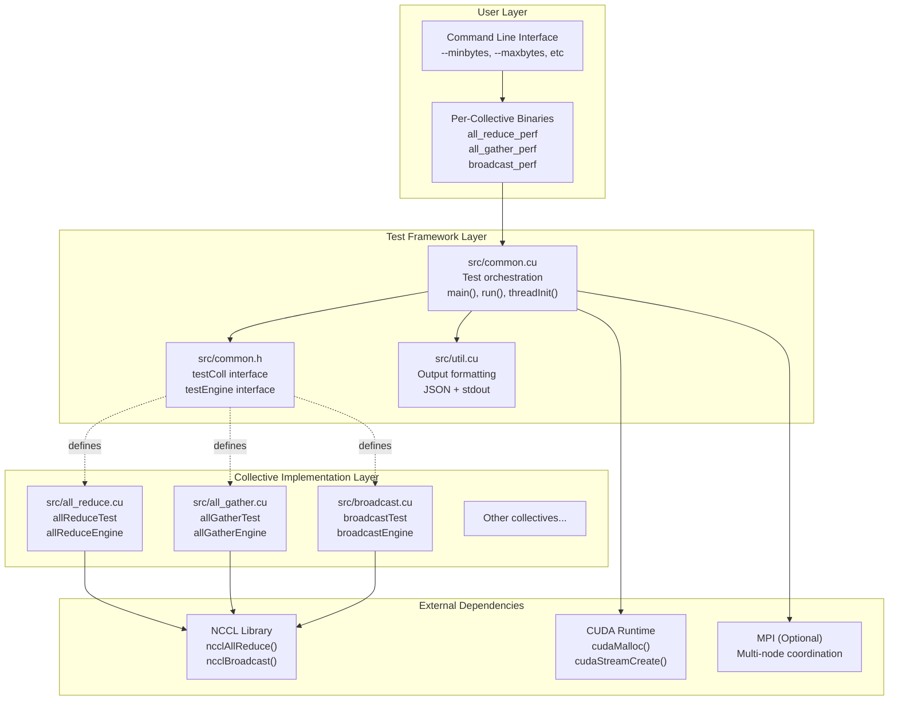
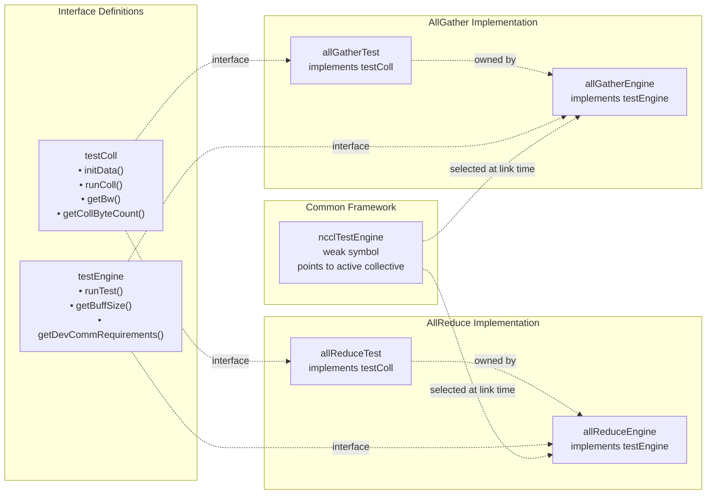

<!-- source: DeepWiki mcp.deepwiki.com · repo NVIDIA/nccl-tests · page 1 Overview · fetched 2026-11-11 -->

# Overview

Relevant source files

The following files were used as context for generating this wiki page:

- [README.md](README.md)
- [src/common.cu](src/common.cu)

NCCL Tests is a performance benchmarking and correctness validation suite for the NVIDIA Collective Communications Library (NCCL). It provides standalone test binaries for measuring bandwidth, latency, and data correctness of NCCL collective communication operations across multiple GPUs, processes, and nodes.

For comprehensive build instructions and dependencies, see [Installation and Build](#1.1). For a full reference of command-line parameters, see [Command Line Arguments](#1.2). For detailed architectural patterns, see [System Architecture](#1.3).

## Purpose and Scope

NCCL Tests serves three primary functions:

1. **Performance Measurement**: Quantifies algorithmic and bus bandwidth as well as latency for collective operations across varying message sizes [README.md:55-57]().
2. **Correctness Validation**: Verifies that collective operations produce mathematically correct results using deterministic data generation and GPU-based verification [README.md:3-3,89]().
3. **Scalability Testing**: Supports multi-GPU, multi-thread, and multi-node execution configurations using MPI [README.md:35-38]().

The test suite is designed for system administrators, NCCL developers, and performance engineers who need to validate NCCL functionality and measure communication performance on GPU clusters.

Sources: [README.md:1-5](), [src/common.cu:1-30]()

## Core Components

The NCCL Tests architecture consists of four primary layers that orchestrate user commands, execution engines, collective plugins, and underlying libraries.

**Figure 1: High-Level System Architecture**

For details on system design, component interaction, and binary layout, see [System Architecture](#1.3).

Sources: [src/common.cu:1-30](), [src/common.h](), [README.md:1-20]()

### Framework Core and Plugin Architecture

The framework core implemented in `src/common.cu` provides centralized initialization, multi-threaded worker management, timing measurement, and result reporting. Each collective operation implements standardized interfaces (`testColl` and `testEngine`) defined in `src/common.h` [src/common.h]().

**Figure 2: Collective Operation Plugin System**

For details on building the suite and target binaries, see [Installation and Build](#1.1).

Sources: [src/common.cu:713-791](), [src/common.h]()

## Execution Model and Parameters

Test execution follows a hierarchical pattern spanning MPI processes, worker threads, and CUDA devices. Each participating GPU is assigned a unique rank based on process, thread, and device indices [README.md:35-38]().

Command-line parameters control message size scaling, iteration counts, data verification, and advanced features such as CUDA graphs and buffer registration [README.md:60-107](). For a comprehensive description of all available flags, defaults, and usage examples, see [Command Line Arguments](#1.2).

Sources: [README.md:35-107](), [src/common.cu:818-1438]()

---

