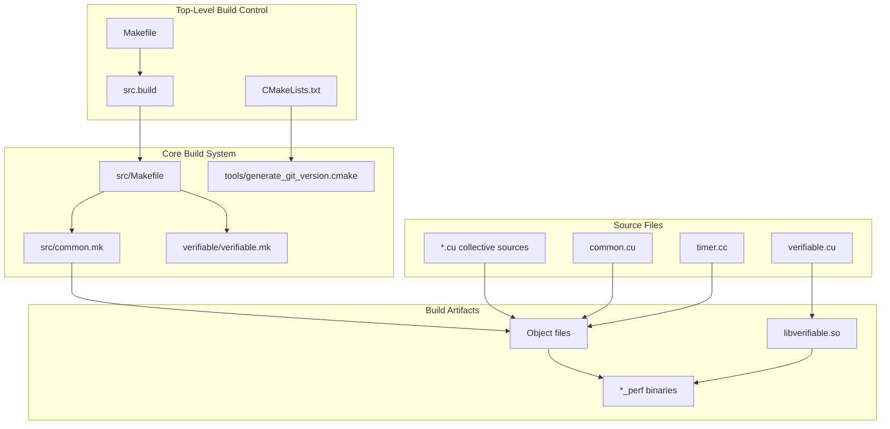
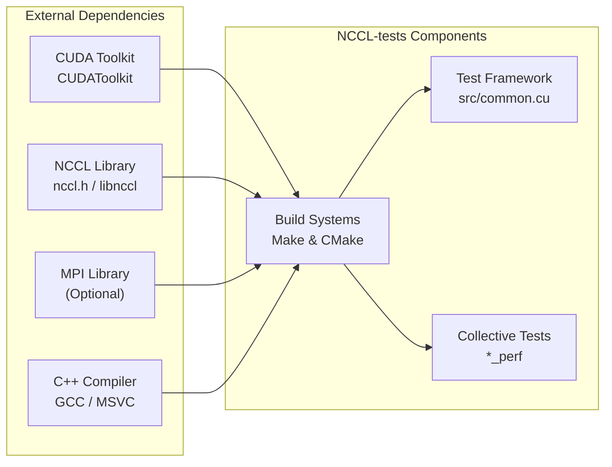

<!-- source: DeepWiki mcp.deepwiki.com · repo NVIDIA/nccl-tests · page 1.1 Installation and Build · fetched 2026-11-11 -->

# Installation and Build

<details>
<summary>Relevant source files</summary>

The following files were used as context for generating this wiki page:

- [CMakeLists.txt](CMakeLists.txt)
- [LICENSE.txt](LICENSE.txt)
- [Makefile](Makefile)
- [src/common.mk](src/common.mk)
- [src/nccl1_compat.h](src/nccl1_compat.h)
- [tools/generate_git_version.cmake](tools/generate_git_version.cmake)
- [verifiable/Makefile](verifiable/Makefile)
- [verifiable/main.cu](verifiable/main.cu)
- [verifiable/verifiable.mk](verifiable/verifiable.mk)

</details>


This page provides comprehensive instructions for building the NCCL Tests benchmarking and correctness validation suite from source, covering dependency requirements, build variables, architecture targeting, and compilation procedures using both GNU Make and CMake build systems.

Sources: [src/common.mk:1-99](), [CMakeLists.txt:1-147]()

## Prerequisites

Before building NCCL Tests, ensure the following dependencies are installed and accessible in your environment:
- **CUDA Toolkit** (version 9.0 or higher; CUDA 12.8+ or 13.0 recommended for Blackwell/newer architectures) [src/common.mk:21-67](), [CMakeLists.txt:48-56]()
- **NCCL Library** (header files and runtime/static libraries) [CMakeLists.txt:61-94]()
- **C++ Compiler** with C++14 support (or C++17 when using CUDA 13.0 or newer) [src/common.mk:20-25](), [CMakeLists.txt:36-42]()
- **GNU Make** (for the traditional Makefile build) [Makefile:1-23]()
- **CMake** (version 3.25 or higher, for the CMake build system) [CMakeLists.txt:7]()
- **MPI Library** (Optional, e.g., OpenMPI or MPICH for multi-node testing) [CMakeLists.txt:24]()

Sources: [src/common.mk:20-67](), [CMakeLists.txt:7-25]()

## Compilation via Make

The traditional build system is orchestrated via GNU `make` at the root and within `src/` [Makefile:12-20]().

### Basic Build
To compile all performance test binaries with default settings, run:
```bash
make
```
For parallel compilation, use:
```bash
make -j
```
Binaries are output into the `build` directory (`BUILDDIR`) [Makefile:7-8]().

### Build Configuration Options and Variables
The Make build system respects several environment variables and configuration parameters:

| Variable | Default | Description |
|----------|---------|-------------|
| `CUDA_HOME` | `/usr/local/cuda` | Path to the CUDA Toolkit root directory [src/common.mk:6]() |
| `PREFIX` | `/usr/local` | Installation prefix [src/common.mk:7]() |
| `DEBUG` | `0` | Set to `1` to enable debug flags (`-O0 -G -g`) [src/common.mk:9,87-93]() |
| `VERBOSE` | `0` | Set to `1` to enable verbose compiler warnings and output [src/common.mk:8,95-99]() |
| `BUILDDIR` | `build` | Output directory for built binaries and objects [Makefile:7]() |
| `MPI` | `0` | Set to `1` to enable MPI multi-node support |
| `MPI_HOME` | `/usr/local/mpi` | Path to MPI installation when `MPI=1` |
| `DSO` | `0` | Compile the verification library as a dynamic shared object (`libverifiable.so`) [verifiable/verifiable.mk:7]() |
| `NAME_SUFFIX` | (empty) | Optional suffix appended to generated test binary names |

Examples:
```bash
# Build with MPI support and custom CUDA path
make MPI=1 CUDA_HOME=/usr/local/cuda-12.8

# Build with debug symbols enabled
make DEBUG=1
```

Sources: [src/common.mk:6-15](), [Makefile:7-20](), [verifiable/verifiable.mk:1-18]()

## Compilation via CMake

As an alternative to GNU Make, NCCL Tests supports building via CMake (`CMakeLists.txt`) [CMakeLists.txt:1-147](). CMake automatically discovers the CUDA toolkit, detects CUDA architecture defaults, handles Git version generation, and configures targets for Linux and Windows.

### CMake Build Steps
```bash
mkdir build && cd build
cmake -DCMAKE_BUILD_TYPE=Release -DNCCL_HOME=/path/to/nccl ..
cmake --build . -j
```

### Key CMake Options
- `-DNCCL_HOME=/path/to/nccl`: Specifies the root directory of the NCCL installation or build tree [CMakeLists.txt:59]()
- `-DCMAKE_CUDA_ARCHITECTURES="75;80;90;100;120"`: Overrides default target GPU architectures [CMakeLists.txt:47-57]()
- `-DCMAKE_BUILD_TYPE=Release`: Selects build optimization level (Release or Debug) [CMakeLists.txt:11-13]()

Sources: [CMakeLists.txt:1-147](), [tools/generate_git_version.cmake:1-27]()

## CUDA Architecture Targeting and Version Handling

The build systems automatically detect the installed CUDA version via `nvcc` and configure appropriate C++ standards and GPU code generation flags (`--gencode`) [src/common.mk:16-67](), [CMakeLists.txt:36-57]().

- **CUDA 13.0+**: Automatically selects C++17 standard (`-std=c++17`) and targets architectures including sm_75, sm_80, sm_90, sm_100, and sm_120 [src/common.mk:20-36](), [CMakeLists.txt:36-49]().
- **CUDA 12.8+**: Targets architectures including sm_60, sm_70, sm_80, sm_90, sm_100, and sm_120 [src/common.mk:37-46](), [CMakeLists.txt:50-51]().
- **Older CUDA Versions**: Targets earlier compute capabilities (sm_35, sm_50, sm_60, etc.) with C++14 [src/common.mk:47-67](), [CMakeLists.txt:52-56]().

Sources: [src/common.mk:16-67](), [CMakeLists.txt:36-57]()

## Build System Architecture



Sources: [Makefile:1-23](), [src/common.mk:1-99](), [CMakeLists.txt:1-147](), [verifiable/verifiable.mk:1-18]()

## Dependency Relationships



Sources: [src/common.mk:1-99](), [CMakeLists.txt:1-147]()

## Build Artifacts

Upon successful compilation, the build process produces:
- **Performance Test Executables**: `all_reduce_perf`, `all_gather_perf`, `broadcast_perf`, `reduce_scatter_perf`, `reduce_perf`, `alltoall_perf`, `scatter_perf`, `gather_perf`, `sendrecv_perf`, `hypercube_perf`, and `comm_ops_perf`.
- **Verification Components**: Static integration or shared object library (`libverifiable.so`) for data verification [verifiable/verifiable.mk:7](), along with `self_test` binaries [verifiable/Makefile:24-29]().
- **Git Version Header**: Automatically generated header `nccl_tests_git_version.h` tracking repository state [tools/generate_git_version.cmake:1-27]().

Sources: [verifiable/verifiable.mk:1-18](), [verifiable/Makefile:24-29](), [tools/generate_git_version.cmake:1-27]()

## Verification

Verify the build by executing a basic performance test binary:
```bash
./build/all_reduce_perf -b 8 -e 128M -f 2 -g 1
```
This runs an AllReduce benchmark on a single GPU across buffer sizes from 8 bytes to 128 MB.

Sources: [verifiable/main.cu:1-14]()

---

