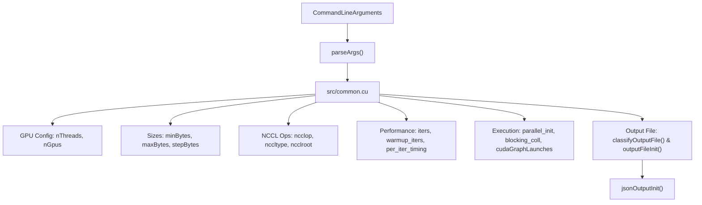
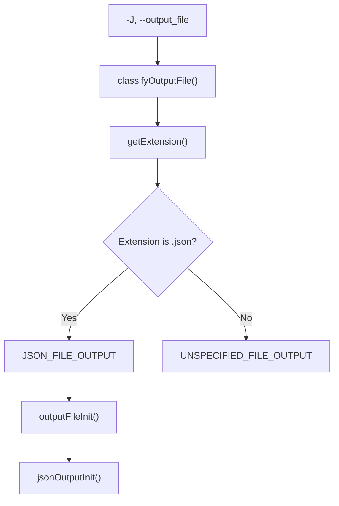
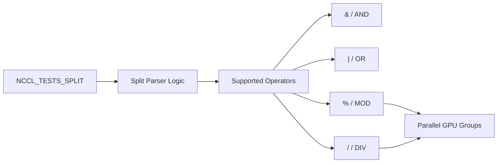

<!-- source: DeepWiki mcp.deepwiki.com · repo NVIDIA/nccl-tests · page 1.2 Command Line Arguments · fetched 2026-11-11 -->

# Command Line Arguments

Relevant source files

The following files were used as context for generating this wiki page:

- [README.md](README.md)
- [src/common.cu](src/common.cu)

This page provides a comprehensive reference for all command-line arguments supported by NCCL Tests performance binaries. These arguments control test execution parameters, data sizes, NCCL operation settings, performance measurement options, and output formatting.

For information about building the test binaries, see [Installation and Build](#1.1). For details about the test execution framework that processes these arguments, see [Test Orchestration and Execution](#2.2).

## Overview and Categorization

All NCCL Tests performance binaries (`all_reduce_perf`, `broadcast_perf`, etc.) parse their parameters into global configuration variables defined in [src/common.cu:88-125](). These parameters are organized into six main categories:

- **GPU Configuration**: Number of threads and GPUs per test (`-t`, `-g`)
- **Data Size Control**: Size ranges and increment patterns (`-b`, `-e`, `-i`, `-f`, `-u`)
- **NCCL Operation Parameters**: Operation type, data type, and root rank settings (`-o`, `-d`, `-r`)
- **Performance Measurement**: Iteration counts, timing options, and aggregation settings (`-n`, `-w`, `-m`, `-N`, `-a`, `-I`, `-K`, `-C`)
- **Test Execution Control**: Initialization modes, correctness checking, blocking, and graphs (`-p`, `-c`, `-z`, `-G`, `-R`, `-D`, `-H`, `-V`, `-T`, `-M`)
- **Reporting and Output**: Timestamps, tuning information, and JSON file logging (`-S`, `-J`, `-U`)

## Argument Parsing and Initialization Flow

The following diagram bridges the natural language command-line options to the underlying code entities and functions in `src/common.cu` responsible for parsing and configuring the test environment.

Sources: [src/common.cu:88-198](), [README.md:60-106]()

## GPU Configuration Arguments

These arguments control the distribution of GPUs across processes and threads for multi-GPU testing.

| Argument | Default | Description |
|----------|---------|-------------|
| `-t, --nthreads <num>` | `1` | Number of threads per process. Controlled by `nThreads` in [src/common.cu:89]() |
| `-g, --ngpus <num>` | `1` | Number of GPUs per thread. Controlled by `nGpus` in [src/common.cu:90]() |

The total number of NCCL ranks equals: `(MPI processes) × (threads per process) × (GPUs per thread)`

Sources: [src/common.cu:89-90](), [README.md:63-65]()

## Data Size Control Arguments

These arguments define the range of data sizes to test, increment patterns, and buffer misalignment options.

| Argument | Default | Description |
|----------|---------|-------------|
| `-b, --minbytes <size>` | `32M` | Minimum size to start with (`minBytes` in [src/common.cu:91]()) |
| `-e, --maxbytes <size>` | `32M` | Maximum size to end at (`maxBytes` in [src/common.cu:92]()) |
| `-i, --stepbytes <size>` | `1M` | Fixed increment between sizes (`stepBytes` in [src/common.cu:93]()) |
| `-f, --stepfactor <factor>` | `1` | Multiplication factor between sizes (`stepFactor` in [src/common.cu:94]()) |
| `-u, --unalign <index>` | `0` | Misalign source and destination buffers by element index (`unalign` in [src/common.cu:114]()) |

Sources: [src/common.cu:91-94](), [src/common.cu:114](), [README.md:66-71](), [README.md:105]()

## NCCL Operation Arguments

These arguments configure the specific NCCL operation parameters, reduction types, data types, and root designations.

| Argument | Default | Values | Description |
|----------|---------|--------|-------------|
| `-o, --op <op>` | `sum` | `sum/prod/min/max/avg/mulsum` | Reduction operation for reduction collectives (`ncclop` in [src/common.cu:100]()) |
| `-d, --datatype <type>` | `float` | `nccltype/all` | NCCL data type (`nccltype` in [src/common.cu:101]()) |
| `-r, --root <rank>` | `0` | `rank/all` | Root rank for Broadcast, Reduce, etc. (`ncclroot` in [src/common.cu:102]()) |

Sources: [src/common.cu:100-102](), [README.md:72-75]()

## Performance Measurement Arguments

These arguments control timing loops, warmup iterations, aggregation counts, and per-iteration profiling metrics.

| Argument | Default | Description |
|----------|---------|-------------|
| `-n, --iters <count>` | `20` | Number of timed iterations (`iters` in [src/common.cu:97]()) |
| `-w, --warmup_iters <count>` | `1` | Number of warmup iterations, untimed (`warmup_iters` in [src/common.cu:96]()) |
| `-m, --agg_iters <count>` | `1` | Operations to aggregate together per iteration (`agg_iters` in [src/common.cu:98]()) |
| `-N, --run_cycles <count>` | `1` | Run and print each cycle; `0` for infinite (`run_cycles` in [src/common.cu:99]()) |
| `-a, --average <mode>` | `1` | Performance averaging mode across ranks: `0`=Rank0, `1`=Avg, `2`=Min, `3`=Max (`average` in [src/common.cu:122]()) |
| `-I, --per_iter_timing <0/1>` | `0` | Collect per-iteration CUDA event timings and summary statistics (`per_iter_timing` in [src/common.cu:105]()) |
| `-K, --per_iter_skip <count>` | `0` | Exclude leading samples from `-I` summary statistics (`per_iter_skip` in [src/common.cu:106]()) |
| `-C, --report_cputime <0/1>` | `0` | Report CPU time instead of GPU latency (`report_cputime` in [src/common.cu:110]()) |

Sources: [src/common.cu:96-110](), [src/common.cu:122](), [README.md:76-86]()

## Test Execution Control Arguments

These arguments manage parallel initialization, correctness validation, execution blocking, CUDA graphs, buffer registration, and custom device/RMA implementations.

| Argument | Default | Description |
|----------|---------|-------------|
| `-p, --parallel_init <0/1>` | `0` | Use threads to initialize NCCL in parallel (`parallel_init` in [src/common.cu:103]()) |
| `-c, --check <count>` | `1` | Perform correctness validation checks every `count` iterations (`datacheck` in [src/common.cu:95]()) |
| `-z, --blocking <0-3>` | `0` | Collective synchronization blocking mode: `0`=none, `1`=wait+barrier per inner iter, `2`=wait per inner iter, `3`=wait+barrier per outer iter (`blocking_coll` in [src/common.cu:104]()) |
| `-G, --cudagraph <count>` | `0` | Capture iterations as a CUDA graph and replay `count` times (`cudaGraphLaunches` in [src/common.cu:109]()) |
| `-R, --local_register <0-2>` | `0` | Buffer registration mode: `0`=none, `1`=local, `2`=symmetric (`local_register` in [src/common.cu:125]()) |
| `-D, --device_implementation <num>` | `0` | Use custom device API implementation (e.g. for AllReduce or AllToAll; requires `-R 2`) (`deviceImpl` in [src/common.cu:112]()) |
| `-H, --host_rma_implementation <num>` | `0` | Use host one-sided RMA contexts instead of built-in collectives (`hostRmaImpl` in [src/common.cu:113]()) |
| `-V, --device_cta_count <num>` | `16` | Number of CTAs for device API implementations (`deviceCtaCount` in [src/common.cu:118]()) |
| `-T, --timeout <seconds>` | `0` | Timeout each test after specified number of seconds (`timeout` in [src/common.cu:108]()) |
| `-M, --memory <0/1>` | `0` | Enable memory usage reporting (`memory_report` in [src/common.cu:115]()) |

Sources: [src/common.cu:95](), [src/common.cu:103-109](), [src/common.cu:112-115](), [src/common.cu:118](), [src/common.cu:125](), [README.md:87-104]()

## Reporting and Output Formatting Arguments

These arguments control logging options, timestamp generation, tuning reporting, and structured JSON output generation.

| Argument | Default | Description |
|----------|---------|-------------|
| `-S, --report_timestamps <0/1>` | `0` | Add timestamp (`"%Y-%m-%d %H:%M:%S"`) to each report line (`report_timestamps` in [src/common.cu:111]()) |
| `-J, --output_file <file>` | none | Write JSON output to file path. Inferred via `classifyOutputFile()` in [src/common.cu:168]() |
| `-U, --tuning <0/1>` | `0` | Report NCCL tuning information (`tuning` in [src/common.cu:116](); requires NCCL >= 2.28) |

Sources: [src/common.cu:111](), [src/common.cu:116](), [src/common.cu:168-175](), [README.md:101-106]()

## Output File Classification Workflow

When an output file is supplied via `-J`, the test binary evaluates the file extension to pick the correct output writer, routing through `classifyOutputFile()` and `outputFileInit()` in [src/common.cu:168]().

Sources: [src/common.cu:136-187]()

## Environment Variables

In addition to command-line arguments, environment variables control runtime configurations such as rank partitioning.

### GPU Partitioning with NCCL_TESTS_SPLIT

The `NCCL_TESTS_SPLIT` environment variable partitions GPUs into smaller groups running distinct operations in parallel.

**Syntax**: `<operation><value>` where operation is `AND`, `OR`, `MOD`, `DIV` (or symbols `&`, `|`, `%`, `/`). Values may be decimal, hexadecimal (`0x`), or binary (`0b`).

Sources: [README.md:111-148]()

---

