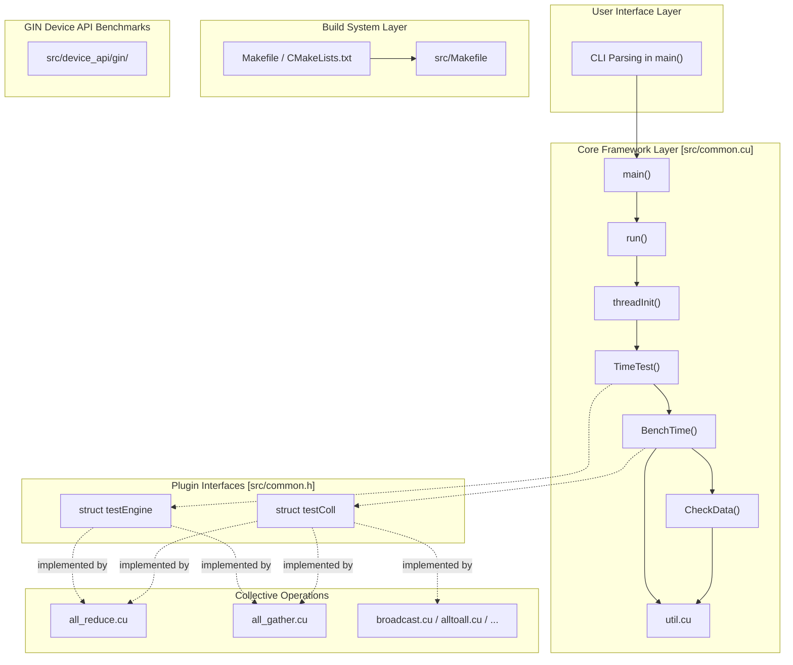
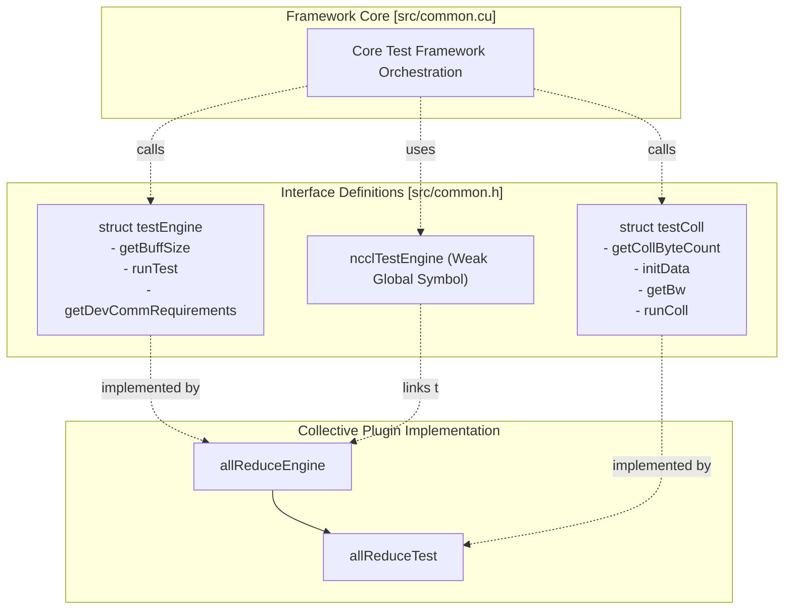
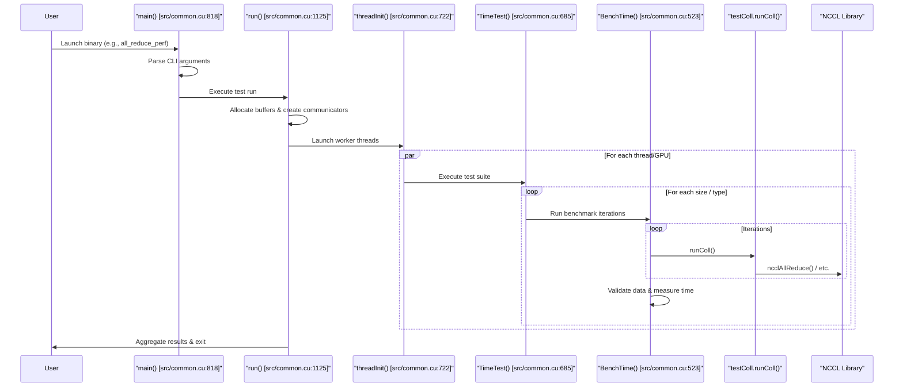
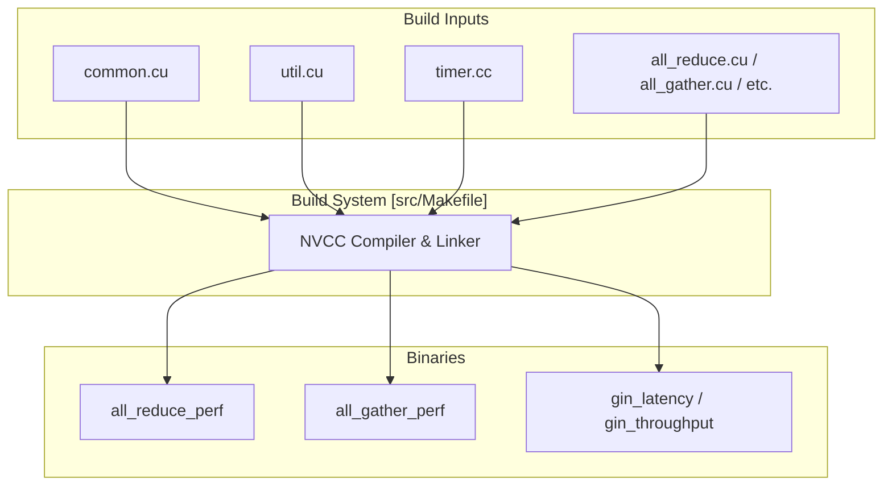

<!-- source: DeepWiki mcp.deepwiki.com · repo NVIDIA/nccl-tests · page 1.3 System Architecture · fetched 2026-11-11 -->

# System Architecture

Relevant source files

The following files were used as context for generating this wiki page:

- [src/Makefile](src/Makefile)
- [src/alltoallv.cu](src/alltoallv.cu)
- [src/common.h](src/common.h)

## Purpose and Scope

This page provides a high-level architectural overview of the NCCL Tests system, documenting how major components interact to enable performance benchmarking and correctness validation of NCCL collective operations, communicator operations, and GPU-Initiated Networking (GIN) device API microbenchmarks. It maps the conceptual architecture to specific code entities (files, classes, interfaces) to bridge understanding between system design and implementation.

For detailed information about specific subsystems, see:
- Build infrastructure: [Build System](#6)
- Test execution details: [Core Testing Framework](#2)
- Individual collectives: [Collective Operations](#3)
- GIN Device API Benchmarks: [GIN Device API Benchmarks](#5)

Sources: [src/common.h:115-148](), [src/common.cu:1-1103]()

---

## Architectural Overview

The NCCL Tests system is organized into major layers that work together to execute performance benchmarks and correctness validation:

| Layer | Primary Components | Responsibility |
|-------|-------------------|----------------|
| **User Interface** | CLI parsing, `main()` | Command-line argument processing, execution flow control [src/common.cu:889-1072]() |
| **Build System** | `Makefile`, `src/Makefile`, `CMakeLists.txt` | Per-collective binary generation, GIN target discovery, dependency management [src/Makefile:44-70]() |
| **Core Framework** | `src/common.cu`, `src/common.h`, `src/util.cu` | Test orchestration, multi-threaded timing, verification, output reporting [src/common.h:121-199]() |
| **Collective Operations** | `all_reduce.cu`, `all_gather.cu`, etc. | NCCL collective implementations, buffer sizing, and test logic [src/common.h:115-126]() |
| **GIN Device API Benchmarks** | `src/device_api/gin/` | GPU-Initiated Networking point-to-point latency and throughput microbenchmarks |

The architecture uses a **plugin pattern** where each collective operation implements standard interfaces defined by the core framework. This allows the framework to orchestrate tests uniformly across all collective types while generating separate binaries for each operation.

Sources: [src/common.cu:1-1103](), [src/common.h:1-201](), [src/Makefile:44-172]()

---

## System Component Diagram

**Key architectural features:**

1. **Core Framework** ([src/common.cu:427-711]()) contains the main execution pipeline (`main()` → `run()` → `threadInit()` → `threadRunTests()`)
2. **Plugin Interfaces** ([src/common.h:115-148]()) define contracts that collectives must implement: `testColl` for operation-specific logic and `testEngine` for buffer management and device requirements.
3. **Weak Symbol Resolution** - A global `ncclTestEngine` symbol ([src/common.h:150]()) is weakly linked to point to the active collective's engine at link time.
4. **GIN Device API Benchmarks** - Independent test binaries under `src/device_api/gin/` that evaluate GPU-initiated networking primitives.

Sources: [src/common.cu:818-1103](), [src/common.h:115-150]()

---

## Plugin Interface Architecture

The test framework uses a dual-interface plugin pattern to achieve uniformity across different collective operations:

### Interface Responsibilities

**`testColl` struct** ([src/common.h:115-126]()):
- `getCollByteCount` - Calculate send/recv buffer sizes and in-place offsets.
- `initData` - Initialize test input patterns and expected output.
- `getBw` - Compute algorithm and bus bandwidth from measured execution time.
- `runColl` - Execute the underlying NCCL collective API (`ncclAllReduce`, `ncclBroadcast`, etc.).

**`testEngine` struct** ([src/common.h:134-148]()):
- `getBuffSize` - Determine total buffer allocation requirements.
- `runTest` - Execute full test suite across data types and sizes.
- `initCommConfig` - Optional configuration of `ncclConfig_t` (NCCL ≥2.14).
- `getDevCommRequirements` - Specify device communicator needs (NCCL ≥2.28/2.29).

Sources: [src/common.h:115-148]()

---

## Test Execution Pipeline

The execution flow from program launch to result output follows a structured pipeline managed by `run()` and worker threads:

**Execution Phases:**
1. **Initialization** ([src/common.cu:818-1086]()): Argument parsing, MPI initialization if enabled.
2. **Resource Allocation** ([src/common.cu:1125-1227]()): GPU memory allocation (`ncclMemAlloc` / `cudaMalloc`), unique ID distribution.
3. **Thread Spawn** ([src/common.cu:1335-1337]()): Multi-threaded execution across local GPUs using `pthread_create`.
4. **Benchmarking & Validation** ([src/common.cu:523-669]()): Warmup, timed execution loops, buffer offset shifting, and `CheckData()` correctness verification.

Sources: [src/common.cu:427-711](), [src/common.cu:818-1103]()

---

## Binary Generation Strategy

The build system compiles separate binaries for each collective operation and GIN benchmark category rather than a single monolithic executable.

**Rationale:**
- **Reduced Binary Size**: Keeps individual executables compact (~10 MB).
- **Parallel Compilation**: Speeds up build times.
- **Weak Symbol Binding**: Resolves `ncclTestEngine` at link time to bind the specific collective engine.

Sources: [src/Makefile:42-70](), [src/Makefile:149-172]()

---

## Key Data Structures

### `struct threadArgs`
[src/common.h:152-199]() defines the primary shared context passed to worker threads, containing:
- Size sweep parameters (`minbytes`, `maxbytes`, `stepbytes`, `nbytes`).
- Parallelism topologies (`totalProcs`, `nProcs`, `proc`, `nThreads`, `thread`, `nGpus`, `gpus`).
- Buffers and streams (`sendbuffs`, `recvbuffs`, `expected`, `comms`, `streams`, `events`).
- Registration handles and device communicators (`sendRegHandles`, `recvRegHandles`, `devComms`).

Sources: [src/common.h:152-199]()

---

