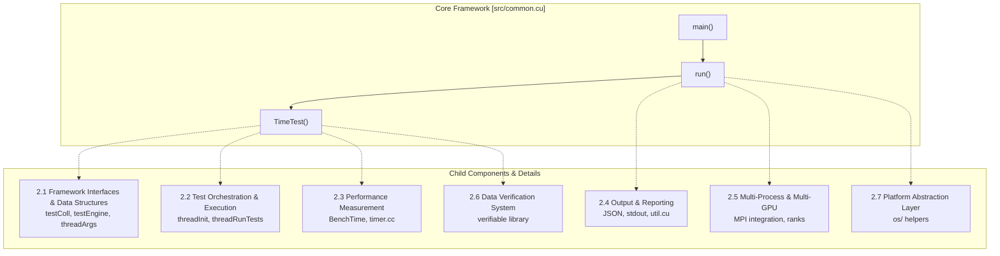

<!-- source: DeepWiki mcp.deepwiki.com · repo NVIDIA/nccl-tests · page 2 Core Testing Framework · fetched 2026-11-11 -->

# Core Testing Framework

Relevant source files

The following files were used as context for generating this wiki page:

- [src/common.cu](src/common.cu)
- [src/common.h](src/common.h)

The Core Testing Framework is the central test orchestration system implemented primarily in [src/common.cu]() and [src/common.h](). It provides infrastructure for executing NCCL collective operation tests across distributed processes, multiple threads per process, and multiple GPUs per thread. The framework implements a plugin architecture where collective operations register themselves via the `testEngine` and `testColl` interfaces, enabling uniform testing across all collective types.

The framework's main responsibilities include:
- Multi-level parallelism management (MPI processes, pthreads, CUDA streams)
- NCCL communicator lifecycle (initialization, registration, destruction)
- Test execution orchestration (warmup, benchmark, validation)
- Performance measurement (timing, bandwidth calculation, result aggregation)
- Distributed synchronization (barriers, allreduce for result collection)

For details on specific collective implementations, see [Collective Operations](#3). For build infrastructure, see [Build System](#6).

Sources: [src/common.cu:1-1959](), [src/common.h:1-363]()

## Architecture Overview

The framework is built around a plugin-style architecture that separates the generic testing infrastructure from specific collective operation implementations.

Sources: [src/common.cu:818-1103](), [src/common.cu:1125-1438]()

---

## 2.1. Framework Interfaces and Data Structures

The framework defines core interfaces like `testColl` and `testEngine` in [src/common.h:91-148]() which define the plugin architecture for collective operations. Data structures such as `threadArgs` ([src/common.h:152-199]()) maintain per-thread state including process topology, buffer pointers, GPU assignments, and NCCL communicators.

For details, see [Framework Interfaces and Data Structures](#2.1).

Sources: [src/common.h:91-199]()

---

## 2.2. Test Orchestration and Execution

The execution pipeline flows from `main()` through `run()`, spawning worker threads via `threadLauncher()` ([src/common.cu:793-797]()), initializing communicators via `threadInit()` ([src/common.cu:722-791]()), and executing tests via `threadRunTests()` ([src/common.cu:713-720]()). Synchronization is handled via custom barrier and allreduce primitives ([src/common.cu:236-320]()).

For details, see [Test Orchestration and Execution](#2.2).

Sources: [src/common.cu:236-320](), [src/common.cu:713-814](), [src/common.cu:1125-1438]()

---

## 2.3. Performance Measurement

Performance timing relies on high-resolution timer utilities (`timer.cc`) wrapped inside `BenchTime()` and `TimeTest()`. The framework computes both algorithmic and bus bandwidth, supports per-iteration timing, and integrates CUDA graph capture and replay (`cudaGraphLaunches`) to eliminate CPU launch overhead [src/common.cu:455-613]().

For details, see [Performance Measurement](#2.3).

Sources: [src/common.cu:455-613]()

---

## 2.4. Output and Reporting

Test results are reported via a dual-output system supporting both standard formatted console output and machine-readable JSON logs. Formatting and reporting functions reside in `util.cu` and `util.h`, accompanied by embedded profiler telemetry integration and analysis tools.

For details, see [Output and Reporting](#2.4).

Sources: [src/common.cu:168-198]()

---

## 2.5. Multi-Process and Multi-GPU Support

Distributed execution relies on MPI integration for multi-node coordination. Global rank calculation handles hierarchical topologies across processes, pthreads, and GPUs, while environment variables like `NCCL_TESTS_SPLIT` control GPU partitioning.

For details, see [Multi-Process and Multi-GPU Support](#2.5).

Sources: [src/common.h:152-199](), [src/common.cu:1125-1438]()

---

## 2.6. Data Verification System

To validate correctness of collective operations, the framework integrates a deterministic data generation and verification engine (using the `verifiable` library) that runs parallel checks against expected bit patterns after test iterations [src/common.cu:322]().

For details, see [Data Verification System](#2.6).

Sources: [src/common.cu:322](), [src/common.cu:685-711]()

---

## 2.7. Platform Abstraction Layer

Cross-platform compilation across Linux and Windows is facilitated by helper shims in the `os/` directory, which normalize host name hashing, process identification (`ncclTestGetPid()`), dynamic string formatting (`asprintf`), and command-line parsing (`getopt`) [src/common.h:24]().

For details, see [Platform Abstraction Layer](#2.7).

Sources: [src/common.h:24](), [src/common.cu:109]()

---

