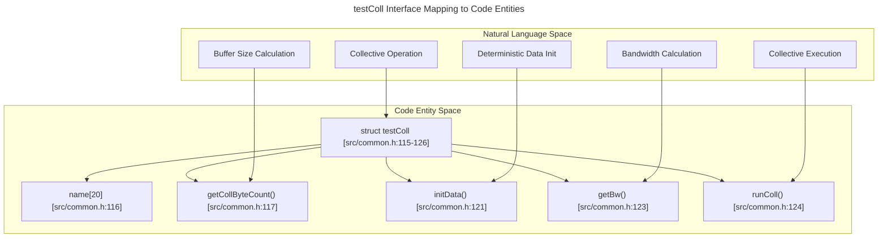
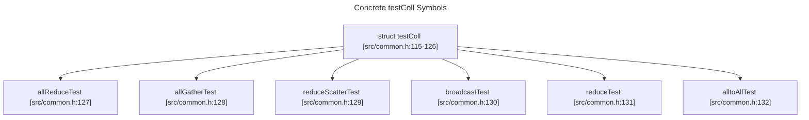
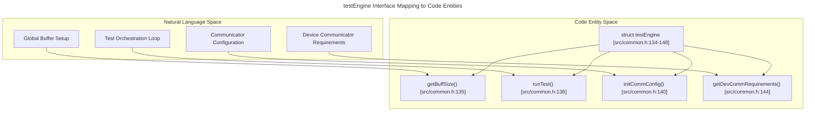
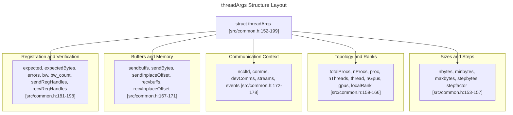

<!-- source: DeepWiki mcp.deepwiki.com · repo NVIDIA/nccl-tests · page 2.1 Framework Interfaces and Data Structures · fetched 2026-11-11 -->

# Framework Interfaces and Data Structures

Relevant source files

The following files were used as context for generating this wiki page:

- [src/common.h](src/common.h)

This document details the core interfaces and data structures that define the NCCL Tests plugin architecture. The framework achieves extensibility through two primary interfaces (`struct testColl` and `struct testEngine`) and key data structures (`struct threadArgs`) that enable uniform testing of different collective operations while accommodating their specific requirements.

## testColl Interface

The `struct testColl` interface defines the operations that all collective benchmarks must implement (`[src/common.h:115-126]()`). It serves as the primary extension point for integrating new collective communication patterns into the benchmarking suite.

Sources: `[src/common.h:115-126]()`

**Function Pointer Details in `struct testColl`**
- `getCollByteCount`: Computes buffer send/receive counts, parameter counts, and in-place offsets based on element size and rank count (`[src/common.h:117-120]()`).
- `initData`: Initializes send and expected receive buffers with predictable patterns for validation (`[src/common.h:121-122]()`).
- `getBw`: Computes algorithmic and bus bandwidth metrics given elapsed time and message counts (`[src/common.h:123]()`).
- `runColl`: Dispatches the actual collective invocation using either NCCL APIs or device-side custom kernels (`[src/common.h:124-125]()`).

Sources: `[src/common.h:115-126]()`

### Concrete Collective Implementations

Each individual collective benchmark instantiates and exports a concrete implementation of `struct testColl` (`[src/common.h:127-132]()`).

Sources: `[src/common.h:115-132]()`

---

## testEngine Interface

The `struct testEngine` interface handles high-level test lifecycle management, execution orchestration, and optional configuration hooks (`[src/common.h:134-148]()`).

Sources: `[src/common.h:134-148]()`

The global instance `ncclTestEngine` is declared extern and defined by the active binary build (`[src/common.h:150]()`).

Sources: `[src/common.h:134-150]()`

---

## threadArgs Data Structure

The `struct threadArgs` data structure encapsulates all configuration parameters, memory pointers, communicator states, and performance accumulators required by an individual execution thread (`[src/common.h:152-199]()`).

Sources: `[src/common.h:152-199]()`

---

## Error Handling and Result Codes

The framework defines standard status codes via `testResult_t` (`[src/common.h:91-100]()`) and error-checking wrapper macros (`[src/common.h:51-113]()`) to safely bubble up CUDA and NCCL errors across processes and threads.

- `testSuccess` (`[src/common.h:92]()`): Operation completed successfully.
- `testInternalError` (`[src/common.h:93]()`): Internal framework fault.
- `testCudaError` (`[src/common.h:94]()`): CUDA runtime failure.
- `testNcclError` (`[src/common.h:95]()`): NCCL failure.
- `testTimeout` (`[src/common.h:96]()`): Operation timed out.
- `testNotImplemented` (`[src/common.h:97]()`): Feature not implemented for configuration.
- `testInvalidUsage` (`[src/common.h:98]()`): Invalid command-line argument or usage.

Sources: `[src/common.h:51-113]`, `[src/common.h:91-100]()`

---

