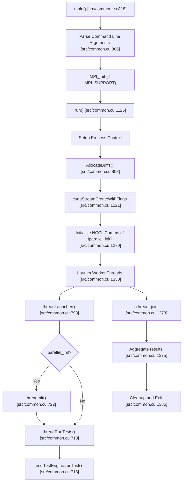
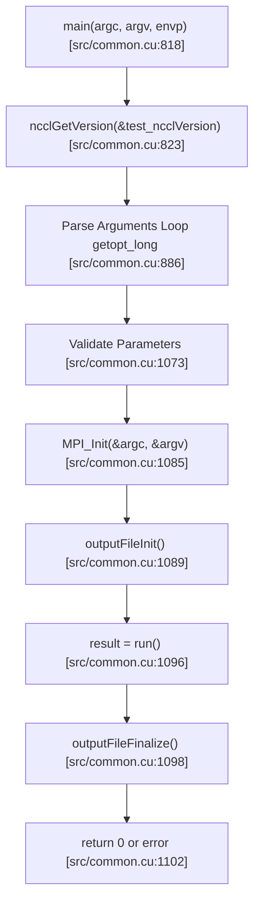
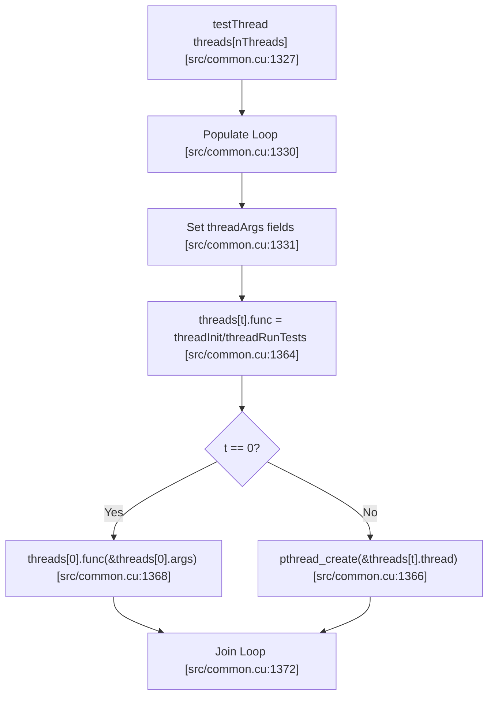

<!-- source: DeepWiki mcp.deepwiki.com · repo NVIDIA/nccl-tests · page 2.2 Test Orchestration and Execution · fetched 2026-11-11 -->

# Test Orchestration and Execution

Relevant source files

The following files were used as context for generating this wiki page:

- [src/common.cu](src/common.cu)

## Overview

This page documents the test orchestration pipeline that coordinates the execution of NCCL collective operation benchmarks. The orchestration system manages the complete lifecycle from program entry through multi-threaded test execution to result aggregation.

The orchestration pipeline consists of four primary stages:

1. **Entry and Setup** - `main()` function parses arguments and invokes `run()` [src/common.cu:818-1103]()
2. **Resource Allocation** - `run()` function allocates buffers, creates streams, and optionally initializes NCCL communicators [src/common.cu:1125-1438]()
3. **Thread Initialization** - `threadInit()` or direct execution based on `parallel_init` mode [src/common.cu:722-791]()
4. **Test Execution** - `threadRunTests()` invokes the test engine and collective operations [src/common.cu:713-720]()

The system supports both sequential and parallel NCCL initialization modes, multi-threaded execution with per-thread GPU assignments, and provides synchronization primitives for coordinating across threads and MPI processes.

Sources: [src/common.cu:818-1103](), [src/common.cu:1125-1438](), [src/common.cu:722-791](), [src/common.cu:713-720]()

## Orchestration Pipeline Overview

**Diagram: Complete Test Orchestration Flow**

Sources: [src/common.cu:818-1103](), [src/common.cu:1125-1438](), [src/common.cu:713-720](), [src/common.cu:722-791](), [src/common.cu:793-801]()

## Main Entry Point

The `main()` function at [src/common.cu:818-1103]() serves as the program entry point. It parses command line arguments, initializes MPI if enabled, invokes the `run()` function for test execution, and handles final cleanup.

**Diagram: main() Function Structure**

### Command Line Configuration

The argument parsing loop at [src/common.cu:886-1072]() configures global test parameters stored in static variables:

| Global Variable | CLI Argument | Default | Description |
|-----------------|--------------|---------|-------------|
| `nThreads` | `-t, --nthreads` | 1 | Number of worker threads per process |
| `nGpus` | `-g, --ngpus` | 1 | Number of GPUs managed by each thread |
| `minBytes` | `-b, --minbytes` | 32M | Starting message size for benchmark sweep |
| `maxBytes` | `-e, --maxbytes` | 32M | Ending message size for benchmark sweep |
| `parallel_init` | `-p, --parallel_init` | 0 | Enable parallel NCCL communicator initialization |
| `blocking_coll` | `-z, --blocking` | 0 | Enable blocking collective operations |
| `cudaGraphLaunches` | `-G, --cudagraph` | 0 | Number of CUDA graph launches per iteration |
| `deviceImpl` | `-D, --device_implementation` | 0 | Device implementation index (0=NCCL host) |

Sources: [src/common.cu:818-1103](), [src/common.cu:79-102](), [src/common.cu:854-884]()

## Setup and Resource Allocation

The `run()` function at [src/common.cu:1125-1438]() orchestrates the complete test execution lifecycle, from resource allocation through thread management to result reporting.

**Diagram: run() Function Orchestration**

```mermaid
graph TD
    runEntry["run() [src/common.cu:1125]"]
    
    mpiSetup["MPI Setup MPI_Comm_size/rank [src/common.cu:1132]"]
    splitComm["MPI_Comm_split for NCCL_TESTS_SPLIT [src/common.cu:1142]"]
    deviceReport["writeDeviceReport() [src/common.cu:1178]"]
    
    memCalc["Calculate Memory Limits reserveMem, memMaxBytes [src/common.cu:1183]"]
    ncclId["ncclGetUniqueId(&ncclId) [src/common.cu:1194]"]
    
    bufferAlloc["AllocateBuffs() for each GPU [src/common.cu:1202]"]
    streamCreate["cudaStreamCreateWithFlags for each GPU [src/common.cu:1217]"]
    
    seqInit{"!parallel_init?"}
    ncclInit["Sequential NCCL Init ncclCommInitRankConfig [src/common.cu:1270]"]
    regMem["Memory Registration ncclCommRegister [src/common.cu:1280]"]
    devComm["Device Communicator Creation ncclDevCommCreate [src/common.cu:1296]"]
    
    threadSetup["Thread Structure Setup threadArgs [src/common.cu:1327]"]
    threadLaunch["Launch Threads threadLaunch [src/common.cu:1364]"]
    
    threadJoin["Join Threads pthread_join [src/common.cu:1372]"]
    mpiAllreduce["MPI_Allreduce errors [src/common.cu:1383]"]
    cleanup["Cleanup Resources ncclCommDestroy, cudaFree [src/common.cu:1386]"]
    writeFooter["writeResultFooter() [src/common.cu:1422]"]
    
    runEntry --> mpiSetup
    mpiSetup --> splitComm
    splitComm --> deviceReport
    deviceReport --> memCalc
    memCalc --> ncclId
    ncclId --> bufferAlloc
    bufferAlloc --> streamCreate
    streamCreate --> seqInit
    
    seqInit -->|"Yes"| ncclInit
    ncclInit --> regMem
    regMem --> devComm
    devComm --> threadSetup
    seqInit -->|"No"| threadSetup
    
    threadSetup --> threadLaunch
    threadLaunch --> threadJoin
    threadJoin --> mpiAllreduce
    mpiAllreduce --> cleanup
    cleanup --> writeFooter
```

### Buffer Allocation Strategy

The `AllocateBuffs()` function at [src/common.cu:803-814]() allocates GPU memory for send, receive, and expected data buffers using `ncclMemAlloc()` or `cudaMalloc()`.

Sources: [src/common.cu:1125-1438](), [src/common.cu:803-814](), [src/common.cu:1183-1192]()

## Thread Management

The orchestration system launches worker threads to parallelize test execution across multiple GPUs. Each thread manages a subset of GPUs and coordinates through synchronization primitives.

**Diagram: Thread Launch and Management**

### Thread Data Structures

The thread system uses `testThread` and `threadArgs` structures defined in [src/common.h:121-170]().

### Thread Launcher Function

The `threadLauncher()` function at [src/common.cu:793-797]() serves as the pthread entry point.

Sources: [src/common.cu:1327-1380](), [src/common.cu:793-801](), [src/common.h:121-170]()

## Thread Synchronization Mechanisms

The orchestration system provides synchronization primitives (`Barrier` and `Allreduce`) implemented via condition variables, mutexes, and MPI primitives [src/common.cu:236-320]().

Sources: [src/common.cu:236-261](), [src/common.cu:266-320]()

## Thread Initialization

The `threadInit()` function at [src/common.cu:722-791]() handles parallel communicator initialization when `parallel_init=1`.

Sources: [src/common.cu:722-791]()

## Test Execution

The `threadRunTests()` function at [src/common.cu:713-720]() sets the GPU context and invokes `ncclTestEngine.runTest()`.

Sources: [src/common.cu:713-720]()

## Collective Operation Pipeline

Collective operations are initiated via `startColl()` [src/common.cu:427-521]() and synchronized using `testStreamSynchronize()` [src/common.cu:369-425]().

Sources: [src/common.cu:427-521](), [src/common.cu:369-425]()

## Result Aggregation and Cleanup

Post-execution processing aggregates error counts and bandwidth metrics across threads and MPI processes before releasing resources [src/common.cu:1372-1437]().

Sources: [src/common.cu:1372-1437]()

## In-place vs. Out-of-place Operations

The framework benchmarks both in-place and out-of-place buffer configurations using appropriate offset calculations [src/common.cu:342-417]().

Sources: [src/common.cu:342-417](), [src/common.cu:247-248](), [src/common.cu:398-401]()

## Performance Considerations

Optimizations include buffer offset rotation, non-blocking streams, synchronization control, and CUDA graph capture [src/common.cu:345-348](), [src/common.cu:1062-1063](), [src/common.cu:419-425](), [src/common.cu:439-500]().

Sources: [src/common.cu:345-348](), [src/common.cu:1062-1063](), [src/common.cu:419-425](), [src/common.cu:439-500]()

## Data Type Support

The framework supports multiple integer, floating-point, and half/bfloat16/FP8 data types [src/common.h:230-263](), [src/common.cu:22-39](), [verifiable/verifiable.cu:1019-1037]().

Sources: [src/common.h:230-263](), [src/common.cu:22-39](), [verifiable/verifiable.cu:1019-1037]()

---

