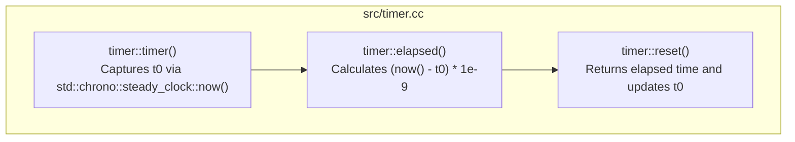
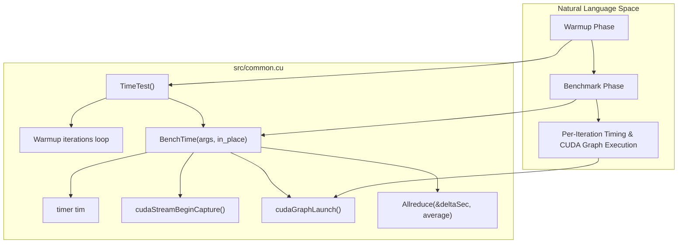
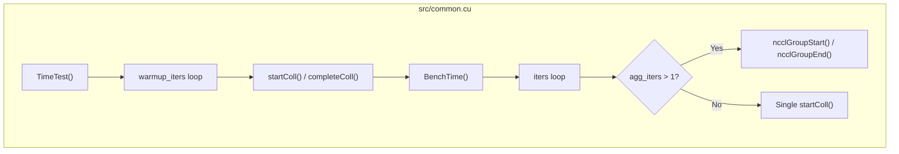
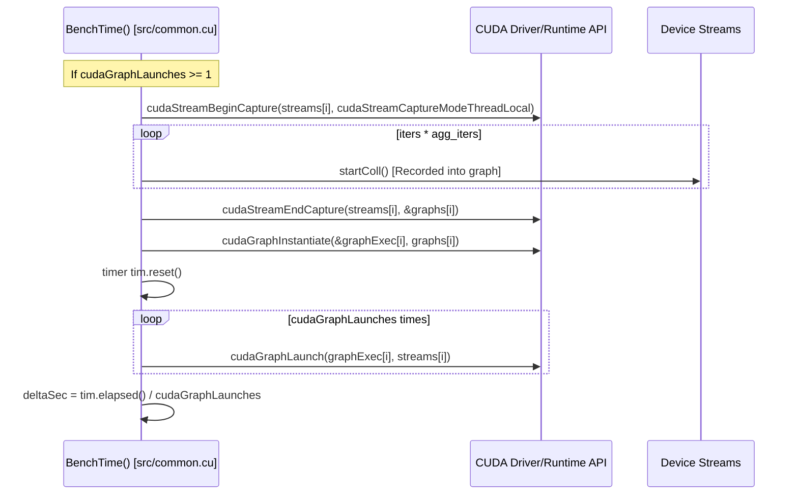

<!-- source: DeepWiki mcp.deepwiki.com · repo NVIDIA/nccl-tests · page 2.3 Performance Measurement · fetched 2026-11-11 -->

# Performance Measurement

Relevant source files

The following files were used as context for generating this wiki page:

- [doc/PERFORMANCE.md](doc/PERFORMANCE.md)
- [src/common.cu](src/common.cu)
- [src/timer.cc](src/timer.cc)
- [src/timer.h](src/timer.h)

## Purpose and Scope

This document details the performance measurement infrastructure in NCCL tests, covering high-resolution timing mechanisms (`src/timer.cc` / `src/timer.h`), test orchestration (`TimeTest()`, `BenchTime()` in `src/common.cu`), bandwidth formulas (algorithmic vs. bus bandwidth), per-iteration timing configurations, and CUDA graph capture/replay integration.

---

## Timing Mechanisms and Infrastructure

High-resolution timing relies on the `timer` class implemented in `src/timer.cc` and declared in `src/timer.h`. It wraps `std::chrono::steady_clock` to measure elapsed wall-clock or steady time in nanoseconds, converting the result to floating-point seconds.

### The `timer` Class (`src/timer.cc`)

- **`timer()`**: Initializes `t0` with the current steady clock epoch count [src/timer.cc:14-16]().
- **`elapsed()`**: Computes the difference between the current steady clock timestamp and `t0`, returning the duration in seconds [src/timer.cc:18-21]().
- **`reset()`**: Evaluates the elapsed time since the last reset or construction, updates `t0` to the current timestamp, and returns the elapsed duration [src/timer.cc:23-28]().

Sources: [src/timer.cc:1-28](), [src/timer.h:1-15]()

---

### Test Orchestration (`TimeTest`) and Execution (`BenchTime`)

The core execution loops are orchestrated by `TimeTest()` and executed by `BenchTime()`, both defined in `src/common.cu`.

Sources: [src/common.cu:523-711]()

---

## Bandwidth Calculations

NCCL tests compute and report two distinct bandwidth metrics: **Algorithmic Bandwidth** and **Bus Bandwidth**.

### Algorithmic Bandwidth (`algbw`)
Algorithmic bandwidth represents the effective data rate achieved by dividing the total transferred payload size $S$ by the elapsed time $t$ [doc/PERFORMANCE.md:16-20]():

$$\text{algbw} = \frac{S}{t}$$

### Bus Bandwidth (`busbw`)
Because collective operations distribute data across $n$ ranks with different communication patterns, raw algorithmic bandwidth does not directly scale with hardware link bandwidth. NCCL tests apply a collective-specific correction factor to compute **bus bandwidth**, representing the underlying hardware bus utilization [doc/PERFORMANCE.md:22-30]():

| Collective Operation | Correction Factor | Bus Bandwidth Formula (`busbw`) |
|----------------------|-------------------|--------------------------------|
| **AllReduce** | $\frac{2(n-1)}{n}$ | $\text{algbw} \times \frac{2(n-1)}{n}$ [doc/PERFORMANCE.md:63]() |
| **ReduceScatter** | $\frac{n-1}{n}$ | $\text{algbw} \times \frac{n-1}{n}$ [doc/PERFORMANCE.md:79]() |
| **AllGather** | $\frac{n-1}{n}$ | $\text{algbw} \times \frac{n-1}{n}$ [doc/PERFORMANCE.md:97]() |
| **AllToAll** | $\frac{n-1}{n}$ | $\text{algbw} \times \frac{n-1}{n}$ [doc/PERFORMANCE.md:143]() |
| **Broadcast** | $1$ | $\text{algbw} \times 1$ [doc/PERFORMANCE.md:141]() |
| **Reduce** | $1$ | $\text{algbw} \times 1$ [doc/PERFORMANCE.md:142]() |

Sources: [doc/PERFORMANCE.md:1-145]()

---

## Per-Iteration Timing and Iteration Control

Performance measurement relies on several loop control variables to filter out initialization overhead and stabilize measurements:

- **Warmup Iterations (`warmup_iters`)**: Unmeasured initial executions (`-w`) to prime caches, connection state, and routing tables [src/common.cu:96]().
- **Benchmark Iterations (`iters`)**: Number of timed collective operations (`-n`) [src/common.cu:97]().
- **Aggregated Iterations (`agg_iters`)**: Grouping multiple collective operations inside a single `ncclGroupStart()` / `ncclGroupEnd()` block (`-m`) [src/common.cu:98](), [src/common.cu:554-559]().
- **Run Cycles (`run_cycles`)**: Repetitions of the entire message-size sweep (`-N`) [src/common.cu:99]().

Sources: [src/common.cu:96-98](), [src/common.cu:523-560](), [src/common.cu:685-711]()

---

## CUDA Graph Integration

To minimize host-side CPU launch overhead, NCCL tests support capturing collective execution streams into CUDA graphs and replaying them via `cudaGraphLaunch()` [src/common.cu:109](), [src/common.cu:536-598]().

### CUDA Graph Capture and Replay Pipeline

Sources: [src/common.cu:109](), [src/common.cu:536-598]()

---

