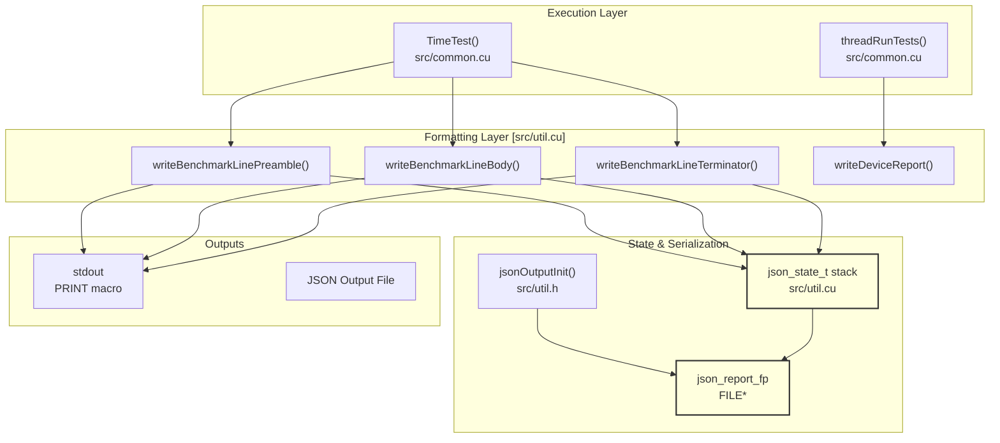
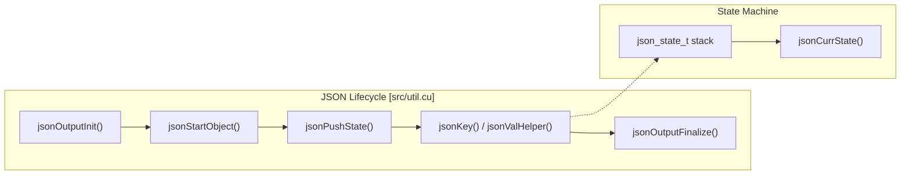
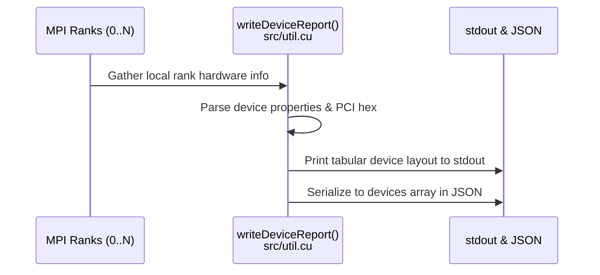

<!-- source: DeepWiki mcp.deepwiki.com · repo NVIDIA/nccl-tests · page 2.4 Output and Reporting · fetched 2026-11-11 -->

# Output and Reporting

Relevant source files

The following files were used as context for generating this wiki page:

- [src/util.cu](src/util.cu)
- [src/util.h](src/util.h)
- [tools/analyze_perf_json.py](tools/analyze_perf_json.py)

## Purpose and Scope

This page documents the output and reporting system in NCCL Tests, which provides a dual-output mechanism: human-readable tabular data to `stdout` and machine-readable JSON reports. The system handles formatting performance metrics, hardware device information, configuration parameters, and error reporting across single-node and distributed MPI environments.

For detailed information on related topics, see the following child pages:
- [NCCL Profiler Integration](#2.4.1) — Telemetry capture and tuning info via embedded profiler versions.
- [Performance JSON Analysis Tools](#2.4.2) — Usage of `tools/analyze_perf_json.py` for performance analysis.

For information about the performance measurement mechanisms that generate the reported data, see [Performance Measurement](#2.3). For details on data validation and error detection, see [Data Verification System](#2.6).

---

## System Overview

The output system maintains two parallel output streams during test execution:
1. **`stdout` Stream**: Formatted, fixed-width tables designed for human operators via `PRINT` macros in `src/util.cu` [src/util.cu:33-36]().
2. **JSON Stream**: Structured JSON documents initialized via `jsonOutputInit()` in `src/util.h` [src/util.h:25]() for automated ingestion and archival.

### Output System Architecture

**Sources**: [src/util.cu:33-58](), [src/util.h:25-45](), [src/common.cu:523-711]()

---

## JSON Output System

The JSON reporting system relies on a lightweight, libc-based serialization approach implemented in `src/util.cu` to avoid external library dependencies [src/util.cu:9-16](). 

### File Initialization and State Management

When `-J` or `--output_file` is specified, `jsonOutputInit()` attempts to open the target file with exclusive creation (`"wx"` mode). If the file already exists, it auto-increments a numeric suffix (e.g., `file.json.0`, `file.json.1`) to prevent accidental overwrites [src/util.h:25](). A stack-based state machine (`json_state_t`, `jsonPushState`, `jsonPopState`) tracks object nesting, list scopes, and comma separators [src/util.cu:103-202]().

Strings written to JSON are sanitized via `sanitizeJson()` to escape control characters, quotes, and backslashes while rejecting non-printable or non-ASCII characters [src/util.cu:125-166]().

**Sources**: [src/util.cu:103-254](), [src/util.h:25-31]()

---

## Benchmark Output Formatting

Benchmark execution writes results in a structured, three-phase sequence managed by functions declared in `src/util.h` [src/util.h:39-42]():

1. **Preamble**: `writeBenchmarkLinePreamble()` records message size in bytes, element count, data type, reduction operation, and root rank [src/util.h:39]().
2. **Body**: `writeBenchmarkLineBody()` is invoked twice per line—first for out-of-place and second for in-place configurations—logging execution time in microseconds, algorithm bandwidth (`algBw`), bus bandwidth (`busBw`), and error counts [src/util.h:42]().
3. **Terminator**: `writeBenchmarkLineTerminator()` finalizes the iteration count and experiment name [src/util.h:40]().

Adaptive floating-point formatting ensures numerical readability across scales from bytes to terabytes [src/util.cu:454-464]().

**Sources**: [src/util.h:39-43](), [src/util.cu:421-500]()

---

## Device Information Reporting

In distributed MPI runs, hardware configuration details (including CUDA device IDs, PCI bus addresses, GPU names, process IDs, and hostnames) are gathered from all participating ranks using `writeDeviceReport()` and summarized on rank 0 [src/util.h:45]().

**Sources**: [src/util.h:45](), [src/util.cu:380-417](), [src/util.cu:512-614]()

---

## NCCL Profiler Integration

NCCL Tests embeds profiler hooks (`ncclProfiler_v5`, `ncclProfiler_v6`, `ncclProfiler_v7`) to capture rich runtime telemetry during collective and point-to-point operations.

For detailed documentation on telemetry collection, proxy event tracking, and tuning parameter output, see [NCCL Profiler Integration](#2.4.1).

**Sources**: [src/util.cu:19-97](), [src/nccl_profiler.h:1-86]()

---

## Performance JSON Analysis Tools

To assist with large-scale performance evaluations, the test suite provides analysis scripts located in the `tools/` directory. 

For detailed usage instructions on analyzing per-iteration variance, slow processes (stragglers), timing spikes, and iteration-0 overheads using `tools/analyze_perf_json.py`, see [Performance JSON Analysis Tools](#2.4.2).

**Sources**: [tools/analyze_perf_json.py:1-359]()

---

