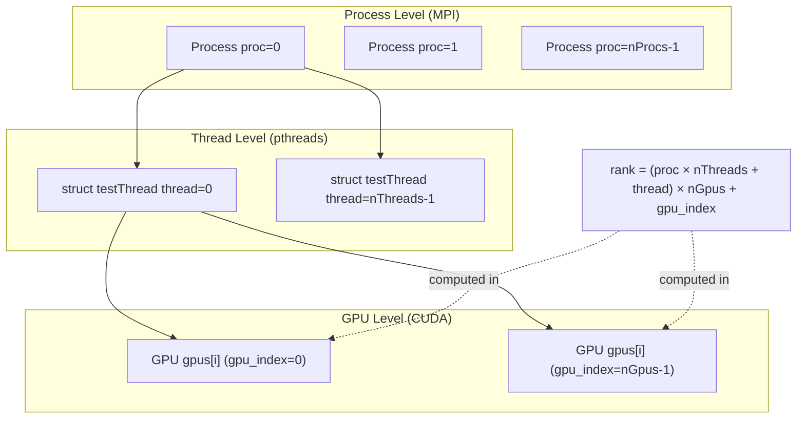
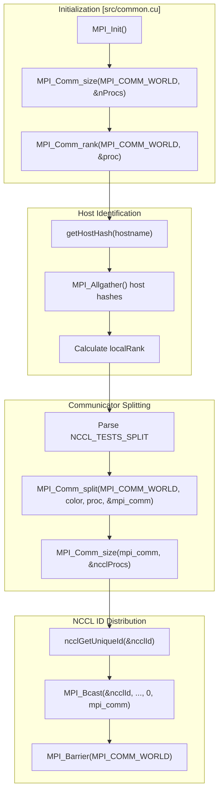
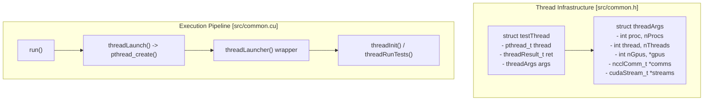
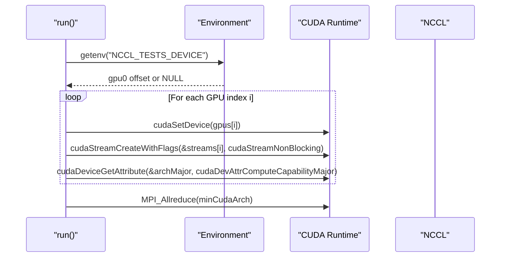
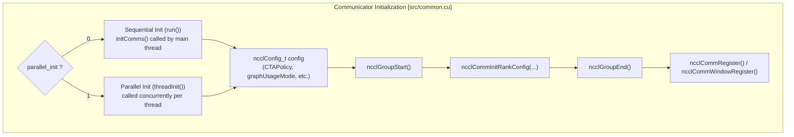

<!-- source: DeepWiki mcp.deepwiki.com · repo NVIDIA/nccl-tests · page 2.5 Multi-Process and Multi-GPU Support · fetched 2026-11-11 -->

# Multi-Process and Multi-GPU Support

<details>
<summary>Relevant source files</summary>

The following files were used as context for generating this wiki page:

- [src/common.cu](src/common.cu)

</details>


## Purpose and Scope

This document explains how NCCL Tests scales to large-scale distributed systems using a three-level parallelism hierarchy: **processes** (coordinated via MPI), **threads** (managed via pthreads within each process), and **GPUs** (assigned to each thread). This architecture enables performance benchmarking and correctness validation at massive scale across multi-node environments while maintaining precise control over communication channels, communicator configuration, and device assignment.

For details on the test orchestration pipeline running on each thread, see [Test Orchestration and Execution](#2.2). For performance measurement across distributed ranks, see [Performance Measurement](#2.3).

Sources: [src/common.cu:1-1959](), [README.md:31-46]()

---

## Hierarchical Parallelism Model

NCCL Tests implements a three-tier parallelism hierarchy where each level multiplies the total number of participating GPUs. The framework computes a unique global rank for each GPU using process, thread, and device identifiers.

### Rank Calculation Formula

```
rank = (proc × nThreads + thread) × nGpus + gpu_index
```

The total number of ranks across the global execution environment is defined as:

```
total_ranks = nProcs × nThreads × nGpus
```

**Parallelism Hierarchy and Code Entities**



Sources: [src/common.cu:440](), [src/common.cu:745](), [src/common.cu:1274](), [src/common.h:85-131]()

---

## MPI Integration

When compiled with `MPI=1`, NCCL Tests uses MPI for multi-node coordination, rank determination, and unique identifier dissemination.

### MPI Process Management and Initialization Flow



Sources: [src/common.cu:1084-1201]()

### MPI Synchronization Primitives

The framework wraps MPI synchronization within utility functions:
- `Barrier()` invokes `MPI_Barrier(MPI_COMM_WORLD)` after process-local pthread synchronization [src/common.cu:236-261]().
- `Allreduce<T>()` invokes `MPI_Allreduce(MPI_IN_PLACE, ...)` to aggregate metrics across processes [src/common.cu:266-320]().

Sources: [src/common.cu:236-320]()

---

## Multi-Threading Support

Processes spawn multiple threads via pthreads to drive separate CUDA streams and device contexts concurrently.

### Thread Management Structures

The framework defines `struct testThread` and `struct threadArgs` to encapsulate execution state per thread:



Sources: [src/common.h:85-131](), [src/common.cu:793-801](), [src/common.cu:1327-1369]()

### Thread-Local Variables

- `is_main_thread` is a `thread_local int` variable that identifies the primary thread responsible for logging output and initialization [src/common.cu:85]().
- `epoch` tracks alternating phases in the thread barrier implementation [src/common.cu:237]().

Sources: [src/common.cu:77](), [src/common.cu:237](), [src/common.cu:268]()

---

## Multi-GPU Management

Each thread manages a subset of GPUs (`nGpus`), initializing distinct CUDA streams, memory buffers, and NCCL communicators for each device.

### GPU Allocation and Assignment Flow

By default, GPUs are assigned sequentially. The `NCCL_TESTS_DEVICE` environment variable can override the starting GPU index.



Sources: [src/common.cu:803-814](), [src/common.cu:1211-1227]()

---

## NCCL Communicator Initialization

Communicators can be initialized via **sequential** (default) or **parallel** (`-p 1`) modes [src/common.cu:103]().

### Initialization Code Flow



Sources: [src/common.cu:200-230](), [src/common.cu:722-791](), [src/common.cu:1259-1312]()

---

## GPU Partitioning with NCCL_TESTS_SPLIT

The `NCCL_TESTS_SPLIT` environment variable splits `MPI_COMM_WORLD` into sub-communicators using bitwise or arithmetic mask operations (`AND`, `OR`, `MOD`, `DIV`) [src/common.cu:1142-1166]().

- **Inter-node splitting**: `NCCL_TESTS_SPLIT="MOD 8"` isolates processes across distinct node ranks into separate groups [README.md:86-104]().
- **Intra-node splitting**: `NCCL_TESTS_SPLIT="DIV 8"` creates independent groups local to each node [README.md:86-104]().

Sources: [src/common.cu:1142-1166](), [README.md:86-104]()

---

## Synchronization Mechanisms

### Barrier Implementation

The `Barrier()` function implements a two-level coordination scheme:
1. **Thread-local phase**: Threads within a process increment an atomic counter under a mutex and wait on a condition variable (`pthread_cond_wait`) [src/common.cu:236-261]().
2. **MPI phase**: The last arriving thread executes `MPI_Barrier(MPI_COMM_WORLD)` before broadcasting release to sibling threads [src/common.cu:236-261]().

Sources: [src/common.cu:236-261]()

### Allreduce Template

The `Allreduce<T>()` template aggregates statistics (sum, min, max, average) across all participating threads and processes by combining pthread reduction loops with `MPI_Allreduce` [src/common.cu:266-320]().

Sources: [src/common.cu:266-320]()

---

## Command-Line Arguments and Usage Examples

| Argument | Short | Description | Default |
|----------|-------|-------------|---------|
| `--nthreads` | `-t` | Number of threads per process | `1` [src/common.cu:89]() |
| `--ngpus` | `-g` | Number of GPUs per thread | `1` [src/common.cu:90]() |
| `--parallel_init` | `-p` | Use parallel communicator initialization | `0` [src/common.cu:103]() |
| `--average` | `-a` | Report average across ranks (0=rank0, 1=avg, 2=min, 3=max) | `1` [src/common.cu:122]() |

### Usage Examples

- **Single Node, 8 GPUs**:
  ```bash
  ./build/all_reduce_perf -g 8
  ```
- **Multi-Node MPI Execution**:
  ```bash
  mpirun -np 8 -N 8 ./build/all_reduce_perf -g 1
  ```
- **Partitioned Distributed Execution**:
  ```bash
  NCCL_TESTS_SPLIT="MOD 8" mpirun -np 64 ./build/all_reduce_perf -g 1
  ```

Sources: [src/common.cu:89-122](), [README.md:33-46](), [README.md:86-104]()

---

