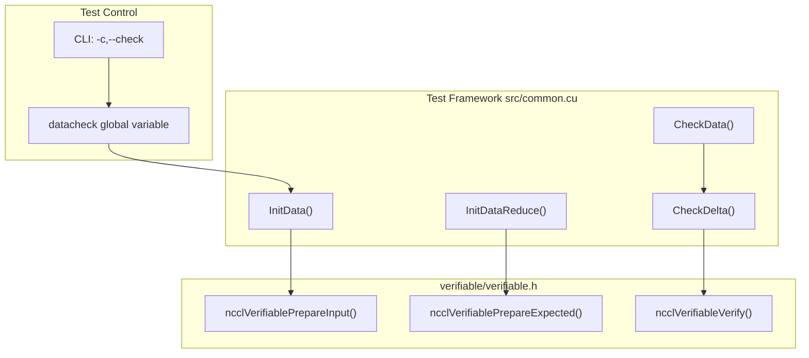
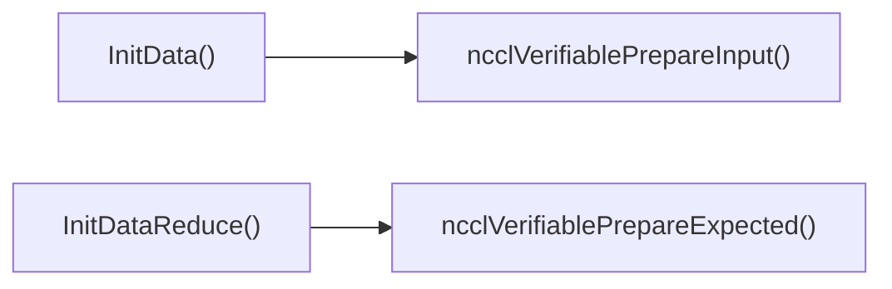
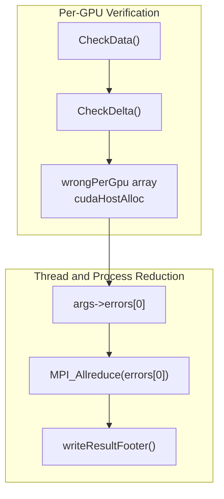
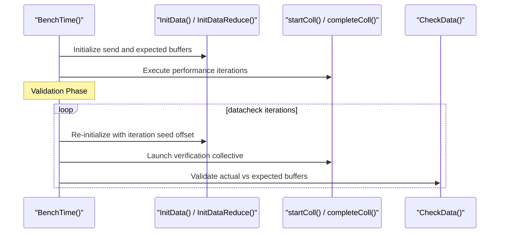

<!-- source: DeepWiki mcp.deepwiki.com · repo NVIDIA/nccl-tests · page 2.6 Data Verification System · fetched 2026-11-11 -->

# Data Verification System

Relevant source files

The following files were used as context for generating this wiki page:

- [src/common.mk](src/common.mk)
- [verifiable/Makefile](verifiable/Makefile)
- [verifiable/inexact_regress.cu](verifiable/inexact_regress.cu)
- [verifiable/main.cu](verifiable/main.cu)
- [verifiable/verifiable.cu](verifiable/verifiable.cu)
- [verifiable/verifiable.h](verifiable/verifiable.h)
- [verifiable/verifiable.mk](verifiable/verifiable.mk)

## Purpose and Scope

The Data Verification System ensures the correctness of NCCL collective operations by generating deterministic test data and validating that actual results match mathematically expected outcomes. This system detects data corruption, race conditions, and logical errors in collective communication patterns across GPUs and nodes.

For performance measurement details, see [Performance Measurement](#2.3). For error reporting and output formatting, see [Output and Reporting](#2.4).

Sources: `[verifiable/verifiable.h:8-10](), [src/common.cu:86]()`

---

## Overview

The verification system operates through three primary phases:
1. **Data Generation**: Deterministic initialization of send buffers using rank-specific patterns and seeds via `ncclVerifiablePrepareInput` `[verifiable/verifiable.h:37-40]()`.
2. **Execution**: Running the target collective operation under test `[src/common.cu:553-598]()`.
3. **Validation**: Comparing actual output buffers against expected results computed independently via `ncclVerifiableVerify` `[verifiable/verifiable.h:54-58]()`.

This workflow is controlled globally by the `datacheck` configuration variable and adjusted via the `-c,--check` command-line flag.

Sources: `[verifiable/verifiable.h:37-58](), [src/common.cu:86]()`

---

## System Architecture

Sources: `[verifiable/verifiable.h:37-58](), [src/common.cu:220-234]()`

---

## Deterministic Data Generation and the Verifiable Subsystem

The verification logic resides in an external subsystem located in `verifiable/` and exposed through `verifiable/verifiable.h`. It carefully crafts floating-point and integer inputs to produce predictable outputs during reduction and communication operations `[verifiable/verifiable.h:8-10]()`.

### Core API Functions

* `ncclVerifiablePrepareInput`: Enqueues a CUDA kernel to generate rank-specific input data in a GPU buffer based on a seed, rank ID, offset, data type (`elt_ty`), and operation (`red_op`) `[verifiable/verifiable.h:37-40]()`.
* `ncclVerifiablePrepareExpected`: Enqueues a kernel to compute the expected mathematical result of a reduction operation across all ranks `[verifiable/verifiable.h:43-46]()`.
* `ncclVerifiableVerify`: Performs element-wise verification between the actual results and expected buffers, writing the number of failed elements to host memory (`bad_elt_n`) `[verifiable/verifiable.h:54-58]()`.
* `ncclVerifiableLaunchSelfTest`: Executes internal self-tests when compiled with `NCCL_VERIFIABLE_SELF_TEST` `[verifiable/verifiable.h:60-62]()`.

Sources: `[verifiable/verifiable.h:31-62]()`

---

## Data Initialization and Validation Functions

The test orchestration layer bridges framework data structures with the verifiable subsystem through wrapper functions defined in `src/common.cu`.

### `InitData` and `InitDataReduce`

`InitData()` wraps `ncclVerifiablePrepareInput()` to populate send buffers prior to test execution `[src/common.cu:231-234]()`. `InitDataReduce()` invokes `ncclVerifiablePrepareExpected()` to precompute expected results for validation `[src/common.cu:226-229]()`.

Sources: `[src/common.cu:220-234]()`

### `CheckDelta` and `CheckData`

`CheckDelta()` serves as an inline wrapper around `ncclVerifiableVerify()` followed by a device synchronization call `[src/common.cu:220-224]`. `CheckData()` iterates across all active GPUs, handles in-place buffer offset calculations, invokes `CheckDelta()`, and aggregates error counts using pinned host memory (`cudaHostAlloc`) `[src/common.cu:322-367]()`.

Sources: `[src/common.cu:220-224](), [src/common.cu:322-367]()`

---

## Error Reporting and Aggregation

1. **Detection**: `CheckData()` evaluates results per GPU and flags mismatches into `wrongPerGpu` `[src/common.cu:326-365]()`.
2. **Thread Accumulation**: Mismatches increment the thread's error counter (`args->errors[0]`) `[src/common.cu:365]()`.
3. **Process Reduction**: MPI collectives aggregate error metrics across distributed nodes via `MPI_Allreduce` `[src/common.cu:1382-1384]()`.
4. **Final Reporting**: `writeResultFooter()` checks the final error count and exits with a non-zero status if verification fails `[src/common.cu:1422]()`.

Sources: `[src/common.cu:322-367](), [src/common.cu:1382-1384](), [src/common.cu:1422]()`

---

## Integration with Test Execution

Data verification runs optionally after performance benchmarking iterations complete inside `BenchTime()` `[src/common.cu:523-669]()`.

Sources: `[src/common.cu:523-669]()`

---

## Configuration Options and Supported Types

The verification system supports all standard NCCL data types (`int8`, `uint8`, `int32`, `uint32`, `int64`, `uint64`, `half`, `float`, `double`, `bfloat16`, and `float8` types) and reduction operators (`sum`, `prod`, `max`, `min`, `avg`, and `mulsum`) [src/common.cu:32-69](). Pre-multiplied sum operations (`PreMulSum`) automatically utilize rank-specific scaling via `ncclVerifiablePremulScalar` `[verifiable/verifiable.h:30-34](), [src/common.cu:448-481]()`.

Sources: `[verifiable/verifiable.h:30-34](), [src/common.cu:32-69](), [src/common.cu:448-481]()`

---

