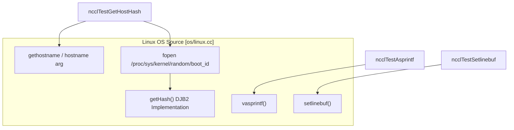
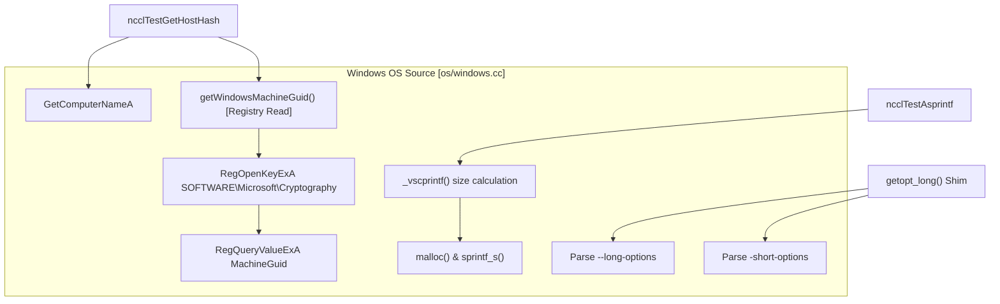
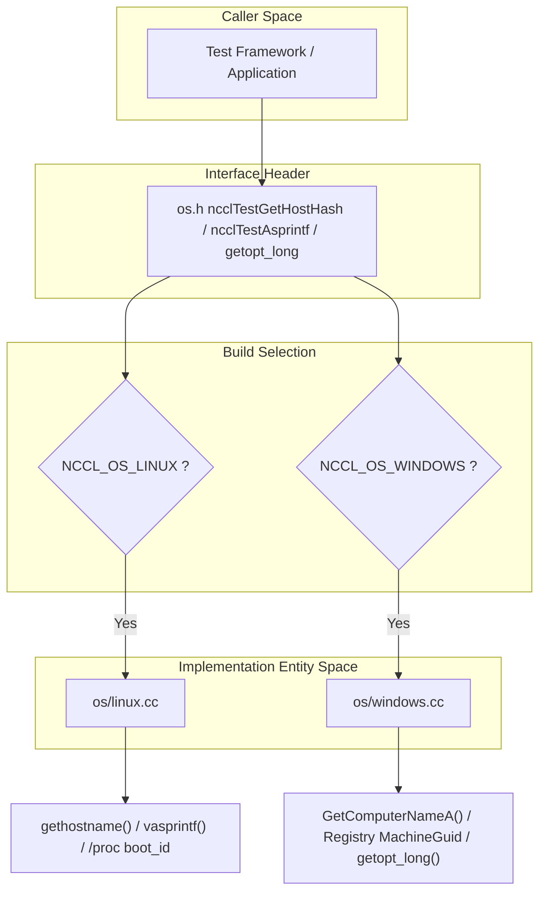

<!-- source: DeepWiki mcp.deepwiki.com · repo NVIDIA/nccl-tests · page 2.7 Platform Abstraction Layer · fetched 2026-11-11 -->

# Platform Abstraction Layer

Relevant source files

The following files were used as context for generating this wiki page:

- [os/CMakeLists.txt](os/CMakeLists.txt)
- [os/Makefile](os/Makefile)
- [os/linux.cc](os/linux.cc)
- [os/os.h](os/os.h)
- [os/windows.cc](os/windows.cc)

The Platform Abstraction Layer (`os/`) provides a unified, cross-platform interface that isolates operating system-dependent system calls, string operations, environment helpers, and command-line parsing routines. This design enables the `nccl-tests` suite to build and execute natively on both Linux and Windows environments without polluting core benchmarking logic with platform-specific conditional compilation.

---

## 1. Interface Definitions

The public contract of the Platform Abstraction Layer is declared in `[os/os.h:1-30]()`. It exposes a standard set of `C`-compatible functions wrapped in `extern "C"` linkage blocks to support mixed C/C++ compilation units across the test framework.

The primary abstraction targets include:
- **Host Identification**: Hashing hostnames combined with unique machine identifiers.
- **Process and Hostname Queries**: Retrieving standard OS hostnames and process IDs.
- **String Manipulations**: Case-insensitive comparisons and safe dynamic string formatting (`asprintf` equivalents).
- **Stream Buffering**: Configuring line buffering on standard I/O streams.
- **Command-Line Parsing Shims**: Providing `getopt_long` support on platforms (such as Windows) where it is natively absent.

Sources: `[os/os.h:1-30]()`

---

## 2. Linux Implementation Details

On Linux targets (`NCCL_OS_LINUX`), the abstraction layer leverages standard POSIX and Linux-specific system files [[os/linux.cc:1-71]()]:

- **Host Hashing (`ncclTestGetHostHash`)**: Combines the input hostname with the unique system boot identifier read from `[os/linux.cc:14-14]()` (`/proc/sys/kernel/random/boot_id`), passing the concatenated string through a DJB2-variant hash function `getHash()` [[os/linux.cc:16-43]()].
- **Process & Host Utilities**: Implemented directly using POSIX primitives `gethostname()` [[os/linux.cc:45-47]()], `getpid()` [[os/linux.cc:49-51]()], case-insensitive string comparisons `strcasecmp`/`strncasecmp` [[os/linux.cc:53-59]()], and GNU extension `vasprintf()` for `ncclTestAsprintf` [[os/linux.cc:61-67]()].
- **Buffering**: Maps `ncclTestSetlinebuf` directly to the standard `setlinebuf()` call [[os/linux.cc:69-71]()].

Sources: `[os/linux.cc:1-71]()`

---

## 3. Windows Implementation and Compatibility Shims

On Windows targets (`NCCL_OS_WINDOWS`), the abstraction layer bridges POSIX semantics to Win32 API equivalents [[os/windows.cc:1-225]()]:

- **Host Hashing (`ncclTestGetHostHash`)**: Concatenates the hostname with the Windows Machine GUID retrieved from the Windows Registry key `SOFTWARE\Microsoft\Cryptography` under `MachineGuid` [[os/windows.cc:22-61]()].
- **Win32 Mappings**: Maps hostname retrieval to `GetComputerNameA()` [[os/windows.cc:63-69]()], process ID to `GetCurrentProcessId()` [[os/windows.cc:71-73]()], string comparisons to `_stricmp` and `_strnicmp` [[os/windows.cc:75-81]()], and dynamic formatting using `_vscprintf` and `sprintf_s` [[os/windows.cc:83-101]()].
- **`getopt_long` Implementation**: Because Windows lacks native `getopt_long`, `[os/windows.cc:116-223]()` provides a complete stateful implementation parsing both short options and long options (with `--opt=val` or `--opt val` syntax).

Sources: `[os/windows.cc:1-225]()`

---

## 4. Architecture and Code Entity Mapping

The following diagram illustrates how build configurations select between `linux.cc` and `windows.cc`, mapping abstract API requests to the corresponding concrete execution path.

Sources: `[os/os.h:1-71]()`, `[os/linux.cc:1-71]()`, `[os/windows.cc:1-225]()`

---

## 5. Build Integration

The OS abstraction layer is compiled into a standalone static archive (`libnccl_test_os.a` or `nccl_test_os`) which is linked by the primary test binaries. Both Make and CMake build systems handle OS detection to select the appropriate compilation source:

- **Make Integration**: Checks if `$(OS)` equals `Windows_NT` to select `windows.cc`, otherwise defaulting to `linux.cc` [[os/Makefile:14-18]()]. Compiles into `${BUILDDIR}/libnccl_test_os.a` [[os/Makefile:22-35]()].
- **CMake Integration**: Evaluates `NCCL_OS_LINUX` and `NCCL_OS_WINDOWS` flags to configure `nccl_test_os` as a static library target [[os/CMakeLists.txt:9-17]()].

Sources: `[os/Makefile:1-35]()`, `[os/CMakeLists.txt:1-24]()`

---

