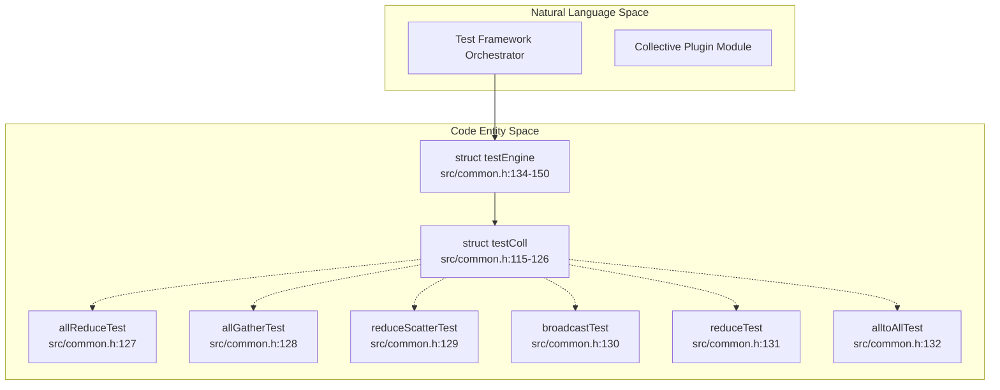
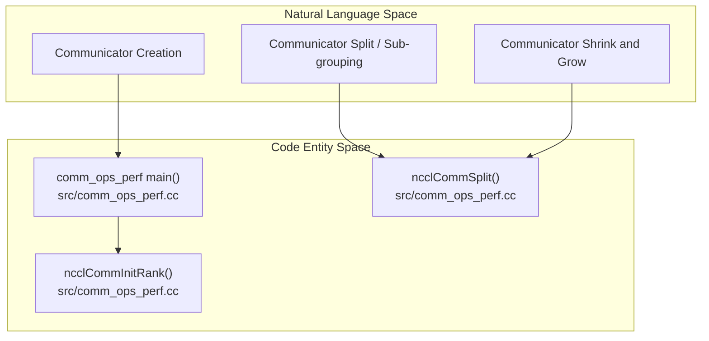

<!-- source: DeepWiki mcp.deepwiki.com · repo NVIDIA/nccl-tests · page 3 Collective Operations · fetched 2026-11-11 -->

# Collective Operations

Relevant source files

The following files were used as context for generating this wiki page:

- [src/common.h](src/common.h)

This page provides an overview of the collective communication operations tested by the NCCL Tests suite and how they integrate with the core testing framework. Each collective operation is encapsulated as a standardized interface entity that allows the framework to execute performance benchmarks, initialize input data, compute algorithmic and bus bandwidths, and validate correctness across distributed ranks.

For detailed documentation, implementation mechanics, and performance characteristics of individual operations, follow the links to each child page below.

## 3.1 Plugin Architecture

The NCCL Tests framework employs a plugin-based architecture centered around the `struct testColl` interface defined in [src/common.h:115-126](). This structure defines function pointers for byte count calculations (`getCollByteCount`), data initialization (`initData`), bandwidth computation (`getBw`), and collective execution (`runColl`). Individual collective binaries bind to these interfaces at compile time using weak symbols via `struct testEngine` [src/common.h:134-150]().

**Diagram: Collective Interface Bridge to Code Entities**

For details, see [Plugin Architecture](#3.1).

Sources: [src/common.h:115-150]()

---

## 3.2 AllReduce

The AllReduce collective operation computes a reduction across data provided by all ranks and distributes the final result back to every rank. It is represented in the framework by `allReduceTest` [src/common.h:127](). The implementation supports multiple kernel variants including LSA, vectorized loads/stores, and multimem operations.

For details, see [AllReduce](#3.2).

Sources: [src/common.h:127-127]()

---

## 3.3 AllGather

The AllGather operation gathers data chunks from every rank and distributes the concatenated result to all participating ranks. Managed via `allGatherTest` [src/common.h:128](), the test harness handles buffer allocation offsets, multi-GPU synchronization, and precise bus bandwidth calculations.

For details, see [AllGather](#3.3).

Sources: [src/common.h:128-128]()

---

## 3.4 AllToAll

The AllToAll collective allows each rank to send distinct data segments to every other rank in the communicator. The benchmark is implemented through `alltoAllTest` [src/common.h:132](), supporting multiple kernel variants such as NVL, GIN, and hybrid execution paths, alongside irregular AllToAllv patterns.

For details, see [AllToAll](#3.4).

Sources: [src/common.h:132-132]()

---

## 3.5 ReduceScatter

The ReduceScatter operation performs a reduction across all rank inputs and scatters different segments of the reduced result to respective ranks. It is exposed through `reduceScatterTest` [src/common.h:129](), which manages buffer offset arithmetic and reduction operation types.

For details, see [ReduceScatter](#3.5).

Sources: [src/common.h:129-129]()

---

## 3.6 Broadcast

The Broadcast operation transmits data from a designated root rank to all other ranks within the communicator. Configured via `broadcastTest` [src/common.h:130](), the framework validates root rank handling, in-place buffer overlays, and API compatibility across NCCL versions.

For details, see [Broadcast](#3.6).

Sources: [src/common.h:130-130]()

---

## 3.7 Reduce

The Reduce collective aggregates data from all participating ranks using a specified reduction operator and stores the accumulated outcome on a single root rank. The benchmark is driven by `reduceTest` [src/common.h:131](), handling non-root receive buffer management and bandwidth derivation.

For details, see [Reduce](#3.7).

Sources: [src/common.h:131-131]()

---

## 3.8 Gather

The Gather collective collects data chunks from each rank and assembles them sequentially on a root rank. The implementation integrates version compatibility layers (switching between native `ncclGather` and manual send/recv sequences) to support varying NCCL releases.

For details, see [Gather](#3.8).

Sources: [src/common.h:115-126]()

---

## 3.9 Scatter

The Scatter operation distributes distinct blocks of data from a root rank out to all other ranks. It acts as the inverse operation to Gather, utilizing symmetric buffer layouts and matching memory initialization routines.

For details, see [Scatter](#3.9).

Sources: [src/common.h:115-126]()

---

## 3.10 SendRecv

The SendRecv operation tests point-to-point communication semantics by simultaneously issuing send and receive requests between pairs of ranks, validating low-level network and device queue behavior.

For details, see [SendRecv](#3.10).

Sources: [src/common.h:115-126]()

---

## 3.11 Hypercube

The Hypercube collective pattern executes communication phases structured around a logical hypercube topology, verifying routing efficiency and multi-dimensional fabric performance.

For details, see [Hypercube](#3.11).

Sources: [src/common.h:115-126]()

---

## 3.12 Communicator Operations Benchmark

The `comm_ops_perf` utility benchmarks core communicator lifecycle operations—including initialization, splitting, shrinking, and growing communicators—measuring control-plane latency across MPI and NCCL runtimes.

**Diagram: Communicator Operation Benchmark Flow**

For details, see [Communicator Operations Benchmark](#3.12).

Sources: [src/common.h:11-32]()

---

