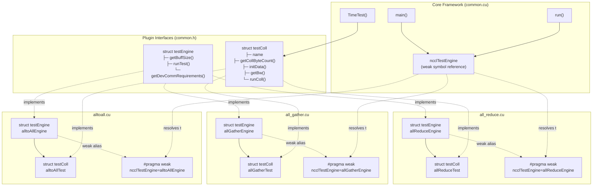
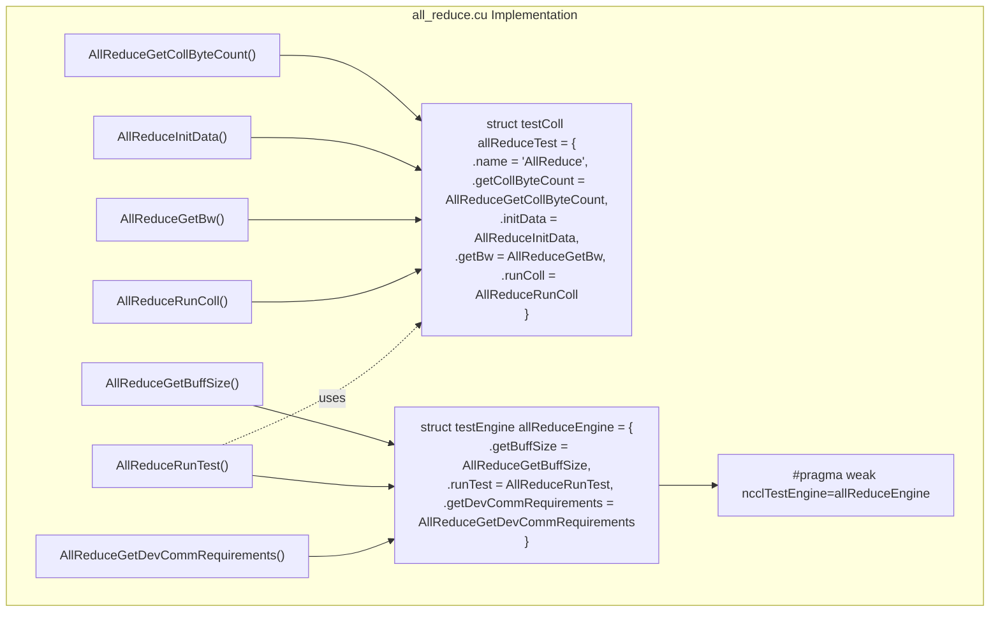
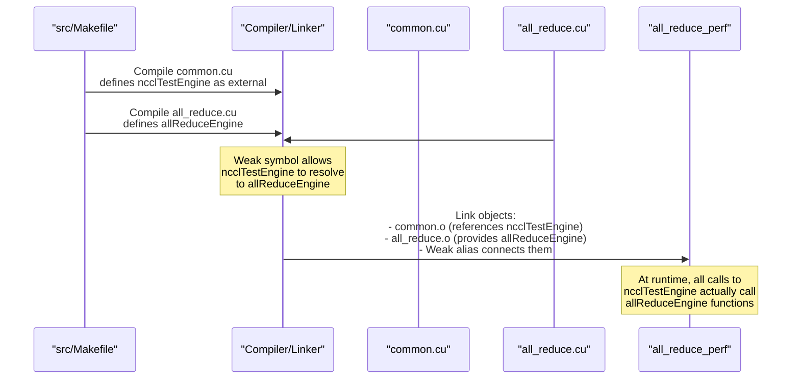
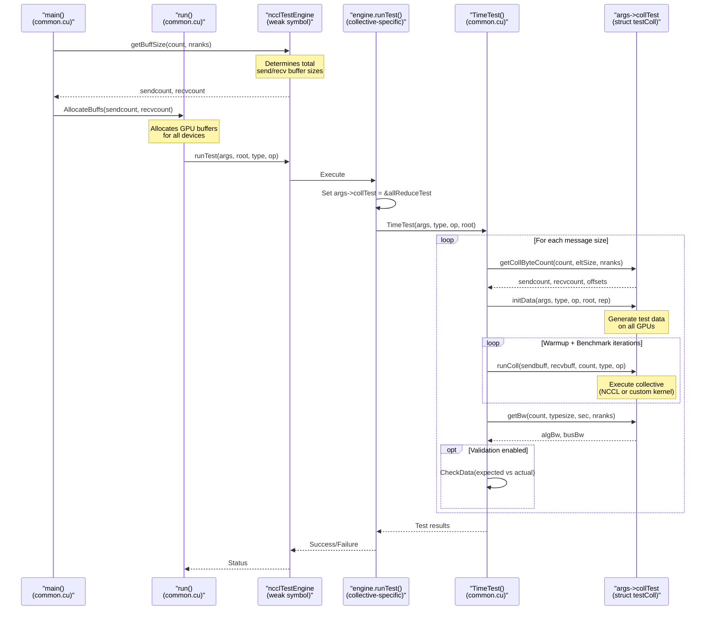
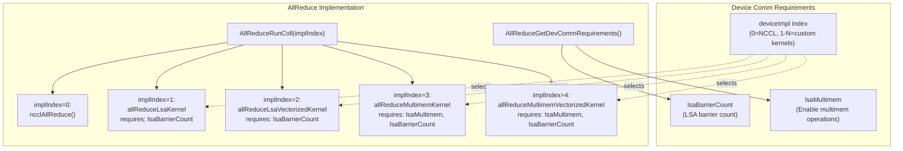

<!-- source: DeepWiki mcp.deepwiki.com · repo NVIDIA/nccl-tests · page 3.1 Plugin Architecture · fetched 2026-11-11 -->

# Plugin Architecture

<details>
<summary>Relevant source files</summary>

The following files were used as context for generating this wiki page:

- [src/Makefile](src/Makefile)
- [src/alltoallv.cu](src/alltoallv.cu)
- [src/common.h](src/common.h)

</details>


## Purpose and Scope

This document explains the plugin architecture that enables NCCL Tests to support multiple collective operations through a uniform interface. Each collective operation (AllReduce, AllGather, Broadcast, etc.) plugs into the core testing framework by implementing two standard interfaces: `testColl` and `testEngine`. The weak symbol linking mechanism allows each binary to contain only one collective implementation, selected at compile time.

For information about the test execution pipeline that uses these interfaces, see [Test Orchestration and Execution](#2.2). For details on the build system that generates per-collective binaries, see [Binary Generation and Linking](#6.2).

---

## Architecture Overview

The plugin architecture separates collective-specific logic from the generic test framework. The framework in `common.cu` orchestrates tests without knowing which collective is being executed, while each collective operation file (e.g., `all_reduce.cu`, `all_gather.cu`) provides the collective-specific implementation.



Sources: `src/common.h:115-151]`, `src/all_reduce.cu:496-552`

---

## Core Interfaces

### testColl Interface

The `testColl` interface defines collective-specific operations required for testing. Each collective operation must implement this interface to integrate with the framework.

| Field/Method | Type | Purpose |
|--------------|------|---------|
| `name` | `char[20]` | Human-readable name of the collective (e.g., "AllReduce") |
| `getCollByteCount` | Function pointer | Calculates send/recv buffer sizes and in-place offsets |
| `initData` | Function pointer | Initializes test data with deterministic patterns |
| `getBw` | Function pointer | Calculates algorithmic and bus bandwidth metrics |
| `runColl` | Function pointer | Executes the actual collective operation (NCCL API or custom kernel) |

**Signature Details:**

```c
struct testColl {
  const char name[20];
  void (*getCollByteCount)(
      size_t *sendcount, size_t *recvcount, size_t *paramcount,
      size_t *sendInplaceOffset, size_t *recvInplaceOffset,
      size_t count, size_t eltSize, int nranks);
  testResult_t (*initData)(struct threadArgs* args, ncclDataType_t type,
      ncclRedOp_t op, int root, int rep, int in_place);
  void (*getBw)(size_t count, size_t typesize, double sec, double* algBw, double* busBw, int nranks);
  testResult_t (*runColl)(void* sendbuff, size_t sendoffset, void* recvbuff, size_t recvoffset,
      size_t count, ncclDataType_t type, ncclRedOp_t op, int root, ncclComm_t comm, cudaStream_t stream, int implIndex);
};
```

Sources: `src/common.h:115-126`

### testEngine Interface

The `testEngine` interface provides high-level test orchestration. It bridges the framework to the collective-specific implementation.

| Method | Purpose |
|--------|---------|
| `getBuffSize` | Determines total send/recv buffer allocations before test execution |
| `runTest` | Top-level test execution across all data types and operations |
| `initCommConfig` | Optional configuration hook called from `initComms` |
| `getDevCommRequirements` | (NCCL 2.28+) Specifies device communicator requirements for custom kernels |

**Signature Details:**

```c
struct testEngine {
  void (*getBuffSize)(size_t *sendcount, size_t *recvcount, size_t count, int nranks);
  testResult_t (*runTest)(struct threadArgs* args, int root, ncclDataType_t type,
      const char* typeName, ncclRedOp_t op, const char* opName);
#if NCCL_VERSION_CODE >= NCCL_VERSION(2,14,0)
  void (*initCommConfig)(ncclConfig_t* config);
#endif
#if NCCL_VERSION_CODE >= NCCL_VERSION(2,29,0)
  testResult_t (*getDevCommRequirements)(int deviceImpl, ncclDevCommRequirements* reqs, ncclComm_t comm);
#elif NCCL_VERSION_CODE >= NCCL_VERSION(2,28,0)
  bool (*getDevCommRequirements)(int deviceImpl, ncclDevCommRequirements* reqs);
#endif
};
```

Sources: `src/common.h:134-148`

### External Declarations

The framework declares external references to all collective implementations, allowing them to be used when linked:

```c
extern struct testColl allReduceTest;
extern struct testColl allGatherTest;
extern struct testColl reduceScatterTest;
extern struct testColl broadcastTest;
extern struct testColl reduceTest;
extern struct testColl alltoAllTest;

extern struct testEngine ncclTestEngine;
```

Sources: `src/common.h:127-133`, `src/common.h:150`

---

## Implementation Pattern

Each collective operation follows a standard implementation pattern. Here is the complete pattern using AllReduce as an example:



Sources: `src/all_reduce.cu:34-552`

### Method Implementation Responsibilities

#### getCollByteCount()
Calculates buffer sizes based on collective semantics. For example:
- **AllReduce**: `sendcount = recvcount = count` (same size for send/recv)
- **AllGather**: `sendcount = count, recvcount = count * nranks` (gather increases size)
- **ReduceScatter**: `sendcount = count * nranks, recvcount = count` (scatter reduces size)

Sources: `src/all_reduce.cu:34-40`

#### initData()
Generates deterministic test data on all GPUs. The data must be reproducible for verification. Typically:
1. Sets device context for each GPU
2. Zeros receive buffers
3. Initializes send buffers with pattern based on rank, iteration, and seed
4. Computes expected results for validation

Sources: `src/all_reduce.cu:42-57`

#### getBw()
Calculates bandwidth metrics:
- **Algorithmic bandwidth**: Total data moved by the algorithm
- **Bus bandwidth**: Actual bus utilization accounting for network topology

The formula varies by collective. AllReduce uses factor `2*(nranks-1)/nranks` to account for reduction tree communication patterns.

Sources: `src/all_reduce.cu:59-65`

#### runColl()
Executes the collective operation. This method typically:
1. Adjusts pointers for send/recv offsets
2. Selects implementation based on `implIndex` (0=NCCL API, 1+=custom kernels)
3. Invokes NCCL API or launches custom CUDA kernel
4. Returns success/failure status

Sources: `src/all_reduce.cu:464-494`

#### runTest()
Orchestrates test execution across data types and operations:
1. Sets `args->collTest` pointer to the `testColl` struct
2. Determines type/operation combinations to test
3. Calls `TimeTest()` for each combination

Sources: `src/all_reduce.cu:509-542`

---

## Weak Symbol Mechanism

The weak symbol mechanism enables compile-time selection of which collective is included in each binary. This is the key to having separate `all_reduce_perf`, `all_gather_perf`, etc. executables without duplicating the entire framework code.

### How It Works



Sources: `src/all_reduce.cu:552`

### Weak Symbol Declaration

Each collective operation file ends with this pragma:

```c
#pragma weak ncclTestEngine=allReduceEngine
```

This directive tells the linker:
- If no strong symbol for `ncclTestEngine` exists, use `allReduceEngine` as the definition
- Since each binary links exactly one collective file, that collective's engine becomes `ncclTestEngine`
- The framework code in `common.cu` references `ncclTestEngine` without knowing which concrete implementation is linked

Sources: `src/all_reduce.cu:552`

### Per-Binary Compilation

The build system generates separate binaries by linking different collective files:

| Binary | Linked Collective File | Weak Symbol Resolution |
|--------|------------------------|------------------------|
| `all_reduce_perf` | `all_reduce.o` | `ncclTestEngine` → `allReduceEngine` |
| `all_gather_perf` | `all_gather.o` | `ncclTestEngine` → `allGatherEngine` |
| `alltoall_perf` | `alltoall.o` | `ncclTestEngine` → `alltoAllEngine` |
| `broadcast_perf` | `broadcast.o` | `ncclTestEngine` → `broadcastEngine` |
| `reduce_perf` | `reduce.o` | `ncclTestEngine` → `reduceEngine` |
| `reduce_scatter_perf` | `reduce_scatter.o` | `ncclTestEngine` → `reduceScatterEngine` |

All binaries share `common.o`, `util.o`, `timer.o`, but each contains only one collective implementation.

Sources: `src/all_reduce.cu:552`, `src/Makefile:44-70`

---

## Data Flow Through Interfaces

The following diagram illustrates how data and control flow through the plugin interfaces during test execution:



Sources: `src/common.h:115-151`, `src/all_reduce.cu:509-542`

---

## threadArgs Data Structure

The `threadArgs` structure is the primary data container passed through the plugin interfaces. It contains all state needed for test execution:

| Field Category | Key Fields | Purpose |
|----------------|------------|---------|
| **Test Parameters** | `nbytes`, `minbytes`, `maxbytes`, `stepbytes`, `stepfactor` | Message size sweep configuration |
| **Parallel Execution** | `totalProcs`, `nProcs`, `proc`, `nThreads`, `thread`, `nGpus`, `gpus`, `localRank` | MPI/thread/GPU topology |
| **Memory Buffers** | `sendbuffs`, `recvbuffs`, `expected`, `sendBytes`, `recvInplaceOffset` | GPU memory for test data |
| **NCCL Resources** | `ncclId`, `comms`, `devComms`, `streams` | NCCL communicators and CUDA streams |
| **Results** | `errors`, `bw`, `bw_count`, `reportErrors` | Validation errors and bandwidth measurements |
| **Plugin Reference** | `collTest` | Pointer to the `testColl` struct for this collective |
| **Registration** | `sendRegHandles`, `recvRegHandles` | (NCCL 2.19+) Memory registration handles for RDMA |

Sources: `src/common.h:152-199`

---

## Custom Kernel Support

For NCCL 2.28+, the plugin architecture supports custom device kernels through the `getDevCommRequirements()` method. This allows collectives to specify device communicator requirements:



**Implementation Example:**

The `getDevCommRequirements()` method specifies what device communicator features are needed:

```c
bool AllReduceGetDevCommRequirements(int deviceImpl, ncclDevCommRequirements* reqs) {
  if (!reqs) return false;
  memset(reqs, 0, sizeof(*reqs));

  switch(deviceImpl) {
    case 1: // allReduceLsaKernel
    case 2: // allReduceLsaVectorizedKernel
      reqs->lsaBarrierCount = deviceCtaCount;
      return true;
    case 3: // allReduceMultimemKernel
    case 4: // allReduceMultimemVectorizedKernel
      reqs->lsaMultimem = true;
      reqs->lsaBarrierCount = deviceCtaCount;
      return true;
    default:
      return false;
  }
}
```

Sources: `src/all_reduce.cu:69-86`

---

## Adding New Collectives

To add a new collective operation to the framework, follow this pattern:

### 1. Create Implementation File

Create a new file `src/my_collective.cu` with these components:

- `MyCollectiveGetCollByteCount()` - Buffer size calculation
- `MyCollectiveInitData()` - Test data initialization
- `MyCollectiveGetBw()` - Bandwidth calculation
- `MyCollectiveRunColl()` - Collective execution
- `MyCollectiveGetBuffSize()` - Wrapper for buffer sizing
- `MyCollectiveRunTest()` - Test orchestration
- `MyCollectiveGetDevCommRequirements()` - (Optional) Device requirements

### 2. Define Structs

```c
struct testColl myCollectiveTest = {
  "MyCollective",
  MyCollectiveGetCollByteCount,
  MyCollectiveInitData,
  MyCollectiveGetBw,
  MyCollectiveRunColl
};

struct testEngine myCollectiveEngine = {
  .getBuffSize = MyCollectiveGetBuffSize,
  .runTest = MyCollectiveRunTest,
#if NCCL_VERSION_CODE >= NCCL_VERSION(2,28,0)
  .getDevCommRequirements = MyCollectiveGetDevCommRequirements
#endif
};

#pragma weak ncclTestEngine=myCollectiveEngine
```

### 3. Update common.h

Add external declaration:

```c
extern struct testColl myCollectiveTest;
```

### 4. Update Build System

Add compilation rule in `src/Makefile` to generate `my_collective_perf` binary.

Sources: `src/all_reduce.cu:34-552`, `src/common.h:127-133`

---

## Summary

The plugin architecture provides:

1. **Uniform Interface**: All collectives implement `testColl` and `testEngine` interfaces
2. **Code Reuse**: Framework code in `common.cu` works with any collective
3. **Binary Separation**: Weak symbols enable per-collective binaries without code duplication
4. **Extensibility**: New collectives integrate by following the established pattern
5. **Flexibility**: Support for both NCCL API and custom device kernels
6. **Type Safety**: Compile-time resolution of collective implementations

This architecture enables efficient testing of all NCCL collective operations while maintaining a clean separation between framework infrastructure and collective-specific logic.

Sources: `src/common.h:115-151`, `src/all_reduce.cu:496-552`

---

