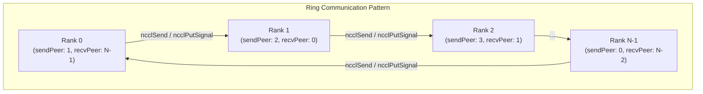
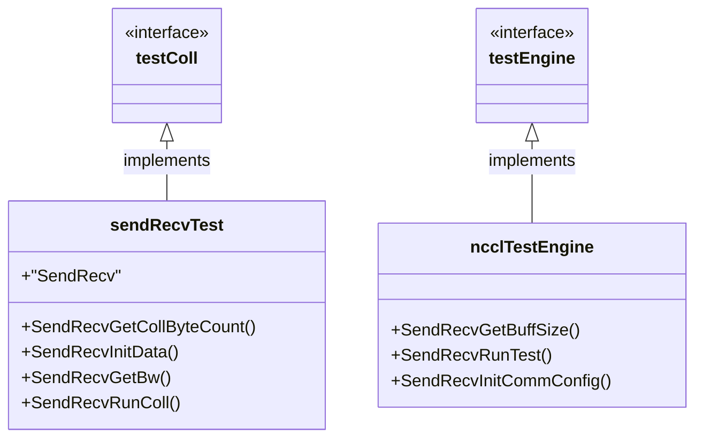
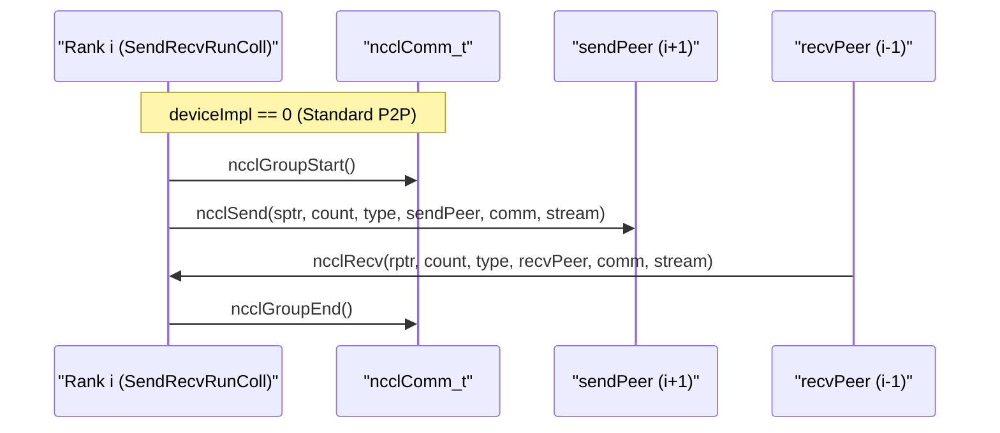

<!-- source: DeepWiki mcp.deepwiki.com · repo NVIDIA/nccl-tests · page 3.10 SendRecv · fetched 2026-11-11 -->

# SendRecv

<details>
<summary>Relevant source files</summary>

The following files were used as context for generating this wiki page:

- [src/sendrecv.cu](src/sendrecv.cu)

</details>


The SendRecv test in `nccl-tests` evaluates the performance and correctness of paired point-to-point communication operations using NCCL's point-to-point primitives (`ncclSend` and `ncclRecv`) as well as host-side RMA operations (`ncclPutSignal`) introduced in newer NCCL versions. This page documents the implementation, execution modes, and performance metrics of the SendRecv test suite.

## Purpose and Scope

The SendRecv test benchmarks direct point-to-point communication between pairs of ranks in a distributed environment. Unlike collective operations that involve all ranks simultaneously in a global reduction or broadcast (such as [AllReduce](3.1) or [Broadcast](3.6)), SendRecv targets explicit peer exchanges, typically organized in a ring topology where every rank sends to its successor and receives from its predecessor.

Sources: [src/sendrecv.cu:1-117]()

## Communication Pattern

The SendRecv test implements a ring communication pattern where each rank `rank` communicates with two distinct peers:
1. `sendPeer = (rank + 1) % nranks`: The target rank to which data is sent.
2. `recvPeer = (rank - 1 + nranks) % nranks`: The source rank from which data is received.



Sources: [src/sendrecv.cu:49-54](), [src/sendrecv.cu:99-107]()

## Implementation Architecture

The SendRecv module exposes a `struct testColl sendRecvTest` interface and defines a weak `ncclTestEngine` structure (`ncclTestEngine`) to hook into the core orchestration framework.



Sources: [src/sendrecv.cu:130-184]()

## Key Components and Functions

### 1. Buffer Size Calculation
`SendRecvGetCollByteCount` defines the buffer configurations, establishing symmetric send and receive counts without in-place offsets.

```c
void SendRecvGetCollByteCount(size_t *sendcount, size_t *recvcount, size_t *paramcount, size_t *sendInplaceOffset, size_t *recvInplaceOffset, size_t count, size_t eltSize, int nranks) {
  *sendcount = count;
  *recvcount = count;
  *sendInplaceOffset = 0;
  *recvInplaceOffset = 0;
  *paramcount = *sendcount;
}
```

Sources: [src/sendrecv.cu:10-16]()

### 2. Data Initialization
`SendRecvInitData` initializes send buffers with deterministic patterns based on rank and repetition index, zeroes out receive buffers, and sets up expected verification buffers from `peer`. Because in-place send-receive semantics are ambiguous or unsupported for correctness checks here, `args->reportErrors` is disabled if `in_place` is set.

```c
testResult_t SendRecvInitData(struct threadArgs* args, ncclDataType_t type, ncclRedOp_t op, int root, int rep, int in_place) {
  size_t sendcount = args->sendBytes / wordSize(type);
  size_t recvcount = args->expectedBytes / wordSize(type);
  int nranks = args->nProcs*args->nThreads*args->nGpus;

  for (int i=0; i<args->nGpus; i++) {
    CUDACHECK(cudaSetDevice(args->gpus[i]));
    int rank = ((args->proc*args->nThreads + args->thread)*args->nGpus + i);
    CUDACHECK(cudaMemset(args->recvbuffs[i], 0, args->expectedBytes));
    void* data = in_place ? args->recvbuffs[i] : args->sendbuffs[i];
    TESTCHECK(InitData(data, sendcount, rank*sendcount, type, ncclSum, rep, 1, 0));
    int peer = (rank-1+nranks)%nranks;
    TESTCHECK(InitData(args->expected[i], recvcount, peer*recvcount, type, ncclSum, rep, 1, 0));
    CUDACHECK(cudaDeviceSynchronize());
  }
  args->reportErrors = in_place ? 0 : 1;
  return testSuccess;
}
```

Sources: [src/sendrecv.cu:18-36]()

### 3. Bandwidth Metrics
`SendRecvGetBw` computes algorithmic bandwidth (`algBw`) and bus bandwidth (`busBw`) directly from payload size and elapsed time.

Sources: [src/sendrecv.cu:38-44]()

### 4. Execution Paths (`SendRecvRunColl`)
The framework supports two distinct execution backends via `deviceImpl`:
- **Standard P2P (`deviceImpl == 0`)**: Uses `ncclSend` and `ncclRecv` wrapped inside `ncclGroupStart()` and `ncclGroupEnd()`.
- **Host RMA Put (`deviceImpl == HOST_RMA_IMPL`)**: Available for NCCL versions $\ge$ `2.29.0`, which partitions data chunks across RMA contexts using `ncclPutSignal` and synchronizes with `ncclWaitSignal`.



Sources: [src/sendrecv.cu:47-117]()

### 5. Communicator Configuration
For NCCL $\ge$ `2.30.0`, `SendRecvInitCommConfig` adjusts `maxP2pPeers` to `2` to properly dimension resources for ring-based send/receive endpoints.

```c
#if NCCL_VERSION_CODE >= NCCL_VERSION(2,14,0)
static void SendRecvInitCommConfig(ncclConfig_t* config) {
#if NCCL_VERSION_CODE >= NCCL_VERSION(2,30,0)
  config->maxP2pPeers = 2;
#else
  (void)config;
#endif
}
#endif
```

Sources: [src/sendrecv.cu:119-128]()

## Test Execution and Registration

The entrypoint `SendRecvRunTest` iterates over requested data types and reduction operators, invoking `TimeTest` to execute the benchmarking loops. The module exports `ncclTestEngine` using `NCCL_WEAK` linkage so that compiling `src/sendrecv.cu` into a standalone binary automatically configures the test engine.

Sources: [src/sendrecv.cu:143-184]()

Sources: [src/sendrecv.cu:1-184]()

---

