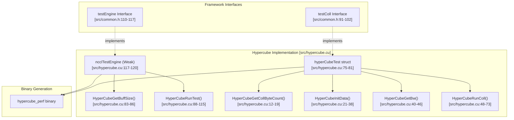

<!-- source: DeepWiki mcp.deepwiki.com · repo NVIDIA/nccl-tests · page 3.11 Hypercube · fetched 2026-11-11 -->

# Hypercube

<details>
<summary>Relevant source files</summary>

The following files were used as context for generating this wiki page:

- [src/hypercube.cu](src/hypercube.cu)

</details>


**Purpose**: This page documents the Hypercube collective communication pattern implementation in NCCL Tests (`src/hypercube.cu`). Hypercube is a specialized communication operation designed to test specific network topologies using a hypercube exchange pattern. It follows the standard plugin architecture used by other collective operations in the test suite.

For information about other collective operations, see [Collective Operations](#3). For details on the plugin architecture that Hypercube uses, see [Plugin Architecture](#3.1). For the core test framework that orchestrates Hypercube tests, see [Core Testing Framework](#2).

---

## Overview

The Hypercube test implements a dimension-exchange communication pattern where each rank communicates with other ranks in a structured, power-of-2 dimensional manner. This implementation performs an AllGather-like exchange pattern across dimensions using grouped send and receive operations [src/hypercube.cu:60-68]().

Like other collective operations in NCCL Tests, Hypercube is compiled into a standalone binary (`hypercube_perf`) that can be executed independently. The implementation integrates with the core test framework through the `testColl` and `testEngine` interfaces defined in [src/hypercube.cu:75-81]() and [src/hypercube.cu:117-120]().

**Sources**: [src/hypercube.cu:60-73](), [src/hypercube.cu:75-81](), [src/hypercube.cu:117-120]()

---

## Integration with Test Framework

### Interface Implementation

Hypercube follows the standard plugin architecture by implementing two key interfaces through `hyperCubeTest` and `ncclTestEngine`:



**Sources**: [src/hypercube.cu:12-120](), [src/common.h:91-117]()

---

## Key Interface Components

### testColl Interface Methods

The `testColl` structure instance `hyperCubeTest` [src/hypercube.cu:75-81]() provides the collective-specific implementation:

| Method | Purpose | Implementation Source |
|--------|---------|-----------------------|
| `getCollByteCount` | Calculates send/receive buffer sizes and in-place offsets based on count, element size, and rank count | [src/hypercube.cu:12-19]() |
| `initData` | Initializes test data and expected buffers with deterministic patterns for validation | [src/hypercube.cu:21-38]() |
| `getBw` | Computes algorithmic and bus bandwidth metrics from timing results | [src/hypercube.cu:40-46]() |
| `runColl` | Executes the hypercube communication pattern using grouped `ncclSend` and `ncclRecv` | [src/hypercube.cu:48-73]() |

**Sources**: [src/hypercube.cu:12-81]()

---

### testEngine Interface Methods

The `ncclTestEngine` structure [src/hypercube.cu:117-120]() orchestrates test execution for the binary:

- `getBuffSize`: Wrapper invoking `HyperCubeGetCollByteCount` with `eltSize=1` [src/hypercube.cu:83-86]()
- `runTest`: Validates that the number of ranks is a power of 2, then loops over data types to invoke `TimeTest` [src/hypercube.cu:88-115]()

**Sources**: [src/hypercube.cu:83-120]()

---

## Hypercube Communication Pattern and Execution

### Communication Logic

In `HyperCubeRunColl` [src/hypercube.cu:48-73](), the implementation checks `deviceImpl == 0` (software runtime path; device implementation returns `testNotImplemented`) [src/hypercube.cu:49-71](). 

For the runtime path:
1. Determines rank and communicator size via `ncclCommCount` and `ncclCommUserRank` [src/hypercube.cu:52-55]().
2. Handles out-of-place vs in-place data copying if necessary [src/hypercube.cu:58]().
3. Iterates over dimensions using a bitwise mask (`mask=1; mask<nRanks; mask<<=1`) [src/hypercube.cu:61]().
4. Inside each iteration, issues grouped send and receive requests using `ncclGroupStart()`, `ncclSend()`, `ncclRecv()`, and `ncclGroupEnd()` [src/hypercube.cu:62-67]().

```mermaid
sequenceDiagram
    participant Coll as "HyperCubeRunColl<br/>[src/hypercube.cu:48]"
    participant NCClRTE as "NCCL Runtime"
    
    Coll->>NCClRTE: ncclCommCount() / ncclCommUserRank()
    Note over Coll,NCClRTE: Optional device-to-device copy for send/recv offset
    
    loop "For mask = 1; mask < nRanks; mask <<= 1"
        Coll->>NCClRTE: ncclGroupStart()
        Coll->>NCClRTE: ncclSend(rbuff + s * rankSize, count * mask, type, rank ^ mask, comm, stream)
        Coll->>NCClRTE: ncclRecv(rbuff + r * rankSize, count * mask, type, rank ^ mask, comm, stream)
        Coll->>NCClRTE: ncclGroupEnd()
    end
```

**Sources**: [src/hypercube.cu:48-73]()

---

## Data Management and Initialization

### Buffer Size Calculation

Buffer dimensions are computed in `HyperCubeGetCollByteCount` [src/hypercube.cu:12-19]() with 16-byte alignment rules:

```c
void HyperCubeGetCollByteCount(size_t *sendcount, size_t *recvcount, size_t *paramcount, size_t *sendInplaceOffset, size_t *recvInplaceOffset, size_t count, size_t eltSize, int nranks) {
  size_t base = (count/nranks) & ~(16/eltSize - 1);
  *sendcount = base;
  *recvcount = base*nranks;
  *sendInplaceOffset = base;
  *recvInplaceOffset = 0;
  *paramcount = base;
}
```

**Sources**: [src/hypercube.cu:12-19]()

### Data Initialization

`HyperCubeInitData` [src/hypercube.cu:21-38]() sets up send buffers, zeros receive buffers, and populates `expected` validation buffers across all active GPUs using rank-specific seeds (`33 * rep + rank`) [src/hypercube.cu:26-36]().

**Sources**: [src/hypercube.cu:21-38]()

---

## Bandwidth Calculation

Bandwidth computation is defined in `HyperCubeGetBw` [src/hypercube.cu:40-46]():

```c
void HyperCubeGetBw(size_t count, size_t typesize, double sec, double* algBw, double* busBw, int nranks) {
  double baseBw = (double)(count * typesize * (nranks - 1)) / 1.0E9 / sec;

  *algBw = baseBw;
  double factor = 1;
  *busBw = baseBw * factor;
}
```

**Sources**: [src/hypercube.cu:40-46]()

---

## Test Execution and Power-of-2 Constraint

`HyperCubeRunTest` [src/hypercube.cu:88-115]() verifies that the total number of ranks (`nRanks`) is a power of 2 (`nRanks && !(nRanks & (nRanks - 1))`) [src/hypercube.cu:105-106](). If the rank count is not a power of 2, the test prints a skipping message and returns successfully without executing [src/hypercube.cu:110-112]().

**Sources**: [src/hypercube.cu:88-115]()

---

## Binary Generation

The `hypercube_perf` binary links `src/hypercube.cu` with the core framework objects, resolving `ncclTestEngine` via weak symbol linking [src/hypercube.cu:117-120]().

**Sources**: [src/hypercube.cu:75-120]()

---

