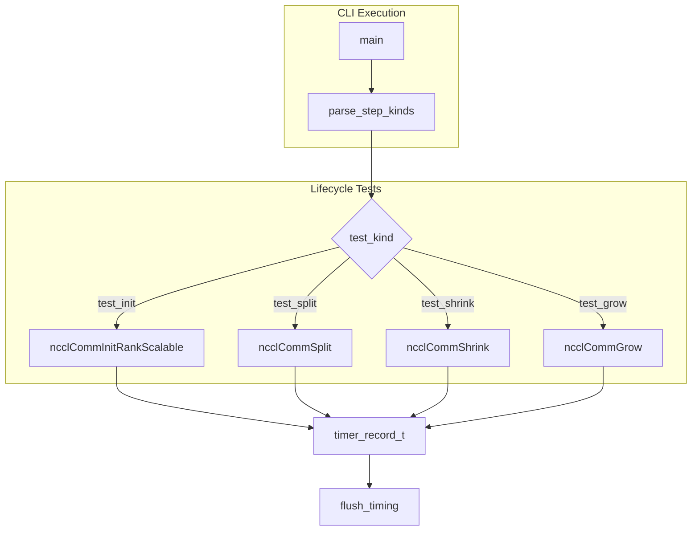
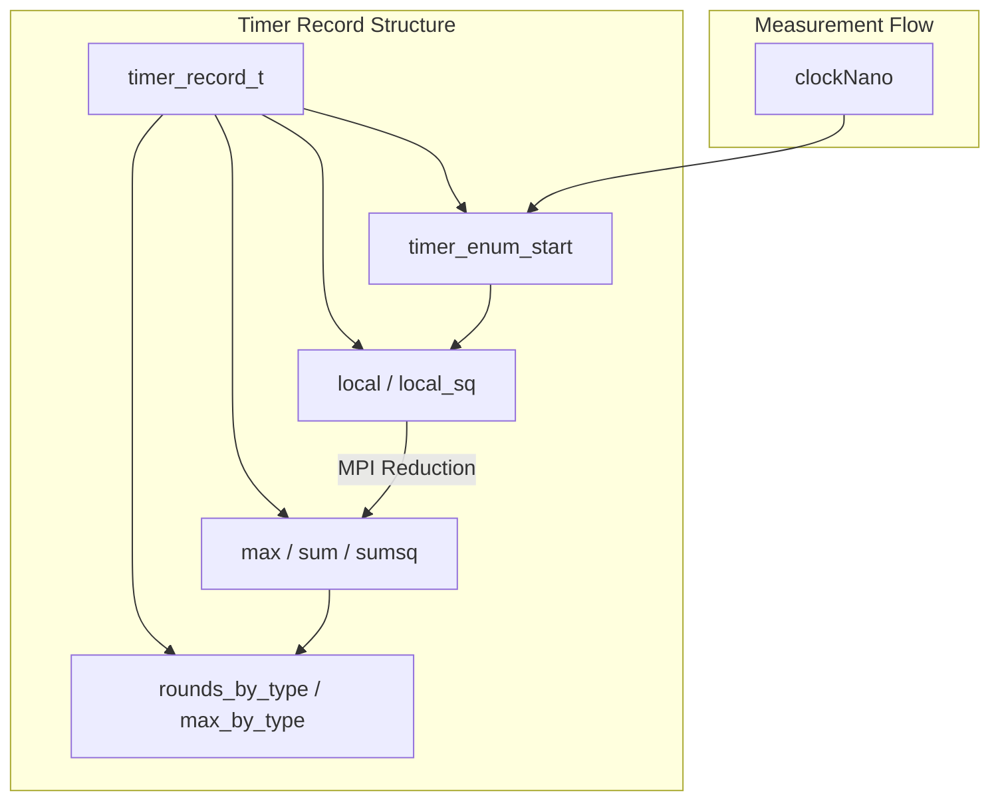

<!-- source: DeepWiki mcp.deepwiki.com · repo NVIDIA/nccl-tests · page 3.12 Communicator Operations Benchmark · fetched 2026-11-11 -->

# Communicator Operations Benchmark

Relevant source files

The following files were used as context for generating this wiki page:

- [src/CMakeLists.txt](src/CMakeLists.txt)
- [src/comm_ops.cu](src/comm_ops.cu)

The `comm_ops_perf` benchmark suite measures the latency and performance characteristics of NCCL communicator lifecycle and topology modification operations—specifically initialization, splitting, shrinking, and growing [src/comm_ops.cu:7-20](). Unlike data-plane collective benchmarks in the suite, `comm_ops_perf` operates independently of the standard `testColl` and `testEngine` plugin framework, directly invoking NCCL communicator APIs across MPI ranks [src/comm_ops.cu:10-13]().

---

## 1. Version Requirements and Build Integration

Communicator operations rely on advanced NCCL runtime features introduced in NCCL version 2.29, notably `ncclCommGrow` and `ncclCommGetUniqueId` [src/CMakeLists.txt:28-30](). 

- **NCCL Version**: Requires `NCCL_VERSION_CODE >= 22900` (`COMM_OPS_MIN_NCCL_VERSION`) [src/CMakeLists.txt:28-30](). If the detected `nccl.h` is older than version 2.29, the CMake build and Makefile automatically skip building `comm_ops_perf` while still building standard collective tests [src/CMakeLists.txt:88-92]().
- **MPI Support**: Mandatory dependency. Because communicator growth, shrinking, and splitting require out-of-band rank coordination and unique ID distribution, `comm_ops_perf` compiles only when `MPI_SUPPORT` is enabled [src/comm_ops.cu:35-40]().

Sources: [src/CMakeLists.txt:28-117](), [src/comm_ops.cu:35-40]()

---

## 2. Benchmark Operations and Test Kinds

The benchmark is structured around four primary communicator lifecycle test kinds (`test_kinds` enum):

1. **`test_init`**: Measures the latency of scalable communicator initialization via `ncclCommInitRankScalable` [src/comm_ops.cu:16(), 184]().
2. **`test_split`**: Measures the performance of partitioning an existing communicator using `ncclCommSplit` [src/comm_ops.cu:17(), 185]().
3. **`test_shrink`**: Benchmarks the removal of ranks from an active communicator using `ncclCommShrink` [src/comm_ops.cu:18(), 186]().
4. **`test_grow`**: Benchmarks the dynamic addition of ranks into an existing communicator scope using `ncclCommGrow` [src/comm_ops.cu:19(), 187]().

*Diagram 1: Communicator operations benchmark execution pipeline bridging CLI arguments to NCCL API calls and timing records.*

Sources: [src/comm_ops.cu:15-20](), [src/comm_ops.cu:183-188]()

---

## 3. Timing and Measurement Infrastructure

Timing data is collected using high-resolution monotonic clocks (`clockNano()`) and aggregated through the `timer_record_t` structure [src/comm_ops.cu:145-173, 177-181](). 

### Timer Enums and Flags
The benchmark defines distinct timer categories (`timer_enums`) mapped to subsystem flags (`timer_flags`) to isolate MPI overheads, CUDA initialization, and specific NCCL communicator transitions [src/comm_ops.cu:85-140]().

| Enum Identifier | Subsystem Flag | Description |
| :--- | :--- | :--- |
| `mpi_init` / `mpi_barrier` / `mpi_allgatherv` | `mpi_flag` | MPI synchronization and unique ID exchange [src/comm_ops.cu:86-88, 123-128]() |
| `work_prepare` / `cuda_init` / `cuda_stream_sync` | `cuda_flag` | Device memory allocation and stream synchronization [src/comm_ops.cu:98-99, 117-118, 138-139]() |
| `nccl_init`, `nccl_split`, `nccl_shrink`, `nccl_grow` | `nccl_flag` | Core NCCL communicator lifecycle routines [src/comm_ops.cu:90-92, 97, 109-111, 116, 130-132, 137]() |

*Diagram 2: Internal data organization of `timer_record_t` for tracking per-operation statistics across distributed ranks.*

Sources: [src/comm_ops.cu:85-140](), [src/comm_ops.cu:145-181]()

---

## 4. Configuration Parameters and Arguments

The `args_t` structure parses command-line parameters to configure iteration counts, warmup phases, rank sweeping, and resizing strategies (`resize_kind`, `resize_num`) [src/comm_ops.cu:195-212](). 

- **Sweep and Step Parsing**: `parse_step_kinds` supports `step-<I>`, `factor-<F>`, and `fixed` arguments to control how communicator sizes expand or shrink across benchmark rounds [src/comm_ops.cu:220-226]().
- **Error Handling Macros**: Robust error checking wrappers (`CUDACHECK`, `NCCLCHECK`, `MPICHECK`) intercept runtime failures, printing file/line locations before triggering an immediate `MPI_Abort` via `ABORT_EXIT` [src/comm_ops.cu:45-79]().

Sources: [src/comm_ops.cu:45-79](), [src/comm_ops.cu:195-226]()

---

