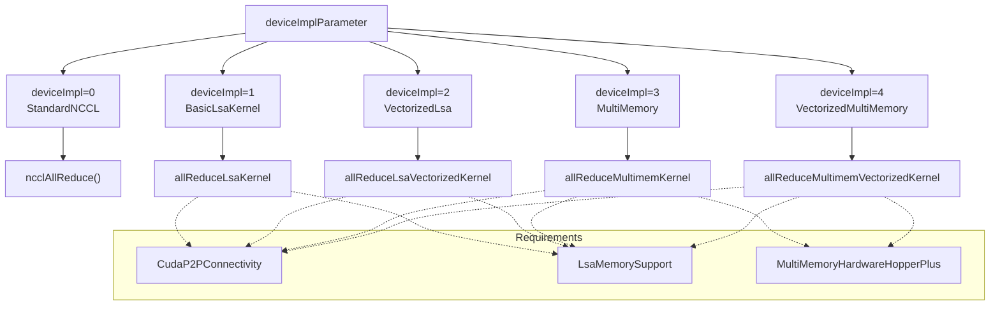
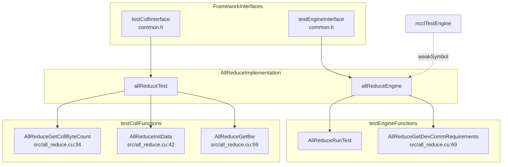
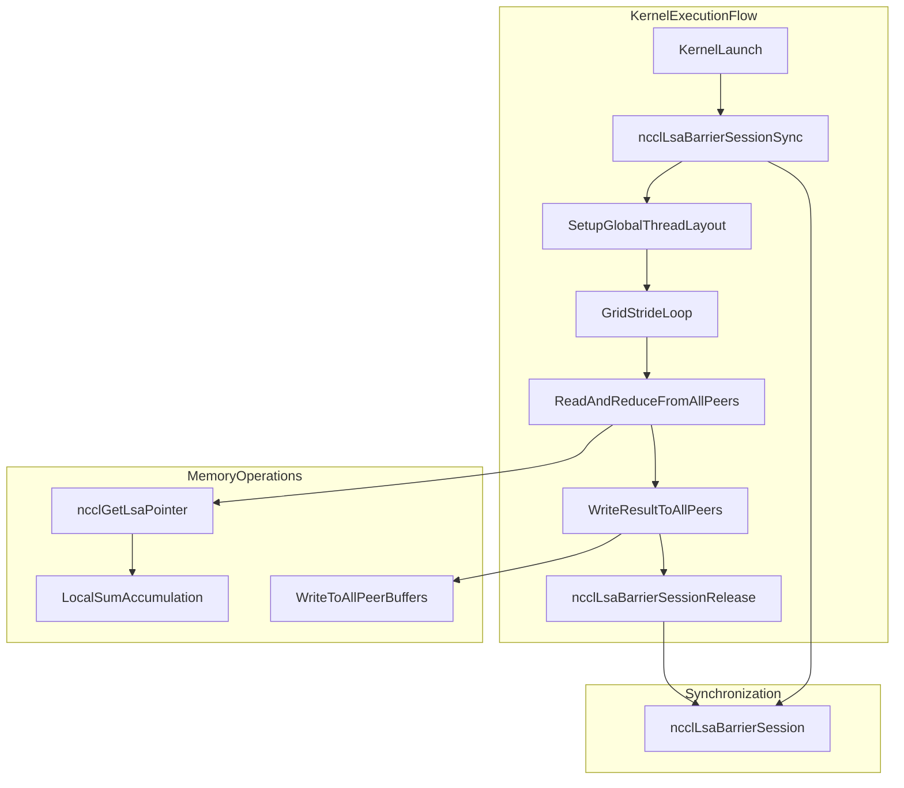
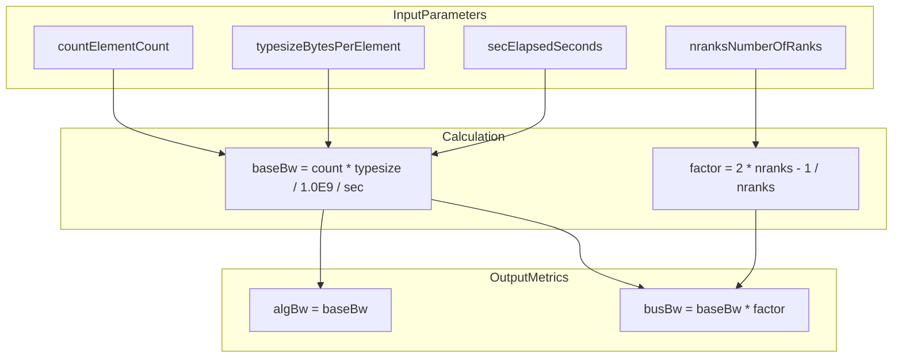

<!-- source: DeepWiki mcp.deepwiki.com · repo NVIDIA/nccl-tests · page 3.2 AllReduce · fetched 2026-11-11 -->

# AllReduce

<details>
<summary>Relevant source files</summary>

The following files were used as context for generating this wiki page:

- [src/all_reduce.cu](src/all_reduce.cu)

</details>


The AllReduce collective operation test implementation provides benchmarking and correctness testing for NCCL AllReduce operations [src/all_reduce.cu:7-12](). The implementation includes the standard NCCL API implementation plus four custom CUDA kernel variants that demonstrate device-side collective implementations using LSA (Load-Store Accessible) memory and multi-memory hardware acceleration [src/all_reduce.cu:10-22]().

**Sources:** [src/all_reduce.cu:7-22]()

## Implementation Structure

The AllReduce test implementation provides five execution paths controlled by the `deviceImpl` parameter (0-4) [src/all_reduce.cu:16-21](). Implementation 0 uses the standard `ncclAllReduce` API. Implementations 1-4 are custom CUDA kernels that require NCCL version 2.28.0 or higher and CUDA P2P connectivity between participating GPUs [src/all_reduce.cu:14-15](), [src/all_reduce.cu:27-32]().

All custom kernels require LSA memory support and use the `ncclDevComm` device communicator structure [src/all_reduce.cu:69-102](). Implementations 3 and 4 additionally require multi-memory hardware support available on Hopper+ architectures [src/all_reduce.cu:90-98]().

**Sources:** [src/all_reduce.cu:7-22](), [src/all_reduce.cu:69-102]()

## Device Implementation Variants

The AllReduce test supports five distinct implementation variants controlled by the `deviceImpl` parameter [src/all_reduce.cu:16-21]%:


Sources: [src/all_reduce.cu:16-22](), [src/all_reduce.cu:69-102]()

| Device Implementation | Kernel Function | Hardware Requirements | Optimization Strategy |
|----------------------|-----------------|----------------------|----------------------|
| 0 | `ncclAllReduce` | Standard NCCL | Baseline NCCL implementation [src/all_reduce.cu:17]() |
| 1 | `allReduceLsaKernel` | CUDA P2P, LSA, LSA barriers | Basic peer-to-peer memory access [src/all_reduce.cu:18](), [src/all_reduce.cu:85-89]() |
| 2 | `allReduceLsaVectorizedKernel` | CUDA P2P, LSA, LSA barriers | 128-bit vectorized loads/stores [src/all_reduce.cu:19](), [src/all_reduce.cu:85-89]() |
| 3 | `allReduceMultimemKernel` | CUDA P2P, LSA, multi-memory, LSA barriers | Hardware-accelerated reduction [src/all_reduce.cu:20](), [src/all_reduce.cu:90-98]() |
| 4 | `allReduceMultimemVectorizedKernel` | CUDA P2P, LSA, multi-memory, LSA barriers | Vectorized hardware-accelerated reduction [src/all_reduce.cu:21](), [src/all_reduce.cu:90-98]() |

**Sources:** [src/all_reduce.cu:16-22](), [src/all_reduce.cu:69-102]()

## Framework Integration

The AllReduce implementation integrates with the core testing framework through two structures: `allReduceTest` (implements `testColl` interface) and `allReduceEngine` (implements `testEngine` interface) [src/all_reduce.cu:464-552]().


Sources: [src/all_reduce.cu:34-102](), [src/all_reduce.cu:464-552]()

### testColl Interface Functions

- `AllReduceGetCollByteCount`: Sets `sendcount` and `recvcount` equal to `count` for AllReduce operations [src/all_reduce.cu:34-40](). Sets `sendInplaceOffset` and `recvInplaceOffset` to 0 [src/all_reduce.cu:37-38]().
- `AllReduceInitData`: Initializes send buffers with deterministic data patterns using `InitData` [src/all_reduce.cu:42-57](). Zeros receive buffers [src/all_reduce.cu:50](). Computes expected results using `InitDataReduce` [src/all_reduce.cu:53]().
- `AllReduceGetBw`: Calculates algorithmic and bus bandwidth using the formula `busBw = baseBw × 2×(nranks-1)/nranks` [src/all_reduce.cu:59-65]().

### testEngine Interface Functions

- `AllReduceGetDevCommRequirements`: Specifies device communicator requirements for custom kernels, such as `lsaBarrierCount` and `lsaMultimem` [src/all_reduce.cu:69-102]().

**Sources:** [src/all_reduce.cu:34-102](), [src/all_reduce.cu:464-552]()

## Device Communication Requirements

Custom AllReduce kernels specify device communicator requirements through the `AllReduceGetDevCommRequirements` function, which populates a `ncclDevCommRequirements` structure [src/all_reduce.cu:69-102]():

| Device Implementation | `lsaBarrierCount` | `lsaMultimem` | Description |
|----------------------|-------------------|---------------|-------------|
| 1 (LSA) | `deviceCtaCount` | false | Requires LSA barriers for synchronization [src/all_reduce.cu:88]() |
| 2 (LSA Vectorized) | `deviceCtaCount` | false | Requires LSA barriers for synchronization [src/all_reduce.cu:88]() |
| 3 (Multi-memory) | `deviceCtaCount` | true | Requires LSA barriers and multi-memory hardware [src/all_reduce.cu:96-97]() |
| 4 (Multi-memory Vectorized) | `deviceCtaCount` | true | Requires LSA barriers and multi-memory hardware [src/all_reduce.cu:96-97]() |

The `deviceCtaCount` variable specifies the number of CTAs (Cooperative Thread Arrays) launched for device implementations [src/all_reduce.cu:88](). LSA barriers enable fast synchronization between CTAs across different GPUs within the same CUDA P2P connectivity domain [src/all_reduce.cu:77-83]().

**Sources:** [src/all_reduce.cu:69-102]()

## Custom CUDA Kernels

The AllReduce implementation provides four custom CUDA kernels available with NCCL version 2.28.0 or higher [src/all_reduce.cu:27-32](). All kernels use `ncclDevComm` device communicators and require CUDA P2P connectivity [src/all_reduce.cu:14-15](), [src/all_reduce.cu:146]().

### Kernel 1: allReduceLsaKernel (Basic LSA)

The basic LSA kernel implements AllReduce using direct peer-to-peer memory access through LSA windows [src/all_reduce.cu:124-144]():


Sources: [src/all_reduce.cu:145-161]()

**Algorithm:**
1. Initialize `ncclLsaBarrierSession` with `ncclCoopCta` scope [src/all_reduce.cu:147]().
2. Synchronize all CTAs across all ranks using `bar.sync()` [src/all_reduce.cu:148]().
3. Calculate global thread ID [src/all_reduce.cu:152-153]().
4. For each element in grid stride loop, read from peers via `ncclGetLsaPointer()`, accumulate sum, and write back [src/all_reduce.cu:155-161]().

**Sources:** [src/all_reduce.cu:145-161]()

### Kernel 2: allReduceLsaVectorizedKernel (Vectorized LSA)

The vectorized LSA kernel optimizes memory bandwidth using vectorized loads/stores (`VectorTypeMapping<T>::Type`) and loop unrolling [src/all_reduce.cu:19-20](). It handles misaligned offsets with scalar paths before entering vectorized blocks.

**Sources:** [src/all_reduce.cu:19-20]()

### Kernel 3 & 4: allReduceMultimemKernel & allReduceMultimemVectorizedKernel (Hardware-Accelerated)

The multi-memory kernels use hardware-accelerated reduction operations (`multimemLoadSum` and `multimemStore`) via `ncclGetLsaMultimemPointer()` to eliminate explicit peer loops on Hopper+ architectures [src/all_reduce.cu:20-21](), [src/all_reduce.cu:90-98]().

**Sources:** [src/all_reduce.cu:20-21](), [src/all_reduce.cu:90-98]()

## Performance Calculation

The `AllReduceGetBw` function calculates bandwidth metrics using the standard AllReduce formula [src/all_reduce.cu:59-65]%:


Sources: [src/all_reduce.cu:59-65]()

**Bandwidth Formula:**
```
baseBw = (count × typesize) / 1.0E9 / sec
algBw = baseBw
busBw = baseBw × 2 × (nranks-1) / nranks
```

**Sources:** [src/all_reduce.cu:59-65]()

## Data Initialization and Verification

The `AllReduceInitData` function initializes send buffers with deterministic data patterns using `InitData`, zeros receive buffers, and computes expected reduction results using `InitDataReduce` [src/all_reduce.cu:42-57](). This supports both in-place and out-of-place validation across all device implementations [src/all_reduce.cu:51-53]().

**Sources:** [src/all_reduce.cu:42-57]()

---

