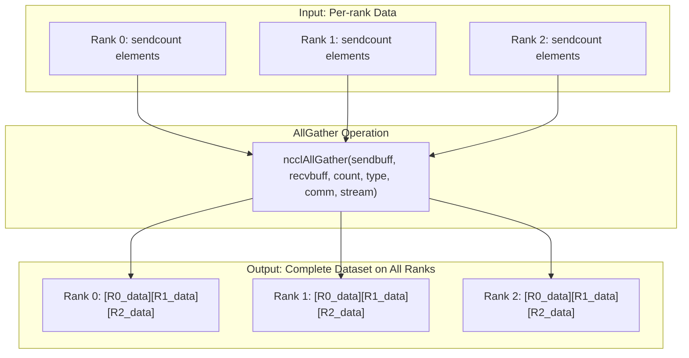
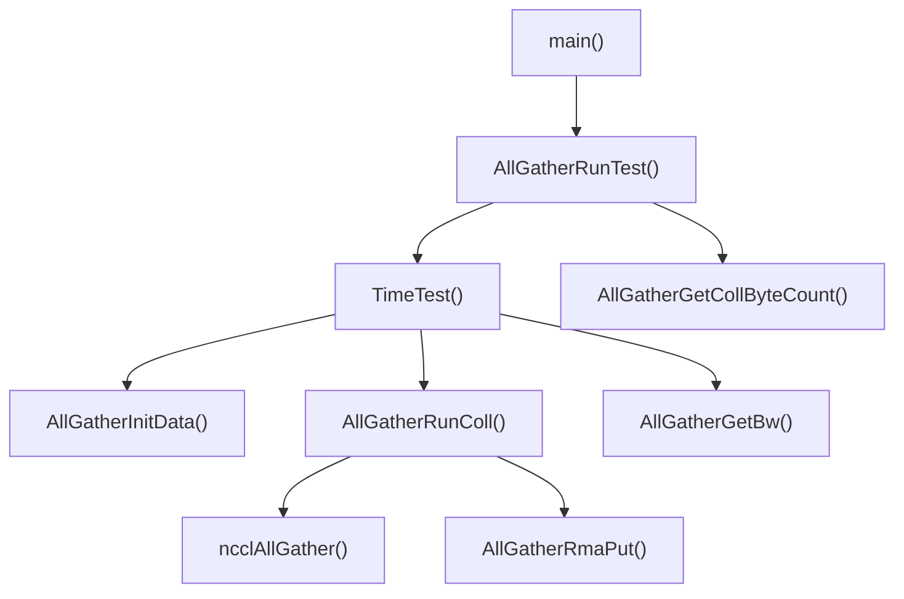
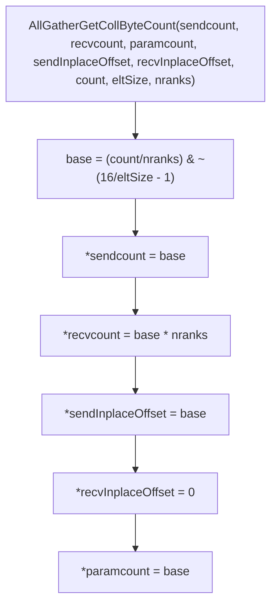
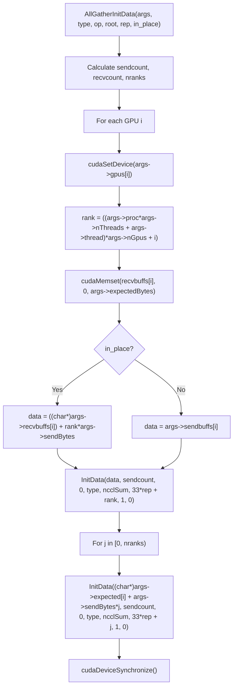
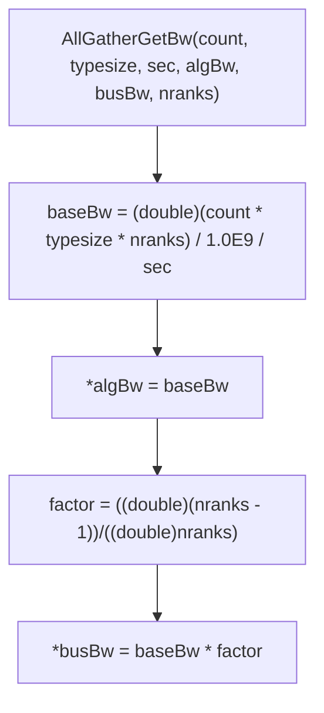
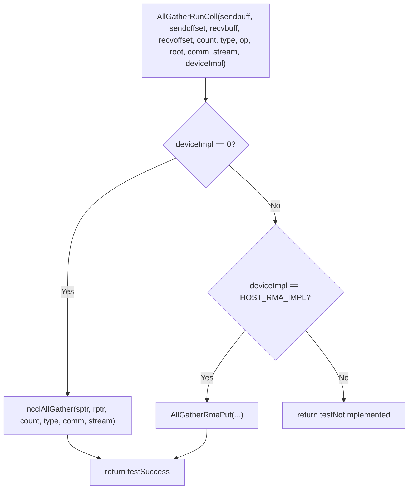
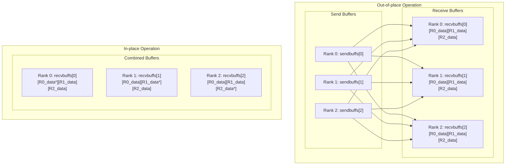
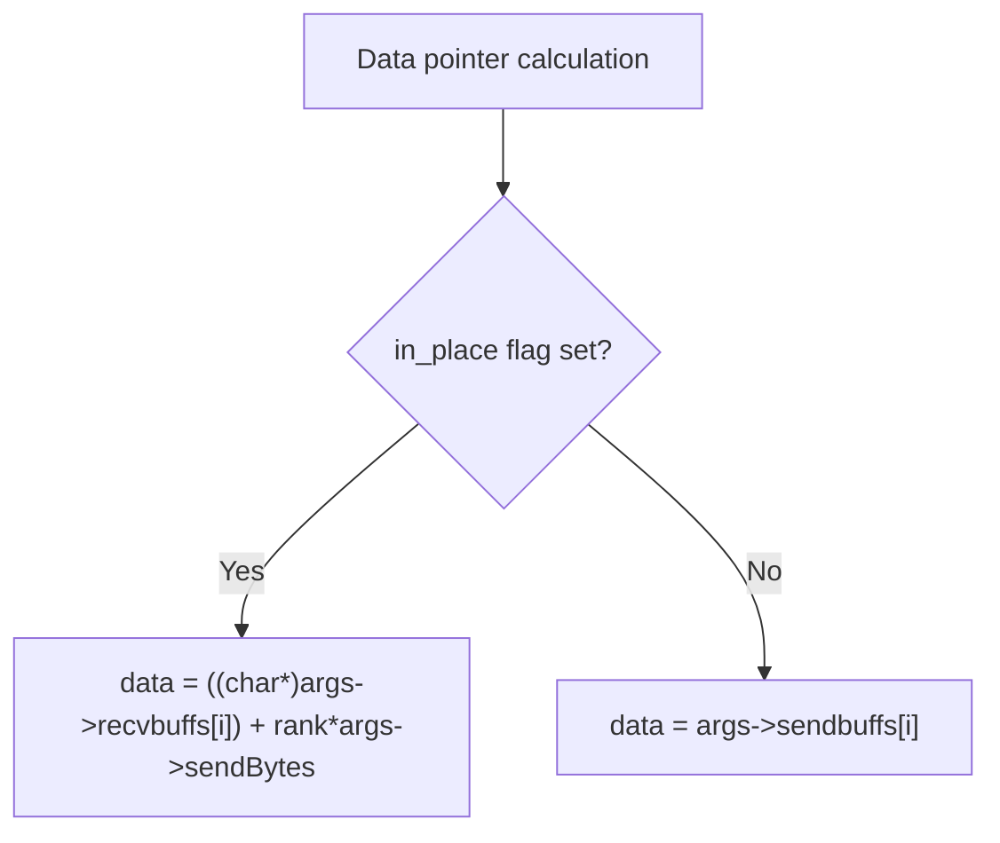

<!-- source: DeepWiki mcp.deepwiki.com · repo NVIDIA/nccl-tests · page 3.3 AllGather · fetched 2026-11-11 -->

# AllGather

<details>
<summary>Relevant source files</summary>

The following files were used as context for generating this wiki page:

- [src/all_gather.cu](src/all_gather.cu)

</details>


The AllGather collective operation implementation provides comprehensive testing for NCCL's `ncclAllGather` operation as well as host RMA put execution paths. Each rank contributes a data chunk of size `count`, and all ranks receive concatenated data from all participants, resulting in output buffers containing `count * nranks` elements.

For information about other collective operations, see the [Collective Operations](#3) section.

## Operation Overview

AllGather transforms individual rank contributions into complete datasets distributed to all participants. Each rank contributes `sendcount` elements and receives `recvcount = sendcount * nranks` elements arranged in rank order.

### AllGather Data Flow



Sources: [src/all_gather.cu:10-115]()

## Implementation Architecture

The AllGather test implementation follows the NCCL-tests framework pattern with `testColl` and `testEngine` interfaces [src/all_gather.cu:117-123](), [src/all_gather.cu:152-155](). The implementation provides functions for buffer calculation, data initialization, bandwidth measurement, and execution.

### Core Implementation Structure

```mermaid
classDiagram
    class testColl {
        +getCollByteCount()
        +initData()
        +getBw()
        +runColl()
    }
    
    class allGatherTest {
        +"AllGather"
        +AllGatherGetCollByteCount()
        +AllGatherInitData() 
        +AllGatherGetBw()
        +AllGatherRunColl()
    }
    
    class testEngine {
        +getBuffSize()
        +runTest()
    }
    
    class allGatherEngine {
        +AllGatherGetBuffSize()
        +AllGatherRunTest()
    }
    
    testColl <|-- allGatherTest
    testEngine <|-- allGatherEngine
    
    note for allGatherTest : "Struct defined at line 117"
    note for allGatherEngine : "Struct defined at line 152"
```

### Function Call Hierarchy



Sources: [src/all_gather.cu:10-155]()

## Buffer Size Calculation

The `AllGatherGetCollByteCount` function determines buffer sizes and offsets for both in-place and out-of-place operations [src/all_gather.cu:10-17](). The calculation ensures 16-byte alignment for optimal memory access patterns.

### Buffer Size Calculation Logic



The alignment calculation `(count/nranks) & ~(16/eltSize - 1)` ensures each rank's contribution is aligned to 16-byte boundaries, optimizing memory access patterns for different element sizes.

| Parameter | Value | Purpose |
|-----------|-------|---------|
| `sendcount` | `base` | Elements each rank contributes |
| `recvcount` | `base * nranks` | Total elements received |
| `sendInplaceOffset` | `base` | Offset for in-place send buffer |
| `recvInplaceOffset` | `0` | Receive buffer starts at beginning |
| `paramcount` | `base` | Parameter count for NCCL call |

Sources: [src/all_gather.cu:10-17]()

The calculation ensures that:
- Each rank sends an equal portion of the total data
- The receive buffer is large enough to hold all data from all ranks
- The offsets are properly set for in-place operations

## Data Initialization

The `AllGatherInitData` function prepares test data with rank-specific patterns and expected results [src/all_gather.cu:19-36](). Each rank receives unique data based on its position in the communicator, enabling verification of correct data placement.

### Data Initialization Process



The initialization uses deterministic seeds (`33*rep + rank`) to generate reproducible test patterns. For in-place operations, the send data is placed at the correct offset within the receive buffer: `((char*)args->recvbuffs[i])+rank*args->sendBytes`.

Sources: [src/all_gather.cu:19-36]()

## Bandwidth Calculation

The `AllGatherGetBw` function computes algorithm and bus bandwidth metrics [src/all_gather.cu:38-44](). Algorithm bandwidth measures logical data movement, while bus bandwidth accounts for network utilization in the AllGather communication pattern.

### Bandwidth Calculation Implementation



### Bandwidth Metrics

| Metric | Formula | Description |
|--------|---------|-------------|
| Algorithm Bandwidth | `(count × typesize × nranks) / 1.0E9 / sec` | Total logical data movement rate |
| Bus Bandwidth | `algBw × (nranks-1)/nranks` | Network utilization accounting for data distribution |

The bus bandwidth factor `(nranks-1)/nranks` reflects that in AllGather, each data element must be transmitted to `nranks-1` other ranks, representing the actual network traffic generated.

Sources: [src/all_gather.cu:38-44]()

## Test Execution and Alternative Implementations

The `AllGatherRunColl` function executes the NCCL AllGather operation or host RMA put routines when `NCCL_VERSION_CODE >= NCCL_VERSION(2,29,0)` [src/all_gather.cu:46-115](). The `AllGatherRunTest` function orchestrates test execution across multiple data types [src/all_gather.cu:130-150]().

### AllGather Execution Flow



### Test Orchestration

```mermaid
flowchart TD
    start["AllGatherRunTest(args, root, type, typeName, op, opName)"]
    setTest["args->collTest = &allGatherTest"]
    
    checkType{"type == -1?"}
    singleType["type_count = 1<br/>run_types = &type<br/>run_typenames = &typeName"]
    allTypes["type_count = test_typenum<br/>run_types = test_types<br/>run_typenames = test_typenames"]
    
    loop["for i in [0, type_count)"]
    timeTest["TimeTest(args, run_types[i], run_typenames[i], ncclRedOp_t(0), \"none\", -1)"]
    
    start --> setTest
    setTest --> checkType
    checkType -->|"No"| singleType
    checkType -->|"Yes"| allTypes
    singleType --> loop
    allTypes --> loop
    loop --> timeTest
```

Sources: [src/all_gather.cu:46-115](), [src/all_gather.cu:130-150]()

## Memory Layout and In-place Operations

AllGather supports both in-place and out-of-place memory layouts [src/all_gather.cu:28](). The in-place mode optimizes memory usage by placing send data at the correct offset within the receive buffer.

### Memory Layout Patterns



### In-place Buffer Calculation

The in-place operation determines the send buffer location within the receive buffer:



For in-place operations, each rank's send data is positioned at offset `rank * sendBytes` within its receive buffer, ensuring correct data placement after the AllGather operation completes.

Sources: [src/all_gather.cu:28](), [src/all_gather.cu:10-17]()

## Framework Integration

The AllGather implementation integrates with the NCCL-tests framework through `testColl` and `testEngine` interfaces [src/all_gather.cu:117-123](), [src/all_gather.cu:152-155](). The weak symbol mechanism enables modular test compilation.

### Framework Integration Structure

```mermaid
classDiagram
    class testColl {
        <<interface>>
        +getCollByteCount()
        +initData()
        +getBw()
        +runColl()
    }
    
    class testEngine {
        <<interface>>
        +getBuffSize()
        +runTest()
    }
    
    class allGatherTest {
        +name : "AllGather"
        +AllGatherGetCollByteCount()
        +AllGatherInitData()
        +AllGatherGetBw()
        +AllGatherRunColl()
    }
    
    class allGatherEngine {
        +AllGatherGetBuffSize()
        +AllGatherRunTest()
    }
    
    testColl <|.. allGatherTest : implements
    testEngine <|.. allGatherEngine : implements
    
    note for allGatherEngine : "Weak symbol: ncclTestEngine"
```

### Weak Symbol Registration

The AllGather test registers as the default engine using `ncclTestEngine` [src/all_gather.cu:152-155](). This mechanism allows the `all_gather_perf` binary to automatically use `allGatherEngine` when no other test engine is explicitly linked, enabling modular compilation of different collective tests.

Sources: [src/all_gather.cu:117-155]()

## Performance Characteristics

The AllGather operation has specific performance characteristics that are measured by the benchmark:

| Metric | Description |
|--------|-------------|
| Algorithm Bandwidth | Total data moved divided by time taken |
| Bus Bandwidth | Actual data moved over the interconnect |
| Data Size | Amount of data each rank contributes |
| Time | Time taken to complete the operation |

The benchmark reports these metrics for various data sizes, allowing users to understand how the AllGather operation performs across different scales.

Sources: [src/all_gather.cu:38-44]()

## Usage Examples

To run the AllGather test with specific parameters:

```bash
./build/all_gather_perf -b 8M -e 128M -f 2 -g 8
```

This will run the AllGather test with data sizes from 8MB to 128MB, doubling the size each step, using 8 GPUs.

For more details on command line options, see the [Command Line Arguments](#1.2) page.

Sources: [src/all_gather.cu:10-155]()

Sources: [src/all_gather.cu:10-155]()

---

