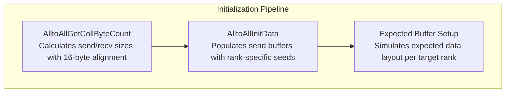
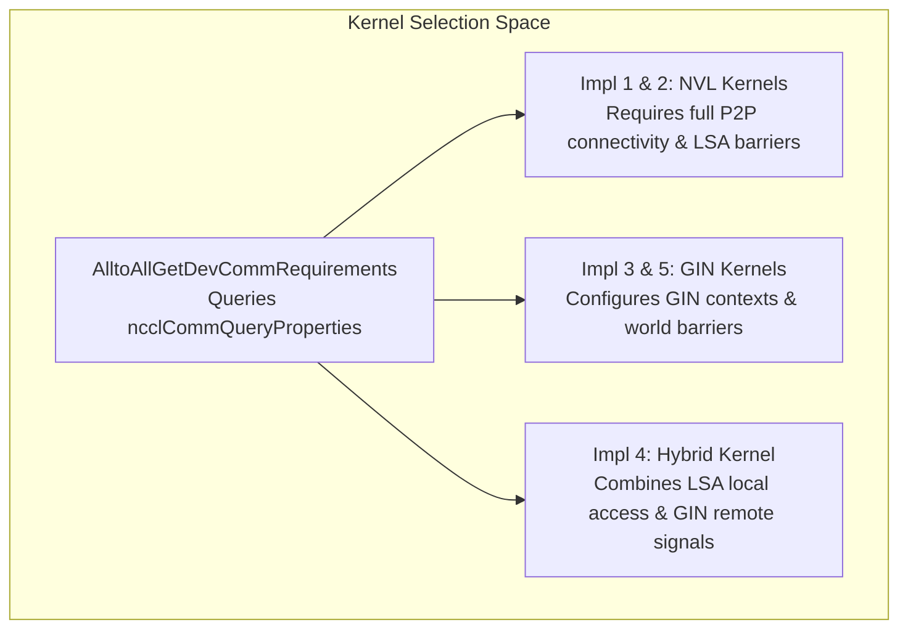

<!-- source: DeepWiki mcp.deepwiki.com · repo NVIDIA/nccl-tests · page 3.4 AllToAll · fetched 2026-11-11 -->

# AllToAll

Relevant source files

The following files were used as context for generating this wiki page:

- [src/alltoall.cu](src/alltoall.cu)

## Purpose and Scope

This page covers the `AllToAll` collective operation test implementation in the NCCL Tests framework (`src/alltoall.cu`). The AllToAll operation distributes data from all ranks to all other ranks, where each rank sends unique data to every other rank and receives unique data from every other rank. This document provides a high-level overview of the implementation, including buffer management, data initialization, bandwidth calculations, and device-side kernel variants (NVL, GIN, and hybrid strategies). 

For irregular all-to-all communication patterns, see the child page [AllToAllv](#3.4.1). For details about the core testing framework that AllToAll integrates with, see [Core Testing Framework](#2).

Sources: [src/alltoall.cu:1-45]()

---

## Buffer Management and Data Initialization

The AllToAll operation requires strict buffer sizing and structured data initialization to verify correctness across all ranks. 

The required buffer byte counts are calculated via `AlltoAllGetCollByteCount`, which ensures 16-byte alignment by masking the per-rank element count [src/alltoall.cu:17-23](). Data initialization is performed by `AlltoAllInitData`, setting up unique send patterns per rank and computing expected receive outcomes for verification [src/alltoall.cu:25-45]().

**AllToAll Initialization Pipeline**

Sources: [src/alltoall.cu:17-45]()

---

## Kernel Variants and Device Communication

Depending on the available hardware and NCCL version, the AllToAll implementation supports standard host-driven NCCL APIs as well as advanced device-side kernels (`deviceImpl` options):

1. **NVL Kernels (`NvlAlltoAllKernel`, `NvlAlltoAllKernelOptimized`)**: Utilize CUDA P2P and Load/Store Architecture (LSA) pointers for direct memory access across intra-node ranks [src/alltoall.cu:66-73]().
2. **GIN Kernels (`GinAlltoAllKernel`, `GinAlltoAllKernelMultiContext`)**: Leverage GPU-Initiated Networking (GIN) for remote peer communication [src/alltoall.cu:77-84]().
3. **Hybrid Kernel (`HybridAlltoAllKernel`)**: Combines LSA for local intra-node transfers and GIN for inter-node transfers [src/alltoall.cu:86-106]().

Device communication requirements for these kernels are queried dynamically through `AlltoAllGetDevCommRequirements`, which configures LSA barriers, GIN contexts, and signal counts [src/alltoall.cu:57-111]().

**Device Kernel Communication Requirements**

Sources: [src/alltoall.cu:57-111]()

---

## Performance Metrics

Bandwidth reporting for AllToAll is handled by `AlltoAllGetBw`, which calculates both algorithmic and bus bandwidth [src/alltoall.cu:47-53](). Because every rank communicates simultaneously with `nranks - 1` peers, the bus bandwidth factor scales by `(nranks - 1) / nranks` to reflect effective network utilization [src/alltoall.cu:51-53]().

Sources: [src/alltoall.cu:47-53]()

---

## Irregular AllToAllv Benchmark

For workloads where send and receive counts vary per rank or follow custom distribution patterns, NCCL Tests provides the `alltoallv_perf` benchmark. 

For complete details on irregular communication layouts, matrix-file modes, and environment configurations, see [AllToAllv](#3.4.1).

Sources: [src/alltoall.cu:1-570]()

---

