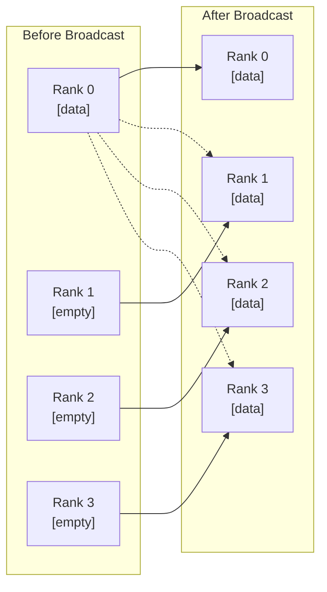
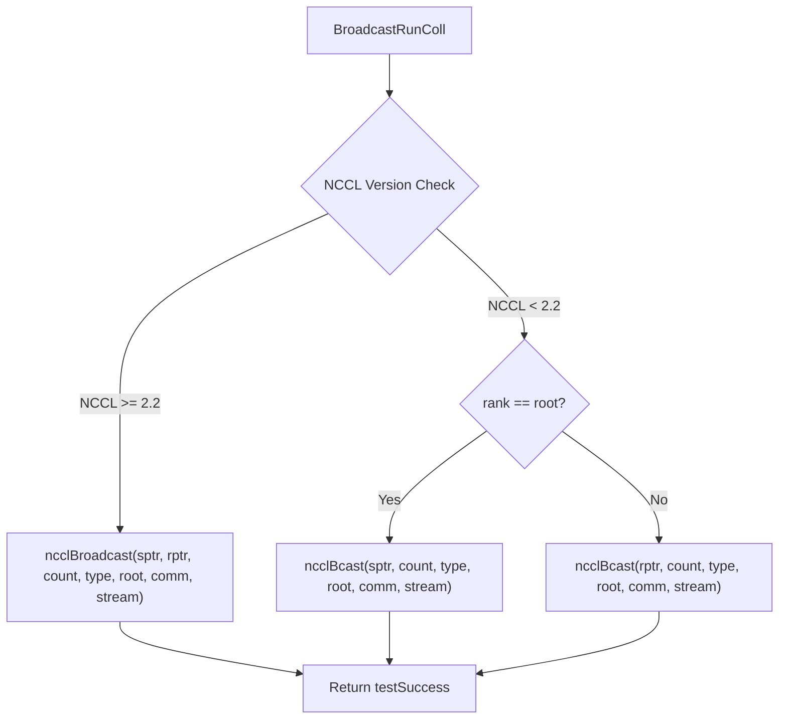
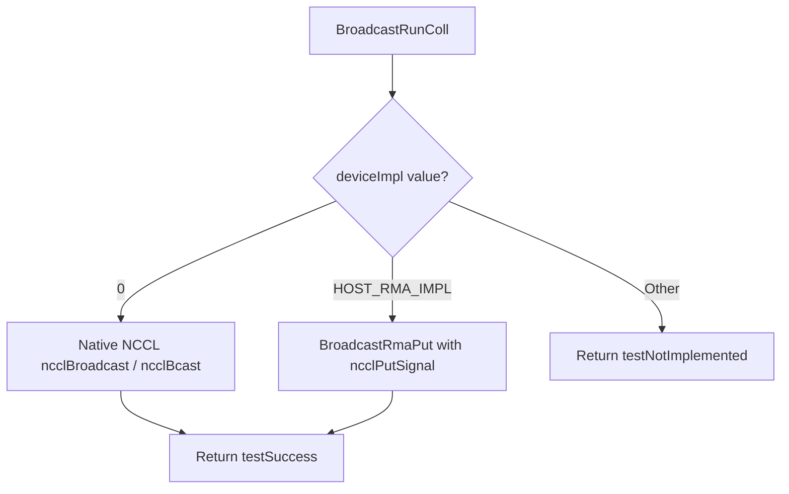
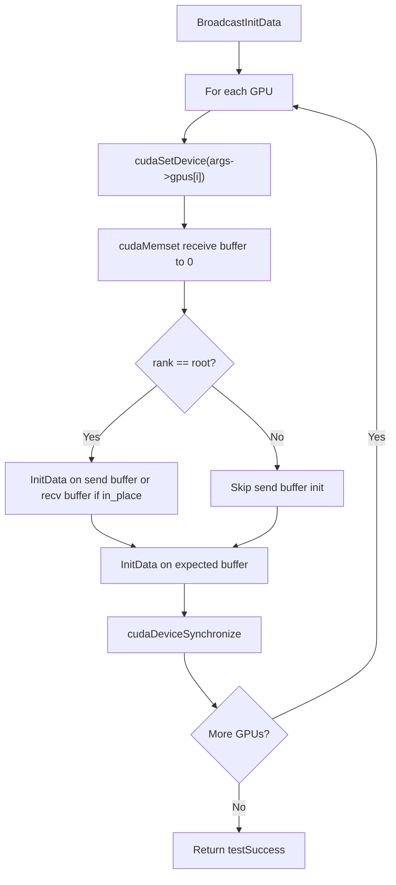
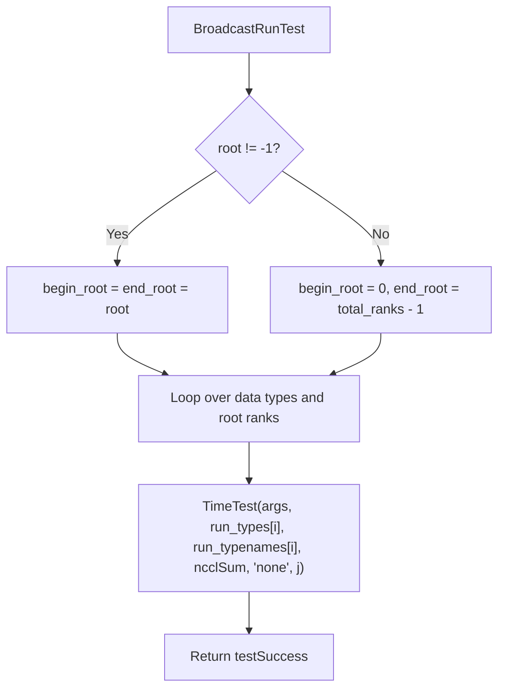

<!-- source: DeepWiki mcp.deepwiki.com · repo NVIDIA/nccl-tests · page 3.6 Broadcast · fetched 2026-11-11 -->

# Broadcast

<details>
<summary>Relevant source files</summary>

The following files were used as context for generating this wiki page:

- [src/broadcast.cu](src/broadcast.cu)

</details>


This page documents the broadcast collective operation test implementation in the NCCL Tests framework. The broadcast operation distributes data from a single root rank to all other ranks in the communicator. This implementation provides comprehensive testing and benchmarking capabilities for NCCL's broadcast functionality, including support for different NCCL API versions, root rank variations, and host RMA execution paths.

For information about other collective operations, see [Plugin Architecture](#3.1), [AllReduce](#3.2), and [AllGather](#3.3). For details about the underlying testing framework, see [Core Testing Framework](#2).

## Implementation Overview

The broadcast test implementation follows the standard `testColl` and `testEngine` interface pattern used throughout the NCCL Tests framework. The implementation is contained entirely within `src/broadcast.cu`, providing both the collective operation logic and test orchestration.

### Broadcast Operation Concept



Sources: [src/broadcast.cu:18-32]()

### Core Data Structures

The broadcast implementation defines structures that integrate with the framework via `struct testColl broadcastTest` and `struct testEngine ncclTestEngine`:

| Structure | Purpose | Key Functions / Symbols |
|-----------|---------|-------------------------|
| `broadcastTest` | Implements `testColl` interface [src/broadcast.cu:100-106]() | `BroadcastGetCollByteCount`, `BroadcastInitData`, `BroadcastGetBw`, `BroadcastRunColl` [src/broadcast.cu:10-40](), [src/broadcast.cu:74-98]() |
| `ncclTestEngine` | Implements `testEngine` interface (weak symbol) [src/broadcast.cu:145-148]() | `BroadcastGetBuffSize`, `BroadcastRunTest` [src/broadcast.cu:108-143]() |

Sources: [src/broadcast.cu:100-106](), [src/broadcast.cu:145-148]()

## NCCL API Integration

The broadcast implementation handles different NCCL API versions through conditional compilation, ensuring compatibility across NCCL releases.

### API Version Handling



The implementation uses preprocessor directives to select the appropriate NCCL API:
- **NCCL 2.2+**: Uses `ncclBroadcast` with separate send and receive pointers [src/broadcast.cu:81-83]()
- **NCCL < 2.2**: Uses `ncclBcast` with different buffer selection based on rank [src/broadcast.cu:83-89]()

Sources: [src/broadcast.cu:74-98]()

### Device Implementation and RMA Support

The broadcast implementation supports native NCCL execution (`deviceImpl == 0`) as well as a Host RMA execution path (`deviceImpl == HOST_RMA_IMPL`) when compiled against NCCL version 2.29.0 or later [src/broadcast.cu:75-97](). 

When `deviceImpl == HOST_RMA_IMPL`, `BroadcastRmaPut` is invoked, which utilizes `ncclPutSignal` and `ncclWaitSignal` over user-registered windows [src/broadcast.cu:42-71]().



Sources: [src/broadcast.cu:42-98]()

## Data Initialization and Verification

### Buffer Management

The `BroadcastGetCollByteCount` function calculates buffer sizes for the operation [src/broadcast.cu:10-16]():

| Parameter | Value | Description |
|-----------|-------|-------------|
| `sendcount` | `count` | Number of elements to send [src/broadcast.cu:11]() |
| `recvcount` | `count` | Number of elements to receive [src/broadcast.cu:12]() |
| `sendInplaceOffset` | `0` | No offset for in-place operations [src/broadcast.cu:13]() |
| `recvInplaceOffset` | `0` | No offset for in-place operations [src/broadcast.cu:14]() |

Sources: [src/broadcast.cu:10-16]()

### Data Initialization Strategy



The initialization process ensures that:
- Only the root rank initializes its send buffer (or receive buffer if `in_place` is true) [src/broadcast.cu:26-27]()
- All receive buffers are initialized to zero via `cudaMemset` [src/broadcast.cu:25]()
- Expected results are initialized per GPU for validation [src/broadcast.cu:28]()

Sources: [src/broadcast.cu:18-32]()

## Test Execution Flow

### Root Rank Iteration

The broadcast test supports testing with specified root ranks or iterating through all ranks in the communicator [src/broadcast.cu:130-135]():



Sources: [src/broadcast.cu:113-143]()

### Integration with Framework

The test execution integrates with the common framework through `BroadcastRunTest`, setting `args->collTest = &broadcastTest` and delegating benchmark timing to `TimeTest` [src/broadcast.cu:114](), [src/broadcast.cu:139]().

Sources: [src/broadcast.cu:113-143]()

## Performance Measurement

### Bandwidth Calculation

The `BroadcastGetBw` function calculates algorithmic and bus bandwidth metrics [src/broadcast.cu:34-40]():

```c
void BroadcastGetBw(size_t count, size_t typesize, double sec, double* algBw, double* busBw, int nranks) {
  double baseBw = (double)(count * typesize) / 1.0E9 / sec;
  *algBw = baseBw;
  double factor = 1;
  *busBw = baseBw * factor;
}
```

**Key characteristics:**
- **Algorithmic Bandwidth**: Measures data transfer rate relative to total transferred data [src/broadcast.cu:35-37]()
- **Bus Bandwidth**: Set equal to algorithmic bandwidth (`factor = 1`) [src/broadcast.cu:38-39]()

Sources: [src/broadcast.cu:34-40]()

### Performance Considerations

Broadcast performance depends on NCCL's internal broadcast algorithms, network topology, and synchronization overhead [src/broadcast.cu:74-98](). When running with Host RMA (`deviceImpl = HOST_RMA_IMPL`), performance is governed by `ncclPutSignal` operations [src/broadcast.cu:42-71]().

Sources: [src/broadcast.cu:42-71](), [src/broadcast.cu:74-98]()

---

