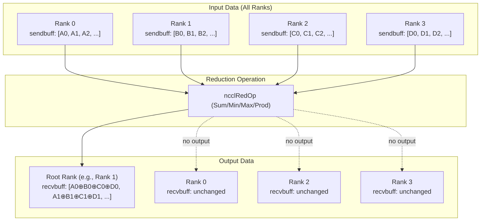
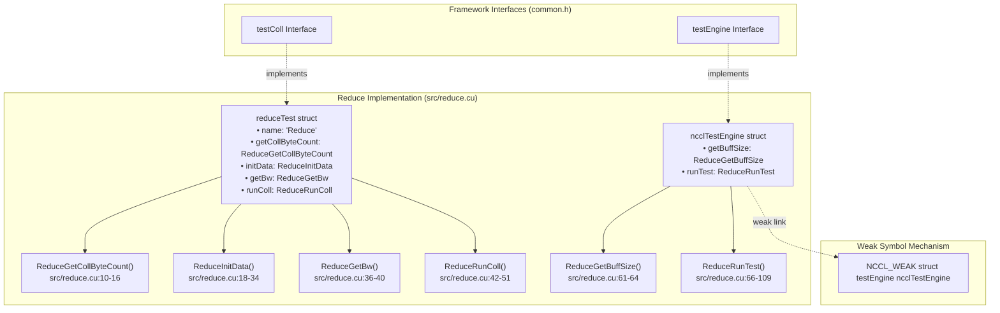
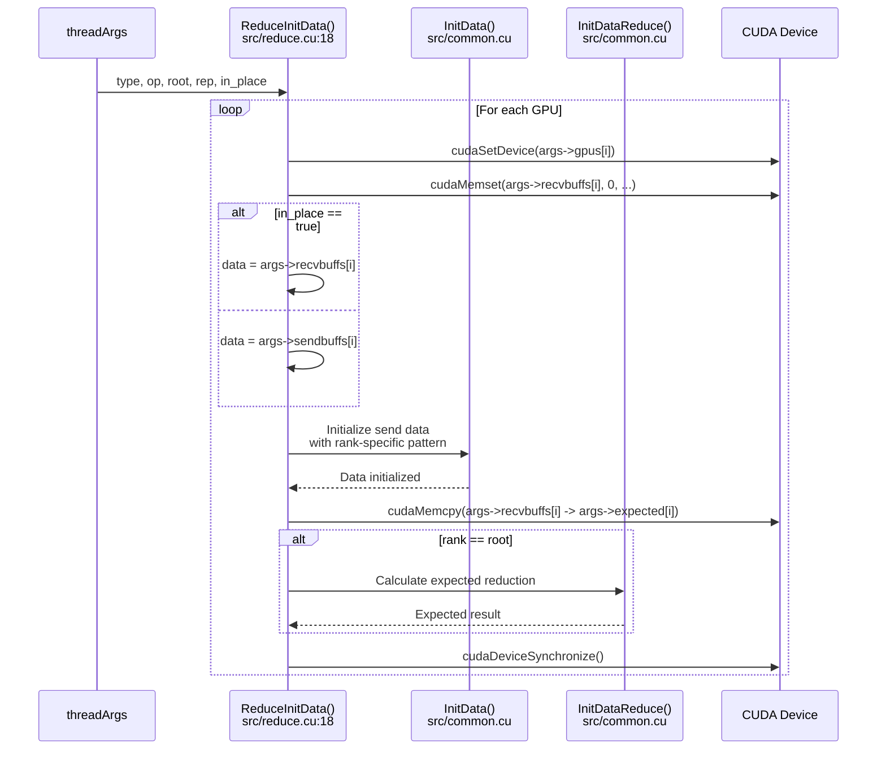
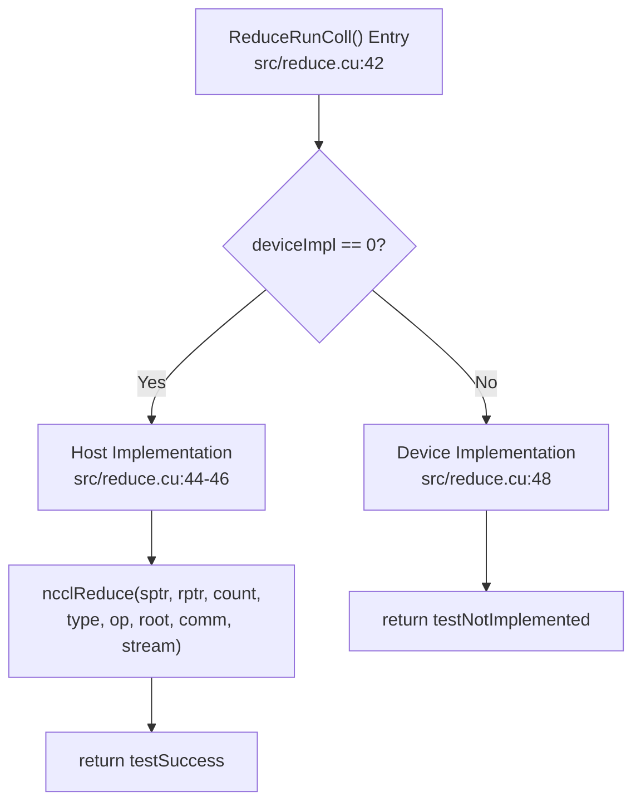
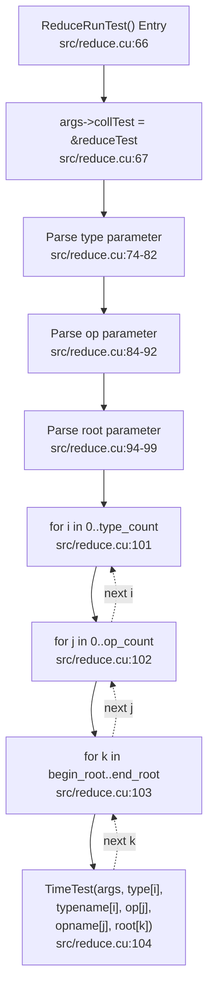
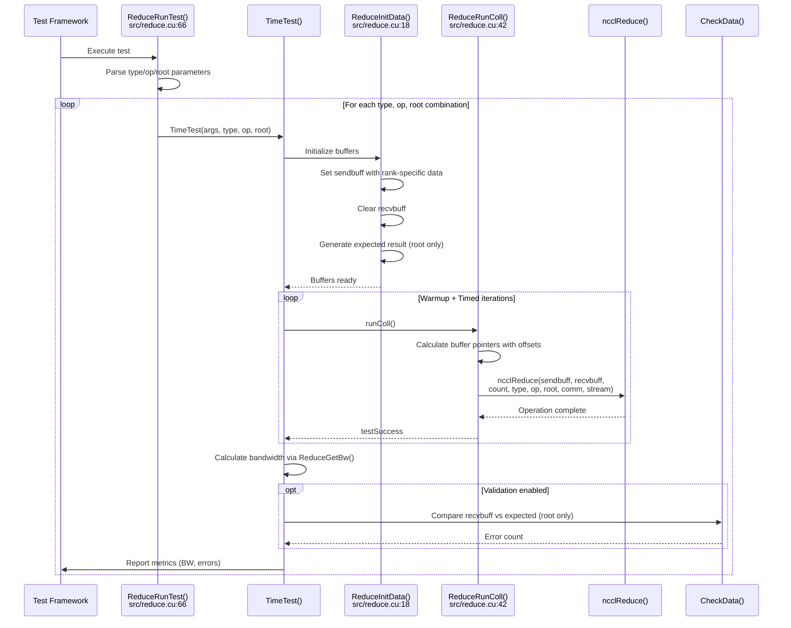
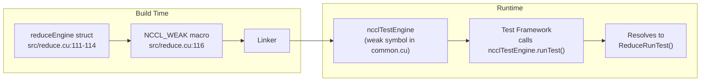

<!-- source: DeepWiki mcp.deepwiki.com · repo NVIDIA/nccl-tests · page 3.7 Reduce · fetched 2026-11-11 -->

# Reduce

<details>
<summary>Relevant source files</summary>

The following files were used as context for generating this wiki page:

- [src/reduce.cu](src/reduce.cu)

</details>


## Purpose and Scope

This document covers the Reduce collective operation implementation in the NCCL tests framework (`src/reduce.cu`). Reduce aggregates data from all participating ranks to a single root rank, applying a reduction operation (sum, product, min, max, etc.) across corresponding elements.

For information about the core testing framework that orchestrates all collective operations, see [Core Testing Framework](#2). For details on other collective operations, see [AllReduce](#3.2), [Broadcast](#3.6), or [ReduceScatter](#3.5). For the plugin architecture that enables Reduce to integrate with the framework, see [Plugin Architecture](#3.1).

Sources: [src/reduce.cu:1-114](), [src/common.h:91-119]()

---

## Operation Semantics

The Reduce collective operation performs element-wise reduction across all ranks, storing the final result only on the designated root rank. Unlike AllReduce (see [AllReduce](#3.2)) which broadcasts the result to all ranks, Reduce concentrates the output on a single rank.

### Communication Pattern



Sources: [src/reduce.cu:42-51]()

---

## Implementation Architecture

The Reduce implementation follows the framework's plugin architecture by providing implementations of both the `testColl` and `testEngine` interfaces [src/reduce.cu:53-59](), [src/reduce.cu:111-114]().

### Plugin Structure



Sources: [src/reduce.cu:10-114](), [src/common.h:91-119]()

---

## Function Reference

### Buffer Size Calculation

#### ReduceGetCollByteCount

Located at [src/reduce.cu:10-16](), this function calculates buffer requirements for the Reduce operation.

**Function Signature:**
```c
void ReduceGetCollByteCount(size_t *sendcount, size_t *recvcount, size_t *paramcount, size_t *sendInplaceOffset, size_t *recvInplaceOffset, size_t count, size_t eltSize, int nranks)
```

**Behavior:**

| Parameter | Value | Rationale |
|-----------|-------|-----------|
| `sendcount` | `count` | All ranks send full data [src/reduce.cu:11]() |
| `recvcount` | `count` | Root receives full reduced result [src/reduce.cu:12]() |
| `sendInplaceOffset` | `0` | No offset for in-place operation [src/reduce.cu:13]() |
| `recvInplaceOffset` | `0` | No offset for in-place operation [src/reduce.cu:14]() |
| `paramcount` | `count` | NCCL API parameter [src/reduce.cu:15]() |

Unlike AlltoAll or ReduceScatter, Reduce has uniform buffer sizes since all ranks send the same amount and the root receives a result of equal size.

Sources: [src/reduce.cu:10-16]()

---

### Data Initialization

#### ReduceInitData

Located at [src/reduce.cu:18-34](), this function initializes test data with deterministic patterns suitable for validation.

**Process Flow:**



**Key Details:**

- **Rank Calculation:** Determines rank using formula `((args->proc*args->nThreads + args->thread)*args->nGpus + i)` [src/reduce.cu:25]()
- **Buffer Clearing:** Clears receive buffers via `cudaMemset` before initialization [src/reduce.cu:26]()
- **In-place Selection:** Selects buffer based on `in_place` flag [src/reduce.cu:27]()
- **Pattern Initialization:** Calls `InitData()` to generate rank-specific patterns [src/reduce.cu:28]()
- **Root Validation Prep:** Only the root rank calculates expected reduction result via `InitDataReduce()` [src/reduce.cu:30]()

Sources: [src/reduce.cu:18-34]()

---

### Bandwidth Calculation

#### ReduceGetBw

Located at [src/reduce.cu:36-40](), this function calculates bandwidth metrics for Reduce operations.

**Formula:**
```c
double baseBw = (double)(count * typesize) / 1.0E9 / sec;
*algBw = baseBw;
*busBw = baseBw;
```

**Characteristics:**

| Metric | Value | Explanation |
|--------|-------|-------------|
| `algBw` | Base bandwidth | Algorithm bandwidth (data moved logically) [src/reduce.cu:38]() |
| `busBw` | Base bandwidth | Bus bandwidth (same as algorithmic for Reduce) [src/reduce.cu:39]() |

Unlike AllReduce which has a bus bandwidth factor accounting for bidirectional ring communication, Reduce has `busBw = baseBw` because data flows in one direction toward the root.

Sources: [src/reduce.cu:36-40]()

---

### Collective Execution

#### ReduceRunColl

Located at [src/reduce.cu:42-51](), this function executes the actual NCCL Reduce collective operation.

**Function Signature:**
```c
testResult_t ReduceRunColl(void* sendbuff, size_t sendoffset, void* recvbuff, size_t recvoffset, size_t count, ncclDataType_t type, ncclRedOp_t op, int root, ncclComm_t comm, cudaStream_t stream, int deviceImpl)
```

**Implementation:**



**Details:**

- Only host implementation (`deviceImpl == 0`) is currently supported [src/reduce.cu:43]()
- Calculates pointers with offsets [src/reduce.cu:44-45]()
- Invokes `ncclReduce()` from NCCL library [src/reduce.cu:46]()
- Unsupported device implementations return `testNotImplemented` [src/reduce.cu:48]()

Sources: [src/reduce.cu:42-51]()

---

### Test Orchestration

#### ReduceRunTest

Located at [src/reduce.cu:66-109](), this function orchestrates multiple test iterations across data types, reduction operations, and root ranks.

**Execution Matrix:**



**Parameter Resolution:**

| Input Value | Resolution | Lines |
|-------------|------------|-------|
| `type != -1` | Single type | [src/reduce.cu:74-77]() |
| `type == -1` | All types in `test_types[]` | [src/reduce.cu:78-82]() |
| `op != -1` | Single operation | [src/reduce.cu:84-87]() |
| `op == -1` | All operations in `test_ops[]` | [src/reduce.cu:88-92]() |
| `root != -1` | Single root rank | [src/reduce.cu:94-95]() |
| `root == -1` | All ranks (0 to `nProcs*nThreads*nGpus-1`) | [src/reduce.cu:96-98]() |

Sources: [src/reduce.cu:66-109]()

---

## Data Flow Through Test Pipeline

The following diagram illustrates how data flows through a complete Reduce test iteration, from initialization through validation.



Sources: [src/reduce.cu:18-51](), [src/reduce.cu:66-109]()

---

## Integration with Framework

### Weak Symbol Linking

The Reduce implementation uses the weak symbol mechanism to plug into the test framework without requiring framework modifications.



At link time, the `reduce_perf` binary resolves `ncclTestEngine` to `reduceEngine`, while other binaries resolve it to their respective engines.

Sources: [src/reduce.cu:111-114](), [src/common.h:119]()

---

## Comparison with Related Collectives

| Collective | Output Distribution | Buffer Sizes | Bandwidth Formula |
|------------|-------------------|--------------|-------------------|
| **Reduce** | Root rank only | Uniform across ranks | `busBw = baseBw` [src/reduce.cu:36-40]() |
| AllReduce | All ranks | Uniform across ranks | `busBw = baseBw × 2(n-1)/n` |
| ReduceScatter | Distributed chunks | `recvcount = sendcount / nranks` | `busBw = baseBw × (n-1)/n` |
| Broadcast | All ranks | Uniform across ranks | `busBw = baseBw` |

For detailed comparisons:
- AllReduce: See [AllReduce](#3.2)
- ReduceScatter: See [ReduceScatter](#3.5)
- Broadcast: See [Broadcast](#3.6)

Sources: [src/reduce.cu:36-40]()

---

## File Structure Summary

| File and Line Range | Code Entity | Purpose |
|---------------------|-------------|---------|
| [src/reduce.cu:10-16]() | `ReduceGetCollByteCount` | Buffer size calculation |
| [src/reduce.cu:18-34]() | `ReduceInitData` | Test data initialization |
| [src/reduce.cu:36-40]() | `ReduceGetBw` | Bandwidth metrics |
| [src/reduce.cu:42-51]() | `ReduceRunColl` | NCCL collective invocation |
| [src/reduce.cu:53-59]() | `reduceTest` | `testColl` interface implementation |
| [src/reduce.cu:61-64]() | `ReduceGetBuffSize` | `testEngine` buffer wrapper |
| [src/reduce.cu:66-109]() | `ReduceRunTest` | Test orchestration |
| [src/reduce.cu:111-114]() | `reduceEngine` | `testEngine` interface implementation |
| [src/reduce.cu:114]() | `NCCL_WEAK` / `ncclTestEngine` | Framework integration via weak linking |

Sources: [src/reduce.cu:1-114]()

---

