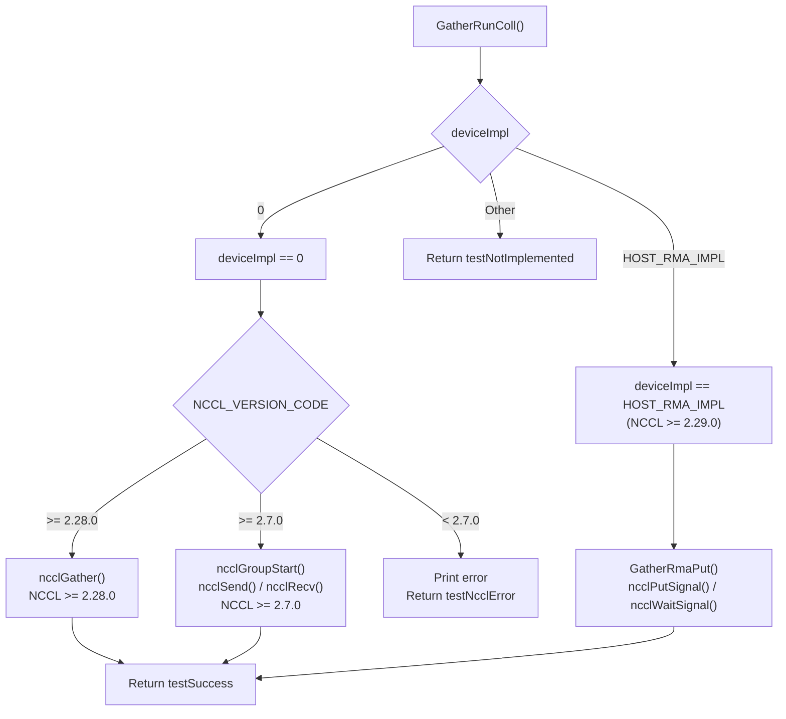
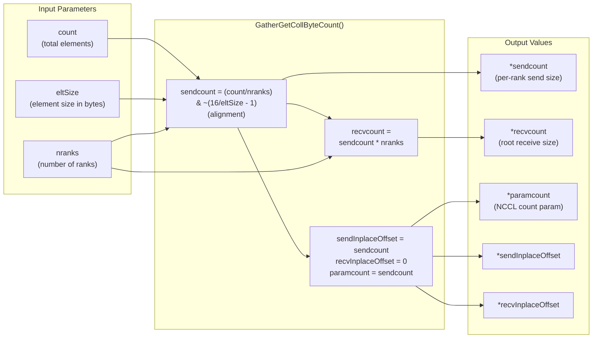
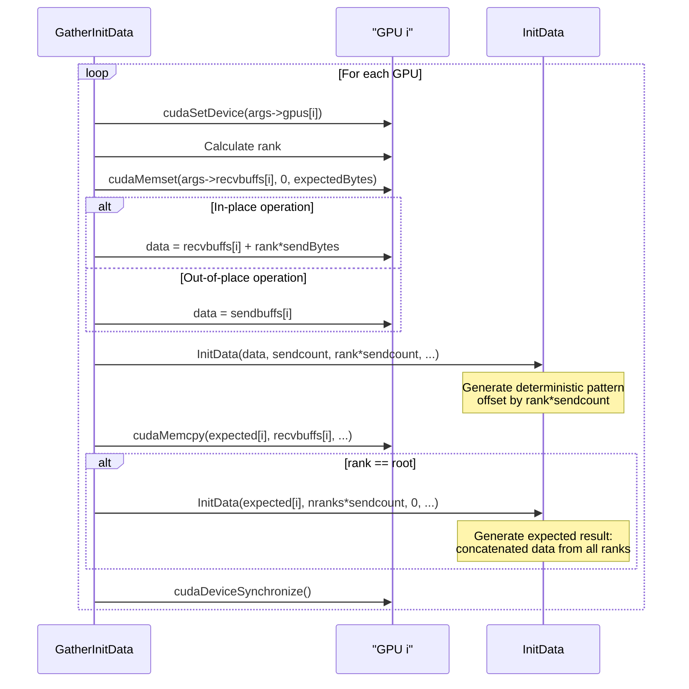
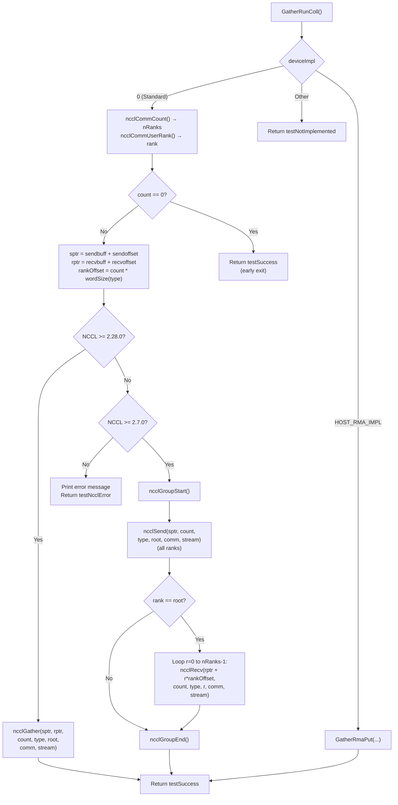
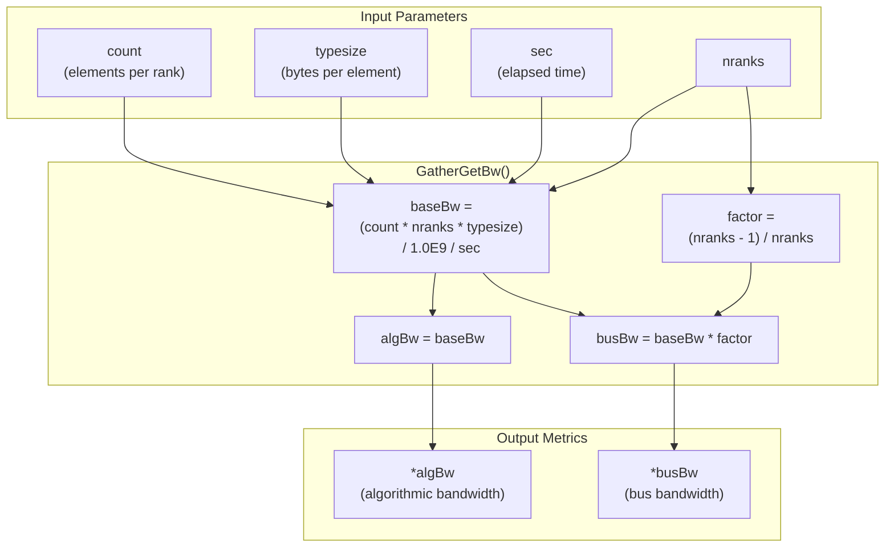
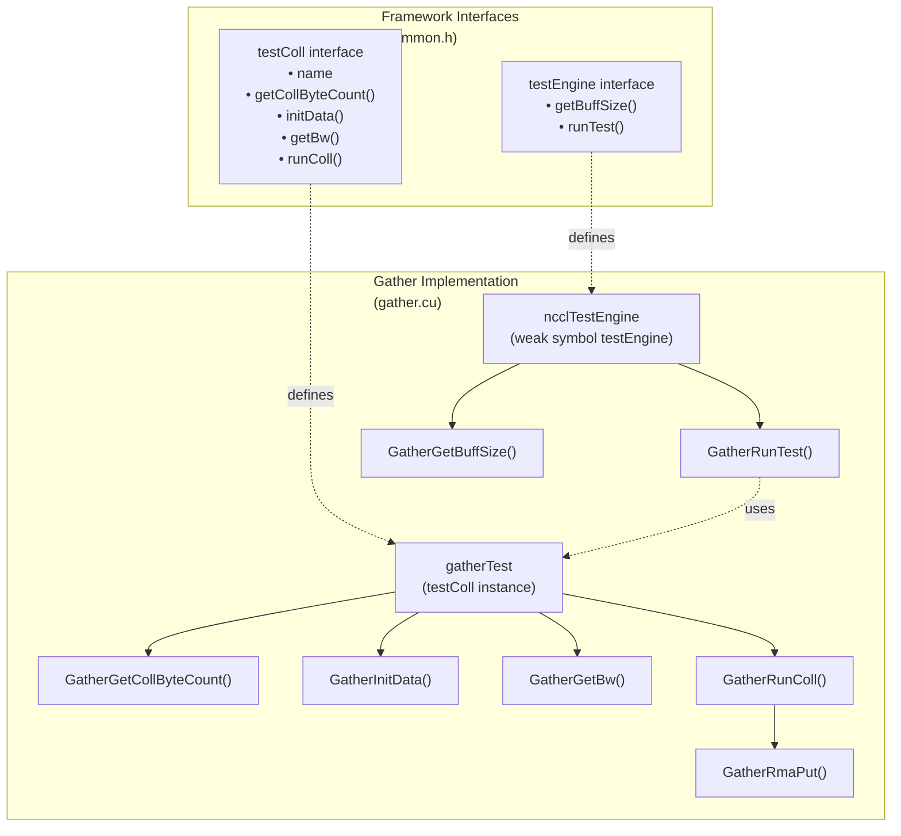

<!-- source: DeepWiki mcp.deepwiki.com · repo NVIDIA/nccl-tests · page 3.8 Gather · fetched 2026-11-11 -->

# Gather

<details>
<summary>Relevant source files</summary>

The following files were used as context for generating this wiki page:

- [src/gather.cu](src/gather.cu)

</details>


## Purpose and Scope

This document describes the **Gather** collective operation implementation in the NCCL tests suite (`src/gather.cu`). Gather is a many-to-one collective where all ranks send data to a single root rank, which receives data from all participants and arranges it in rank order. This page covers the Gather-specific implementation of the `testColl` and `testEngine` interfaces, the NCCL version compatibility layer (`ncclGather` vs manual send/recv), host RMA put support (`HOST_RMA_IMPL`), buffer management, data initialization, and bandwidth calculation.

For information about the general plugin architecture that Gather uses, see [Plugin Architecture](#3.1). For details on the core test framework that orchestrates Gather tests, see [Test Orchestration and Execution](#2.2).

Sources: [src/gather.cu:1-173](), [src/common.h:91-119]()

---

## Implementation Overview

The Gather collective is implemented in [src/gather.cu:1-173]() and follows the standard plugin pattern used by all collective operations in the test suite. Each rank sends a portion of data to a designated root rank, which receives and concatenates data from all ranks in rank order.

**Key characteristics:**
- **Operation type**: Many-to-one collective
- **Root rank**: Only the root rank receives data; other ranks only send
- **Data layout**: Root receives data in contiguous rank-order layout
- **NCCL version compatibility & execution modes**: Uses native `ncclGather` ($\ge 2.28.0$), manual grouped `ncclSend`/`ncclRecv` ($\ge 2.7.0$), or host-side RMA put (`HOST_RMA_IMPL`, $\ge 2.29.0$).

The implementation provides two main structures:
- `gatherTest` ([src/gather.cu:125-131]()): Implements the `testColl` interface for collective operations
- `ncclTestEngine` ([src/gather.cu:170-173](), weakly linked): Implements the `testEngine` interface for test orchestration

Sources: [src/gather.cu:1-173](), [src/common.h:91-119]()

---

## NCCL Version Compatibility Layer and RMA Implementation

The Gather implementation includes compatibility layers to support different NCCL versions and execution modes: the native `ncclGather` API introduced in NCCL 2.28.0, manual grouped send/recv for NCCL $\ge 2.7.0$, and host-side RMA (`ncclPutSignal`) introduced in NCCL 2.29.0 via `HOST_RMA_IMPL`.



**Version-specific and mode implementations:**

| Implementation Mode / Version | Method | Code Location |
|--------------------------------|--------|---------------|
| `deviceImpl == 0`, NCCL $\ge 2.28.0$ | Native `ncclGather` API | [src/gather.cu:100-101]() |
| `deviceImpl == 0`, NCCL 2.7.0 - 2.27.x | Manual `ncclSend`/`ncclRecv` with grouping | [src/gather.cu:102-110]() |
| `deviceImpl == 0`, NCCL $< 2.7.0$ | Not supported (error message) | [src/gather.cu:111-114]() |
| `deviceImpl == HOST_RMA_IMPL`, NCCL $\ge 2.29.0$ | `GatherRmaPut` via `ncclPutSignal`/`ncclWaitSignal` | [src/gather.cu:46-86]() |

**Host RMA Implementation Details (`GatherRmaPut`)** ([src/gather.cu:46-86]()):
- Retrieves user pointers from registered windows using `ncclWinGetUserPtr` ([src/gather.cu:58-59]()).
- Performs a grouped `ncclPutSignal` from each rank to place data directly into the root's receive window at `recvoffset + rank * chunkBytes` ([src/gather.cu:65-69]()).
- On the root rank, allocates an array of `ncclWaitSignalDesc_t` descriptors and calls `ncclWaitSignal` to block until all peer transmissions complete ([src/gather.cu:71-84]()).

Sources: [src/gather.cu:46-87](), [src/gather.cu:89-123]()

---

## Buffer Management and Byte Count Calculation

The `GatherGetCollByteCount` function calculates buffer sizes for Gather operations, ensuring proper alignment and addressing the asymmetric nature of the collective (different send and receive sizes).



**Buffer size calculation** ([src/gather.cu:10-16]()):

```c
*sendcount = (count/nranks) & ~(16/eltSize - 1);
*recvcount = (*sendcount)*nranks;
*sendInplaceOffset = *sendcount;
*recvInplaceOffset = 0;
*paramcount = *sendcount;
```

**Alignment requirements:**
- The send count is aligned to 16-byte boundaries by the bitwise AND operation with `~(16/eltSize - 1)`.
- This ensures efficient memory access patterns on the GPU.

**In-place operation offsets:**
- `sendInplaceOffset = sendcount`: Each rank's data starts at its rank-specific offset in the receive buffer.
- `recvInplaceOffset = 0`: Root's receive buffer starts at the beginning.

Sources: [src/gather.cu:10-16](), [src/gather.cu:133-136]()

---

## Data Initialization

The `GatherInitData` function prepares test data for validation, initializing buffers with deterministic patterns that allow verification of correct data placement at the root rank.



**Initialization logic** ([src/gather.cu:18-36]()):

1. **Clear receive buffers**: All receive buffers are zeroed (`cudaMemset`) ([src/gather.cu:26]()).
2. **Select data buffer**: For in-place operations, data points to `recvbuffs[i] + rank*sendBytes`; otherwise to `sendbuffs[i]` ([src/gather.cu:27]()).
3. **Generate send data**: Each rank generates unique data with offset `rank*sendcount` ([src/gather.cu:28]()).
4. **Copy expected baseline**: Copies the receive buffer state to `expected[i]` ([src/gather.cu:29]()).
5. **Generate expected result**: Only the root rank generates the expected result containing all ranks' concatenated data ([src/gather.cu:30-32]()).

Sources: [src/gather.cu:18-36]()

---

## Execution Flow

The `GatherRunColl` function executes the Gather operation based on the selected device implementation (`deviceImpl`) and NCCL version.



**Key execution steps for standard path (`deviceImpl == 0`)** ([src/gather.cu:89-114]()):
1. Query communicator rank count and user rank ([src/gather.cu:91-94]()).
2. Check for zero element count (`count == 0`) for early exit ([src/gather.cu:96]()).
3. Resolve send and receive pointers with offsets ([src/gather.cu:98-99]()).
4. Dispatch to native `ncclGather` ($\ge 2.28.0$) or grouped send/recv ($\ge 2.7.0$).

Sources: [src/gather.cu:89-123]()

---

## Bandwidth Calculation

The `GatherGetBw` function calculates bandwidth metrics for Gather operations, accounting for the asymmetric communication pattern where all ranks send to a single root.



**Bandwidth formulas** ([src/gather.cu:38-44]()):

```c
double baseBw = (double)(count * nranks * typesize) / 1.0E9 / sec;
*algBw = baseBw;
double factor = ((double)(nranks-1))/((double)(nranks));
*busBw = baseBw * factor;
```

**Bus bandwidth factor:**
- The factor `(nranks - 1) / nranks` accounts for the root rank not transmitting over the network to itself.
- Only `nranks - 1` ranks send data across network links.

Sources: [src/gather.cu:38-44]()

---

## Integration with Test Framework

The Gather implementation integrates with the core test framework through `gatherTest` ([src/gather.cu:125-131]()) and the weakly-linked `ncclTestEngine` ([src/gather.cu:170-173]()).



**Structures and weak linking** ([src/gather.cu:125-131](), [src/gather.cu:170-173]()):
- `gatherTest`: Defines collective callbacks (`GatherGetCollByteCount`, `GatherInitData`, `GatherGetBw`, `GatherRunColl`).
- `ncclTestEngine`: Declared with `NCCL_WEAK`, defining `GatherGetBuffSize` and `GatherRunTest`. This allows individual collective binaries (e.g., `gather_perf`) to bind their test engine cleanly at link time.

Sources: [src/gather.cu:125-173](), [src/common.h:91-119]()

---

## Summary

The Gather collective implementation demonstrates:
- **Version and Mode Compatibility**: Supports native `ncclGather` ($\ge 2.28.0$), fallback grouped send/recv ($\ge 2.7.0$), and host RMA put (`HOST_RMA_IMPL`, $\ge 2.29.0$).
- **Asymmetric Buffer Layout**: Properly sizes send vs receive buffers using `GatherGetCollByteCount` with 16-byte alignment.
- **Deterministic Validation**: Configures distinct per-rank offsets during initialization (`GatherInitData`) to verify root assembly order.
- **Accurate Bandwidth Metrics**: Discounts root self-communication via `(nranks-1)/nranks` scaling in `GatherGetBw`.

Sources: [src/gather.cu:1-173](), [src/common.h:91-119]()

---

