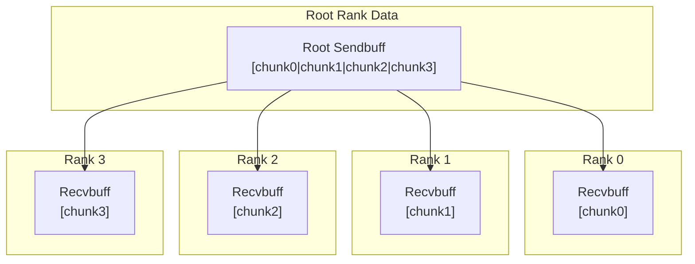
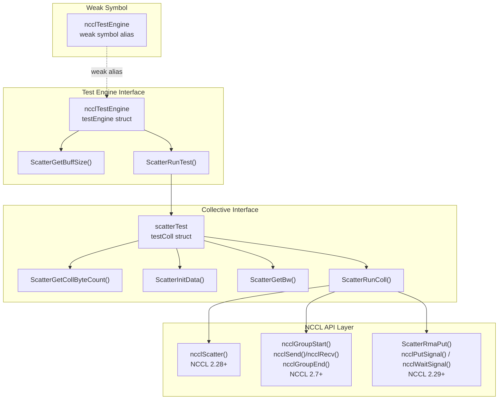
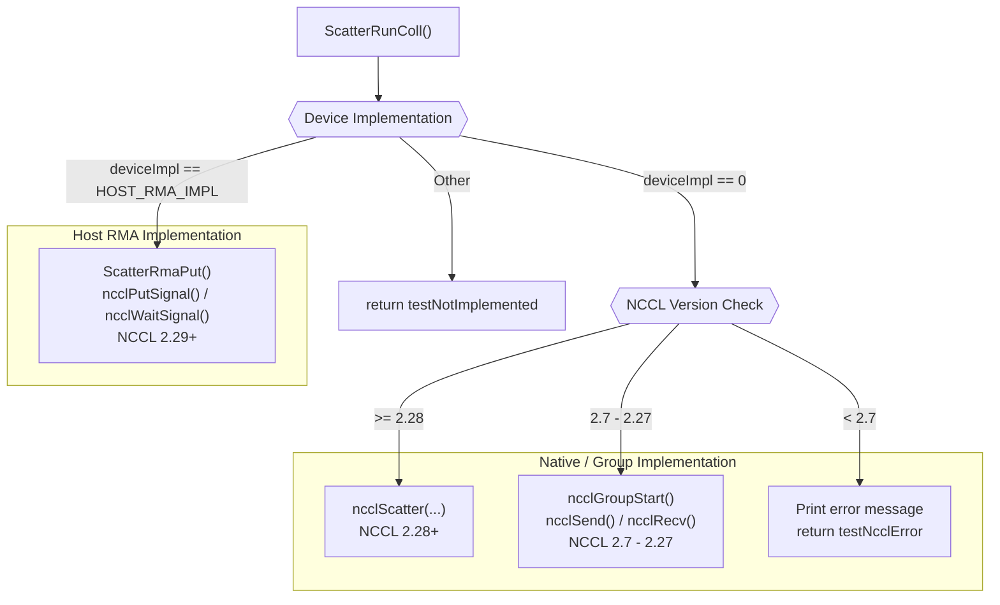

<!-- source: DeepWiki mcp.deepwiki.com · repo NVIDIA/nccl-tests · page 3.9 Scatter · fetched 2026-11-11 -->

# Scatter

<details>
<summary>Relevant source files</summary>

The following files were used as context for generating this wiki page:

- [src/scatter.cu](src/scatter.cu)

</details>


This page documents the Scatter collective operation test implementation in the NCCL Tests framework (`[src/scatter.cu]()`). The scatter operation distributes data from a root rank to all ranks in the communicator, where each rank receives a distinct portion of the data. This test validates both the correctness and performance of scatter operations across different NCCL versions, native NCCL APIs, and host RMA execution paths.

For information about other collective operations, see [Collective Operations](#3). For details about the core testing framework that executes these tests, see [Core Testing Framework](#2).

## Operation Overview

The scatter operation takes data from a single root rank and distributes it evenly across all ranks in the communicator. Each rank receives a chunk of the original data based on its rank ID and the total number of ranks.

### Scatter Data Distribution Flow



Sources: [src/scatter.cu:10-40]()

## Implementation Architecture

The scatter test follows the standard NCCL Tests collective interface pattern, implementing the `testColl` structure (`[src/scatter.cu:122-128]()`) and `testEngine` structure (`[src/scatter.cu:167-170]()`) with scatter-specific functions.

### Scatter Test Components



Sources: [src/scatter.cu:86-170]()

## Buffer Size Calculation

The scatter operation requires careful buffer size calculation to ensure proper data distribution and alignment. The `ScatterGetCollByteCount` function (`[src/scatter.cu:10-16]`) handles this calculation.

| Parameter | Calculation | Purpose |
|-----------|-------------|---------|
| `sendcount` | `(recvcount) * nranks` | Total data the root rank sends |
| `recvcount` | `(count/nranks) & -(16/eltSize)` | Data each rank receives (aligned) |
| `paramcount` | `recvcount` | Parameter passed to NCCL |
| `sendInplaceOffset` | `0` | No offset for send buffer |
| `recvInplaceOffset` | `recvcount` | Offset for in-place operations |

The alignment calculation `& -(16/eltSize)` ensures proper memory alignment for efficient data transfers.

Sources: [src/scatter.cu:10-16]()

## NCCL Version Compatibility and Execution Modes

The scatter implementation adapts to different NCCL versions with varying levels of native support, as well as supporting host-side RMA put implementations (`HOST_RMA_IMPL`) for recent NCCL releases (`[src/scatter.cu:42-120]()`).

### Version Compatibility Flow



Sources: [src/scatter.cu:42-120]()

## Data Initialization and Validation

The scatter test initializes data on the root rank and sets up expected results for validation via `ScatterInitData` (`[src/scatter.cu:18-32]()`).

### Data Initialization Process

The initialization follows this pattern:
1. **Clear receive buffers**: All ranks zero their receive buffers using `cudaMemset` (`[src/scatter.cu:25]()`).
2. **Initialize send data**: Only the root rank initializes the send buffer with test data (`[src/scatter.cu:27]()`).
3. **Set expected results**: Each rank calculates expected data based on its portion (`[src/scatter.cu:28]()`).

```c
// Root rank initialization (rank == root)
TESTCHECK(InitData(data, sendcount, 0, type, ncclSum, rep, 1, 0));

// Expected data for all ranks  
TESTCHECK(InitData(args->expected[i], recvcount, rank*recvcount, type, ncclSum, rep, 1, 0));
```

The expected data uses `rank*recvcount` as the offset to generate the appropriate data chunk that each rank should receive.

Sources: [src/scatter.cu:18-32]()

## Performance Measurement

Scatter bandwidth calculation accounts for the asymmetric nature of the operation where only the root rank sends data across the network fabric (`[src/scatter.cu:34-40]()`).

### Bandwidth Calculation

```c
double baseBw = (double)(count * nranks * typesize) / 1.0E9 / sec;
*algBw = baseBw;
double factor = ((double)(nranks-1))/((double)(nranks));
*busBw = baseBw * factor;
```

- **Algorithmic Bandwidth**: Total data transferred (`count * nranks * typesize`) divided by execution time.
- **Bus Bandwidth**: Adjusted by factor `(nranks-1)/nranks` to account for bus traffic characteristics of scatter operations.

Sources: [src/scatter.cu:34-40]()

## Test Execution Integration

The scatter test integrates with the NCCL Tests framework through standard engine and collective interfaces (`[src/scatter.cu:122-170]()`).

### Execution Flow

| Function | Role | Key Operations |
|----------|------|----------------|
| `ScatterRunTest` | Test orchestrator | Type iteration, root rank iteration, calls `TimeTest` (`[src/scatter.cu:135-165]`) |
| `TimeTest` | Framework function | Timing loops, data validation, performance reporting |
| `ScatterRunColl` | Core operation | NCCL API calls, version adaptation, RMA put dispatch (`[src/scatter.cu:86-120]`) |

The test supports:
- **Multiple data types**: Iterates through `test_types` when type is `-1` (`[src/scatter.cu:142-150]()`).
- **Multiple root ranks**: Tests all ranks as root when root is `-1` (`[src/scatter.cu:152-157]()`).

Sources: [src/scatter.cu:122-170]()

## Limitations and Constraints

The scatter test implementation carries the following constraints:
1. **NCCL Version Requirement**: Native `ncclScatter` requires NCCL 2.28 or later, while fallback manual send/recv requires NCCL 2.7 or later (`[src/scatter.cu:97-111]()`).
2. **Host RMA Limitations**: Host-side RMA via `ScatterRmaPut` requires NCCL 2.29 or later with window registration support (`[src/scatter.cu:42-84]()`).
3. **Alignment Requirements**: Buffer sizes are aligned to 16-byte boundaries based on element size (`[src/scatter.cu:11]()`).

Sources: [src/scatter.cu:10-16](), [src/scatter.cu:42-111]()

---

