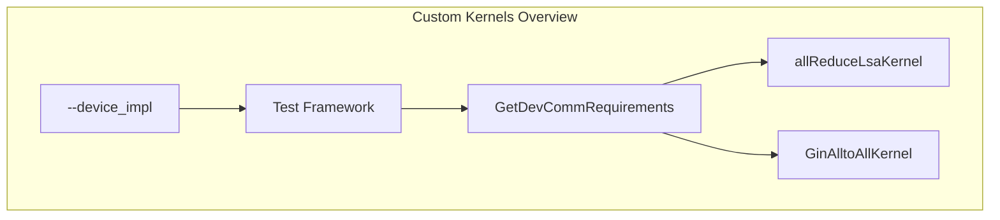
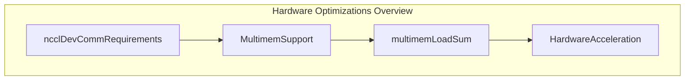
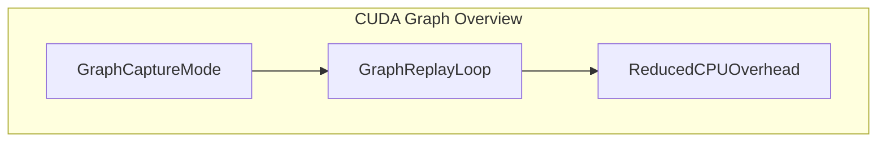
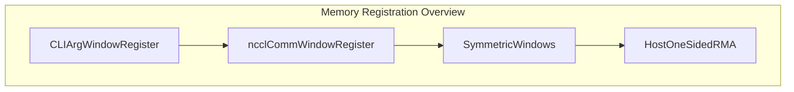

<!-- source: DeepWiki mcp.deepwiki.com · repo NVIDIA/nccl-tests · page 4 Advanced CUDA Features · fetched 2026-11-11 -->

# Advanced CUDA Features

Relevant source files

The following files were used as context for generating this wiki page:

- [src/all_reduce.cu](src/all_reduce.cu)
- [src/alltoall.cu](src/alltoall.cu)

## Purpose and Scope

The advanced CUDA features module in NCCL Tests provides specialized GPU optimizations and device-side collective execution capabilities that extend beyond standard NCCL API usage [src/all_reduce.cu:7-22](). This infrastructure enables benchmarking of high-performance custom CUDA kernels, hardware-accelerated load-store architectures, CUDA graph replay mechanisms, and host/device-side memory registration [src/alltoall.cu:55-111](), [src/all_reduce.cu:69-102](). 

As a parent page, this section offers a high-level architectural overview of these capabilities and how they relate to the core benchmarking framework. For deep technical details, implementation specifics, and code walkthroughs, please refer to the child pages linked below.

Sources: [src/all_reduce.cu:7-22](), [src/alltoall.cu:55-111]()

---

## 4.1 Custom CUDA Kernels

NCCL Tests incorporates device-side collective implementations such as LSA-based AllReduce and GIN-integrated AllToAll kernels [src/all_reduce.cu:16-22](), [src/alltoall.cu:65-110](). These kernels utilize custom dispatch mechanisms, cooperative thread arrays (`ncclCoopCta`), and explicit device communicator queries (`AllReduceGetDevCommRequirements`, `AlltoAllGetDevCommRequirements`) to configure runtime resources like LSA barriers and GIN signal counts [src/all_reduce.cu:69-89](), [src/alltoall.cu:57-75]().

For detailed documentation of device-side collective implementations, kernel dispatch mechanisms, LSA-based communication, and GIN integration, see [Custom CUDA Kernels](#4.1).

Diagram: Custom Kernels Overview Flow

Sources: [src/all_reduce.cu:16-22](), [src/alltoall.cu:57-111]()

---

## 4.2 Hardware Optimizations

Hardware-accelerated features target modern GPU architectures (such as `sm_90+`) to maximize throughput and reduce synchronization overhead [src/all_reduce.cu:20-21](), [src/all_reduce.cu:90-98](). Key mechanisms include multimem operations (`lsaMultimem`), architectural barriers, and vectorized load/store pipelines (`allReduceMultimemVectorizedKernel`) that optimize memory controllers and minimize instruction counts [src/all_reduce.cu:90-98](), [src/all_reduce.cu:338-441]().

For documentation of hardware-specific optimizations including multimem operations, LSA barriers, vectorized loads/stores, and architecture-specific features, see [Hardware Optimizations](#4.2).

Diagram: Hardware Optimizations Flow

Sources: [src/all_reduce.cu:20-21](), [src/all_reduce.cu:90-98]()

---

## 4.3 CUDA Graph Support

To reduce CPU launch overhead and kernel dispatch latency during repeated benchmark iterations, NCCL Tests integrates CUDA graph capture and replay mechanisms [src/all_reduce.cu:1-589](). By capturing collective execution into static CUDA graphs, the framework eliminates host-side runtime overhead, allowing for precise measurement of pure collective communication performance.

For an explanation of CUDA graph capture and replay for reducing CPU overhead in repeated collective operations, see [CUDA Graph Support](#4.3).

Diagram: CUDA Graph Overview Flow

Sources: [src/all_reduce.cu:1-589]()

---

## 4.4 Memory Registration and Host RMA

Advanced memory handling capabilities include local vs symmetric window registration (`-R`), `ncclCommWindowRegister` integration, and host one-sided Remote Memory Access (`-H`) execution paths [src/alltoall.cu:143-153](). These mechanisms establish high-speed direct memory windows across ranks, enabling advanced device-initiated communication patterns.

For local vs symmetric window registration (`-R`), `ncclCommWindowRegister`, and host one-sided RMA (`-H`) execution paths, see [Memory Registration and Host RMA](#4.4).

Diagram: Memory Registration Flow

Sources: [src/alltoall.cu:143-153]()

---

