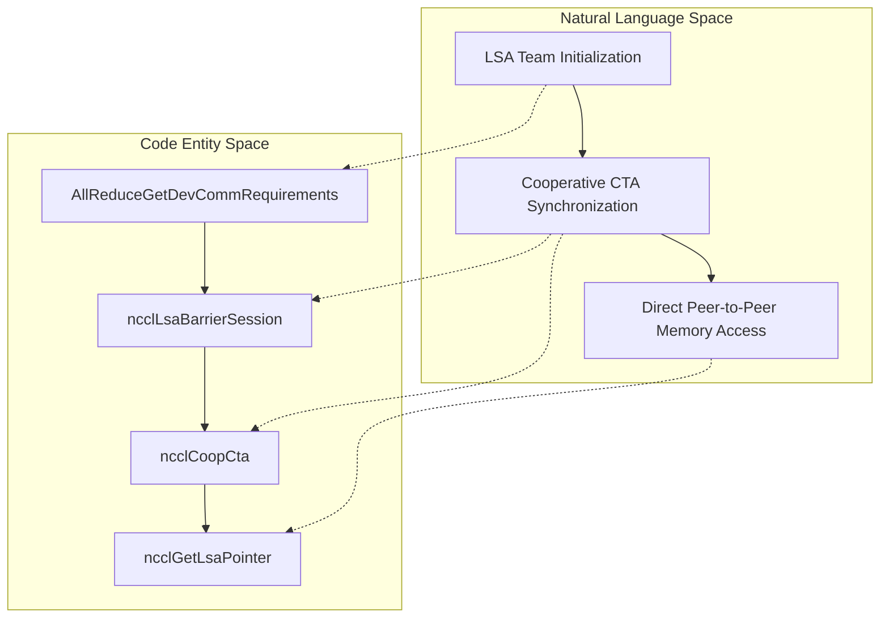
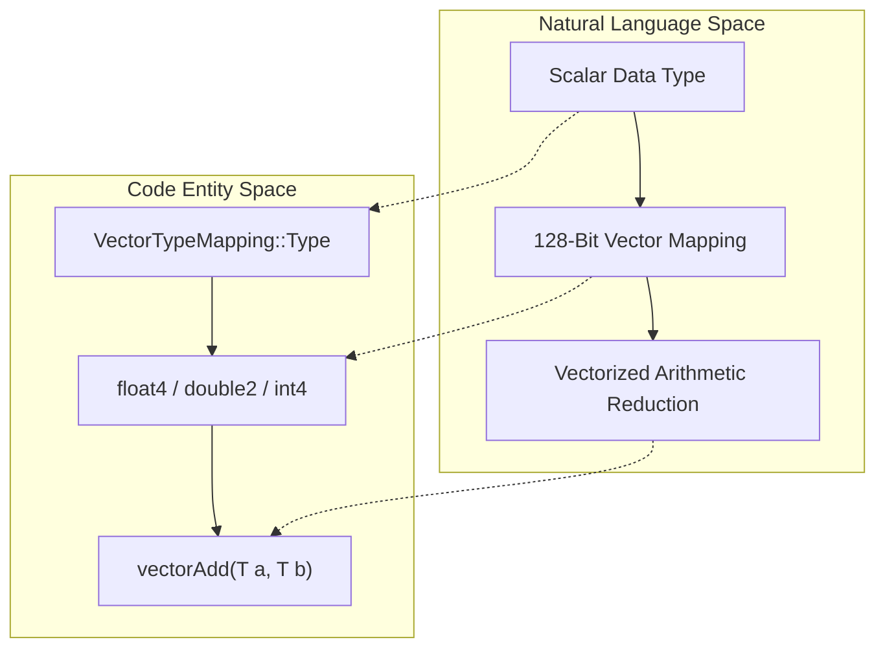

<!-- source: DeepWiki mcp.deepwiki.com · repo NVIDIA/nccl-tests · page 4.2 Hardware Optimizations · fetched 2026-11-11 -->

# Hardware Optimizations

Relevant source files

The following files were used as context for generating this wiki page:

- [src/all_reduce.cu](src/all_reduce.cu)
- [src/multimem_ops.h](src/multimem_ops.h)
- [src/vector_types.h](src/vector_types.h)

## Purpose and Scope
This page documents the architecture-specific hardware optimizations implemented in the `nccl-tests` suite (specifically within custom device-side kernels and infrastructure helpers). These optimizations leverage advanced NVIDIA GPU architectural features—such as Load-Store Accessible (LSA) peer-to-peer memory windows, cooperative thread array (CTA) synchronization, PTX-level multimem instructions, and 128-bit vectorized loads and stores—to maximize memory bandwidth and lower synchronization overhead during collective execution.

Sources: `src/all_reduce.cu:7-22`, `src/multimem_ops.h:13-16`, `src/vector_types.h:12-15`

---

## 1. Load-Store Accessible (LSA) Barriers and P2P Architecture
Custom device kernels in `nccl-tests` rely on CUDA peer-to-peer (P2P) connectivity to directly read and write remote GPU buffers through LSA windows without host intervention. Synchronization across ranks within an LSA team utilizes `ncclLsaBarrierSession` combined with cooperative thread arrays (`ncclCoopCta`) [src/all_reduce.cu:147-148]().

The LSA barrier implementation bypasses global synchronization bottlenecks by executing lightweight peer-visible atomic updates and flag checks mapped directly into the device communicator layout (`devComm.lsaBarrier`) [src/all_reduce.cu:147]().

*Title: LSA Barrier and Peer-to-Peer Communication Flow*

Sources: `src/all_reduce.cu:69-102`, `src/all_reduce.cu:145-161`

---

## 2. Multimem Hardware Acceleration
On Hopper architectures and later (`__CUDA_ARCH__ >= 900`), hardware-accelerated multicast/multimem operations allow a single load or store instruction to simultaneously access and reduce data across multiple peer memory addresses [src/multimem_ops.h:25-26]().

### PTX Wrappers in `multimem_ops.h`
The codebase abstracts raw PTX assembly instructions into typed C++ device inline functions [src/multimem_ops.h:13-16]():
* `multimemLoadSum`: Uses `multimem.ld_reduce.global.add` to perform reduction loads on `double`, `float`, `float2`, and `float4` types [src/multimem_ops.h:27-63]().
* `multimemStore`: Uses `multimem.st.global` to execute multicast writes across peer buffers [src/multimem_ops.h:72-102]().

Sources: `src/multimem_ops.h:1-105`

---

## 3. Vectorized Loads, Stores, and Type Mapping
To saturate memory controllers and maximize bus bandwidth, the framework maps scalar primitive types to the widest available vectorized types (targeting 128-bit alignment where possible) [src/vector_types.h:14-15]().

### VectorTypeMapping and Vector Math
The `VectorTypeMapping` template struct associates scalar data types with their optimal vector counterparts [src/vector_types.h:16-50]():
* `float` $\rightarrow$ `float4` [src/vector_types.h:21-24]()
* `double` $\rightarrow$ `double2` [src/vector_types.h:26-29]()
* `int32_t` $\rightarrow$ `int4` [src/vector_types.h:42-45]()
* `int8_t` $\rightarrow$ `char4` [src/vector_types.h:31-34]()

In addition, inline `vectorAdd` functions provide type-safe arithmetic operations over these vector structures [src/vector_types.h:52-87]().

*Title: Vectorized Type Mapping and Operation Hierarchy*

Sources: `src/vector_types.h:1-89`

---

## 4. Kernel Variant Dispatch and Device Communicator Requirements
Depending on hardware capabilities and the selected `deviceImpl` argument, performance tests query and configure device requirements through functions such as `AllReduceGetDevCommRequirements` [src/all_reduce.cu:69-102]().

| `deviceImpl` Index | Implementation Kernel | Required Hardware Features |
| :--- | :--- | :--- |
| `0` | NCCL Built-in (Fallback) | Standard NCCL Communicator |
| `1` | `allReduceLsaKernel` [src/all_reduce.cu:145-146]() | CUDA P2P Connectivity, LSA Barriers |
| `2` | `allReduceLsaVectorizedKernel` [src/all_reduce.cu:19-19]() | CUDA P2P Connectivity, Vector Types |
| `3` | `allReduceMultimemKernel` [src/all_reduce.cu:20-20]() | Hopper Architecture (`__CUDA_ARCH__ >= 900`), Multimem Support |
| `4` | `allReduceMultimemVectorizedKernel` [src/all_reduce.cu:21-21]() | Hopper Architecture, Multimem Support, Vector Types |

Sources: `src/all_reduce.cu:16-22`, `src/all_reduce.cu:69-121`

---

