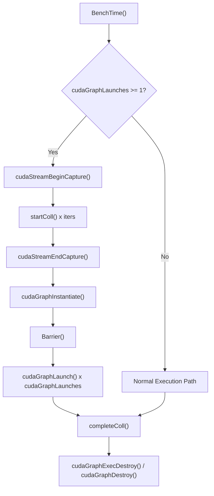
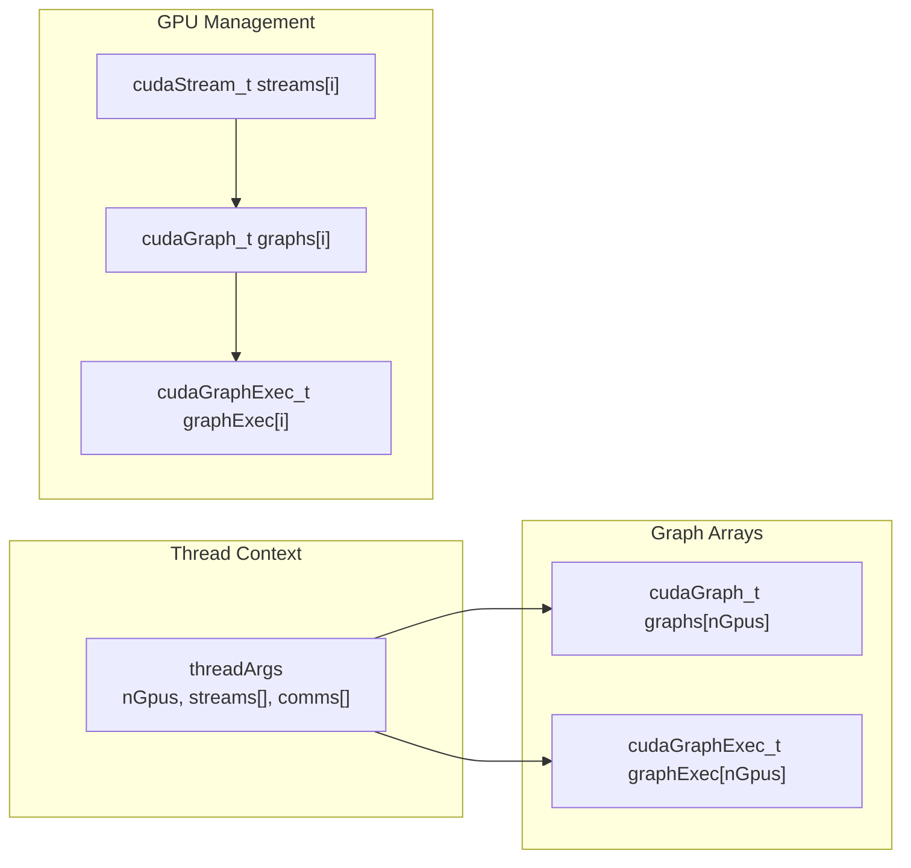
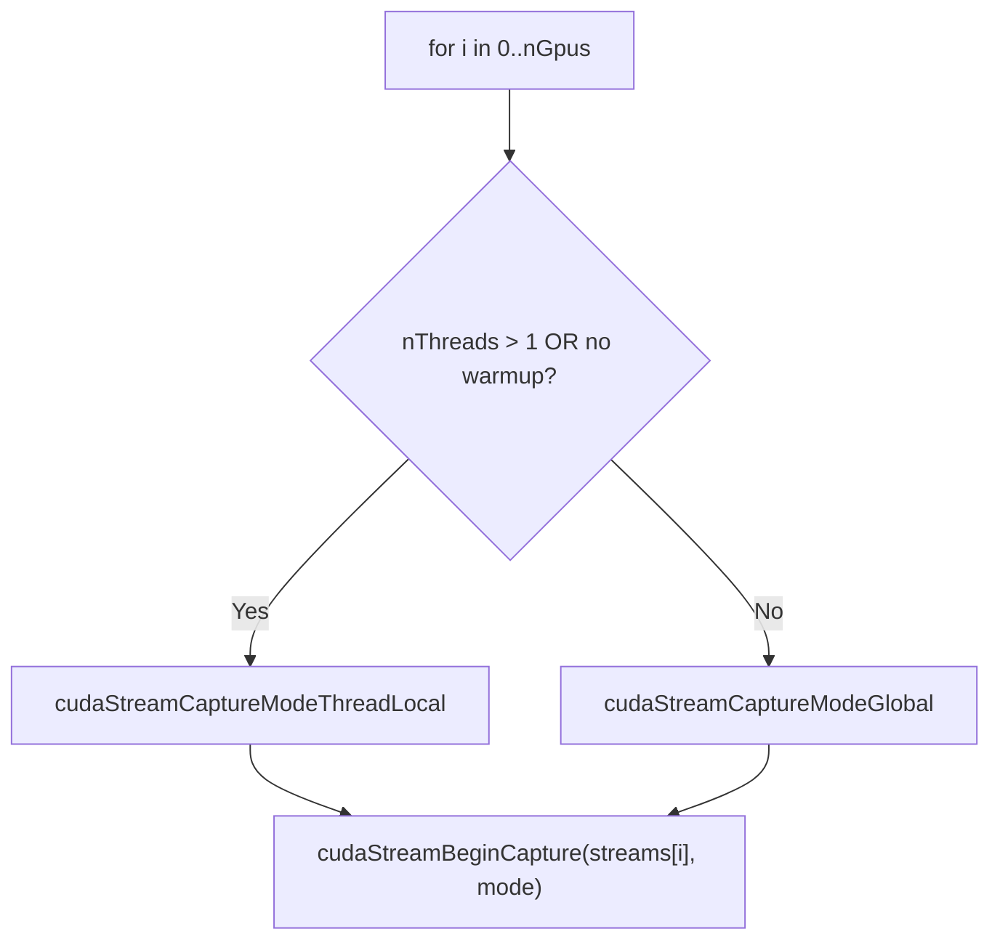
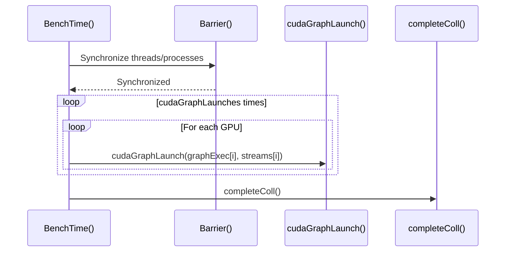

<!-- source: DeepWiki mcp.deepwiki.com · repo NVIDIA/nccl-tests · page 4.3 CUDA Graph Support · fetched 2026-11-11 -->

# CUDA Graph Support

<details>
<summary>Relevant source files</summary>

The following files were used as context for generating this wiki page:

- [src/common.cu](src/common.cu)

</details>


## Purpose and Scope

This document describes the CUDA Graph support system in NCCL Tests, which enables capturing collective operations as reusable CUDA graphs for reduced CPU overhead during repeated benchmark iterations. This feature is particularly useful for performance testing scenarios where the same collective operation pattern is executed many times.

For information about the core performance measurement system, see [Performance Measurement](#2.3). For details on the test execution pipeline, see [Test Orchestration and Execution](#2.2).

---

## Overview

CUDA Graphs allow the capture of a sequence of CUDA operations (kernel launches, memory operations) into a graph structure that can be replayed with significantly reduced CPU overhead. In NCCL Tests, this feature is managed via `cudaGraphLaunches` [src/common.cu:109]() and integrated within `BenchTime()` [src/common.cu:523]() to:

1. **Reduce CPU overhead**: Capturing NCCL collective operations eliminates per-iteration CPU overhead in performance measurements.
2. **Improve repeatability**: Graph replay ensures identical operation sequences across iterations.
3. **Enable high-frequency benchmarking**: Allows testing of scenarios where CPU overhead would otherwise dominate.

The implementation captures the main benchmark iterations as a CUDA graph using `cudaStreamBeginCapture` [src/common.cu:546](), then replays this graph multiple times via `cudaGraphLaunch` [src/common.cu:576]() to measure pure GPU-to-GPU communication performance without CPU interference.

Sources: [src/common.cu:98](), [src/common.cu:523-605]()

---

## Enabling CUDA Graph Support

### Command-Line Interface

CUDA Graph support is controlled via the `-G` or `--cudagraph` command-line argument, which parses into `cudaGraphLaunches` [src/common.cu:109]():

```bash
./build/all_reduce_perf -G <num_graph_launches> [other args]
```

| Parameter | Description | Default |
|-----------|-------------|---------|
| `-G, --cudagraph` | Number of times to replay the captured graph | 0 (disabled) |

**Example usage:**
```bash
# Capture benchmark iterations as graph, replay 100 times
./build/all_reduce_perf -b 8 -e 128M -g 8 -G 100

# Standard benchmark with 20 iterations, no graph
./build/all_reduce_perf -b 8 -e 128M -g 8 -n 20
```

Sources: [src/common.cu:109](), [src/common.cu:967-973]()

---

## Requirements and Version Support

### Build Requirements

| Requirement | Minimum Version |
|-------------|-----------------|
| CUDA Runtime | 11.3 (CUDART_VERSION >= 11030) |
| NCCL | 2.9.0 |

The feature is conditionally compiled using preprocessor directives:

```cpp
#if CUDART_VERSION >= 11030
  // CUDA graph code
#endif
```

If the minimum requirements are not met, the `-G` option is ignored with a warning message printed to stdout. Additionally, `initComms()` configures `graphUsageMode` for NCCL versions supporting it [src/common.cu:209-212]().

Sources: [src/common.cu:209-212](), [src/common.cu:536](), [src/common.cu:968-972]()

---

## Implementation Architecture

### High-Level Flow (Code Entity Space)


Sources: [src/common.cu:536-598]()

### Per-GPU Graph Management



NCCL Tests creates separate CUDA graphs for each GPU managed by a thread [src/common.cu:537-538](). Each graph captures the collective operations executed on its corresponding CUDA stream.

Sources: [src/common.cu:537-538]()

---

## Capture Phase

### Stream Capture Modes

The capture process uses **thread-local capture mode** to support multi-threaded execution and handle P2P pre-connect operations [src/common.cu:541-547]():



**Thread-local mode** is required for multi-thread scenarios and P2P pre-connect initialization where `cudaMalloc` occurs during capture.

Sources: [src/common.cu:541-547](), [src/common.cu:616]()

### Captured Operations

During capture inside `BenchTime()`, the following operations are recorded into the graph:
1. NCCL Group Operations (if `agg_iters > 1`): `ncclGroupStart()` [src/common.cu:553]()
2. Collective Calls: Multiple iterations of `startColl()` [src/common.cu:554-558]()
3. NCCL Group End (if `agg_iters > 1`): `ncclGroupEnd()` [src/common.cu:559]()

The captured sequence represents `iters × agg_iters` collective operations.

Sources: [src/common.cu:553-559]()

---

## Instantiation and Launch Phase

### Graph Instantiation

After capture completes, each graph is instantiated to create an executable graph using `cudaGraphInstantiate()` [src/common.cu:569]() and finalized via `cudaStreamEndCapture()` [src/common.cu:565]().

Sources: [src/common.cu:564-570]()

### Synchronized Launch



The launch phase synchronizes all threads, resets timers, and dispatches the graph `cudaGraphLaunches` times across all GPUs.

Sources: [src/common.cu:571-580]()

---

## Timing Adjustments

### Bandwidth Calculation

When CUDA graphs are enabled, the timing measurement is adjusted to account for multiple graph launches [src/common.cu:582-588]():

```cpp
double deltaSec = tim.elapsed();
deltaSec = deltaSec/(iters*agg_iters);
if (cudaGraphLaunches >= 1) deltaSec = deltaSec/cudaGraphLaunches;
```

**Without graphs:** Time is divided by `(iters × agg_iters)` to get per-operation time.

**With graphs:** Time is further divided by `cudaGraphLaunches` because the captured work is replayed multiple times.

Sources: [src/common.cu:582-588](), [src/common.cu:600-601]()

---

## Data Validation with CUDA Graphs

When data validation is enabled (`-c` flag), NCCL Tests captures and replays additional graphs specifically for correctness checks via `CheckData()` [src/common.cu:612-651]().

Key differences for validation graphs:
- Only a **single iteration** is captured.
- Graph is launched **once** per validation cycle.
- Graph is **destroyed after each validation** via `cudaGraphExecDestroy()` and `cudaGraphDestroy()` [src/common.cu:645-649]().

Sources: [src/common.cu:612-651]()

---

## Resource Management

### Graph Cleanup Process

Proper resource cleanup is critical to avoid memory leaks [src/common.cu:593-597](), [src/common.cu:645-649]():

```cpp
for (int i=0; i<args->nGpus; i++) {
  CUDACHECK(cudaGraphExecDestroy(graphExec[i]));
  CUDACHECK(cudaGraphDestroy(graphs[i]));
}
```

Cleanup occurs after main benchmark graph launches complete and after each data validation iteration.

Sources: [src/common.cu:593-597](), [src/common.cu:645-649]()

---

## Code Structure Summary

### Key Variables and Functions

| Entity Name | Type / Role | Location | Purpose |
|-------------|-------------|----------|---------|
| `cudaGraphLaunches` | Global Variable (`int`) | [src/common.cu:109]() | Number of graph replays (0=disabled) |
| `cudaStreamBeginCapture` | CUDA Runtime API | [src/common.cu:546]() | Begin recording operations into a graph |
| `cudaStreamEndCapture` | CUDA Runtime API | [src/common.cu:565]() | End graph capture |
| `cudaGraphInstantiate` | CUDA Runtime API | [src/common.cu:569]() | Create executable graph representation |
| `cudaGraphLaunch` | CUDA Runtime API | [src/common.cu:576]() | Execute instantiated graph |
| `cudaGraphExecDestroy` | CUDA Runtime API | [src/common.cu:594]() | Free executable graph resources |
| `cudaGraphDestroy` | CUDA Runtime API | [src/common.cu:595]() | Free graph definition resources |

Sources: [src/common.cu:109](), [src/common.cu:536-598]()

---

